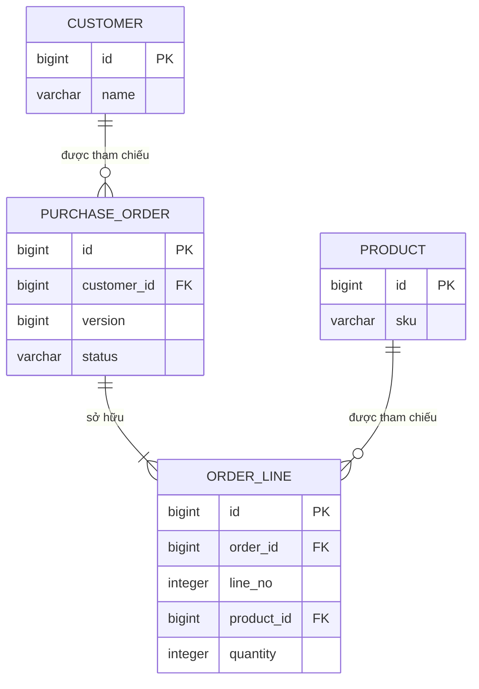

# Thiết kế DDL từ aggregate và ánh xạ collection

Trong **Spring Data Relational JDBC**, mô hình domain được tổ chức theo aggregate: một aggregate root quản lý vòng đời của các entity/value object được sở hữu bên trong nó. Khi thiết kế schema quan hệ, cần chuyển ranh giới ownership đó thành bảng, khóa chính, khóa ngoại và các cột định vị phần tử trong collection.

Các quy tắc nền tảng:

- Mỗi **aggregate root** được lưu trong một bảng có khóa chính.
- Entity con được sở hữu thường nằm trong bảng riêng và có FK trỏ về root hoặc entity cha trực tiếp.
- `@MappedCollection` khai báo cách ánh xạ collection và tên cột FK (`idColumn`), cùng cột key/index (`keyColumn`) khi collection cần định vị phần tử.
- Value object có thể được lưu ngay trong bảng root bằng `@Embedded`, hoặc thành một cột scalar qua converter nếu nó có biểu diễn lưu trữ đơn.
- Aggregate root khác được tham chiếu bằng ID/`AggregateReference`; tham chiếu đó không làm thay đổi ownership.
- Spring Data JDBC dùng schema đã có. DDL và thay đổi schema nên được quản lý bằng migration như Flyway hoặc Liquibase.

Bài này đi từ aggregate model đến DDL, giải thích cách chọn PK/FK, cách ánh xạ `List`, `Set`, `Map`, cách phân biệt collection với embedded object và cách kiểm thử schema trên database mục tiêu.

## 1. Bắt đầu từ ranh giới aggregate

Giả sử domain bán hàng có mô hình:

```text
Customer (aggregate root riêng)
  id
  name

Product (aggregate root riêng)
  id
  sku

PurchaseOrder (aggregate root)
  id
  customerId  ────────────────> Customer.id
  status
  shippingAddress (value object)
  lines
    ├── OrderLine
    └── OrderLine
```

`PurchaseOrder` sở hữu `OrderLine` và `ShippingAddress` là value object thuộc đơn hàng. `Customer` và `Product` là aggregate độc lập; đơn hàng chỉ lưu ID để tham chiếu đến chúng.

Schema tương ứng thường có các bảng:

| Bảng | Vai trò | Quan hệ |
|---|---|---|
| `customer` | Aggregate root Customer | Được PurchaseOrder tham chiếu |
| `product` | Aggregate root Product | Được OrderLine tham chiếu |
| `purchase_order` | Aggregate root PurchaseOrder | Có FK `customer_id`, chứa cột embedded address |
| `order_line` | Entity con được PurchaseOrder sở hữu | Có FK `order_id` đến `purchase_order`, FK `product_id` đến `product` |

Sơ đồ quan hệ:



Đây là bước quan trọng nhất: **DDL phải thể hiện ownership và identity của domain**, thay vì tạo một object graph Java bất kỳ rồi cố ép thành các quan hệ bảng.

## 2. Aggregate root ánh xạ thành bảng như thế nào?

Một aggregate root thường được đánh dấu bằng `@Table` và có một property `@Id`:

```java
@Table("purchase_order")
public class PurchaseOrder {

    @Id
    private Long id;

    @Version
    private Long version;

    private Long customerId;

    private String status;
}
```

DDL cần có:

- Cột `id` làm primary key.
- Cột `version` nếu dùng optimistic locking với `@Version`.
- Các cột scalar tương ứng với property root.
- FK và constraint phù hợp với các invariant cần database bảo vệ.

Ví dụ PostgreSQL:

```sql
CREATE TABLE purchase_order (
    id BIGINT GENERATED BY DEFAULT AS IDENTITY PRIMARY KEY,
    version BIGINT NOT NULL,
    customer_id BIGINT NOT NULL,
    status VARCHAR(30) NOT NULL,
    CONSTRAINT fk_purchase_order_customer
        FOREIGN KEY (customer_id) REFERENCES customer(id)
);
```

`GENERATED BY DEFAULT AS IDENTITY` là cú pháp PostgreSQL dùng trong ví dụ. MySQL, SQL Server, Oracle và các database khác có cú pháp identity/sequence khác nhau. Hãy dùng DDL của database mục tiêu.

### Tên bảng và tên cột

`@Table("purchase_order")` chỉ rõ tên bảng. `@Column("customer_id")` chỉ rõ tên cột cho property Java:

```java
@Column("customer_id")
private Long customerId;
```

Nếu không khai báo tên tường minh, Spring Data Relational dùng `NamingStrategy` để suy ra tên. Quy ước mặc định thường chuyển camelCase thành dạng snake_case, nhưng dự án nên thống nhất naming strategy và kiểm tra tên thật mà mapping tạo ra.

Khi schema được quản lý bằng migration, dùng `@Table` và `@Column` tường minh cho những tên quan trọng giúp tránh việc đổi naming strategy vô tình làm mapping lệch DDL.

## 3. Collection được sở hữu ánh xạ bằng `@MappedCollection`

Trong Spring Data JDBC, collection entity được sở hữu không được lưu bằng một cột JSON mặc định. Các phần tử được lưu trong bảng quan hệ riêng. `@MappedCollection` cho biết cột FK dùng để liên kết phần tử với owner và, khi cần, cột key để xác định vị trí/key của phần tử.

```java
@Table("purchase_order")
public class PurchaseOrder {

    @Id
    private Long id;

    @MappedCollection(idColumn = "order_id", keyColumn = "line_no")
    private List<OrderLine> lines = new ArrayList<>();
}
```

Hai thuộc tính quan trọng:

| Thuộc tính | Ý nghĩa | Ví dụ |
|---|---|---|
| `idColumn` | Cột ở bảng phần tử chứa ID của aggregate/owner | `order_id` |
| `keyColumn` | Cột lưu key/index của phần tử collection khi collection cần key | `line_no` |

Tên `idColumn` là tên cột FK ở bảng child, không phải tên property ID Java và cũng không phải tên cột PK của root. Trong ví dụ, `purchase_order.id` là PK; `order_line.order_id` là FK trỏ đến cột đó.

### Entity con

```java
@Table("order_line")
public class OrderLine {

    @Id
    private Long id;

    @Column("product_id")
    private Long productId;

    private int quantity;
}
```

DDL:

```sql
CREATE TABLE order_line (
    id BIGINT GENERATED BY DEFAULT AS IDENTITY PRIMARY KEY,
    order_id BIGINT NOT NULL,
    line_no INTEGER NOT NULL,
    product_id BIGINT NOT NULL,
    quantity INTEGER NOT NULL CHECK (quantity > 0),
    CONSTRAINT fk_order_line_order
        FOREIGN KEY (order_id) REFERENCES purchase_order(id),
    CONSTRAINT fk_order_line_product
        FOREIGN KEY (product_id) REFERENCES product(id),
    CONSTRAINT uq_order_line_position
        UNIQUE (order_id, line_no)
);
```

`order_id` liên kết child với owner. `line_no` lưu vị trí phần tử trong `List`. `UNIQUE(order_id, line_no)` ngăn hai phần tử trong cùng một đơn chiếm cùng một vị trí.

Nếu dùng một bảng child cho nhiều aggregate type hoặc naming convention khác, hãy chọn tên FK rõ ràng và tránh các cột generic khó hiểu như `parent` hoặc `owner`.

## 4. Ánh xạ `List`, `Set` và `Map`

Collection type ảnh hưởng đến cách schema lưu key/position:

| Java collection | Ý nghĩa | Cột key thường cần |
|---|---|---|
| `List<T>` | Có thứ tự và phần tử được định vị theo index | `keyColumn` để lưu index/vị trí |
| `Map<K, V>` | Phần tử được định vị bằng key | `keyColumn` để lưu map key |
| `Set<T>` | Collection không cam kết thứ tự theo index | Thường không cần key column chỉ để lưu vị trí |

### `List`: lưu vị trí phần tử

```java
@MappedCollection(idColumn = "order_id", keyColumn = "line_no")
private List<OrderLine> lines = new ArrayList<>();
```

`line_no` giữ vị trí phần tử trong danh sách. Khi thêm, xóa hoặc sắp xếp lại phần tử, mapping phải có thể biểu diễn vị trí mới. DDL nên có unique constraint theo `(order_id, line_no)` để tránh vị trí trùng.

Không dùng cột `line_no` làm business identifier nếu vị trí có thể thay đổi. Nếu dòng hàng có mã nghiệp vụ ổn định, lưu thêm `line_code` hoặc dùng PK riêng cho child; `line_no` vẫn chỉ là vị trí collection.

### `Set`: không dựa vào thứ tự

```java
@MappedCollection(idColumn = "order_id")
private Set<Tag> tags = new LinkedHashSet<>();
```

Với `Set`, domain model không nên dựa vào thứ tự lưu/đọc. Nếu cần thứ tự hiển thị, dùng `List` hoặc lưu một property sort order rõ ràng. `LinkedHashSet` có thứ tự trong bộ nhớ nhưng không tự tạo một contract thứ tự bền vững trong relational mapping nếu schema không lưu key/order.

### `Map`: lưu key

```java
@MappedCollection(idColumn = "order_id", keyColumn = "attribute_name")
private Map<String, OrderAttribute> attributes = new LinkedHashMap<>();
```

Trong ví dụ, `attribute_name` lưu key của map; bảng child cần cột này và constraint duy nhất theo owner/key:

```sql
CREATE TABLE order_attribute (
    id BIGINT GENERATED BY DEFAULT AS IDENTITY PRIMARY KEY,
    order_id BIGINT NOT NULL REFERENCES purchase_order(id),
    attribute_name VARCHAR(100) NOT NULL,
    attribute_value VARCHAR(500),
    UNIQUE (order_id, attribute_name)
);
```

Tên cột `keyColumn` phải phù hợp với kiểu key mà ứng dụng dùng và schema thực tế. Nếu map key là enum hoặc custom value type, kiểm tra store conversion và kiểu cột tương ứng.

## 5. Collection lồng nhau tạo FK theo từng cấp owner

Một aggregate có thể có nhiều cấp entity được sở hữu:

```text
PurchaseOrder
  └── OrderLine
        └── LineNote
```

Mỗi collection con cần một bảng có FK trỏ đến owner trực tiếp. Ví dụ:

```java
@Table("order_line")
public class OrderLine {

    @Id
    private Long id;

    private int quantity;

    @MappedCollection(idColumn = "order_line_id", keyColumn = "note_no")
    private List<LineNote> notes = new ArrayList<>();
}
```

DDL:

```sql
CREATE TABLE line_note (
    id BIGINT GENERATED BY DEFAULT AS IDENTITY PRIMARY KEY,
    order_line_id BIGINT NOT NULL REFERENCES order_line(id),
    note_no INTEGER NOT NULL,
    note_text VARCHAR(500) NOT NULL,
    UNIQUE (order_line_id, note_no)
);
```

`line_note.order_line_id` trỏ đến `order_line.id`, không trỏ trực tiếp đến `purchase_order.id`, vì `OrderLine` là owner của collection `notes`.

Khi vẽ DDL, hãy đi từ root xuống từng cấp và đặt FK về owner trực tiếp. Cách này thể hiện ownership rõ ràng và giúp database kiểm tra tính toàn vẹn của từng nhánh aggregate.

Collection lồng nhau làm aggregate lớn và phức tạp hơn. Nếu một child có vòng đời riêng, được nhiều aggregate tham chiếu hoặc cần cập nhật độc lập, hãy xem xét biến nó thành aggregate root riêng thay vì tiếp tục lồng thêm tầng.

## 6. Phân biệt `@MappedCollection` và `@Embedded`

Không phải object property nào cũng cần một bảng riêng. Nếu object là value object thuộc root và các field của nó có thể nằm trong cùng một hàng, dùng embedded mapping.

Ví dụ:

```java
public class ShippingAddress {

    private String street;
    private String city;
    private String postalCode;
}

@Table("purchase_order")
public class PurchaseOrder {

    @Id
    private Long id;

    @Embedded(prefix = "shipping_")
    private ShippingAddress shippingAddress;
}
```

Schema root chứa các cột:

```sql
shipping_street VARCHAR(200),
shipping_city VARCHAR(100),
shipping_postal_code VARCHAR(20)
```

`@Embedded` không tạo một bảng `shipping_address`; nó trải các property của value object thành các cột trên bảng owner. Prefix giúp tránh trùng tên với các field khác.

| Tiêu chí | `@Embedded` | `@MappedCollection` |
|---|---|---|
| Vị trí lưu | Cùng bảng với owner | Bảng riêng cho entity/value collection |
| Quan hệ | Value object thuộc root | Entity được sở hữu trong aggregate |
| Khóa ngoại | Không cần FK riêng cho embedded fields | Cần FK từ bảng child về owner |
| Cardinality | Một embedded object | Có thể là collection nhiều phần tử |
| Ví dụ | Địa chỉ giao hàng | Danh sách dòng hàng |

Nếu cần lưu một value object thành đúng một cột, custom converter domain ↔ simple store type có thể phù hợp. Nếu value object gồm nhiều thành phần cần query/index riêng, `@Embedded` thường phù hợp hơn việc serialize toàn bộ thành một chuỗi JSON không có cấu trúc.

## 7. Tham chiếu aggregate root khác bằng ID

Một aggregate không sở hữu aggregate khác. Ví dụ `PurchaseOrder` tham chiếu `Customer`, còn `OrderLine` tham chiếu `Product`. Trong domain model, có thể lưu scalar ID:

```java
@Table("purchase_order")
public class PurchaseOrder {

    @Id
    private Long id;

    @Column("customer_id")
    private Long customerId;
}
```

Hoặc dùng `AggregateReference<Customer, Long>` khi muốn biểu đạt rõ đây là reference đến aggregate root khác:

```java
private AggregateReference<Customer, Long> customer;
```

DDL vẫn là một cột FK:

```sql
customer_id BIGINT NOT NULL REFERENCES customer(id)
```

Tham chiếu này không có nghĩa Spring Data JDBC tự tải `Customer` khi tải `PurchaseOrder`, cũng không cascade save/delete sang aggregate Customer. Nếu cần thông tin Customer, application service hoặc query riêng chịu trách nhiệm lấy dữ liệu.

### Vì sao không tạo quan hệ object hai chiều?

Spring Data JDBC làm việc theo aggregate boundary và không cung cấp persistence context/lazy-loading graph như một số ORM. Tránh mô hình hóa hai aggregate độc lập bằng object references hai chiều gây vòng tham chiếu. Lưu ID giúp domain model thể hiện rõ ranh giới và transaction boundary.

### FK có nên có `ON DELETE CASCADE`?

Với FK từ `purchase_order.customer_id` đến `customer.id`, xóa Customer không nên tự động xóa lịch sử đơn hàng. Thường dùng `RESTRICT`/`NO ACTION` hoặc soft delete/anonymization theo chính sách nghiệp vụ.

Với FK từ `order_line.order_id` đến `purchase_order.id`, child thuộc vòng đời root. Spring Data JDBC quản lý xóa các entity được sở hữu trong aggregate; DDL có thể dùng FK thông thường và để framework thực hiện thứ tự delete. `ON DELETE CASCADE` chỉ nên thêm khi database cũng cần hỗ trợ các đường xóa trực tiếp khác và semantics đã được xác định rõ.

## 8. Chọn khóa chính cho root và child

### Root có generated ID

Một lựa chọn phổ biến là ID số do database sinh:

```java
@Id
private Long id;
```

DDL PostgreSQL:

```sql
id BIGINT GENERATED BY DEFAULT AS IDENTITY PRIMARY KEY
```

Database tạo ID khi insert root. Spring Data JDBC dùng ID đó để insert các bảng child có FK tương ứng.

### Root có ID do ứng dụng cấp

Ứng dụng có thể cấp UUID trước khi lưu:

```java
@Id
private UUID id;
```

DDL có thể dùng `UUID` trên PostgreSQL hoặc `CHAR(36)`/`BINARY(16)` tùy database. Kiểu Java, converter/dialect và DDL phải tương thích. ID do ứng dụng cấp có lợi khi cần tạo reference trước khi insert, nhưng phải đảm bảo uniqueness.

### Child có ID riêng và key collection

Child entity có thể có PK riêng như `order_line.id`, đồng thời có FK `order_id` và `line_no` để thể hiện vị trí trong List. Ba cột này có vai trò khác nhau:

| Cột | Vai trò |
|---|---|
| `id` | Identity của row child trong schema |
| `order_id` | Owner/aggregate root chứa child |
| `line_no` | Vị trí child trong collection của order |

Không gộp ba khái niệm vào một cột nếu chúng có semantics khác nhau. Nếu schema dùng composite key thay vì child identity riêng, cần xác nhận mapping strategy hỗ trợ chính xác cấu trúc đó trước khi triển khai.

## 9. DDL cần phản ánh `@Version`

Nếu aggregate root có optimistic locking:

```java
@Version
private Long version;
```

DDL phải có cột version tương ứng:

```sql
version BIGINT NOT NULL
```

Spring Data JDBC dùng version trong câu UPDATE để phát hiện cập nhật đồng thời. Khi insert, framework khởi tạo version theo quy tắc của mapping. Khi update, version được tăng; nếu version hiện tại không khớp, thao tác có thể ném `OptimisticLockingFailureException`.

Không thêm `@Version` vào class mà quên migration cột version. Ngược lại, nếu DDL có cột version nhưng entity không map/không dùng nó, cột đó không tự tạo optimistic locking.

## 10. Chọn kiểu SQL theo kiểu Java và database

DDL phải phù hợp với store type cuối cùng sau mapping/converter:

| Kiểu Java/domain | Kiểu SQL thường gặp | Điều cần chú ý |
|---|---|---|
| `Long` | `BIGINT` | Phạm vi giá trị và ID generation |
| `Integer` | `INTEGER` | Không dùng cho ID có thể vượt giới hạn 32-bit |
| `String` | `VARCHAR(n)` / `TEXT` | Chọn length theo contract và index requirements |
| `BigDecimal` | `NUMERIC(p,s)` / `DECIMAL(p,s)` | Precision, scale và rounding |
| `Boolean` | `BOOLEAN` hoặc kiểu tương đương | Dialect có thể dùng kiểu vật lý khác |
| `LocalDate` | `DATE` | Không chứa thời gian |
| `LocalDateTime` | `TIMESTAMP` | Không chứa offset/time zone |
| `Instant` | Timestamp type phù hợp với dialect | Xác định semantics UTC và cách driver bind |
| `UUID` | `UUID`, `CHAR(36)` hoặc `BINARY(16)` | Phụ thuộc database và driver |
| Enum | Thường `VARCHAR` qua conversion phù hợp | Tránh phụ thuộc ordinal nếu thứ tự enum có thể đổi |
| Custom value object | Store type đơn giản qua converter | DDL phải dùng kiểu của giá trị sau converter |

Đây là hướng dẫn chọn kiểu phổ biến, không phải bảng ánh xạ bắt buộc cho mọi database. Kiểm tra JDBC driver và dialect thực tế, đặc biệt với thời gian, UUID, JSON, binary và kiểu vendor-specific.

## 11. Ràng buộc toàn vẹn nên nằm trong DDL

Domain validation giúp đưa ra lỗi thân thiện, nhưng database constraints bảo vệ dữ liệu trước mọi writer — kể cả batch job, SQL thủ công hoặc service khác.

Các ràng buộc thường cần:

```sql
CREATE TABLE product (
    id BIGINT GENERATED BY DEFAULT AS IDENTITY PRIMARY KEY,
    sku VARCHAR(64) NOT NULL,
    name VARCHAR(200) NOT NULL,
    active BOOLEAN NOT NULL,
    CONSTRAINT uq_product_sku UNIQUE (sku)
);

CREATE TABLE inventory (
    product_id BIGINT PRIMARY KEY REFERENCES product(id),
    available INTEGER NOT NULL,
    CONSTRAINT ck_inventory_available CHECK (available >= 0)
);
```

Nên cân nhắc:

- `PRIMARY KEY` cho identity.
- `NOT NULL` cho field bắt buộc.
- `UNIQUE` cho business key như SKU/email nếu nghiệp vụ yêu cầu duy nhất.
- `FOREIGN KEY` cho reference giữa các bảng.
- `CHECK` cho invariant đơn giản như quantity không âm.
- Unique constraint trên owner + collection key để tránh trùng vị trí/key.

Không phải mọi invariant đều có thể diễn đạt bằng CHECK constraint. Quy tắc cần đọc nhiều bảng hoặc phụ thuộc workflow vẫn cần domain/application logic và transaction/concurrency control phù hợp.

## 12. Index theo quan hệ và query workload

FK bảo vệ tham chiếu nhưng không phải database nào cũng tự tạo index trên cột FK. Hãy xem các truy vấn thực tế để tạo index phù hợp.

Ví dụ:

```sql
CREATE INDEX idx_purchase_order_customer_created
    ON purchase_order(customer_id, created_at DESC, id);

CREATE INDEX idx_order_line_product
    ON order_line(product_id);
```

Index `(customer_id, created_at, id)` có thể hỗ trợ truy vấn danh sách đơn theo khách hàng, sắp xếp theo thời gian và ID. Unique `(order_id, line_no)` đã tạo index/constraint cho cặp owner-position trên database hỗ trợ kiểu constraint đó.

Chọn index dựa trên:

- Predicate `WHERE` thường dùng.
- Cột JOIN/FK.
- Thứ tự `ORDER BY`.
- Selectivity/cardinality của cột.
- Chi phí ghi do mỗi index phải được duy trì khi insert/update/delete.

Không tạo index cho mọi cột. Dùng `EXPLAIN`/execution plan và dữ liệu đại diện để xác nhận lợi ích.

## 13. Naming strategy và schema evolution

Spring Data Relational dùng `NamingStrategy` để suy ra tên bảng/cột từ domain metadata. Ví dụ property `createdAt` có thể ánh xạ thành `created_at`; property `customerId` có thể thành `customer_id`.

Khi thiết kế schema cho ứng dụng dài hạn:

- Chọn một quy ước tên bảng/cột nhất quán.
- Dùng `@Table`/`@Column` khi tên cần ổn định hoặc khác tên mặc định.
- Dùng `idColumn`/`keyColumn` tường minh cho collection quan trọng.
- Đặt tên FK/unique/check constraint có ý nghĩa để dễ đọc migration và lỗi database.
- Đừng đổi tên property Java rồi cho rằng migration database tự chạy.

Ví dụ nếu đổi:

```java
@Column("email_address")
private String email;
```

thành:

```java
@Column("contact_email")
private String email;
```

thì cần migration đổi tên cột hoặc thêm cột/backfill theo chiến lược tương thích. Annotation chỉ thay mapping; nó không tự rename cột trong database.

## 14. Quản lý DDL bằng migration

Spring Data JDBC tập trung vào mapping và persistence, không tự suy ra toàn bộ schema production như một ORM schema generator. Trong ứng dụng thực tế, quản lý DDL bằng migration có version để:

- Tái tạo schema trên local/test/staging/production.
- Review thay đổi schema cùng code.
- Thêm FK/index/constraint theo thứ tự rõ ràng.
- Backfill dữ liệu khi đổi mapping.
- Roll forward có kiểm soát và theo dõi lịch sử migration.

Ví dụ Flyway:

```text
src/main/resources/db/migration/
  V1__create_customer_and_product.sql
  V2__create_purchase_order.sql
  V3__create_order_line.sql
  V4__add_order_query_indexes.sql
```

Migration có thể chia theo dependency:

1. Tạo bảng root độc lập (`customer`, `product`).
2. Tạo bảng root tham chiếu (`purchase_order`) và FK đến customer.
3. Tạo bảng child (`order_line`) và FK đến order/product.
4. Tạo index/constraint bổ sung theo workload.

Với thay đổi phá vỡ tương thích, ưu tiên quy trình **expand → migrate/backfill → contract**:

- Expand: thêm cột/bảng mới, giữ code cũ vẫn hoạt động.
- Migrate: deploy code ghi/đọc tương thích và backfill dữ liệu.
- Contract: sau khi không còn dùng schema cũ, xóa cột/bảng cũ trong migration riêng.

Không sửa migration đã chạy trên môi trường dùng chung nếu công cụ migration coi chúng là immutable; tạo migration mới để thay đổi schema.

## 15. Ví dụ DDL hoàn chỉnh cho PurchaseOrder aggregate

Domain model rút gọn:

```java
@Table("purchase_order")
public class PurchaseOrder {

    @Id
    private Long id;

    @Version
    private Long version;

    @Column("customer_id")
    private Long customerId;

    private String status;

    @Embedded(prefix = "shipping_")
    private ShippingAddress shippingAddress;

    @MappedCollection(idColumn = "order_id", keyColumn = "line_no")
    private List<OrderLine> lines = new ArrayList<>();
}
```

`OrderLine` có `id`, `productId` và `quantity`; `ShippingAddress` có `street`, `city`, `postalCode`.

DDL PostgreSQL:

```sql
CREATE TABLE customer (
    id BIGINT GENERATED BY DEFAULT AS IDENTITY PRIMARY KEY,
    name VARCHAR(150) NOT NULL,
    email VARCHAR(320) NOT NULL,
    CONSTRAINT uq_customer_email UNIQUE (email)
);

CREATE TABLE product (
    id BIGINT GENERATED BY DEFAULT AS IDENTITY PRIMARY KEY,
    sku VARCHAR(64) NOT NULL,
    name VARCHAR(200) NOT NULL,
    CONSTRAINT uq_product_sku UNIQUE (sku)
);

CREATE TABLE purchase_order (
    id BIGINT GENERATED BY DEFAULT AS IDENTITY PRIMARY KEY,
    version BIGINT NOT NULL,
    customer_id BIGINT NOT NULL,
    status VARCHAR(30) NOT NULL,
    shipping_street VARCHAR(200),
    shipping_city VARCHAR(100),
    shipping_postal_code VARCHAR(20),
    CONSTRAINT fk_purchase_order_customer
        FOREIGN KEY (customer_id) REFERENCES customer(id)
);

CREATE TABLE order_line (
    id BIGINT GENERATED BY DEFAULT AS IDENTITY PRIMARY KEY,
    order_id BIGINT NOT NULL,
    line_no INTEGER NOT NULL,
    product_id BIGINT NOT NULL,
    quantity INTEGER NOT NULL,
    CONSTRAINT fk_order_line_order
        FOREIGN KEY (order_id) REFERENCES purchase_order(id),
    CONSTRAINT fk_order_line_product
        FOREIGN KEY (product_id) REFERENCES product(id),
    CONSTRAINT ck_order_line_quantity CHECK (quantity > 0),
    CONSTRAINT uq_order_line_position UNIQUE (order_id, line_no)
);

CREATE INDEX idx_purchase_order_customer_status
    ON purchase_order(customer_id, status);

CREATE INDEX idx_order_line_product
    ON order_line(product_id);
```

Các điểm cần đối chiếu giữa model và DDL:

| Domain mapping | DDL |
|---|---|
| `PurchaseOrder @Table("purchase_order")` | Bảng `purchase_order` |
| `@Id Long id` | `id BIGINT ... PRIMARY KEY` |
| `@Version Long version` | `version BIGINT NOT NULL` |
| `@Column("customer_id") Long customerId` | `customer_id BIGINT` + FK đến `customer(id)` |
| `@Embedded(prefix = "shipping_")` | `shipping_street`, `shipping_city`, `shipping_postal_code` |
| `@MappedCollection(idColumn = "order_id", keyColumn = "line_no") List<OrderLine>` | `order_line.order_id` + `order_line.line_no` |
| `OrderLine.productId` | `product_id` + FK đến `product(id)` |
| `OrderLine.quantity` | `quantity INTEGER NOT NULL CHECK (quantity > 0)` |

DDL trên là ví dụ PostgreSQL, không phải migration portable cho mọi engine. Với database khác, điều chỉnh identity, boolean/timestamp/UUID và cú pháp constraint/index theo vendor.

## 16. Kiểm thử schema và mapping

Một schema đúng cần được xác nhận bằng database thật hoặc test database tương thích với production. Có thể dùng `@DataJdbcTest` cho repository slice và Testcontainers để chạy đúng engine.

Các kiểm tra nên có:

1. **Insert aggregate mới:** root được insert, generated ID được gán và FK child dùng đúng ID.
2. **Read aggregate:** collection được dựng lại đầy đủ; List giữ đúng thứ tự thông qua key column.
3. **Update collection:** thêm/xóa/sắp xếp child phản ánh đúng bảng và unique key.
4. **Delete aggregate:** child được xóa theo mapping và FK không bị vi phạm.
5. **Embedded fields:** prefix và null/empty semantics ánh xạ đúng cột.
6. **Reference độc lập:** FK Customer/Product từ chối ID không tồn tại.
7. **Version:** update tăng version và stale update bị phát hiện.
8. **Constraints:** unique/check/FK hoạt động với các dữ liệu không hợp lệ.
9. **Indexes:** execution plan cho query thường dùng có thể tận dụng index dự kiến.

Ví dụ integration test cơ bản:

```java
@DataJdbcTest
class PurchaseOrderMappingTest {

    @Autowired PurchaseOrderRepository repository;
    @Autowired JdbcTemplate jdbcTemplate;

    @Test
    void persistsRootEmbeddedAddressAndOrderedLines() {
        Long customerId = insertCustomer();
        Long productA = insertProduct("SKU-A");
        Long productB = insertProduct("SKU-B");

        PurchaseOrder order = new PurchaseOrder(customerId, "DRAFT");
        order.setShippingAddress(
                new ShippingAddress("1 Main Street", "Hanoi", "100000")
        );
        order.addLine(productA, 2);
        order.addLine(productB, 1);

        PurchaseOrder saved = repository.save(order);

        assertThat(saved.getId()).isNotNull();

        Integer lineCount = jdbcTemplate.queryForObject(
                "SELECT COUNT(*) FROM order_line WHERE order_id = ?",
                Integer.class,
                saved.getId()
        );
        assertThat(lineCount).isEqualTo(2);

        PurchaseOrder loaded = repository.findById(saved.getId()).orElseThrow();
        assertThat(loaded.getLines()).hasSize(2);
        assertThat(loaded.getShippingAddress().getCity()).isEqualTo("Hanoi");
    }
}
```

Đoạn test minh họa; constructor, setter, helper insert và schema cần khớp domain model thực tế. Không dùng `@DataJdbcTest` với H2 để kết luận DDL PostgreSQL production chắc chắn tương thích. Chạy thêm integration test với PostgreSQL Testcontainers nếu production dùng PostgreSQL.

## 17. Những lỗi thường gặp

| Biểu hiện | Nguyên nhân có thể | Cách xử lý |
|---|---|---|
| `Table ... not found` | Thiếu migration hoặc sai `@Table` | Kiểm tra migration đã chạy và tên bảng mapping |
| `Column ... not found` | Sai `@Column`, `idColumn`, `keyColumn` hoặc naming strategy | Đối chiếu entity metadata với DDL |
| Insert child vi phạm FK | Parent chưa được insert hoặc `idColumn` trỏ sai cột | Kiểm tra ownership và FK về owner trực tiếp |
| List đọc lại sai thứ tự | Thiếu/sai key column hoặc không lưu position | Dùng `keyColumn` và DDL phù hợp cho List |
| Hai phần tử trùng vị trí | Thiếu unique constraint trên owner + key | Thêm `UNIQUE(owner_id, key_column)` |
| Map key không được lưu như mong muốn | `keyColumn` hoặc kiểu key không phù hợp | Kiểm tra mapping key và store type |
| Embedded column không tìm thấy | Prefix/cột không khớp | Đối chiếu `@Embedded(prefix)` với tên cột |
| Xóa root bị FK violation | Bảng khác còn tham chiếu hoặc child chưa được xử lý | Kiểm tra aggregate ownership, FK và delete flow |
| Stale update không được phát hiện | Thiếu `@Version` hoặc cột version | Thêm version property và migration tương ứng |
| Migration chạy local nhưng lỗi production | DDL phụ thuộc dialect hoặc phiên bản server | Test bằng cùng engine/major version với production |
| Rename property làm query/schema lỗi | Chỉ sửa Java mapping, không migration dữ liệu | Thêm migration tương thích và cập nhật mapping đồng bộ |

## 18. Quy trình thiết kế DDL từ một aggregate mới

1. **Vẽ aggregate boundary:** xác định root, owned entity, embedded value object và aggregate reference.
2. **Chọn bảng root:** một bảng cho root, PK rõ ràng, cột version nếu dùng optimistic locking.
3. **Ánh xạ owned collections:** mỗi collection entity có bảng riêng; xác định FK `idColumn` về owner trực tiếp.
4. **Chọn collection key:** `List` cần position, `Map` cần key, `Set` không nên dựa vào thứ tự.
5. **Ánh xạ value object:** chọn `@Embedded` cho nhiều cột hoặc converter cho một store value.
6. **Ánh xạ aggregate reference:** lưu ID/FK; không biến reference thành ownership.
7. **Chọn PK/FK và SQL types:** đảm bảo tương thích với Java type, converter, dialect và driver.
8. **Thêm constraints:** `NOT NULL`, `UNIQUE`, `CHECK`, FK và quy tắc delete phù hợp.
9. **Thêm index theo workload:** filter, join, sort và cardinality thực tế.
10. **Viết migration có version:** tạo bảng theo dependency và triển khai thay đổi schema an toàn.
11. **Kiểm thử round-trip:** insert/read/update/delete aggregate, collection order/key, version và constraints trên database mục tiêu.

### Bảng quyết định nhanh

| Domain model | DDL/mapping |
|---|---|
| Aggregate root | Bảng riêng + primary key |
| Owned entity trong `List` | Bảng child + FK `idColumn` + `keyColumn` lưu index |
| Owned entity trong `Map` | Bảng child + FK + `keyColumn` lưu map key |
| Owned entity trong `Set` | Bảng child + FK; không dựa vào thứ tự |
| Nested collection | Bảng ở cấp sâu hơn + FK về owner trực tiếp |
| Embedded value object | Các cột trên bảng owner, có thể dùng prefix |
| Scalar value object | Converter domain ↔ store type và một cột |
| Aggregate root khác | ID/`AggregateReference` + FK nếu cần |
| Optimistic locking | Property `@Version` + cột version trong bảng root |

**Điểm cốt lõi:** thiết kế DDL từ aggregate bằng cách giữ rõ root, ownership và reference. Root có PK; bảng collection có FK về owner trực tiếp; `List`/`Map` cần key column để lưu vị trí/key; embedded value nằm trong bảng owner; aggregate độc lập chỉ được tham chiếu bằng ID. DDL phải khớp mapping, converter, constraints và database dialect, đồng thời được quản lý bằng migration và kiểm thử trên database mục tiêu.

## Tài liệu tham khảo chính thức

- [Spring Data Relational — Object Mapping Fundamentals](https://docs.spring.io/spring-data/relational/reference/jdbc/mapping.html): aggregate root, entity mapping, naming strategy và relational mapping.
- [Spring Data Relational — Mapping Entities](https://docs.spring.io/spring-data/relational/reference/jdbc/mapping.html): `@Table`, `@Column`, `@Id`, `@Version`, `@MappedCollection` và embedded objects.
- [Spring Data Relational — `MappedCollection` API](https://docs.spring.io/spring-data/relational/reference/api/java/org/springframework/data/relational/core/mapping/MappedCollection.html): `idColumn` và `keyColumn`.
- [Spring Data Relational — `Embedded` API](https://docs.spring.io/spring-data/relational/reference/api/java/org/springframework/data/relational/core/mapping/Embedded.html): prefix và empty behavior của embedded value objects.
- [Spring Data Relational — `AggregateReference` API](https://docs.spring.io/spring-data/relational/reference/api/java/org/springframework/data/relational/core/mapping/AggregateReference.html): tham chiếu đến aggregate root khác.
- [Spring Data JDBC — Optimistic Locking](https://docs.spring.io/spring-data/relational/reference/jdbc/mapping.html): version property và xử lý cập nhật đồng thời.
- [PostgreSQL — Data Definition](https://www.postgresql.org/docs/current/ddl.html): bảng, primary key, foreign key, unique/check constraints và index.
- [Flyway — Versioned Migrations](https://documentation.red-gate.com/flyway/flyway-concepts/migrations/versioned-migrations): quản lý schema migration có version.
