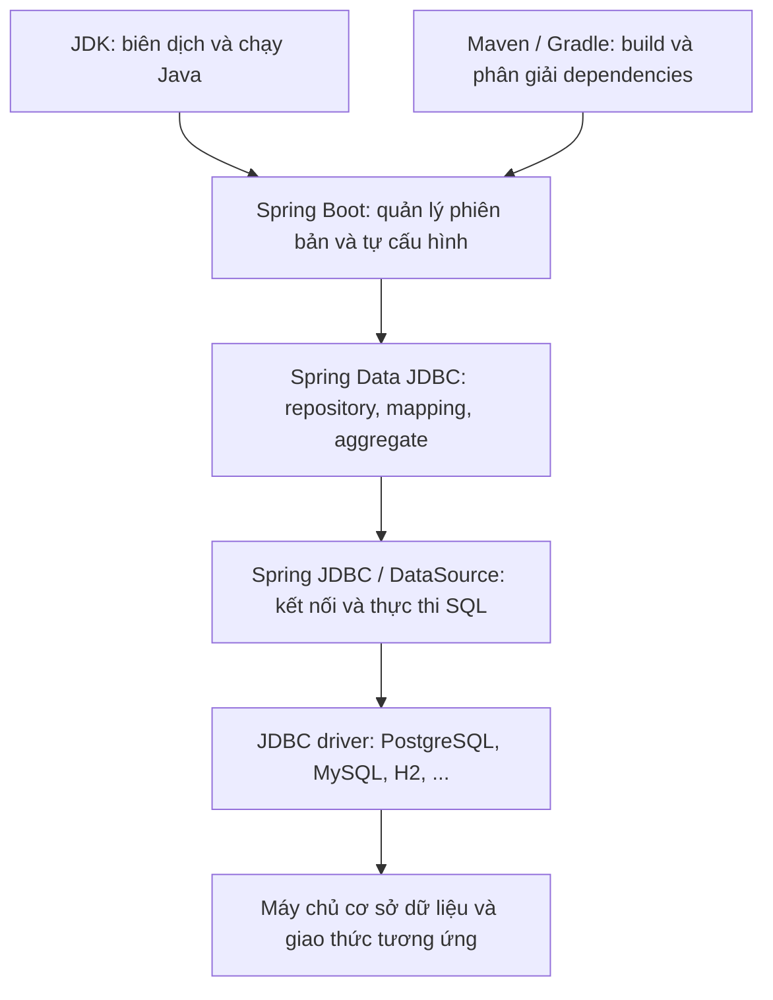

# Chọn tổ hợp Java, Spring Boot, Spring Data và JDBC driver tương thích

Khi khởi tạo dự án **Spring Data Relational JDBC**, việc chọn phiên bản không dừng ở câu hỏi “Java nào chạy được Spring Boot?”. Một ứng dụng còn phải dùng đúng thế hệ Spring Data JDBC, có JDBC driver tương thích với Java và máy chủ cơ sở dữ liệu, đồng thời chạy bằng công cụ build đủ mới. Chọn sai một mắt xích có thể khiến dự án không biên dịch, không khởi động hoặc chỉ lỗi khi truy cập dữ liệu.

Bài này hướng dẫn cách chọn và kiểm tra **một bộ phiên bản có căn cứ**, dùng PostgreSQL làm ví dụ triển khai và đối chiếu với H2/MySQL. Các phiên bản cụ thể bên dưới là **mốc tham khảo tại tháng 11/2026**; khi tạo dự án mới, nên đối chiếu trang tài liệu của đúng nhánh Spring Boot định sử dụng.

## 1. Hiểu đúng các thành phần cần tương thích



| Thành phần | Trách nhiệm | Điều cần kiểm tra |
|---|---|---|
| **Java/JDK** | Biên dịch, chạy ứng dụng; cung cấp JDBC API trong JDK | Phiên bản Java đáp ứng mức tối thiểu và nằm trong phạm vi hỗ trợ của Spring Boot, build tool và driver |
| **Spring Boot** | Tự cấu hình `DataSource`, quản lý dependency thông qua BOM, cung cấp starter | Chọn một nhánh Boot được hỗ trợ và dùng BOM của chính nhánh đó |
| **Spring Data JDBC** | Ánh xạ aggregate sang bảng SQL; cung cấp `CrudRepository`, `JdbcAggregateTemplate`, v.v. | Phiên bản Spring Data đi theo Spring Boot; không tự phối phiên bản khác thế hệ |
| **JDBC driver** | Triển khai `java.sql.Driver`, kết nối đến một hệ quản trị CSDL cụ thể | Driver có trên runtime classpath, hỗ trợ JDK và phiên bản server đang dùng |
| **Database server** | Thực thi SQL, xác thực, giao dịch, kiểu dữ liệu | Phù hợp với driver, có **dialect** mà Spring Data JDBC nhận diện được |
| **Maven/Gradle** | Biên dịch, quản lý dependencies và chạy plugin Spring Boot | Phiên bản tool thỏa yêu cầu riêng của Spring Boot plugin |

**Phân biệt ba tên dễ nhầm:** `spring-jdbc` là lớp truy cập JDBC cấp thấp của Spring Framework; `spring-data-jdbc` cung cấp mô hình repository/aggregate; `org.postgresql:postgresql` là **driver thật sự** để mở kết nối PostgreSQL. Starter `spring-boot-starter-data-jdbc` mang theo Spring Data JDBC và cơ sở hạ tầng Spring JDBC, nhưng không tự chọn PostgreSQL/MySQL cho bạn.

Spring Data JDBC dùng JDBC đồng bộ (blocking). **R2DBC** là cơ chế truy cập CSDL phản ứng với driver và starter riêng; driver `r2dbc-postgresql` không thay thế cho `org.postgresql:postgresql`. Spring Data JDBC cũng khác **Spring Data JPA**: không cần Hibernate/JPA để tạo repository JDBC.

## 2. Chọn Spring Boot trước, để BOM chọn Spring Data

Spring Boot phát hành một **BOM** (*Bill of Materials*) mang tên `org.springframework.boot:spring-boot-dependencies`. BOM quy định một bộ phiên bản đã được Spring Boot phối hợp kiểm thử cho Spring Framework, Spring Data, driver và nhiều thư viện khác.

Quy tắc an toàn khi khởi tạo:

1. Chọn **một phiên bản Spring Boot cụ thể** trong nhánh ổn định, chẳng hạn `4.1.2`.
2. Dùng `spring-boot-starter-data-jdbc` **không ghi version riêng**.
3. Khai báo driver bằng tọa độ Maven/Gradle của vendor và để BOM quản lý version nếu driver nằm trong danh sách được quản lý.
4. Chỉ ghi đè phiên bản Spring Data hoặc driver nếu có yêu cầu thực tế, tài liệu tương thích rõ ràng và kiểm thử riêng.

Spring Data dùng hai hệ số phiên bản cần phân biệt: **release train** (ví dụ `2026.0.x`) là bộ phát hành chung, còn **Spring Data JDBC module** mang số như `4.1.x`. Chúng không phải hai dependency độc lập cần khai báo bằng tay khi dùng Spring Boot starter.

### Ma trận tham khảo cho các thế hệ gần đây

| Spring Boot | Spring Framework | Spring Data release train | Spring Data JDBC | JDK tối thiểu | Build tool cần chú ý |
|---|---|---|---|---|---|
| **4.1.x** (ví dụ `4.1.2`) | **7.0.x** | **2026.0.x** | **4.1.x** | Java **17** | Gradle **8.14+** hoặc 9.x; Maven **3.6.3+** |
| **4.0.x** | **7.0.x** | **2025.1.x** | **4.0.x** | Java **17** | Gradle **8.14+** hoặc 9.x; Maven **3.6.3+** |
| **3.5.x** (ví dụ `3.5.16`) | **6.2.x** | **2025.0.x** | **3.5.x** | Java **17** | Gradle 8.x từ **8.4+** hoặc nhánh 7.x từ **7.6.4+**; Maven **3.6.3+** |

Các hàng là **tổ hợp theo thế hệ**, không phải lời khuyên lấy một patch version bất kỳ ở cột này ghép với patch version ở cột khác. Ví dụ BOM của Spring Boot `4.1.2` quản lý `spring-data-jdbc:4.1.2`; BOM của `3.5.16` quản lý dòng `3.5.x`. Chính BOM quyết định bản vá cụ thể.

**Nên chọn hướng nào?**

- **Dự án mới:** Java **21 LTS** và Spring Boot **4.1.x** là một bộ ví dụ phù hợp, với Spring Data JDBC **4.1.x**, driver do BOM quản lý và Gradle đủ mới. Java 17 vẫn đáp ứng mức tối thiểu của Boot 4.1; Java 21 thuận lợi khi muốn giữ một mốc LTS cho dự án học tập và triển khai.
- **Dự án đang ở Boot 3.5:** giữ Spring Data JDBC **3.5.x** theo BOM Boot 3.5 trong khi bảo trì; lập kế hoạch nâng cấp **cả thế hệ** khi chuyển sang Boot 4.x.
- **Dự án bị ràng buộc Gradle/JDK cũ:** kiểm tra yêu cầu plugin trước khi nâng Spring Boot. Một wrapper Gradle 8.5 có thể dùng với Boot 3.5 nhưng **không đủ** cho Boot 4.1.

Đừng suy luận rằng “cùng Java 21” đồng nghĩa mọi bản Spring Boot hoặc Spring Data đều tương thích. JDK là một điều kiện cần; phiên bản Framework, API và BOM còn phải khớp nhau.

## 3. Chọn JDBC driver theo hệ quản trị CSDL

Driver nằm ở tầng **kết nối**, không quyết định phiên bản Spring Data JDBC. Một số lựa chọn thường gặp:

| Database | Dependency driver (Gradle/Maven) | Tiền tố JDBC URL | Lưu ý |
|---|---|---|---|
| PostgreSQL | `org.postgresql:postgresql` | `jdbc:postgresql://` | Dùng PostgreSQL JDBC Driver (pgJDBC) và đối chiếu bản server |
| MySQL | `com.mysql:mysql-connector-j` | `jdbc:mysql://` | Dùng Connector/J cho MySQL; kiểm tra phiên bản server và kiểu xác thực |
| MariaDB | `org.mariadb.jdbc:mariadb-java-client` | `jdbc:mariadb://` | Driver riêng của MariaDB; nên chọn đúng driver thay vì ngầm dùng MySQL Connector/J |
| H2 | `com.h2database:h2` | `jdbc:h2:mem:` hoặc `jdbc:h2:file:` | Thuận tiện chạy ví dụ cục bộ; không đại diện hoàn toàn cho SQL của PostgreSQL/MySQL |
| Microsoft SQL Server | `com.microsoft.sqlserver:mssql-jdbc` | `jdbc:sqlserver://` | Kiểm tra yêu cầu JDK, TLS và bản SQL Server của driver |
| Oracle Database | `com.oracle.database.jdbc:ojdbc11` (ví dụ phổ biến) | `jdbc:oracle:thin:@` | Kiểm tra artifact `ojdbc` phù hợp JDK và bản Oracle Database |

Spring Data JDBC cần **SQL dialect** để biểu diễn các khác biệt giữa CSDL. Theo tài liệu Spring Data Relational, các hệ có hỗ trợ dialect tích hợp gồm DB2, H2, HSQLDB, MariaDB, Microsoft SQL Server, MySQL, Oracle và PostgreSQL. Nếu dùng CSDL khác, cần kiểm tra hoặc cung cấp dialect riêng; **có driver JDBC không đồng nghĩa Spring Data JDBC hỗ trợ database đó**.

Với mỗi driver, hãy xác nhận ba loại tương thích khác nhau:

1. **Driver ↔ Java:** bản driver có chạy với JDK đang dùng không? Đặc biệt lưu ý các vendor phát hành biến thể driver theo dòng Java.
2. **Driver ↔ database server:** bản server, cơ chế xác thực, TLS/SSL, kiểu dữ liệu và giao thức được driver hỗ trợ không?
3. **Database ↔ Spring Data JDBC:** Spring Data có thể xác định dialect và thao tác repository trên database đó không?

Trong đa số cấu hình Spring Boot hiện đại, chỉ cần khai báo `spring.datasource.url`, `username`, `password`; Boot thường suy ra driver từ JDBC URL. Thuộc tính `spring.datasource.driver-class-name` chỉ nên đặt khi việc suy luận không đáp ứng được cấu hình đặc biệt.

## 4. Ví dụ đầy đủ: Java 21 + Spring Boot 4.1.2 + PostgreSQL

Giả sử ta phát triển dịch vụ quản lý sách dùng **JDK 21**, **PostgreSQL** và **Gradle Groovy DSL**. Chọn `Spring Boot 4.1.2`; BOM sẽ xác định Spring Data JDBC `4.1.2` và bản pgJDBC được quản lý. Dự án không cần tự ghi version của `spring-data-jdbc` hay `postgresql`.

### `build.gradle`

```groovy
plugins {
    id 'java'
    id 'org.springframework.boot' version '4.1.2'
}

apply plugin: 'io.spring.dependency-management'

group = 'com.example'
version = '0.0.1-SNAPSHOT'

java {
    toolchain {
        languageVersion = JavaLanguageVersion.of(21)
    }
}

repositories {
    mavenCentral()
}

dependencies {
    implementation 'org.springframework.boot:spring-boot-starter-data-jdbc'
    runtimeOnly 'org.postgresql:postgresql'

    testImplementation 'org.springframework.boot:spring-boot-starter-data-jdbc-test'
}

tasks.named('test') {
    useJUnitPlatform()
}
```

Ở đây `io.spring.dependency-management` tự import BOM của phiên bản plugin Spring Boot đang dùng. Có thể dùng tính năng `platform(...)` gốc của Gradle thay cho plugin quản lý dependency, nhưng **chỉ cần một chiến lược quản lý phiên bản nhất quán**. `runtimeOnly` thích hợp cho driver PostgreSQL vì mã ứng dụng thường làm việc với `DataSource`, `JdbcTemplate` hoặc repository của Spring, không biên dịch trực tiếp theo API của pgJDBC.

> Nếu dùng Gradle wrapper, đặt wrapper ở **Gradle 8.14+ hoặc 9.x** cho Boot 4.1. Có JDK 21 nhưng wrapper 8.5 vẫn không đáp ứng điều kiện của plugin Boot 4.1.

### `application.yml`

```yaml
spring:
  datasource:
    url: ${DB_URL:jdbc:postgresql://localhost:5432/bookstore}
    username: ${DB_USERNAME:bookstore_app}
    password: ${DB_PASSWORD}
```

Để chạy cấu hình này cần một PostgreSQL server đang hoạt động, database `bookstore`, tài khoản `bookstore_app` có quyền phù hợp và biến môi trường `DB_PASSWORD`. Các tên trên chỉ là ví dụ, không mặc định tồn tại khi khởi động Spring Boot. Trong môi trường thật, nên cấp thông tin kết nối qua biến môi trường hoặc hệ thống quản lý bí mật.

Luồng khởi động chính là:

```text
Spring Boot đọc spring.datasource.*
  -> tìm PostgreSQL JDBC driver trên runtime classpath
  -> tạo DataSource (thường dùng HikariCP)
  -> lấy JDBC Connection tới PostgreSQL
  -> Spring Data JDBC xác định PostgreSQL dialect
  -> khởi tạo các thành phần repository
```

Spring Data JDBC **không phải công cụ tự tạo/migrate toàn bộ schema** như một kỳ vọng thường gặp khi chuyển từ JPA. Trước khi lưu aggregate, cần có bảng phù hợp; với dự án thật có thể quản lý schema bằng Flyway/Liquibase, còn ví dụ học tập có thể dùng script SQL có kiểm soát.

### Nếu dùng Maven

Các lựa chọn Java/Boot/driver không đổi. Với Spring Boot parent POM, khai báo tối thiểu như sau:

```xml
<project xmlns="http://maven.apache.org/POM/4.0.0"
         xmlns:xsi="http://www.w3.org/2001/XMLSchema-instance"
         xsi:schemaLocation="http://maven.apache.org/POM/4.0.0 https://maven.apache.org/xsd/maven-4.0.0.xsd">
    <modelVersion>4.0.0</modelVersion>

    <parent>
        <groupId>org.springframework.boot</groupId>
        <artifactId>spring-boot-starter-parent</artifactId>
        <version>4.1.2</version>
        <relativePath/>
    </parent>

    <groupId>com.example</groupId>
    <artifactId>bookstore</artifactId>
    <version>0.0.1-SNAPSHOT</version>

    <properties>
        <java.version>21</java.version>
    </properties>

    <dependencies>
        <dependency>
            <groupId>org.springframework.boot</groupId>
            <artifactId>spring-boot-starter-data-jdbc</artifactId>
        </dependency>
        <dependency>
            <groupId>org.postgresql</groupId>
            <artifactId>postgresql</artifactId>
            <scope>runtime</scope>
        </dependency>
        <dependency>
            <groupId>org.springframework.boot</groupId>
            <artifactId>spring-boot-starter-data-jdbc-test</artifactId>
            <scope>test</scope>
        </dependency>
    </dependencies>

    <build>
        <plugins>
            <plugin>
                <groupId>org.springframework.boot</groupId>
                <artifactId>spring-boot-maven-plugin</artifactId>
            </plugin>
        </plugins>
    </build>
</project>
```

Parent POM cũng import bộ quản lý phiên bản Spring Boot, vì vậy các dependency ở trên không khai báo version. Nếu dự án có parent riêng, có thể import BOM của Spring Boot trong `dependencyManagement` thay vì sử dụng `spring-boot-starter-parent`.

## 5. Ví dụ bảo trì: đang dùng Spring Boot 3.5

Một dự án hiện có Java 17 hoặc Java 21, Boot `3.5.x` và Gradle 8.5 nên giữ **Spring Data JDBC 3.5.x** do BOM của Boot 3.5 quản lý. Phần dependencies có thể trông giống hệt ví dụ Gradle phía trên:

```groovy
dependencies {
    implementation 'org.springframework.boot:spring-boot-starter-data-jdbc'
    runtimeOnly 'org.postgresql:postgresql'
}
```

Điểm quyết định nằm ở **plugin/parent Boot**: khi dùng `3.5.16`, dependency resolution chọn dòng Spring Data 3.5 tương ứng thay vì 4.1. Không sửa thủ công `spring-data-jdbc` sang `4.1.2` để lấy tính năng mới trong khi vẫn giữ Boot 3.5: thế hệ Spring Framework cần thiết đã thay đổi từ 6.2 lên 7.0. Việc nâng cấp Boot 3.5 → 4.1 là một đợt migration riêng, gồm cả API, plugin, Gradle wrapper và thử nghiệm tích hợp.

## 6. Kiểm tra bộ phiên bản thực tế của dự án

**Kiểm tra phiên bản công cụ trước:**

```bash
java -version
./gradlew --version
```

Trên Windows có thể dùng `gradlew.bat --version`. Hãy phân biệt **JDK dùng chạy Gradle** với **Java toolchain dùng biên dịch ứng dụng**; chúng có thể được cấu hình khác nhau. Cần bảo đảm cả hai đáp ứng yêu cầu tương ứng.

**Xem dependency đã được giải quyết thành phiên bản nào:**

```bash
./gradlew dependencyInsight --dependency spring-data-jdbc --configuration runtimeClasspath
./gradlew dependencyInsight --dependency postgresql --configuration runtimeClasspath
./gradlew dependencies --configuration runtimeClasspath
```

Với Maven:

```bash
./mvnw dependency:tree -Dincludes=org.springframework.data:spring-data-jdbc
./mvnw dependency:tree -Dincludes=org.postgresql:postgresql
```

Sau khi cấu hình database, có thể kiểm tra kết nối bằng `JdbcTemplate` trong ứng dụng Spring Boot:

```java
package com.example.bookstore;

import org.springframework.boot.CommandLineRunner;
import org.springframework.boot.SpringApplication;
import org.springframework.boot.autoconfigure.SpringBootApplication;
import org.springframework.context.annotation.Bean;
import org.springframework.jdbc.core.JdbcTemplate;

@SpringBootApplication
public class BookstoreApplication {
    public static void main(String[] args) {
        SpringApplication.run(BookstoreApplication.class, args);
    }

    @Bean
    CommandLineRunner verifyJdbc(JdbcTemplate jdbcTemplate) {
        return args -> {
            Integer result = jdbcTemplate.queryForObject("SELECT 1", Integer.class);
            System.out.println("JDBC connection test: " + result);
        };
    }
}
```

Khi chương trình truy cập PostgreSQL thành công, dòng in dự kiến là `JDBC connection test: 1`. Đây mới là phép kiểm tra **JDBC kết nối và thực thi SQL**. Muốn xác nhận Spring Data JDBC làm việc đúng với schema, cần tiếp tục kiểm tra một aggregate và repository thực sự qua thao tác lưu/đọc dữ liệu.

## 7. Lỗi thường gặp khi ghép phiên bản

| Biểu hiện | Nguyên nhân có thể xảy ra | Hướng xử lý |
|---|---|---|
| `UnsupportedClassVersionError` hoặc không biên dịch được | JDK chạy/biên dịch thấp hơn bytecode của thư viện hoặc cấu hình toolchain | Xem `java -version`, Gradle JVM và Java toolchain; chọn JDK được Boot và driver hỗ trợ |
| Plugin Spring Boot không áp dụng được trên Gradle | Gradle wrapper dưới mức tối thiểu của nhánh Boot | Nâng wrapper lên phiên bản hỗ trợ trước khi thử chạy plugin |
| `NoSuchMethodError`, `NoClassDefFoundError` liên quan Spring | Ép Spring Data/Spring Framework khác thế hệ với Spring Boot | Gỡ các version override; quay về Spring Boot BOM đồng nhất |
| `Failed to configure a DataSource`, `No suitable driver` | Thiếu driver runtime, sai JDBC URL hoặc chưa cung cấp cấu hình database | Thêm đúng tọa độ driver; kiểm tra `spring.datasource.*` và runtime classpath |
| `Connection refused`, timeout, authentication failed | Server chưa chạy, host/port sai, tài khoản sai hoặc chặn mạng | Kiểm tra database server, URL, quyền truy cập, xác thực và TLS |
| Không xác định được dialect | Database không được hỗ trợ/nhận diện, hoặc không lấy được metadata kết nối | Kiểm tra danh sách dialect, JDBC driver và kết nối; cân nhắc cung cấp dialect riêng nếu hệ DB khác |
| Chạy với H2 nhưng lỗi ở PostgreSQL/MySQL | Khác biệt cú pháp SQL, kiểu dữ liệu, generated keys hoặc migration | Kiểm thử tích hợp với **cùng loại database** như môi trường triển khai |
| Repository khởi tạo được nhưng CRUD báo thiếu bảng/cột | Schema chưa được tạo hoặc khác với mapping của aggregate | Quản lý bảng bằng SQL migration và kiểm tra naming/mapping |

**Đọc lỗi theo tầng:** lỗi build/toolchain trước tiên kiểm tra Java và Gradle/Maven; lỗi dependency/class trước tiên kiểm tra BOM; lỗi `DataSource` trước tiên kiểm tra driver/URL; lỗi SQL/schema sau khi đã kết nối thì kiểm tra dialect và thiết kế database. Cách phân tầng giúp tránh sửa sai chỗ, ví dụ nâng Spring Data khi vấn đề thực tế chỉ là thiếu driver PostgreSQL.

## 8. Quy trình chọn phiên bản cho một dự án thực tế

1. **Xác định database và server version** (ví dụ PostgreSQL đang chạy ở môi trường dev/production) cùng các yêu cầu TLS, xác thực.
2. **Xác định JDK mục tiêu** theo nền tảng triển khai (ví dụ Java 21 LTS) và đảm bảo build tool chạy được trên JDK đã chọn.
3. **Chọn nhánh Spring Boot ổn định** phù hợp JDK và công cụ build; đọc trang *System Requirements* của đúng nhánh.
4. **Dùng starter Spring Data JDBC và BOM của Boot**; không ấn định Spring Data train riêng nếu chưa có nhu cầu đặc biệt.
5. **Chọn driver theo vendor**, đặt dependency ở runtime khi phù hợp, dùng version từ BOM nếu được quản lý; đối chiếu bảng hỗ trợ JDK/server của vendor.
6. **Kiểm tra dialect**, cấu hình `DataSource`, đọc dependency tree và chạy truy vấn kết nối thực tế.
7. **Xác nhận CRUD trên database mục tiêu**, quản lý schema và ghi lại bộ phiên bản đã dùng (JDK, Boot, driver, server, wrapper) để dễ tái tạo môi trường.

Ví dụ lựa chọn được diễn đạt rõ ràng: **“Java 21 + Spring Boot 4.1.2 + Spring Data JDBC 4.1.2 do Boot BOM quản lý + pgJDBC theo Boot BOM + PostgreSQL server đã kiểm tra hỗ trợ + Gradle 8.14 trở lên”**. Câu này đủ xác định các mối quan hệ quan trọng mà không phải tự khóa hàng loạt thư viện con.

## Tài liệu chính thức để đối chiếu

- [Spring Boot — System Requirements (nhánh ổn định hiện hành)](https://docs.spring.io/spring-boot/system-requirements.html)
- [Spring Boot 3.5 — System Requirements](https://docs.spring.io/spring-boot/3.5/system-requirements.html)
- [Spring Boot — Build Systems và dependency management](https://docs.spring.io/spring-boot/reference/using/build-systems.html)
- [Spring Boot Gradle Plugin — Managing Dependencies](https://docs.spring.io/spring-boot/gradle-plugin/managing-dependencies.html)
- [Spring Boot — Managed Dependency Coordinates](https://docs.spring.io/spring-boot/appendix/dependency-versions/coordinates.html)
- [Spring Boot — SQL Databases và DataSource](https://docs.spring.io/spring-boot/reference/data/sql.html)
- [Spring Data Relational — JDBC Getting Started và danh sách dialect](https://docs.spring.io/spring-data/relational/reference/jdbc/getting-started.html)
- [Spring Data — Project, release trains và BOM](https://spring.io/projects/spring-data)
- [PostgreSQL JDBC Driver — tài liệu vendor](https://jdbc.postgresql.org/documentation/)
- [MySQL Connector/J — tài liệu vendor](https://dev.mysql.com/doc/connector-j/en/)
