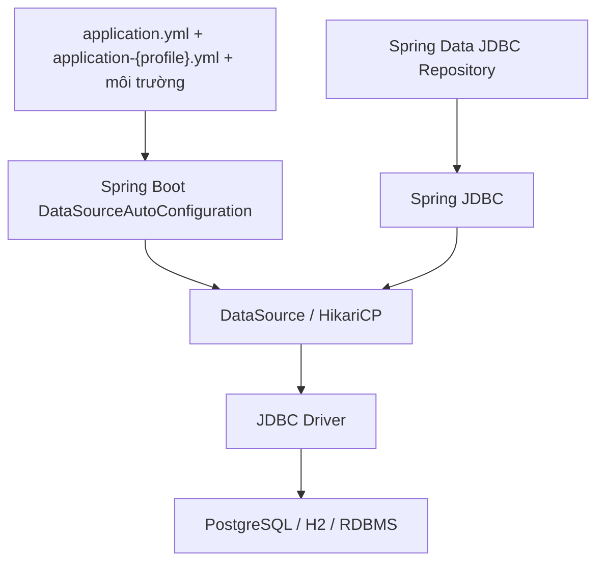

# Cấu hình `spring.datasource` cho môi trường phát triển và kiểm thử

Trong ứng dụng **Spring Data JDBC**, kết nối đến cơ sở dữ liệu được cấu hình chủ yếu qua nhóm thuộc tính `spring.datasource.*` của **Spring Boot**. Cùng một code repository có thể hoạt động với database phát triển và database kiểm thử khác nhau, miễn là ứng dụng nạp đúng cấu hình, có JDBC driver tương ứng và schema phù hợp.

Bài này hướng dẫn cách tổ chức cấu hình cho môi trường **development (dev)** và **testing (test)** trong ứng dụng Spring Boot + Spring Data Relational/JDBC, cách chọn profile, cách kiểm thử thực tế và những lỗi cấu hình thường gặp.

## 1. `spring.datasource` nằm ở đâu trong luồng Spring Data JDBC?

Spring Data JDBC không trực tiếp đọc YAML rồi tự mở kết nối. Với Spring Boot, các bước được phối hợp như sau:

1. Spring Boot đọc thuộc tính từ `application.yml`, file theo profile, environment variables và các nguồn cấu hình khác.
2. `DataSourceAutoConfiguration` tạo một `DataSource` phù hợp với driver và các dependency có trên classpath, thường sử dụng **HikariCP** nếu có thư viện này.
3. Spring JDBC sử dụng `DataSource` để lấy `Connection` và thực thi JDBC operations.
4. Spring Data JDBC dùng hạ tầng Spring JDBC để thực hiện thao tác repository và ánh xạ aggregate vào bảng/cột quan hệ.



Vì vậy:

- `spring.datasource.*` quy định **kết nối và pool**, không định nghĩa entity hoặc mapping.
- `@Table`, `@Id`, `@MappedCollection` là metadata ánh xạ dùng khi Spring Data JDBC thực hiện persistence.
- `spring.sql.init.*` và các công cụ migration như Flyway/Liquibase liên quan đến **khởi tạo và quản lý schema**, là nhóm cấu hình khác với `spring.datasource.*`.
- Các thuộc tính `spring.datasource.hikari.*` điều khiển pool Hikari; chúng không thay thế `url`, `username` hay `password`.

## 2. Chuẩn bị dependency và cấu trúc cấu hình

Ví dụ dùng Spring Boot 3.x, Java 21, Gradle Groovy và PostgreSQL làm cơ sở dữ liệu phát triển. Nếu sử dụng Spring Boot dependency management/BOM, không cần chỉ định thủ công phiên bản các dependency mà Boot quản lý.

```groovy
dependencies {
    implementation 'org.springframework.boot:spring-boot-starter-data-jdbc'

    // Database dùng khi phát triển và chạy ứng dụng.
    runtimeOnly 'org.postgresql:postgresql'

    // Database gọn nhẹ cho một nhóm bài kiểm thử.
    testRuntimeOnly 'com.h2database:h2'

    testImplementation 'org.springframework.boot:spring-boot-starter-test'
}
```

`spring-boot-starter-data-jdbc` đưa Spring Data JDBC và hạ tầng Spring JDBC vào ứng dụng. PostgreSQL và H2 là **JDBC drivers/database khác nhau**; chỉ cấu hình URL mà thiếu dependency driver tương ứng sẽ không tạo được connection.

Có thể tổ chức file như sau:

```text
src/
├── main/
│   ├── java/...
│   └── resources/
│       ├── application.yml
│       └── application-dev.yml
└── test/
    ├── java/.../CustomerRepositoryH2Test.java
    └── resources/
        ├── application-test.yml
        └── sql/schema-test.sql
```

- `application.yml`: cấu hình chung, áp dụng bất kể profile.
- `application-dev.yml`: giá trị cho môi trường phát triển.
- `application-test.yml` trong `src/test/resources`: giá trị chỉ có trên test classpath, hữu ích để tránh đóng gói cấu hình kiểm thử vào production artifact.
- Mỗi file profile chỉ được áp dụng khi profile đó đang **active**. File `application-test.yml` không tự có hiệu lực chỉ vì chương trình đang chạy một phương thức `@Test`; cần kích hoạt profile phù hợp hoặc cấu hình test theo cách khác.

## 3. Các thuộc tính `spring.datasource` cần nắm

| Thuộc tính | Ý nghĩa | Ví dụ |
| --- | --- | --- |
| `spring.datasource.url` | JDBC URL gồm giao thức, host, port, database và có thể có tham số kết nối. | `jdbc:postgresql://localhost:5432/catalog_dev` |
| `spring.datasource.username` | Tên tài khoản database. | `catalog_dev` |
| `spring.datasource.password` | Mật khẩu database; nên lấy từ biến môi trường hoặc secret manager. | `${DEV_DB_PASSWORD}` |
| `spring.datasource.driver-class-name` | Tên class của JDBC driver nếu cần khai báo tường minh. | `org.postgresql.Driver` |
| `spring.datasource.hikari.maximum-pool-size` | Giới hạn số connection tối đa của pool Hikari. | `8` |
| `spring.datasource.hikari.minimum-idle` | Mức connection idle Hikari cố gắng duy trì. | `1` |
| `spring.datasource.hikari.connection-timeout` | Thời gian tối đa chờ lấy connection từ pool, tính bằng millisecond. | `30000` |

Spring Boot thường xác định được JDBC driver từ URL nếu driver đã có trên classpath; do đó **`driver-class-name` không bắt buộc** cho các URL PostgreSQL/H2 thông dụng.

Ví dụ URL:

```text
PostgreSQL: jdbc:postgresql://localhost:5432/catalog_dev
H2 memory: jdbc:h2:mem:catalog_test;DB_CLOSE_DELAY=-1
```

Với PostgreSQL, `catalog_dev` là database có thật và server phải đang hoạt động. Với H2 `mem:catalog_test`, database chạy **trong bộ nhớ của JVM kiểm thử**, không cần PostgreSQL server, nhưng sẽ mất dữ liệu khi vòng đời database/JVM kết thúc.

Nhóm thuộc tính pool chỉ nên điều chỉnh theo môi trường và hành vi truy cập thực tế. Các con số trong ví dụ là minh họa, không phải cấu hình tối ưu cho mọi ứng dụng.

## 4. Cấu hình chung: `application.yml`

Đặt những thuộc tính thực sự dùng chung vào `src/main/resources/application.yml`:

```yaml
spring:
  application:
    name: catalog-service
  sql:
    init:
      mode: never
```

`spring.sql.init.mode: never` trong ví dụ cho biết **không tự chạy các file schema/data SQL initializer** theo cơ chế `spring.sql.init`, phù hợp khi muốn quản lý schema qua migration hoặc một bước thiết lập riêng.

Không nên để thông tin truy cập database production hoặc mật khẩu cố định trong file dùng chung. Cũng không nên mặc định `spring.profiles.active: dev` trong cấu hình đóng gói để triển khai, vì có thể khiến ứng dụng được đưa lên môi trường khác nhưng vẫn kết nối vào database dev.

> Spring Data JDBC **không tự tạo bảng theo `@Table` như cơ chế sinh DDL của Hibernate/JPA**. Dù cấu hình `DataSource` đúng, bảng cần tồn tại trước khi thực hiện repository CRUD.

## 5. Môi trường phát triển: PostgreSQL với profile `dev`

Tạo `src/main/resources/application-dev.yml`:

```yaml
spring:
  datasource:
    url: ${DEV_DB_URL:jdbc:postgresql://localhost:5432/catalog_dev}
    username: ${DEV_DB_USER:catalog_dev}
    password: ${DEV_DB_PASSWORD}
    hikari:
      maximum-pool-size: 8
      minimum-idle: 1
      connection-timeout: 30000
```

Cú pháp placeholder `${TEN_BIEN:gia_tri_mac_dinh}` có nghĩa: nếu biến có sẵn thì dùng biến, nếu không thì dùng giá trị mặc định. Với `${DEV_DB_PASSWORD}` không có phần mặc định, ứng dụng cần cung cấp mật khẩu từ một nguồn cấu hình; tránh lưu password thật trong Git.

Ví dụ trên giả định bạn đã tạo:

- Database PostgreSQL tên `catalog_dev`.
- User `catalog_dev` với quyền cần thiết cho công việc phát triển.
- Biến môi trường `DEV_DB_PASSWORD`.
- Schema tương ứng với các aggregate/repository Spring Data JDBC.

Chạy với profile `dev` bằng tham số Spring Boot:

```bash
java -jar catalog-service.jar --spring.profiles.active=dev
```

Hoặc khi dùng Spring Boot Gradle plugin:

```bash
./gradlew bootRun --args='--spring.profiles.active=dev'
```

Trên PowerShell/Windows, có thể sử dụng `.\gradlew.bat bootRun --args="--spring.profiles.active=dev"` nếu project có Gradle wrapper. Biến môi trường `SPRING_PROFILES_ACTIVE=dev` cũng là một cách kích hoạt profile.

**Lưu ý quan trọng:** Khi khởi chạy bằng `dev`, database trong URL phải là database phát triển chuyên biệt. Không dùng chung database production để chạy thử tạo/xóa/cập nhật entity.

### 5.1. Cung cấp mật khẩu an toàn trong lúc phát triển

Một ví dụ PowerShell cho **phiên terminal hiện tại**:

```powershell
$env:DEV_DB_PASSWORD = "local-secret"
$env:SPRING_PROFILES_ACTIVE = "dev"
.\gradlew.bat bootRun
```

Đây là giá trị minh họa. Trong thực tế nên lấy từ secret store, cơ chế quản lý biến môi trường của IDE hoặc môi trường chạy, tránh ghi mật khẩu thật trong script được commit. File `.env` không tự được Spring Boot nạp trong mọi tình huống; nếu dùng file đó phải có cơ chế riêng đưa các biến vào process environment hoặc property sources.

Có thể sử dụng trực tiếp các tên biến chuẩn của Spring Boot: `SPRING_DATASOURCE_URL`, `SPRING_DATASOURCE_USERNAME` và `SPRING_DATASOURCE_PASSWORD`. Theo cơ chế externalized configuration, giá trị từ environment variables có thể ghi đè giá trị cùng tên trong YAML. Hãy kiểm tra các biến này trước khi kết luận một file profile đang quyết định URL.

### 5.2. Có nên cấu hình JDBC driver và Hikari ở mọi môi trường?

Không cần thiết phải khai báo `driver-class-name` khi Boot tự nhận diện được driver. Với Hikari, `maximum-pool-size` và `minimum-idle` chỉ nên được điều chỉnh khi biết giới hạn connection của database và tải sử dụng. Ứng dụng dev nhỏ có thể dùng giá trị mặc định để giảm biến số cấu hình.

## 6. Môi trường kiểm thử nhanh: H2 in-memory và profile `test`

Mục tiêu của nhóm test này là chạy nhanh, độc lập với PostgreSQL bên ngoài, phù hợp với kiểm thử cơ bản về repository, ánh xạ entity và transaction. Chúng **không chứng minh tương thích hoàn toàn với PostgreSQL**.

Tạo `src/test/resources/application-test.yml`:

```yaml
spring:
  datasource:
    url: "jdbc:h2:mem:catalog_test;DB_CLOSE_DELAY=-1;DB_CLOSE_ON_EXIT=FALSE"
    username: sa
    password: ""
  sql:
    init:
      mode: always
      schema-locations: classpath:sql/schema-test.sql
```

Ở đây:

- `jdbc:h2:mem:catalog_test` tạo database H2 trong bộ nhớ.
- `DB_CLOSE_DELAY=-1` giữ database tồn tại khi connection cuối cùng bị đóng, cho tới khi JVM kết thúc hoặc database bị shutdown.
- `spring.sql.init.mode: always` bật chạy SQL initializer, ghi đè `never` ở cấu hình chung.
- `schema-locations` chỉ rõ file schema trong test classpath.

Tạo `src/test/resources/sql/schema-test.sql`:

```sql
CREATE TABLE customers (
    id BIGINT GENERATED BY DEFAULT AS IDENTITY PRIMARY KEY,
    full_name VARCHAR(150) NOT NULL
);
```

Đây là DDL ví dụ. Khi dùng Spring Data JDBC, tên bảng/cột phải tương ứng với mapping trên Java domain model.

### 6.1. Một entity, một repository, hai môi trường

```java
import org.springframework.data.annotation.Id;
import org.springframework.data.relational.core.mapping.Column;
import org.springframework.data.relational.core.mapping.Table;

@Table("customers")
public record Customer(
    @Id Long id,
    @Column("full_name") String fullName
) {}
```

```java
import org.springframework.data.repository.ListCrudRepository;

public interface CustomerRepository
        extends ListCrudRepository<Customer, Long> {
}
```

Repository interface không nhắc tới PostgreSQL hay H2. Cùng một `CustomerRepository` sẽ sử dụng `DataSource` đang có trong ApplicationContext. Đây chính là lợi ích của tách cấu hình kết nối khỏi domain/persistence logic.

### 6.2. Test repository với `@DataJdbcTest`

```java
import static org.assertj.core.api.Assertions.assertThat;

import org.junit.jupiter.api.Test;
import org.springframework.beans.factory.annotation.Autowired;
import org.springframework.boot.test.autoconfigure.data.jdbc.DataJdbcTest;
import org.springframework.boot.test.autoconfigure.jdbc.AutoConfigureTestDatabase;
import org.springframework.test.context.ActiveProfiles;

@DataJdbcTest
@ActiveProfiles("test")
@AutoConfigureTestDatabase(
    replace = AutoConfigureTestDatabase.Replace.NONE
)
class CustomerRepositoryH2Test {

    @Autowired
    CustomerRepository customers;

    @Test
    void savesAndFindsCustomer() {
        Customer saved = customers.save(new Customer(null, "Lan"));

        assertThat(saved.id()).isNotNull();
        assertThat(customers.findById(saved.id()))
            .contains(saved);
    }
}
```

Giải thích annotation:

- `@DataJdbcTest` tạo một Spring Boot test slice tập trung vào Spring Data JDBC và các thành phần JDBC cần thiết, thay vì khởi tạo toàn bộ web application.
- `@ActiveProfiles("test")` bật `application-test.yml`.
- `@AutoConfigureTestDatabase(replace = NONE)` yêu cầu giữ `DataSource` theo cấu hình test đã cung cấp. Theo mặc định, một số test slice có thể **thay DataSource bằng embedded test database**, nên annotation này hữu ích khi cần kiểm soát chính xác URL.
- `@DataJdbcTest` theo cấu hình thông dụng có transaction test được rollback sau mỗi test; vẫn cần lưu ý những side effects không nằm trong transaction.

Để test thật sự chạy được, H2 phải có trên test runtime classpath và file schema phải tồn tại ở đúng đường dẫn. Nếu trong cùng suite có nhiều context dùng một database H2 được đặt tên cố định, có thể phát sinh tương tác ngoài ý muốn; có thể dùng database name riêng cho từng nhóm test hoặc cấu hình cô lập khi cần.

### 6.3. Giới hạn của H2

H2 phù hợp khi cần vòng phản hồi nhanh. Tuy nhiên, cú pháp SQL, kiểu cột, sequence/identity, transaction semantics, collation, function và dialect khác PostgreSQL. Bật `MODE=PostgreSQL` của H2 chỉ giúp tương thích một phần, **không biến H2 thành PostgreSQL**.

Nếu ứng dụng sử dụng SQL native, khóa, isolation, index hoặc tính năng PostgreSQL đặc thù, cần có kiểm thử trên PostgreSQL thật hoặc database PostgreSQL container.

## 7. Kiểm thử tương thích thực tế: PostgreSQL qua Testcontainers

Để kiểm tra SQL và mapping trên đúng loại database sử dụng ở môi trường chạy, có thể dùng **Testcontainers** khởi tạo PostgreSQL riêng cho test. Container giúp mỗi môi trường kiểm thử có một database được tạo trong vòng đời test, giảm việc phải phụ thuộc vào database dev dùng chung.

Bổ sung dependency:

```groovy
dependencies {
    testImplementation 'org.springframework.boot:spring-boot-testcontainers'
    testImplementation 'org.testcontainers:junit-jupiter'
    testImplementation 'org.testcontainers:postgresql'
}
```

Ví dụ dùng Testcontainers JUnit 5 và `@DynamicPropertySource`:

```java
import static org.assertj.core.api.Assertions.assertThat;

import org.junit.jupiter.api.Test;
import org.springframework.beans.factory.annotation.Autowired;
import org.springframework.boot.test.autoconfigure.data.jdbc.DataJdbcTest;
import org.springframework.boot.test.autoconfigure.jdbc.AutoConfigureTestDatabase;
import org.springframework.test.context.DynamicPropertyRegistry;
import org.springframework.test.context.DynamicPropertySource;
import org.springframework.test.context.jdbc.Sql;
import org.testcontainers.containers.PostgreSQLContainer;
import org.testcontainers.junit.jupiter.Container;
import org.testcontainers.junit.jupiter.Testcontainers;

@DataJdbcTest
@Testcontainers
@AutoConfigureTestDatabase(
    replace = AutoConfigureTestDatabase.Replace.NONE
)
@Sql("/sql/schema-test.sql")
class CustomerRepositoryPostgresTest {

    @Container
    static PostgreSQLContainer<?> postgres =
        new PostgreSQLContainer<>("postgres:16-alpine");

    @DynamicPropertySource
    static void configureDatasource(DynamicPropertyRegistry registry) {
        registry.add("spring.datasource.url", postgres::getJdbcUrl);
        registry.add("spring.datasource.username", postgres::getUsername);
        registry.add("spring.datasource.password", postgres::getPassword);
    }

    @Autowired
    CustomerRepository customers;

    @Test
    void persistsCustomerInPostgres() {
        Customer saved = customers.save(new Customer(null, "Mai"));

        assertThat(saved.id()).isNotNull();
        assertThat(customers.findById(saved.id()))
            .contains(saved);
    }
}
```

Trong ví dụ:

1. Testcontainers khởi động PostgreSQL và cấp JDBC URL, username, password tương ứng với container.
2. `@DynamicPropertySource` cung cấp trực tiếp các thuộc tính `spring.datasource.*` cho Spring context, ghi đè cấu hình tĩnh tương ứng.
3. `@AutoConfigureTestDatabase(replace = NONE)` tránh việc test slice thay PostgreSQL container thành H2.
4. `@Sql` chạy script tạo bảng trước phương thức test; script phải tương thích PostgreSQL. Khi ứng dụng có migration chính thức, nên dùng chính migration đó trong integration test để kiểm tra schema đúng phiên bản.

Test này không kích hoạt profile `test` của phần H2: cấu hình chung có `spring.sql.init.mode: never`, và test thiết lập schema bằng `@Sql`. Trường hợp muốn quản lý bằng profile riêng, có thể tạo `application-pgtest.yml` và dùng `@ActiveProfiles("pgtest")`, trong đó chỉ giữ những thuộc tính thực sự đặc thù cho test PostgreSQL.

Testcontainers yêu cầu môi trường chạy có khả năng cung cấp container runtime tương thích. Image PostgreSQL được chọn phù hợp với phiên bản database mà hệ thống thực tế sử dụng; ví dụ `postgres:16-alpine` chỉ là minh họa. Có thể dùng `@ServiceConnection` của Spring Boot cùng `spring-boot-testcontainers` để tự cấp connection details, nhưng không cần trộn hai cách đó trong cùng ví dụ.

## 8. Chọn cấu hình kiểm thử nào?

| Yêu cầu | H2 in-memory | PostgreSQL Testcontainers |
| --- | --- | --- |
| Không cần PostgreSQL server hay container runtime | Có | Không |
| Khởi động nhanh, ít phụ thuộc bên ngoài | Thường thuận tiện hơn | Tốn thời gian khởi động container |
| Kiểm tra CRUD/mapping đơn giản | Phù hợp | Phù hợp |
| Kiểm tra cú pháp SQL PostgreSQL và dialect | Chỉ tương thích một phần | Phù hợp hơn |
| Kiểm tra migration/schema dùng ở production | Chỉ khi SQL/migration tương thích H2 | Nên ưu tiên |
| Kiểm tra hành vi lock/transaction/index của PostgreSQL | Không đáng tin cậy | Sát môi trường thực tế hơn |

Cách phân lớp hợp lý là dùng H2 cho test đơn giản cần phản hồi nhanh và Testcontainers cho phần yêu cầu tương thích database. Với dự án có nhiều câu SQL đặc thù hoặc cần độ tin cậy cao ở tầng persistence, có thể ưu tiên Testcontainers ngay từ đầu.

## 9. Thứ tự ưu tiên cấu hình và vấn đề profile

Spring Boot kết hợp nhiều nguồn cấu hình (property sources). Một số quy tắc thực dụng khi đọc `spring.datasource`:

- `application.yml` đặt giá trị chung.
- `application-dev.yml` hoặc `application-test.yml` ghi đè các key trùng với cấu hình chung khi profile tương ứng được kích hoạt.
- Environment variables (chẳng hạn `SPRING_DATASOURCE_URL`) và tham số dòng lệnh có thể ghi đè giá trị trong file YAML.
- `@DynamicPropertySource` cấp giá trị động cho Spring Test và có ưu tiên cao hơn nhiều nguồn cấu hình thông thường.
- Nếu đồng thời bật nhiều profile và chúng định nghĩa cùng một property, thứ tự profile/property sources sẽ ảnh hưởng giá trị cuối; nên tránh cấu hình datasource chồng lấn gây khó dự đoán.

Một bảng hình dung:

| Cách chạy | Profile | Nguồn cấu hình datasource dự kiến |
| --- | --- | --- |
| Local dev | `dev` | `application-dev.yml`, có thể được biến môi trường ghi đè |
| Repository test nhanh | `test` | `src/test/resources/application-test.yml` |
| Test PostgreSQL container | Có thể không cần profile riêng | `@DynamicPropertySource` cấp URL và credentials container |
| Production | Profile riêng theo quy trình triển khai | Thông tin từ deployment config/secret manager; không mượn cấu hình dev |

Lưu ý: **Profile không tự tạo và không tự cô lập database.** Chỉ khi datasource trỏ đến database độc lập thì môi trường mới thật sự tách biệt.

### 9.1. Các cách kích hoạt profile

| Ngữ cảnh | Cách kích hoạt |
| --- | --- |
| Chạy JAR | `--spring.profiles.active=dev` |
| Chạy từ environment | `SPRING_PROFILES_ACTIVE=dev` |
| Chạy JUnit/Spring Test | `@ActiveProfiles("test")` |
| Chạy Gradle Boot plugin | `bootRun --args='--spring.profiles.active=dev'` |

Không cấu hình `spring.profiles.active` bên trong `application-dev.yml` hoặc tài liệu YAML chỉ được nạp theo profile: Spring Boot giới hạn nơi hợp lệ để khai báo thuộc tính kích hoạt profile. Hãy kích hoạt từ nguồn không phụ thuộc profile, ví dụ lệnh chạy hoặc environment.

## 10. Quản lý schema, dữ liệu mẫu và transaction

### 10.1. Schema không đi cùng datasource một cách tự động

Ba nhiệm vụ phải được tách rõ:

| Nhiệm vụ | Thành phần liên quan |
| --- | --- |
| Kết nối | `spring.datasource.*`, `DataSource` và JDBC driver |
| Khởi tạo schema/data bằng script | `spring.sql.init.*` và file `schema.sql`/`data.sql` |
| Quản lý lịch sử thay đổi schema | Flyway, Liquibase hoặc quy trình migration tương đương |

Với ứng dụng nhiều môi trường, Flyway/Liquibase thường phù hợp để đảm bảo database dev, test và production cùng tiến hóa theo những migration được kiểm soát. Nếu dùng migration, cần khai báo dependency tương ứng, thiết lập và cho phép công cụ chạy trước khi kiểm thử repository. Không nên vừa bật SQL initializer tạo bảng vừa để migration khác tạo lại đúng bảng, trừ khi có chủ đích rõ ràng.

### 10.2. Dữ liệu test phải cô lập

- Database test phải tách khỏi database dev/production; tài khoản test chỉ cần quyền trên phạm vi test.
- Với `@DataJdbcTest`, transaction mặc định thường được rollback sau test; các thao tác ngoài transaction, async process hoặc gọi ứng dụng bằng kết nối khác có thể cần cleanup riêng.
- Với `@SpringBootTest(webEnvironment = RANDOM_PORT)`, HTTP request từ test client và transaction xử lý trên server có thể chạy trên những thread/transaction khác nhau, vì thế không được mặc định cho rằng mọi dữ liệu server ghi sẽ được rollback theo transaction của phương thức test.
- Không dùng bảng có dữ liệu thật của người dùng hoặc thông tin nhạy cảm để làm test fixtures.

### 10.3. Tránh lộ bí mật qua log và code

Tránh commit mật khẩu và tránh log toàn bộ environment/property sources. Bật log SQL hoặc bind parameter ở mức DEBUG/TRACE có thể làm lộ dữ liệu nghiệp vụ trong quá trình kiểm thử; chỉ bật khi thực sự cần và dùng dữ liệu test phù hợp.

## 11. Các lỗi cấu hình thường gặp và cách xử lý

| Hiện tượng | Nguyên nhân thường gặp | Hướng xử lý |
| --- | --- | --- |
| `Failed to configure a DataSource` | Không có JDBC URL/embedded database thích hợp, hoặc thiếu driver. | Kiểm tra active profile, URL, dependency JDBC driver và test classpath. |
| `Connection refused` | Database chưa chạy, sai host/port, cấu hình container/localhost không đúng. | Kiểm tra endpoint từ chính process Java và trạng thái PostgreSQL. |
| `password authentication failed` | User/password không khớp hoặc quyền đăng nhập không hợp lệ. | Kiểm tra environment variables, database user và nguồn cấu hình ghi đè. |
| `relation "..." does not exist` hoặc `Table not found` | Schema chưa khởi tạo, sai tên bảng hoặc sai schema/search path. | Chạy migration/SQL initializer, kiểm tra `@Table` và tên bảng thực tế. |
| Test dùng H2 dù muốn PostgreSQL container | Test slice tự thay `DataSource` bằng embedded database. | Dùng `@AutoConfigureTestDatabase(replace = NONE)` và kiểm tra dynamic properties. |
| Test dùng nhầm database dev | Profile hoặc biến `SPRING_DATASOURCE_URL` ghi đè URL test. | Kích hoạt đúng profile, kiểm tra môi trường CI/IDE, dùng database test chuyên biệt. |
| H2 chạy tốt nhưng PostgreSQL thất bại | Dialect, DDL hoặc SQL functions không tương thích. | Bổ sung integration test trên PostgreSQL container cùng migration thực tế. |
| Pool hết connection hoặc chờ lâu | Query/transaction giữ connection quá lâu, pool thiếu hoặc connection leak. | Xem transaction boundary, thời gian query, connection handling và số lượng pool. |

Không nên xử lý mọi lỗi bằng cách đổi `spring.datasource.hikari.maximum-pool-size`. Nếu sai profile, thiếu schema hoặc database không chạy, tăng pool sẽ không giải quyết được nguyên nhân.

## 12. Quy trình thiết lập môi trường mới

1. Thêm Spring Data JDBC starter và JDBC driver tương ứng.
2. Tạo `application.yml` cho cấu hình chung; để URL và thông tin đăng nhập vào profile/environment đúng môi trường.
3. Tạo database dev riêng và chuẩn bị schema bằng migration hoặc script được kiểm soát.
4. Chạy với `dev` và xác nhận một thao tác repository đơn giản đọc/ghi thành công.
5. Tạo `application-test.yml` và schema H2 cho nhóm test nhanh, hoặc cấu hình Testcontainers cho integration test PostgreSQL.
6. Dùng `@ActiveProfiles`/`@DynamicPropertySource` khi cần; kiểm soát test database replacement và isolation.
7. Trong CI, truyền database credentials qua secret/environment và đảm bảo test không thể ghi vào database production.

Một nguyên tắc cần nhớ: **Spring Data JDBC repository không cần đổi khi chuyển dev sang test; chỉ `DataSource` và cơ chế chuẩn bị schema được thay theo môi trường.** Cấu hình đúng profile, driver và schema sẽ giúp kiểm thử nhất quán mà không làm lẫn dữ liệu giữa các hệ thống.

## 13. Tài liệu tra cứu

- [Spring Boot — Externalized Configuration](https://docs.spring.io/spring-boot/reference/features/external-config.html): nơi cấu hình, profile và thứ tự ưu tiên property sources.
- [Spring Boot — SQL Databases](https://docs.spring.io/spring-boot/reference/data/sql.html): `DataSource`, pool và SQL initialization.
- [Spring Boot — Testing](https://docs.spring.io/spring-boot/reference/testing/index.html): test slices, Spring Boot Test và database trong kiểm thử.
- [Spring Data JDBC — Reference Documentation](https://docs.spring.io/spring-data/relational/reference/jdbc.html): repository, mapping và hành vi persistence.
- [Testcontainers — PostgreSQL Module](https://java.testcontainers.org/modules/databases/postgres/): PostgreSQL container dùng cho integration testing.
