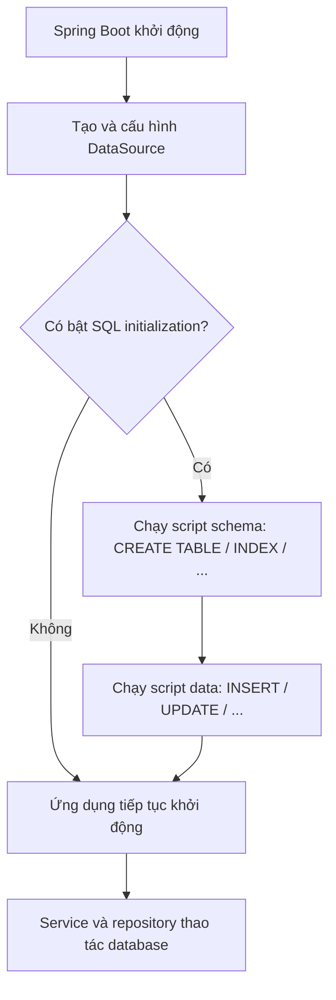

# Khởi tạo schema bằng SQL script và kiểm soát thứ tự nạp dữ liệu

Trong ứng dụng **Spring Data JDBC**, repository làm việc với các bảng và cột đã tồn tại trong cơ sở dữ liệu. Annotation như `@Table`, `@Id`, `@Column` cho framework biết cách ánh xạ dữ liệu, nhưng **không tự tạo schema từ class Java**. Vì vậy, trước khi gọi `repository.findAll()` hoặc `repository.save(...)`, ứng dụng cần có các bảng, khóa và dữ liệu khởi tạo phù hợp.

Một cách đơn giản để làm việc này trong ứng dụng Spring Boot là đặt các câu lệnh SQL trong `schema.sql` và `data.sql`. Spring Boot có cơ chế chạy các script đó khi khởi động ứng dụng, với cấu hình quyết định **có chạy hay không, chạy file nào và theo thứ tự nào**. Bài này trình bày toàn bộ luồng, ví dụ có khóa ngoại, cách chia script thành nhiều file, các lỗi thường gặp và thời điểm nên chuyển sang công cụ quản lý migration.

## 1. Phân biệt schema, dữ liệu khởi tạo và ánh xạ Java

Ba khái niệm liên quan nhưng giải quyết các nhu cầu khác nhau:

| Thành phần | Câu hỏi cần trả lời | Ví dụ |
|---|---|---|
| **Schema** | Database có cấu trúc gì? | `CREATE TABLE`, `PRIMARY KEY`, `FOREIGN KEY`, `CREATE INDEX` |
| **Seed data** | Khi bắt đầu, database cần có những hàng nào? | `INSERT INTO departments ...` |
| **Entity mapping** | Một bảng/cột được biểu diễn bằng đối tượng Java nào? | `@Table("departments")`, `@Id Long id` |

Ví dụ, đoạn Java sau chỉ mô tả cách đọc/ghi bảng `departments`:

```java
import org.springframework.data.annotation.Id;
import org.springframework.data.relational.core.mapping.Table;

@Table("departments")
public record Department(@Id Long id, String name) {}
```

Để repository thao tác được, database vẫn cần có bảng tương ứng:

```sql
CREATE TABLE departments (
    id BIGINT PRIMARY KEY,
    name VARCHAR(120) NOT NULL
);
```

Nếu thiếu bảng, mã Java vẫn có thể biên dịch và ứng dụng có thể khởi động đến một giai đoạn nhất định, nhưng truy vấn thực tế sẽ lỗi vì database không tìm được bảng. Việc đưa SQL initialization vào quá trình khởi động giúp ứng dụng thử nghiệm có schema và dữ liệu mẫu ngay từ đầu.

## 2. Spring Boot chạy SQL script trong giai đoạn nào?

Spring Boot hỗ trợ **script-based database initialization** trên `DataSource`. Khi cơ chế này được bật và có script phù hợp, nó thực thi **script tạo schema trước**, rồi mới thực thi **script nạp dữ liệu**. Sau giai đoạn khởi tạo database, các đoạn mã chạy sau khi ứng dụng đã khởi động, như `ApplicationRunner`, có thể truy vấn dữ liệu đã nạp.



Đường đi cụ thể phụ thuộc cấu hình auto-configuration, loại database và các bean khởi tạo database khác. Điều cần nhớ là **`schema.sql` và `data.sql` không được chạy mỗi khi gọi repository**: chúng là bước khởi tạo, còn repository thực thi SQL nghiệp vụ khi ứng dụng hoạt động.

Với cấu hình mặc định, Spring Boot tìm các tài nguyên SQL thông dụng trên classpath, chẳng hạn:

```text
src/main/resources/
├── schema.sql
└── data.sql
```

`schema.sql` dành cho DDL; `data.sql` dành cho dữ liệu ban đầu. Nếu có nhiều script, có thể cấu hình đường dẫn riêng thay vì phụ thuộc cách tìm mặc định.

## 3. Ví dụ hoàn chỉnh: schema có khóa ngoại và dữ liệu mẫu

Giả sử xây dựng ứng dụng quản lý nhân viên. Một phòng ban (`departments`) có nhiều nhân viên (`employees`), còn mỗi nhân viên phải thuộc về một phòng ban hợp lệ.

### 3.1. Chuẩn bị phụ thuộc và database thử nghiệm

Với dự án Gradle sử dụng Spring Boot, cần tối thiểu Spring Data JDBC và một JDBC driver. Ví dụ dùng **H2 in-memory** cho môi trường học tập:

```groovy
dependencies {
    implementation 'org.springframework.boot:spring-boot-starter-data-jdbc'
    runtimeOnly 'com.h2database:h2'
}
```

Đặt cấu hình trong `src/main/resources/application.yml`:

```yaml
spring:
  datasource:
    url: jdbc:h2:mem:companydb;DB_CLOSE_DELAY=-1
    driver-class-name: org.h2.Driver
    username: sa
    password: ''
  sql:
    init:
      mode: always
      encoding: UTF-8
      continue-on-error: false
```

Ở đây `mode: always` khiến việc chạy script được yêu cầu rõ ràng ngay cả khi đổi loại database. Với H2 in-memory, cấu hình mặc định thường cũng đủ vì Spring Boot nhận diện đây là embedded database. Trong dự án thực tế, không nên mặc định dùng `always` cho database có dữ liệu tồn tại lâu dài nếu script chưa được thiết kế chạy lặp an toàn.

### 3.2. Viết `schema.sql`

Tạo `src/main/resources/schema.sql`:

```sql
CREATE TABLE departments (
    id BIGINT PRIMARY KEY,
    name VARCHAR(120) NOT NULL
);

CREATE TABLE employees (
    id BIGINT PRIMARY KEY,
    full_name VARCHAR(160) NOT NULL,
    department_id BIGINT NOT NULL,
    CONSTRAINT fk_employees_department
        FOREIGN KEY (department_id) REFERENCES departments(id)
);

CREATE INDEX idx_employees_department_id
    ON employees(department_id);
```

Thứ tự các lệnh ở đây có chủ đích:

1. Tạo bảng **cha** `departments`.
2. Tạo bảng **con** `employees`, có khóa ngoại tham chiếu `departments(id)`.
3. Tạo index cho cột được dùng để tìm các nhân viên theo phòng ban.

Nếu đảo thứ tự, việc tạo khóa ngoại của `employees` có thể lỗi do bảng `departments` chưa tồn tại. Một số hệ quản trị hỗ trợ tạo bảng trước và bổ sung ràng buộc bằng `ALTER TABLE` sau, nhưng vẫn cần quy định thứ tự thực thi rõ ràng.

### 3.3. Viết `data.sql`

Tạo `src/main/resources/data.sql`:

```sql
-- Nạp bảng cha trước để các ID phòng ban đã tồn tại.
INSERT INTO departments (id, name) VALUES
    (10, 'Engineering'),
    (20, 'Operations');

-- Mỗi department_id phải tham chiếu một phòng ban hợp lệ.
INSERT INTO employees (id, full_name, department_id) VALUES
    (101, 'Lan Nguyen', 10),
    (102, 'Minh Tran', 10),
    (103, 'Hoa Pham', 20);
```

Nếu chạy `INSERT INTO employees` trước khi có các hàng `departments`, database sẽ từ chối những hàng con do vi phạm khóa ngoại. Do đó, **thứ tự nạp dữ liệu không chỉ là vấn đề tổ chức file**: nó phải tuân theo các ràng buộc của schema.

Ví dụ sử dụng ID cố định để seed dữ liệu và minh họa khóa ngoại. Đây không phải thiết kế bắt buộc cho mọi bảng. Trong ứng dụng mà ID do database sinh, cần khai báo cơ chế sinh ID tương ứng và tránh trộn tùy tiện ID seed cố định với sequence/identity.

### 3.4. Đọc dữ liệu từ Spring Data JDBC

Tạo entity ánh xạ bảng `employees`:

```java
import org.springframework.data.annotation.Id;
import org.springframework.data.relational.core.mapping.Table;

@Table("employees")
public record Employee(
        @Id Long id,
        String fullName,
        Long departmentId
) {}
```

Theo naming strategy thông dụng của Spring Data Relational, `fullName` ánh xạ `full_name` và `departmentId` ánh xạ `department_id`. Hai thuộc tính `Long` ở đây là giá trị khóa đơn giản; Spring Data JDBC không tự tạo một object `Department` từ `departmentId` chỉ vì tồn tại khóa ngoại ở database.

Repository:

```java
import org.springframework.data.repository.CrudRepository;

public interface EmployeeRepository extends CrudRepository<Employee, Long> {
    Iterable<Employee> findByDepartmentId(Long departmentId);
}
```

Có thể đọc dữ liệu ngay khi ứng dụng khởi động xong bằng `ApplicationRunner`:

```java
import org.springframework.boot.ApplicationRunner;
import org.springframework.context.annotation.Bean;
import org.springframework.context.annotation.Configuration;

@Configuration
class DemoRunnerConfiguration {

    @Bean
    ApplicationRunner showSeededEmployees(EmployeeRepository repository) {
        return args -> {
            System.out.println("Employees: " + repository.count());
            repository.findByDepartmentId(10L)
                    .forEach(System.out::println);
        };
    }
}
```

Với database H2 trống được khởi tạo từ hai file trên, số bản ghi `employees` sau khi seed là `3`; truy vấn `findByDepartmentId(10L)` tìm hai nhân viên thuộc `Engineering`. Điều này cho thấy dữ liệu đã có sẵn **trước thời điểm `ApplicationRunner` đọc bằng repository**.

## 4. Quy tắc thứ tự: từ cấu trúc bảng đến dữ liệu

Cần phân biệt hai tầng thứ tự:

| Tầng | Quy tắc | Nếu đảo thứ tự |
|---|---|---|
| **Giữa loại script** | Chạy schema trước, data sau. | `INSERT` có thể thất bại vì bảng chưa có. |
| **Trong schema** | Tạo đối tượng được tham chiếu trước, đối tượng phụ thuộc sau. | `FOREIGN KEY`, view hoặc index có thể tham chiếu đối tượng chưa tồn tại. |
| **Trong data** | Nạp hàng cha trước, hàng con sau. | Vi phạm khóa ngoại. |
| **Khi xóa để seed lại** | Thường xóa hàng con trước, hàng cha sau. | `DELETE`/`TRUNCATE` có thể bị khóa ngoại chặn. |
| **Khi có nhiều file** | Khai báo thứ tự rõ bằng `schema-locations`/`data-locations`. | Phụ thuộc thứ tự tìm resource, khó lặp lại và khó debug. |

Đường thực thi mong muốn cho ví dụ:


Một file `schema.sql` gồm nhiều lệnh sẽ được đọc và thực thi theo thứ tự lệnh trong file; tương tự với `data.sql`. Nếu schema phức tạp hơn, tách thành nhiều file nhỏ là hợp lý, nhưng cần bảo đảm thứ tự đã được khai báo.

## 5. Chia script thành nhiều file và kiểm soát thứ tự nạp

Với dự án lớn hơn, có thể chia file theo nhóm phụ thuộc:

```text
src/main/resources/
└── db/
    ├── schema/
    │   ├── 01-departments.sql
    │   ├── 02-employees.sql
    │   └── 03-indexes.sql
    └── data/
        ├── 01-departments.sql
        └── 02-employees.sql
```

Ví dụ, `01-departments.sql` tạo bảng cha; `02-employees.sql` tạo bảng con cùng khóa ngoại; `03-indexes.sql` tạo index. Tương tự, nạp dữ liệu cha trước dữ liệu con.

Trong `application.yml`, có thể khai báo các location **tường minh theo thứ tự mong muốn**:

```yaml
spring:
  sql:
    init:
      mode: always
      schema-locations:
        - classpath:db/schema/01-departments.sql
        - classpath:db/schema/02-employees.sql
        - classpath:db/schema/03-indexes.sql
      data-locations:
        - classpath:db/data/01-departments.sql
        - classpath:db/data/02-employees.sql
```

Đây là **phương án thay thế** cho cặp file `schema.sql` và `data.sql` ở ví dụ ban đầu: chuyển nội dung vào các file tương ứng và dùng cấu hình mới. Không nên giữ các bản sao script có cùng lệnh tạo bảng/nạp dữ liệu rồi cấu hình để chạy cả hai tập; khi đó sẽ gặp lỗi trùng bảng hoặc trùng khóa.

Các tiền tố và cách khai báo location cần hiểu đúng:

- `classpath:` trỏ đến một resource trên classpath, phù hợp khi tên file và thứ tự đã xác định.
- `classpath*:` tìm tài nguyên khớp ở nhiều vị trí trên classpath; hữu ích khi chủ động gom nhiều resource, nhưng không nên dựa vào thứ tự tìm được để bảo đảm thứ tự tạo khóa ngoại.
- `optional:classpath:...` cho phép location vắng mặt mà không xem đó là lỗi; dùng khi file thực sự tùy chọn. Với script bắt buộc, nên giữ `classpath:` để phát hiện sai đường dẫn từ lúc khởi động.
- Một pattern có wildcard có thể tìm nhiều file; **tiền tố `01-`, `02-` trong tên file tự nó không phải là cam kết thứ tự thực thi**. Khi có quan hệ phụ thuộc, hãy khai báo từng file trong danh sách theo đúng thứ tự.

Tách schema và data thành hai nhóm cũng giúp phân biệt lỗi: nếu bảng chưa được tạo, kiểm tra `schema-locations`; nếu khóa ngoại bị vi phạm khi seed, kiểm tra `data-locations` và dữ liệu tham chiếu.

## 6. Các tùy chọn `spring.sql.init` quan trọng

Spring Boot dùng nhóm cấu hình `spring.sql.init.*` để điều khiển cơ chế chạy SQL script trên `DataSource`.

| Thuộc tính | Ý nghĩa | Cách dùng điển hình |
|---|---|---|
| `spring.sql.init.mode` | Quyết định có chạy script SQL initialization hay không. | `embedded`, `always`, `never` |
| `spring.sql.init.schema-locations` | Danh sách resource chứa lệnh khởi tạo schema. | `classpath:db/schema/01-tables.sql` |
| `spring.sql.init.data-locations` | Danh sách resource chứa lệnh seed dữ liệu. | `classpath:db/data/01-parents.sql` |
| `spring.sql.init.platform` | Tên platform để chọn script chuyên biệt theo database. | `h2`, `postgresql`, `mysql` tùy tổ chức đặt tên |
| `spring.sql.init.encoding` | Encoding khi đọc file SQL. | `UTF-8` |
| `spring.sql.init.separator` | Dấu phân cách câu lệnh SQL. | Thường giữ `;` |
| `spring.sql.init.continue-on-error` | Có tiếp tục thực thi khi một lệnh lỗi hay không. | Thường giữ `false` để lỗi khởi tạo lộ rõ |

### `mode` và sự khác nhau giữa H2 với database bên ngoài

Mặc định, Spring Boot thường chỉ tự chạy script SQL initialization cho **embedded database** như H2, HSQLDB hoặc Derby. Với PostgreSQL, MySQL và các database bên ngoài, nếu muốn chạy script bằng cơ chế này cần bật rõ:

```yaml
spring:
  sql:
    init:
      mode: always
```

Ba giá trị chính:

- **`embedded`**: chạy theo điều kiện nhận diện embedded database; đây là mặc định thông dụng.
- **`always`**: yêu cầu chạy khi ứng dụng khởi động nếu có datasource/script phù hợp, kể cả database bên ngoài.
- **`never`**: tắt cơ chế khởi tạo SQL script của Spring Boot.

Với database lâu dài, `always` có thể khiến `CREATE TABLE` chạy lại trên bảng đã tồn tại, hoặc `INSERT` lại cùng ID và gây lỗi trùng dữ liệu. Việc quyết định script chạy mỗi lần hay chỉ ở lần triển khai đầu tiên là lựa chọn thiết kế, không chỉ là chuyện sửa một thuộc tính cấu hình.

### Script riêng cho từng database

Cú pháp SQL giữa H2, PostgreSQL, MySQL, Oracle... không hoàn toàn giống nhau. Spring Boot có thể tìm script theo platform, ví dụ:

```text
src/main/resources/
├── schema.sql
├── data.sql
├── schema-h2.sql
└── data-h2.sql
```

Và cấu hình:

```yaml
spring:
  sql:
    init:
      platform: h2
```

Theo cơ chế location mặc định, script tên chung và script mang hậu tố platform có thể cùng được đưa vào danh sách khởi tạo. Vì vậy cần **phân chia nội dung không trùng nhau** (ví dụ phần chung ở `schema.sql`, phần bổ sung riêng H2 ở `schema-h2.sql`), hoặc chỉ định `schema-locations`/`data-locations` một cách tường minh nếu muốn dùng bộ script hoàn toàn khác. Không nên đặt cùng lệnh `CREATE TABLE departments` vào cả hai file rồi mong framework tự chọn đúng một file.

## 7. Lúc nào dữ liệu seed đã sẵn sàng cho mã ứng dụng?

Một lỗi khởi tạo thường xuất hiện khi mã Java truy vấn database ngay trong lúc Spring đang tạo các bean, trước khi dependency khởi tạo database đã hoàn tất. Với luồng thông thường, nên dùng `ApplicationRunner`, `CommandLineRunner` hoặc logic nghiệp vụ chạy sau khi ứng dụng đã sẵn sàng để đọc dữ liệu khởi tạo.

Khi thực sự cần một bean tùy chỉnh truy vấn dữ liệu trong giai đoạn khởi tạo chính bean đó, có thể khai báo phụ thuộc vào database initialization:

```java
import org.springframework.boot.sql.init.dependency.DependsOnDatabaseInitialization;
import org.springframework.stereotype.Component;

@Component
@DependsOnDatabaseInitialization
class SeedDependentComponent {
    // Bean phụ thuộc vào việc database đã được khởi tạo.
}
```

Annotation cho Spring Boot biết bean này phải phụ thuộc vào quá trình database initialization. Nó đặc biệt hữu ích khi một bean có logic khởi tạo tùy biến đọc dữ liệu ngay lúc được tạo, thay vì chờ tới runner. Không phải mọi component dùng repository đều cần annotation này.

Nếu dự án đồng thời sử dụng **JPA/Hibernate**, sẽ có thêm các quy tắc riêng về việc schema do Hibernate tạo và thời điểm chạy SQL scripts (ví dụ cấu hình `spring.jpa.defer-datasource-initialization`). Đây là tình huống tích hợp JPA; **không nên coi các thuộc tính JPA là cách chuẩn để tạo bảng cho dự án chỉ dùng Spring Data JDBC**.

## 8. Khi khởi tạo lỗi, điều gì xảy ra?

Theo hành vi mặc định, Spring Boot không âm thầm bỏ qua lỗi SQL initialization. Khi một lệnh quan trọng lỗi và `continue-on-error` là `false`, quá trình khởi tạo thường thất bại, làm ứng dụng không thể khởi động bình thường.

Ví dụ gây lỗi khóa ngoại:

```sql
-- Sai: department_id=99 chưa có trong departments.
INSERT INTO employees (id, full_name, department_id)
VALUES (999, 'Unknown Employee', 99);
```

Nếu đã có bảng nhưng script vẫn chạy lại:

```sql
-- Có thể lỗi trong lần khởi động thứ hai trên database lưu bền.
CREATE TABLE departments (
    id BIGINT PRIMARY KEY,
    name VARCHAR(120) NOT NULL
);
```

Một số hệ quản trị cung cấp `CREATE TABLE IF NOT EXISTS`, cú pháp upsert hoặc cơ chế ràng buộc giúp script có thể chạy lại. Tuy nhiên, cú pháp và ý nghĩa không đồng nhất giữa các database. Chỉ thêm `IF NOT EXISTS` cũng không giải quyết được việc **schema cũ khác schema mới**. Với thay đổi cấu trúc qua nhiều phiên bản, quản lý migration là phương án có kiểm soát hơn.

`continue-on-error: true` có thể hữu ích trong một số trường hợp đặc biệt mà bạn chủ động chấp nhận lỗi; nó không sửa được sự phụ thuộc sai giữa các file hoặc dữ liệu seed không hợp lệ. Với bài thực hành, nên để `false` để biết ngay lệnh nào bị lỗi.

Một điểm cần thận trọng: nếu nhiều câu DDL đã thực thi rồi mới gặp lỗi, database có thể đã thay đổi **một phần**. Không thể mặc định rằng mọi hệ quản trị đều rollback toàn bộ DDL trong một script như một transaction duy nhất. Khi điều tra lỗi, nên xem trạng thái database thực tế hoặc tạo lại database thử nghiệm sạch.

## 9. Bảng chẩn đoán các lỗi phổ biến

| Triệu chứng | Nguyên nhân có thể | Hướng xử lý |
|---|---|---|
| Repository báo *table not found* | Chưa chạy schema; file không ở classpath; `mode` không phù hợp. | Kiểm tra `src/main/resources`, đường dẫn cấu hình và `spring.sql.init.mode`. |
| `INSERT` báo không tìm thấy bảng | Data chạy nhưng schema thiếu bảng hoặc DDL thất bại. | Kiểm tra giai đoạn schema và thứ tự các lệnh `CREATE TABLE`. |
| *Referential integrity constraint violation* | Seed hàng con trước hàng cha, hoặc dùng sai khóa tham chiếu. | Chỉnh thứ tự `INSERT`; kiểm tra ID có tồn tại. |
| *Table already exists* | Khởi tạo lại schema trên database đã có bảng. | Dùng database thử nghiệm trống, hoặc chuyển sang migration có phiên bản. |
| *Duplicate key / unique constraint* | Seed lại cùng ID/giá trị unique. | Xác định seed có cần chạy lặp; tách cơ chế dữ liệu thử nghiệm. |
| SQL syntax error khi đổi từ H2 sang PostgreSQL | Script có cú pháp riêng của database. | Dùng SQL tương thích hoặc script theo platform. |
| Log ứng dụng chạy nhưng không thấy dữ liệu | File nằm sai resource path, đang kết nối nhầm DB, hoặc script không được bật. | Xem JDBC URL thực tế, location, mode và log khởi tạo. |
| Không tạo được object Java từ dữ liệu | Cột thiếu/sai tên hoặc kiểu không tương thích mapping. | Đối chiếu `@Table`, `@Column`, thuộc tính entity và DDL. |

### Bật log phục vụ quan sát

Có thể tăng log của thành phần thực thi SQL scripts:

```yaml
logging:
  level:
    org.springframework.jdbc.datasource.init: DEBUG
```

Mức log và thông tin hiện ra phụ thuộc phiên bản Spring và cấu hình logging. Khi debug, xem **file nào đã được thực thi, câu SQL nào bị lỗi và lỗi database trả về**. Với `schema-locations`/`data-locations` khai báo tường minh, việc xác định file đang chạy thường đơn giản hơn.

Ngoài ra, cần kiểm tra **database thực sự được kết nối**. Hai URL H2 `jdbc:h2:mem:companydb` và `jdbc:h2:mem:otherdb` là hai database khác nhau. Tương tự, ứng dụng chạy dưới profile khác có thể dùng URL hoặc tài khoản khác với cấu hình đang xem.

## 10. Kiểm thử và nạp dữ liệu khác nhau theo môi trường

Seed data hữu ích cho local development và integration test, nhưng **dữ liệu mẫu không nhất thiết thuộc về mọi môi trường**. Có thể dùng profile riêng để quyết định cơ chế khởi tạo:

```yaml
# application-test.yml: ví dụ cho môi trường test dùng H2
spring:
  datasource:
    url: jdbc:h2:mem:testdb;DB_CLOSE_DELAY=-1
    driver-class-name: org.h2.Driver
    username: sa
    password: ''
  sql:
    init:
      mode: always
```

Khi khởi động bằng profile `test`, Spring Boot sẽ đọc thêm cấu hình test. Nếu các file `schema.sql`/`data.sql` đang nằm trên classpath, môi trường test có thể tự tạo bảng và seed dữ liệu dùng chung cho các lần dựng `ApplicationContext`.

Với dữ liệu chuyên biệt cho một bài kiểm thử, Spring Test cũng hỗ trợ `@Sql` để chủ động chạy script trước hoặc sau test:

```java
import org.junit.jupiter.api.Test;
import org.springframework.test.context.jdbc.Sql;

@Sql(scripts = "classpath:test-data/specific-employees.sql")
class EmployeeRepositoryTest {

    @Test
    void shouldFindEmployeesFromTestData() {
        // Kiểm tra kết quả truy vấn phù hợp dữ liệu test.
    }
}
```

Đoạn này minh họa nơi gắn script cho test, chưa phải một test hoàn chỉnh. `@Sql` là cơ chế test riêng, có các quy tắc transaction và thời điểm chạy script riêng; không nên nhầm với script `data.sql` mà Spring Boot chạy lúc khởi tạo application context. Nếu hai cơ chế cùng thêm một bộ dữ liệu, có thể vô tình tạo bản ghi trùng nhau.

## 11. Khi nào nên dùng Flyway hoặc Liquibase?

`schema.sql`/`data.sql` rất tiện khi học Spring Data JDBC, tạo database in-memory hoặc dựng nhanh một môi trường thử nghiệm. Tuy nhiên, với database được dùng lâu dài và có dữ liệu cần giữ, hệ thống cần trả lời thêm:

- Database hiện đang ở phiên bản schema nào?
- Một thay đổi cột đã được triển khai lên môi trường nào?
- Script nào đã chạy thành công và không nên chạy lại?
- Làm thế nào áp dụng thay đổi theo thứ tự qua nhiều phiên bản phần mềm?

Lúc đó, các công cụ migration như **Flyway** hoặc **Liquibase** phù hợp hơn. Ví dụ với Flyway, có thể tổ chức migration theo phiên bản:

```text
src/main/resources/
└── db/
    └── migration/
        ├── V1__create_departments.sql
        ├── V2__create_employees.sql
        └── V3__add_employee_indexes.sql
```

Flyway ghi nhận migration nào đã áp dụng và thực thi các migration mới theo thứ tự phiên bản. Đây là một cơ chế khác với việc Spring Boot chạy lại `schema.sql`/`data.sql` theo cấu hình initialization. Khi chuyển sang migration, nên thiết kế rõ **một cơ chế chịu trách nhiệm tạo và nâng cấp schema**, tránh để cả migration và SQL initialization cùng thực hiện DDL tương đương.

Ứng dụng vẫn có thể có dữ liệu tham chiếu hoặc dữ liệu thử nghiệm, nhưng cần quyết định dữ liệu nào được quản lý bằng migration, dữ liệu nào chỉ tồn tại trong test/local, và cách tránh nạp lặp.

## 12. Bài thực hành tự kiểm tra thứ tự nạp

Sử dụng ví dụ `departments`/`employees`, có thể lần lượt thực hiện:

1. Tạo hai file `schema.sql` và `data.sql`, chạy ứng dụng với H2 in-memory; gọi `repository.count()` và `findByDepartmentId(10L)` để quan sát dữ liệu đã được nạp.
2. Đảo hai lệnh `CREATE TABLE`, đưa `employees` lên trước `departments`; quan sát lỗi khóa ngoại khi schema được tạo. Khôi phục thứ tự đúng.
3. Đảo các lệnh `INSERT`, đưa nhân viên lên trước phòng ban; quan sát lỗi ràng buộc khi nạp data. Khôi phục thứ tự đúng.
4. Tách script thành 5 file `db/schema/...` và `db/data/...`; khai báo `schema-locations`/`data-locations` rõ thứ tự rồi chạy lại.
5. Chuyển sang database persistent để thấy tác động của script chạy lại; chỉ thực hiện trên database thử nghiệm, sau đó cân nhắc migration để quản lý phiên bản schema.

Đọc kết quả theo chuỗi nguyên nhân: **SQL DDL tạo cấu trúc → SQL seed nạp dữ liệu hợp lệ → Spring Data JDBC ánh xạ các hàng thành entity → repository trả kết quả cho ứng dụng**. Nếu một mắt xích lỗi, cần kiểm tra đúng giai đoạn thay vì sửa ngẫu nhiên ở tầng repository.

## 13. Tóm lược luồng khởi tạo

```text
application.yml + DataSource
          |
          v
spring.sql.init.mode quyết định có chạy script
          |
          v
schema-locations  (schema.sql, hoặc danh sách DDL tường minh)
          |
          v
Tạo bảng cha -> tạo bảng con/FK -> tạo index
          |
          v
data-locations    (data.sql, hoặc danh sách seed tường minh)
          |
          v
Nạp hàng cha -> nạp hàng con
          |
          v
Ứng dụng sử dụng repository để đọc/ghi dữ liệu
```

Đối với **Spring Data JDBC**, hãy kiểm soát schema bằng SQL hoặc migration, giữ thứ tự phụ thuộc của DDL và dữ liệu seed, đồng thời nhớ rằng `@Table` chỉ ánh xạ entity chứ không thay thế script tạo bảng. Cấu hình location tường minh và phân biệt môi trường thử nghiệm với database lâu dài sẽ giúp quy trình khởi động ổn định, dễ kiểm tra và dễ mở rộng.
