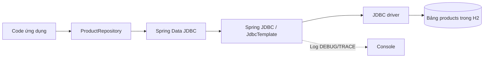

# Thực hiện vòng CRUD đầu tiên và quan sát SQL

## 1. Mục tiêu của bài thực hành

Sau khi đã khởi tạo dự án Spring Boot có Spring Data JDBC, bước quan trọng nhất là **chạy được một vòng Create → Read → Update → Delete trên cơ sở dữ liệu thật và nhìn thấy các câu SQL mà framework thực thi**. Bài này sử dụng cơ sở dữ liệu H2 chạy trong bộ nhớ để không cần cài đặt máy chủ database; cách dùng repository tương tự khi chuyển sang PostgreSQL hoặc một cơ sở dữ liệu quan hệ được hỗ trợ khác.

Khi hoàn thành, bạn sẽ biết:

- Khai báo bảng SQL, ánh xạ một Java object và tạo `CrudRepository`.
- Lưu bản ghi mới, đọc theo ID, cập nhật dữ liệu và xóa bản ghi.
- Bật log Spring JDBC để quan sát `INSERT`, `SELECT`, `UPDATE` và `DELETE`.
- Hiểu vì sao `save` đôi khi thực hiện `INSERT`, đôi khi thực hiện `UPDATE`; vì sao `save` trả về một đối tượng cần sử dụng tiếp.
- Phân biệt SQL mà repository phát ra với log do ứng dụng tự in, đồng thời biết các lỗi thường gặp khi chạy lần đầu.

### CRUD đi qua những thành phần nào?



Bạn gọi phương thức Java trên repository; Spring Data JDBC tạo và thực thi SQL thông qua hạ tầng JDBC. Bật log ở đúng lớp cho phép thấy lệnh SQL thực sự được gửi tới JDBC, thay vì chỉ suy luận từ tên phương thức.

## 2. Chuẩn bị một ứng dụng tối thiểu

Ví dụ giả định:

- **Java 21**, Spring Boot 3.x hoặc một phiên bản Spring Boot tương thích với Spring Data JDBC.
- Dự án Gradle được tạo bằng Spring Initializr hoặc một dự án Spring Boot có sẵn.
- Chọn dependencies **Spring Data JDBC** và **H2 Database**.
- Package Java dùng trong bài: `com.example.jdbccrud`. Nếu package thực tế khác, sửa nhất quán các dòng `package`.

Với Gradle Groovy DSL, phần dependencies cần có:

```groovy
dependencies {
    implementation 'org.springframework.boot:spring-boot-starter-data-jdbc'
    runtimeOnly 'com.h2database:h2'
}
```

`spring-boot-starter-data-jdbc` cung cấp Spring Data JDBC và hạ tầng Spring JDBC. H2 cung cấp JDBC driver và database nhúng để chạy ví dụ. Khi dùng Spring Boot dependency management, phiên bản tương thích của các thư viện này được quản lý theo phiên bản Spring Boot của dự án.

Cấu trúc các file sẽ tạo:

```text
src/
└── main/
    ├── java/com/example/jdbccrud/
    │   ├── JdbcCrudApplication.java
    │   ├── Product.java
    │   └── ProductRepository.java
    └── resources/
        ├── application.properties
        └── schema.sql
```

Không cần Spring Web cho bài thực hành chạy từ console. Ta dùng `CommandLineRunner`, nên chương trình tự thực hiện các bước CRUD khi ứng dụng khởi động.

## 3. Cấu hình database và log SQL

Tạo `src/main/resources/application.properties`:

```properties
spring.application.name=jdbc-crud-demo

# Database H2 trong bộ nhớ, dùng cho buổi thực hành
spring.datasource.url=jdbc:h2:mem:crud_demo;DB_CLOSE_DELAY=-1
spring.datasource.driver-class-name=org.h2.Driver
spring.datasource.username=sa
spring.datasource.password=

# Chạy schema.sql trong lúc khởi tạo ứng dụng
spring.sql.init.mode=always

# In câu SQL qua hạ tầng Spring JDBC
logging.level.org.springframework.jdbc=DEBUG

# In thông tin gán tham số PreparedStatement chi tiết hơn
logging.level.org.springframework.jdbc.core.StatementCreatorUtils=TRACE
```

Giải thích:

| Cấu hình | Tác dụng |
| --- | --- |
| `jdbc:h2:mem:crud_demo` | H2 tạo database trong bộ nhớ của tiến trình Java; khi ứng dụng dừng hoàn toàn, dữ liệu thực hành không được lưu lâu dài. |
| `DB_CLOSE_DELAY=-1` | Giữ database H2 tồn tại trong JVM ngay cả khi kết nối cuối đóng; không biến H2 in-memory thành database bền vững sau khi thoát JVM. |
| `spring.sql.init.mode=always` | Cho phép Spring Boot thực thi script `schema.sql` khi khởi động. |
| `logging.level.org.springframework.jdbc=DEBUG` | Hiển thị các hoạt động JDBC và lệnh SQL qua Spring JDBC trong console. |
| `StatementCreatorUtils=TRACE` | Giúp thấy thông tin bind tham số ở những đường thực thi sử dụng lớp này; mức độ chi tiết phụ thuộc phiên bản Spring. |

**Chỉ bật log tham số ở mức TRACE trong môi trường học tập hoặc khi chẩn đoán có kiểm soát.** Trong ứng dụng thật, bind parameter có thể chứa email, thông tin khách hàng hoặc dữ liệu nhạy cảm.

## 4. Tạo bảng `products` bằng SQL

Tạo `src/main/resources/schema.sql`:

```sql
CREATE TABLE "products" (
    id       BIGINT GENERATED BY DEFAULT AS IDENTITY PRIMARY KEY,
    name     VARCHAR(120) NOT NULL,
    price    DECIMAL(12, 2) NOT NULL,
    quantity INTEGER NOT NULL CHECK (quantity >= 0)
);
```

Mỗi hàng có bốn cột:

- `id`: khóa chính số nguyên do database sinh khi chèn.
- `name`: tên sản phẩm, bắt buộc.
- `price`: giá dùng kiểu số thập phân, phù hợp hơn kiểu dấu phẩy động cho các giá trị tiền.
- `quantity`: số lượng tồn kho, không được âm.

**Chi tiết dễ gây lỗi với H2:** tên bảng được viết `"products"` trong dấu ngoặc kép có chủ ý. H2 mặc định chuyển tên SQL *không được quote* sang chữ hoa; trong khi `@Table("products")` ở phần kế tiếp chỉ định tên chính xác. Spring Data JDBC có thể quote identifier trong SQL phát sinh. Nếu tạo `CREATE TABLE products` nhưng ánh xạ `@Table("products")`, ứng dụng có thể báo không tìm thấy bảng do `PRODUCTS` và `"products"` là hai identifier khác nhau trên H2. Ở bài này, bảng được tạo với tên trùng khớp mapping.

Các cột `id`, `name`, `price`, `quantity` không được quote trong DDL, nên H2 chuyển chúng sang chữ hoa theo mặc định; ánh xạ tên cột do Spring Data JDBC suy ra theo dialect H2 sẽ tương ứng. Khi chuyển qua một database khác, cần kiểm tra quy tắc chữ hoa/chữ thường và quoting của dialect đó.

Spring Data JDBC **không tự tạo bảng theo entity như một cơ chế Hibernate DDL**. Ta chủ động tạo schema bằng script; ở dự án thực tế, thường dùng Flyway hoặc Liquibase để quản lý thay đổi schema qua các phiên bản.

## 5. Ánh xạ hàng dữ liệu thành Java record

Tạo `src/main/java/com/example/jdbccrud/Product.java`:

```java
package com.example.jdbccrud;

import java.math.BigDecimal;
import org.springframework.data.annotation.Id;
import org.springframework.data.relational.core.mapping.Table;

@Table("products")
public record Product(
        @Id Long id,
        String name,
        BigDecimal price,
        int quantity
) {
}
```

Mỗi instance `Product` mô tả một hàng trong bảng:

| Java | SQL |
| --- | --- |
| `Long id` | `id BIGINT`, khóa chính |
| `String name` | `name VARCHAR(120)` |
| `BigDecimal price` | `price DECIMAL(12,2)` |
| `int quantity` | `quantity INTEGER` |

`@Table("products")` liên kết record với bảng đã tạo; `@Id` của `org.springframework.data.annotation.Id` đánh dấu thuộc tính khóa chính. Không dùng nhầm `jakarta.persistence.Id` của JPA. Spring Data JDBC không cần `@Entity` của JPA.

Ở đây dùng Java `record` để tập trung vào vòng CRUD. Record là đối tượng bất biến: sau khi tạo, không thể gọi `setQuantity(...)`; để cập nhật, ta tạo một record mới giữ nguyên ID rồi gọi `save`. Spring Data có thể dựng instance từ canonical constructor của record; khi insert sinh ID, `save` có thể trả về instance mới mang ID đó.

**Luôn sử dụng giá trị trả về của `save`**, đặc biệt với record hoặc đối tượng bất biến.

## 6. Tạo repository cho bảng

Tạo `src/main/java/com/example/jdbccrud/ProductRepository.java`:

```java
package com.example.jdbccrud;

import org.springframework.data.repository.CrudRepository;

public interface ProductRepository extends CrudRepository<Product, Long> {
}
```

Hai tham số generic có nghĩa:

- `Product` là kiểu aggregate root mà repository quản lý.
- `Long` là kiểu ID của `Product`.

Không cần tự viết lớp implements repository cho những thao tác cơ bản. Spring Data tạo implementation khi ứng dụng khởi động và cung cấp những phương thức sẵn có:

| Phương thức | Mục đích | SQL thường thấy |
| --- | --- | --- |
| `save(new Product(null, ...))` | Thêm hàng mới | `INSERT` |
| `findById(id)` | Đọc một hàng | `SELECT ... WHERE id = ?` |
| `findAll()` | Đọc danh sách | `SELECT` |
| `save(new Product(id, ...))` | Lưu thay đổi của hàng đã tồn tại | `UPDATE` |
| `deleteById(id)` | Xóa hàng | `DELETE` |
| `existsById(id)` | Kiểm tra tồn tại | Thường là truy vấn dạng `SELECT COUNT(...)` |

Spring Data JDBC phân biệt insert/update bằng chiến lược nhận diện trạng thái mới của entity; đối với record **không có `@Version` trong ví dụ này**, giá trị `@Id = null` biểu thị đối tượng mới, còn ID khác `null` được hiểu là đối tượng đã tồn tại. Quy tắc có thể thay đổi khi dùng `@Version`, `Persistable` hoặc cấu hình nhận diện trạng thái riêng.

## 7. Chạy trọn vẹn Create → Read → Update → Delete

Tạo `src/main/java/com/example/jdbccrud/JdbcCrudApplication.java`:

```java
package com.example.jdbccrud;

import java.math.BigDecimal;
import org.springframework.boot.CommandLineRunner;
import org.springframework.boot.SpringApplication;
import org.springframework.boot.autoconfigure.SpringBootApplication;
import org.springframework.context.annotation.Bean;

@SpringBootApplication
public class JdbcCrudApplication {

    public static void main(String[] args) {
        SpringApplication.run(JdbcCrudApplication.class, args);
    }

    @Bean
    CommandLineRunner firstCrud(ProductRepository products) {
        return args -> {
            // CREATE
            System.out.println("\n=== CREATE ===");
            Product created = products.save(
                    new Product(
                            null,
                            "So tay A5",
                            new BigDecimal("35000.00"),
                            10
                    )
            );
            System.out.println("Da tao: " + created);

            // READ
            System.out.println("\n=== READ ===");
            Product found = products.findById(created.id())
                    .orElseThrow();
            System.out.println("Tim theo ID: " + found);

            System.out.println("Tat ca san pham:");
            products.findAll().forEach(System.out::println);

            // UPDATE
            System.out.println("\n=== UPDATE ===");
            Product changed = new Product(
                    found.id(),                    // Giữ nguyên khóa chính
                    found.name(),
                    found.price(),
                    25                              // Đổi số lượng 10 -> 25
            );
            Product savedAfterUpdate = products.save(changed);
            System.out.println("Da cap nhat: " + savedAfterUpdate);

            Product verified = products.findById(savedAfterUpdate.id())
                    .orElseThrow();
            System.out.println("Doc lai sau update: " + verified);

            // DELETE
            System.out.println("\n=== DELETE ===");
            products.deleteById(savedAfterUpdate.id());
            boolean stillExists = products.existsById(savedAfterUpdate.id());
            System.out.println("Con ton tai sau delete? " + stillExists);
        };
    }
}
```

Đặt các file trong cùng package để component scan tìm thấy bean và Spring Data repository scan tìm được interface. Khi ứng dụng khởi động thành công, Spring sẽ gọi `CommandLineRunner` sau khi application context được tạo và database đã khởi tạo theo cấu hình.

### Chạy ứng dụng

Tại thư mục gốc dự án có Gradle Wrapper:

```bash
./gradlew bootRun
```

Trên Windows PowerShell:

```powershell
.\gradlew.bat bootRun
```

Nếu IDE đã hỗ trợ chạy Spring Boot, bạn cũng có thể chạy phương thức `main` của `JdbcCrudApplication`.

Ở console, ngoài log Spring, các dòng tự in sẽ có dạng:

```text
=== CREATE ===
Da tao: Product[id=1, name=So tay A5, price=35000.00, quantity=10]

=== READ ===
Tim theo ID: Product[id=1, name=So tay A5, price=35000.00, quantity=10]
Tat ca san pham:
Product[id=1, name=So tay A5, price=35000.00, quantity=10]

=== UPDATE ===
Da cap nhat: Product[id=1, name=So tay A5, price=35000.00, quantity=25]
Doc lai sau update: Product[id=1, name=So tay A5, price=35000.00, quantity=25]

=== DELETE ===
Con ton tai sau delete? false
```

ID có thể khác `1` nếu database đã có dữ liệu hoặc ID từng được sinh trước đó. Giá trị hiển thị của `BigDecimal` phụ thuộc cách driver và mapper biểu diễn scale, nên có thể khác chút về phần số 0 sau dấu thập phân. Các đoạn trên là **kết quả minh họa**, không phải log đo được từ một lần chạy cụ thể.

## 8. Đọc log SQL theo từng thao tác

Khi bật `DEBUG` cho `org.springframework.jdbc`, console có thể hiển thị thông báo từ `JdbcTemplate`, `NamedParameterJdbcTemplate`, thành phần transaction và các lớp JDBC liên quan. Nội dung log chính xác, thứ tự cột, cách quote tên bảng/cột và cú pháp SQL phụ thuộc phiên bản Spring Data JDBC, dialect và driver; cần đối chiếu log thực tế của dự án.

Để dễ đọc, các câu SQL dưới đây chỉ minh họa **hình dạng câu lệnh**, đã lược bỏ prefix thời gian, tên luồng, lớp log và một số chi tiết dialect.

### 8.1. Create: `INSERT`

Lời gọi:

```java
Product created = products.save(
        new Product(null, "So tay A5", new BigDecimal("35000.00"), 10)
);
```

SQL tương đương:

```sql
INSERT INTO "products" ("NAME", "PRICE", "QUANTITY")
VALUES (?, ?, ?);
```

Ở bước này:

1. `id` là `null`, nên Spring Data JDBC nhận đây là entity mới.
2. Database sinh khóa chính bằng cột `IDENTITY`.
3. Giá trị `?` là bind parameter của JDBC `PreparedStatement`; dữ liệu được gửi riêng qua API tham số.
4. `save` trả về `Product` có `id` đã sinh, chẳng hạn `1L`.

Không nên nối chuỗi dữ liệu người dùng trực tiếp vào SQL; bind parameter giúp tách cấu trúc truy vấn khỏi giá trị, đồng thời tránh nhiều rủi ro SQL injection.

### 8.2. Read: `SELECT`

Lời gọi:

```java
Product found = products.findById(created.id()).orElseThrow();
```

SQL về bản chất tương đương:

```sql
SELECT "ID", "NAME", "PRICE", "QUANTITY"
FROM "products"
WHERE "ID" = ?;
```

Giá trị bind của `?` là ID sản phẩm. Repository trả `Optional<Product>`: có hàng thì chuyển dữ liệu thành record, không có thì `Optional.empty()`. `orElseThrow()` trong ví dụ chủ động báo lỗi nếu việc tìm lại không thành công.

Gọi `findAll()` tạo thêm một câu `SELECT` không lọc ID:

```sql
SELECT "ID", "NAME", "PRICE", "QUANTITY"
FROM "products";
```

Khi bảng lớn, tránh gọi `findAll()` rồi lọc trong Java cho một màn hình có phân trang; bài này chỉ có một hàng để quan sát dễ dàng.

### 8.3. Update: `UPDATE`

Lời gọi:

```java
Product changed = new Product(
        found.id(), found.name(), found.price(), 25
);
Product updated = products.save(changed);
```

SQL tương đương:

```sql
UPDATE "products"
SET "NAME" = ?, "PRICE" = ?, "QUANTITY" = ?
WHERE "ID" = ?;
```

Vì ID không còn là `null`, Spring Data JDBC coi đây là bản ghi đã tồn tại và thực hiện đường update. Ví dụ chỉ đổi `quantity` nhưng lệnh update aggregate root thông thường vẫn có thể gán các cột được mapping, không chỉ cột mà bạn vừa đổi trong Java.

**Không có dirty checking như Hibernate/JPA**: chỉ dựng một record mới chưa tạo SQL; lệnh `products.save(changed)` mới yêu cầu ghi thay đổi. Việc gọi `findById` sau update là một phép đọc độc lập để kiểm tra giá trị đã được lưu.

Nếu muốn cập nhật chính xác một cột bằng SQL, có thể nghiên cứu repository query tùy chỉnh, `JdbcTemplate` hoặc các API thích hợp; đó là lựa chọn thiết kế khác với việc lưu toàn bộ aggregate.

### 8.4. Delete: `DELETE`

Lời gọi:

```java
products.deleteById(updated.id());
```

SQL tương đương:

```sql
DELETE FROM "products"
WHERE "ID" = ?;
```

Sau khi xóa, `existsById(id)` có thể phát sinh truy vấn kiểm tra sự tồn tại (chẳng hạn dựa trên `COUNT`). Giá trị `false` là kết quả mong đợi trong ví dụ này, vì chỉ có một sản phẩm và sản phẩm đã bị xóa.

### 8.5. Bảng đối chiếu toàn bộ vòng CRUD

| Thứ tự | Lệnh Java | SQL chính | Điều cần quan sát |
| --- | --- | --- | --- |
| 1 | `save(new Product(null, ...))` | `INSERT` | ID mới được tạo và trả về. |
| 2 | `findById(id)` | `SELECT ... WHERE ...` | Dữ liệu được ánh xạ từ hàng SQL thành `Product`. |
| 3 | `findAll()` | `SELECT ...` | Có thêm một lần truy vấn toàn bảng. |
| 4 | `save(new Product(id, ...))` | `UPDATE ... WHERE ...` | ID giữ nguyên, `quantity` thay đổi. |
| 5 | `findById(id)` | `SELECT ... WHERE ...` | Đọc lại dữ liệu vừa cập nhật. |
| 6 | `deleteById(id)` | `DELETE ... WHERE ...` | Hàng được xóa theo ID. |
| 7 | `existsById(id)` | Truy vấn kiểm tra tồn tại | Kết quả `false`; phát sinh thêm SQL. |

Không nên kỳ vọng cả vòng CRUD chỉ có bốn câu SQL, vì chính ví dụ đã chủ động gọi thêm `findAll`, `findById` lần hai và `existsById` để kiểm tra các trạng thái.

## 9. Phân biệt log SQL với kết quả in ra

Ví dụ:

```text
DEBUG ... JdbcTemplate : Executing prepared SQL statement [...]
TRACE ... StatementCreatorUtils : Setting SQL statement parameter value ...
Da tao: Product[id=1, name=So tay A5, price=35000.00, quantity=10]
```

Hai dòng đầu là log từ hạ tầng truy cập database; dòng cuối là `System.out.println` trong ứng dụng. Dòng `Da tao` chứng minh chương trình đã nhận một object; log SQL cho biết thao tác nào thực sự được yêu cầu ở tầng JDBC.

Khi đọc log, tự hỏi:

1. Lệnh là `INSERT`, `SELECT`, `UPDATE` hay `DELETE`?
2. Tên bảng có khớp với `@Table` và `schema.sql`?
3. Câu SQL có `WHERE` đúng ID không?
4. Có bao nhiêu lần `SELECT` vì code gọi nhiều phương thức đọc?
5. Những dấu `?` đại diện cho giá trị nào, và có cần log chúng trong môi trường này không?
6. Có truy vấn ngoài dự kiến do code thật, initializer hoặc framework thực thi không?

Không suy ra rằng một phương thức repository luôn tương ứng chính xác với **một** SQL trong mọi mô hình. Ví dụ này dùng một aggregate root đơn giản, không có bảng con; khi thêm collection/đối tượng con thuộc aggregate, quá trình `save` và đọc aggregate có thể phát sinh nhiều câu SQL hơn.

## 10. Các khái niệm quan trọng sau lần chạy đầu tiên

### `save` không đồng nghĩa với `INSERT`

`CrudRepository.save` là thao tác lưu trạng thái aggregate. Tùy Spring Data JDBC nhận diện entity mới hay đã tồn tại, lệnh ghi sẽ theo đường insert hoặc update. Trên ví dụ:

```java
products.save(new Product(null, "A", new BigDecimal("10.00"), 1));
// Đường INSERT vì ID chưa có

products.save(new Product(123L, "A", new BigDecimal("10.00"), 2));
// Đường UPDATE vì ID đã có; cần đảm bảo row ID = 123 thực sự tồn tại
```

Dùng ID tự đoán không phải cách tạo mới an toàn; nếu ID đã được gán nhưng hàng không tồn tại, `save` không mặc nhiên là “upsert” có thể tự tạo lại hàng. Với update không tìm thấy đối tượng, hành vi báo lỗi phụ thuộc cơ chế cập nhật và trạng thái nhận diện; ở bài thực hành, luôn lấy ID từ bản ghi tạo thành công.

### Repository method và giao dịch

Các phương thức CRUD repository mặc định được cấu hình transaction phù hợp với thao tác. Tuy nhiên, các lệnh liên tiếp trong `CommandLineRunner` **không tự động tạo thành một transaction chung**: tạo, đọc, cập nhật và xóa là các lời gọi riêng trong ví dụ.

Khi nghiệp vụ yêu cầu nhiều bước phải cùng thành công hoặc cùng rollback, đặt chúng trong một phương thức service có `@Transactional`, gọi qua Spring bean. Chẳng hạn, chuyển số lượng giữa hai bản ghi phải được coi là một nghiệp vụ, cần thêm kiểm tra tồn kho và tính nhất quán; không chỉ nối hai lời gọi `save` là đã đủ.

### `@Id` khác `@Version`

`@Id` xác định bản ghi cần thao tác; **không ngăn hai người cập nhật cùng bản ghi rồi ghi đè nhau**. Nếu cần phát hiện cập nhật cạnh tranh, Spring Data JDBC hỗ trợ `@Version` để optimistic locking. Bài đầu tiên chưa thêm version để quan sát bốn loại câu SQL cơ bản; việc thêm version là một bước mở rộng, có ảnh hưởng tới DDL và điều kiện `UPDATE`.

### H2 in-memory để thực hành, không phải kho lưu trữ vĩnh viễn

Khởi động lại tiến trình JVM sẽ tạo database H2 mới và Spring Boot chạy lại `schema.sql`. Vòng CRUD xóa bản ghi ở cuối cũng khiến bảng trống sau lần chạy. Nếu cần giữ dữ liệu qua các lần chạy, chuyển sang file-backed H2 hoặc một database triển khai như PostgreSQL và dùng migration; khi chuyển, kiểm tra driver, dialect, kiểu SQL, quoting và transaction.

## 11. Lỗi phổ biến và cách xử lý

| Triệu chứng | Nguyên nhân thường gặp | Hướng xử lý |
| --- | --- | --- |
| `Table "products" not found` | `schema.sql` chưa được chạy; tên bảng trong `@Table` khác chữ hoa/chữ thường so với DDL H2 | Kiểm tra `src/main/resources/schema.sql`, `spring.sql.init.mode`; bảo đảm `CREATE TABLE "products"` khớp `@Table("products")`. |
| `Column ... not found` | Tên cột hoặc quy tắc quoting không khớp mapping | Đối chiếu record, DDL và SQL trong log; với `@Column` tùy chỉnh phải khớp tên thực tế. |
| `Failed to configure a DataSource` | Thiếu H2 dependency/driver hoặc sai URL | Kiểm tra `runtimeOnly 'com.h2database:h2'`, URL và dependency được load. |
| Không tạo được bean `ProductRepository` | Thiếu starter JDBC hoặc repository ở ngoài vùng package scan | Kiểm tra dependency và đặt repository cùng package hoặc dưới package của `@SpringBootApplication`. |
| Không thấy SQL trên console | Chưa bật logger đúng hoặc log mức DEBUG bị cấu hình khác ghi đè | Bật `logging.level.org.springframework.jdbc=DEBUG`, chạy lại, phân biệt SQL log với dòng `System.out.println`. |
| Gọi `save` rồi không có `INSERT` | Entity có ID khác `null` nên Spring Data JDBC xem là đã tồn tại | Với sản phẩm mới, dùng ID `null`; với cập nhật, dùng ID từ bản ghi đã lưu. |
| Sau lần chạy, bảng không còn sản phẩm | Code đã gọi `deleteById` | Tạm bỏ lời gọi delete để xem trạng thái sau update; hoặc tạo lại ở lần chạy tiếp. |
| Khởi động lại không còn dữ liệu cũ | Dùng database H2 in-memory | Đây là hành vi dự kiến; dùng database bền vững nếu cần lưu lâu dài. |
| Thêm field Java nhưng query lỗi | Schema SQL chưa cập nhật tương ứng | Cập nhật `schema.sql` hoặc migration cùng với model; Spring Data JDBC không tự sửa cấu trúc bảng. |

Nếu gặp lỗi, đọc **ngoại lệ đầu tiên liên quan SQL** trong stack trace, lấy tên bảng/cột mà database báo, rồi đối chiếu trực tiếp với DDL và mapping. Đừng sửa cấu hình logger để che lỗi; logger chỉ là công cụ quan sát.

## 12. Bài tập tự thực hành

Sau khi vòng CRUD đầu tiên chạy được, có thể thử ba thay đổi nhỏ để hiểu cơ chế rõ hơn.

**Bài tập A — Thêm bản ghi thứ hai:** tạo thêm `Product` có `id = null` rồi gọi `findAll()`. Quan sát hai lần `INSERT` và kết quả `SELECT` chứa hai hàng. Dự đoán ID mới trước khi nhìn console.

**Bài tập B — So sánh bản ghi trước và sau update:** đổi `price`, giữ nguyên `quantity`; gọi `save` và đọc lại. Quan sát SQL update có thể gán các cột khác ngoài cột bạn chủ ý thay đổi. Giải thích vì sao phương thức `save` khác một câu SQL `UPDATE products SET price = ...` do bạn tự viết.

**Bài tập C — Đếm các truy vấn đọc:** ghi ra dự đoán số câu `SELECT` của vòng CRUD hiện tại, sau đó bỏ `findAll()` và lượt `findById(...)` sau update. So sánh số truy vấn từ log. Mục tiêu là thấy **mỗi lần kiểm tra dữ liệu bằng repository cũng có chi phí truy cập database**.

Có thể xóa toàn bộ dữ liệu thử nghiệm khi ứng dụng kết thúc vì H2 đang chạy in-memory. Để thử lại từ đầu, chỉ cần khởi động lại ứng dụng với những file cấu hình và schema đã chuẩn bị.

## 13. Ghi nhớ

Với một bảng đơn giản, vòng Spring Data JDBC đầu tiên diễn ra như sau: định nghĩa DDL → tạo model có `@Table`/`@Id` → khai báo `CrudRepository` → gọi `save`, `findById`, `save`, `deleteById` → quan sát lệnh SQL bằng log Spring JDBC. Tên phương thức repository nói lên **ý định ở tầng ứng dụng**; SQL trong log cho thấy **truy cập database thực tế**.

Điểm quan trọng nhất của bài thực hành là kết nối được ba lớp thông tin: **đối tượng Java đang có ID và giá trị nào**, **phương thức repository nào vừa được gọi**, và **database đã nhận câu SQL gì**. Khi nắm được mối liên hệ này, bạn sẽ dễ hiểu hơn các bài tiếp theo về truy vấn tùy chỉnh, transaction, quan hệ aggregate, optimistic locking và tối ưu hiệu năng.

### Tài liệu chính thức để tra cứu thêm

- [Spring Data Relational — Getting Started](https://docs.spring.io/spring-data/relational/reference/jdbc/getting-started.html)
- [Spring Data Relational — Mapping](https://docs.spring.io/spring-data/relational/reference/jdbc/mapping.html)
- [Spring Data Relational — Persisting Entities](https://docs.spring.io/spring-data/relational/reference/jdbc/entity-persistence.html)
