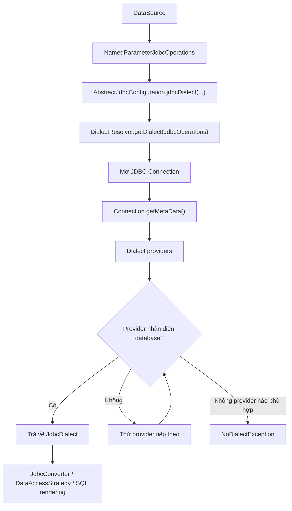

# Phát hiện dialect từ metadata của kết nối

Trong **Spring Data Relational JDBC**, mỗi database có những khác biệt về cú pháp SQL và cách thực hiện một số thao tác. Ví dụ, cách giới hạn số hàng, tạo ID, khóa hàng, xử lý identifier, `UPSERT` hoặc kiểu mảng có thể khác nhau giữa PostgreSQL, MySQL, Oracle và SQL Server. Spring Data JDBC gom những khác biệt này vào một abstraction tên là **`JdbcDialect`**.

Khi khởi tạo hạ tầng JDBC, Spring Data JDBC mặc định xác định dialect bằng cách lấy một kết nối từ `DataSource` và kiểm tra metadata của kết nối đó. Việc phân giải được thực hiện qua `DialectResolver`, thường dựa trên `Connection.getMetaData()` và các provider được phát hiện qua `SpringFactoriesLoader`.

Quy trình tổng quát:

1. Ứng dụng cấu hình `DataSource` và `NamedParameterJdbcOperations`.
2. `AbstractJdbcConfiguration` gọi logic xác định dialect.
3. `DialectResolver` sử dụng JDBC operations để lấy connection.
4. Resolver đọc metadata của database/driver.
5. Provider phù hợp trả về một `JdbcDialect`.
6. Dialect được dùng trong converter, data access strategy và các thành phần tạo SQL của Spring Data JDBC.

Nếu database không có dialect được hỗ trợ hoặc provider tùy chỉnh, Spring Data JDBC không thể hoàn tất cấu hình mặc định và ứng dụng có thể thất bại khi khởi động. Bài này giải thích metadata, cơ chế phát hiện, danh sách dialect tích hợp, cách mở rộng provider và cách xử lý lỗi.

## 1. Dialect là gì và vì sao Spring Data JDBC cần nó?

`JdbcDialect` mô tả những đặc điểm SQL/JDBC của một database. Nó giúp Spring Data JDBC tạo câu SQL phù hợp mà không phải viết một implementation repository riêng cho từng vendor.

Các khác biệt thường được dialect biểu diễn:

| Khía cạnh | Ví dụ khác biệt |
|---|---|
| Giới hạn kết quả | `LIMIT/OFFSET`, `FETCH FIRST`, `OFFSET … FETCH` hoặc cú pháp vendor-specific |
| Sinh ID | Identity column, sequence hoặc cách lấy generated key |
| Khóa hàng | Cú pháp và vị trí của `FOR UPDATE`, lock clause hoặc locking hint |
| Identifier | Quy tắc quote tên bảng/cột và phân biệt chữ hoa/chữ thường |
| Insert | Cách biểu diễn insert với giá trị mặc định hoặc lấy generated key |
| Upsert | Cách tạo lệnh insert-or-update nếu database hỗ trợ |
| Array columns | Khả năng bind/đọc kiểu mảng và cách chuyển đổi |
| Kiểu native | Các Java type được JDBC driver xử lý như kiểu store native |
| Feature flags | Khả năng của database như Single Query Loading hoặc các tính năng SQL khác |

Dialect không chỉ là một chuỗi tên vendor. Nó là tập hợp quy tắc và capability mà framework cần để sinh SQL, bind dữ liệu và xử lý kết quả đúng với database.

### `Dialect` và `JdbcDialect`

Spring Data Relational có interface chung `org.springframework.data.relational.core.dialect.Dialect`. `JdbcDialect` trong package `org.springframework.data.jdbc.core.dialect` mở rộng interface đó bằng các khả năng đặc thù JDBC, ví dụ JDBC array support và SQL type metadata.

```text
org.springframework.data.relational.core.dialect.Dialect
                    ▲
                    │ extends
                    │
org.springframework.data.jdbc.core.dialect.JdbcDialect
```

Spring Data JDBC cần một `JdbcDialect`. Khi provider trả về một implementation, implementation đó phải tương thích với SQL và hành vi JDBC của database thực tế.

## 2. Metadata được lấy từ đâu?

JDBC cung cấp `DatabaseMetaData` thông qua một `Connection`:

```java
Connection connection = dataSource.getConnection();
DatabaseMetaData metadata = connection.getMetaData();
```

Metadata chứa thông tin về database và driver đang phục vụ connection đó. Một số method hữu ích:

| Method | Thông tin |
|---|---|
| `getDatabaseProductName()` | Tên sản phẩm database, ví dụ PostgreSQL hoặc MySQL |
| `getDatabaseProductVersion()` | Phiên bản database server |
| `getDriverName()` | Tên JDBC driver |
| `getDriverVersion()` | Phiên bản JDBC driver |
| `getURL()` | JDBC URL của connection |
| `getUserName()` | Tên user đang kết nối |
| `getIdentifierQuoteString()` | Ký tự dùng để quote identifier theo driver |
| `supportsTransactions()` | Driver/database có hỗ trợ transaction hay không |
| `supportsBatchUpdates()` | Khả năng batch update |

Spring Data JDBC dùng `JdbcOperations` để lấy connection và đọc metadata; ứng dụng không cần tự mở connection để thực hiện dialect resolution thông thường.

### Ví dụ đọc metadata để chẩn đoán

Khi cần xác nhận driver đang kết nối đến database nào, có thể dùng `JdbcTemplate`:

```java
import java.sql.DatabaseMetaData;

import org.springframework.jdbc.core.ConnectionCallback;
import org.springframework.jdbc.core.JdbcTemplate;
import org.springframework.stereotype.Component;

@Component
public class DatabaseMetadataReporter {

    public DatabaseMetadataReporter(JdbcTemplate jdbcTemplate) {
        jdbcTemplate.execute((ConnectionCallback<Void>) connection -> {
            DatabaseMetaData metadata = connection.getMetaData();

            System.out.println("Database: " + metadata.getDatabaseProductName());
            System.out.println("Database version: " + metadata.getDatabaseProductVersion());
            System.out.println("JDBC driver: " + metadata.getDriverName());
            System.out.println("Driver version: " + metadata.getDriverVersion());

            return null;
        });
    }
}
```

Đây là code chẩn đoán, không phải cách thay thế `DialectResolver`. `JdbcTemplate.execute(ConnectionCallback)` lấy connection theo cơ chế Spring JDBC và quản lý vòng đời connection. Không gọi `close()` trên connection nhận từ callback này.

Tránh ghi toàn bộ JDBC URL hoặc user/credential vào log nếu URL chứa thông tin nhạy cảm. Khi điều tra, tên sản phẩm, phiên bản server và phiên bản driver thường đã đủ để xác nhận database.

## 3. Quy trình phát hiện dialect khi khởi tạo

Trong cấu hình Java thuần, `AbstractJdbcConfiguration` cung cấp bean `jdbcDialect(NamedParameterJdbcOperations)`. Implementation mặc định dùng hạ tầng resolver để xác định dialect từ JDBC operations.



Các bước chi tiết:

1. `DataSource` cung cấp connection cho database thực tế.
2. `NamedParameterJdbcOperations` là abstraction Spring JDBC dùng để thực hiện SQL và truy cập connection.
3. `AbstractJdbcConfiguration.jdbcDialect(...)` xác định dialect trong lúc cấu hình các bean Spring Data JDBC.
4. `DialectResolver` lấy connection thông qua `JdbcOperations` và kiểm tra metadata.
5. Các `JdbcDialectProvider` được phát hiện qua `SpringFactoriesLoader` được dùng để tìm dialect tương ứng.
6. Provider phù hợp trả về `Optional` chứa `Dialect`; resolver sử dụng dialect đó cho hạ tầng JDBC.

Nếu không có provider nào nhận diện database, resolver ném `DialectResolver.NoDialectException`. Lỗi này thường khiến application context không khởi tạo được vì các bean như `JdbcConverter` và `DataAccessStrategy` cần dialect.

### Metadata không chỉ là tên trong JDBC URL

Không nên suy ra dialect chỉ bằng cách kiểm tra chuỗi `spring.datasource.url`. URL là cấu hình kết nối; `DatabaseMetaData` phản ánh database mà JDBC connection thực sự đang nói chuyện.

Ví dụ URL có thể đi qua proxy, cloud database endpoint hoặc driver tương thích với một giao thức khác. Tên database trong URL có thể không trùng `getDatabaseProductName()`. Provider nên kiểm tra metadata và những capability cần thiết thay vì chỉ parse URL.

## 4. Các dialect được Spring Data JDBC hỗ trợ trực tiếp

Theo tài liệu Spring Data Relational **4.1.2**, các database có dialect tích hợp gồm:

| Database | JDBC dialect tích hợp |
|---|---|
| IBM Db2 | `JdbcDb2Dialect` |
| H2 | `JdbcH2Dialect` |
| HSQLDB | `JdbcHsqlDbDialect` |
| MariaDB | `JdbcMariaDbDialect` |
| Microsoft SQL Server | `JdbcSqlServerDialect` |
| MySQL | `JdbcMySqlDialect` |
| Oracle | `JdbcOracleDialect` |
| PostgreSQL | `JdbcPostgresDialect` |

Danh sách này nói về dialect được Spring Data JDBC cung cấp, không phải toàn bộ database có JDBC driver. Một database có driver JDBC vẫn cần dialect để Spring Data JDBC biết cách tạo SQL.

Nếu dùng database khác, ứng dụng có thể không khởi động với lỗi không tìm thấy dialect. Khi đó có thể:

- Dùng dialect do vendor cung cấp nếu có.
- Viết `JdbcDialect` phù hợp và provider để resolver tự phát hiện.
- Override bean `jdbcDialect(...)` trong `AbstractJdbcConfiguration` nếu ứng dụng chỉ cần lựa chọn cố định và bạn kiểm soát database.

Không nên chọn dialect gần giống chỉ vì database hỗ trợ một phần cú pháp SQL chung. Các khác biệt về ID generation, locking, upsert, array, type conversion và query rendering có thể chỉ lộ ra khi chạy một use case cụ thể.

## 5. Spring Boot và cấu hình Java thuần

### Spring Boot

Với Spring Boot và dependency `spring-boot-starter-data-jdbc`, thông thường chỉ cần cấu hình `DataSource`:

```yaml
spring:
  datasource:
    url: jdbc:postgresql://localhost:5432/sales
    username: app
    password: ${DB_PASSWORD}
    driver-class-name: org.postgresql.Driver
```

Khi có driver và DataSource hợp lệ, Spring Boot auto-configure hạ tầng Spring Data JDBC. `AbstractJdbcConfiguration` và dialect resolution được cấu hình trong infrastructure tương ứng; ứng dụng không phải tự gọi `DialectResolver`.

Không cần khai báo tên dialect trong YAML thông thường. Spring Data JDBC xác định dialect từ connection metadata. Cấu hình JDBC URL và driver vẫn phải đúng với database mà ứng dụng muốn kết nối.

### Java configuration với `AbstractJdbcConfiguration`

Khi không dùng Spring Boot hoặc cần tự cấu hình infrastructure:

```java
@Configuration
@EnableJdbcRepositories
public class ApplicationJdbcConfiguration extends AbstractJdbcConfiguration {

    @Bean
    public DataSource dataSource() {
        return DataSourceBuilder.create()
                .url("jdbc:postgresql://localhost:5432/sales")
                .username("app")
                .password(System.getenv("DB_PASSWORD"))
                .driverClassName("org.postgresql.Driver")
                .build();
    }

    @Bean
    public NamedParameterJdbcOperations namedParameterJdbcOperations(
            DataSource dataSource) {
        return new NamedParameterJdbcTemplate(dataSource);
    }

    @Bean
    public PlatformTransactionManager transactionManager(DataSource dataSource) {
        return new JdbcTransactionManager(dataSource);
    }
}
```

`AbstractJdbcConfiguration` cung cấp bean `jdbcDialect(...)` mặc định. Không cần tự khai báo thêm dialect bean nếu auto detection đã hoạt động.

Nếu override `jdbcDialect(...)`, chữ ký hiện hành là:

```java
@Override
@Bean
public JdbcDialect jdbcDialect(NamedParameterJdbcOperations operations) {
    // Chọn dialect có chủ đích.
}
```

Đây là điểm mở rộng cấu hình; hãy dùng nó khi có yêu cầu rõ ràng, không phải bước bắt buộc trong ứng dụng bình thường.

## 6. Kiểm tra dialect được chọn trong ứng dụng

Có thể inject bean `JdbcDialect` để kiểm tra dialect name hoặc capability:

```java
import org.springframework.data.jdbc.core.dialect.JdbcDialect;
import org.springframework.stereotype.Component;

@Component
public class JdbcDialectReporter {

    public JdbcDialectReporter(JdbcDialect dialect) {
        System.out.println("Spring Data JDBC dialect: " + dialect.getName());
        System.out.println(
                "Single Query Loading supported: " + dialect.supportsSingleQueryLoading()
        );
    }
}
```

`getName()` và feature flags giúp chẩn đoán dialect đã được cấu hình. Không nên dùng một lần kiểm tra này để kết luận mọi tính năng database đều hoạt động; vẫn phải chạy integration test với đúng database/driver.

### Dialect ảnh hưởng tới những bean nào?

`AbstractJdbcConfiguration` truyền dialect vào nhiều thành phần:

| Thành phần | Vai trò của dialect |
|---|---|
| `JdbcConverter` | Kết hợp converter mặc định/custom và thông tin kiểu native của store |
| `DataAccessStrategy` | Tạo các thao tác persistence phù hợp với SQL dialect |
| `JdbcAggregateTemplate` | Dùng data access strategy/converter đã cấu hình để lưu aggregate |
| Query/SQL rendering | Tạo limit, lock, insert, identifier và các câu lệnh đặc thù |
| ID generation callback | Dùng thông tin dialect để xử lý chiến lược sinh ID phù hợp |

Nếu dialect sai, ứng dụng có thể khởi động nhưng lỗi ở một thao tác ít được dùng, ví dụ insert với generated key, upsert, array mapping hoặc locking. Vì vậy, kiểm tra dialect name chỉ là bước đầu.

## 7. `DialectResolver` và provider SPI

Từ Spring Data Relational **3.5**, `DialectResolver` hiện hành nằm trong package:

```java
org.springframework.data.jdbc.core.dialect.DialectResolver
```

Class này cung cấp:

```java
JdbcDialect dialect = DialectResolver.getDialect(jdbcOperations);
```

Method nhận `JdbcOperations`, lấy connection và resolve dialect. Nếu không tìm được dialect, nó ném `DialectResolver.NoDialectException`.

Provider extension là interface lồng:

```java
org.springframework.data.jdbc.core.dialect.DialectResolver.JdbcDialectProvider
```

Method provider:

```java
Optional<Dialect> getDialect(JdbcOperations operations);
```

Provider trả `Optional.of(dialect)` nếu nhận diện được database, hoặc `Optional.empty()` nếu database không thuộc phạm vi provider đó. Giá trị trả về phải là dialect tương thích với Spring Data JDBC; thực tế nên trả một implementation `JdbcDialect`.

### Package cũ đã deprecated

Trước Spring Data Relational 3.5, resolver được đặt trong package `org.springframework.data.jdbc.repository.config`. API cũ đã bị deprecated từ 3.5 để chuyển sang `org.springframework.data.jdbc.core.dialect`.

Khi viết provider mới cho Spring Data Relational 3.5 trở lên, dùng package `org.springframework.data.jdbc.core.dialect`. Không bắt đầu dự án mới với import resolver/provider cũ.

## 8. Viết provider tùy chỉnh

Giả sử tổ chức dùng một database riêng tên `AcmeDB`, có JDBC driver nhưng Spring Data JDBC chưa có dialect tích hợp. Bạn cần hai phần:

1. Một implementation `AcmeJdbcDialect` mô tả SQL/driver behavior thực tế.
2. Một provider nhận diện `AcmeDB` từ metadata và trả dialect đó.

### Provider đọc metadata

```java
package com.example.jdbc;

import java.sql.DatabaseMetaData;
import java.util.Optional;

import org.springframework.dao.DataAccessException;
import org.springframework.jdbc.core.ConnectionCallback;
import org.springframework.jdbc.core.JdbcOperations;
import org.springframework.data.jdbc.core.dialect.DialectResolver.JdbcDialectProvider;
import org.springframework.data.relational.core.dialect.Dialect;

public class AcmeDialectProvider implements JdbcDialectProvider {

    @Override
    public Optional<Dialect> getDialect(JdbcOperations operations) {
        return operations.execute((ConnectionCallback<Optional<Dialect>>) connection -> {
            DatabaseMetaData metadata = connection.getMetaData();

            String productName = metadata.getDatabaseProductName();
            String productVersion = metadata.getDatabaseProductVersion();

            if ("AcmeDB".equalsIgnoreCase(productName)) {
                // Thay bằng implementation JdbcDialect thực sự của AcmeDB.
                return Optional.of(new AcmeJdbcDialect());
            }

            return Optional.empty();
        });
    }
}
```

Đoạn code trên minh họa SPI và metadata lookup. `AcmeJdbcDialect` là class do ứng dụng/vendor triển khai; nó phải implement `JdbcDialect` với quy tắc SQL phù hợp. Không thể dùng class placeholder này để compile trước khi có dialect implementation thực tế.

Nếu database có nhiều major version với khác biệt SQL, provider có thể kiểm tra `getDatabaseProductVersion()` và chọn implementation theo version. Không nên parse version bằng so sánh chuỗi đơn giản nếu vendor dùng format phức tạp; dùng parser/strategy được kiểm thử.

### Đăng ký provider bằng `META-INF/spring.factories`

Tạo file:

```text
src/main/resources/META-INF/spring.factories
```

Nội dung:

```properties
org.springframework.data.jdbc.core.dialect.DialectResolver$JdbcDialectProvider=com.example.jdbc.AcmeDialectProvider
```

Spring Data JDBC dùng `SpringFactoriesLoader` để phát hiện provider từ classpath. Provider cần có constructor mặc định công khai để loader có thể khởi tạo theo cơ chế này; tránh yêu cầu constructor dependency injection của Spring application context cho provider được load bằng `SpringFactoriesLoader`.

### Khi provider không nhận database

Nếu metadata không phải `AcmeDB`, trả `Optional.empty()`. Điều đó cho phép resolver tiếp tục xét provider khác. Không trả về dialect Acme cho mọi database chỉ để tránh `NoDialectException`; chọn sai dialect có thể làm SQL sai hoặc gây hỏng dữ liệu.

## 9. Viết `JdbcDialect` có trách nhiệm

Provider chỉ giải quyết câu hỏi **“database này dùng dialect nào?”**. Nó không tự định nghĩa cú pháp SQL. Nếu database chưa có dialect tương thích, phải implement `JdbcDialect`.

Một dialect cần phản ánh đúng các capability của database:

- `limit()` và `lock()` trả cách render limit/lock clause.
- `getIdentifierProcessing()` xác định cách xử lý quote/case của identifier.
- `getIdGeneration()` và `getInsertRenderContext()` hỗ trợ insert/generated ID.
- `getUpsertRenderContext()` mô tả cách tạo upsert nếu có hỗ trợ.
- `getArraySupport()` mô tả JDBC array binding/reading.
- `simpleTypes()` liệt kê store-native types được driver xử lý.
- `getConverters()` cung cấp converter đặc thù database nếu cần.
- `supportsSingleQueryLoading()` chỉ trả `true` khi database hỗ trợ các SQL feature cần thiết cho cơ chế đó.

Không nên implement dialect bằng cách copy một class khác rồi đổi `getName()`. Một database có cú pháp `LIMIT` giống PostgreSQL nhưng khác cách sinh ID, quoting, array hoặc upsert vẫn cần dialect đúng cho các tính năng đó.

### Tái sử dụng dialect tích hợp khi database thực sự tương thích

Nếu database là một distribution tương thích đầy đủ với một dialect có sẵn, có thể cân nhắc tái sử dụng implementation hiện có. Tuy nhiên phải kiểm chứng từng feature Spring Data JDBC sử dụng. Chỉ tương thích wire protocol hoặc có thể chạy một số câu SELECT không đủ để khẳng định tương thích dialect.

Ví dụ, không trả `JdbcPostgresDialect` cho mọi database trả product name chứa chữ `Postgres`. Cần xác nhận syntax, generated key, locking, types và transaction semantics tương thích với PostgreSQL dialect.

## 10. Override dialect tường minh qua `AbstractJdbcConfiguration`

Trong một ứng dụng chỉ kết nối đến một database đã biết và muốn cố định dialect, có thể override bean method:

```java
@Configuration
@EnableJdbcRepositories
public class AcmeJdbcConfiguration extends AbstractJdbcConfiguration {

    @Override
    @Bean
    public JdbcDialect jdbcDialect(NamedParameterJdbcOperations operations) {
        return new AcmeJdbcDialect();
    }
}
```

Đây là cách thay thế dialect resolution mặc định bằng một lựa chọn tường minh. Chỉ dùng nếu `AcmeJdbcDialect` đã được implement và database chắc chắn phù hợp.

Ưu điểm:

- Không cần provider SPI hoặc `spring.factories` nếu ứng dụng chỉ có một database cố định.
- Có thể cấu hình dialect cụ thể trong một configuration module riêng.
- Hữu ích khi connection metadata không nhận diện được vendor nhưng ứng dụng kiểm soát chính xác database.

Giới hạn:

- Cấu hình bị gắn với dialect cố định; không tự đổi khi DataSource trỏ sang database khác.
- Không phù hợp nếu cùng application context có nhiều nhóm repository dùng dialect khác nhau mà chỉ có một bean dialect toàn cục.
- Không giải quyết thiếu implementation; class dialect vẫn phải mô tả đúng database.

Với database vendor mới được chia sẻ cho nhiều ứng dụng, provider SPI thường phù hợp hơn vì có thể đóng gói trong thư viện và tự phát hiện theo metadata.

## 11. Nhiều DataSource cần dialect tương ứng cho từng database

Một ứng dụng có thể kết nối nhiều database, ví dụ:

```text
ordersDataSource
  └── Orders repositories + JdbcDialect của Orders DB

reportingDataSource
  └── Reporting repositories + JdbcDialect của Reporting DB
```

Dialect phải khớp DataSource mà repository infrastructure đang sử dụng. Không dùng dialect của database A cho `NamedParameterJdbcOperations` của database B chỉ vì cả hai cùng chạy trong một ứng dụng.

Với nhiều DataSource, cần cấu hình từng nhóm repository và infrastructure rõ ràng:

- DataSource tương ứng.
- `NamedParameterJdbcOperations` tương ứng.
- Transaction manager tương ứng.
- Dialect tương ứng.
- Mapping/converter/data access strategy tương ứng nếu cấu hình yêu cầu.

`AbstractJdbcConfiguration` mặc định được thiết kế cho một hạ tầng JDBC trong configuration scope. Với nhiều database, hãy tách configuration/ repository infrastructure thành các nhóm riêng và xác nhận bean wiring không bị dùng chéo. Không chỉ khai báo hai `DataSource` rồi kỳ vọng một bean dialect duy nhất tự chọn cho mọi repository.

## 12. Các lỗi thường gặp khi phát hiện dialect

| Biểu hiện | Nguyên nhân có thể | Cách xử lý |
|---|---|---|
| `DialectResolver.NoDialectException` khi khởi động | Không có provider nhận diện product metadata | Kiểm tra database product name/version và danh sách dialect tích hợp; thêm provider/dialect nếu cần |
| Lỗi lấy connection trước khi resolve dialect | Database chưa sẵn sàng, URL/credential sai, driver thiếu hoặc network lỗi | Kiểm tra DataSource, driver, secret, firewall và database readiness |
| Provider tùy chỉnh không được gọi | Sai key trong `spring.factories`, resource không nằm trong artifact hoặc class không load được | Kiểm tra file `META-INF/spring.factories`, FQCN và nội dung JAR |
| Provider trả `Optional.empty()` cho database cần hỗ trợ | So sánh metadata sai casing/product name/version | In metadata an toàn trong môi trường dev/test và sửa điều kiện nhận diện |
| Application khởi động nhưng insert lỗi | Dialect chọn sai generated ID/insert rendering | Kiểm tra SQL và generated-key behavior trên database thật |
| Query phân trang lỗi cú pháp | Limit clause của dialect không phù hợp | Kiểm tra `Dialect.limit()` và SQL được render |
| Identifier có chữ hoa/ký tự đặc biệt lỗi | Identifier processing/quoting không đúng | Kiểm tra `getIdentifierProcessing()` và quy tắc database |
| `FOR UPDATE` hoặc lock query lỗi | Lock clause khác giữa các database | Kiểm tra `Dialect.lock()` và transaction thực tế |
| Array/converter lỗi | Dialect khai báo sai native type hoặc array support | Kiểm tra `getArraySupport()`, `simpleTypes()` và driver |
| H2 test pass nhưng production fail | H2 dùng dialect khác database production | Chạy integration test bằng Testcontainers với engine/driver production |
| Hai repository dùng nhầm dialect | Nhiều DataSource nhưng wiring/configuration dùng chung sai | Tách repository infrastructure và dialect theo DataSource |
| Upgrade Spring Data làm provider cũ không compile | Dùng package resolver đã deprecated từ 3.5 | Chuyển import sang `org.springframework.data.jdbc.core.dialect` |

## 13. Cách điều tra `NoDialectException`

Khi application context không khởi động, thực hiện theo thứ tự:

1. **Đọc exception gốc:** xác nhận có phải `DialectResolver.NoDialectException` hay lỗi lấy connection/driver.
2. **Kiểm tra JDBC driver:** dependency driver có mặt trong runtime classpath không?
3. **Kiểm tra DataSource:** URL, username, password, schema và network có kết nối được không?
4. **Đọc metadata từ chính connection:** `getDatabaseProductName()`, `getDatabaseProductVersion()`, `getDriverName()`.
5. **Đối chiếu dialect tích hợp:** DB2, H2, HSQLDB, MariaDB, SQL Server, MySQL, Oracle hoặc PostgreSQL.
6. **Nếu là database mới:** triển khai `JdbcDialect` và `JdbcDialectProvider`, hoặc chọn dialect tường minh nếu tương thích đã được xác nhận.
7. **Kiểm tra discovery:** `META-INF/spring.factories` phải nằm trong JAR/runtime classpath với key và provider class chính xác.
8. **Kiểm tra SQL thực tế:** chạy integration tests cho insert, generated ID, update/version, pagination, lock và các feature ứng dụng sử dụng.

Không xử lý `NoDialectException` bằng cách chọn đại một dialect gần tên vendor. Lỗi có thể biến từ startup failure dễ nhận diện thành runtime SQL failure khó điều tra hơn.

### Phân biệt lỗi dialect với lỗi kết nối

| Lỗi | Dấu hiệu |
|---|---|
| Không kết nối được database | `SQLException`, connection refused, authentication failure, timeout hoặc pool acquisition error |
| Không tìm được dialect | `DialectResolver.NoDialectException` sau khi resolver không tìm được provider phù hợp |
| Dialect chọn được nhưng SQL không tương thích | Application có thể start; lỗi xuất hiện khi thực hiện query/insert/update/lock |
| Thiếu driver | `ClassNotFoundException`, driver class không load được hoặc không có driver phù hợp cho JDBC URL |

Chẩn đoán đúng loại lỗi giúp tránh sửa provider trong khi vấn đề thật là DataSource chưa kết nối được.

## 14. Kiểm thử dialect và database thực tế

Một test khởi tạo Spring context có thể xác nhận dialect bean được tạo:

```java
@SpringBootTest
class JdbcDialectConfigurationTest {

    @Autowired JdbcDialect dialect;

    @Test
    void resolvesDialectFromConfiguredDatabase() {
        assertThat(dialect).isNotNull();
        assertThat(dialect.getName()).isNotBlank();
    }
}
```

Test này chỉ chứng minh có dialect bean, chưa chứng minh mọi SQL feature hoạt động.

### Test provider theo metadata

Có thể unit test provider với JDBC operations mock/stub, nhưng integration test với driver thật quan trọng hơn vì metadata do driver trả về. Kiểm tra:

- Product name/version khớp điều kiện provider.
- Database khác trả `Optional.empty()`.
- Version không hỗ trợ được xử lý rõ ràng.
- Provider có trong JAR ở `META-INF/spring.factories`.
- `DialectResolver.getDialect(...)` trả đúng implementation.

### Test SQL features theo dialect

Chạy trên đúng database/driver của production và kiểm tra các tính năng ứng dụng thực sự sử dụng:

- Insert aggregate và lấy generated ID.
- Update và optimistic locking với `@Version`.
- Phân trang/sort và SQL limit/offset.
- Lock query hoặc `SELECT FOR UPDATE` nếu dùng.
- Upsert nếu ứng dụng gọi API đó.
- Array/native type/custom conversion nếu schema có sử dụng.
- Single Query Loading nếu đã bật và dialect khai báo hỗ trợ.
- Identifier quoting với tên cột/bảng có chữ hoa hoặc reserved word.

H2 rất hữu ích cho test nhanh, nhưng H2 không thay thế test PostgreSQL/MySQL/Oracle/SQL Server production. Dialect và driver khác nhau có thể tạo SQL và bind type khác nhau.

## 15. Metadata và dialect trong môi trường connection pool/proxy

Ứng dụng production thường dùng HikariCP hoặc connection pool khác. `DataSource` có thể là pool, proxy quan sát SQL, routing DataSource hoặc wrapper. Khi resolver lấy connection, metadata phản ánh database mà connection cuối cùng được cấp.

Các lưu ý:

- Đảm bảo pool đã được cấu hình đúng JDBC driver.
- Nếu dùng routing DataSource, xác nhận connection lúc startup được route đến database phù hợp; resolver thường cần một dialect ổn định cho mapping context.
- Nếu routing DataSource có thể chuyển giữa nhiều database với dialect khác nhau trong cùng một repository infrastructure, một dialect được resolve duy nhất khi startup có thể không đủ. Hãy tách infrastructure theo dialect hoặc bảo đảm các target database tương thích dialect.
- Proxy/wrapper phải cho phép lấy metadata và không làm mất thông tin cần thiết.
- Nếu database chỉ sẵn sàng sau khi ứng dụng start, dialect resolution có thể làm startup phụ thuộc khả năng lấy connection. Hãy thiết kế readiness/health check và startup ordering phù hợp.

Không giả định resolver tự chọn lại dialect mỗi lần lấy connection. Dialect là bean infrastructure được xác định trong quá trình cấu hình, không phải quyết định động theo từng statement.

## 16. Lịch sử package và phiên bản API

Khi đọc ví dụ cũ, có thể gặp hai package:

| API | Trạng thái |
|---|---|
| `org.springframework.data.jdbc.repository.config.DialectResolver` | API cũ, deprecated từ Spring Data Relational 3.5, for removal |
| `org.springframework.data.jdbc.core.dialect.DialectResolver` | API hiện hành từ 3.5 trở lên |
| `org.springframework.data.jdbc.core.dialect.DialectResolver.JdbcDialectProvider` | SPI hiện hành để mở rộng phát hiện dialect |
| `org.springframework.data.relational.core.dialect.Dialect` | Dialect abstraction chung |
| `org.springframework.data.jdbc.core.dialect.JdbcDialect` | JDBC-specific dialect abstraction |

Nếu nâng từ 3.4 trở xuống lên 3.5+, cập nhật import và provider registration sang package mới. Không trộn class resolver cũ với provider interface mới.

Tài liệu Spring Data Relational **4.1.2** là bản stable được dùng làm mốc cho ví dụ API và danh sách database trong bài. Khi dùng release khác, kiểm tra Javadoc đúng phiên bản vì SPI, package và các feature flags có thể thay đổi theo release.

## 17. Quy trình lựa chọn và phát hiện dialect

1. **Xác định database thực tế:** vendor, product name, major/minor version và JDBC driver.
2. **Dùng dialect tích hợp nếu có:** đối chiếu database với danh sách Spring Data JDBC hỗ trợ.
3. **Cấu hình DataSource:** bảo đảm driver và connection credentials hoạt động.
4. **Để Spring tự resolve:** dùng `AbstractJdbcConfiguration`/Spring Boot mặc định nếu metadata nhận diện được.
5. **Kiểm tra dialect bean:** inject `JdbcDialect` để ghi nhận `getName()` và feature flags trong test/diagnostic.
6. **Nếu database chưa được hỗ trợ:** kiểm tra vendor có dialect; nếu không, implement `JdbcDialect`.
7. **Tạo provider:** implement `DialectResolver.JdbcDialectProvider`, đọc `DatabaseMetaData`, trả dialect khi nhận diện được và `Optional.empty()` khi không phù hợp.
8. **Đăng ký SPI:** thêm provider vào `META-INF/spring.factories` bằng key hiện hành.
9. **Hoặc override tường minh:** override `jdbcDialect(...)` chỉ khi database/dialect cố định và đã được xác nhận tương thích.
10. **Kiểm thử với driver thật:** xác nhận generated IDs, SQL rendering, locking, pagination, type conversion và feature flags.

### Bảng quyết định nhanh

| Tình huống | Hướng xử lý |
|---|---|
| PostgreSQL/MySQL/Oracle/SQL Server hoặc DB có dialect tích hợp | Dùng metadata-based auto detection |
| Database mới, có JDBC driver nhưng chưa có dialect | Implement `JdbcDialect` + `JdbcDialectProvider` |
| Database cố định và muốn ép một dialect đã kiểm chứng | Override `AbstractJdbcConfiguration.jdbcDialect(...)` |
| Provider không nhận diện database | Trả `Optional.empty()` để resolver thử provider khác |
| `NoDialectException` | Kiểm tra metadata, provider SPI và dialect implementation |
| Connection refused/authentication failure | Sửa DataSource/driver/network trước; đây không phải lỗi dialect |
| Nhiều database khác dialect | Tách repository infrastructure và dialect theo từng DataSource |
| H2 test pass nhưng production lỗi SQL | Integration test bằng đúng engine và driver production |

**Điểm cốt lõi:** Spring Data JDBC phát hiện dialect bằng cách lấy connection từ `NamedParameterJdbcOperations`, đọc metadata và tìm provider phù hợp qua `DialectResolver`. Các database phổ biến có dialect tích hợp; database khác cần dialect do vendor cung cấp hoặc custom `JdbcDialect` cùng `JdbcDialectProvider`. Provider hiện hành được đăng ký qua `META-INF/spring.factories`. Hãy kiểm tra product metadata, cấu hình DataSource và SQL thực tế trên database mục tiêu; không chọn một dialect gần giống chỉ để ứng dụng khởi động.

## Tài liệu tham khảo chính thức

- [Spring Data Relational 4.1 — Getting Started / Dialects](https://docs.spring.io/spring-data/relational/reference/jdbc/getting-started.html): danh sách database hỗ trợ, `AbstractJdbcConfiguration` và dialect resolution.
- [Spring Data JDBC — `DialectResolver` API](https://docs.spring.io/spring-data/relational/reference/api/java/org/springframework/data/jdbc/core/dialect/DialectResolver.html): `getDialect(JdbcOperations)` và `NoDialectException`.
- [Spring Data JDBC — `DialectResolver.JdbcDialectProvider` API](https://docs.spring.io/spring-data/relational/reference/api/java/org/springframework/data/jdbc/core/dialect/DialectResolver.JdbcDialectProvider.html): SPI provider được phát hiện qua `SpringFactoriesLoader`.
- [Spring Data JDBC — `AbstractJdbcConfiguration` API](https://docs.spring.io/spring-data/relational/reference/api/java/org/springframework/data/jdbc/repository/config/AbstractJdbcConfiguration.html): bean `jdbcDialect(NamedParameterJdbcOperations)` và các bean hạ tầng sử dụng dialect.
- [Spring Data JDBC — `JdbcDialect` API](https://docs.spring.io/spring-data/relational/reference/api/java/org/springframework/data/jdbc/core/dialect/JdbcDialect.html): JDBC dialect interface và array/type support.
- [Spring Data Relational — `Dialect` API](https://docs.spring.io/spring-data/relational/reference/api/java/org/springframework/data/relational/core/dialect/Dialect.html): SQL feature abstraction, limit/lock/identifier processing và feature flags.
- [Spring Framework — `DatabaseMetaData`](https://docs.oracle.com/en/java/javase/21/docs/api/java.sql/java/sql/DatabaseMetaData.html): JDBC metadata API cho database và driver.
- [Spring Framework — `SpringFactoriesLoader`](https://docs.spring.io/spring-framework/docs/current/javadoc-api/org/springframework/core/io/support/SpringFactoriesLoader.html): cơ chế phát hiện SPI qua `META-INF/spring.factories`.
