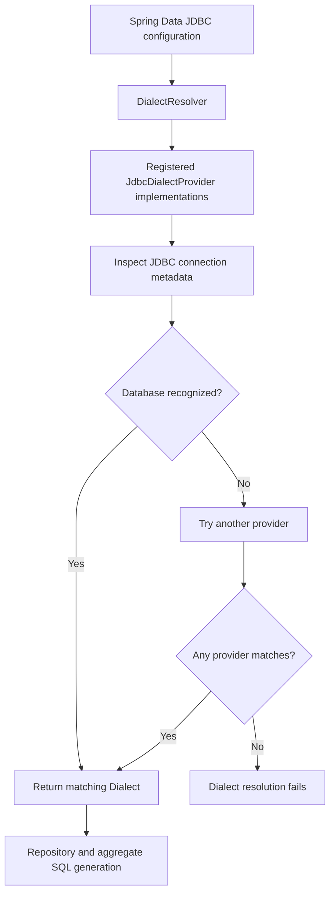

# Tùy chỉnh hoặc đăng ký dialect theo SPI của phiên bản

Trong Spring Data JDBC, dialect giúp framework tạo SQL phù hợp với đặc điểm của hệ quản trị cơ sở dữ liệu. Khi dùng một database chưa có dialect tích hợp hoặc một biến thể có cú pháp riêng, ứng dụng có thể cung cấp dialect tùy chỉnh và đăng ký provider qua SPI của Spring Data.

Bài học trình bày vai trò của `Dialect`, cách `DialectResolver` tìm provider, cách triển khai `JdbcDialectProvider`, đăng ký trong `META-INF/spring.factories`, và những điểm cần kiểm tra để dialect hoạt động đúng với phiên bản Spring Data Relational đang chạy.

## 1. Dialect trong Spring Data JDBC là gì?

Trong Spring Data Relational, **Dialect** mô tả những khác biệt SQL giữa các hệ quản trị cơ sở dữ liệu để framework có thể tạo câu lệnh phù hợp với database đang kết nối.

Các database có thể khác nhau ở những điểm như:

- Cách quote tên bảng, tên cột và identifier có chữ hoa/chữ thường.
- Cú pháp phân trang như `LIMIT/OFFSET`, `FETCH FIRST` hoặc cú pháp riêng của vendor.
- Cách insert và lấy generated key.
- Cách biểu diễn một số thao tác SQL hoặc kiểu dữ liệu đặc thù.
- Hỗ trợ array và những khả năng relational khác mà dialect của phiên bản đó công bố.

Spring Data JDBC dùng dialect trong quá trình tạo SQL cho các thao tác repository và aggregate persistence. Nhờ vậy, cùng một repository có thể hoạt động trên những database có cú pháp khác nhau khi dialect tương ứng được cung cấp.

### 1.1. Dialect không phải Hibernate Dialect

Tên `Dialect` cũng xuất hiện trong Hibernate, nhưng hai loại không phải cùng một API.

| Thành phần | Mục đích |
|---|---|
| Spring Data Relational `Dialect` | Cung cấp thông tin và ngữ cảnh SQL cho Spring Data JDBC/Relational |
| Hibernate `Dialect` | Điều khiển SQL generation và hành vi database của Hibernate ORM |
| JDBC Driver | Kết nối database, thực thi statement, chuyển kiểu JDBC |
| Spring `Converter` | Chuyển kiểu Java/domain sang kiểu relational và ngược lại |

Không thể đăng ký class `org.hibernate.dialect.*` làm dialect của Spring Data JDBC. Hai framework có abstraction và SPI riêng.

### 1.2. Dialect khác naming strategy và custom converter

Các cơ chế này giải quyết những vấn đề khác nhau:

| Nhu cầu | Cơ chế phù hợp |
|---|---|
| Database dùng cú pháp phân trang khác | Dialect |
| Tên bảng/cột của entity cần tùy chỉnh | `@Table`, `@Column` hoặc naming strategy |
| Enum lưu mã `P` thay vì tên `PAID` | Custom converter |
| Giá trị domain object ánh xạ thành nhiều cột | Embedded mapping hoặc custom persistence |
| Một truy vấn báo cáo cần SQL đặc thù | `@Query` hoặc custom repository |
| Database chưa có dialect tích hợp | Dialect implementation và provider SPI |

Không nên tạo custom dialect chỉ để đổi tên một cột hoặc chuyển enum thành code. Dialect tác động ở cấp SQL generation, trong khi mapping và converter giải quyết cấu trúc dữ liệu của domain.

## 2. Spring Data JDBC tìm dialect như thế nào?

Khi cấu hình JDBC repository, Spring Data cần một dialect phù hợp với `DataSource`. Cơ chế phân giải thường dựa vào `DialectResolver` và các implementation của SPI `JdbcDialectProvider`.

Một provider kiểm tra database mà `JdbcOperations` đang kết nối. Nếu nhận diện được database mình hỗ trợ, provider trả về `Optional` chứa dialect tương ứng. Nếu không nhận diện được, provider trả `Optional.empty()` để resolver có thể thử provider khác.

Luồng khái quát:



Thông tin database thường lấy từ `DatabaseMetaData`, ví dụ:

- `getDatabaseProductName()`
- `getDatabaseProductVersion()`
- `getDriverName()`
- `getDriverVersion()`

Provider nên nhận diện đúng database mà nó hỗ trợ. Chỉ dựa vào một chuỗi tên driver chung có thể dẫn đến việc chọn nhầm dialect.

### 2.1. Built-in dialect và database chưa được hỗ trợ

Spring Data JDBC có sẵn dialect cho một số hệ quản trị cơ sở dữ liệu phổ biến. Khi database được nhận diện bởi provider tích hợp, framework có thể sử dụng dialect đó mà ứng dụng không cần tự đăng ký.

Với database chưa được hỗ trợ, hoặc một database tương thích một phần nhưng có SQL semantics riêng, ứng dụng có thể cung cấp:

1. Một implementation của Spring Data Relational `Dialect`.
2. Một implementation của `DialectResolver.JdbcDialectProvider`.
3. Metadata SPI để Spring Data phát hiện provider.

Nếu database đã có dialect tích hợp, trước tiên hãy xác định phần khác biệt có thật sự cần custom dialect hay có thể giải quyết ở custom query, converter hoặc schema mapping.

### 2.2. Không có dialect thì sao?

Nếu resolver không tìm thấy provider phù hợp, cấu hình Spring Data JDBC không thể tiếp tục với dialect cần thiết. Ứng dụng có thể thất bại trong lúc khởi động repository infrastructure với lỗi không tìm thấy dialect cho database.

Đây là lỗi cấu hình/runtime dependency, không phải lỗi cú pháp của một method repository riêng lẻ. Hãy kiểm tra:

- JDBC driver có đúng database không.
- `DatabaseMetaData` trả về product name/version gì.
- Provider SPI có nằm trên classpath không.
- File `META-INF/spring.factories` có được đóng gói vào artifact không.
- Provider có trả dialect cho database đang chạy không.

## 3. Dialect API và phần cần tùy chỉnh

Interface `org.springframework.data.relational.core.dialect.Dialect` là hợp đồng của Spring Data Relational. Các thành phần cụ thể và chữ ký method có thể thay đổi giữa các release train, vì vậy phải dựa vào Javadoc/source của đúng phiên bản `spring-data-relational` mà ứng dụng đang dùng.

Dialect có thể cung cấp những ngữ cảnh và capability mà framework cần để render SQL, chẳng hạn:

- Select context cho việc tạo SELECT và phân trang.
- Insert context cho câu INSERT và chiến lược generated key.
- Update/delete contexts.
- Quy tắc xử lý identifier.
- Hỗ trợ array hoặc kiểu dữ liệu relational đặc thù.
- Các capability khác được bổ sung trong release cụ thể.

Không phải mọi database đều cần tự viết toàn bộ những thành phần này. Nếu database gần với một dialect có sẵn, hãy tận dụng implementation tương thích và chỉ thay đổi phần thực sự khác biệt, nếu API version cho phép.

### 3.1. Identifier processing

Identifier processing quy định cách Spring Data xử lý tên bảng/cột trong SQL, ví dụ cách quote identifier và quy tắc chữ hoa/chữ thường.

Giả sử database có bảng tên `Order` hoặc cột tên `group`, các tên này có thể xung đột với reserved word. Dialect phù hợp có thể cung cấp cách quote đúng cho vendor.

Một identifier được quote có thể có dạng khác nhau giữa database, chẳng hạn dấu ngoặc kép hoặc backtick. Không tự nối ký tự quote vào mọi tên cột trong application code; để dialect và mapping xử lý theo abstraction được cung cấp.

### 3.2. Select context và pagination

Cú pháp phân trang không giống nhau giữa mọi database. Ví dụ minh họa:

```sql
-- Một số database hỗ trợ LIMIT/OFFSET
SELECT id, order_code
FROM orders
ORDER BY id
LIMIT 20 OFFSET 40;
```

```sql
-- Một số database dùng OFFSET/FETCH
SELECT id, order_code
FROM orders
ORDER BY id
OFFSET 40 ROWS FETCH NEXT 20 ROWS ONLY;
```

Dialect giúp Spring Data render query tương ứng với database. Vì thế, khi viết custom dialect, cần kiểm tra SQL được sinh cho paging thay vì chỉ kiểm tra một câu SELECT đơn giản.

### 3.3. Insert context và generated keys

Database có thể khác nhau về cách tạo ID và lấy giá trị sinh tự động. Một số dùng identity column và JDBC generated keys; một số có sequence hoặc cú pháp `RETURNING`.

Dialect có thể mô tả chiến lược insert/generation mà Spring Data Relational hỗ trợ ở release đó. Khi tùy chỉnh, hãy xác nhận cả:

- SQL insert được tạo.
- Cách lấy generated ID.
- Mapping generated ID về entity.
- Hành vi insert với ID được ứng dụng cấp trước.
- Hành vi khi save aggregate có dependent entities.

Một dialect tạo đúng câu INSERT nhưng không tương thích với generated-key mechanism của driver vẫn có thể khiến `save()` không trả về ID như mong đợi.

### 3.4. Capability phụ thuộc phiên bản

Không nên sao chép implementation `Dialect` từ một phiên bản Spring Data khác rồi kỳ vọng binary/source compatibility. Một release có thể bổ sung method hoặc thay đổi cách render context được cấu tạo.

Khi viết custom dialect:

1. Xác định chính xác version Spring Data JDBC/Relational qua dependency management.
2. Mở Javadoc hoặc source JAR đúng version.
3. Kiểm tra interface `Dialect` và các implementation tích hợp tương ứng.
4. Tận dụng implementation gần nhất nếu API cho phép.
5. Biên dịch và chạy integration test với đúng JDBC driver/database.
## 4. Provider precedence và trường hợp database đã có dialect tích hợp

Một ứng dụng có thể có cả provider tích hợp của Spring Data và provider tùy chỉnh. Nếu database được nhận diện bởi nhiều provider, kết quả phụ thuộc cách resolver lấy và sắp xếp danh sách provider trong đúng release.

Không giả định provider tùy chỉnh luôn được chọn chỉ vì file `spring.factories` có entry. Khi cần thay dialect tích hợp:

1. Xác định provider tích hợp nào nhận diện product name của database.
2. Kiểm tra cách `DialectResolver` của phiên bản đang dùng duyệt và sắp xếp provider.
3. Kiểm tra SPI có hỗ trợ ordering qua `Ordered` hoặc annotation order trong release đó không.
4. Nếu release hỗ trợ ordering, dùng cơ chế được tài liệu hóa và đặt thứ tự tường minh.
5. Nếu có cơ chế cấu hình dialect trực tiếp ở repository infrastructure, xác nhận nó là extension point công khai của version đó.
6. Viết integration test chứng minh dialect thực sự được chọn.

Không dựa vào thứ tự dòng trong file, thứ tự component scan hoặc thứ tự classpath như một hợp đồng ưu tiên ổn định.

### 7.1. Không override built-in dialect nếu không cần

Nếu dialect tích hợp đã tạo đúng SQL cho database, hãy dùng nó. Một custom provider chỉ để trả về một dialect khác có thể làm ứng dụng mất các tối ưu/capability mà dialect tích hợp đã hỗ trợ.

Chỉ override khi có khác biệt được xác nhận, ví dụ database vendor có fork riêng với pagination, identifier hoặc generated-key behavior khác với dialect gốc.

### 7.2. Tách nhận diện product và kiểm tra capability

Một số database tương thích protocol với database khác nhưng khác SQL behavior ở vài phiên bản. Product name cho biết vendor; version và capability test cho biết implementation nào phù hợp.

Không nên dùng driver name làm bằng chứng duy nhất rằng SQL semantics tương đương. Driver có thể là wrapper hoặc proxy driver kết nối tới database khác.

## 5. Phiên bản Spring Data JDBC và tương thích SPI

Dialect là extension API của Spring Data Relational. Phiên bản Spring Data JDBC thường kéo theo phiên bản Spring Data Relational tương ứng. Khi thay đổi một thành phần riêng lẻ, có thể tạo ra mismatch giữa provider, dialect và các render context.

### 8.1. Dùng dependency management của Spring Boot hoặc Spring Data release train

Với ứng dụng Spring Boot, thông thường nên để BOM của Boot quản lý các phiên bản Spring Data tương thích. Không tự nâng riêng `spring-data-relational` lên version khác với `spring-data-jdbc` trừ khi có lý do và đã xác nhận tương thích.

Nếu ứng dụng quản lý Spring Data trực tiếp, giữ các module trong cùng release train theo hướng dẫn của dự án Spring Data.

### 8.2. Kiểm tra API đúng phiên bản

Trước khi viết provider, xác nhận trong dependency thực tế:

- Package của `DialectResolver`.
- Provider interface có tên `JdbcDialectProvider` hay API đã thay đổi.
- Chữ ký method nhận `JdbcOperations` hay abstraction khác.
- Kiểu trả về là `Optional<Dialect>` hay dạng khác.
- Cách resolver nạp provider và xử lý thứ tự.
- Các method trừu tượng của `Dialect`.
- Các context/capability mà database cần cung cấp.

Đừng lấy ví dụ của Spring Data JDBC 2.x, 3.x hoặc 4.x rồi trộn import và interface giữa các version. Source JAR và Javadoc gắn với dependency đang build là nguồn xác định chữ ký chính xác.

### 8.3. Phân biệt Spring Data JDBC và Spring Data R2DBC

Spring Data JDBC và Spring Data R2DBC có các abstraction riêng cho kết nối và dialect. Một provider dành cho JDBC không tự được dùng bởi R2DBC.

| Công nghệ | Kết nối | Dialect/provider |
|---|---|---|
| Spring Data JDBC | JDBC, `DataSource`, `JdbcOperations` | Spring Data Relational `Dialect` và JDBC provider SPI |
| Spring Data R2DBC | Reactive driver, `ConnectionFactory` | R2DBC dialect và provider SPI riêng |

Không đăng ký `R2dbcDialectProvider` cho JDBC repository hoặc ngược lại. Cùng một database vendor không có nghĩa hai SPI có thể dùng chung implementation.

## 6. Một ứng dụng kết nối nhiều database

Nếu ứng dụng có nhiều `DataSource`, mỗi nhóm repository cần dialect tương ứng với database mà nó sử dụng.

Ví dụ:

- `ordersDataSource` kết nối PostgreSQL.
- `reportingDataSource` kết nối ExampleDB.
- Repository order và repository reporting có thể cần các cấu hình JDBC repository riêng.

Không nên giả định một dialect duy nhất có thể điều khiển repository kết nối tới nhiều database vendor khác nhau.

### 9.1. Cấu hình tách biệt theo DataSource

Ở mức kiến trúc, cần xác định cho từng nhóm repository:

- DataSource.
- Transaction manager.
- `JdbcOperations` hoặc `NamedParameterJdbcOperations`.
- Repository base package.
- Dialect tương ứng.

Tên bean và cách chỉ định dialect phụ thuộc API cấu hình của Spring Data JDBC version đang dùng. Hãy tách rõ từng repository configuration thay vì dùng một provider nhận database A rồi giả định nó sẽ xử lý database B.

### 9.2. Transaction giữa nhiều DataSource

Có hai dialect khác nhau không đồng nghĩa hai database tự tham gia cùng transaction. Local JDBC transaction manager thường quản lý một DataSource.

Nếu use case phải cập nhật hai database cùng lúc, cần kiến trúc transaction phân tán hoặc thiết kế consistency như outbox/saga. Dialect chỉ ảnh hưởng SQL generation; nó không điều phối commit giữa nhiều database.

## 7. Kiểm thử custom dialect và provider

Kiểm thử provider chỉ trả đúng object dialect là chưa đủ. Cần xác nhận dialect được resolver chọn và SQL thực tế chạy đúng trên database mục tiêu.

### 10.1. Test nhận diện database

Kiểm tra các trường hợp:

- Product name chính xác được nhận diện.
- Product name khác trả `Optional.empty()`.
- Product name có khác biệt hoa/thường được xử lý theo chính sách.
- Version được hỗ trợ chọn dialect đúng.
- Version không hỗ trợ tạo lỗi rõ ràng.
- Metadata lỗi được báo đúng nguyên nhân.

Có thể unit test logic nhận diện bằng cách mock `JdbcOperations`/connection metadata, nhưng integration test với JDBC driver thật vẫn cần thiết để kiểm tra tên product/version thực tế.

### 10.2. Test provider discovery

Khởi động Spring context hoặc repository configuration với provider được đóng gói qua SPI. Xác nhận Spring Data phát hiện provider mà không cần tự tạo instance thủ công trong test.

Một test trực tiếp gọi provider không kiểm tra được file `spring.factories` đã được đọc hay chưa. Vì vậy cần ít nhất một test discovery qua cơ chế resolver/application context thực tế của release.

### 10.3. Test SQL behavior qua repository

Tạo các integration test tập trung vào capability mà dialect cung cấp:

| Capability | Kịch bản test |
|---|---|
| Identifier processing | Tên bảng/cột có chữ hoa hoặc reserved word |
| Pagination | Page có offset, limit và sort ổn định |
| Insert | Insert entity và nhận generated ID |
| Sequence/identity | Kiểm tra đúng chiến lược tạo ID |
| Update | Thay đổi aggregate và đọc lại giá trị |
| Delete | Xóa aggregate có dependent mapping |
| Array/type support | Ghi và đọc kiểu đặc thù nếu ứng dụng sử dụng |
| Null/type conversion | Kiểm tra bind và extract trên driver thật |

Không chỉ kiểm tra SQL string. Một câu SQL có vẻ đúng vẫn có thể thất bại do JDBC driver, generated key hoặc cách database diễn giải identifier.

### 10.4. Test với database thật hoặc Testcontainers

H2 ở chế độ tương thích với vendor có thể hữu ích cho một số test nhanh, nhưng không chứng minh hoàn toàn SQL behavior của database mục tiêu.

Với dialect tùy chỉnh, nên chạy integration test bằng database thật hoặc Testcontainers image phù hợp. Điều này đặc biệt quan trọng cho pagination, identity/sequence, quoted identifiers, array và generated keys.

## 8. Kiểm tra artifact và chẩn đoán lỗi SPI

Provider hoạt động khi chạy trong IDE nhưng không được phát hiện trong production thường do metadata không có trong artifact hoặc bị ghi đè khi đóng gói.

### 11.1. Kiểm tra file trong JAR

Sau khi build artifact, xác nhận JAR chứa:

```text
META-INF/spring.factories
```

Mở file đó trong JAR và xác nhận key provider cùng fully qualified class name vẫn còn. Với fat JAR, kiểm tra cả vị trí resource bên trong cấu trúc archive.

Nếu dùng shading/assembly plugin, cấu hình resource transformer để gộp các file `META-INF/spring.factories` từ nhiều dependency. Không để resource của một dependency ghi đè resource của dependency khác.

### 11.2. Bật log và kiểm tra metadata

Khi resolver không chọn dialect mong muốn:

1. Log product name và product version từ connection metadata.
2. Xác nhận provider class có trên classpath.
3. Xác nhận file SPI đúng path và key.
4. Kiểm tra resolver có load provider không.
5. Kiểm tra provider trả `Optional.empty()` hay dialect.
6. Kiểm tra provider khác có được chọn trước không.
7. Xác nhận dialect implementation được tạo từ đúng version API.

Không ghi thông tin kết nối nhạy cảm hoặc credential vào log.

### 11.3. Lỗi thường gặp

| Triệu chứng | Nguyên nhân có thể | Cách xử lý |
|---|---|---|
| Không tìm thấy dialect | Không có provider phù hợp | Cài driver/provider và đăng ký SPI |
| Provider không được gọi | Sai path hoặc key `spring.factories` | Kiểm tra resource trong JAR |
| Provider chạy trong IDE nhưng không chạy trong JAR | Resource bị mất/ghi đè khi đóng gói | Cấu hình merge resource |
| Provider luôn trả empty | Product name không khớp metadata thật | Log `DatabaseMetaData` và điều chỉnh nhận diện |
| Chọn nhầm dialect | Provider match quá rộng hoặc precedence không đúng | Thu hẹp điều kiện và kiểm tra thứ tự resolver |
| Lỗi `NoSuchMethodError` hoặc `AbstractMethodError` | Dialect/provider biên dịch với API version khác runtime | Đồng bộ Spring Data release train |
| SQL pagination sai | Select context không phù hợp database | Kiểm tra paging SQL và capability dialect |
| Insert không lấy được ID | Generated-key behavior không khớp driver/database | Kiểm tra insert context và generated-key path |
| Identifier bị sai casing/quote | Identifier processing không phù hợp | Kiểm tra quy tắc quote/case của database |
| Chạy được H2 nhưng lỗi database thật | H2 không mô phỏng đầy đủ semantics vendor | Test với database mục tiêu |

## 9. Checklist khi triển khai custom dialect

Trước khi phát hành provider/dialect, xác nhận từng phần sau:

1. **Version:** Spring Data JDBC và Spring Data Relational đang dùng cùng release train tương thích.
2. **API:** Provider interface, method signature và Dialect contract khớp source/Javadoc của dependency thực tế.
3. **Scope:** Database product và version được nhận diện chính xác.
4. **Fallback:** Provider trả `Optional.empty()` khi database không thuộc phạm vi của nó.
5. **Dialect:** Implementation hỗ trợ đúng pagination, identifier, insert/generated key và capability mà ứng dụng sử dụng.
6. **SPI metadata:** `META-INF/spring.factories` có đúng key và fully qualified provider class name.
7. **Packaging:** Resource SPI còn nguyên trong JAR/fat JAR sau khi merge.
8. **Precedence:** Nếu có provider tích hợp cùng match, test chứng minh resolver chọn đúng dialect.
9. **Database tests:** Integration test chạy trên database/driver mục tiêu.
10. **Multiple data sources:** Mỗi nhóm repository được cấu hình với dialect và transaction manager phù hợp.

## 10. Quy trình triển khai từ đầu đến cuối

Một quy trình thực tế có thể chia thành các bước:

### Bước 1: Xác định database và khác biệt SQL

Thu thập product name, product version, driver name/version và xác định khác biệt thực tế so với dialect tích hợp gần nhất.

Không bắt đầu bằng việc viết một class Dialect lớn. Trước hết hãy chứng minh repository đang cần capability nào mà dialect hiện tại không đáp ứng.

### Bước 2: Xác định extension API của version

Kiểm tra dependency Spring Data JDBC/Relational đang được quản lý. Đọc provider interface và Dialect contract trong đúng source JAR.

Nếu API version không có SPI được mô tả trong ví dụ, điều chỉnh theo extension point mà version đó cung cấp. Không tự tạo interface cùng tên trong application package để thay thế SPI chính thức.

### Bước 3: Viết Dialect implementation

Tái sử dụng dialect có sẵn khi tương thích. Nếu cần implementation riêng, cung cấp các render context/capability bắt buộc và giữ class stateless nếu có thể.

Dialect không nên chứa trạng thái request, connection hoặc business data.

### Bước 4: Viết provider

Provider nhận `JdbcOperations`, kiểm tra metadata và trả dialect đúng. Không nhận diện database bằng chuỗi quá rộng và không trả dialect phỏng đoán cho database lạ.

### Bước 5: Đăng ký SPI

Thêm entry `DialectResolver$JdbcDialectProvider` vào `META-INF/spring.factories`. Xác nhận file resource được đóng gói vào JAR cuối cùng.

### Bước 6: Kiểm tra resolver và repository

Khởi động repository infrastructure, xác nhận dialect được chọn, sau đó thực thi các use case đại diện: đọc, insert, generated ID, update, delete và pagination.

### Bước 7: Kiểm tra nâng cấp version

Khi nâng Spring Data release train, biên dịch lại custom dialect/provider và chạy lại integration test. Extension API có thể thay đổi dù database vendor không thay đổi.

## 11. Đăng ký dialect qua JdbcDialectProvider SPI

Spring Data JDBC cung cấp SPI để phát hiện dialect dựa trên JDBC connection. Trong các phiên bản có `DialectResolver.JdbcDialectProvider`, provider thường có method nhận `JdbcOperations` và trả về `Optional<Dialect>`.

Provider chịu trách nhiệm trả dialect khi database khớp. Nếu không khớp, trả `Optional.empty()` để resolver tiếp tục tìm provider khác.

### 4.1. Cấu trúc provider

Ví dụ dưới đây minh họa provider nhận diện database có product name là `ExampleDB`:

```java
package com.example.persistence;

import java.sql.DatabaseMetaData;
import java.util.Optional;

import org.springframework.data.jdbc.repository.config.DialectResolver;
import org.springframework.data.relational.core.dialect.Dialect;
import org.springframework.jdbc.core.ConnectionCallback;
import org.springframework.jdbc.core.JdbcOperations;

public final class ExampleDialectProvider
        implements DialectResolver.JdbcDialectProvider {

    @Override
    public Optional<Dialect> getDialect(JdbcOperations operations) {

        return operations.execute(
                (ConnectionCallback<Optional<Dialect>>) connection -> {

                    DatabaseMetaData metadata = connection.getMetaData();

                    String productName = metadata.getDatabaseProductName();

                    if ("ExampleDB".equalsIgnoreCase(productName)) {
                        return Optional.of(ExampleDialect.INSTANCE);
                    }

                    return Optional.empty();
                }
        );
    }
}
```

`ExampleDialect.INSTANCE` đại diện cho implementation dialect mà ứng dụng cung cấp. Tên class, package và product name trong ví dụ là placeholder cần thay bằng database thực tế.

Dùng `JdbcOperations.execute(ConnectionCallback)` để đọc metadata trên connection do Spring JDBC quản lý. Không tự mở một connection mới rồi bỏ quên đóng nó; cũng không đóng connection do callback nhận được.

### 4.2. Đăng ký provider trong META-INF/spring.factories

Chỉ triển khai class provider chưa đủ. Spring Data cần phát hiện implementation đó qua SPI metadata.

Tạo file:

```text
src/main/resources/META-INF/spring.factories
```

Thêm key provider của Spring Data JDBC:

```properties
org.springframework.data.jdbc.repository.config.DialectResolver$JdbcDialectProvider=\
com.example.persistence.ExampleDialectProvider
```

Tên class ở vế phải phải là fully qualified class name của provider. Dấu `$` trong key thể hiện nested interface `JdbcDialectProvider` của `DialectResolver`.

Khi đóng gói thư viện hoặc ứng dụng, file `META-INF/spring.factories` phải có mặt trong JAR cuối cùng. Nếu build tạo shaded/fat JAR và có nhiều file `spring.factories`, cấu hình đóng gói phải gộp resource đúng cách thay vì ghi đè metadata của dependency khác.

### 4.3. SPI discovery khác component scanning

Provider được phát hiện qua SPI metadata của Spring, không chỉ vì class có `@Component`.

| Cách đăng ký | Vai trò |
|---|---|
| `@Component` | Đăng ký một Spring bean qua component scanning |
| `@Bean` | Khai báo bean trong application context |
| `META-INF/spring.factories` | Khai báo implementation cho SpringFactoriesLoader SPI |
| `AutoConfiguration.imports` | Khai báo Spring Boot auto-configuration classes |

Đối với `JdbcDialectProvider` SPI dùng `SpringFactoriesLoader`, hãy cung cấp đúng entry trong `META-INF/spring.factories`. Không thay nó bằng `AutoConfiguration.imports` chỉ vì ứng dụng đã nâng lên Spring Boot 3; hai metadata này phục vụ hai cơ chế khác nhau.

Một provider có thể không cần `@Component` vì resolver khởi tạo implementation từ SPI metadata. Đăng ký thêm một bean cùng mục đích mà không hiểu lifecycle có thể tạo cấu hình dư thừa hoặc gây nhầm lẫn.

### 4.4. Nhiều provider trong cùng artifact

Nếu một artifact hỗ trợ nhiều database, có thể khai báo nhiều provider implementation trong danh sách của cùng SPI key theo cú pháp SpringFactoriesLoader mà phiên bản Spring Framework sử dụng.

Ví dụ:

```properties
org.springframework.data.jdbc.repository.config.DialectResolver$JdbcDialectProvider=\
com.example.persistence.ExampleDialectProvider,\
com.example.persistence.AnotherDialectProvider
```

Mỗi provider chỉ nên nhận những database mà nó thật sự hỗ trợ. Provider không nhận diện được database phải trả `Optional.empty()`.

Không trả về một dialect mặc định cho mọi product name chỉ để tránh lỗi khởi động. Làm vậy có thể khiến Spring Data sinh SQL sai trên database không tương thích.

## 12. Tạo implementation Dialect

Provider chỉ giải quyết việc **chọn** dialect. Nếu database cần SQL behavior riêng, ứng dụng còn phải cung cấp implementation của `Dialect`.

### 5.1. Bắt đầu từ dialect tương thích gần nhất

Trước khi tự viết toàn bộ interface, xác định database có tương thích về SQL với dialect tích hợp nào:

- Cú pháp SELECT và pagination có giống không?
- Cách quote identifier có giống không?
- Generated key/identity/sequence có tương thích không?
- Các kiểu dữ liệu array có cần hỗ trợ không?
- Insert/update/delete context có khác không?

Nếu database thực sự tương thích với một dialect có sẵn, provider có thể trả về dialect đó. Ví dụ minh họa khi ANSI behavior phù hợp:

```java
return Optional.of(AnsiDialect.INSTANCE);
```

Chỉ dùng lựa chọn này sau khi xác nhận class và capability có trong đúng release, đồng thời kiểm tra SQL được sinh trên database mục tiêu. “Database hỗ trợ SQL chuẩn” không có nghĩa mọi khác biệt generated key, identifier hoặc pagination đều tự tương thích.

### 5.2. Khung implementation riêng

Nếu không có dialect tích hợp phù hợp, tạo implementation riêng:

```java
package com.example.persistence;

import org.springframework.data.relational.core.dialect.Dialect;

public final class ExampleDialect implements Dialect {

    public static final ExampleDialect INSTANCE = new ExampleDialect();

    private ExampleDialect() {
    }

    /*
     * Implement the Dialect contract required by the exact
     * Spring Data Relational version used by this application.
     *
     * Supply the required select/insert/update/delete contexts,
     * identifier processing and supported database capabilities.
     */
}
```

Đây là khung cấu trúc, không phải implementation hoàn chỉnh để copy nguyên trạng. Compiler sẽ yêu cầu triển khai đầy đủ các abstract methods của interface `Dialect` trong release đang dùng. Danh sách method và kiểu context cần lấy từ API version thực tế.

Nếu release cung cấp base implementation hoặc các context có thể tái sử dụng, dùng chúng để giảm lượng code. Không sao chép class nội bộ hoặc package-private implementation từ dependency; các thành phần đó không phải extension API ổn định.

### 5.3. Thay đổi đúng phần database khác biệt

Ví dụ database chỉ khác cách phân trang nhưng các phần khác tương thích với dialect hiện có. Khi đó, tập trung vào select rendering context mà API version cung cấp.

Nếu khác generated key strategy, cần tập trung insert context và ID generation behavior.

Nếu khác identifier quote, cần cung cấp identifier processing phù hợp.

Không viết một dialect hoàn toàn mới nếu chỉ một capability khác biệt và framework có abstraction để tái sử dụng phần còn lại.

### 5.4. Không đưa logic nhận diện database vào Dialect

Nên phân chia trách nhiệm:

- `JdbcDialectProvider`: đọc metadata, quyết định database nào được hỗ trợ và trả dialect.
- `Dialect`: mô tả SQL behavior/capability của database.
- Repository/template: sử dụng dialect để tạo và thực thi SQL.

Tránh để dialect tự mở connection hoặc tự kiểm tra database product name. Dialect nên mô tả behavior; provider mới là thành phần phát hiện.

## 13. Nhận diện database an toàn

`DatabaseMetaData` là nguồn nhận diện quan trọng, nhưng product name và version cần được xử lý có chủ đích.

### 6.1. So sánh product name không phân biệt hoa thường

Ví dụ:

```java
String productName = metadata.getDatabaseProductName();

if ("ExampleDB".equalsIgnoreCase(productName)) {
    return Optional.of(ExampleDialect.INSTANCE);
}
```

Không dùng phép so sánh một phần quá rộng như `contains("SQL")` nếu nhiều database có thể cùng chứa chuỗi đó. Provider có thể nhận nhầm database khác và trả dialect không tương thích.

### 6.2. Xem xét product version khi behavior thay đổi

Nếu database có nhiều major version với SQL capability khác nhau, provider có thể đọc product version để quyết định:

- Một dialect chung có thể dùng cho mọi version được hỗ trợ.
- Một dialect khác nhau cho các version có behavior khác nhau.
- Từ chối rõ ràng version nằm ngoài phạm vi hỗ trợ.

Ví dụ minh họa:

```java
String productName = metadata.getDatabaseProductName();
String productVersion = metadata.getDatabaseProductVersion();

if (!"ExampleDB".equalsIgnoreCase(productName)) {
    return Optional.empty();
}

if (!isSupported(productVersion)) {
    throw new IllegalStateException(
            "Unsupported ExampleDB version: " + productVersion
    );
}

return Optional.of(ExampleDialect.INSTANCE);
```

`isSupported(...)` là logic ứng dụng cần tự định nghĩa theo version thực tế. Không giả định version string luôn theo một định dạng số đơn giản.

### 6.3. Trả Optional.empty hay báo lỗi?

Dùng `Optional.empty()` khi provider không nhận diện database thuộc phạm vi của nó. Điều này cho phép provider khác thử tiếp.

Nếu provider đã nhận diện đúng database nhưng version đó không được hỗ trợ, trả empty có thể khiến resolver chọn nhầm một dialect khác. Trong trường hợp đó, lỗi rõ ràng thường an toàn hơn.

Quy tắc:

| Trường hợp | Hành vi phù hợp |
|---|---|
| Product name thuộc database khác | `Optional.empty()` |
| Product name đúng, version được hỗ trợ | Trả dialect tương ứng |
| Product name đúng, version không hỗ trợ | Báo lỗi có thông tin version |
| Metadata không đọc được | Để lỗi kết nối/metadata được báo rõ hoặc xử lý theo hợp đồng SPI |
| Database không rõ hoặc chưa được kiểm chứng | Không trả dialect phỏng đoán |

## 14. Nguyên tắc ghi nhớ

- Spring Data Relational `Dialect` mô tả SQL behavior và capability của database cho Spring Data JDBC.
- `DialectResolver.JdbcDialectProvider` là SPI giúp nhận diện database qua JDBC metadata và trả dialect phù hợp.
- Provider không nhận diện database phải trả `Optional.empty()` để resolver thử provider khác.
- Với provider SPI dùng `SpringFactoriesLoader`, đăng ký implementation trong `META-INF/spring.factories` bằng key của nested provider interface theo đúng version.
- `@Component` đơn thuần không thay thế metadata SPI.
- Dialect chịu trách nhiệm SQL generation behavior; mapping annotation và custom converter giải quyết tên cột hoặc kiểu domain.
- Chỉ viết custom dialect khi database thực sự khác dialect tích hợp ở những capability Spring Data cần.
- Không giả định custom provider luôn thắng provider built-in; kiểm tra resolver precedence của release đang dùng.
- Đồng bộ Spring Data JDBC và Spring Data Relational version; không trộn SPI giữa các release train hoặc giữa JDBC và R2DBC.
- Kiểm thử với database và driver thực tế, đặc biệt pagination, identifier quoting và generated key.
- Kiểm tra resource SPI trong artifact đã đóng gói, không chỉ chạy trong IDE.

Tùy chỉnh dialect là cách mở rộng SQL generation của Spring Data JDBC cho database chưa được hỗ trợ hoặc có khác biệt vendor cụ thể. Provider SPI quyết định database nào dùng dialect nào; bản thân dialect mô tả cách framework tạo SQL và xử lý capability. Khi triển khai, hãy bám đúng API của Spring Data Relational version đang chạy, đăng ký provider bằng metadata SPI tương ứng và xác nhận hành vi bằng integration test trên database mục tiêu.


