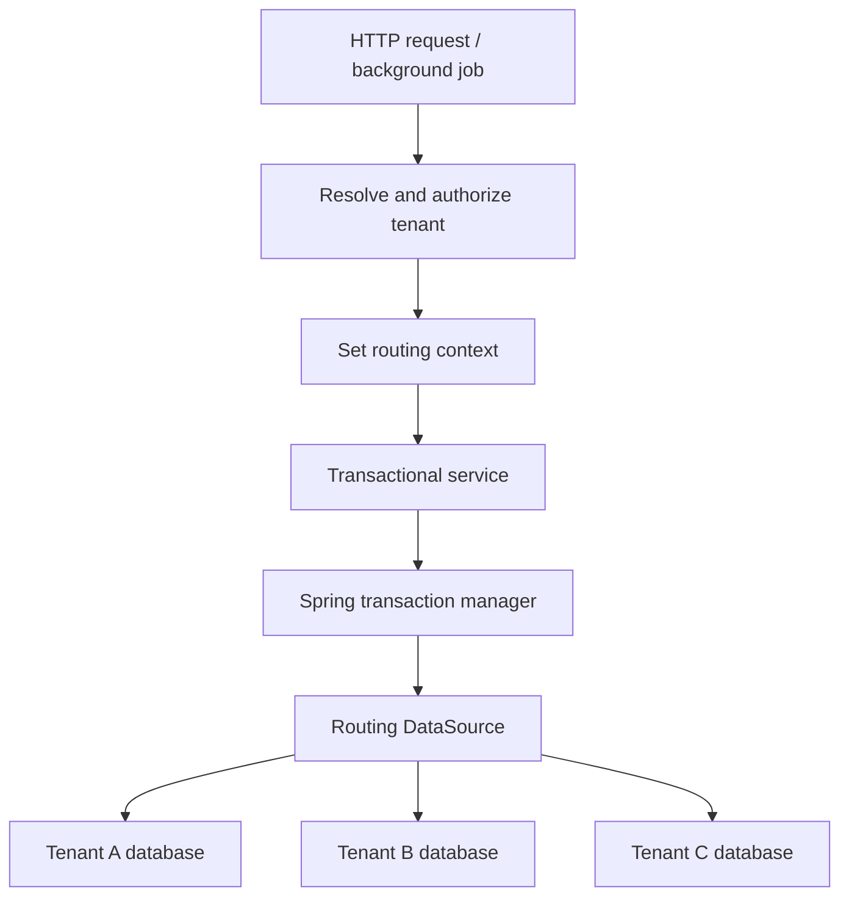
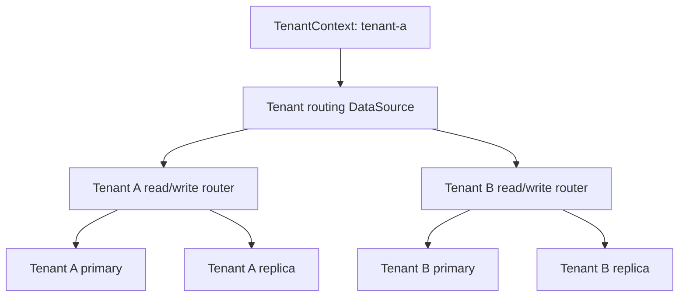
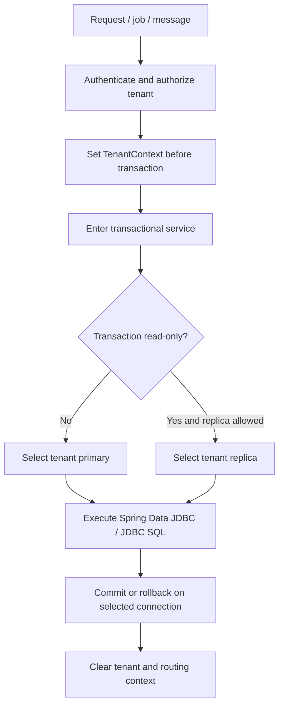

# Định tuyến tenant hoặc nguồn đọc/ghi và ranh giới nhất quán

Spring Data JDBC thường làm việc với một `DataSource` đã được cấu hình sẵn. Khi ứng dụng phục vụ nhiều tenant hoặc dùng database replica cho truy vấn đọc, ứng dụng cần quyết định kết nối nào sẽ thực hiện một thao tác. Quyết định này được gọi là định tuyến datasource (data source routing).

Có hai câu hỏi định tuyến khác nhau:

- **Định tuyến tenant:** request thuộc tenant nào và phải truy cập database, schema hoặc vùng dữ liệu nào?
- **Định tuyến đọc/ghi:** thao tác được phép chạy trên primary hay có thể chạy trên read replica?

Hai quyết định này ảnh hưởng trực tiếp đến ranh giới nhất quán. Spring quản lý một JDBC connection trong transaction; sau khi connection được lấy và gắn với transaction hiện tại, đổi routing key giữa chừng không chuyển transaction sang database khác. Vì vậy, tenant và chế độ đọc/ghi phải được xác định trước khi transaction bắt đầu.

Bài học trình bày các chiến lược multi-tenancy, `AbstractRoutingDataSource`, `TenantContext`, routing primary/replica, replication lag, read-your-writes, bảo vệ tenant boundary và cách kiểm thử.

## 1. Routing datasource hoạt động như thế nào?

Một `DataSource` cung cấp JDBC connections. Thay vì để mọi thao tác lấy connection từ cùng một pool, ứng dụng có thể đặt một routing datasource ở trước nhiều datasource đích.

Spring có `AbstractRoutingDataSource` làm nền tảng cho kiểu định tuyến này. Subclass cung cấp khóa qua `determineCurrentLookupKey()`; Spring dùng khóa đó để chọn datasource đích khi cần lấy connection.



Routing datasource chỉ chọn connection. Nó không tự thêm `tenant_id` vào câu SQL, không xác thực người dùng có quyền truy cập tenant đó và không tự bảo đảm dữ liệu giữa các database được đồng bộ.

Trong Spring Data JDBC, repository, `JdbcAggregateOperations` và `JdbcTemplate` cần sử dụng datasource được định tuyến tương ứng. Nếu repository dùng một datasource còn custom JDBC template dùng datasource khác, hai thao tác có thể đi tới hai nơi khác nhau dù cùng được gọi từ một service.

## 2. Chọn chiến lược multi-tenancy trước khi routing

Routing datasource không phải cách duy nhất để cô lập tenant. Trước hết cần chọn nơi dữ liệu tenant được lưu:

| Chiến lược | Cách tổ chức | Đặc điểm |
| --- | --- | --- |
| Shared database, shared schema | Các tenant dùng chung bảng; mỗi hàng có `tenant_id`. | Ít connection pool, dễ vận hành tập trung; mọi query và constraint phải tôn trọng tenant. |
| Shared database, schema per tenant | Mỗi tenant có schema riêng trong cùng database. | Có thể tách namespace và migration theo schema; phải quản lý schema/session của connection cẩn thận. |
| Database per tenant | Mỗi tenant có database riêng, thường có datasource/pool riêng. | Cô lập dữ liệu và tải tốt hơn; tăng chi phí quản lý pool, migration, backup và connection. |

### Shared schema với tenant_id

Ví dụ:

```sql
CREATE TABLE purchase_order (
    tenant_id VARCHAR(80) NOT NULL,
    id BIGINT NOT NULL,
    status VARCHAR(30) NOT NULL,
    total_amount NUMERIC(18, 2) NOT NULL,
    PRIMARY KEY (tenant_id, id)
);
```

Query phải ràng buộc tenant:

```sql
SELECT id, status, total_amount
FROM purchase_order
WHERE tenant_id = :tenantId
  AND id = :orderId;
```

Nếu chỉ định tuyến datasource nhưng mọi tenant vẫn dùng chung schema, routing không thay thế predicate `tenant_id`. Có thể bổ sung row-level security (RLS) ở database để tạo lớp bảo vệ độc lập. Foreign key và unique constraint cũng nên đưa `tenant_id` vào khóa khi tính duy nhất chỉ có ý nghĩa trong phạm vi tenant.

### Database hoặc schema riêng cho tenant

Khi mỗi tenant có database riêng, `AbstractRoutingDataSource` có thể chọn pool dựa trên tenant key. Với schema riêng, có thể dùng schema-qualified table hoặc thiết lập schema cho connection; nếu thay đổi session state, phải bảo đảm state được reset trước khi connection quay lại pool.

Đừng chọn database-per-tenant chỉ vì routing datasource có sẵn. Hãy cân nhắc số tenant, số connection, yêu cầu backup/restore, migration, isolation và chi phí vận hành.

## 3. Xác định tenant từ nguồn đã được xác thực

Tenant key phải đến từ một nguồn đã được xác thực và kiểm tra quyền. Có thể lấy từ:

- Tenant claim trong access token đã được xác minh.
- Mapping giữa tài khoản đăng nhập và tenant ở hệ thống identity.
- Tenant đã được xác thực từ domain/subdomain theo cấu hình đáng tin cậy.
- Metadata của job/message đã được xác thực bởi producer hoặc service boundary.

Không lấy một `tenantId` tùy ý từ request rồi dùng thẳng làm routing key. Client có thể sửa header hoặc query parameter để thử truy cập tenant khác. Việc xác định tenant và việc người dùng có quyền truy cập tenant đó là hai bước phải được thực hiện trước khi mở transaction.

Với shared schema, predicate tenant vẫn cần được áp dụng ở từng query hoặc enforced bằng RLS. Với database/schema riêng, route sai tenant có thể khiến cả aggregate được tải từ sai vùng dữ liệu; vì thế việc xác thực routing key vẫn rất quan trọng.
## 4. Lưu tenant trong context của request

Một cách triển khai phổ biến là lưu tenant hiện tại trong `ThreadLocal` trong suốt một request đồng bộ. Context phải có phạm vi rõ ràng và luôn được khôi phục/xóa sau khi request hoàn tất.

Ví dụ context có scope:

```java
public final class TenantContext {

    private static final ThreadLocal<String> CURRENT =
        new ThreadLocal<>();

    private TenantContext() {
    }

    public static String requireTenantId() {
        String tenantId = CURRENT.get();
        if (tenantId == null || tenantId.isBlank()) {
            throw new IllegalStateException("Tenant context is missing");
        }
        return tenantId;
    }

    public static Scope use(String tenantId) {
        if (tenantId == null || tenantId.isBlank()) {
            throw new IllegalArgumentException("Tenant ID is required");
        }

        String previous = CURRENT.get();
        CURRENT.set(tenantId);

        return () -> {
            if (previous == null) {
                CURRENT.remove();
            } else {
                CURRENT.set(previous);
            }
        };
    }

    @FunctionalInterface
    public interface Scope extends AutoCloseable {
        @Override
        void close();
    }
}
```

Scope khôi phục giá trị trước đó, nên có thể dùng an toàn hơn khi context được lồng nhau trong cùng thread. `remove()` trong trường hợp không có giá trị cũ giúp tránh rò tenant giữa hai request được xử lý lần lượt trên cùng worker thread.

### Đặt context trong filter/interceptor

Ví dụ minh họa filter lấy tenant từ principal đã được xác thực:

```java
@Component
public class TenantContextFilter extends OncePerRequestFilter {

    private final AuthenticatedTenantResolver tenantResolver;

    public TenantContextFilter(AuthenticatedTenantResolver tenantResolver) {
        this.tenantResolver = tenantResolver;
    }

    @Override
    protected void doFilterInternal(
            HttpServletRequest request,
            HttpServletResponse response,
            FilterChain chain) throws ServletException, IOException {

        String tenantId = tenantResolver.requireAuthorizedTenant(request);

        try (TenantContext.Scope ignored = TenantContext.use(tenantId)) {
            chain.doFilter(request, response);
        }
    }
}
```

`AuthenticatedTenantResolver` đại diện cho thành phần xác thực tenant từ principal/claim đã được kiểm tra. Filter không nên tin trực tiếp một header chưa được xác thực.

Với background job hoặc message consumer, cần mở scope tenant tương tự trước khi gọi service transactional và đóng scope trong `finally`/try-with-resources.

## 5. Vì sao tenant phải được thiết lập trước transaction?

`@Transactional` thường được áp dụng bởi Spring proxy. Khi caller gọi method transactional, interceptor bắt đầu transaction trước khi chạy phần thân method. Transaction manager có thể lấy connection và gắn nó với thread ngay ở thời điểm đó.

Do đó, đoạn code sau có thứ tự sai:

```java
@Transactional
public void handle(String tenantId, long orderId) {
    try (TenantContext.Scope ignored = TenantContext.use(tenantId)) {
        // Transaction đã bắt đầu trước khi method body chạy.
        orders.findById(orderId);
    }
}
```

Nếu connection đã được lấy trước khi tenant context được đặt, routing datasource có thể đã chọn sai tenant hoặc ném lỗi vì không có tenant key. Đổi context sau đó không chuyển connection hiện tại sang datasource khác.

Một cách rõ ràng là đặt tenant context ở filter hoặc một facade không transactional, rồi gọi bean transactional riêng:

```java
@Component
public class TenantOrderFacade {

    private final OrderTransactionService transactions;

    public TenantOrderFacade(OrderTransactionService transactions) {
        this.transactions = transactions;
    }

    public PurchaseOrder loadForTenant(String tenantId, long orderId) {
        try (TenantContext.Scope ignored = TenantContext.use(tenantId)) {
            return transactions.load(orderId);
        }
    }
}

@Service
public class OrderTransactionService {

    private final PurchaseOrderRepository orders;

    public OrderTransactionService(PurchaseOrderRepository orders) {
        this.orders = orders;
    }

    @Transactional(readOnly = true)
    public PurchaseOrder load(long orderId) {
        return orders.findById(orderId)
            .orElseThrow(() -> new OrderNotFoundException(orderId));
    }
}
```

Khi `transactions.load(...)` được gọi qua Spring proxy, tenant context đã tồn tại. Filter là lựa chọn tự nhiên cho HTTP; facade tương tự hữu ích cho job hoặc luồng không có servlet request.

**Không đổi tenant giữa một transaction.** Một transaction JDBC gắn với connection đã chọn. Nếu cần thao tác trên hai tenant, thực hiện hai transaction riêng và xem xét rõ rằng chúng không nguyên tử cùng nhau.

## 6. Tạo routing datasource theo tenant

Ví dụ đơn giản dùng `AbstractRoutingDataSource` để chọn một datasource theo tenant key:

```java
public class TenantRoutingDataSource extends AbstractRoutingDataSource {

    @Override
    protected Object determineCurrentLookupKey() {
        return TenantContext.requireTenantId();
    }
}
```

Cấu hình target datasources:

```java
@Configuration
public class TenantDataSourceConfiguration {

    @Bean
    @Primary
    DataSource dataSource(
            @Qualifier("tenantADatasource") DataSource tenantA,
            @Qualifier("tenantBDatasource") DataSource tenantB) {

        Map<Object, Object> targets = new HashMap<>();
        targets.put("tenant-a", tenantA);
        targets.put("tenant-b", tenantB);

        TenantRoutingDataSource routing = new TenantRoutingDataSource();
        routing.setTargetDataSources(targets);
        routing.setLenientFallback(false);
        return routing;
    }
}
```

Các bean `tenantADatasource` và `tenantBDatasource` đại diện cho pool đã cấu hình riêng, thường bằng HikariCP. Ví dụ cố ý chỉ có hai tenant để minh họa. Trong hệ thống động, không nên tạo vô hạn pool mà không có giới hạn và lifecycle; cần registry quản lý tenant, pool eviction, health check và giới hạn tổng connection.

`setLenientFallback(false)` giúp tránh âm thầm dùng default datasource khi lookup key không khớp. Với hệ thống tenant-isolated, không cấu hình một default datasource dùng chung cho các tenant nếu việc fallback có thể trả dữ liệu sai tenant. `TenantContext.requireTenantId()` cũng chủ động thất bại khi context bị thiếu.

### Tạo routing datasource và cấu hình Spring Data JDBC cùng datasource

Datasource được expose cho Spring cần được dùng nhất quán bởi:

- Spring Data JDBC repositories.
- `JdbcAggregateOperations`.
- `JdbcTemplate` và `NamedParameterJdbcTemplate`.
- Transaction manager quản lý JDBC connection.

Nếu một repository hoặc template vô tình được cấu hình bằng pool tenant cố định, nó sẽ bypass routing. Khi có nhiều datasource, hãy kiểm tra wiring và qualifier của từng bean, không chỉ kiểm tra bean routing chính.
## 7. Định tuyến primary và read replica

Một hệ thống có thể dùng primary cho thao tác ghi và replica cho truy vấn đọc để giảm tải. Một cách phổ biến là dùng `AbstractRoutingDataSource` và chọn route theo thuộc tính read-only của transaction.

```java
public enum DatabaseRole {
    PRIMARY,
    REPLICA
}

public class ReadWriteRoutingDataSource
        extends AbstractRoutingDataSource {

    @Override
    protected Object determineCurrentLookupKey() {
        boolean readOnly =
            TransactionSynchronizationManager.isCurrentTransactionReadOnly();

        return readOnly ? DatabaseRole.REPLICA : DatabaseRole.PRIMARY;
    }
}
```

Cấu hình datasource đích:

```java
@Bean
DataSource readWriteRoutingDataSource(
        @Qualifier("primaryDataSource") DataSource primary,
        @Qualifier("replicaDataSource") DataSource replica) {

    Map<Object, Object> targets = new HashMap<>();
    targets.put(DatabaseRole.PRIMARY, primary);
    targets.put(DatabaseRole.REPLICA, replica);

    ReadWriteRoutingDataSource routing =
        new ReadWriteRoutingDataSource();

    routing.setTargetDataSources(targets);
    routing.setDefaultTargetDataSource(primary);
    return routing;
}
```

Mọi transaction không được đánh dấu read-only, kể cả khi tình cờ chỉ chạy SELECT, sẽ route về primary. Đây là lựa chọn an toàn hơn về consistency; chỉ những use case đọc được phép chấp nhận replica mới được đánh dấu read-only.

### Vì sao cần LazyConnectionDataSourceProxy?

Transaction manager thường bắt đầu transaction trước khi service thực thi câu SQL. Nếu routing datasource lấy physical connection ngay lúc transaction bắt đầu, routing có thể diễn ra trước khi thông tin read-only được phản ánh trên connection.

`LazyConnectionDataSourceProxy` trì hoãn việc lấy physical connection đến khi câu lệnh SQL đầu tiên thực sự cần connection. Điều này cho routing datasource cơ hội đọc transaction metadata đã được thiết lập:

```java
@Bean
@Primary
DataSource dataSource(
        @Qualifier("readWriteRoutingDataSource") DataSource routing) {
    return new LazyConnectionDataSourceProxy(routing);
}
```

Transaction manager, Spring Data JDBC và JDBC templates phải dùng cùng datasource proxy được expose làm datasource chính. Routing datasource là target bên dưới proxy. Hãy kiểm tra cấu hình thực tế của ứng dụng để tránh một bean repository dùng proxy còn template khác dùng trực tiếp primary/replica.

### Đánh dấu use case đọc và ghi

```java
@Service
public class OrderReadService {

    private final PurchaseOrderRepository orders;

    public OrderReadService(PurchaseOrderRepository orders) {
        this.orders = orders;
    }

    @Transactional(readOnly = true)
    public List<PurchaseOrder> findRecent(long customerId) {
        return orders.findByCustomerId(customerId);
    }
}

@Service
public class OrderWriteService {

    private final PurchaseOrderRepository orders;

    public OrderWriteService(PurchaseOrderRepository orders) {
        this.orders = orders;
    }

    @Transactional
    public PurchaseOrder changeStatus(long orderId, String status) {
        PurchaseOrder order = orders.findById(orderId)
            .orElseThrow(() -> new OrderNotFoundException(orderId));

        return orders.save(order.withStatus(status));
    }
}
```

Read-only transaction có thể route đến replica; transaction ghi route đến primary. Đừng suy luận route chỉ từ SQL SELECT/UPDATE. Quyết định này dựa trên transaction metadata và hợp đồng của use case.

`readOnly = true` là transaction hint, không phải cơ chế phân quyền database. Nếu muốn ngăn ghi vào replica, cấu hình database user/role của replica chỉ có quyền đọc và giữ write path ở primary.

## 8. Kết hợp tenant routing với read/write routing

Hai chiều có thể được kết hợp theo cấu trúc nhiều tầng:



Tenant router chọn datasource của tenant trước; router bên trong tenant đó chọn primary hoặc replica. Có thể dùng một routing key kết hợp (tenant ID, database role) thay cho router lồng nhau, nhưng cần giữ nguyên nguyên tắc: tenant được xác định từ context đã xác thực, còn role đọc/ghi đến từ transaction policy.

Trong mọi cấu hình, các repository và JDBC templates của cùng ứng dụng phải dùng cùng datasource chain. Nếu có một bean bỏ qua tầng tenant router hoặc read/write router, ứng dụng có thể đọc/ghi sai database.

Với tenant có primary nhưng chưa có replica, policy có thể route mọi thao tác về primary. Không nên để tenant thiếu replica làm phát sinh route sang replica của tenant khác hoặc một datasource mặc định không liên quan.
## 9. Replication lag và read-your-writes

Read replica thường nhận dữ liệu từ primary theo cơ chế replication bất đồng bộ. Vì vậy, sau khi primary commit một thay đổi, replica có thể chưa nhận thay đổi đó ngay lập tức.

Ví dụ:

1. Request A cập nhật trạng thái đơn hàng trên primary.
2. Transaction commit thành công.
3. Request B ngay sau đó đọc đơn hàng từ replica.
4. Replica chưa replay transaction vừa commit nên trả trạng thái cũ.

Đây là replication lag, không phải lỗi của Spring Data JDBC. Thuộc tính read-only chỉ giúp chọn đường đọc; nó không bảo đảm replica đã bắt kịp primary.

Các chiến lược thường dùng:

- **Read from primary cho dữ liệu nhạy consistency:** trạng thái thanh toán, quyền truy cập vừa thay đổi, số dư, hoặc trang xác nhận ngay sau thao tác ghi.
- **Read-your-writes/sticky primary:** sau khi người dùng ghi thành công, các lần đọc tiếp theo của cùng workflow/session được route về primary trong một khoảng thời gian hoặc đến khi có tín hiệu replica đã bắt kịp.
- **Eventual consistency có chủ đích:** màn hình thống kê, feed hoặc báo cáo có thể chấp nhận dữ liệu trễ; UI cần thể hiện semantics đó.
- **Consistency token/replication position:** với hệ thống cần kiểm soát chặt, trả về token/version/LSN từ write path rồi chỉ đọc replica khi replica đã đạt vị trí tương ứng; cách triển khai phụ thuộc database.

### Ép một truy vấn đọc quan trọng về primary

Có thể mở một scope consistency riêng:

```java
public enum ReadPreference {
    DEFAULT,
    PRIMARY_ONLY
}

public final class ReadPreferenceContext {

    private static final ThreadLocal<ReadPreference> CURRENT =
        new ThreadLocal<>();

    private ReadPreferenceContext() {
    }

    public static boolean requiresPrimary() {
        return CURRENT.get() == ReadPreference.PRIMARY_ONLY;
    }

    public static Scope use(ReadPreference preference) {
        ReadPreference previous = CURRENT.get();
        CURRENT.set(preference);
        return () -> {
            if (previous == null) {
                CURRENT.remove();
            } else {
                CURRENT.set(previous);
            }
        };
    }

    @FunctionalInterface
    public interface Scope extends AutoCloseable {
        @Override
        void close();
    }
}
```

Router có thể ưu tiên override trước transaction read-only:

```java
@Override
protected Object determineCurrentLookupKey() {
    if (ReadPreferenceContext.requiresPrimary()) {
        return DatabaseRole.PRIMARY;
    }

    return TransactionSynchronizationManager.isCurrentTransactionReadOnly()
        ? DatabaseRole.REPLICA
        : DatabaseRole.PRIMARY;
}
```

Facade đặt scope trước khi gọi service transactional:

```java
public PurchaseOrder loadFresh(long orderId) {
    try (var ignored =
            ReadPreferenceContext.use(ReadPreference.PRIMARY_ONLY)) {
        return readService.findById(orderId);
    }
}
```

Scope này chỉ minh họa override trong cùng luồng xử lý. Sticky primary qua nhiều HTTP request cần lưu trạng thái consistency theo user/session/tenant ở một nơi phù hợp, ví dụ cache có TTL hoặc token. Không thể dựa vào ThreadLocal vì nó bị xóa khi request kết thúc và thread được tái sử dụng.

## 10. Ranh giới connection và transaction

Một transaction JDBC thường gắn một connection với thread thông qua transaction manager. Routing được quyết định khi physical connection được lấy. Sau thời điểm đó:

- Đổi TenantContext không đổi datasource của connection hiện tại.
- Đổi read preference không chuyển transaction đang chạy từ replica sang primary.
- Các repository/template cùng datasource và cùng transaction manager tham gia transaction hiện tại sẽ dùng connection đã gắn.
- Một transaction không thể tự động đọc từ replica rồi ghi lên primary như thể đó là cùng một connection transaction.

Do đó, hãy chọn tenant và read/write policy trước khi bắt đầu transaction. Nếu use case cần đọc dữ liệu mới nhất rồi ghi, route toàn bộ transaction về primary. Không cố mở đầu bằng read-only transaction trên replica rồi thực hiện write ở cuối.

### Không thể nâng read-only transaction thành write transaction bằng lời gọi lồng nhau

Ví dụ service đọc:

```java
@Transactional(readOnly = true)
public PurchaseOrder review(long orderId) {
    return orders.findById(orderId).orElseThrow();
}
```

Nếu method này gọi một method ghi có propagation REQUIRED, method ghi sẽ tham gia transaction read-only hiện tại. Transaction không tự đổi thành primary/write chỉ vì method con không đặt read-only. Tùy database, write có thể bị từ chối hoặc không được route như mong đợi.

Tách use case đọc và ghi thành transaction boundary rõ ràng. Nếu thật sự cần transaction độc lập, REQUIRES_NEW có thể tạo transaction mới, nhưng phải đặt tenant context đúng và hiểu rằng transaction mới có thể commit độc lập với transaction ngoài.

### Isolation vẫn do database quyết định

Đọc nhiều lần trên cùng connection không tự có nghĩa mọi lần đọc thấy cùng snapshot. Kết quả phụ thuộc isolation level và semantics của database. Ví dụ ở READ_COMMITTED, hai câu SELECT có thể thấy hai commit khác nhau. Nếu cần snapshot nhất quán cho báo cáo, hãy chọn isolation phù hợp hoặc tạo snapshot riêng; read-only không đồng nghĩa REPEATABLE_READ.
## 11. ThreadLocal, async execution và message consumer

ThreadLocal chỉ gắn context với thread hiện tại. Nó phù hợp với request xử lý đồng bộ, nhưng không tự truyền tenant sang thread khác.

Các tình huống cần xử lý riêng:

- Method chạy qua executor hoặc @Async.
- Scheduled job xử lý dữ liệu của nhiều tenant.
- Message consumer đọc message có tenant metadata.
- CompletableFuture chuyển sang thread pool khác.
- Batch task chia nhỏ công việc cho nhiều worker.

Không giả định tenant context sẽ tồn tại sau khi đổi thread. Hãy truyền tenant ID đã xác thực như một tham số tường minh hoặc dùng task decorator/executor wrapper để mở và đóng scope trong worker.

Ví dụ wrapper đơn giản:

```java
public Runnable withTenant(String tenantId, Runnable task) {
    return () -> {
        try (TenantContext.Scope ignored = TenantContext.use(tenantId)) {
            task.run();
        }
    };
}
```

Với message consumer, validate tenant metadata trước khi mở scope. Không cho message không tin cậy tự chọn database tùy ý. Sau khi xử lý, luôn đóng scope dù task thành công hay ném exception.

Với reactive pipeline, ThreadLocal không phải context propagation mechanism phù hợp vì execution có thể đổi thread. Cần dùng Reactor Context và tích hợp routing phù hợp với reactive stack; Spring Data JDBC là blocking JDBC technology, nên không biến nó thành reactive chỉ bằng cách đưa call vào reactive chain.

## 12. Tenant isolation ở mức query và schema

Với shared schema, routing datasource thường không tạo ra tenant isolation vì mọi tenant cùng dùng một pool và một schema. Điều kiện tenant cần được áp dụng trong từng query:

```sql
SELECT id, status
FROM purchase_order
WHERE tenant_id = :tenantId
  AND id = :orderId;
```

Có thể củng cố isolation bằng:

- Composite primary key hoặc unique constraint gồm tenant ID.
- Foreign key có tenant ID ở cả hai phía để ngăn liên kết chéo tenant.
- Row-level security (RLS) nếu database hỗ trợ và policy được thiết kế đúng.
- Repository/query adapter nhận tenant ID từ context đã xác thực.
- Test âm tính chứng minh tenant A không thể đọc hoặc sửa row của tenant B.

Không nên dựa vào việc controller đã kiểm tra tenant rồi bỏ predicate ở tầng query. Các job, batch, report hoặc endpoint khác có thể gọi repository theo đường khác. Cần bảo đảm mọi đường truy cập cùng tôn trọng tenant boundary.

Với schema-per-tenant, chọn schema ở connection/session có thể tạo ra state tồn tại trong pooled connection. Nếu dùng câu lệnh SET SCHEMA hoặc search_path, phải đặt/reset state một cách đáng tin cậy mỗi lần connection được mượn/trả. Một connection bị trả về pool với schema của tenant trước là nguy cơ đọc/ghi chéo tenant nghiêm trọng. Dùng pool riêng theo schema hoặc cơ chế schema routing đã kiểm chứng nếu không thể bảo đảm reset session state.

Với database-per-tenant, pool riêng giảm phụ thuộc vào session state, nhưng routing registry vẫn phải kiểm soát tenant key và pool lifecycle.

## 13. Quản lý tenant datasource và pool

Trong hệ thống có nhiều tenant, mỗi datasource thường giữ connection pool riêng. Tổng connection có thể tăng nhanh:

- 100 tenant × pool tối đa 10 connections có thể cho phép tới 1.000 connections.
- Pool nhàn rỗi vẫn giữ tài nguyên nếu không có eviction/lifecycle phù hợp.
- Một tenant có lưu lượng lớn có thể chiếm phần lớn connection nếu không có giới hạn.

Một registry datasource động cần có:

1. Danh sách tenant hợp lệ từ nguồn quản lý tin cậy.
2. Cấu hình kết nối được bảo vệ và không log password/secret.
3. Giới hạn pool theo tenant và tổng connection toàn hệ thống.
4. Lazy creation hoặc preload có kiểm soát.
5. Health check và xử lý tenant database không khả dụng.
6. Eviction/close pool khi tenant ngừng hoạt động.
7. Migration và version schema cho từng tenant.
8. Metrics theo tenant/route nhưng tránh cardinality không kiểm soát.

Không tạo datasource mới cho mỗi request. Routing key chỉ chọn một pool đã được quản lý. Với số lượng tenant lớn, cân nhắc database server/proxy hỗ trợ multiplexing hoặc shared schema với RLS thay vì một pool vật lý cho từng tenant.

## 14. Fallback và failover phải giữ đúng tenant

Có hai loại fallback cần phân biệt:

- **Replica của một tenant không khả dụng:** có thể route truy vấn đọc về primary của chính tenant đó nếu chính sách consistency và tải cho phép.
- **Không tìm thấy tenant key hoặc tenant database không khả dụng:** không được fallback sang database của tenant khác.

Với read/write router, primary là default hợp lý cho route không rõ role vì nó giữ đường đọc an toàn hơn về freshness. Với tenant router, default datasource chung có thể làm mất isolation; hãy fail fast khi tenant key thiếu hoặc không có trong registry.

Nếu replica down, policy có thể:
- Chuyển đọc về primary và phát metric/alert.
- Trả lỗi tạm thời nếu primary không đủ tải hoặc use case không cho phép fallback.
- Retry sau khi health check xác nhận replica hồi phục.

Không retry một transaction đã thất bại trên datasource khác mà không xác định rõ transaction đã rollback và thao tác có an toàn để chạy lại hay không. Với write, retry cần idempotency key hoặc cơ chế chống ghi trùng phù hợp.

## 15. Transaction giữa nhiều tenant hoặc nhiều datasource

Một local JDBC transaction thông thường quản lý một datasource/connection resource. Nếu một use case cần ghi vào tenant A và tenant B, việc gọi hai routing scope nối tiếp không biến chúng thành một transaction nguyên tử:

```java
@Transactional
public void moveData(String sourceTenant, String targetTenant) {
    // Không thể đổi TenantContext và kỳ vọng cùng transaction
    // tự chuyển connection sang datasource khác.
}
```

Sau khi transaction đã lấy connection cho tenant A, đổi context sang tenant B không đổi connection đang gắn. Ngay cả khi mở hai transaction riêng, một transaction có thể commit trong khi transaction còn lại thất bại.

Nếu nghiệp vụ xuyên tenant thực sự cần thiết, hãy cân nhắc:

- Thiết kế lại để mỗi transaction chỉ thay đổi một tenant.
- Dùng workflow/Saga với bước bù trừ (compensation).
- Dùng outbox/inbox để truyền thay đổi giữa tenant một cách bền vững.
- Chỉ dùng distributed/XA transaction khi hạ tầng, database và yêu cầu vận hành thực sự hỗ trợ và lợi ích vượt chi phí.

Không để một transaction thông thường tạo cảm giác rằng nhiều database đã được commit nguyên tử.
## 16. Query method và transaction policy

Một derived query do ứng dụng khai báo không tự có transaction read-only chỉ vì tên bắt đầu bằng find. Nếu gọi query method đó mà không có transaction hiện tại, router đọc thuộc tính transaction có thể không thấy read-only flag và chọn primary.

Ví dụ service đặt policy rõ ràng:

```java
@Service
public class CustomerOrderReadService {

    private final PurchaseOrderRepository orders;

    public CustomerOrderReadService(PurchaseOrderRepository orders) {
        this.orders = orders;
    }

    @Transactional(readOnly = true)
    public List<PurchaseOrder> findByCustomer(long customerId) {
        return orders.findByCustomerId(customerId);
    }
}
```

Có thể annotate trực tiếp query method, nhưng service-level transaction thường thể hiện rõ use case và bao trùm nhiều repository call. Nếu use case cần consistency mạnh, đừng đánh dấu read-only chỉ để đưa query sang replica.

Nếu class service được đánh dấu read-only ở cấp class, method ghi phải khai báo transaction ghi rõ ràng và không được vô tình tham gia một read-only transaction đã mở ở caller. Hãy thiết kế boundary sao cho route được chọn trước lần lấy connection đầu tiên.

## 17. Kiểm thử tenant routing và read/write routing

Routing cần được kiểm thử ở mức connection, không chỉ kiểm tra method determineCurrentLookupKey trả về một enum. Integration test nên xác nhận repository thực sự dùng datasource mong muốn.

### Kiểm thử tenant isolation

- Thiết lập tenant A trước khi gọi transactional service và xác nhận query đọc từ database A.
- Thiết lập tenant B và xác nhận cùng repository đọc từ database B.
- Không có tenant context phải fail fast.
- Tenant key không nằm trong registry phải lỗi, không fallback sang database khác.
- Tenant A không thể đọc, cập nhật hoặc xóa row của tenant B trong shared schema.
- Context được xóa/khôi phục sau success và exception để request kế tiếp không thừa tenant cũ.
- Job/message consumer mở scope đúng tenant và đóng scope sau xử lý.

### Kiểm thử primary/replica routing

- Transaction ghi không read-only dùng primary.
- Service có read-only transaction dùng replica khi policy cho phép.
- Query method không có transaction read-only được route theo default đã chọn, thường là primary.
- Read preference PRIMARY_ONLY override route replica cho một truy vấn quan trọng.
- Replica unavailable được xử lý theo fallback policy đã định nghĩa.
- Không có đường nào ghi bằng credential của replica.
- Kiểm tra LazyConnectionDataSourceProxy thực sự trì hoãn lấy physical connection đến sau khi transaction metadata được thiết lập.

### Kiểm thử consistency

- Ghi trên primary rồi đọc ngay trên replica để mô phỏng replication lag.
- Xác nhận workflow read-your-writes route về primary hoặc chờ consistency token.
- Kiểm tra nhiều query trong cùng transaction dùng cùng connection/route.
- Kiểm tra read-only transaction không thể được nâng thành write route chỉ bởi một method con.
- Kiểm tra isolation level nếu use case yêu cầu snapshot nhất quán.

Một cách đơn giản để kiểm tra route là cấu hình hai datasource test riêng, mỗi datasource có một marker table hoặc giá trị nhận diện khác nhau. Gọi cùng repository dưới các context khác nhau rồi xác nhận kết quả đúng nguồn. Test transaction cần thực sự đi qua Spring proxy và transaction manager; gọi trực tiếp method Java không kiểm tra được routing/transaction interception.

## 18. Quy trình triển khai routing an toàn

Trước khi bật routing trong production, xác định:

1. Tenant isolation dùng shared schema, schema-per-tenant hay database-per-tenant?
2. Tenant ID lấy từ principal/claim nào và được authorize ở đâu?
3. Tenant context được đặt trước transaction bằng filter/facade nào?
4. Context có được dọn trong mọi đường success/failure không?
5. Các repository, aggregate operations, JDBC templates và transaction manager có dùng cùng datasource chain không?
6. Tenant router có fail fast khi thiếu hoặc không nhận diện tenant key không?
7. Pool per tenant có giới hạn tổng connection và lifecycle không?
8. Read/write router dựa trên transaction metadata nào?
9. LazyConnectionDataSourceProxy có được đặt đúng trước routing datasource không?
10. Use case nào chấp nhận eventual consistency và use case nào bắt buộc đọc primary?
11. Có sticky primary hoặc consistency token cho read-your-writes không?
12. Replica failure fallback có giữ nguyên tenant và được giám sát không?
13. Async job và message consumer truyền tenant context như thế nào?
14. Cross-tenant workflow có transaction boundary và compensation rõ ràng không?
15. Integration test đã xác nhận connection thực tế, isolation và replication lag chưa?

Sơ đồ tổng hợp:



## 19. Những lỗi thường gặp

| Lỗi | Hậu quả | Cách xử lý |
| --- | --- | --- |
| Đặt tenant context bên trong method đã có @Transactional | Transaction có thể lấy connection trước khi tenant được đặt. | Đặt context trong filter/facade trước khi gọi bean transactional. |
| Đổi tenant trong cùng transaction | Connection hiện tại vẫn trỏ đến tenant đã chọn lúc đầu. | Dùng transaction riêng cho từng tenant. |
| Tin trực tiếp tenant ID từ request | Có thể truy cập dữ liệu tenant khác. | Resolve từ principal đã xác thực và authorize tenant. |
| Shared schema nhưng không lọc tenant_id | Query có thể đọc hoặc sửa hàng tenant khác. | Predicate tenant, RLS và constraint phù hợp. |
| Quên xóa ThreadLocal | Request sau trên cùng thread có thể dùng tenant cũ. | Dùng scope/try-finally và remove context. |
| Cho rằng ThreadLocal tự truyền sang @Async | Worker có thể không có tenant hoặc dùng context sai. | Truyền context rõ ràng qua task wrapper. |
| Đọc replica ngay sau write | Có thể nhận dữ liệu cũ do replication lag. | Read primary/sticky primary hoặc consistency token. |
| Chỉ route dựa vào câu SELECT | Query read có thể vẫn chạy trên primary hoặc write route không nhất quán. | Dùng transaction policy rõ ràng. |
| Không dùng lazy connection khi route theo readOnly | Physical connection có thể được lấy trước khi route metadata sẵn sàng. | Cấu hình LazyConnectionDataSourceProxy đúng vị trí. |
| Fallback tenant không hợp lệ sang datasource mặc định | Có nguy cơ trả dữ liệu sai tenant. | Fail fast, không dùng default tenant datasource. |
| Một transaction ghi vào hai tenant | Tạo cảm giác atomicity không có thật. | Tách transaction và dùng Saga/outbox hoặc giải pháp phân tán phù hợp. |
| Quá nhiều pool tenant | Cạn connection và tăng chi phí tài nguyên. | Giới hạn pool, quản lý lifecycle hoặc chọn chiến lược tenancy khác. |

## 20. Câu hỏi tự kiểm tra

- AbstractRoutingDataSource chọn datasource ở thời điểm nào?
- Routing tenant khác routing primary/replica ở điểm nào?
- Shared schema có cần predicate tenant_id khi đã có routing datasource không?
- Vì sao tenant phải được xác thực và đặt context trước khi transaction bắt đầu?
- Vì sao đổi TenantContext giữa transaction không đổi connection đang được dùng?
- ThreadLocal cần được dọn như thế nào sau request?
- Tại sao ThreadLocal không tự truyền tenant sang @Async hoặc reactive pipeline?
- TransactionSynchronizationManager.isCurrentTransactionReadOnly() được dùng để làm gì trong read/write router?
- LazyConnectionDataSourceProxy hỗ trợ routing theo read-only transaction như thế nào?
- Vì sao readOnly=true không phải cơ chế phân quyền database?
- Replication lag ảnh hưởng read-your-writes ra sao?
- Khi nào nên route một truy vấn đọc về primary?
- Vì sao một query method khai báo không có transaction read-only có thể không được route sang replica?
- Vì sao transaction thông thường không thể commit nguyên tử trên hai tenant database?
- Những integration test nào chứng minh tenant isolation và route connection đúng?

Định tuyến tenant và định tuyến đọc/ghi phải được quyết định trước khi transaction lấy connection. Tenant context cần đến từ danh tính đã xác thực, được giữ cố định trong transaction và được dọn sau request; read/write policy cần phản ánh mức nhất quán mà use case chấp nhận. Dùng routing datasource để chọn đúng pool, dùng transaction boundary để giữ một connection nhất quán, và thiết kế rõ read-your-writes khi replica có độ trễ. Với shared schema, vẫn phải bảo vệ tenant bằng predicate, constraint hoặc RLS; routing không thay thế kiểm soát truy cập dữ liệu.
