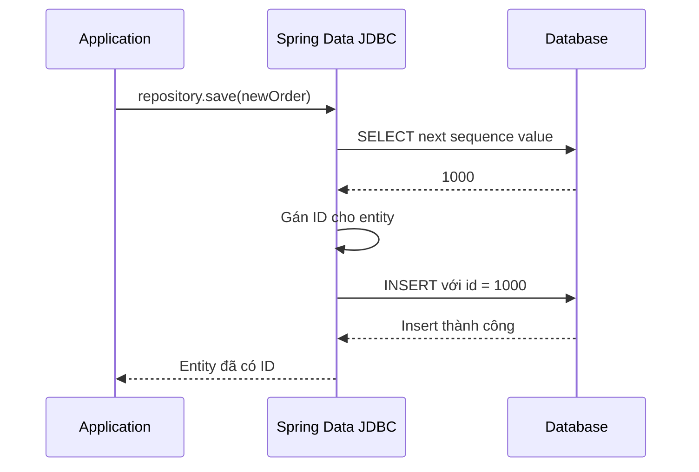
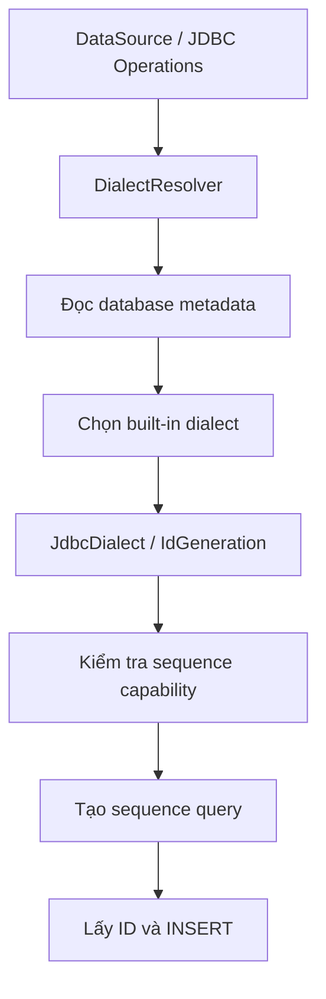

# Hỗ trợ sequence, @Sequence và dialect trong phiên bản có tính năng

Spring Data JDBC hỗ trợ nhiều cách tạo khóa chính. Với cột identity hoặc auto-increment, database thường cấp ID khi thực hiện INSERT. Một số hệ quản trị còn cung cấp **sequence**: một database object chuyên cấp ra các giá trị số theo thứ tự. Sequence có thể được dùng để cấp ID trước khi INSERT, chia sẻ giữa nhiều bảng hoặc tuân theo quy ước schema sẵn có.

Từ **Spring Data Relational 3.5**, Spring Data JDBC cung cấp annotation **`@Sequence`** để chỉ định sequence dùng cho property khóa chính. Tính năng này phụ thuộc vào dialect của database. Chỉ có annotation trong code chưa đủ: phiên bản thư viện phải hỗ trợ, dialect phải khai báo khả năng sequence và sequence phải tồn tại trong database.

Bài học này trình bày cách hoạt động của sequence, cách dùng `@Sequence`, sự khác nhau giữa sequence và identity, danh sách dialect được Spring Data JDBC hỗ trợ, cách xử lý database chưa có dialect sequence phù hợp, cách quản lý sequence bằng migration và cách kiểm thử.

## 1. Sequence là gì?

Sequence là một đối tượng độc lập trong database dùng để cấp các giá trị số theo quy tắc đã cấu hình. Một sequence thường có các thuộc tính như:

- Giá trị bắt đầu (START WITH).
- Bước tăng (INCREMENT BY).
- Giá trị nhỏ nhất/lớn nhất.
- Chính sách chu kỳ (CYCLE hoặc NO CYCLE).
- Cache các giá trị để giảm chi phí truy cập.

Ví dụ PostgreSQL:

```sql
CREATE SEQUENCE public.purchase_order_id_seq
    START WITH 1000
    INCREMENT BY 1
    NO CYCLE;
```

Mỗi lần lấy giá trị tiếp theo, database tăng sequence và trả về một số mới. Với PostgreSQL:

```sql
SELECT nextval('public.purchase_order_id_seq');
```

Nếu sequence đang ở trạng thái ban đầu, câu lệnh có thể trả về 1000; lần gọi tiếp theo trả về 1001.

Sequence không phải một cột trong bảng và cũng không phải một hàng dữ liệu của aggregate. Nó là database object riêng, được bảng hoặc ứng dụng sử dụng để lấy giá trị cho một cột.

### 1.1. Sequence và identity/auto-increment

Cả sequence và identity đều có thể tạo ID tự động, nhưng thời điểm lấy ID khác nhau.

| Đặc điểm | Identity/auto-increment | Sequence tường minh |
|---|---|---|
| Nơi cấp ID | Database cấp khi INSERT | Ứng dụng lấy giá trị từ database sequence trước INSERT |
| Thời điểm có ID | Thường sau khi INSERT | Có thể có trước khi INSERT |
| Cách SQL thường chạy | INSERT rồi đọc generated key | SELECT next value, sau đó INSERT có ID |
| Dùng chung giữa nhiều bảng | Thường gắn với một cột/bảng | Có thể dùng cùng sequence cho nhiều bảng |
| Cách khai báo Spring Data JDBC | Mapping ID thông thường | Thêm `@Sequence` vào property `@Id` |
| Phụ thuộc dialect | Generated-key support | Sequence support và câu SQL lấy next value |

Nếu cột ID dùng identity/auto-increment và database tự sinh giá trị khi INSERT, thường không cần `@Sequence`.

Nếu muốn Spring Data JDBC lấy ID từ một sequence được chỉ định trước khi INSERT, dùng `@Sequence`.

### 1.2. Sequence không bảo đảm số liên tục

Sequence thường bảo đảm các giá trị được cấp không trùng trong phạm vi cấu hình của sequence, nhưng không bảo đảm không có khoảng trống.

Ví dụ:

1. Transaction lấy giá trị 1000.
2. INSERT thất bại hoặc transaction rollback.
3. Transaction tiếp theo lấy giá trị 1001.

Giá trị 1000 có thể không xuất hiện trong bảng, nhưng sequence vẫn đã tiến lên. Một số database còn cache giá trị sequence, nên restart hoặc sự cố có thể tạo khoảng trống lớn hơn.

Không dùng sequence làm số chứng từ bắt buộc liên tục nếu nghiệp vụ yêu cầu không được thiếu số. Yêu cầu đánh số pháp lý hoặc kiểm soát chứng từ cần một cơ chế riêng, có quy tắc khóa và audit phù hợp.

## 2. @Sequence trong Spring Data Relational

`@Sequence` thuộc package:

```java
import org.springframework.data.relational.core.mapping.Sequence;
```

Annotation này được đặt trên property khóa chính đã có `@Id`. Nó chỉ định sequence mà Spring Data JDBC cần dùng để lấy giá trị ban đầu của ID khi lưu entity mới.

Ví dụ:

```java
import org.springframework.data.annotation.Id;
import org.springframework.data.relational.core.mapping.Sequence;
import org.springframework.data.relational.core.mapping.Table;

@Table("purchase_orders")
public class PurchaseOrder {

    @Id
    @Sequence(
        sequence = "purchase_order_id_seq",
        schema = "public"
    )
    private Long id;

    private String orderNumber;

    protected PurchaseOrder() {
    }

    public PurchaseOrder(String orderNumber) {
        this.orderNumber = orderNumber;
    }

    public Long getId() {
        return id;
    }

    public String getOrderNumber() {
        return orderNumber;
    }
}
```

Trong ví dụ:

- `@Id` đánh dấu property là khóa chính.
- `@Sequence` chỉ định sequence `purchase_order_id_seq`.
- `schema = "public"` chỉ định schema chứa sequence.
- Kiểu `Long` cho phép ID chưa có giá trị trước khi entity được lưu.

### 2.1. Các thuộc tính của @Sequence

Annotation có ba thuộc tính:

| Thuộc tính | Ý nghĩa |
|---|---|
| `value` | Tên sequence |
| `sequence` | Alias của `value` |
| `schema` | Schema chứa sequence |

`value` và `sequence` là hai tên thay thế cho cùng một giá trị. Có thể viết ngắn:

```java
@Id
@Sequence("purchase_order_id_seq")
private Long id;
```

Hoặc ghi rõ tên thuộc tính:

```java
@Id
@Sequence(
    sequence = "purchase_order_id_seq",
    schema = "public"
)
private Long id;
```

Nếu không chỉ định schema, việc tìm sequence phụ thuộc schema mặc định/search path của database và cách dialect xử lý identifier. Với hệ thống có nhiều schema, nên chỉ rõ schema để tránh trỏ nhầm sequence.

Trong Oracle, schema có thể tương ứng với user sở hữu sequence. Tên sequence cuối cùng được tạo từ schema và sequence theo quy tắc của mapping API.

### 2.2. @Sequence chỉ dành cho khóa chính

Đặt `@Sequence` cùng `@Id` trên property định danh. Không dùng annotation này như một converter chung để tự cấp số cho mọi field trong entity.

Ví dụ:

```java
@Id
@Sequence(sequence = "invoice_id_seq", schema = "billing")
private Long id;
```

Nếu một property nghiệp vụ khác cần lấy số từ sequence, chẳng hạn số hóa đơn hiển thị, hãy thiết kế quy trình cấp số riêng theo yêu cầu nghiệp vụ thay vì giả định `@Sequence` có thể áp dụng cho mọi property.

### 2.3. Chọn kiểu dữ liệu ID

Các kiểu số nguyên như `Long` thường phù hợp với sequence. Cột database phải có kiểu tương thích với giá trị mà sequence cấp.

Ví dụ:

```sql
CREATE TABLE purchase_orders (
    id BIGINT PRIMARY KEY,
    order_number VARCHAR(40) NOT NULL
);
```

Không nên dùng kiểu Java quá nhỏ nếu sequence có thể vượt giới hạn của kiểu đó. Sequence tăng lâu dài nên `Long`/BIGINT thường là lựa chọn an toàn hơn `Integer`/INTEGER cho ID có vòng đời lớn.

## 3. Spring Data JDBC lấy sequence value như thế nào?

Khi lưu entity mới có property được đánh dấu `@Sequence`, Spring Data JDBC thực hiện thêm một truy vấn để lấy giá trị tiếp theo trước câu INSERT.

Với PostgreSQL, luồng SQL minh họa là:

```sql
SELECT nextval('public.purchase_order_id_seq');
```

Giả sử câu lệnh trả về 1000. Spring Data JDBC dùng ID đó trong INSERT:

```sql
INSERT INTO purchase_orders(id, order_number)
VALUES (?, ?);
```

Tham số đầu tiên là 1000, tham số thứ hai là mã đơn hàng.



### 3.1. Sequence query và INSERT là hai thao tác riêng

Việc lấy sequence value và INSERT không phải một câu SQL duy nhất. Tài liệu Spring Data Relational khuyến nghị thực hiện chúng trong một transaction bao quanh để quản lý thao tác persistence như một đơn vị.

Ví dụ:

```java
@Service
public class PurchaseOrderService {

    private final PurchaseOrderRepository repository;

    public PurchaseOrderService(PurchaseOrderRepository repository) {
        this.repository = repository;
    }

    @Transactional
    public PurchaseOrder create(String orderNumber) {
        return repository.save(new PurchaseOrder(orderNumber));
    }
}
```

Transaction bảo vệ thao tác lưu ở tầng ứng dụng. Tuy nhiên, sequence value đã cấp thường không được thu hồi khi transaction rollback. Điều đó bình thường và không có nghĩa dữ liệu bị lưu dở dang.

### 3.2. Sequence không được gọi lại cho mỗi lần update

`@Sequence` là chiến lược lấy ID cho entity mới. Khi entity đã có ID và được xác định là tồn tại, thao tác save/update không nên cấp một ID mới cho entity đó.

Ví dụ:

```java
PurchaseOrder saved = repository.save(
    new PurchaseOrder("ORD-1001")
);

Long id = saved.getId();

// Tải và cập nhật entity đã có ID.
PurchaseOrder existing = repository.findById(id).orElseThrow();
repository.save(existing);
```

Lần lưu đầu cần cấp ID từ sequence. Lần lưu entity hiện có sử dụng ID đã có.

Việc Spring Data xác định entity mới hay cũ phụ thuộc entity state detection. Với kiểu ID wrapper như `Long`, giá trị ban đầu thường là `null`. Nếu tự gán ID trước khi save, Spring Data có thể xem entity là đã tồn tại tùy chiến lược phát hiện trạng thái.

## 4. Sequence phải được tạo trong database

`@Sequence` chỉ khai báo sequence Spring Data JDBC cần sử dụng. Annotation không tự tạo database sequence và không thay thế schema migration.

Với PostgreSQL, có thể tạo sequence trong Flyway migration:

```sql
-- V001__create_purchase_order_sequence.sql

CREATE SEQUENCE public.purchase_order_id_seq
    START WITH 1000
    INCREMENT BY 1
    NO CYCLE;
```

Tạo bảng sử dụng ID:

```sql
-- V002__create_purchase_orders.sql

CREATE TABLE public.purchase_orders (
    id BIGINT PRIMARY KEY,
    order_number VARCHAR(40) NOT NULL
);
```

Thứ tự migration cần bảo đảm sequence đã tồn tại trước khi ứng dụng thực hiện INSERT.

### 4.1. Quyền truy cập sequence

Database user của ứng dụng cần quyền sử dụng sequence. Với PostgreSQL, tùy quyền sở hữu và chính sách bảo mật, có thể cần cấp quyền:

```sql
GRANT USAGE, SELECT ON SEQUENCE public.purchase_order_id_seq
TO app_user;
```

Nếu sequence không tồn tại, schema sai hoặc user thiếu quyền, thao tác lấy ID sẽ thất bại trước khi INSERT.

### 4.2. Không tạo sequence trùng với sequence identity đang có

Nếu bảng đã dùng identity/auto-increment và sequence nội bộ do database quản lý, hãy xác định rõ cách database cấp ID trước khi thêm `@Sequence`.

Không tùy tiện gắn một sequence mới vào cột identity mà chưa kiểm tra schema và default expression. Có thể dẫn đến hai cơ chế cấp ID xung đột hoặc sequence không đồng bộ với dữ liệu hiện có.

### 4.3. Đồng bộ sequence với dữ liệu đã có

Khi chuyển một bảng đang có dữ liệu sang sequence tường minh, giá trị bắt đầu của sequence phải tránh trùng với ID hiện tại.

Với PostgreSQL, có thể kiểm tra:

```sql
SELECT MAX(id) FROM public.purchase_orders;
```

Sau đó điều chỉnh sequence theo chính sách migration. Hãy tính giá trị phù hợp với dữ liệu hiện có, trạng thái sequence và semantics của database. Không chạy lệnh đồng bộ một cách mù quáng trên production vì có thể làm sequence lùi hoặc tạo ID trùng.

## 5. Các dialect hỗ trợ sequence

Spring Data JDBC dùng **dialect** để mô tả khác biệt SQL giữa các hệ quản trị database. Dialect quyết định cách lấy giá trị tiếp theo từ sequence.

Theo tài liệu Spring Data Relational hiện hành, các dialect được liệt kê có hỗ trợ sequence gồm:

| Dialect | Sequence support trong Spring Data JDBC |
|---|---|
| H2 | Có |
| HSQL | Có |
| PostgreSQL | Có |
| DB2 | Có |
| Oracle | Có |
| Microsoft SQL Server | Có |
| MySQL | Không |
| MariaDB | Không nằm trong danh sách dialect hỗ trợ sequence được tài liệu liệt kê |

Điểm quan trọng là **khả năng của database server và khả năng của Spring Data JDBC dialect là hai điều khác nhau**. Một database engine có thể cung cấp sequence ở cấp server, nhưng dialect Spring Data JDBC đang dùng chưa chắc đã khai báo hoặc triển khai cách lấy sequence tương ứng.

Tài liệu Spring Data Relational ghi rõ MySQL không hỗ trợ sequence trong tính năng này. MariaDB không nằm trong danh sách dialect sequence được liệt kê; không nên suy ra Spring Data JDBC hỗ trợ chỉ vì một phiên bản MariaDB có cú pháp sequence riêng.

Nếu database của ứng dụng không nằm trong danh sách, hãy kiểm tra dialect cụ thể của phiên bản thư viện đang sử dụng trước khi áp dụng `@Sequence`.

### 5.1. SQL lấy sequence khác nhau theo database

Ví dụ PostgreSQL:

```sql
SELECT nextval('public.purchase_order_id_seq');
```

Các hệ quản trị khác có thể dùng cú pháp riêng, chẳng hạn `NEXT VALUE FOR`, `sequence.NEXTVAL` hoặc biểu thức khác. Spring Data JDBC không yêu cầu ứng dụng tự viết câu query vendor-specific cho từng entity khi built-in dialect đã hỗ trợ.

Dialect tạo câu query phù hợp với database. Vì vậy, không sao chép cú pháp PostgreSQL sang Oracle, SQL Server hoặc DB2 rồi kỳ vọng hoạt động giống nhau.

### 5.2. Hỗ trợ sequence không đồng nghĩa hỗ trợ mọi tính năng sequence của vendor

Một database có thể hỗ trợ nhiều tùy chọn sequence như cache, cycle, increment âm, order hoặc giới hạn min/max. `@Sequence` chỉ khai báo tên và schema sequence để Spring Data JDBC lấy giá trị kế tiếp.

Các thuộc tính cấu hình sequence như START, INCREMENT, CACHE, CYCLE vẫn thuộc DDL/migration của database. Annotation không thay thế chúng.

## 6. Mốc phiên bản: tính năng có từ Spring Data Relational 3.5

`@Sequence` được giới thiệu từ **Spring Data Relational 3.5**. API documentation của annotation ghi rõ `Since: 3.5`. Hai phần trong API ID generation liên quan trực tiếp đến tính năng cũng được bổ sung từ 3.5:

- `IdGeneration.sequencesSupported()`: cho biết dialect có hỗ trợ sequence hay không.
- `IdGeneration.createSequenceQuery(SqlIdentifier)`: tạo SQL lấy giá trị tiếp theo của sequence.

Do đó, không chỉ kiểm tra phiên bản database. Cần kiểm tra phiên bản Spring Data Relational thực tế mà ứng dụng đang chạy.

### 6.1. Bảng tương thích theo phiên bản

| Phiên bản Spring Data Relational | `@Sequence` | Ghi chú |
|---|---|---|
| Trước 3.5 | Chưa có | Không thể dùng annotation/API sequence mới |
| 3.5.x | Có | Cần dialect hỗ trợ sequence |
| 4.0.x | Có | Tiếp tục hỗ trợ |
| 4.1.x | Có | Tài liệu hiện hành tiếp tục mô tả tính năng |

Đây là mốc phiên bản của **Spring Data Relational**, không phải cách gọi phiên bản Spring Boot. Spring Boot quản lý phiên bản Spring Data thông qua dependency management/BOM tương ứng.

### 6.2. Kiểm tra dependency đang sử dụng

Trong dự án Maven, có thể kiểm tra dependency tree:

```bash
mvn dependency:tree -Dincludes=org.springframework.data:spring-data-relational,org.springframework.data:spring-data-jdbc
```

Với Gradle:

```bash
./gradlew dependencyInsight --dependency spring-data-relational --configuration runtimeClasspath
```

Tên configuration có thể khác tùy project. Mục tiêu là xác định phiên bản thư viện thực tế được resolve, không chỉ nhìn version khai báo trong một file.

### 6.3. Nâng cấp theo BOM của Spring Boot hoặc Spring Data

Nếu dự án dùng Spring Boot, ưu tiên để Spring Boot dependency management chọn các phiên bản Spring Data tương thích. Nếu quản lý Spring Data bằng release train BOM riêng, cần bảo đảm các module Spring Data cùng release train tương thích.

Không nên chỉ nâng riêng `spring-data-jdbc` hoặc `spring-data-relational` lên một phiên bản khác với các module liên quan mà không kiểm tra compatibility. Việc trộn phiên bản có thể gây lỗi class/method khi chạy dù code compile ở một số trường hợp.

### 6.4. Nếu dự án dùng phiên bản trước 3.5

Nếu dependency chưa có `@Sequence`, import annotation sẽ không biên dịch. Có các hướng xử lý:

- Dùng cơ chế identity/auto-increment mà dialect và database đã hỗ trợ.
- Nâng Spring Data Relational lên release train có `@Sequence` và phù hợp với Spring Framework/Spring Boot của ứng dụng.
- Nếu chưa thể nâng cấp, lấy ID bằng JDBC code riêng và quản lý việc ghi ID một cách tường minh.

Không tự tạo một annotation cùng tên trong package ứng dụng để giả lập tính năng. Spring Data JDBC không biết annotation tự định nghĩa đó và sẽ không dùng nó để sinh ID.

## 7. Dialect quyết định khả năng sequence như thế nào?

Dialect là lớp trừu tượng hóa hành vi SQL riêng của database. Spring Data JDBC sử dụng dialect để biết cách render SQL, xử lý kiểu dữ liệu, lấy generated key và thực hiện các thao tác khác.

Đối với sequence, dialect cung cấp thông tin thông qua `IdGeneration`:

```java
IdGeneration idGeneration = dialect.getIdGeneration();

boolean supported = idGeneration.sequencesSupported();
```

Khi dialect hỗ trợ sequence, API có thể tạo câu query tương ứng:

```java
String sql = idGeneration.createSequenceQuery(sequenceName);
```

Các phương thức này thuộc API Spring Data Relational. Ứng dụng thông thường không cần tự gọi chúng; Spring Data JDBC sử dụng chúng trong quá trình persistence.

### 7.1. Dialect được phát hiện tự động

Trong cấu hình chuẩn, Spring Data JDBC cố gắng xác định dialect từ cấu hình database bằng cách lấy connection và kiểm tra metadata.



Nếu database đã có built-in dialect, ứng dụng thường không cần cấu hình thủ công.

Nếu Spring Data JDBC không tìm được dialect phù hợp, cấu hình có thể thất bại khi khởi động. Khi đó, cần dialect do vendor cung cấp hoặc custom dialect phù hợp.

### 7.2. Kiểm tra dialect thực tế

Khi một ứng dụng kết nối đến database proxy, driver tương thích hoặc hệ quản trị có tên/version khác thường, metadata có thể ảnh hưởng đến dialect được chọn.

Nếu sequence không hoạt động như mong đợi:

1. Xác nhận database server/version.
2. Xác nhận JDBC driver.
3. Xác nhận Spring Data Relational version.
4. Xác nhận dialect được resolve.
5. Xác nhận dialect báo sequence support.
6. Kiểm tra SQL sequence được tạo và quyền truy cập database.

Không nên bắt đầu bằng cách đổi tên sequence nếu nguyên nhân thật là dialect không hỗ trợ sequence.

## 8. Database chưa có built-in dialect sequence phù hợp

Nếu ứng dụng sử dụng một database chưa được Spring Data JDBC hỗ trợ sequence, có thể cần custom dialect.

Custom dialect phải mô tả đúng các đặc điểm của database, bao gồm câu SQL lấy giá trị tiếp theo. Không chỉ bật cờ hỗ trợ sequence nếu database không thực sự có khả năng đó.

Về mặt API, custom ID generation cần thể hiện:

- Sequence có được hỗ trợ hay không qua `sequencesSupported()`.
- Câu SQL lấy giá trị tiếp theo qua `createSequenceQuery(SqlIdentifier)`.
- Quy tắc identifier/schema phù hợp với database.

Nếu custom dialect cần được Spring tự động phát hiện, Spring Data JDBC cung cấp SPI `DialectResolver.JdbcDialectProvider`. Provider trả về dialect phù hợp khi nhận ra database; nếu không nhận ra, trả về `Optional.empty()`.

Trong các phiên bản 3.5, provider được phát hiện thông qua Spring `SpringFactoriesLoader`. Tài liệu cấu hình mô tả đăng ký provider trong resource `META-INF/spring.factories`, với key:

```text
org.springframework.data.jdbc.core.dialect.DialectResolver$JdbcDialectProvider
```

Ví dụ định dạng đăng ký:

```properties
org.springframework.data.jdbc.core.dialect.DialectResolver$JdbcDialectProvider=com.example.database.CustomJdbcDialectProvider
```

Provider cần kiểm tra database metadata để chỉ cung cấp dialect cho đúng database. Không nên đăng ký một custom dialect chung cho mọi DataSource nếu nó không tương thích.

### 8.1. Không tùy tiện ghi đè dialect built-in

Nếu database đã có built-in dialect, hãy ưu tiên dùng dialect đó. Việc thay dialect có thể ảnh hưởng không chỉ sequence mà còn:

- Cách quote identifier.
- Cú pháp limit/offset.
- Cách render INSERT và RETURNING/generated keys.
- Kiểu dữ liệu và converter.
- Lock clause và upsert.
- Hành vi array hoặc các tính năng khác.

Một custom dialect chỉ sửa sequence nhưng làm sai các hành vi khác có thể gây lỗi ở nhiều thao tác persistence.

### 8.2. Khi nào nên dùng JDBC trực tiếp?

Nếu dialect chưa hỗ trợ sequence và việc triển khai custom dialect quá lớn so với nhu cầu, có thể lấy ID bằng JDBC trực tiếp trong một component riêng. Khi làm vậy, ứng dụng chịu trách nhiệm:

- Viết SQL phù hợp vendor.
- Quản lý transaction.
- Gán ID vào entity trước khi insert.
- Xử lý lỗi và quyền truy cập.
- Kiểm thử với đúng database/driver.

Cách này không khiến `@Sequence` tự hoạt động; nó là một chiến lược cấp ID khác.

## 9. So sánh @Sequence với các chiến lược ID khác

| Chiến lược | Cách hoạt động | Khi phù hợp |
|---|---|---|
| Identity/auto-increment | Database cấp ID trong INSERT | Schema dùng cột identity và dialect hỗ trợ generated keys |
| `@Sequence` | Spring Data lấy giá trị từ sequence trước INSERT | Database có sequence và dialect Spring Data hỗ trợ |
| ID do ứng dụng cấp | Application tạo UUID hoặc ID khác trước khi save | Muốn ID có sẵn trước khi ghi hoặc tạo dữ liệu offline |
| Bảng cấp số riêng | Ứng dụng cập nhật một row counter | Hệ thống cũ hoặc quy tắc cấp số tùy biến; cần concurrency control |

### 9.1. Khi dùng identity

Entity chỉ cần ID:

```java
@Table("customers")
public class Customer {

    @Id
    private Long id;

    private String name;
}
```

Database tự sinh ID khi INSERT. Spring Data JDBC đọc generated key theo khả năng của dialect/driver.

Không thêm `@Sequence` nếu cột được thiết kế cho identity và không có sequence tường minh dành cho ứng dụng.

### 9.2. Khi dùng sequence

```java
@Table("invoices")
public class Invoice {

    @Id
    @Sequence(sequence = "invoice_id_seq", schema = "billing")
    private Long id;

    private String invoiceNumber;
}
```

Spring Data JDBC lấy giá trị từ sequence trước khi INSERT. Đây là lựa chọn khi schema dùng sequence rõ ràng.

### 9.3. Khi dùng UUID do ứng dụng cấp

```java
@Table("outbox_events")
public record OutboxEvent(
    @Id UUID id,
    String eventType
) {}
```

Ứng dụng có thể tạo UUID trước khi lưu. Khi ID đã có sẵn, không cần database sequence cho property này.

## 10. Sequence và transaction

Tài liệu Spring Data Relational nhấn mạnh việc lấy sequence value và câu INSERT là hai thao tác riêng, nên khuyến nghị chạy trong transaction bao quanh.

Ví dụ:

```java
@Transactional
public PurchaseOrder placeOrder(String orderNumber) {
    PurchaseOrder order = new PurchaseOrder(orderNumber);
    return repository.save(order);
}
```

Nếu use case còn ghi thêm aggregate khác, đặt transaction ở service để các thao tác cùng tham gia transaction manager phù hợp.

### 10.1. Rollback không trả lại sequence value

Với nhiều hệ quản trị, đặc biệt PostgreSQL, thao tác lấy next value không rollback theo transaction. Ví dụ:

- Transaction A lấy 1000.
- Transaction A INSERT thất bại và rollback.
- Transaction B lấy 1001.

Không có row mang ID 1000, nhưng điều đó không phải lỗi. Sequence được thiết kế để cấp giá trị duy nhất, không phải đánh số liên tục không có khoảng trống.

### 10.2. Concurrent transaction

Hai transaction đồng thời lấy giá trị từ cùng sequence sẽ nhận các giá trị khác nhau theo cơ chế đồng bộ của database sequence.

Đây là ưu điểm quan trọng của sequence so với cách tự đọc MAX(id) + 1, vốn dễ tạo race condition:

```sql
SELECT MAX(id) + 1 FROM purchase_orders;
```

Không dùng MAX(id) + 1 làm cơ chế cấp ID đồng thời. Sequence hoặc identity là cơ chế do database quản lý cho mục đích này.

### 10.3. Sequence cache và khoảng trống

Database có thể cache một nhóm giá trị để giảm I/O. Cache cải thiện hiệu năng nhưng có thể mất các số chưa dùng khi database restart hoặc xảy ra sự cố.

Nếu nghiệp vụ cần số thứ tự hiển thị cho người dùng, có thể dùng sequence riêng cho số đó nhưng vẫn phải chấp nhận khoảng trống hoặc thiết kế quy trình quản lý số chứng từ riêng. Không suy luận rằng sequence luôn tạo dãy liên tục.

## 11. Kiểm thử @Sequence

Nên kiểm thử bằng integration test với database có dialect sequence tương ứng. Unit test chỉ kiểm tra annotation tồn tại không chứng minh Spring Data JDBC tạo đúng câu SQL hoặc database user có quyền sử dụng sequence.

Ví dụ entity và repository:

```java
@Table("purchase_orders")
public class PurchaseOrder {

    @Id
    @Sequence(sequence = "purchase_order_id_seq", schema = "public")
    private Long id;

    private String orderNumber;

    protected PurchaseOrder() {
    }

    public PurchaseOrder(String orderNumber) {
        this.orderNumber = orderNumber;
    }

    public Long getId() {
        return id;
    }
}
```

```java
public interface PurchaseOrderRepository
        extends CrudRepository<PurchaseOrder, Long> {
}
```

Test:

```java
@DataJdbcTest
class PurchaseOrderSequenceTest {

    @Autowired
    PurchaseOrderRepository repository;

    @Test
    void assignsIdFromDatabaseSequence() {
        PurchaseOrder saved = repository.save(
            new PurchaseOrder("ORD-1001")
        );

        assertThat(saved.getId()).isNotNull();
        assertThat(saved.getId()).isGreaterThanOrEqualTo(1000L);
    }
}
```

Test giả định migration đã tạo sequence bắt đầu từ 1000 và schema `public` đang được sử dụng. Nếu test transaction rollback, sequence vẫn có thể tiến lên; không nên phụ thuộc ID của lần chạy trước phải chính xác bằng một số cố định.

### 11.1. Kiểm tra sequence query được phát

Có thể bật logging Spring JDBC trong môi trường kiểm thử:

```properties
logging.level.org.springframework.jdbc=DEBUG
```

Khi lưu entity mới, log có thể cho thấy truy vấn lấy sequence trước INSERT. Câu SQL cụ thể phụ thuộc dialect.

Không bật logging SQL chi tiết trong production nếu dữ liệu nhạy cảm có thể xuất hiện trong log hoặc log volume quá lớn.

### 11.2. Kiểm tra database đích bằng Testcontainers

H2 có thể xác nhận luồng cơ bản, nhưng không chứng minh cú pháp và hành vi của PostgreSQL, Oracle, DB2 hay SQL Server.

Nếu production dùng PostgreSQL, hãy dùng PostgreSQL container cùng major version tương thích. Nếu production dùng SQL Server hoặc Oracle, kiểm thử với database/driver phù hợp của hệ thống đó.

Integration test cần xác nhận:

- Migration tạo sequence thành công.
- User ứng dụng có quyền đọc sequence.
- Dialect được chọn đúng.
- Entity mới nhận ID.
- INSERT dùng ID vừa lấy.
- Transaction rollback không để lại row dở dang.
- Sequence có thể tiếp tục cấp giá trị sau nhiều lần lưu.

## 12. Những lỗi thường gặp

| Triệu chứng | Nguyên nhân | Cách xử lý |
|---|---|---|
| Không biên dịch được import `@Sequence` | Spring Data Relational trước 3.5 | Nâng cấp release train tương thích hoặc dùng chiến lược ID khác |
| Entity save báo sequence không hỗ trợ | Dialect không khai báo sequence support | Kiểm tra dialect/version và danh sách hỗ trợ |
| Không tìm thấy sequence | Chưa tạo sequence hoặc sai schema/tên | Tạo sequence bằng migration và kiểm tra schema |
| Permission denied | Database user thiếu quyền sequence | Cấp quyền cần thiết cho user ứng dụng |
| PostgreSQL chạy nhưng Oracle lỗi | SQL sequence vendor-specific bị dùng sai | Để dialect tương ứng tạo câu query |
| MySQL không dùng được @Sequence | MySQL không hỗ trợ sequence trong Spring Data JDBC | Dùng AUTO_INCREMENT/identity hoặc ID do ứng dụng cấp |
| MariaDB không được nhận diện sequence | Dialect không nằm trong danh sách sequence support của tài liệu | Kiểm tra phiên bản/dialect; dùng custom dialect nếu cần |
| ID trùng với dữ liệu cũ | Sequence bắt đầu thấp hơn ID hiện có | Đồng bộ sequence trong migration có kiểm soát |
| ID bị nhảy số sau rollback | Sequence value đã được tiêu thụ | Chấp nhận khoảng trống; sequence không bảo đảm gapless |
| Mỗi lần update lại lấy ID mới | Entity state detection hoặc ID mapping sai | Kiểm tra giá trị ID và trạng thái mới/cũ |
| Annotation có nhưng không lấy sequence | Annotation đặt sai property hoặc không phải ID | Đặt `@Sequence` cùng property `@Id` |
| Custom dialect làm hỏng query khác | Dialect thay thế thiếu các hành vi cần thiết | Giữ đầy đủ semantics dialect và integration test toàn bộ persistence |
| Test H2 pass nhưng production fail | Khác biệt dialect hoặc quyền database | Test bằng database/driver production-compatible |

## 13. Quy trình áp dụng sequence trong dự án

Khi muốn chuyển một entity sang sequence, thực hiện theo thứ tự:

1. Xác định database và phiên bản JDBC driver đang dùng.
2. Xác định Spring Data Relational version có hỗ trợ `@Sequence` (3.5 trở lên).
3. Xác nhận dialect của database có sequence support.
4. Tạo sequence trong schema migration.
5. Kiểm tra schema, quyền và giá trị bắt đầu của sequence.
6. Đặt `@Sequence` trên property `@Id`.
7. Bao thao tác persistence trong transaction phù hợp.
8. Viết integration test trên database/driver tương thích.
9. Kiểm tra log SQL và ID được gán.
10. Triển khai migration theo thứ tự tương thích với ứng dụng đang chạy.

Nếu không thể đáp ứng bước dialect support, chọn identity, ID do ứng dụng cấp hoặc custom dialect đã được kiểm thử.

## 14. Bài thực hành

**Bài 1.** `@Sequence` được giới thiệu từ phiên bản nào của Spring Data Relational?

*Đáp án:* Từ Spring Data Relational 3.5. Đây là phiên bản của Spring Data release train, không đồng nghĩa với Spring Boot 3.5.

**Bài 2.** `@Sequence` được đặt ở đâu?

*Đáp án:* Trên property khóa chính đã có `@Id`. Annotation thuộc package `org.springframework.data.relational.core.mapping`.

**Bài 3.** `@Sequence(sequence = "order_seq", schema = "public")` có tự tạo sequence trong database không?

*Đáp án:* Không. Sequence phải được tạo trước bằng schema migration hoặc DDL phù hợp.

**Bài 4.** Khi lưu entity mới có `@Sequence`, Spring Data JDBC thực hiện những bước SQL nào?

*Đáp án:* Lấy giá trị tiếp theo từ sequence bằng một SELECT, sau đó dùng ID nhận được trong câu INSERT.

**Bài 5.** MySQL có nằm trong danh sách dialect hỗ trợ sequence của Spring Data JDBC không?

*Đáp án:* Không. Tài liệu Spring Data Relational nêu rõ MySQL không hỗ trợ sequence trong tính năng này.

**Bài 6.** Hai transaction cùng lấy giá trị từ một sequence có thể nhận cùng ID không?

*Đáp án:* Không trong cơ chế sequence chuẩn của database; sequence được thiết kế để cấp các giá trị khác nhau theo thứ tự cấp phát.

**Bài 7.** Transaction rollback có trả lại giá trị sequence vừa lấy không?

*Đáp án:* Thông thường không. Khoảng trống trong ID là hành vi bình thường của sequence.

**Bài 8.** Có nên dùng MAX(id) + 1 thay sequence không?

*Đáp án:* Không. Nhiều transaction đồng thời có thể cùng đọc một giá trị MAX và tạo ID trùng. Dùng sequence hoặc identity do database quản lý.

**Bài 9.** Database có native sequence nhưng Spring Data JDBC dialect không hỗ trợ thì `@Sequence` có tự hoạt động không?

*Đáp án:* Không. Cần dialect hỗ trợ, custom dialect/provider phù hợp hoặc một chiến lược cấp ID khác.

**Bài 10.** Vì sao nên integration test sequence với đúng database production?

*Đáp án:* Cú pháp lấy sequence, identifier/schema, driver và quyền truy cập khác nhau theo database. H2 không thể đại diện đầy đủ cho mọi dialect.

## 15. Điều cần ghi nhớ

- Sequence là database object cấp các giá trị số; nó không phải cột hoặc hàng của aggregate.
- Spring Data Relational hỗ trợ `@Sequence` từ phiên bản **3.5**.
- Đặt `@Sequence` cùng property `@Id` để chỉ định sequence cấp khóa chính.
- `value` và `sequence` là hai thuộc tính alias; `schema` chỉ định schema chứa sequence.
- Annotation không tự tạo sequence; hãy tạo và quản lý sequence bằng migration.
- Khi lưu entity mới, Spring Data JDBC lấy sequence value trước INSERT rồi ghi ID vào câu INSERT.
- Sequence query và INSERT là hai thao tác riêng; dùng transaction bao quanh cho use case cần atomicity.
- Sequence không bảo đảm số liên tục; rollback hoặc cache có thể tạo khoảng trống.
- Dialect quyết định sequence support và SQL lấy giá trị tiếp theo.
- Danh sách Spring Data Relational hiện hành gồm H2, HSQL, PostgreSQL, DB2, Oracle và Microsoft SQL Server; MySQL không hỗ trợ, MariaDB không được liệt kê trong danh sách sequence support.
- Nếu database không có built-in dialect phù hợp, cần custom dialect/provider hoặc một chiến lược ID khác.
- Kiểm tra phiên bản Spring Data Relational thực tế và quản lý dependency qua BOM tương thích.
- Kiểm thử migration, quyền sequence, SQL được phát và ID được gán trên database/driver phù hợp với production.

### Tài liệu tham khảo chính thức

- [Spring Data Relational — Sequence Support](https://docs.spring.io/spring-data/relational/reference/jdbc/sequences.html): cách dùng `@Sequence`, luồng lấy sequence value, transaction và danh sách dialect hỗ trợ.
- [Spring Data Relational 3.5 — Sequence Support](https://docs.spring.io/spring-data/relational/reference/3.5/jdbc/sequences.html): tài liệu sequence của release train 3.5.
- [Spring Data Relational — Sequence API](https://docs.spring.io/spring-data/relational/reference/api/java/org/springframework/data/relational/core/mapping/Sequence.html): thuộc tính `value`, `sequence`, `schema` và mốc `Since 3.5`.
- [Spring Data Relational — IdGeneration API](https://docs.spring.io/spring-data/relational/reference/3.5/api/java/org/springframework/data/relational/core/dialect/IdGeneration.html): `sequencesSupported()` và `createSequenceQuery`.
- [Spring Data Relational — Dialect Configuration](https://docs.spring.io/spring-data/relational/reference/3.5/jdbc/getting-started.html): cách phát hiện và tùy chỉnh dialect.
- [PostgreSQL — Sequence Functions](https://www.postgresql.org/docs/current/functions-sequence.html): `nextval`, `currval`, `setval` và semantics cấp giá trị.
- [PostgreSQL — CREATE SEQUENCE](https://www.postgresql.org/docs/current/sql-createsequence.html): tạo và cấu hình sequence.

Khi triển khai, hãy đối chiếu phiên bản Spring Data Relational, dialect được chọn, sequence DDL và JDBC driver. `@Sequence` chỉ hoạt động khi cả bốn phần này cùng tương thích.
