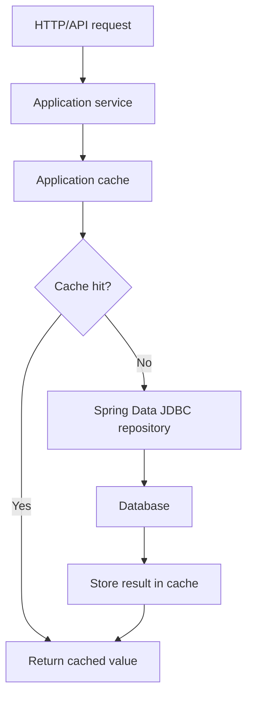
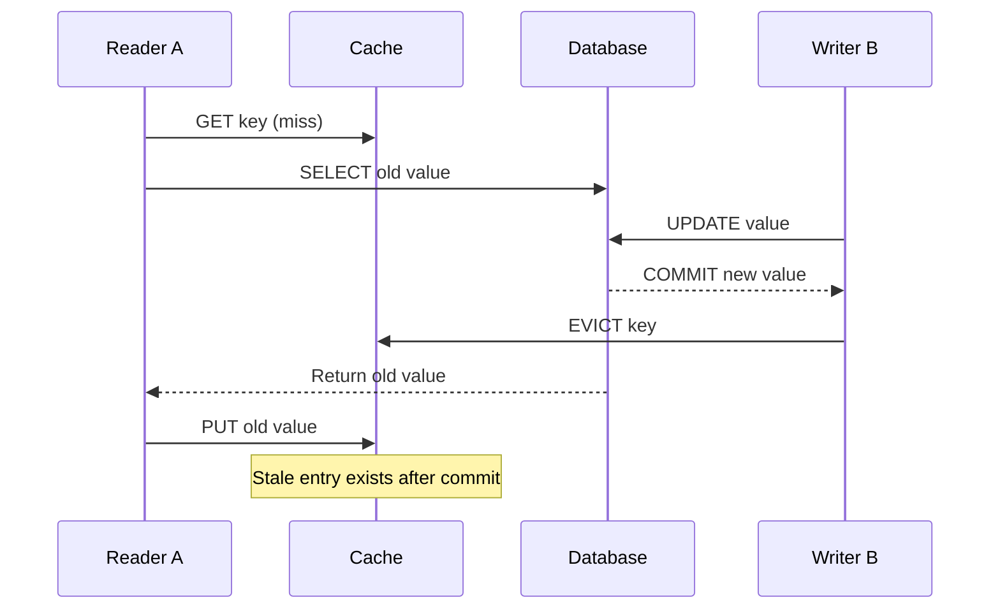
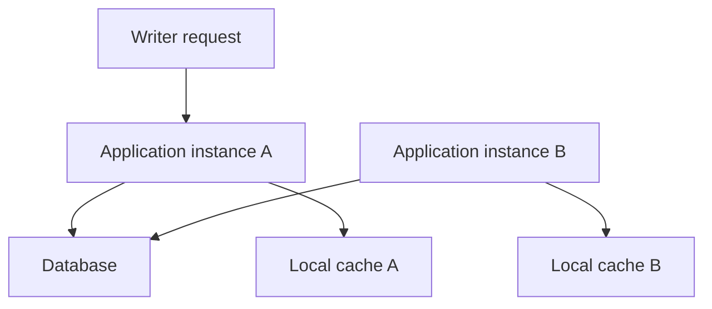
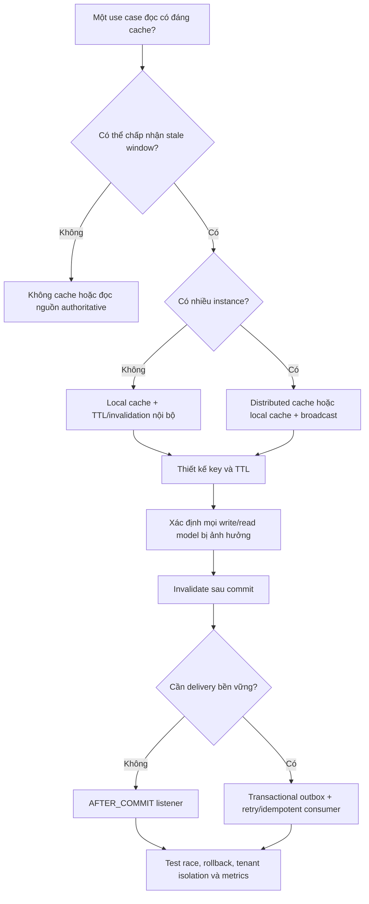

# Cache ở tầng ứng dụng và chiến lược vô hiệu hóa khi ghi

Cache ở tầng ứng dụng lưu tạm kết quả đọc trong bộ nhớ của process hoặc một hệ thống cache dùng chung để giảm số lần truy vấn database và cải thiện độ trễ. Trong Spring Data JDBC, cache thường được đặt ở service/use-case hoặc query adapter, bao quanh repository và các thao tác đọc. Repository vẫn là nơi truy cập dữ liệu bền vững; cache là một bản sao có thời hạn và cần được đồng bộ bằng chiến lược ghi rõ ràng.

Phần khó nhất của cache không phải là đọc giá trị từ cache, mà là bảo đảm cache không tiếp tục trả dữ liệu cũ sau khi database đã thay đổi. Một lần ghi có thể ảnh hưởng đến cache của aggregate, danh sách, kết quả tìm kiếm, thống kê và dữ liệu liên quan. Nếu vô hiệu hóa quá sớm, một request đọc đồng thời có thể nạp lại dữ liệu cũ. Nếu vô hiệu hóa quá muộn hoặc không lan tới các instance khác, ứng dụng có thể hiển thị trạng thái lỗi thời.

Bài học này trình bày cache-aside và Spring Cache abstraction, cách thiết kế key/TTL, các annotation thường dùng, chiến lược invalidation cho insert/update/delete, quan hệ với transaction commit, race condition, cache stampede, multi-instance invalidation, kiểm thử và giám sát.

## 1. Cache ở tầng ứng dụng giải quyết vấn đề gì?

Một request đọc dữ liệu có thể đi qua các lớp:



Khi cache hit, service có thể trả kết quả mà không cần thực hiện query. Khi cache miss, service đọc database rồi lưu kết quả vào cache để request sau tái sử dụng.

Cache hữu ích khi:

- Một số dữ liệu được đọc nhiều hơn ghi.
- Kết quả đọc tốn thời gian tính toán hoặc join nhiều bảng.
- Có thể chấp nhận một mức độ trễ dữ liệu được xác định rõ.
- Dữ liệu có key truy cập ổn định và kích thước cache có thể giới hạn.
- Chi phí đọc database hoặc dịch vụ phụ trợ đang là nút thắt.

Cache không tự làm mọi query nhanh hơn. Với dữ liệu ít được đọc, thay đổi liên tục, có cardinality rất cao hoặc yêu cầu consistency nghiêm ngặt, chi phí serialize, network, eviction và invalidation có thể lớn hơn lợi ích.

### Cache không phải nguồn dữ liệu bền vững

Database vẫn là nguồn dữ liệu chuẩn. Cache có thể bị mất khi process restart, node bị thay thế, TTL hết hạn hoặc cache server gặp sự cố. Ứng dụng phải có thể phục hồi bằng cách đọc lại database.

Không đặt dữ liệu duy nhất của nghiệp vụ vào cache. Một cache entry bị eviction không được làm mất thông tin cần thiết để khôi phục trạng thái hệ thống.

## 2. Chọn chiến lược cache

Các mô hình thường gặp:

| Chiến lược | Cách hoạt động | Khi phù hợp |
| --- | --- | --- |
| Cache-aside (lazy loading) | Ứng dụng đọc cache; miss thì đọc database rồi ghi cache. Khi ghi dữ liệu, ứng dụng chủ động evict/update cache. | Phổ biến, dễ áp dụng cho Spring service. |
| Read-through | Cache layer tự tải dữ liệu từ loader khi miss. | Khi cache provider/framework hỗ trợ loader và muốn gom logic đọc. |
| Write-through | Ghi cache và database trong cùng một luồng ghi theo hợp đồng của cache layer. | Khi cần cache luôn được cập nhật cùng write path và có cơ chế bảo đảm rõ. |
| Write-behind | Ghi vào cache trước, database được cập nhật bất đồng bộ sau. | Một số workload đặc thù; rủi ro cao hơn vì cache trở thành nơi nhận ghi tạm thời. |

Với ứng dụng Spring Data JDBC, cache-aside thường là lựa chọn dễ kiểm soát: repository ghi database, service quản lý cache key và invalidation. Không nên tự tạo write-behind chỉ để giảm latency nếu chưa có durable queue, retry, idempotency và cơ chế phục hồi.

### Cache dữ liệu nào?

Ưu tiên cache các kết quả đọc có giá trị tái sử dụng:

- Aggregate được đọc thường xuyên theo ID.
- DTO/read model dùng cho màn hình hoặc API.
- Metadata ít thay đổi như danh mục, cấu hình công khai.
- Kết quả tính toán tốn kém có đầu vào ổn định.
- Query danh sách có filter phổ biến và kích thước kết quả được giới hạn.

Cân nhắc kỹ trước khi cache:

- Số dư, trạng thái thanh toán hoặc quyền truy cập thay đổi thường xuyên.
- Kết quả phụ thuộc người dùng hiện tại hoặc quyền hiện tại.
- Query có nhiều filter tự do dẫn đến hàng triệu cache key.
- Dữ liệu có kích thước lớn hoặc chứa thông tin nhạy cảm.
- Query có tính nhất quán mạnh ngay sau khi ghi.

## 3. Spring Cache abstraction

Spring cung cấp abstraction để ứng dụng sử dụng annotation thay vì phụ thuộc trực tiếp vào một cache provider. Bật caching bằng cấu hình:

```java
@Configuration
@EnableCaching
public class CacheConfiguration {
}
```

Sau đó cung cấp một implementation của CacheManager. Ví dụ dùng Caffeine cho cache local trong một process:

```java
@Configuration
@EnableCaching
public class CacheConfiguration {

    @Bean
    CacheManager cacheManager() {
        CaffeineCacheManager manager =
            new CaffeineCacheManager("orders", "orderLists");

        manager.setCaffeine(
            Caffeine.newBuilder()
                .maximumSize(20_000)
                .expireAfterWrite(Duration.ofMinutes(5))
        );

        return manager;
    }
}
```

Ví dụ cần dependency Caffeine tương ứng. Trong hệ thống nhiều instance, cache local của từng node là các bản sao độc lập; invalidation trên node A không tự xóa entry của node B. Khi cần chia sẻ cache hoặc invalidation toàn cụm, có thể dùng Redis hoặc một provider phân tán khác.

Spring Cache abstraction cung cấp các annotation chính:

| Annotation | Hành vi |
| --- | --- |
| @Cacheable | Kiểm tra cache trước khi gọi method; cache miss thì chạy method và lưu kết quả. |
| @CachePut | Luôn chạy method rồi cập nhật kết quả vào cache. |
| @CacheEvict | Xóa một entry hoặc toàn bộ entries trong cache. |
| @Caching | Gom nhiều cache operation trên cùng method. |
| @CacheConfig | Khai báo cấu hình cache dùng chung ở cấp class. |

Trong tài liệu, ký hiệu @ ở bảng tương ứng với annotation có một ký tự @ ở đầu tên.

### Cache key và vùng cache

Cache thường được chia thành named cache như `orders` hoặc `orderLists`. Mỗi entry có một key duy nhất trong vùng đó. Thiết kế key là phần của hợp đồng dữ liệu: cùng một key phải luôn đại diện cho cùng một kết quả và cùng phạm vi truy cập.

Ví dụ cache một aggregate theo ID:

```java
@Service
public class OrderQueryService {

    private final PurchaseOrderRepository orders;

    public OrderQueryService(PurchaseOrderRepository orders) {
        this.orders = orders;
    }

    @Cacheable(cacheNames = "orders", key = "#orderId")
    public PurchaseOrder findById(long orderId) {
        return orders.findById(orderId)
            .orElseThrow(() -> new OrderNotFoundException(orderId));
    }
}
```

Nếu method được gọi qua Spring proxy, cache hit có thể trả kết quả mà không chạy thân method. Vì vậy method được cache phải được gọi qua bean proxy; self-invocation trong cùng class thường không kích hoạt caching annotation ở chế độ proxy mặc định.

### Chọn provider theo phạm vi triển khai

- Cache local như Caffeine có latency thấp, không cần network, nhưng mỗi instance có dữ liệu riêng.
- Cache phân tán như Redis chia sẻ entries giữa các instance, nhưng thêm network, serialization, vận hành và dependency ngoài.
- Cache provider phải có giới hạn dung lượng/TTL phù hợp; cache không giới hạn có thể làm tăng heap hoặc memory của cache server.
- Chọn serializer tương thích giữa các phiên bản ứng dụng nếu cache tồn tại qua rolling deployment.

Không dùng tên provider làm chiến lược consistency. Dù cache local hay phân tán, ứng dụng vẫn cần quyết định khi nào entry hết hạn, được cập nhật hoặc bị xóa.
## 4. Dùng @Cacheable cho đường đọc

`@Cacheable` kiểm tra cache trước khi gọi method. Nếu key đã tồn tại, Spring trả kết quả từ cache; method không được thực thi. Nếu cache miss, method chạy và kết quả được lưu theo key.

```java
@Cacheable(cacheNames = "orders", key = "#orderId")
public PurchaseOrder findById(long orderId) {
    return orders.findById(orderId)
        .orElseThrow(() -> new OrderNotFoundException(orderId));
}
```

Có thể đặt key bằng tham số hoặc biểu thức SpEL dựa trên tham số method:

```java
@Cacheable(
    cacheNames = "orderSummaries",
    key = "#customerId + ':' + #page + ':' + #size"
)
public List<OrderSummary> findSummaries(
        long customerId,
        int page,
        int size) {
    return queries.findSummaries(customerId, page, size);
}
```

Key phải chứa mọi đầu vào ảnh hưởng kết quả. Nếu kết quả phụ thuộc customer, tenant, locale, currency, page, filter hoặc quyền truy cập, các yếu tố đó phải được phản ánh trong key hoặc cache phải được phân vùng phù hợp. Bỏ sót một tham số có thể khiến request nhận kết quả được tạo cho request khác.

### Condition và unless

`condition` được đánh giá trước khi method chạy; `unless` được đánh giá sau khi có kết quả:

```java
@Cacheable(
    cacheNames = "orders",
    key = "#orderId",
    condition = "#orderId > 0",
    unless = "#result == null"
)
public PurchaseOrder findOptional(long orderId) {
    return orders.findById(orderId).orElse(null);
}
```

- Dùng `condition` để bỏ qua cache cho một số lời gọi.
- Dùng `unless` để không lưu kết quả sau khi method đã chạy, ví dụ không cache null.
- Không dùng điều kiện để thay thế authorization hoặc tenant validation.

Spring Cache có hỗ trợ xử lý `Optional` ở abstraction; empty Optional thường được biểu diễn như null ở tầng cache. Cần kiểm tra hành vi với provider và cấu hình cụ thể nếu cache negative result. Nếu không muốn cache kết quả không tìm thấy, đặt `unless` phù hợp.

### Tránh cache object có thể bị thay đổi ngoài ý muốn

Nếu cache trả về một object mutable, caller có thể sửa object đó trong bộ nhớ mà không ghi database. Request khác sau đó nhận cùng instance đã bị thay đổi. Điều này đặc biệt rủi ro với cache local lưu object reference.

Ưu tiên cache immutable DTO/record hoặc tạo defensive copy. Không để controller thay đổi trực tiếp aggregate lấy từ cache. Cache serialization của provider phân tán thường tạo bản sao khi đọc, nhưng không nên dựa vào khác biệt provider để định nghĩa domain behavior.

## 5. Dùng @CachePut và @CacheEvict cho đường ghi

`@CachePut` luôn chạy method rồi lưu kết quả vào cache. Nó hữu ích khi method trả về đầy đủ giá trị mới và key có thể xác định chính xác:

```java
@CachePut(cacheNames = "orders", key = "#result.id")
public PurchaseOrder updateStatus(long orderId, String status) {
    PurchaseOrder current = orders.findById(orderId)
        .orElseThrow(() -> new OrderNotFoundException(orderId));

    return orders.save(current.withStatus(status));
}
```

Trong ví dụ này `#result.id` là ID của aggregate sau khi lưu. Cần bảo đảm method trả về object đã được lưu và key dùng trong `@CachePut` khớp với key của `@Cacheable` ở đường đọc.

Tuy nhiên, `@CachePut` cập nhật cache trước khi chắc chắn transaction bên ngoài đã commit nếu cache advice chạy trước transaction commit. Với dữ liệu cần consistency, cân nhắc invalidation sau commit thay vì ghi trực tiếp kết quả vào cache ngay trong method transactional.

### Xóa entry bằng @CacheEvict

```java
@CacheEvict(cacheNames = "orders", key = "#orderId")
public void deleteOrder(long orderId) {
    orders.deleteById(orderId);
}
```

Theo mặc định, `@CacheEvict` thực hiện eviction sau khi method chạy thành công. `beforeInvocation = true` chuyển việc xóa sang trước khi method chạy, kể cả khi method thất bại. Với dữ liệu gắn với database transaction, không nên chọn `beforeInvocation = true` một cách tùy tiện: nếu database rollback, cache có thể đã bị xóa sớm; một request đọc đồng thời có thể nạp lại trạng thái cũ.

`allEntries = true` xóa toàn bộ entries trong cache region:

```java
@CacheEvict(cacheNames = "orderLists", allEntries = true)
public void changeOrderStatus(long orderId, String status) {
    // Update database.
}
```

Cách này đơn giản nhưng có thể gây cache miss hàng loạt và tăng tải database. Chỉ dùng khi số entry và tác động cold-cache có thể chấp nhận được.

### Không phối hợp @Cacheable và @CachePut tùy tiện trên cùng method

`@Cacheable` có thể bỏ qua việc chạy method khi hit; `@CachePut` luôn chạy method. Gắn cả hai lên cùng method có thể tạo semantics khó hiểu. Hãy tách rõ read path và write path, hoặc dùng `@Caching` khi thật sự cần nhiều cache operation có mục đích rõ ràng.

## 6. Thiết kế cache key an toàn và đầy đủ

Cache key là một phần của ranh giới dữ liệu. Key cần đáp ứng:

- Phân biệt mọi input ảnh hưởng kết quả.
- Không trộn dữ liệu giữa tenant.
- Không trộn dữ liệu giữa người dùng/quyền truy cập nếu response được cá nhân hóa.
- Có biểu diễn ổn định qua các phiên bản ứng dụng.
- Không chứa secret, access token hoặc thông tin nhạy cảm không cần thiết.
- Có cardinality có thể kiểm soát.

Ví dụ cache theo tenant và ID:

```java
@Cacheable(
    cacheNames = "orders",
    key = "#tenantId + ':' + #orderId"
)
public PurchaseOrder findForTenant(String tenantId, long orderId) {
    return orderQueries.findForTenant(tenantId, orderId);
}
```

`tenantId` phải được lấy từ context đã xác thực, không tin trực tiếp một tham số client tự truyền. Nếu dùng database-per-tenant và mỗi tenant có ID namespace riêng, tenant ID vẫn cần nằm trong cache key vì cache có thể dùng chung cho toàn bộ application instance.

Với object/filter phức tạp, cân nhắc `KeyGenerator` thay vì nối chuỗi thủ công. Generator nên chuẩn hóa thứ tự field, null, collection và encoding để hai request tương đương tạo cùng key.

```java
@Component("orderSearchKeyGenerator")
public class OrderSearchKeyGenerator implements KeyGenerator {

    @Override
    public Object generate(
            Object target,
            Method method,
            Object... params) {

        OrderSearchCriteria criteria = (OrderSearchCriteria) params[0];

        return criteria.tenantId()
            + ":" + criteria.status()
            + ":" + criteria.from()
            + ":" + criteria.to()
            + ":" + criteria.page()
            + ":" + criteria.size();
    }
}
```

Sử dụng:

```java
@Cacheable(
    cacheNames = "orderSearch",
    keyGenerator = "orderSearchKeyGenerator"
)
public Page<OrderSummary> search(OrderSearchCriteria criteria) {
    return queries.search(criteria);
}
```

Nếu criteria chứa danh sách sort/filter, hãy chuẩn hóa thứ tự phần tử trước khi tạo key. Nếu không, hai criteria tương đương nhưng khác thứ tự collection có thể tạo hai entry khác nhau hoặc key collision nếu chuẩn hóa sai.
## 7. TTL, giới hạn dung lượng và chính sách eviction

TTL (time to live) giới hạn thời gian một entry được giữ trong cache. Ví dụ Caffeine:

```java
@Bean
CacheManager cacheManager() {
    CaffeineCacheManager manager =
        new CaffeineCacheManager("orders", "orderLists");

    manager.setCaffeine(
        Caffeine.newBuilder()
            .maximumSize(50_000)
            .expireAfterWrite(Duration.ofMinutes(3))
            .recordStats()
    );

    return manager;
}
```

Các chính sách thường gặp:

- `expireAfterWrite`: hết hạn sau khoảng thời gian kể từ lần ghi.
- `expireAfterAccess`: hết hạn sau khoảng thời gian không được truy cập.
- Maximum size/weight: giới hạn số entry hoặc tổng trọng lượng.
- Eviction policy: chọn entry cần loại bỏ khi đạt giới hạn.

TTL không thay thế invalidation. Một entry có thể lỗi thời ngay sau lần ghi database; TTL chỉ giới hạn thời gian tối đa entry có thể tồn tại nếu không bị xóa sớm. TTL dài giúp tăng hit ratio nhưng kéo dài cửa sổ stale data. TTL ngắn làm giảm stale window nhưng tăng miss và tải database.

Với dữ liệu có độ nóng khác nhau, dùng cache region và TTL riêng. Ví dụ danh mục sản phẩm có thể có TTL dài, còn trạng thái đơn hàng có TTL ngắn hơn hoặc bị evict ngay sau write.

### TTL jitter để tránh hết hạn đồng loạt

Nếu hàng nghìn key được tạo cùng lúc với TTL giống nhau, chúng có thể hết hạn cùng lúc và tạo burst query. Có thể thêm jitter nhỏ vào TTL hoặc phân tán thời điểm refresh. Jitter phải nằm trong giới hạn stale data mà nghiệp vụ cho phép.

## 8. Invalidation khi insert, update và delete

Cache-aside thường dùng quy tắc: **ghi database thành công rồi evict cache entry liên quan**. Cách này tránh cache chứa giá trị mới trong khi database transaction vẫn có thể rollback.

Ví dụ write service:

```java
@Service
public class OrderCommandService {

    private final PurchaseOrderRepository orders;

    public OrderCommandService(PurchaseOrderRepository orders) {
        this.orders = orders;
    }

    @Transactional
    public PurchaseOrder changeStatus(long orderId, String status) {
        PurchaseOrder current = orders.findById(orderId)
            .orElseThrow(() -> new OrderNotFoundException(orderId));

        return orders.save(current.withStatus(status));
    }
}
```

Nếu cache được quản lý riêng, service cần phát tín hiệu invalidation sau khi transaction commit. Không nên chỉ xóa cache trước khi gọi `save` vì transaction có thể thất bại và một request đọc đồng thời có thể nạp lại dữ liệu cũ.

### Invalidate aggregate theo ID

Khi một đơn hàng thay đổi, tối thiểu cần xóa cache theo key ID:

```java
@CacheEvict(cacheNames = "orders", key = "#orderId")
public void evictOrder(long orderId) {
}
```

Đây là ví dụ minh họa một cache operation riêng. Trong ứng dụng thực tế, nên gom invalidation vào listener/service có trách nhiệm rõ thay vì gọi một method rỗng ở nhiều nơi.

Nếu một lần ghi làm thay đổi các danh sách, search result hoặc summary, phải evict các cache region tương ứng. Chỉ xóa `orders[orderId]` không tự làm mới `orderLists[customerId:page]`.

### Invalidate khi insert

Insert mới có thể ảnh hưởng:

- Cache của aggregate theo ID mới (thường chưa tồn tại, nhưng có thể có negative cache).
- Danh sách theo customer/status.
- Kết quả tìm kiếm và pagination.
- Tổng số đơn, dashboard hoặc summary.
- Cache của các đối tượng liên quan nếu response chứa dữ liệu join.

Vì vậy, invalidation cần dựa trên tập query/read model bị ảnh hưởng, không chỉ dựa vào aggregate vừa được lưu.

### Invalidate khi delete

Delete vật lý hoặc soft delete đều có thể ảnh hưởng cache. Với soft delete, row vẫn tồn tại trong database nhưng không còn thuộc tập active; cần evict aggregate key và mọi list/search/count cache chỉ chứa bản ghi active.

Nếu dùng negative caching cho kết quả không tồn tại, khi insert một bản ghi có ID hoặc business key từng được cache là “không tìm thấy”, cần evict negative entry tương ứng.

## 9. Thời điểm invalidation: sau commit

Một method có cả `@Transactional` và `@CacheEvict` có thể khiến cache eviction chạy khi method trả về nhưng trước khi transaction database thực sự commit, tùy thứ tự advisor/interceptor. Không nên hiểu mặc định `@CacheEvict` là “sau commit”.

Nếu database rollback sau khi cache đã bị evict, dữ liệu có thể vẫn đúng nhưng cache miss tăng. Nguy hiểm hơn là request đọc trong khoảng giữa eviction và commit có thể nạp lại giá trị cũ từ database; entry đó tiếp tục tồn tại sau commit.

Một cách thể hiện rõ thời điểm là publish application event trong transaction và lắng nghe ở phase `AFTER_COMMIT`:

```java
public record OrderChanged(long orderId, long customerId) {}

@Service
public class OrderCommandService {

    private final PurchaseOrderRepository orders;
    private final ApplicationEventPublisher events;

    public OrderCommandService(
            PurchaseOrderRepository orders,
            ApplicationEventPublisher events) {
        this.orders = orders;
        this.events = events;
    }

    @Transactional
    public PurchaseOrder changeStatus(long orderId, String status) {
        PurchaseOrder current = orders.findById(orderId)
            .orElseThrow(() -> new OrderNotFoundException(orderId));

        PurchaseOrder saved = orders.save(current.withStatus(status));

        events.publishEvent(
            new OrderChanged(saved.id(), saved.customerId())
        );

        return saved;
    }
}
```

Listener thực hiện invalidation sau commit:

```java
@Component
public class OrderCacheInvalidator {

    private final CacheManager cacheManager;

    public OrderCacheInvalidator(CacheManager cacheManager) {
        this.cacheManager = cacheManager;
    }

    @TransactionalEventListener(phase = TransactionPhase.AFTER_COMMIT)
    public void onOrderChanged(OrderChanged event) {
        Cache orders = cacheManager.getCache("orders");
        if (orders != null) {
            orders.evict(event.orderId());
        }

        Cache orderLists = cacheManager.getCache("orderLists");
        if (orderLists != null) {
            orderLists.clear();
        }
    }
}
```

Ví dụ xóa toàn bộ `orderLists` để dễ thấy nguyên tắc. Trong hệ thống lớn, có thể evict theo customer, status hoặc dùng versioned key để tránh clear toàn region. Nếu không có transaction đang hoạt động, `@TransactionalEventListener` mặc định không xử lý event; hãy bảo đảm event được publish trong transaction hoặc cấu hình fallback có chủ đích.

Một lựa chọn khác là dùng transaction-aware cache manager/decorator để trì hoãn các thao tác `put`, `evict` và `clear` phù hợp đến sau commit. Cần kiểm tra semantics provider và thao tác cache cụ thể; không phải mọi API như `putIfAbsent` đều được trì hoãn theo cùng cách. Với invalidation có nhiều bước hoặc cần xử lý sau commit rõ ràng, transactional event listener hoặc outbox thường dễ đọc hơn.

### Vì sao không evict trước khi ghi?

Nếu xóa cache trước database update, request B có thể miss cache và đọc database cũ trong khi request A chưa commit. Request B ghi giá trị cũ trở lại cache; sau đó A commit. Nếu không có lần evict tiếp theo, cache giữ dữ liệu stale cho đến TTL.

Vì vậy, thứ tự write database rồi invalidation sau commit là nền tảng tốt hơn, nhưng vẫn chưa loại bỏ mọi race condition như phần tiếp theo mô tả.
## 10. Race condition giữa cache miss và database write

Evict sau commit giảm nhiều lỗi stale cache, nhưng cache-aside vẫn có race condition:

1. Request A miss cache và bắt đầu đọc database, nhận giá trị cũ.
2. Request B cập nhật row trên primary và commit giá trị mới.
3. Request B evict cache sau commit.
4. Request A hoàn tất query cũ và ghi kết quả cũ vào cache sau lần eviction.
5. Request tiếp theo đọc entry cũ vừa được A ghi.

Sơ đồ:



Đây là race giữa việc nạp cache và invalidation. Nó cho thấy “evict sau commit” là quy tắc nền tảng, nhưng không tự cung cấp consistency tuyến tính cho mọi interleaving.

### Các mức bảo vệ

- **Không cache dữ liệu yêu cầu consistency tức thời:** đọc trực tiếp primary cho trạng thái nhạy cảm.
- **TTL ngắn:** giới hạn thời gian stale trong tình huống race, nhưng không loại bỏ race.
- **Per-key single-flight/lock:** chỉ cho một loader nạp cùng key tại một thời điểm; writer cần phối hợp với lock nếu muốn chặn loader cũ.
- **Version/fencing token:** cache entry mang version từ database; chỉ cho phép ghi cache nếu version không cũ hơn version hiện tại.
- **Versioned cache key:** key bao gồm version/epoch hiện tại; sau write, tăng version để entry cũ trở thành unreachable.
- **Double invalidation:** một số hệ thống xóa lần nữa sau một khoảng trễ để giảm cửa sổ race; đây chỉ là biện pháp giảm xác suất, không phải bảo đảm correctness.
- **Write-through có kiểm soát:** cập nhật cache với version mới trong cùng write workflow và xử lý retry/idempotency.

Chọn biện pháp theo yêu cầu consistency. Nếu không thể chứng minh thứ tự và atomicity giữa database với cache, đừng mô tả cache-aside là strongly consistent.

### Versioned key minh họa

Giả sử cache key có dạng `order:{id}:v{version}`. Reader lấy version hiện tại từ một nguồn version đáng tin cậy rồi đọc entry tương ứng. Sau commit, writer tăng version/epoch. Loader cũ có thể ghi entry version trước đó, nhưng request mới đã dùng version mới nên không đọc nhầm entry cũ.

Cơ chế này cần thiết kế cẩn thận: nếu version pointer cũng được cache và có thể stale, vấn đề chỉ chuyển sang pointer. Version phải được đọc từ nguồn có consistency phù hợp hoặc được cập nhật bằng cơ chế atomic đáng tin cậy.

## 11. Invalidation cho list, search, count và read model

Một aggregate có thể xuất hiện trong nhiều cache entry. Ví dụ một đơn hàng có thể nằm trong:

- `orders[id]` — chi tiết aggregate.
- `orderLists[customerId,status,page,size]` — danh sách theo khách hàng và trạng thái.
- `orderSearch[criteria]` — kết quả tìm kiếm.
- `orderCounts[customerId]` — số lượng.
- `dashboard[tenantId]` — summary.

Khi status đổi từ CREATED sang CONFIRMED, entry list cho cả hai trạng thái có thể bị ảnh hưởng. Khi customerId thay đổi, list của customer cũ và mới đều có thể bị ảnh hưởng. Khi insert/delete, pagination boundaries và total count cũng thay đổi.

### Các chiến lược quản lý list cache

1. **Evict toàn region:** dễ triển khai, phù hợp region nhỏ hoặc write không thường xuyên; có thể gây miss burst.
2. **Evict theo nhóm key:** theo tenant/customer/status nếu key namespace được thiết kế trước.
3. **Version/epoch namespace:** key chứa version của collection; write tăng epoch, entries cũ tự trở thành không được tham chiếu.
4. **Cache read model ít biến động:** chỉ cache những list có filter cố định và invalidate dễ xác định.
5. **Không cache pagination động:** nếu mọi tổ hợp filter/page tạo key riêng và khó invalidation, cache có thể không đáng giá.

Ví dụ namespace version:

```java
String key = "customer:" + customerId
    + ":orders:v" + listVersion;
```

Khi dữ liệu của customer thay đổi, tăng `listVersion` bằng thao tác atomic. Các key version cũ có thể để TTL tự dọn. Cần đảm bảo version update được chia sẻ giữa mọi application instance nếu cache dùng chung.

Không dùng `allEntries = true` như cách mặc định cho mọi write trong hệ thống có cache lớn. Một lần clear toàn bộ có thể làm cache hit ratio sụt mạnh và dồn tải lên database.

## 12. Aggregate có child và dữ liệu liên quan

Trong Spring Data JDBC, save aggregate có thể thay đổi root và các child rows. Cache thường lưu cả aggregate object, nên invalidation cần theo root ID sau bất kỳ thay đổi child nào.

Ví dụ:

- Thêm hoặc xóa OrderLine làm thay đổi cache `orders[orderId]`.
- Thay đổi child làm thay đổi total, count hoặc summary cache.
- Nếu query read model join với Customer, thay đổi tên Customer có thể ảnh hưởng nhiều OrderSummary dù aggregate Order không đổi.

Xác định dependency giữa write model và read model. Với số lượng quan hệ lớn, việc tìm mọi cache key liên quan có thể rất khó. Có thể chọn clear/version namespace cho read model hoặc chỉ cache aggregate theo ID và những metadata ổn định.

Không để cache aggregate trở thành một cách chia sẻ object domain giữa nhiều use case nếu các use case có quyền truy cập khác nhau. DTO riêng cho read model thường dễ kiểm soát hơn.

## 13. Bulk update, custom SQL và đường ghi ngoài repository

`@CacheEvict` trên một service method chỉ chạy khi write path thực sự đi qua method đó. Các thay đổi bằng custom SQL, batch job, migration, script quản trị hoặc một service khác có thể bypass annotation/invalidation.

Ví dụ:

```java
@Repository
public class OrderBulkRepository {

    private final NamedParameterJdbcTemplate jdbc;

    public OrderBulkRepository(NamedParameterJdbcTemplate jdbc) {
        this.jdbc = jdbc;
    }

    public int markExpired(Collection<Long> ids) {
        return jdbc.update("""
            UPDATE purchase_order
            SET status = :status
            WHERE id IN (:ids)
            """,
            new MapSqlParameterSource()
                .addValue("status", "EXPIRED")
                .addValue("ids", ids)
        );
    }
}
```

Lệnh bulk này không tự gọi cache annotation của từng aggregate. Caller phải invalidation theo tập ID hoặc namespace bị ảnh hưởng sau commit. Nếu danh sách ID lớn, có thể tăng version của cache region hoặc phát event theo nhóm thay vì gửi hàng triệu key riêng lẻ.

### Quy tắc tổ chức write path

- Đặt write use case trong service/command handler thống nhất.
- Tập trung invalidation policy ở một adapter hoặc listener.
- Với custom SQL, công bố rõ tập aggregate/read model bị ảnh hưởng.
- Với scheduled job/import, dùng cùng invalidation/outbox contract.
- Nếu database có nhiều writer ngoài ứng dụng, cân nhắc CDC hoặc database event mechanism để phát invalidation.
- Không giả định migration DDL/data tự kích hoạt Spring event listener.
## 14. Cache local và cache phân tán trong nhiều instance

Khi ứng dụng chạy nhiều instance, cache local tạo một bản sao riêng trên mỗi node:



Nếu instance A evict cache của nó sau commit, entry trong cache B vẫn còn. Vì vậy local cache chỉ phù hợp khi dữ liệu có thể stale trong giới hạn TTL hoặc khi có cơ chế broadcast invalidation.

Các lựa chọn:

- **Distributed cache dùng chung:** mọi instance truy cập cùng cache backend. Evict một key có hiệu lực với các instance dùng backend đó, nhưng vẫn cần xử lý lỗi network và consistency giữa database/cache.
- **Local cache + pub/sub invalidation:** write path publish event; mỗi instance nhận event và evict local entry. Cần xử lý mất message, reconnect, duplicate và ordering.
- **Local cache với TTL ngắn:** chấp nhận stale window có giới hạn khi dữ liệu không nhạy consistency.
- **Không dùng local cache cho dữ liệu thay đổi thường xuyên:** tránh tạo nhiều bản sao khó đồng bộ.

### Invalidation event phải idempotent

Một event như `OrderChanged(orderId, version)` nên có thể xử lý nhiều lần mà không gây lỗi. Evict cùng key hai lần thường idempotent. Nếu event cập nhật cache bằng payload thay vì evict, cần so sánh version để event cũ đến muộn không ghi đè giá trị mới.

Với pub/sub không durable, subscriber có thể bỏ lỡ event khi mất kết nối. Khi subscriber khởi động lại, cần clear local cache, đồng bộ epoch/version hoặc chấp nhận TTL stale window. Với yêu cầu reliability cao, dùng durable messaging hoặc outbox.

## 15. Transactional outbox cho invalidation đáng tin cậy

`@TransactionalEventListener(AFTER_COMMIT)` chạy trong process sau commit, nhưng có một khoảng hở: database đã commit rồi process dừng trước khi listener hoàn tất. Event trong bộ nhớ không còn để phát lại sau restart.

Nếu invalidation phải được giao bền vững đến cache subscriber, ghi outbox record trong cùng transaction với dữ liệu nghiệp vụ:

```java
@Transactional
public PurchaseOrder changeStatus(long orderId, String status) {
    PurchaseOrder current = orders.findById(orderId)
        .orElseThrow(() -> new OrderNotFoundException(orderId));

    PurchaseOrder saved = orders.save(current.withStatus(status));

    outbox.insert(new CacheInvalidationMessage(
        "OrderChanged",
        saved.id(),
        saved.version()
    ));

    return saved;
}
```

Một worker đọc outbox, publish message đến broker hoặc kênh invalidation, rồi đánh dấu message đã xử lý. Nếu publish thành công nhưng đánh dấu thất bại, message có thể được gửi lại; consumer cần idempotent.

Outbox đảm bảo event được lưu cùng transaction database. Nó không làm cache và database trở thành một transaction phân tán; thay vào đó, nó cung cấp delivery có thể retry và eventual invalidation. Trong khoảng từ database commit đến khi subscriber xử lý event, cache vẫn có thể stale. Nếu nghiệp vụ không chấp nhận khoảng đó, đường đọc nhạy consistency phải bypass cache hoặc kiểm tra version ở nguồn authoritative.

### Nội dung event nên tối thiểu

Thông thường chỉ cần:

- Event type.
- Aggregate ID.
- Tenant ID nếu key được phân vùng tenant.
- Aggregate version hoặc cache epoch.
- Event ID và timestamp.
- Những nhóm cache/read model cần invalidation.

Tránh gửi toàn bộ aggregate nhạy cảm vào message nếu subscriber chỉ cần xóa key. Payload tối thiểu giảm rủi ro lộ dữ liệu và giảm coupling giữa schema domain với message contract.

## 16. Cache stampede và tải đồng thời khi hết hạn

Cache stampede xảy ra khi nhiều request cùng miss một key nóng, cùng truy vấn database và cùng ghi lại kết quả. Nó thường xuất hiện khi TTL hết hạn đồng loạt hoặc sau khi clear một cache region lớn.

Các biện pháp:

- **Single-flight:** chỉ một request load một key; các request khác chờ kết quả.
- `@Cacheable(sync = true)`: yêu cầu cache provider hỗ trợ đồng bộ load theo key; semantics phụ thuộc provider và giới hạn của Spring Cache.
- **TTL jitter:** phân tán thời điểm hết hạn.
- **Refresh ahead:** tải lại entry trước khi hết hạn nếu workload phù hợp.
- **Stale-while-revalidate:** tạm trả giá trị cũ trong thời gian ngắn trong khi refresh nền; chỉ dùng khi nghiệp vụ chấp nhận stale.
- **Rate limit/concurrency limit:** hạn chế số loader cùng gọi database.
- **Negative caching:** cache kết quả không tìm thấy trong thời gian ngắn khi miss lặp lại là tốn kém.

Ví dụ:

```java
@Cacheable(
    cacheNames = "productCatalog",
    key = "#productId",
    sync = true
)
public ProductView findProduct(long productId) {
    return productQueries.findById(productId)
        .orElseThrow(() -> new ProductNotFoundException(productId));
}
```

`sync = true` không phải distributed lock chung cho mọi instance trong mọi provider. Kiểm tra implementation cụ thể trước khi dựa vào nó để chống stampede xuyên cụm.

### Negative caching

Cache kết quả “không tìm thấy” có thể giảm query lặp lại cho ID không tồn tại. Tuy nhiên, khi insert mới với cùng ID/business key, phải evict negative entry. TTL nên ngắn hơn cache entry bình thường vì trạng thái không tồn tại có thể thay đổi.

Không cache lỗi tạm thời như database timeout hoặc connection failure thành “không tìm thấy”. Phân biệt absence hợp lệ với lỗi hạ tầng.

## 17. Cache và transaction-aware behavior

Spring Cache abstraction không tự biến mọi cache provider thành một phần của transaction database. Database rollback không tự rollback thao tác cache đã chạy trước đó, trừ khi có decorator/transaction integration phù hợp.

Một số điểm cần phân biệt:

- `@Transactional` quản lý transaction database thông qua transaction manager.
- `@Cacheable` có thể đọc cache trước khi method và transaction bên trong method bắt đầu, tùy vị trí annotation/advisor.
- `@CachePut` có thể cập nhật cache trước khi database transaction commit.
- `@CacheEvict` mặc định không đồng nghĩa after commit.
- Transaction-aware cache decorator có thể trì hoãn một số thao tác cache đến sau commit, nhưng không phải mọi thao tác cache API đều được trì hoãn như nhau.
- Distributed cache thường không tham gia cùng local JDBC transaction manager theo cách atomic.

Với cache-aside và dữ liệu được cập nhật bởi Spring Data JDBC, cách dễ diễn đạt nhất thường là: write DB và outbox/event trong transaction; sau commit xử lý invalidation. Nếu không cần delivery durable, `@TransactionalEventListener(AFTER_COMMIT)` có thể đủ.

Không mở transaction dài chỉ để giữ cache lock hoặc chờ network cache. Giữ transaction database ngắn để tránh giữ connection và lock lâu.
## 18. Tenant, authorization và dữ liệu nhạy cảm

Cache có thể làm lộ dữ liệu nếu key không phản ánh phạm vi truy cập. Điều này đặc biệt quan trọng khi nhiều tenant dùng chung application instance hoặc cache backend.

Ví dụ một key chỉ chứa order ID:

```java
@Cacheable(cacheNames = "orders", key = "#orderId")
public OrderView findOrder(long orderId) {
    // ...
}
```

Nếu ID chỉ duy nhất trong phạm vi tenant, hai tenant có thể cùng có order ID bằng nhau. Key trên sẽ gây collision và có thể trả dữ liệu tenant này cho tenant khác.

Dùng key có tenant scope:

```java
@Cacheable(
    cacheNames = "orders",
    key = "#tenantId + ':' + #orderId"
)
public OrderView findOrder(String tenantId, long orderId) {
    return queries.findForTenant(tenantId, orderId);
}
```

Tenant ID phải đến từ context đã xác thực. Cache key không thay thế authorization: trước khi trả cache hit, service vẫn phải bảo đảm caller được phép truy cập tenant và tài nguyên. Nếu response thay đổi theo role, permission, ownership hoặc user preference, những yếu tố đó cũng phải được phản ánh trong key hoặc cache ở mức dữ liệu chung trước khi áp dụng authorization riêng.

Không cache nguyên response chứa token, credential, thông tin thanh toán hoặc dữ liệu cá nhân nếu không có yêu cầu rõ ràng về bảo mật, TTL, encryption và access control. Cache phân tán cần bảo vệ network, authentication, encryption at rest và quyền truy cập theo môi trường.

## 19. Serialization và tương thích khi rolling deployment

Cache phân tán thường serialize object thành bytes. Khi ứng dụng rolling deployment, hai phiên bản code có thể cùng đọc/ghi cache. Thay đổi class shape, package, enum, JSON property hoặc serializer có thể khiến phiên bản cũ không đọc được entry do phiên bản mới ghi.

Các lựa chọn giảm rủi ro:

- Cache DTO có schema đơn giản và ổn định thay vì serialize aggregate domain phức tạp.
- Dùng JSON schema/versioned payload nếu cache sống qua nhiều phiên bản.
- Thêm namespace/version vào cache name hoặc key khi thay đổi format không tương thích.
- Xóa namespace cũ trong release chuyển đổi khi chấp nhận cold cache.
- Dùng TTL đủ ngắn để entry cũ tự biến mất, nhưng không dựa vào TTL nếu serializer mới không đọc được entry cũ ngay sau deploy.
- Không dùng Java native serialization làm hợp đồng lưu trữ dài hạn nếu không kiểm soát serialVersionUID và class evolution.

Ví dụ version namespace:

```java
@Cacheable(
    cacheNames = "orderViews:v2",
    key = "#tenantId + ':' + #orderId"
)
public OrderViewV2 findView(String tenantId, long orderId) {
    return queries.findViewV2(tenantId, orderId);
}
```

Đổi namespace tạo cache region mới và tránh parse nhầm payload cũ. Cần có kế hoạch dọn region cũ sau khi mọi instance đã chuyển phiên bản.

## 20. Cache failure và chính sách fail-open/fail-closed

Cache là một dependency hạ tầng. Cache server có thể timeout, network lỗi, hết memory hoặc từ chối kết nối. Cần quyết định cache failure ảnh hưởng request như thế nào.

### Fail-open

Nếu cache chỉ là tối ưu, ứng dụng có thể bỏ qua cache khi cache unavailable và đọc database. Điều này giữ chức năng nhưng làm tăng tải database. Cần có connection pool/database capacity và circuit breaker/rate limit phù hợp để cache outage không gây database overload.

Spring cho phép cấu hình `CacheErrorHandler` để định nghĩa cách xử lý lỗi get/put/evict/clear. Ví dụ minh họa fail-open cho thao tác cache:

```java
@Configuration
@EnableCaching
public class CacheErrorConfiguration implements CachingConfigurer {

    @Override
    public CacheErrorHandler errorHandler() {
        return new CacheErrorHandler() {
            @Override
            public void handleCacheGetError(
                    RuntimeException exception,
                    Cache cache,
                    Object key) {
                log.warn("Cache GET failed for {}", cache.getName(), exception);
            }

            @Override
            public void handleCachePutError(
                    RuntimeException exception,
                    Cache cache,
                    Object key,
                    Object value) {
                log.warn("Cache PUT failed for {}", cache.getName(), exception);
            }

            @Override
            public void handleCacheEvictError(
                    RuntimeException exception,
                    Cache cache,
                    Object key) {
                log.error("Cache EVICT failed for {}", cache.getName(), exception);
            }

            @Override
            public void handleCacheClearError(
                    RuntimeException exception,
                    Cache cache) {
                log.error("Cache CLEAR failed for {}", cache.getName(), exception);
            }
        };
    }
}
```

Ví dụ chỉ ghi log để minh họa hook; behavior fallback cụ thể cần kiểm tra theo CacheErrorHandler và Spring version. Với lỗi GET, handler có thể cho phép method tiếp tục đọc database. Với lỗi EVICT, nếu chỉ log rồi tiếp tục, cache stale có thể tồn tại; cần alert, TTL ngắn, retry hoặc phát invalidation lại.

### Fail-closed

Với dữ liệu mà trả kết quả stale có thể gây hậu quả lớn, ứng dụng có thể từ chối request khi không thể xác định freshness hoặc bypass cache và đọc nguồn authoritative. Fail-closed không nhất thiết có nghĩa trả lỗi ngay; có thể bỏ qua cache và query primary nếu database còn khả dụng.

Không bắt tất cả cache exception rồi im lặng. Phải có metric/alert để phân biệt cache đang miss bình thường với cache backend đang lỗi.

## 21. Không cache quá sâu trong repository

Có thể đặt `@Cacheable` trên repository method, nhưng cache ở application service/query service thường thể hiện rõ hơn:

- Use case nào chấp nhận stale data.
- Caller nào được phép dùng cache.
- Cache key bao gồm tenant/user/locale ra sao.
- Những write nào cần invalidate.
- Khi nào phải bypass cache và đọc primary.

Nếu cache đặt sâu trong repository, mọi caller có thể vô tình nhận cache behavior dù use case yêu cầu freshness. Repository nên tập trung persistence contract; service điều phối cache policy theo nghiệp vụ.

Một ngoại lệ là repository/query adapter chuyên biệt cho dữ liệu tham chiếu ổn định, nơi cache behavior là một phần rõ ràng của adapter contract. Dù vậy, cần ghi rõ TTL và invalidation ownership.
## 22. Kiểm thử cache hit, miss và invalidation

Test cache không chỉ kiểm tra method có annotation. Cần xác nhận observable behavior: cache hit không gọi repository lần nữa, write commit làm entry bị evict, rollback không phát invalidation sau commit, và key không trộn tenant.

Ví dụ test service cache với repository mock và cache manager test:

```java
@SpringBootTest
class OrderQueryCacheTest {

    @Autowired
    OrderQueryService queryService;

    @MockBean
    PurchaseOrderRepository orders;

    @Test
    void secondReadUsesCachedValue() {
        PurchaseOrder order = sampleOrder(10L);
        when(orders.findById(10L)).thenReturn(Optional.of(order));

        queryService.findById(10L);
        queryService.findById(10L);

        verify(orders, times(1)).findById(10L);
    }
}
```

Test cần gọi service qua Spring bean proxy. Nếu tự tạo object bằng `new OrderQueryService(...)`, cache annotation sẽ không được áp dụng.

### Kiểm tra invalidation sau commit

Với `@TransactionalEventListener(AFTER_COMMIT)`, cần kiểm tra cả hai đường:

- Commit thành công: listener chạy và key liên quan bị evict.
- Rollback: listener không chạy, cache không bị invalidated bởi event của transaction đã rollback.

Ví dụ theo ý nghĩa:

```java
@Test
void committedWriteInvalidatesCachedOrder() {
    queryService.findById(orderId);
    assertThat(cacheManager.getCache("orders").get(orderId)).isNotNull();

    commandService.changeStatus(orderId, "CONFIRMED");

    assertThat(cacheManager.getCache("orders").get(orderId)).isNull();
}

@Test
void rolledBackWriteDoesNotRunAfterCommitInvalidation() {
    queryService.findById(orderId);

    assertThatThrownBy(() ->
        commandService.changeStatusAndFail(orderId, "CONFIRMED")
    ).isInstanceOf(IllegalStateException.class);

    assertThat(cacheManager.getCache("orders").get(orderId)).isNotNull();
}
```

Đây là ví dụ minh họa; cần bảo đảm method command thật sự chạy qua transaction proxy và test kiểm soát được commit/rollback. Nếu test class tự chạy trong transaction, hãy dùng transaction test support phù hợp để quan sát kết quả sau khi transaction kết thúc.

### Kiểm thử negative cache và bulk write

- Cache kết quả not-found, sau đó insert bản ghi cùng key và xác nhận negative entry được evict.
- Update aggregate qua repository/service và xác nhận cache detail cùng list/read model bị invalidated.
- Chạy bulk SQL và xác nhận caller phát invalidation cho toàn bộ vùng dữ liệu bị ảnh hưởng.
- Soft delete một aggregate và xác nhận cache active list/count không còn trả row đó.
- Thay đổi child collection và xác nhận cache aggregate root bị evict.
- Thay đổi dữ liệu liên quan như Customer name và xác nhận read model join được refresh.

### Kiểm thử nhiều instance

Nếu dùng local cache, tạo hai application context hoặc hai cache manager độc lập. Ghi qua instance A rồi xác nhận invalidation event được instance B nhận và xóa entry tương ứng. Test cả subscriber reconnect/mất message nếu cơ chế pub/sub có thể xảy ra.

Nếu dùng distributed cache, kiểm tra cả serialization, TTL, eviction và behavior khi cache server unavailable. Test local Caffeine không chứng minh Redis serializer hoặc network failure behavior đúng.

## 23. Kiểm thử race condition và stampede

Các test concurrency có thể dùng latch/barrier để điều khiển thứ tự thay vì dựa vào timing ngẫu nhiên.

Một race test cần tạo được trình tự:

1. Reader miss cache.
2. Reader đọc snapshot cũ từ database nhưng tạm dừng trước khi cache put.
3. Writer commit giá trị mới và evict key.
4. Reader tiếp tục và cố put giá trị cũ.
5. Test xác nhận chiến lược version/lock của ứng dụng không cho entry stale trở thành giá trị hiện hành.

Không dùng `Thread.sleep()` làm công cụ đồng bộ chính. Dùng `CountDownLatch`, `CyclicBarrier` hoặc test hook rõ ràng để tạo thứ tự có thể lặp lại.

Đối với stampede:

- Khởi chạy nhiều request đồng thời cùng đọc một key miss.
- Đếm số lần loader/repository được gọi.
- Xác nhận provider `sync` hoặc single-flight policy giảm số lần load theo kỳ vọng.
- Chạy test với nhiều application instance nếu cần chống stampede xuyên cụm.
- Đo số request chờ và thời gian chờ; single-flight có thể giảm DB load nhưng tăng latency cho request chờ.

Không kiểm thử race bằng một assertion duy nhất trên Caffeine rồi suy rộng cho Redis hoặc provider khác. Locking/atomic operation phụ thuộc cache implementation.

## 24. Metrics và quan sát cache trong production

Cache cần được đo như một thành phần hiệu năng, không chỉ bật lên rồi giả định nó đang có ích.

Các chỉ số quan trọng:

| Metric | Câu hỏi cần trả lời |
| --- | --- |
| Hit ratio | Bao nhiêu request đọc được phục vụ từ cache? |
| Hit/miss count theo cache region | Region nào có ích, region nào chỉ tăng chi phí? |
| Load latency | Cache miss mất bao lâu để truy vấn database? |
| Cache operation latency | GET/PUT/EVICT có bị chậm do network/provider không? |
| Entry count/estimated size | Cache có tiến gần giới hạn dung lượng không? |
| Eviction/expiration count | Entry bị loại do capacity hay TTL? |
| Invalidation lag | Bao lâu từ database commit đến khi các node nhận invalidation? |
| Cache error count | GET/PUT/EVICT/clear lỗi bao nhiêu lần? |
| Loader concurrency | Có dấu hiệu stampede hoặc nhiều request cùng nạp key nóng không? |
| Stale-read indicator | Có version hoặc timestamp nào cho thấy cache trả dữ liệu cũ không? |

Caffeine có thể expose statistics nếu bật `recordStats()`. Với cache phân tán, dùng metrics/exporter của provider và theo dõi latency network. Spring Boot Actuator/Micrometer có thể tích hợp cache metrics tùy provider và cấu hình.

### Hit ratio không phải mục tiêu duy nhất

Hit ratio cao vẫn có thể che giấu stale data hoặc key collision. Đánh giá cùng với correctness, latency p95/p99, database load, memory, invalidation lag và lỗi cache. Một cache region có hit ratio thấp nhưng giữ dữ liệu quan trọng đôi khi vẫn có giá trị; region có hit ratio cao nhưng trả dữ liệu theo quyền sai là lỗi nghiêm trọng.

Không đưa raw cache key chứa email, tenant ID hoặc thông tin cá nhân vào metric label vì cardinality và privacy. Dùng tên region, operation và nhóm key đã được làm sạch.

## 25. Quy trình thiết kế cache và invalidation

Trước khi thêm cache cho một use case Spring Data JDBC, hãy trả lời:

1. Use case nào đọc dữ liệu và mức stale tối đa được chấp nhận là bao lâu?
2. Database vẫn là nguồn dữ liệu chuẩn và cache có thể được dựng lại không?
3. Cache aggregate, DTO, list hay kết quả tính toán?
4. Key chứa tenant, user scope, locale, filter, sort và pagination nào?
5. Provider là local hay distributed? Các instance có cần invalidation lẫn nhau không?
6. TTL, maximum size và eviction policy nào phù hợp?
7. Insert/update/delete ảnh hưởng cache detail, list, search, count và dashboard nào?
8. Invalidation chạy sau commit bằng event, transaction-aware cache hay outbox?
9. Có race giữa loader cũ và invalidation không? Có cần version/lock hoặc bypass cache?
10. Custom SQL, batch job, soft delete và external writer có cùng invalidation contract không?
11. Cache outage nên fail-open hay fail-closed?
12. Serializer có tương thích khi rolling deployment không?
13. Có negative caching hoặc stampede không?
14. Integration test nào chứng minh hit/miss, commit/rollback, multi-instance và race behavior?
15. Metrics nào cảnh báo stale data, invalidation lag và cache outage?

Sơ đồ quyết định:



## 26. Những lỗi thường gặp

| Lỗi | Hậu quả | Cách xử lý |
| --- | --- | --- |
| Cache không chứa tenant ID | Dữ liệu tenant có thể bị trộn khi ID chỉ unique trong tenant. | Đưa tenant scope vào key và vẫn authorize caller. |
| Chỉ evict cache detail | List/search/count vẫn trả kết quả cũ. | Xác định dependency của mọi read model bị ảnh hưởng. |
| Evict trước khi database commit | Request đọc có thể nạp lại giá trị cũ. | Invalidate sau commit. |
| Cho rằng @CacheEvict tự chạy AFTER_COMMIT | Cache có thể bị xóa trước commit tùy advisor order. | Dùng AFTER_COMMIT event hoặc transaction-aware cache integration đã kiểm chứng. |
| Chỉ dùng TTL thay invalidation | Dữ liệu cũ có thể tồn tại đến hết TTL. | Kết hợp TTL với invalidation theo write. |
| Cache local trên nhiều instance nhưng không broadcast | Instance khác giữ entry stale. | Dùng distributed cache hoặc pub/sub/outbox invalidation. |
| @CachePut trước commit | Cache có thể chứa giá trị của transaction rollback. | Cập nhật/evict sau commit. |
| Bulk SQL không phát invalidation | Cache không biết các row đã thay đổi. | Phát event theo ID/namespace hoặc CDC. |
| Cache object mutable | Caller có thể thay đổi object trong cache mà không ghi DB. | Dùng immutable DTO/record hoặc defensive copy. |
| Cache key thiếu filter/permission | Request có thể nhận kết quả của phạm vi khác. | Thiết kế key đủ input và kiểm tra authorization. |
| Clear toàn bộ cache sau mọi write | Cold-cache burst và database overload. | Evict theo key/group hoặc version namespace. |
| Dùng pub/sub không durable cho invalidation bắt buộc | Subscriber mất message có thể giữ stale entry. | Outbox/durable messaging, resync và TTL. |
| Không có metrics | Không biết cache đang có ích hay lỗi. | Theo dõi hit/miss, latency, eviction, errors và lag. |

## 27. Câu hỏi tự kiểm tra

- Cache-aside khác read-through và write-through như thế nào?
- Vì sao database vẫn phải là nguồn dữ liệu chuẩn?
- `@Cacheable`, `@CachePut` và `@CacheEvict` khác nhau ở thời điểm chạy method nào?
- `condition` và `unless` khác nhau ra sao?
- Vì sao cache key cần tenant, filter, sort và pagination khi chúng ảnh hưởng kết quả?
- Vì sao `@CacheEvict` không mặc định đồng nghĩa với after commit?
- Race nào vẫn có thể xảy ra dù đã evict sau commit?
- Khi nào cần versioned key, lock hoặc bypass cache?
- Vì sao update aggregate child có thể phải evict cache root và read model?
- Bulk SQL và batch job cần invalidation như thế nào?
- Cache local khác distributed cache ở khả năng đồng bộ nhiều instance ra sao?
- Vì sao transactional outbox đáng tin cậy hơn event trong bộ nhớ khi process có thể dừng sau commit?
- `sync = true` có bảo đảm distributed lock không?
- Cache failure nên fail-open hay fail-closed theo use case nào?
- Những integration test nào chứng minh invalidation chỉ chạy sau commit?
- Metrics nào giúp phát hiện cache stampede và invalidation lag?

Cache ở tầng ứng dụng chỉ hữu ích khi key đại diện đúng phạm vi dữ liệu, TTL có giới hạn và mọi write path đều có chính sách invalidation. Với Spring Data JDBC, hãy giữ database là nguồn chuẩn, đặt cache policy ở service/read adapter, evict các aggregate và read model bị ảnh hưởng sau commit, rồi dùng outbox khi invalidation cần delivery bền vững giữa nhiều instance. Kiểm thử cả race condition, rollback, tenant isolation và cache outage; đo hit ratio cùng latency và invalidation lag để xác nhận cache thực sự cải thiện hiệu năng mà không làm sai dữ liệu.
