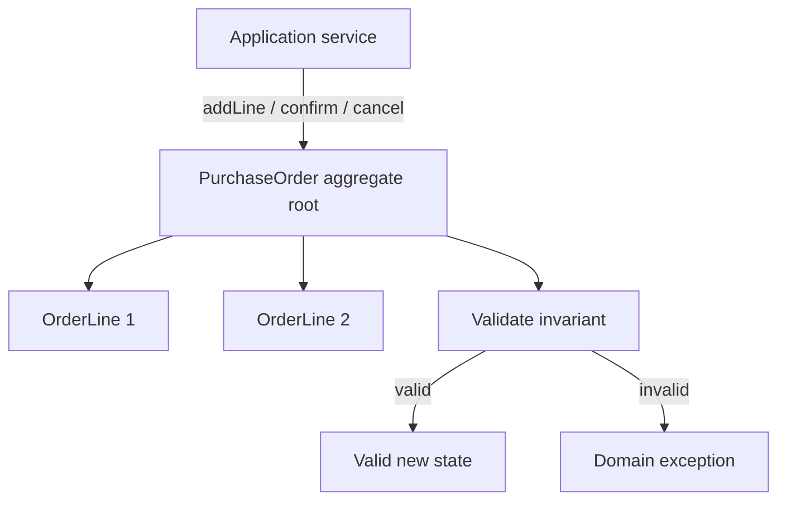
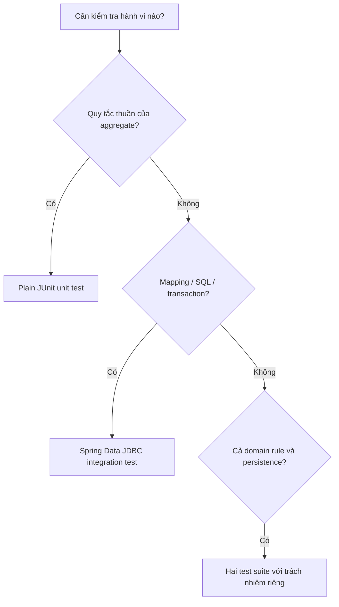

# Kiểm thử quy tắc aggregate không cần cơ sở dữ liệu

Trong Spring Data JDBC, aggregate là ranh giới nhất quán của mô hình domain: aggregate root điều phối thay đổi và bảo vệ invariant của các object con. Nhiều quy tắc quan trọng có thể được kiểm tra bằng cách tạo aggregate trong bộ nhớ, gọi domain method và xác nhận trạng thái hoặc exception. Những test này không cần database, JDBC driver, Spring application context hay repository mock.

Kiểm thử aggregate không cần cơ sở dữ liệu giúp phản hồi nhanh, tập trung vào hành vi nghiệp vụ và làm rõ hợp đồng của domain model. Chúng không thay thế integration test cho mapping, SQL, transaction hoặc optimistic locking; chúng xác nhận rằng bản thân aggregate từ chối trạng thái không hợp lệ và chuyển trạng thái hợp lệ theo đúng quy tắc.

Bài học trình bày cách thiết kế aggregate dễ kiểm thử, tổ chức plain unit test với JUnit, kiểm tra state transition/invariant/child collection/domain event, dùng parameterized và property-based test, xử lý thời gian/phụ thuộc ngoài, và phân định rõ phần nào cần database integration test.

## 1. Quy tắc aggregate là gì?

Aggregate thường có:

- **Aggregate root:** object duy nhất mà bên ngoài dùng để yêu cầu thay đổi aggregate.
- **Child entities/value objects:** các thành phần nằm trong ranh giới aggregate.
- **Invariant:** điều kiện luôn phải đúng trước và sau một thao tác domain hợp lệ.
- **Domain methods:** hành vi thay đổi trạng thái và kiểm tra invariant.

Ví dụ một đơn hàng có root `PurchaseOrder` và các dòng hàng `OrderLine`. Một số invariant có thể là:

- Chỉ đơn ở trạng thái `CREATED` mới được thêm hoặc xóa dòng hàng.
- Số lượng mỗi dòng phải lớn hơn 0.
- Đơn không có dòng hàng không được xác nhận.
- Chỉ đơn đã xác nhận mới được giao.
- Đơn đã giao không được hủy.
- Tổng tiền được tính từ các dòng hàng, không nhận giá trị tùy ý từ caller.

Các quy tắc này thuộc domain model. Chúng không cần biết dữ liệu được lưu bằng Spring Data JDBC, PostgreSQL hay một cơ chế persistence khác.

### Aggregate root bảo vệ invariant



Caller yêu cầu root thực hiện hành vi. Root kiểm tra trạng thái và điều kiện liên quan đến child rồi mới thay đổi aggregate. Test có thể gọi trực tiếp method của root và xác nhận kết quả.

## 2. Vì sao không cần database cho domain rule?

Một unit test thuần có thể tạo object trong bộ nhớ:

```java
PurchaseOrder order = PurchaseOrder.create("PO-100");

order.addLine(new OrderLine(10L, 2, new BigDecimal("15.00")));

order.confirm();

assertThat(order.status()).isEqualTo(OrderStatus.CONFIRMED);
```

Test này kiểm tra logic `addLine` và `confirm`. Nó không cần biết bảng nào được insert hoặc câu SQL nào được chạy.

Lợi ích:

- Chạy nhanh vì không khởi tạo Spring context hoặc database.
- Test tập trung vào business behavior, không bị nhiễu bởi cấu hình datasource.
- Dễ tạo nhiều tình huống biên và trạng thái lỗi.
- Khi test thất bại, phạm vi nguyên nhân thường nằm trong domain logic.
- Có thể chạy hàng trăm hoặc hàng nghìn trường hợp trong CI với chi phí thấp.

Không thêm `@DataJdbcTest` hay `@SpringBootTest` cho test chỉ gọi domain method. Các annotation đó khởi tạo hạ tầng không cần thiết và làm test chậm hơn.

## 3. Thiết kế aggregate dễ kiểm thử

Một aggregate có thể được ánh xạ bằng annotation Spring Data JDBC nhưng domain method không nên gọi trực tiếp repository hoặc `JdbcTemplate`.

Ví dụ aggregate:

```java
@Table("purchase_order")
public class PurchaseOrder {

    @Id
    private Long id;

    @Version
    private Long version;

    private final String reference;
    private OrderStatus status;
    private final List<OrderLine> lines = new ArrayList<>();

    private PurchaseOrder(String reference) {
        if (reference == null || reference.isBlank()) {
            throw new IllegalArgumentException("Reference is required");
        }
        this.reference = reference;
        this.status = OrderStatus.CREATED;
    }

    public static PurchaseOrder create(String reference) {
        return new PurchaseOrder(reference);
    }

    public void addLine(OrderLine line) {
        requireCreated();
        Objects.requireNonNull(line, "line is required");

        boolean duplicateProduct = lines.stream()
            .anyMatch(existing ->
                existing.productId().equals(line.productId()));

        if (duplicateProduct) {
            throw new DuplicateOrderLineException(line.productId());
        }

        lines.add(line);
    }

    public void confirm() {
        requireCreated();

        if (lines.isEmpty()) {
            throw new EmptyOrderCannotBeConfirmedException();
        }

        status = OrderStatus.CONFIRMED;
    }

    public void ship() {
        if (status != OrderStatus.CONFIRMED) {
            throw new InvalidOrderStateException(status, "SHIP");
        }

        status = OrderStatus.SHIPPED;
    }

    public void cancel() {
        if (status == OrderStatus.SHIPPED) {
            throw new ShippedOrderCannotBeCancelledException();
        }

        if (status == OrderStatus.CANCELLED) {
            return;
        }

        status = OrderStatus.CANCELLED;
    }

    private void requireCreated() {
        if (status != OrderStatus.CREATED) {
            throw new InvalidOrderStateException(status, "MODIFY");
        }
    }

    public String reference() {
        return reference;
    }

    public OrderStatus status() {
        return status;
    }

    public List<OrderLine> lines() {
        return List.copyOf(lines);
    }
}
```

Các thành phần minh họa:

```java
public enum OrderStatus {
    CREATED,
    CONFIRMED,
    SHIPPED,
    CANCELLED
}

public record OrderLine(
    Long productId,
    int quantity,
    BigDecimal unitPrice
) {
    public OrderLine {
        Objects.requireNonNull(productId, "productId is required");
        Objects.requireNonNull(unitPrice, "unitPrice is required");

        if (productId <= 0) {
            throw new IllegalArgumentException("productId must be positive");
        }
        if (quantity <= 0) {
            throw new IllegalArgumentException("quantity must be positive");
        }
        if (unitPrice.signum() < 0) {
            throw new IllegalArgumentException("unitPrice cannot be negative");
        }
    }
}
```

Đây là mô hình minh họa; exception và constructor có thể được tổ chức khác trong dự án. Điểm quan trọng là aggregate kiểm soát thay đổi và cung cấp API quan sát trạng thái thay vì để caller sửa trực tiếp collection.

### Không để test phụ thuộc vào chi tiết persistence

Test domain không nên cần:

- `ApplicationContext` hoặc `@Autowired`.
- `DataSource`, database container hoặc migration.
- Repository mock chỉ để gọi method của aggregate.
- Reflection để thay đổi private field.
- ID do database sinh nếu quy tắc đang kiểm tra không phụ thuộc ID.
- Transaction annotation hoặc transaction manager.

Nếu một quy tắc chỉ có thể test sau khi ghi database, có thể quy tắc đó đang nằm sai tầng hoặc phụ thuộc một behavior persistence thực sự cần integration test.
## 4. Tổ chức plain unit test với JUnit 5

Một test class thuần chỉ cần JUnit và assertion library. Không cần Spring runner/extension:

```java
class PurchaseOrderTest {

    @Test
    void confirmsOrderWhenItHasAtLeastOneLine() {
        PurchaseOrder order = PurchaseOrder.create("PO-100");
        order.addLine(new OrderLine(
            10L, 2, new BigDecimal("15.00")
        ));

        order.confirm();

        assertThat(order.status()).isEqualTo(OrderStatus.CONFIRMED);
    }
}
```

Ví dụ dùng AssertJ cho cú pháp assertion dễ đọc. Có thể dùng JUnit assertions nếu dự án không dùng AssertJ.

Một test nên thể hiện ba phần:

1. **Arrange:** tạo aggregate và trạng thái ban đầu.
2. **Act:** gọi một domain method.
3. **Assert:** xác nhận trạng thái, giá trị hoặc exception.

Tên test nên mô tả hành vi và điều kiện, ví dụ `cannotConfirmAnEmptyOrder` hoặc `rejectsDuplicateProductLine`. Tránh tên chung như `test1` hoặc tên implementation như `callsSetStatus`.

## 5. Kiểm tra state transition hợp lệ

Test trạng thái thành công theo hành vi công khai của aggregate:

```java
@Test
void followsCreatedConfirmedShippedLifecycle() {
    PurchaseOrder order = orderWithOneLine();

    assertThat(order.status()).isEqualTo(OrderStatus.CREATED);

    order.confirm();
    assertThat(order.status()).isEqualTo(OrderStatus.CONFIRMED);

    order.ship();
    assertThat(order.status()).isEqualTo(OrderStatus.SHIPPED);
}
```

Helper tạo fixture:

```java
private PurchaseOrder orderWithOneLine() {
    PurchaseOrder order = PurchaseOrder.create("PO-200");
    order.addLine(new OrderLine(
        25L, 1, new BigDecimal("49.90")
    ));
    return order;
}
```

Test từng bước chuyển trạng thái giúp chỉ ra chính xác transition nào bị hỏng. Nếu có nhiều đường chuyển trạng thái, có thể dùng parameterized test hoặc bảng transition để tránh bỏ sót.

### Kiểm tra thao tác lặp (idempotent)

Một số domain operation được thiết kế để gọi lặp mà không đổi kết quả, ví dụ hủy một đơn đã hủy:

```java
@Test
void cancellingAlreadyCancelledOrderIsIdempotent() {
    PurchaseOrder order = orderWithOneLine();

    order.cancel();
    order.cancel();

    assertThat(order.status()).isEqualTo(OrderStatus.CANCELLED);
}
```

Chỉ kiểm tra idempotency khi đó là hợp đồng nghiệp vụ. Nếu thao tác lặp phải bị từ chối, test exception thay vì tự giả định mọi method nên idempotent.

## 6. Kiểm tra invariant và trạng thái không hợp lệ

Test negative path quan trọng như test thành công. Ví dụ đơn rỗng không được xác nhận:

```java
@Test
void cannotConfirmAnEmptyOrder() {
    PurchaseOrder order = PurchaseOrder.create("PO-EMPTY");

    assertThatThrownBy(order::confirm)
        .isInstanceOf(EmptyOrderCannotBeConfirmedException.class);

    assertThat(order.status()).isEqualTo(OrderStatus.CREATED);
}
```

Assertion cuối xác nhận thao tác thất bại không để aggregate ở trạng thái dở dang. Nếu domain method có thể thay đổi nhiều field trước khi phát hiện lỗi, test cần xác nhận không có thay đổi một phần.

Các tình huống khác:

```java
@Test
void cannotShipOrderBeforeConfirmation() {
    PurchaseOrder order = orderWithOneLine();

    assertThatThrownBy(order::ship)
        .isInstanceOf(InvalidOrderStateException.class);

    assertThat(order.status()).isEqualTo(OrderStatus.CREATED);
}

@Test
void cannotCancelShippedOrder() {
    PurchaseOrder order = orderWithOneLine();
    order.confirm();
    order.ship();

    assertThatThrownBy(order::cancel)
        .isInstanceOf(ShippedOrderCannotBeCancelledException.class);

    assertThat(order.status()).isEqualTo(OrderStatus.SHIPPED);
}
```

Exception nên thể hiện loại vi phạm domain ổn định. Không nên assert toàn bộ message nếu message chỉ phục vụ log hoặc có thể được dịch/đổi wording. Nếu message là một phần API contract, kiểm tra ở service/API test phù hợp.

## 7. Dùng parameterized test cho dữ liệu biên

Khi nhiều input phải bị từ chối theo cùng một quy tắc, `@ParameterizedTest` giảm lặp:

```java
@ParameterizedTest
@ValueSource(ints = {0, -1, -10})
void rejectsNonPositiveQuantity(int quantity) {
    assertThatThrownBy(() ->
        new OrderLine(
            10L,
            quantity,
            new BigDecimal("12.00")
        )
    ).isInstanceOf(IllegalArgumentException.class);
}
```

Có thể dùng `@CsvSource` khi cần nhiều giá trị:

```java
@ParameterizedTest
@CsvSource({
    "0, 12.00",
    "-1, 12.00",
    "1, -0.01"
})
void rejectsInvalidLineValues(int quantity, BigDecimal unitPrice) {
    assertThatThrownBy(() ->
        new OrderLine(10L, quantity, unitPrice)
    ).isInstanceOf(IllegalArgumentException.class);
}
```

Với BigDecimal, cần chú ý cách parser chuyển literal và scale. Nếu scale là một phần hợp đồng tiền tệ, tạo `BigDecimal` trực tiếp trong `MethodSource` để kiểm soát chính xác.

Dùng `@MethodSource` cho trường hợp phức tạp:

```java
static Stream<Arguments> invalidOrderReferences() {
    return Stream.of(
        Arguments.of((String) null),
        Arguments.of(""),
        Arguments.of("   ")
    );
}

@ParameterizedTest
@MethodSource("invalidOrderReferences")
void rejectsBlankReference(String reference) {
    assertThatThrownBy(() -> PurchaseOrder.create(reference))
        .isInstanceOf(IllegalArgumentException.class);
}
```

Parameterized test nên gom những input có cùng expected behavior. Không nhồi nhiều quy tắc khác nhau vào một test chỉ để giảm số method.

## 8. Kiểm thử child collection qua aggregate root

Bên ngoài aggregate nên thay đổi child thông qua root method. Test xác nhận root giữ invariant khi thêm, xóa hoặc thay đổi child.

Ví dụ duplicate product không được thêm hai lần:

```java
@Test
void rejectsDuplicateProductLine() {
    PurchaseOrder order = PurchaseOrder.create("PO-DUP");
    order.addLine(new OrderLine(
        10L, 1, new BigDecimal("5.00")
    ));

    assertThatThrownBy(() ->
        order.addLine(new OrderLine(
            10L, 2, new BigDecimal("5.00")
        ))
    ).isInstanceOf(DuplicateOrderLineException.class);

    assertThat(order.lines()).hasSize(1);
}
```

Nếu nghiệp vụ yêu cầu gộp quantity của cùng sản phẩm thay vì từ chối duplicate, test đúng behavior đó:

- Sau khi thêm hai dòng cùng product, aggregate có một dòng.
- Quantity bằng tổng quantity.
- Unit price hoặc discount tuân theo quy tắc đã định.
- Tổng tiền được tính lại đúng.

### Bảo vệ collection khỏi sửa trực tiếp

Nếu getter trả về collection mutable, caller có thể bypass domain method và phá invariant:

```java
@Test
void returnedLinesCannotMutateAggregateCollection() {
    PurchaseOrder order = orderWithOneLine();

    assertThatThrownBy(() ->
        order.lines().add(new OrderLine(
            99L, 1, new BigDecimal("1.00")
        ))
    ).isInstanceOf(UnsupportedOperationException.class);

    assertThat(order.lines()).hasSize(1);
}
```

Với `List.copyOf`, collection trả về là immutable view/copy. Test này bảo vệ public API của aggregate. Nếu getter của domain model cố ý trả collection mutable, hãy xem lại cách caller có thể thay đổi state ngoài root method.
## 9. Kiểm tra giá trị được tính từ child

Nếu aggregate có giá trị dẫn xuất như tổng tiền, không nhận giá trị đó từ bên ngoài nếu domain có thể tính từ các dòng hàng. Có thể thêm method:

```java
public BigDecimal totalAmount() {
    return lines.stream()
        .map(line -> line.unitPrice()
            .multiply(BigDecimal.valueOf(line.quantity())))
        .reduce(BigDecimal.ZERO, BigDecimal::add);
}
```

Test tính toán với nhiều dòng:

```java
@Test
void calculatesTotalFromAllLines() {
    PurchaseOrder order = PurchaseOrder.create("PO-TOTAL");

    order.addLine(new OrderLine(
        10L, 2, new BigDecimal("12.50")
    ));
    order.addLine(new OrderLine(
        20L, 3, new BigDecimal("4.00")
    ));

    assertThat(order.totalAmount())
        .isEqualByComparingTo("37.00");
}
```

`isEqualByComparingTo` so sánh giá trị số học của `BigDecimal`, không yêu cầu scale giống hệt. Nếu scale là một phần hợp đồng (ví dụ luôn lưu hai chữ số thập phân), dùng assertion chính xác và chuẩn hóa scale trong domain.

Các test biên có thể gồm:

- Aggregate rỗng có tổng bằng zero.
- Quantity lớn.
- Giá bằng zero nếu được phép.
- Giá trị gần giới hạn precision của domain.
- Discount/tax/rounding theo thứ tự tính toán đã định.
- Currency khác nhau không được cộng nếu aggregate không hỗ trợ multi-currency.

Không dùng floating-point `double` cho tiền tệ. Dùng `BigDecimal` hoặc value object tiền tệ có quy tắc rounding rõ ràng.

## 10. Kiểm tra domain event do aggregate phát ra

Nếu aggregate lưu domain event để application layer publish sau khi lưu, có thể kiểm tra event được tạo khi hành vi nghiệp vụ xảy ra:

```java
@Test
void confirmingOrderRecordsOrderConfirmedEvent() {
    PurchaseOrder order = orderWithOneLine();

    order.confirm();

    assertThat(order.domainEvents())
        .containsExactly(new OrderConfirmed(order.reference()));
}
```

Ví dụ aggregate có thể lưu event:

```java
private final List<Object> domainEvents = new ArrayList<>();

public void confirm() {
    requireCreated();

    if (lines.isEmpty()) {
        throw new EmptyOrderCannotBeConfirmedException();
    }

    status = OrderStatus.CONFIRMED;
    domainEvents.add(new OrderConfirmed(reference));
}

public Collection<Object> domainEvents() {
    return List.copyOf(domainEvents);
}

public void clearDomainEvents() {
    domainEvents.clear();
}
```

Test thêm các hợp đồng:

- Hành vi thất bại không phát domain event.
- Event chỉ được tạo một lần theo semantics nghiệp vụ.
- Event chứa aggregate ID/reference và dữ liệu cần thiết.
- Clear event collection không thay đổi trạng thái domain.
- Domain event biểu diễn sự kiện nghiệp vụ, không phải thông báo SQL đã chạy.

Việc Spring Data repository publish `@DomainEvents` là persistence integration behavior và cần integration test riêng. Unit test ở đây chỉ xác nhận aggregate tạo event đúng lúc.

## 11. Kiểm thử quy tắc có phụ thuộc thời gian

Nếu quy tắc domain liên quan đến thời gian, không gọi `LocalDateTime.now()` hoặc `Instant.now()` trực tiếp trong logic cần test. Truyền thời điểm vào domain method hoặc inject `Clock` qua factory/domain service.

Ví dụ truyền instant rõ ràng:

```java
public void confirm(Instant confirmedAt) {
    requireCreated();

    if (lines.isEmpty()) {
        throw new EmptyOrderCannotBeConfirmedException();
    }

    this.status = OrderStatus.CONFIRMED;
    this.confirmedAt = Objects.requireNonNull(confirmedAt);
}
```

Test xác định:

```java
@Test
void recordsProvidedConfirmationTime() {
    Instant confirmedAt =
        Instant.parse("2026-11-13T02:00:00Z");

    PurchaseOrder order = orderWithOneLine();
    order.confirm(confirmedAt);

    assertThat(order.confirmedAt()).isEqualTo(confirmedAt);
}
```

Nếu dùng `Clock`, truyền `Clock.fixed(...)` trong test. Không dùng `Thread.sleep` để đợi thời gian trôi qua. Với quy tắc ngày địa phương, truyền `ZoneId` rõ ràng và test các trường hợp biên timezone/DST.

## 12. Dùng builder hoặc Object Mother cho fixture

Khi aggregate có nhiều field bắt buộc, tạo helper để test tập trung vào hành vi:

```java
final class PurchaseOrderMother {

    private PurchaseOrderMother() {
    }

    static PurchaseOrder empty() {
        return PurchaseOrder.create("PO-TEST");
    }

    static PurchaseOrder withOneLine() {
        PurchaseOrder order = empty();
        order.addLine(new OrderLine(
            10L, 1, new BigDecimal("20.00")
        ));
        return order;
    }

    static PurchaseOrder confirmed() {
        PurchaseOrder order = withOneLine();
        order.confirm();
        return order;
    }
}
```

Sử dụng:

```java
@Test
void shippedOrderCannotBeCancelled() {
    PurchaseOrder order = PurchaseOrderMother.confirmed();
    order.ship();

    assertThatThrownBy(order::cancel)
        .isInstanceOf(ShippedOrderCannotBeCancelledException.class);
}
```

Helper fixture nên có tên theo trạng thái/ngữ cảnh nghiệp vụ. Tránh builder quá tổng quát cho phép tạo mọi trạng thái không hợp lệ; nếu cần test một state đặc biệt, hãy tạo nó qua domain behavior hợp lệ hoặc factory test được kiểm soát.

Không lặp lại cùng một Object Mother trong nhiều module nếu nó che giấu cấu trúc domain hoặc tạo dependency test khó quản lý. Một factory nhỏ ngay trong test class thường đủ.

## 13. Property-based test cho invariant

JUnit example test một số input cụ thể. Property-based testing tạo nhiều input để xác nhận một thuộc tính luôn đúng trong một miền dữ liệu. Có thể dùng thư viện như jqwik nếu dự án đã chấp nhận dependency này.

Ví dụ property: với mọi quantity dương, tạo `OrderLine` thành công và quantity được giữ nguyên:

```java
@Property
void positiveQuantityIsPreserved(
        @ForAll @IntRange(min = 1, max = 1_000_000) int quantity) {

    OrderLine line = new OrderLine(
        10L, quantity, new BigDecimal("1.00")
    );

    Assertions.assertThat(line.quantity()).isEqualTo(quantity);
}
```

Một số property có giá trị:

- Tổng tiền không âm khi mọi line price và quantity không âm/dương theo invariant.
- Thêm một dòng hợp lệ làm tổng tăng đúng số tiền của dòng đó.
- Thêm dòng duplicate bị từ chối hoặc gộp theo quy tắc đã định.
- Trạng thái SHIPPED không thể chuyển về CREATED/CONFIRMED.
- Cancel không làm thay đổi aggregate đã SHIPPED.
- Collection trả ra không thể sửa trực tiếp internal state.

Property test không thay thế example test. Khi có bug, giữ lại một regression example với input cụ thể để người đọc hiểu trường hợp lỗi.
## 14. Kiểm tra transition bằng bảng quy tắc

Với aggregate có nhiều trạng thái, lập bảng transition giúp nhìn rõ operation nào được phép:

| Trạng thái hiện tại | Operation | Kết quả mong đợi |
| --- | --- | --- |
| CREATED | addLine | Thành công nếu line hợp lệ. |
| CREATED | confirm với line | Chuyển sang CONFIRMED. |
| CREATED | confirm rỗng | Từ chối, giữ CREATED. |
| CONFIRMED | ship | Chuyển sang SHIPPED. |
| CONFIRMED | addLine | Từ chối. |
| SHIPPED | cancel | Từ chối, giữ SHIPPED. |
| CANCELLED | cancel | Idempotent nếu domain chọn chính sách này. |
| CANCELLED | addLine/confirm | Từ chối. |

Có thể viết một test cho từng hàng quan trọng. Nếu có nhiều tổ hợp state/operation, dùng `@MethodSource` để cung cấp state đã được tạo qua domain methods và operation mong đợi.

Không dùng reflection để đặt trực tiếp `status` thành SHIPPED hoặc CANCELLED chỉ để rút ngắn test. Làm vậy có thể tạo trạng thái mà domain không bao giờ cho phép và làm test không còn phản ánh đường đi thực tế.

## 15. Phân biệt unit test aggregate với integration test Spring Data JDBC

Không cần database cho invariant domain, nhưng một số hành vi chỉ được chứng minh ở tầng persistence:

| Hành vi | Loại test phù hợp |
| --- | --- |
| Không xác nhận đơn rỗng | Unit test aggregate. |
| Không thêm line khi đơn đã xác nhận | Unit test aggregate. |
| Tính tổng tiền từ các line | Unit test aggregate. |
| Tạo domain event khi xác nhận | Unit test aggregate. |
| Spring Data JDBC ánh xạ root và `@MappedCollection` đúng | Repository integration test. |
| Insert trả generated ID đúng | Repository integration test. |
| `@Version` phát hiện stale update | Database integration test với transaction/concurrency phù hợp. |
| Callback/auditing chạy trong pipeline persistence | Spring Data integration test. |
| Transaction rollback nhiều repository writes | Transaction integration test. |
| SQL dialect, constraint và converter round-trip | Integration test trên database đích. |

Đừng dùng unit test để giả vờ chứng minh SQL hoặc mapping hoạt động. Ngược lại, không cần khởi động database chỉ để chứng minh một aggregate từ chối hủy đơn đã giao.

### Chia trách nhiệm giữa aggregate và service

Aggregate bảo vệ invariant nội bộ. Application service điều phối repository, authorization, transaction và các aggregate khác.

Ví dụ:

```java
@Transactional
public PurchaseOrder confirm(long orderId) {
    PurchaseOrder order = orders.findById(orderId)
        .orElseThrow(() -> new OrderNotFoundException(orderId));

    order.confirm();

    return orders.save(order);
}
```

Unit test aggregate kiểm tra `order.confirm()` với trạng thái và lines khác nhau. Service integration test kiểm tra việc tải root, lưu lại và transaction. Nếu service có policy thuần không cần database, có thể dùng fake port trong service unit test; không cần mock JDBC driver.

## 16. Test không nên phụ thuộc vào Spring context

Một class test domain thường có thể chạy trực tiếp bằng JUnit:

```java
class OrderLineTest {

    @Test
    void rejectsNegativePrice() {
        assertThatThrownBy(() ->
            new OrderLine(
                10L,
                1,
                new BigDecimal("-0.01")
            )
        ).isInstanceOf(IllegalArgumentException.class);
    }
}
```

Không cần:

```java
@SpringBootTest
@AutoConfigureTestDatabase
class OrderLineTest {
    // Hạ tầng không liên quan đến quy tắc constructor.
}
```

Dùng `@ExtendWith(MockitoExtension.class)` chỉ khi class đang test thực sự phụ thuộc collaborator cần mock. Aggregate thuần thường không cần mock repository, clock, event publisher hoặc application service.

Nếu domain method cần thời gian, truyền `Instant` hoặc `Clock` rõ ràng. Nếu domain cần policy bên ngoài, cân nhắc đưa policy vào domain service hoặc truyền một value/result đã được application layer xác định.

## 17. Test domain service có port mà không cần database

Một domain service có thể cần truy vấn một policy hoặc collaborator. Khi đó, định nghĩa port nhỏ và dùng fake in-memory trong unit test:

```java
public interface CreditLimitPolicy {
    boolean allows(CustomerId customerId, Money orderTotal);
}

public class OrderApprovalService {

    private final CreditLimitPolicy creditLimit;

    public OrderApprovalService(CreditLimitPolicy creditLimit) {
        this.creditLimit = creditLimit;
    }

    public void approve(PurchaseOrder order, CustomerId customerId) {
        if (!creditLimit.allows(customerId, order.totalAmount())) {
            throw new CreditLimitExceededException(customerId);
        }

        order.confirm();
    }
}
```

Fake:

```java
final class AllowAllCreditLimitPolicy implements CreditLimitPolicy {
    @Override
    public boolean allows(CustomerId customerId, Money orderTotal) {
        return true;
    }
}
```

Test:

```java
@Test
void approvesOrderWhenCreditPolicyAllowsIt() {
    PurchaseOrder order = orderWithOneLine();
    OrderApprovalService service =
        new OrderApprovalService(new AllowAllCreditLimitPolicy());

    service.approve(order, customerId);

    assertThat(order.status()).isEqualTo(OrderStatus.CONFIRMED);
}
```

Fake thể hiện hợp đồng của collaborator mà không cần database. Nếu test cần xác nhận SQL query lấy credit limit đúng hoặc transaction bao trùm thao tác, đó là integration test khác.

Không tạo interface/port chỉ để mock mọi class. Chỉ tách dependency khi nó là ranh giới thực của domain/application architecture.

## 18. Tổ chức package và tên test

Có thể đặt unit test cùng package logic hoặc trong test source tree phản ánh package production:

```text
src/
  main/
    java/
      com/example/orders/domain/
        PurchaseOrder.java
        OrderLine.java
        OrderStatus.java
        InvalidOrderStateException.java
  test/
    java/
      com/example/orders/domain/
        PurchaseOrderTest.java
        OrderLineTest.java
```

Một test class tập trung vào một aggregate hoặc value object. Tên test có thể theo mẫu:

- `confirmsOrderWhenItContainsAtLeastOneLine`.
- `rejectsConfirmationWhenOrderIsEmpty`.
- `rejectsAddingLineAfterConfirmation`.
- `keepsShippedOrderUnchangedWhenCancellationIsRejected`.
- `calculatesTotalFromAllOrderLines`.

Tên test nên mô tả điều kiện và kết quả nghiệp vụ. Tránh đưa tên method private hoặc tên field nội bộ vào tên test vì implementation có thể thay đổi trong khi behavior không đổi.
## 19. Những lỗi thường gặp khi kiểm thử aggregate

| Lỗi | Vì sao có vấn đề | Cách xử lý |
| --- | --- | --- |
| Dùng `@SpringBootTest` cho mọi domain test | Khởi tạo nhiều hạ tầng không liên quan và làm test chậm. | Dùng plain JUnit cho aggregate behavior. |
| Mock repository trong test gọi trực tiếp aggregate method | Mock không giúp kiểm tra invariant của aggregate. | Tạo aggregate thật trong bộ nhớ. |
| Sửa private field bằng reflection để tạo trạng thái | Có thể tạo state không thể đạt được qua domain API. | Tạo state bằng các transition hợp lệ. |
| Assert method private đã được gọi | Khóa test vào implementation thay vì behavior. | Assert trạng thái, value object, exception hoặc domain event công khai. |
| Chỉ test đường thành công | Bỏ sót invalid transition và invariant bị phá. | Test cả điều kiện hợp lệ, không hợp lệ và boundary. |
| Chỉ kiểm tra exception, không kiểm tra state sau lỗi | Aggregate có thể đã bị thay đổi một phần trước khi ném lỗi. | Assert state vẫn hợp lệ sau operation thất bại. |
| Trả collection mutable từ root | Caller có thể bypass domain methods. | Trả immutable copy/view hoặc API đọc phù hợp. |
| Dùng `Thread.sleep` để test time rule | Test chậm và không ổn định. | Truyền `Instant` hoặc inject `Clock.fixed`. |
| Test SQL/mapping bằng unit test | Không chạy database nên không chứng minh persistence behavior. | Viết repository integration test riêng. |
| Dùng một fixture khổng lồ cho mọi test | Khó biết dữ liệu nào quan trọng với từng behavior. | Dùng helper nhỏ theo trạng thái/ngữ cảnh. |
| Assert toàn bộ exception message | Test dễ vỡ khi wording thay đổi. | Assert exception type và domain code nếu có. |
| Chỉ đo line coverage | Code có thể chạy nhưng invariant chưa được xác nhận. | Đánh giá behavior và các nhánh nghiệp vụ quan trọng. |

## 20. Coverage và mutation testing

Line coverage cho biết dòng code đã được thực thi, nhưng không chứng minh assertion đủ mạnh. Một test có thể gọi `confirm()` rồi chỉ assert object khác null; khi logic invariant bị xóa, test vẫn pass.

Hãy ưu tiên assertion thể hiện hợp đồng:

- Trạng thái chuyển đúng.
- Giá trị tính toán chính xác.
- Exception đúng loại khi input/state không hợp lệ.
- Aggregate giữ nguyên state khi operation bị từ chối.
- Domain event chỉ được tạo khi hành vi thành công.
- Child collection không thể bị sửa ngoài root.

Mutation testing có thể giúp đánh giá sức mạnh test bằng cách cố ý thay đổi code (ví dụ bỏ điều kiện kiểm tra empty order, đổi `>` thành `>=`, hoặc bỏ cập nhật state) rồi kiểm tra test có phát hiện không. Công cụ như PIT có thể hỗ trợ Java mutation testing nếu dự án cần.

Không chạy mutation testing trên mọi commit nếu chi phí quá lớn. Có thể dùng ở nightly/release hoặc cho domain module quan trọng. Mục tiêu là phát hiện assertion yếu, không phải tối đa hóa một con số coverage.

## 21. Một test class hoàn chỉnh minh họa

Ví dụ kết hợp một số quy tắc của `PurchaseOrder`:

```java
class PurchaseOrderTest {

    @Test
    void confirmsOrderWithLines() {
        PurchaseOrder order = PurchaseOrder.create("PO-300");
        order.addLine(new OrderLine(
            10L, 2, new BigDecimal("12.50")
        ));

        order.confirm();

        assertThat(order.status()).isEqualTo(OrderStatus.CONFIRMED);
    }

    @Test
    void rejectsEmptyOrderAndKeepsOriginalState() {
        PurchaseOrder order = PurchaseOrder.create("PO-301");

        assertThatThrownBy(order::confirm)
            .isInstanceOf(EmptyOrderCannotBeConfirmedException.class);

        assertThat(order.status()).isEqualTo(OrderStatus.CREATED);
    }

    @Test
    void rejectsDuplicateProductAndKeepsOneLine() {
        PurchaseOrder order = PurchaseOrder.create("PO-302");
        order.addLine(new OrderLine(
            10L, 1, new BigDecimal("5.00")
        ));

        assertThatThrownBy(() ->
            order.addLine(new OrderLine(
                10L, 2, new BigDecimal("5.00")
            ))
        ).isInstanceOf(DuplicateOrderLineException.class);

        assertThat(order.lines()).hasSize(1);
    }

    @Test
    void cannotCancelShippedOrder() {
        PurchaseOrder order = PurchaseOrder.create("PO-303");
        order.addLine(new OrderLine(
            10L, 1, new BigDecimal("5.00")
        ));
        order.confirm();
        order.ship();

        assertThatThrownBy(order::cancel)
            .isInstanceOf(ShippedOrderCannotBeCancelledException.class);

        assertThat(order.status()).isEqualTo(OrderStatus.SHIPPED);
    }
}
```

Test class này có thể chạy mà không cần `@SpringBootTest`, datasource hoặc Testcontainers. Nó xác nhận một số hợp đồng của aggregate; các test persistence vẫn nằm ở repository integration suite.

## 22. Quy trình lập bộ unit test cho aggregate

Khi bắt đầu kiểm thử một aggregate mới hoặc mở rộng quy tắc hiện có:

1. Liệt kê state và transition hợp lệ của aggregate.
2. Liệt kê invariant ở root và từng child/value object.
3. Xác định operation nào thay đổi state và operation nào chỉ đọc.
4. Viết test cho transition thành công.
5. Viết test cho transition bị cấm và xác nhận state không đổi.
6. Viết test input biên bằng parameterized test.
7. Kiểm tra collection và child chỉ thay đổi qua root API.
8. Kiểm tra derived value như total, count hoặc status.
9. Kiểm tra domain event nếu aggregate phát event.
10. Cố định clock/timezone hoặc truyền instant vào method khi có quy tắc thời gian.
11. Dùng property-based test cho invariant có nhiều input nếu có giá trị.
12. Để mapping, generated ID, SQL, transaction và callback cho integration test riêng.

Một sơ đồ lựa chọn:



## 23. Câu hỏi tự kiểm tra

- Aggregate root bảo vệ invariant bằng cách nào?
- Vì sao có thể kiểm tra state transition mà không cần repository?
- Khi nào nên dùng plain JUnit thay vì `@DataJdbcTest`?
- Vì sao không nên sửa private field bằng reflection để tạo fixture?
- Làm thế nào xác nhận operation thất bại không làm aggregate đổi state một phần?
- Khi nào dùng `@ParameterizedTest` hoặc `@MethodSource`?
- Vì sao child collection nên được thay đổi qua aggregate root?
- Khi nào nên dùng `Clock.fixed` hoặc truyền `Instant` vào domain method?
- Domain event khác persistence lifecycle event như thế nào?
- Những property nào phù hợp với property-based testing?
- Test nào cần database thật để xác nhận Spring Data JDBC mapping?
- Vì sao line coverage không chứng minh invariant đã được bảo vệ?
- Khi nào mutation testing có thể phát hiện assertion yếu?

Kiểm thử quy tắc aggregate không cần cơ sở dữ liệu bằng cách tạo aggregate thật trong bộ nhớ, gọi các domain method công khai và xác nhận trạng thái, giá trị, exception hoặc domain event. Tập trung vào invariant, transition hợp lệ/bị cấm và child collection; dùng JUnit, parameterized test và clock cố định để giữ test nhanh, lặp lại được. Dành integration test riêng cho Spring Data JDBC mapping, SQL, generated ID, transaction và callback để mỗi tầng kiểm tra đúng hợp đồng của nó.
