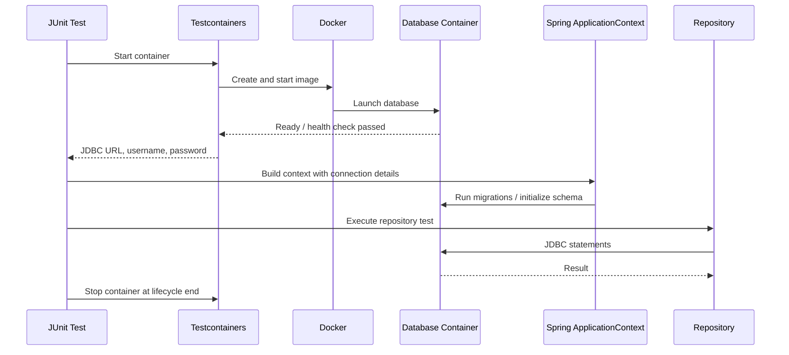

# Testcontainers và cơ sở dữ liệu cùng loại với môi trường triển khai

Kiểm thử Spring Data Relational JDBC cần chạy trên hệ quản trị cơ sở dữ liệu có behavior gần với môi trường triển khai. Một test chạy thành công trên H2 không chứng minh rằng câu SQL, kiểu dữ liệu, constraint, pagination hoặc transaction sẽ hoạt động giống PostgreSQL, MySQL, SQL Server hay Oracle trong production.

**Testcontainers** khởi chạy database thật trong container cho test, cung cấp JDBC URL, username và password động, rồi dọn container theo lifecycle đã cấu hình. Nhờ vậy, repository, mapping aggregate, custom query và migration có thể được kiểm tra bằng đúng database engine mà ứng dụng sử dụng khi triển khai.

Mục tiêu không chỉ là có database để test. Cần chọn image và cấu hình tương thích với production, chạy schema migration thật, kiểm tra các behavior phụ thuộc vendor và quản lý vòng đời container phù hợp với Spring Test context.

## 1. Vì sao cần database cùng loại với production?

Spring Data JDBC tạo SQL dựa trên dialect, mapping metadata và JDBC driver. Các database khác nhau có thể xử lý cùng một thao tác theo cách khác nhau.

Ví dụ:

- PostgreSQL dùng `INSERT ... ON CONFLICT`; MySQL dùng `ON DUPLICATE KEY UPDATE`.
- Kiểu UUID, JSON, array và timestamp có cách lưu/đọc khác nhau.
- Quy tắc quote identifier, casing và reserved words không giống nhau.
- Generated identity, sequence và cách trả generated key phụ thuộc database/driver.
- Constraint, isolation level, lock và transaction behavior có khác biệt.
- Cú pháp pagination, function, expression và upsert không đồng nhất.

Một test dùng H2 có thể pass vì H2 chấp nhận SQL hoặc mapping mà database production không chấp nhận. Chế độ compatibility của H2 giúp kiểm thử một số cú pháp, nhưng không biến H2 thành PostgreSQL, MySQL hay SQL Server thực sự.

### 1.1. Những gì test database cần tương đồng

Cụm từ “cùng loại với môi trường triển khai” nên được hiểu theo mức tương thích kỹ thuật, không chỉ tên vendor.

| Thành phần | Mức tương đồng nên hướng tới |
|---|---|
| Database engine | Cùng vendor/engine với production |
| Major version | Cùng major version; dùng patch version gần hoặc giống khi khả thi |
| JDBC driver | Cùng driver family và version tương thích |
| Extensions | Có các extension production đang sử dụng |
| Charset/encoding | Cùng encoding và collation quan trọng |
| Timezone | Cùng timezone hoặc cấu hình timezone đã thống nhất |
| SQL mode/compatibility level | Cùng chế độ ảnh hưởng cú pháp và constraint |
| Schema | Chạy cùng migration scripts của ứng dụng |
| Transaction settings | Kiểm tra isolation/locking cần thiết của use case |

Không phải mọi cấu hình hạ tầng đều tái tạo được bằng container. Dịch vụ database managed có thể thêm extension, proxy, replication, authentication hoặc behavior riêng. Container kiểm tra tốt database engine và nhiều behavior SQL; các khác biệt đặc thù managed service vẫn cần test ở môi trường tương ứng.

### 1.2. Dùng H2 ở đâu?

H2 vẫn hữu ích cho test nhanh nếu ứng dụng không phụ thuộc vào SQL/vendor-specific behavior. Có thể dùng nó cho unit-level persistence test đơn giản hoặc test logic không cần xác minh dialect production.

Với các trường hợp sau, nên dùng database cùng loại với production:

- Custom @Query hoặc native SQL.
- Pagination và sorting có SQL đặc thù.
- Generated ID hoặc sequence.
- JSON, UUID, array, enum mapping hoặc kiểu vendor-specific.
- Foreign key, unique constraint, cascade/restrict behavior.
- Locking, isolation, optimistic locking và transaction boundary.
- Flyway/Liquibase migration chứa SQL riêng của vendor.

## 2. Testcontainers hoạt động như thế nào?

Testcontainers dùng Docker để khởi chạy một instance database tạm thời. Test lấy connection details từ container đang chạy thay vì phụ thuộc vào một database cài sẵn trên máy developer.

Luồng điển hình:



Testcontainers có module cho nhiều database. Mỗi module cung cấp container class và cấu hình phù hợp với image tương ứng.

Ví dụ:

| Database | Container class phổ biến |
|---|---|
| PostgreSQL | `PostgreSQLContainer` |
| MySQL | `MySQLContainer` |
| MariaDB | `MariaDBContainer` |
| Microsoft SQL Server | `MSSQLServerContainer` |
| Oracle XE/Free hoặc image được cấp phép | Container tương ứng theo module và image |

Tên class/package và image hỗ trợ phụ thuộc phiên bản Testcontainers. Hãy dùng module chính thức phù hợp với database và version đang chọn.

## 3. Dependencies cho Testcontainers

Với dự án Gradle dùng Spring Boot dependency management, có thể thêm test dependencies:

```kotlin
dependencies {
    implementation("org.springframework.boot:spring-boot-starter-data-jdbc")

    testImplementation("org.springframework.boot:spring-boot-starter-test")
    testImplementation("org.testcontainers:junit-jupiter")
    testImplementation("org.testcontainers:postgresql")
}
```

Hai module Testcontainers có vai trò khác nhau:

- `junit-jupiter` tích hợp container lifecycle với JUnit 5.
- `postgresql` cung cấp `PostgreSQLContainer` và cấu hình database PostgreSQL.

Để dùng Spring Boot service connection từ Boot 3.1 trở lên, thêm:

```kotlin
dependencies {
    testImplementation("org.springframework.boot:spring-boot-testcontainers")
}
```

Để version Testcontainers nhất quán, dùng dependency management/BOM tương thích với phiên bản Spring Boot của dự án hoặc import Testcontainers BOM nếu dự án tự quản lý version. Tránh khai báo mỗi module một version khác nhau.

### 3.1. Docker là điều kiện chạy test

Testcontainers cần Docker-compatible runtime đang hoạt động. Môi trường có thể là Docker Desktop, Docker Engine hoặc runtime tương thích được Testcontainers hỗ trợ.

Nếu Docker không chạy, container không thể khởi động và integration test sẽ thất bại trước khi repository test được thực thi.

Không nên biến lỗi thiếu Docker thành một test pass giả. Trong CI, hãy cấu hình runner có quyền chạy container và để integration test thực sự được thực thi.

## 4. Cấu hình PostgreSQL bằng @Container và @DynamicPropertySource

Cách phổ biến, tương thích với nhiều phiên bản Spring Boot, là dùng JUnit Testcontainers extension và đăng ký connection details qua `@DynamicPropertySource`.

Ví dụ:

```java
import org.junit.jupiter.api.Test;
import org.springframework.beans.factory.annotation.Autowired;
import org.springframework.boot.test.autoconfigure.jdbc.AutoConfigureTestDatabase;
import org.springframework.boot.test.autoconfigure.data.jdbc.DataJdbcTest;
import org.springframework.test.context.DynamicPropertyRegistry;
import org.springframework.test.context.DynamicPropertySource;
import org.testcontainers.containers.PostgreSQLContainer;
import org.testcontainers.junit.jupiter.Container;
import org.testcontainers.junit.jupiter.Testcontainers;

import static org.assertj.core.api.Assertions.assertThat;

@Testcontainers
@DataJdbcTest
@AutoConfigureTestDatabase(
        replace = AutoConfigureTestDatabase.Replace.NONE
)
class CustomerRepositoryIntegrationTest {

    @Container
    static final PostgreSQLContainer<?> postgres =
            new PostgreSQLContainer<>("postgres:16.4")
                    .withDatabaseName("app_test")
                    .withUsername("test_user")
                    .withPassword("test_password");

    @DynamicPropertySource
    static void configureDataSource(DynamicPropertyRegistry registry) {
        registry.add("spring.datasource.url", postgres::getJdbcUrl);
        registry.add("spring.datasource.username", postgres::getUsername);
        registry.add("spring.datasource.password", postgres::getPassword);
        registry.add(
                "spring.datasource.driver-class-name",
                postgres::getDriverClassName
        );
    }

    @Autowired
    CustomerRepository customers;

    @Test
    void savesAndLoadsCustomer() {
        Customer saved = customers.save(
                new Customer(null, "An", "an@example.test")
        );

        Customer loaded = customers.findById(saved.id()).orElseThrow();

        assertThat(loaded.name()).isEqualTo("An");
    }
}
```

Các điểm cần chú ý:

- `@Testcontainers` bật JUnit 5 extension.
- `@Container` khai báo container do extension quản lý.
- Container `static` được khởi chạy một lần cho test class và dừng sau class.
- `@DynamicPropertySource` cung cấp URL và credentials sau khi container có connection details.
- `@AutoConfigureTestDatabase(replace = NONE)` ngăn test slice thay DataSource bằng embedded database.
- Image tag trong ví dụ chỉ minh họa. Hãy thay bằng version database tương ứng với môi trường triển khai.

`Customer` và `CustomerRepository` là các kiểu của ứng dụng. Constructor, property và schema trong ví dụ cần khớp entity thực tế.

### 4.1. Vì sao cần Replace.NONE?

`@DataJdbcTest` là test slice cho Spring Data JDBC. Cấu hình mặc định có thể tìm embedded database để thay DataSource.

Khi muốn kiểm tra PostgreSQL container, phải giữ DataSource do Testcontainers cung cấp. Nếu không, test có thể vô tình chạy trên H2 dù container đã được khai báo.

### 4.2. Không hard-code JDBC URL

Container có thể cấp cổng host động. Không giả định PostgreSQL luôn chạy ở `localhost:5432`.

Dùng các accessor của container:

- `getJdbcUrl()`
- `getUsername()`
- `getPassword()`
- `getDriverClassName()`

Nhờ vậy, test hoạt động cả khi Docker ánh xạ cổng khác cổng mặc định.

## 5. Dùng Spring Boot @ServiceConnection

Với Spring Boot **3.1 trở lên**, có thể dùng `@ServiceConnection` để Spring Boot suy ra connection details từ Testcontainers object.

Ví dụ:

```java
import org.junit.jupiter.api.Test;
import org.springframework.beans.factory.annotation.Autowired;
import org.springframework.boot.test.autoconfigure.jdbc.AutoConfigureTestDatabase;
import org.springframework.boot.test.autoconfigure.data.jdbc.DataJdbcTest;
import org.springframework.boot.testcontainers.service.connection.ServiceConnection;
import org.testcontainers.containers.PostgreSQLContainer;
import org.testcontainers.junit.jupiter.Container;
import org.testcontainers.junit.jupiter.Testcontainers;

@Testcontainers
@DataJdbcTest
@AutoConfigureTestDatabase(
        replace = AutoConfigureTestDatabase.Replace.NONE
)
class CustomerRepositoryIntegrationTest {

    @Container
    @ServiceConnection
    static final PostgreSQLContainer<?> postgres =
            new PostgreSQLContainer<>("postgres:16.4")
                    .withDatabaseName("app_test")
                    .withUsername("test_user")
                    .withPassword("test_password");

    @Autowired
    CustomerRepository customers;

    @Test
    void savesAndLoadsCustomer() {
        Customer saved = customers.save(
                new Customer(null, "An", "an@example.test")
        );

        assertThat(customers.findById(saved.id())).isPresent();
    }
}
```

`@ServiceConnection` cần dependency `spring-boot-testcontainers`. Spring Boot nhận diện container type và tạo connection details phù hợp cho auto-configuration.

Trong test dùng service connection, thường không cần đăng ký lại `spring.datasource.url`, username và password bằng `@DynamicPropertySource`.

Chọn một cơ chế connection details rõ ràng cho test. Không cấu hình hai nguồn cùng ghi đè một nhóm property nếu không có lý do cụ thể.

### 5.1. Khi nào dùng DynamicPropertySource?

`@DynamicPropertySource` phù hợp khi:

- Dùng Spring Boot trước 3.1.
- Container không được Spring Boot nhận diện tự động.
- Cần đăng ký property tùy chỉnh ngoài connection details chuẩn.
- Muốn kiểm soát rõ property mà Spring context nhận.

`@ServiceConnection` thường ngắn gọn hơn khi container type được Spring Boot hỗ trợ. Cả hai đều có thể kết nối Spring context tới cùng container.

## 6. Quản lý vòng đời container và Spring context

Vòng đời container cần tương thích với vòng đời Spring `ApplicationContext`. Đây là chi tiết quan trọng vì Spring Test có thể cache context giữa các test class.

### 6.1. Container static theo test class

Với:

```java
@Container
static PostgreSQLContainer<?> postgres = ...;
```

JUnit extension khởi chạy container trước test class và dừng sau khi class hoàn tất. Đây là lựa chọn dễ hiểu cho một test class độc lập.

Tuy nhiên, nếu Spring context được cache và tái sử dụng sau khi container đã dừng, một test class khác có thể nhận context chứa DataSource trỏ tới container cũ.

Nếu nhiều test class dùng chung context, hãy chọn lifecycle sao cho container tồn tại ít nhất bằng thời gian context được sử dụng.

### 6.2. Singleton container cho một nhóm test

Có thể dùng một container static được khởi chạy một lần cho cả JVM:

```java
abstract class AbstractPostgresIntegrationTest {

    static final PostgreSQLContainer<?> POSTGRES =
            new PostgreSQLContainer<>("postgres:16.4")
                    .withDatabaseName("app_test")
                    .withUsername("test_user")
                    .withPassword("test_password");

    static {
        POSTGRES.start();
    }

    @DynamicPropertySource
    static void configureDataSource(DynamicPropertyRegistry registry) {
        registry.add("spring.datasource.url", POSTGRES::getJdbcUrl);
        registry.add("spring.datasource.username", POSTGRES::getUsername);
        registry.add("spring.datasource.password", POSTGRES::getPassword);
    }
}
```

Các test class kế thừa base class dùng cùng container. Cách này tránh container bị dừng sau mỗi class trong khi Spring context vẫn được cache.

Không đồng thời gắn `@Container` vào singleton được tự start theo cách này, vì hai lifecycle manager có thể tranh quyền start/stop container. Chọn một cơ chế quản lý lifecycle.

### 6.3. Container do Spring context quản lý

Với Spring Boot service connection, có thể khai báo container như bean trong test configuration để lifecycle gắn với application context. Cách này hữu ích khi muốn container sống cùng context được cache.

Ví dụ cấu trúc:

```java
@TestConfiguration(proxyBeanMethods = false)
class PostgresContainerConfiguration {

    @Bean
    @ServiceConnection
    PostgreSQLContainer<?> postgresContainer() {
        return new PostgreSQLContainer<>("postgres:16.4")
                .withDatabaseName("app_test")
                .withUsername("test_user")
                .withPassword("test_password");
    }
}
```

Import test configuration vào test class. Spring quản lý bean và lifecycle container theo context. Xác nhận cách khởi tạo/đóng container theo Spring Boot version đang dùng.

Không cần chọn cùng lúc cả `@Container` và bean-managed lifecycle cho một container instance.

## 7. Chạy migration thật trên container

Một integration test đáng tin cậy nên tạo schema theo cùng cách ứng dụng triển khai schema.

Nếu production dùng Flyway hoặc Liquibase, hãy để migration chạy trên container. Không duy trì một schema test viết tay khác với migration production.

Ví dụ migration Flyway:

```sql
CREATE TABLE customers (
    id BIGINT GENERATED BY DEFAULT AS IDENTITY PRIMARY KEY,
    name VARCHAR(160) NOT NULL,
    email VARCHAR(255) NOT NULL UNIQUE
);
```

Khi test context khởi tạo:

1. Testcontainers khởi chạy database rỗng.
2. Spring tạo DataSource từ container connection details.
3. Flyway/Liquibase chạy migration.
4. Spring Data JDBC khởi tạo mapping/repository.
5. Test thực hiện thao tác persistence trên schema vừa tạo.

Điều này kiểm tra cả migration lẫn mapping. Nếu migration dùng cú pháp riêng của PostgreSQL, test PostgreSQL container sẽ phát hiện lỗi mà H2 có thể không phát hiện.

### 7.1. Tránh schema drift

Không sao chép toàn bộ DDL production sang một file test riêng rồi quên cập nhật file đó khi migration thay đổi.

Ưu tiên:

- Dùng cùng thư mục migration.
- Dùng cùng thứ tự version migration.
- Giữ constraint, index, default và generated ID behavior tương ứng.
- Dùng fixture data riêng cho test thay vì thay đổi migration để phục vụ test.
- Chỉ tạo schema phụ khi test thật sự cần một cấu trúc độc lập.

### 7.2. Init script và migration

Testcontainers cho phép nạp init script khi container khởi động. Cách này hữu ích để tạo database extension hoặc cấu hình nền trước khi ứng dụng chạy migration.

Tuy nhiên, không dùng init script để âm thầm tạo toàn bộ bảng ứng dụng nếu production dùng Flyway/Liquibase. Khi đó test sẽ không kiểm tra được migration thực tế.

## 8. Kiểm thử Spring Data JDBC repository

Khi đã kết nối đúng database, test repository có thể kiểm tra hành vi persistence thực tế.

Ví dụ aggregate root:

```java
@Table("customers")
public record Customer(
        @Id Long id,
        String name,
        String email
) {
}
```

Repository:

```java
public interface CustomerRepository
        extends CrudRepository<Customer, Long> {
}
```

Test insert và generated ID:

```java
@Test
void insertsCustomerAndReturnsGeneratedId() {
    Customer saved = customers.save(
            new Customer(null, "An", "an@example.test")
    );

    assertThat(saved.id()).isNotNull();

    Customer loaded = customers.findById(saved.id()).orElseThrow();

    assertThat(loaded.name()).isEqualTo("An");
    assertThat(loaded.email()).isEqualTo("an@example.test");
}
```

Test này xác nhận:

- Mapping `@Id`.
- Generated identity behavior.
- JDBC driver trả generated key.
- Spring Data JDBC map hàng trở lại entity.

Nếu test dùng H2 trong khi production dùng database khác, generated-key behavior có thể khác. Đây là lý do cần database cùng loại.

### 8.1. Kiểm thử constraint

Thử ghi email trùng unique key hoặc một foreign key không hợp lệ. Xác nhận database từ chối dữ liệu và ứng dụng nhận exception phù hợp.

Không chỉ kiểm tra exception class ở mức quá cụ thể nếu Spring exception translation có thể khác giữa driver/vendor. Quan trọng là xác nhận constraint thực sự được thực thi và transaction không để lại dữ liệu dở dang.

## 9. Kiểm thử aggregate và child collection

Spring Data JDBC lưu aggregate root và các child rows theo mapping. Test trên database production-like giúp xác nhận foreign key, delete/insert order và mapping collection.

Ví dụ:

```java
@Table("orders")
public record PurchaseOrder(
        @Id Long id,
        String orderCode,
        @MappedCollection(idColumn = "order_id")
        List<OrderLine> lines
) {
}
```

Kịch bản kiểm thử:

1. Tạo order với hai lines.
2. Save aggregate.
3. Đọc lại order qua repository.
4. Xác nhận số lượng và giá trị child rows.
5. Thay đổi collection theo semantics của aggregate.
6. Save lại và xác nhận child rows trong database phản ánh trạng thái mới.

Các điểm cần quan sát:

- Tên FK trong child table.
- Cách Spring Data xóa/thêm child rows khi save aggregate.
- Constraint có ngăn xóa theo thứ tự không.
- Generated ID của child có được map lại không.
- Transaction rollback nếu thao tác child thất bại.

### 9.1. Foreign key và delete order

Một database có thể từ chối xóa parent khi child còn tồn tại nếu FK không cascade. Spring Data JDBC quản lý aggregate child persistence theo mapping, nhưng test vẫn cần xác nhận thứ tự SQL và constraint thực tế.

Không thêm `ON DELETE CASCADE` chỉ để làm test pass nếu schema production không có behavior đó. Schema test phải phản ánh migration triển khai.

## 10. Kiểm thử custom query và dialect-specific SQL

Các repository method dùng `@Query`, pagination hoặc native SQL cần được chạy trên database mục tiêu.

Ví dụ test pagination:

```java
@Test
void appliesStablePagination() {
    customers.saveAll(List.of(
            new Customer(null, "An", "an@example.test"),
            new Customer(null, "Binh", "binh@example.test"),
            new Customer(null, "Chi", "chi@example.test")
    ));

    Page<Customer> page = repository.findAll(
            PageRequest.of(0, 2, Sort.by("name").ascending())
    );

    assertThat(page.getContent()).hasSize(2);
}
```

Trong test thực tế, cần bảo đảm fixture không chứa dữ liệu từ test khác và sort có tie-breaker ổn định nếu giá trị sort có thể trùng.

Các kịch bản nên kiểm tra trên database cùng loại:

- Pagination có offset/limit.
- Sort theo cột reserved word hoặc tên cần quote.
- Native function hoặc operator của vendor.
- Upsert và conflict handling.
- JSON/array/UUID mapping.
- Sequence hoặc generated key.
- Locking và isolation behavior.

## 11. Transaction test và dữ liệu sau commit

`@DataJdbcTest` thường chạy mỗi test method trong transaction và rollback sau test. Đây là cách thuận tiện để cô lập dữ liệu giữa các test.

Nhưng test transaction rollback có thể che khuất một số hành vi:

- `REQUIRES_NEW` commit độc lập.
- Callback hoặc event sau save nhưng trước commit.
- Transaction synchronization.
- Visibility giữa nhiều transaction.
- Locking/concurrency.

Nếu cần kiểm tra commit thật, không để test method vô tình giữ transaction ngoài. Dùng test không transactional hoặc điều khiển transaction rõ ràng.

Ví dụ test không transactional:

```java
@DataJdbcTest
@Transactional(propagation = Propagation.NOT_SUPPORTED)
class TransactionBoundaryIntegrationTest {
    // Gọi service để transaction của service tự bắt đầu/commit.
}
```

Khi test transaction, đọc kết quả từ transaction hoặc connection độc lập sau khi service đã hoàn tất. Truy vấn trong cùng transaction cũ có thể không nhìn thấy commit mới theo isolation level của database.

### 11.1. Kiểm thử rollback

Một test có thể gọi application service thực hiện hai thao tác database rồi ném exception. Sau khi method kết thúc, dùng query độc lập để xác nhận cả hai thay đổi đã rollback.

Test phải chạy qua Spring proxy thực sự. Tự tạo service bằng `new` sẽ bỏ qua transaction interceptor và không kiểm tra đúng behavior production.

## 12. Kiểm thử concurrency và locking

Một số lỗi chỉ xuất hiện khi nhiều transaction cùng ghi dữ liệu.

Với optimistic locking:

1. Hai transaction đọc cùng version.
2. Transaction A update và commit.
3. Transaction B thử update bằng version cũ.
4. Database/Spring Data phải phát hiện update count không đúng và báo optimistic locking failure.

Với unique constraint, thử hai transaction insert cùng business key và xác nhận một transaction bị từ chối.

Với isolation/locking, tạo test dùng hai connection hoặc hai thread có synchronization rõ ràng. Tránh dùng `Thread.sleep()` để giả định thứ tự chạy; dùng latch/barrier và timeout hữu hạn.

Không chạy test concurrency trên cùng transaction test của JUnit rồi kết luận đã mô phỏng hai transaction độc lập. Mỗi worker cần transaction/connection phù hợp.

## 13. Cô lập dữ liệu giữa test

Container có thể dùng chung cho nhiều test, nhưng dữ liệu không nên rò rỉ giữa các test.

Các chiến lược phổ biến:

- Dùng transaction rollback của `@DataJdbcTest` cho test thông thường.
- Tạo fixture với khóa riêng cho mỗi test.
- Xóa dữ liệu theo thứ tự FK khi test không transactional.
- Tạo schema riêng theo test suite nếu database và migration hỗ trợ.
- Dùng truncate/reset sequence có kiểm soát khi cần.

Không dựa vào thứ tự test execution. Mỗi test phải tự tạo dữ liệu cần thiết và không phụ thuộc test chạy trước.

Nếu dùng `@Sql` để chuẩn bị dữ liệu, hãy dùng script phù hợp database đang chạy và xác định rõ transaction mode của script.

## 14. Chọn image và cấu hình gần production

Không dùng tag `latest` cho database image trong integration test. Tag đó có thể đổi version theo thời gian và làm test hôm nay chạy khác ngày mai.

Nên pin version rõ ràng:

```java
new PostgreSQLContainer<>("postgres:16.4")
```

Ví dụ này chỉ minh họa cách pin tag. Hãy chọn tag tương ứng với major/patch version mà production đang vận hành.

Ngoài image tag, xem xét:

- Database name, username và authentication mode.
- Encoding/locale/collation.
- Timezone.
- Extensions như PostGIS hoặc extension khác.
- SQL mode hoặc compatibility level.
- Memory/configuration cần thiết cho behavior đang test.
- Driver version và connection properties.
- TLS/authentication nếu ứng dụng phụ thuộc vào chúng.

Nếu production dùng image vendor đã tùy biến, ưu tiên image tương thích hoặc image nội bộ đã được kiểm soát. Test bằng image upstream không thể xác nhận behavior của extension riêng nếu extension đó không được cài.

### 14.1. Database managed service

Nếu production dùng dịch vụ managed như cloud database, Testcontainers có thể chạy engine nền tương ứng nhưng không tái tạo toàn bộ dịch vụ managed.

Các behavior có thể cần test bổ sung ở staging:

- Proxy và connection pool behavior.
- Failover, replication và read replica.
- IAM/database authentication.
- Backup/restore.
- Network policy và TLS.
- Extension do nhà cung cấp quản lý.
- Giới hạn connection hoặc resource quota.

Container test tập trung vào SQL, schema, driver và transaction behavior của engine.

## 15. Quản lý container trong CI

CI cần Docker runtime hoặc Testcontainers-compatible environment. Pipeline nên chạy integration test trên runner được cấp quyền sử dụng container.

Một pipeline thường tách:

- Unit tests: chạy nhanh, không cần Docker.
- Integration tests: khởi động database container và chạy Spring context/repository.
- Packaging/build: chạy sau khi các test bắt buộc thành công.

Nếu CI không có Docker, hãy cấu hình runner hoặc remote Docker endpoint phù hợp. Không bỏ qua toàn bộ integration suite mà vẫn báo pipeline đã xác minh database behavior.

### 15.1. Không tắt test một cách âm thầm

Testcontainers có tùy chọn để test bị disable khi Docker không khả dụng trong một số cấu hình JUnit. Điều này hữu ích cho môi trường developer tùy chọn, nhưng CI chính phải bảo đảm Docker sẵn sàng và integration tests thật sự được thực thi.

Nếu CI cần fail khi không có Docker, không bật chế độ tự skip khiến pipeline xanh dù không chạy test.

### 15.2. Thời gian và tái sử dụng container

Container startup có chi phí. Có thể giảm thời gian bằng cách:

- Dùng một container cho nhóm test cùng database/version.
- Dùng Spring context caching với lifecycle container phù hợp.
- Giữ test fixture nhỏ.
- Chỉ chạy database integration suite khi cần trong local workflow, nhưng luôn chạy ở pipeline bắt buộc.
- Dùng image đã được cache trên runner nếu chính sách CI cho phép.

Không bật reusable containers toàn cục mà không hiểu rủi ro dữ liệu tồn tại giữa các build. Tái sử dụng container có thể làm test phụ thuộc dữ liệu cũ nếu không reset schema.

## 16. Lỗi thường gặp và cách xử lý

| Triệu chứng | Nguyên nhân có thể | Cách xử lý |
|---|---|---|
| Không khởi động được container | Docker daemon/runtime chưa chạy hoặc không truy cập được | Kiểm tra Docker context và quyền của runner |
| Test vẫn chạy H2 | Test slice thay DataSource mặc định | Dùng `@AutoConfigureTestDatabase(replace = NONE)` |
| Connection refused | Container chưa sẵn sàng hoặc property lấy sai | Dùng container accessors và readiness strategy |
| JDBC URL dùng cổng 5432 cố định | Hard-code host/port | Dùng `getJdbcUrl()` |
| Test class thứ hai không kết nối được | Spring context cache dùng DataSource trỏ tới container đã dừng | Đồng bộ container lifecycle với context hoặc dùng singleton/context-managed container |
| Migration fail trên container | Migration có SQL khác với database thật hoặc thiếu extension | Chạy cùng migration và cài extension cần thiết |
| Generated ID khác mong đợi | Database/driver xử lý generated keys khác H2 | Kiểm tra mapping và dùng database cùng loại |
| SQL chạy trên H2 nhưng fail production | H2 không tái tạo đầy đủ dialect/SQL semantics | Chạy Testcontainers với production engine |
| Test phụ thuộc thứ tự | Dữ liệu không được cô lập | Rollback, cleanup hoặc fixture riêng |
| `NoSuchMethodError` ở Testcontainers | Module dùng version không đồng bộ | Dùng BOM/dependency management |
| Container chạy lâu hoặc timeout | Image pull, health check hoặc resource thiếu | Kiểm tra log container, image cache và runner resources |
| Test transaction không thấy dữ liệu | Đọc trong transaction cũ hoặc isolation snapshot | Quan sát từ transaction độc lập sau commit |
| Test bị skip trên CI | Docker unavailable và test được cấu hình disabled | Cấp Docker runtime và yêu cầu suite chạy thật |

## 17. Quy trình thiết lập một integration test đáng tin cậy

Có thể triển khai theo trình tự sau:

1. Xác định database engine, major version, driver và extension của production.
2. Chọn Testcontainers module và image tag tương ứng.
3. Thêm dependency Testcontainers/JUnit và Spring Boot integration nếu cần.
4. Khởi chạy container bằng `@Container`, singleton hoặc Spring-managed bean.
5. Đăng ký JDBC connection details bằng `@DynamicPropertySource` hoặc `@ServiceConnection`.
6. Tắt embedded database replacement cho test slice.
7. Chạy migration thật trên database container.
8. Kiểm tra CRUD, aggregate mapping, constraints và generated IDs.
9. Kiểm tra custom SQL, pagination, transaction và locking phụ thuộc vendor.
10. Cô lập dữ liệu và quản lý container lifecycle tương thích Spring context cache.
11. Chạy suite trong CI có Docker runtime.
12. Bổ sung staging test cho behavior riêng của managed service.

## 18. Nguyên tắc ghi nhớ

- Testcontainers chạy database thật trong container để kiểm tra Spring Data JDBC trên đúng engine.
- Hãy dùng cùng vendor và major version với production; pin image tag thay vì dùng `latest`.
- Đồng bộ driver, extension, collation, timezone và SQL mode khi chúng ảnh hưởng behavior.
- H2 hữu ích cho test nhanh nhưng không thay thế database production.
- `@Container` và `@Testcontainers` tích hợp lifecycle với JUnit 5.
- `@DynamicPropertySource` đăng ký connection details động; Spring Boot 3.1+ có thể dùng `@ServiceConnection`.
- Với `@DataJdbcTest`, dùng `@AutoConfigureTestDatabase(replace = NONE)` để giữ container DataSource.
- Container lifecycle phải tồn tại lâu bằng Spring context đang sử dụng nó.
- Chạy Flyway/Liquibase migration thật để tránh schema drift.
- Kiểm tra aggregate child rows, generated IDs, constraint, pagination, custom SQL và transaction behavior.
- Test `REQUIRES_NEW`, commit và concurrency cần transaction/connection độc lập.
- CI bắt buộc phải chạy integration suite trên Docker-capable runner.
- Container không tái tạo đầy đủ mọi behavior của managed database service; dùng staging cho phần đặc thù đó.

Testcontainers giúp kiểm tra Spring Data Relational JDBC với database engine giống môi trường triển khai, giảm khoảng cách giữa test và production ở SQL, mapping, migration và transaction behavior. Giá trị của test phụ thuộc vào image/version, schema và cấu hình được chọn. Hãy pin database version phù hợp, dùng migration thật, quản lý container cùng Spring context lifecycle và chạy integration suite trong CI để phát hiện khác biệt trước khi triển khai.

## Tài liệu tham khảo

- [Testcontainers for Java — Documentation](https://java.testcontainers.org/)
- [Testcontainers JUnit 5 Integration](https://java.testcontainers.org/test_framework_integration/junit_5/)
- [Testcontainers PostgreSQL Module](https://java.testcontainers.org/modules/databases/postgres/)
- [Spring Boot — Testcontainers and Service Connections](https://docs.spring.io/spring-boot/reference/testing/testcontainers.html)
- [Spring Boot — Testing Spring Data JDBC](https://docs.spring.io/spring-boot/reference/testing/spring-boot-applications.html)

