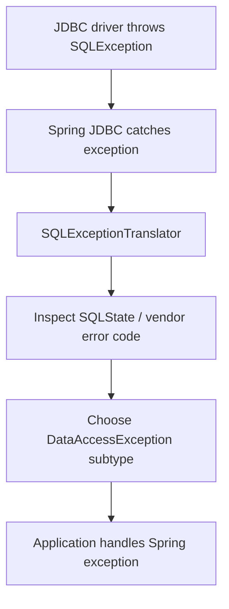

# Phân loại DataAccessException và exception được dịch từ JDBC

Khi làm việc với database, JDBC driver có thể ném ra các loại `SQLException` khác nhau tùy lỗi cú pháp SQL, constraint, timeout, mất kết nối hoặc xung đột đồng thời. Nếu application service phải phụ thuộc trực tiếp vào mã lỗi riêng của từng driver, code sẽ khó đọc và khó chuyển database.

Spring giải quyết vấn đề này bằng **exception translation**: các lỗi persistence ở tầng JDBC được chuyển thành hệ thống exception thống nhất trong package `org.springframework.dao`. Lớp nền của hệ thống này là `DataAccessException`. Spring Data JDBC và Spring JDBC dùng các exception đó để application layer có thể xử lý lỗi theo ý nghĩa truy cập dữ liệu thay vì phụ thuộc vào chi tiết vendor.

Bài học trình bày cấu trúc `DataAccessException`, cách `SQLException` được dịch, những loại lỗi thường gặp trong Spring Data JDBC và cách xử lý, retry, logging cũng như kiểm thử chúng.

## 1. Vì sao cần exception translation?

Một JDBC driver có thể biểu diễn cùng một lỗi nghiệp vụ bằng các exception hoặc vendor code khác nhau.

Ví dụ, vi phạm unique constraint có thể xuất hiện dưới dạng `SQLException` với SQLState/vendor code riêng của PostgreSQL, MySQL hoặc SQL Server. Nếu service kiểm tra trực tiếp các mã này, logic nghiệp vụ sẽ phụ thuộc database.

Không có exception translation, code có thể phải làm như sau:

```java
try {
    jdbcStatement.executeUpdate(sql);
} catch (SQLException ex) {
    if ("23505".equals(ex.getSQLState())) {
        // Xử lý duplicate theo một database cụ thể.
    }
    throw new RuntimeException(ex);
}
```

Cách này có một số vấn đề:

- Application layer biết chi tiết JDBC.
- Mã SQLState và vendor error code có thể khác nhau giữa database.
- Mỗi repository/service có thể tự xử lý lỗi theo cách khác.
- Việc đổi database hoặc driver làm tăng phạm vi sửa code.
- RuntimeException chung làm mất ngữ nghĩa của lỗi.

Với Spring, cùng tình huống có thể được biểu diễn bằng exception ở mức abstraction:

```java
try {
    customers.save(customer);
} catch (DuplicateKeyException ex) {
    throw new EmailAlreadyRegisteredException(
        customer.email(),
        ex
    );
}
```

`DuplicateKeyException` cho biết thao tác thất bại do khóa bị trùng. Service không cần biết driver đã dùng SQLState hay vendor code nào để nhận diện lỗi.

## 2. DataAccessException là gì?

`DataAccessException` là lớp cơ sở của hệ thống unchecked exception dành cho lỗi truy cập dữ liệu trong Spring.

Package:

```java
import org.springframework.dao.DataAccessException;
```

Đặc điểm:

- Là runtime exception, kế thừa `NestedRuntimeException`.
- Độc lập với công nghệ persistence cụ thể ở mức application.
- Có thể giữ exception gốc làm cause.
- Có các subclass mô tả nhóm lỗi như integrity violation, resource failure, query timeout hoặc optimistic locking failure.

Do là unchecked exception, `DataAccessException` thường kích hoạt rollback mặc định khi thoát khỏi method có `@Transactional`. Quy tắc rollback cụ thể vẫn phụ thuộc transaction configuration và exception có bị bắt/nuốt hay không.

### 2.1. Cấu trúc phân loại ở mức khái quát

Các nhánh chính:

```text
DataAccessException
├── TransientDataAccessException
├── NonTransientDataAccessException
└── RecoverableDataAccessException
```

Cách phân loại này thể hiện khả năng lỗi có thể tự hết khi thử lại hay cần thay đổi điều kiện/logic.

| Nhóm | Ý nghĩa |
| --- | --- |
| `TransientDataAccessException` | Lỗi có khả năng tạm thời; thử lại sau có thể thành công. |
| `NonTransientDataAccessException` | Lỗi không tự hết nếu không sửa nguyên nhân hoặc dữ liệu. |
| `RecoverableDataAccessException` | Lỗi có thể phục hồi bằng cách thực hiện thao tác recovery, chẳng hạn lấy lại connection hoặc khôi phục resource. |

Không phải mọi exception transient đều nên retry ngay. Retry chỉ an toàn khi operation có semantics phù hợp, transaction được bắt đầu lại và có giới hạn số lần thử.

## 3. Một số DataAccessException thường gặp

Spring cung cấp nhiều subclass để mô tả các lỗi phổ biến.

| Exception | Ý nghĩa thường gặp | Nhóm xử lý |
| --- | --- | --- |
| `DuplicateKeyException` | Vi phạm primary key hoặc unique key. | Integrity/data conflict. |
| `DataIntegrityViolationException` | Vi phạm constraint như NOT NULL, foreign key, check hoặc unique. | Integrity violation. |
| `BadSqlGrammarException` | SQL sai cú pháp hoặc tham chiếu table/column không hợp lệ. | Lỗi query/schema. |
| `InvalidDataAccessResourceUsageException` | Sử dụng resource/query không hợp lệ. | Lỗi cấu hình hoặc câu lệnh. |
| `EmptyResultDataAccessException` | Truy vấn kỳ vọng có row nhưng không có row. | Kết quả không như mong đợi. |
| `IncorrectResultSizeDataAccessException` | Số row trả về khác số lượng mong đợi. | Sai cardinality. |
| `OptimisticLockingFailureException` | Update/delete không tác động row vì version/state không còn khớp. | Concurrency conflict. |
| `CannotAcquireLockException` | Không lấy được lock cần thiết. | Lock contention. |
| `PessimisticLockingFailureException` | Thao tác thất bại do vấn đề lock. | Concurrency/locking. |
| `QueryTimeoutException` | Query vượt thời gian cho phép. | Timeout. |
| `DataAccessResourceFailureException` | Resource database/connection không khả dụng. | Hạ tầng. |
| `UncategorizedSQLException` | SQLException không được phân loại cụ thể. | Lỗi JDBC chưa phân loại. |

Một exception có thể nằm sâu trong hierarchy. Khi xử lý, ưu tiên catch subclass cụ thể mà use case cần, sau đó mới đến `DataAccessException` tổng quát.

### 3.1. DuplicateKeyException và DataIntegrityViolationException

`DuplicateKeyException` là trường hợp cụ thể của lỗi integrity. `DataIntegrityViolationException` rộng hơn và có thể bao gồm nhiều constraint khác.

Ví dụ:

- Email bị trùng unique.
- Mã đơn hàng bị trùng.
- Cột NOT NULL nhận null.
- Foreign key tham chiếu tới row không tồn tại.
- Giá trị vi phạm CHECK constraint.

Không nên coi mọi `DataIntegrityViolationException` là duplicate. Chỉ chuyển thành lỗi “đã tồn tại” khi có đủ bằng chứng constraint cụ thể bị vi phạm.

### 3.2. BadSqlGrammarException

Exception này thường chỉ ra SQL không hợp lệ đối với database hiện tại, chẳng hạn:

- Sai tên bảng hoặc cột.
- Sai cú pháp SQL.
- Dùng function không tồn tại.
- Query migration chưa chạy hoặc schema không tương thích với code.

Đây thường là lỗi cần sửa code/schema, không phải lỗi để retry.

### 3.3. EmptyResultDataAccessException

Một số API JDBC yêu cầu đúng một row, ví dụ queryForObject. Nếu query không trả row, Spring có thể ném `EmptyResultDataAccessException`.

Trong Spring Data repository, API như `findById` thường trả về `Optional` để biểu diễn không tìm thấy một cách tường minh. Không nên bắt EmptyResultDataAccessException quanh mọi lần gọi `findById`.

### 3.4. IncorrectResultSizeDataAccessException

Lỗi này xuất hiện khi query được thiết kế để trả một số lượng row cụ thể nhưng database trả số lượng khác.

Ví dụ query mong đợi một customer theo email nhưng dữ liệu thực tế có nhiều row. Đây có thể là dấu hiệu:

- Unique constraint chưa tồn tại.
- Dữ liệu legacy có duplicate.
- Predicate query không đủ chặt.
- Repository method khai báo cardinality không đúng.

Đừng chọn ngẫu nhiên row đầu tiên để che giấu lỗi cardinality nếu domain yêu cầu dữ liệu duy nhất.

### 3.5. OptimisticLockingFailureException

Spring Data JDBC có thể dùng `@Version` để phát hiện update/delete dựa trên version cũ không còn khớp.

Ví dụ:

```java
@Table("inventory")
public record Inventory(
    @Id Long id,
    Integer quantity,
    @Version Long version
) {}
```

Nếu hai transaction cùng đọc version 4, transaction thứ nhất update thành version 5. Transaction thứ hai cố update với version 4 và không còn row nào thỏa điều kiện. Spring báo optimistic locking failure.

Đây là concurrency conflict, không nhất thiết là lỗi hạ tầng. Ứng dụng có thể yêu cầu người dùng tải lại, hoặc thực hiện một quy trình retry có đọc lại aggregate và áp dụng lại domain command.

## 4. SQLException được dịch như thế nào?

JDBC driver ném `SQLException`. Spring JDBC dùng `SQLExceptionTranslator` để chuyển lỗi đó thành `DataAccessException`.

Luồng khái quát:



Translator có thể dựa trên:

- SQLState do driver cung cấp.
- Vendor error code riêng của database.
- Loại exception JDBC cụ thể.
- Thông tin câu lệnh SQL và resource liên quan.

Spring cung cấp các implementation translator khác nhau. `SQLErrorCodeSQLExceptionTranslator` có thể sử dụng mã lỗi vendor theo database; các translator khác có thể dựa trên SQLState hoặc JDBC exception subtype. Nếu không nhận diện được, lỗi có thể trở thành `UncategorizedSQLException`.

### 4.1. SQLState và vendor error code

`SQLException` có các thông tin quan trọng:

```java
String sqlState = ex.getSQLState();
int vendorCode = ex.getErrorCode();
Throwable cause = ex.getCause();
SQLException next = ex.getNextException();
```

SQLState thường là mã chuẩn hóa theo nhóm lỗi SQL, còn vendor code là mã riêng của database. Một số driver cung cấp thêm exception subclass hoặc chuỗi exception nối tiếp qua `getNextException()`.

Khi debug, có thể ghi nhận SQLState và vendor code theo policy logging của ứng dụng. Tuy nhiên, không nên để application business logic phụ thuộc các giá trị này nếu Spring đã cung cấp subclass phù hợp.

### 4.2. Spring JDBC và repository exception translation

Các abstraction như `JdbcTemplate` bắt `SQLException` và dịch sang `DataAccessException`.

Spring Data JDBC sử dụng Spring JDBC infrastructure để thực hiện các thao tác SQL. Repository và template có thể phát ra các exception trong hệ thống Spring DAO khi persistence thất bại.

Với các bean được đánh dấu `@Repository`, Spring cũng có exception translation infrastructure để chuyển persistence exception ở tầng repository sang hệ thống `DataAccessException` khi có translator tương ứng.

Trong code ứng dụng, nên để exception Spring đi lên application service thay vì tự bọc mọi lỗi thành RuntimeException chung.

## 5. Xử lý exception ở application service

Service nên chuyển lỗi persistence thành lỗi application/domain có ý nghĩa đối với use case. Việc chuyển đổi cần cụ thể, không nên bắt mọi lỗi database rồi trả một kết quả thành công giả.

Ví dụ đăng ký khách hàng với email duy nhất:

```java
@Service
public class RegistrationService {

    private final CustomerRepository customers;

    public RegistrationService(CustomerRepository customers) {
        this.customers = customers;
    }

    @Transactional
    public Customer register(RegisterCustomer command) {
        Customer customer = Customer.register(
            command.name(),
            command.email()
        );

        try {
            return customers.save(customer);
        } catch (DuplicateKeyException ex) {
            throw new EmailAlreadyRegisteredException(
                command.email(),
                ex
            );
        }
    }
}
```

Unique constraint ở database vẫn là nguồn bảo vệ cuối cùng. Kiểm tra `existsByEmail` trước khi insert không loại bỏ race condition vì hai request có thể cùng kiểm tra “chưa tồn tại” rồi cùng insert.

Catch `DuplicateKeyException` xử lý tình huống cạnh tranh đó theo cách rõ ràng.

### 5.1. Giữ cause khi chuyển exception

Custom exception nên giữ exception gốc:

```java
public class EmailAlreadyRegisteredException
        extends RuntimeException {

    public EmailAlreadyRegisteredException(
            String email,
            Throwable cause) {
        super("Email đã được đăng ký: " + email, cause);
    }
}
```

Giữ cause giúp log và hệ thống quan sát vẫn truy được lỗi database gốc. Cần cân nhắc không đưa email hoặc dữ liệu cá nhân vào message nếu exception có thể được log ở nơi không được phép lưu dữ liệu đó.

### 5.2. Chỉ bắt loại lỗi mà use case hiểu

Ví dụ không nên:

```java
try {
    return customers.save(customer);
} catch (DataAccessException ex) {
    return customer;
}
```

Cách này che giấu lỗi kết nối, schema, constraint, timeout và concurrency thành công giả. Caller không biết dữ liệu đã được lưu hay chưa.

Thay vào đó, chỉ bắt subclass có ý nghĩa cụ thể:

```java
try {
    return customers.save(customer);
} catch (DuplicateKeyException ex) {
    throw new EmailAlreadyRegisteredException(
        command.email(),
        ex
    );
}
```

Các lỗi khác tiếp tục truyền lên handler phù hợp để được ghi nhận và trả response lỗi.
## 6. Phân biệt lỗi có thể retry và lỗi cần sửa nguyên nhân

Không phải mọi `DataAccessException` đều phù hợp để thử lại.

| Loại lỗi | Ví dụ | Hướng xử lý thường gặp |
| --- | --- | --- |
| Transient | Deadlock, lock tạm thời, resource tạm gián đoạn | Có thể retry có giới hạn nếu operation an toàn. |
| Non-transient | SQL sai, thiếu column, vi phạm constraint | Sửa query/schema/dữ liệu; retry thường không giúp. |
| Concurrency conflict | Optimistic locking failure | Đọc lại aggregate và áp dụng lại command nếu nghiệp vụ cho phép. |
| Timeout | Query timeout hoặc chờ lock quá lâu | Xác định nguyên nhân; retry có kiểm soát nếu timeout là tạm thời. |
| Resource failure | Database mất kết nối hoặc pool không cấp connection | Kiểm tra hạ tầng; retry có backoff nếu request có thể lặp an toàn. |

Phân loại transient/non-transient của Spring là gợi ý về bản chất lỗi, không phải lệnh tự động retry. Chính application phải quyết định operation có thể lặp hay không.

### 6.1. Những lỗi thường không nên retry

Thông thường không retry các lỗi:

- `BadSqlGrammarException`: query sai hoặc schema không tương thích.
- `DataIntegrityViolationException`: dữ liệu vi phạm constraint.
- `DuplicateKeyException`: khóa đã tồn tại.
- Lỗi mapping hoặc type conversion do code/configuration.
- Lỗi quyền truy cập cố định.

Retry chỉ lặp lại cùng lỗi và làm tăng tải database.

### 6.2. Deadlock và lỗi tạm thời

Deadlock có thể được database phát hiện và hủy một transaction để giải phóng tài nguyên. Nếu transaction được rollback đầy đủ, ứng dụng có thể thử lại toàn bộ use case sau một khoảng chờ ngắn.

Nhưng phải bảo đảm:

- Retry có số lần tối đa.
- Có exponential backoff và jitter.
- Mỗi lần retry bắt đầu transaction mới.
- Operation có tính idempotent hoặc có cơ chế chống xử lý trùng.
- Không phát side effect bên ngoài database trước khi transaction commit.

Không retry một statement riêng lẻ trong transaction đã bị database đánh dấu rollback-only rồi tiếp tục dùng transaction đó.

### 6.3. Retry transaction ở boundary bên ngoài

Một cách tổ chức là để retry bao quanh một operation tạo transaction mới cho từng lần thử:

```java
public OrderResult placeOrder(PlaceOrderCommand command) {
    return retryTemplate.execute(context ->
        transactionTemplate.execute(status ->
            placeOrderInTransaction(command)
        )
    );
}
```

Ví dụ này minh họa thứ tự: retry ở ngoài, transaction ở trong. Mỗi attempt gọi `TransactionTemplate.execute` để có transaction riêng. Cần cấu hình retry policy chỉ cho các exception transient được chọn và giới hạn số lần thử.

Nếu dùng annotation `@Retryable` và `@Transactional`, thứ tự proxy/interceptor có thể ảnh hưởng việc transaction có được mở lại cho mỗi attempt hay không. Tách bean hoặc dùng template tường minh giúp ranh giới dễ hiểu hơn. Không đặt retry bên trong một transaction đã thất bại.

## 7. Xử lý optimistic locking conflict

`OptimisticLockingFailureException` thường biểu thị aggregate đã bị thay đổi sau khi transaction hiện tại đọc nó.

Ví dụ:

```java
try {
    order.confirm();
    orders.save(order);
} catch (OptimisticLockingFailureException ex) {
    throw new OrderChangedConcurrentlyException(
        order.getId(),
        ex
    );
}
```

Các lựa chọn xử lý:

1. Trả conflict cho caller để người dùng tải lại dữ liệu.
2. Tải lại aggregate rồi kiểm tra command còn hợp lệ không.
3. Áp dụng lại command trên state mới và lưu, nếu nghiệp vụ cho phép retry.
4. Ghi nhận conflict để theo dõi khi xảy ra thường xuyên.

Không nên tự động lấy object cũ và save lại nhiều lần mà không chạy lại domain logic. Ví dụ số lượng tồn kho hoặc trạng thái đơn hàng có thể đã thay đổi, khiến command ban đầu không còn hợp lệ.

## 8. Transaction rollback và exception translation

`DataAccessException` là unchecked exception. Khi nó thoát khỏi method có `@Transactional`, Spring mặc định rollback transaction theo quy tắc rollback cho runtime exception.

Ví dụ:

```java
@Transactional
public void createOrder(PlaceOrderCommand command) {
    PurchaseOrder saved = orders.save(
        PurchaseOrder.create(command)
    );

    try {
        outbox.insert(saved.getId(), command.eventPayload());
    } catch (DataAccessException ex) {
        throw new OutboxWriteFailedException(ex);
    }
}
```

Custom exception kế thừa RuntimeException nên transaction mặc định rollback. Nếu catch rồi chỉ log mà không ném lại hoặc đánh dấu rollback-only, transaction có thể commit những thay đổi trước đó.

### 8.1. Checked exception và rollback rule

Nếu application chuyển lỗi persistence thành checked exception, transaction mặc định có thể không rollback theo quy tắc mặc định của `@Transactional`.

Có thể khai báo rollback rule:

```java
@Transactional(rollbackFor = OrderPersistenceException.class)
public void createOrder() throws OrderPersistenceException {
    // ...
}
```

Hoặc thiết kế custom application exception kế thừa RuntimeException nếu phù hợp với quy ước codebase. Điều quan trọng là quyết định rollback phải rõ ràng và được kiểm thử.

### 8.2. Không tiếp tục dùng transaction sau lỗi nghiêm trọng

Một số lỗi database khiến transaction hiện tại không còn dùng được, chẳng hạn transaction bị abort sau constraint violation hoặc deadlock tùy database. Sau lỗi, hãy để transaction kết thúc/rollback rồi bắt đầu transaction mới nếu cần tiếp tục.

Không giả định bắt được exception nghĩa là connection và transaction vẫn ở trạng thái bình thường.

## 9. Ghi log exception có ích cho chẩn đoán

Khi log lỗi database, cần giữ đủ thông tin để điều tra nhưng tránh làm lộ dữ liệu nhạy cảm.

Thông tin hữu ích:

- Tên use case hoặc repository operation.
- Correlation ID/trace ID.
- Loại Spring exception.
- SQLState và vendor code nếu có trong cause.
- Database/datasource name đã được cấu hình.
- Thời điểm, duration và retry attempt.
- Aggregate identifier nếu policy cho phép.

Không nên ghi:

- Password hoặc token.
- Toàn bộ parameter nhạy cảm.
- Nội dung cá nhân không cần thiết.
- Raw SQL có literal chứa dữ liệu người dùng nếu log không được bảo vệ.

Ví dụ:

```java
catch (DataAccessException ex) {
    log.error(
        "Không thể lưu đơn hàng. orderId={}, errorType={}",
        orderId,
        ex.getClass().getSimpleName(),
        ex
    );
    throw ex;
}
```

Truyền exception làm tham số cuối để logger ghi stack trace. Không chỉ log `ex.getMessage()` vì message có thể thiếu cause chain và stack trace.

### 9.1. Không phân loại lỗi bằng cách đọc message

Tránh code:

```java
if (ex.getMessage().contains("duplicate")) {
    // ...
}
```

Message có thể thay đổi theo driver, database version hoặc locale. Hãy catch subclass như `DuplicateKeyException` hoặc inspect SQLState/vendor code ở một adapter kỹ thuật chuyên biệt khi Spring không phân loại được.

## 10. Trả lỗi phù hợp qua REST API

Application exception nên được chuyển thành HTTP response tại web boundary, ví dụ bằng `@RestControllerAdvice`.

```java
@RestControllerAdvice
public class ApiExceptionHandler {

    @ExceptionHandler(EmailAlreadyRegisteredException.class)
    ResponseEntity<ApiError> handleDuplicateEmail(
            EmailAlreadyRegisteredException ex) {
        return ResponseEntity
            .status(HttpStatus.CONFLICT)
            .body(new ApiError(
                "EMAIL_ALREADY_REGISTERED",
                "Email đã được sử dụng"
            ));
    }

    @ExceptionHandler(DataAccessResourceFailureException.class)
    ResponseEntity<ApiError> handleDatabaseUnavailable(
            DataAccessResourceFailureException ex) {
        return ResponseEntity
            .status(HttpStatus.SERVICE_UNAVAILABLE)
            .body(new ApiError(
                "DATABASE_UNAVAILABLE",
                "Dịch vụ dữ liệu tạm thời không khả dụng"
            ));
    }
}
```

`ApiError` là DTO response của ứng dụng. Không trả nguyên văn SQL, SQLState, vendor code hoặc stack trace cho client. Những chi tiết kỹ thuật đó thuộc log/trace nội bộ.

Không nên ánh xạ tất cả `DataAccessException` thành HTTP 500 mà không phân biệt. Một số lỗi có thể tương ứng conflict, not found hoặc service unavailable; quyết định này nên dựa trên semantics của use case, không chỉ tên exception.

## 11. Dùng exception translation trong JDBC code tùy chỉnh

Khi dùng `JdbcTemplate`, Spring tự xử lý `SQLException` và dịch sang `DataAccessException`.

Ví dụ:

```java
Integer count = jdbcTemplate.queryForObject(
    "SELECT COUNT(*) FROM customers WHERE active = ?",
    Integer.class,
    true
);
```

Nếu tự gọi JDBC API trực tiếp, code cần xử lý `SQLException`. Có thể dùng `SQLExceptionTranslator` để giữ cùng abstraction của Spring:

```java
SQLExceptionTranslator translator =
    new SQLErrorCodeSQLExceptionTranslator(dataSource);

try (Connection connection = dataSource.getConnection();
     PreparedStatement statement =
         connection.prepareStatement(sql)) {

    // Bind parameter và thực thi statement.

} catch (SQLException ex) {
    throw translator.translate(
        "Thực thi truy vấn customer",
        sql,
        ex
    );
}
```

Trong ứng dụng Spring thông thường, ưu tiên `JdbcTemplate` hoặc các abstraction Spring quản lý connection/transaction. Nếu dùng JDBC trực tiếp, cần chú ý connection transaction-aware và không tự đóng/commit resource do Spring transaction quản lý.

## 12. Kiểm thử exception translation

Cần kiểm thử ở hai mức:

- Unit test cho application service: xác nhận Spring exception cụ thể được chuyển thành lỗi nghiệp vụ phù hợp.
- Integration test trên database: xác nhận driver/database thực sự phát sinh lỗi và Spring dịch sang subclass mong đợi.

### 12.1. Unit test cho duplicate key

```java
@ExtendWith(MockitoExtension.class)
class RegistrationServiceTest {

    @Mock
    CustomerRepository customers;

    @InjectMocks
    RegistrationService service;

    @Test
    void translatesDuplicateKeyToBusinessException() {
        RegisterCustomer command =
            new RegisterCustomer("An", "an@example.test");

        when(customers.save(any()))
            .thenThrow(new DuplicateKeyException("duplicate"));

        assertThatThrownBy(() -> service.register(command))
            .isInstanceOf(EmailAlreadyRegisteredException.class)
            .hasCauseInstanceOf(DuplicateKeyException.class);
    }
}
```

Test này xác nhận mapping application-level. Nó không chứng minh database constraint hoặc JDBC exception translator hoạt động đúng.

### 12.2. Integration test với unique constraint

```java
@DataJdbcTest
class CustomerConstraintTest {

    @Autowired
    CustomerRepository customers;

    @Test
    void rejectsDuplicateEmail() {
        customers.save(Customer.register(
            "An",
            "same@example.test"
        ));

        assertThatThrownBy(() ->
            customers.save(Customer.register(
                "Binh",
                "same@example.test"
            ))
        ).isInstanceOf(DataIntegrityViolationException.class);
    }
}
```

Database schema phải có unique constraint trên email. Tùy database/driver và translator, lỗi duplicate cụ thể có thể là `DuplicateKeyException` hoặc được biểu diễn bằng subclass integrity phù hợp. Test trên database production tương ứng giúp xác nhận behavior thực tế.

### 12.3. Kiểm thử optimistic locking

Tạo aggregate với version, tải cùng một row qua hai lần đọc độc lập, lưu thay đổi từ bản thứ nhất, rồi thử lưu bản thứ hai với version cũ. Xác nhận lần save thứ hai ném `OptimisticLockingFailureException`.

Test nên chạy trên database thật hoặc Testcontainers nếu semantics version/transaction phụ thuộc engine. Đảm bảo hai lần đọc thực sự có version ban đầu giống nhau và transaction đầu đã commit trước khi lần hai save.

### 12.4. Không để test transaction che giấu kết quả

Nếu test method có `@Transactional`, test framework có thể rollback transaction sau test. Điều đó hữu ích cho isolation giữa test, nhưng có thể che giấu thời điểm commit hoặc transaction boundary của service.

Khi kiểm thử rollback/retry, hãy xác định rõ transaction nào đang bao quanh test và service. Có thể dùng service transaction thực sự rồi đọc dữ liệu trong transaction mới để xác nhận kết quả đã commit hoặc rollback.

## 13. Những lỗi thường gặp

| Hiện tượng | Nguyên nhân | Hướng xử lý |
| --- | --- | --- |
| Application phụ thuộc SQLState/vendor code | Xử lý trực tiếp SQLException ở business layer. | Dùng DataAccessException và chuyển thành lỗi nghiệp vụ. |
| Mọi lỗi đều bị coi là duplicate | Catch DataIntegrityViolationException quá rộng. | Phân biệt DuplicateKeyException và constraint cụ thể. |
| Query sai được retry nhiều lần | Retry mọi DataAccessException. | Chỉ retry lỗi transient đã chọn. |
| Retry nhưng transaction vẫn rollback-only | Retry bên trong transaction đã thất bại. | Retry bên ngoài và mở transaction mới cho mỗi attempt. |
| Dữ liệu đã ghi một phần dù service báo lỗi | Exception bị catch/nuốt, callback kết thúc bình thường. | Ném lại hoặc đánh dấu rollback-only. |
| Lỗi database bị trả thành HTTP 200 | Service nuốt exception và trả object giả. | Chuyển lỗi thành application exception và xử lý ở web boundary. |
| Log không đủ thông tin | Chỉ log message, không giữ cause/trace. | Log exception đầy đủ với correlation ID. |
| Log lộ dữ liệu | Ghi raw SQL/parameters không lọc. | Redact và giới hạn quyền truy cập log. |
| Test H2 khác production | SQLState/vendor code và translator khác nhau. | Integration test trên đúng database/driver. |
| Optimistic lock conflict bị xem là lỗi hạ tầng | Không phân biệt concurrency exception. | Xử lý conflict theo quy tắc nghiệp vụ. |
| EmptyResultDataAccessException bị bắt quanh findById | Nhầm API JDBC với Optional repository method. | Dùng Optional cho findById; xử lý exception đúng API. |

## 14. Quy trình xử lý lỗi persistence

Khi một thao tác Spring Data JDBC thất bại:

1. Xác định exception Spring ở ngoài cùng và cause chain.
2. Phân loại lỗi: integrity, query/schema, concurrency, timeout hay resource failure.
3. Chuyển thành application/domain exception nếu use case có ý nghĩa tương ứng.
4. Để lỗi cần rollback thoát khỏi transaction hoặc áp dụng rollback rule rõ ràng.
5. Chỉ retry transient exception đã chọn, với backoff, giới hạn và operation idempotent.
6. Mỗi retry attempt phải dùng transaction mới nếu lần trước đã thất bại.
7. Ghi log loại lỗi, cause, trace ID và context tối thiểu cần thiết.
8. Không trả SQL/vendor detail cho API client.
9. Kiểm thử cả unit mapping lẫn integration trên database/driver thực tế.
10. Theo dõi tần suất exception để phát hiện constraint violation, deadlock, timeout hoặc database instability.

> **DataAccessException chuẩn hóa lỗi persistence thành hệ thống exception của Spring.** Hãy xử lý theo subclass và ý nghĩa của lỗi: integrity violation thường cần phản hồi nghiệp vụ, lỗi SQL/schema cần sửa nguyên nhân, optimistic locking là conflict cần đọc lại state, còn lỗi transient chỉ nên retry khi operation an toàn và mỗi lần thử có transaction mới.

### Tài liệu tham khảo

- [Spring Framework — Data Access Exceptions](https://docs.spring.io/spring-framework/reference/data-access/dao.html): hệ thống DataAccessException và exception translation.
- [Spring Framework — JDBC Core](https://docs.spring.io/spring-framework/reference/data-access/jdbc/core.html): JdbcTemplate và xử lý SQLException.
- [Spring Framework — SQLExceptionTranslator API](https://docs.spring.io/spring-framework/docs/current/javadoc-api/org/springframework/jdbc/support/SQLExceptionTranslator.html): contract chuyển SQLException thành DataAccessException.
- [Spring Framework — DataAccessException API](https://docs.spring.io/spring-framework/docs/current/javadoc-api/org/springframework/dao/DataAccessException.html): lớp cơ sở của exception truy cập dữ liệu.
- [Spring Data JDBC — Optimistic Locking](https://docs.spring.io/spring-data/relational/reference/jdbc/entity-persistence.html): version property và xử lý cập nhật đồng thời.
- [Spring Framework — Declarative Transaction Management](https://docs.spring.io/spring-framework/reference/data-access/transaction/declarative.html): transaction boundary và rollback rules.
