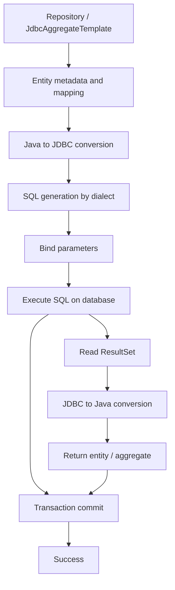
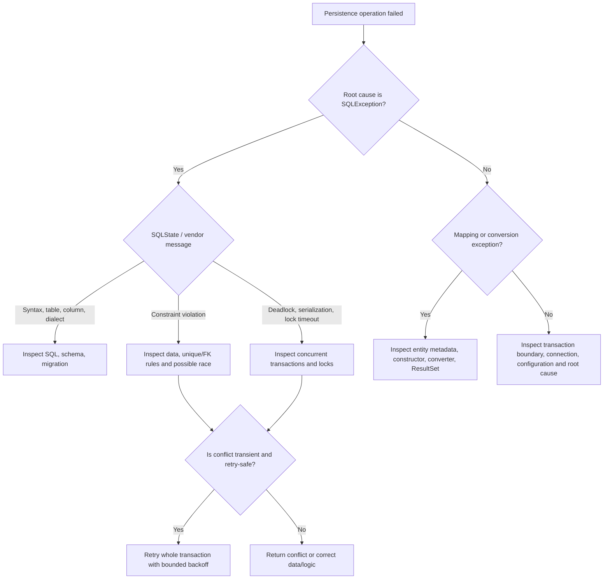

# Phân biệt lỗi cú pháp SQL, lỗi mapping và xung đột đồng thời

Khi một thao tác repository của **Spring Data Relational JDBC** thất bại, thông báo lỗi ở tầng service thường chưa đủ để xác định nguyên nhân. Cùng một lời gọi `repository.save(...)` có thể thất bại khi Spring Data tạo SQL, chuyển object Java thành giá trị JDBC, thực thi câu lệnh, ánh xạ ResultSet thành entity hoặc commit transaction.

Ba nhóm lỗi cần phân biệt là:

- **Lỗi cú pháp SQL và lỗi thực thi SQL:** database không chấp nhận câu lệnh hoặc không thể thực hiện nó trong schema/cấu hình hiện tại.
- **Lỗi mapping:** Spring Data không thể chuyển đổi hoặc liên kết dữ liệu giữa entity, metadata và relational row theo cách đã khai báo.
- **Xung đột đồng thời:** thao tác hợp lệ riêng lẻ nhưng bị ảnh hưởng bởi một transaction khác cùng đọc/ghi dữ liệu.

Nhận diện đúng nhóm lỗi giúp chọn cách sửa phù hợp. Sửa SQL không giải quyết được converter sai; thay mapping không giải quyết được deadlock; retry không thể chữa một câu SQL sai cú pháp.

## 1. Xác định lỗi xảy ra ở giai đoạn nào

Một thao tác đọc/ghi trong Spring Data JDBC đi qua nhiều giai đoạn:



Các giai đoạn này tạo ra những dấu hiệu khác nhau:

| Giai đoạn | Lỗi điển hình | Dấu hiệu |
|---|---|---|
| Mapping metadata | Mapping/constructor error | Không xác định được persistent property hoặc cách tạo entity |
| Java-to-JDBC conversion | Conversion error | Không chuyển được enum, value object hoặc kiểu custom |
| SQL generation | Dialect/configuration issue | SQL được tạo không phù hợp database |
| SQL execution | SQL grammar/resource/integrity error | Database trả SQLException với SQLState/vendor code |
| ResultSet mapping | Mapping/conversion error | Query chạy được nhưng không chuyển được cột thành property |
| Transaction commit | Constraint/concurrency/connection error | Method có thể đã chạy qua repository nhưng commit thất bại |

Không phải lỗi nào cũng xuất hiện đúng tại dòng code nhìn thấy trong stack trace. Spring có thể bọc SQLException trong một exception thuộc `DataAccessException`, còn exception mapping có thể được ném trước hoặc sau khi database thực thi câu lệnh.

### 1.1. Phân biệt thời điểm tạo SQL và thời điểm database thực thi

Spring Data JDBC có thể tạo SQL từ mapping metadata và dialect. Sau đó JDBC driver bind parameter và gửi statement tới database.

Nếu SQL sai cú pháp, database thường trả lỗi khi parse/execute statement. Nếu mapping sai, lỗi có thể xảy ra trước khi gửi SQL (ví dụ không có converter ghi) hoặc sau khi query chạy (ví dụ không thể tạo entity từ ResultSet).

Một lỗi xuất hiện trong method repository không có nghĩa lỗi nằm ở repository method. Hãy tìm frame đầu tiên thuộc Spring Data/JDBC, exception gốc và giai đoạn mà thao tác đã đạt tới.

## 2. Lỗi cú pháp SQL và lỗi thực thi SQL

Lỗi SQL xảy ra khi database không thể phân tích hoặc thực hiện câu lệnh được gửi. Nguyên nhân có thể là cú pháp không hợp lệ, tên bảng/cột không tồn tại, identifier bị quote sai, kiểu dữ liệu không phù hợp, quyền truy cập hoặc schema chưa được migration.

### 2.1. Nguyên nhân phổ biến

- Viết sai cú pháp trong `@Query` hoặc custom repository.
- Dùng tên bảng/cột khác với schema thật.
- Dùng reserved word làm identifier mà không quote đúng.
- SQL được viết cho PostgreSQL nhưng chạy trên MySQL hoặc SQL Server.
- Câu lệnh pagination, upsert hoặc function không được database hỗ trợ.
- Migration chưa chạy hoặc chạy sai thứ tự.
- Database schema khác môi trường local/test.
- Alias, join condition hoặc parameter placeholder không đúng.
- Database user thiếu quyền SELECT/INSERT/UPDATE/DELETE.
- Cột có kiểu dữ liệu hoặc constraint không chấp nhận giá trị bind.

### 2.2. Ví dụ lỗi tên bảng hoặc reserved word

Giả sử schema có bảng `orders`, nhưng query viết nhầm:

```java
@Query("SELECT * FROM order WHERE id = :id")
Optional<PurchaseOrder> findOne(long id);
```

Từ `order` có thể là reserved word hoặc tên bảng không đúng với schema. Database có thể trả lỗi cú pháp hoặc lỗi không tìm thấy relation/table tùy vendor.

Sửa query theo tên bảng thực tế:

```java
@Query("SELECT * FROM orders WHERE id = :id")
Optional<PurchaseOrder> findOne(long id);
```

Nếu identifier thực sự là reserved word, nên cân nhắc đổi tên schema. Nếu không thể đổi, dùng cách quote đúng với database và dialect. Không dùng một kiểu quote tùy tiện cho mọi vendor.

### 2.3. BadSqlGrammarException

Spring JDBC thường dịch một số lỗi SQL grammar thành `BadSqlGrammarException`, thuộc nhóm `DataAccessException`.

Exception này là dấu hiệu hữu ích, nhưng không nên hiểu quá hẹp rằng chỉ có dấu chấm phẩy hoặc keyword sai. Tùy driver và database, lỗi relation/table không tồn tại, column không tồn tại hoặc một số lỗi truy cập SQL cũng có thể được phân loại gần nhóm grammar/resource usage.

Hãy đọc:

- SQL statement được gửi.
- SQLState của SQLException gốc.
- Vendor error code.
- Tên bảng/cột và schema đang kết nối.
- Vị trí lỗi mà database báo (line, column hoặc character position).

Không chỉ sửa theo tên exception mà bỏ qua message và root cause.

### 2.4. SQLState và vendor code

JDBC `SQLException` có thể cung cấp:

- `getSQLState()`: mã phân loại lỗi theo SQLState.
- `getErrorCode()`: mã lỗi riêng của database vendor.
- `getNextException()`: exception JDBC tiếp theo trong chuỗi lỗi.

SQLState là manh mối, không phải hợp đồng phân loại giống nhau tuyệt đối giữa mọi driver. Ví dụ, class `42` thường liên quan lỗi cú pháp hoặc access rule; class `23` liên quan integrity constraint; class `40` thường liên quan transaction rollback. Mã cụ thể và cách driver báo lỗi cần tra theo database đang dùng.

Một vài ví dụ thường gặp:

| Database/error | SQLState hoặc vendor code thường thấy | Gợi ý |
|---|---|---|
| PostgreSQL undefined table | `42P01` | Sai tên relation/schema hoặc migration thiếu |
| PostgreSQL undefined column | `42703` | Mapping/query tham chiếu cột không tồn tại |
| PostgreSQL unique violation | `23505` | Trùng unique/primary key |
| PostgreSQL serialization failure | `40001` | Transaction cần retry theo chính sách |
| PostgreSQL deadlock | `40P01` | Deadlock giữa các transaction |
| MySQL deadlock | Vendor code `1213` | Transaction bị chọn làm deadlock victim |
| MySQL lock wait timeout | Vendor code `1205` | Không lấy được lock trong thời gian cho phép |

Mã lỗi có thể thay đổi theo version, driver và operation. Khi cần chẩn đoán production, đối chiếu với tài liệu lỗi của database vendor và ghi lại driver version.

### 2.5. Lỗi schema và migration

Một query có thể đúng cú pháp nhưng thất bại vì schema thực tế không đúng với code.

Ví dụ:

- Entity dùng `@Column("display_name")` nhưng migration tạo `full_name`.
- Code mới truy vấn cột vừa thêm nhưng migration chưa chạy trên một node.
- Test dùng schema tự tạo còn production dùng migration khác.
- Ứng dụng kết nối nhầm database hoặc nhầm schema.
- Một column được đổi tên nhưng native query cũ vẫn tham chiếu tên cũ.

Cách xử lý:

1. Xác nhận JDBC URL và database/schema đang kết nối.
2. Kiểm tra migration history.
3. Đọc DDL thật của bảng/cột bị lỗi.
4. So sánh tên cột trong mapping và SQL.
5. Sửa migration hoặc mapping theo hợp đồng schema đã chọn.
6. Chạy integration test trên database cùng loại.

Không chữa lỗi thiếu cột bằng cách thêm cột thủ công chỉ trên một môi trường. Điều đó tạo schema drift và khiến lỗi xuất hiện lại ở môi trường khác.
## 3. Xung đột đồng thời là gì?

Xung đột đồng thời xảy ra khi nhiều transaction cùng đọc hoặc thay đổi dữ liệu liên quan trong một khoảng thời gian. Mỗi câu SQL có thể hợp lệ và mapping có thể đúng, nhưng kết quả của một transaction bị ảnh hưởng bởi thay đổi của transaction khác.

Những tình huống phổ biến:

- Hai request cùng tạo bản ghi có cùng primary key hoặc unique business key.
- Hai transaction cùng sửa một aggregate.
- Một transaction đọc dữ liệu rồi ghi lại sau khi transaction khác đã cập nhật.
- Hai transaction giữ lock theo thứ tự khác nhau và tạo deadlock.
- Transaction không thể lấy lock trong thời gian cho phép.
- Database từ chối commit vì serialization/isolation rule.

Khác với lỗi SQL grammar, sửa dấu câu hoặc tên cột không giải quyết được concurrency conflict. Cần xem xét locking, version, transaction boundary, thứ tự truy cập dữ liệu và retry policy.

## 4. Optimistic locking và @Version

Spring Data JDBC hỗ trợ optimistic locking cho aggregate có version property được đánh dấu bằng `@Version`.

Ví dụ:

```java
@Table("customers")
public record Customer(
        @Id Long id,
        String name,
        String email,
        @Version Long version
) {
}
```

Khi đọc entity, Spring Data lấy version hiện tại. Khi cập nhật, SQL có thể dùng cả ID và version cũ trong điều kiện WHERE, đồng thời tăng version khi update thành công.

Ý tưởng SQL:

```sql
UPDATE customers
SET name = ?, email = ?, version = ?
WHERE id = ? AND version = ?;
```

Nếu transaction khác đã cập nhật row trước đó, version trong database không còn bằng version mà entity đang giữ. Update không tác động tới row nào. Spring Data phát hiện update count không như mong đợi và báo optimistic locking failure, thường dưới dạng `OptimisticLockingFailureException`.

### 4.1. Ví dụ hai request cùng cập nhật

Giả sử customer đang ở version 4:

1. Request A đọc customer version 4.
2. Request B cũng đọc customer version 4.
3. A cập nhật email và commit, version thành 5.
4. B cập nhật display name từ snapshot version 4.
5. SQL của B tìm row có version 4 nhưng database đang là 5.
6. B không cập nhật được row và nhận optimistic locking exception.

Điều này ngăn B âm thầm ghi đè dữ liệu bằng một snapshot cũ.

### 4.2. Optimistic locking failure không luôn có nghĩa có writer khác

Update count bằng 0 có thể do:

- Transaction khác đã cập nhật version.
- Row đã bị xóa.
- ID không tồn tại.
- Entity mang version cũ hoặc sai.
- Mapping/version field không khớp schema.

Vì vậy, exception là tín hiệu có conflict ở điều kiện update, nhưng cần kiểm tra row tồn tại, version trong database và lịch sử transaction trước khi kết luận chính xác nguyên nhân.

### 4.3. Khi nào dùng optimistic locking?

Phù hợp khi xung đột không xảy ra thường xuyên và không muốn giữ lock dài trong lúc xử lý business logic.

Ví dụ:

- Người dùng sửa hồ sơ khách hàng.
- Nhiều worker có thể cập nhật cùng một đơn hàng.
- Một aggregate được đọc, xử lý trong application, rồi lưu sau một khoảng thời gian.
- Cần ngăn stale update mà không dùng pessimistic lock cho mọi lần đọc.

Nếu nghiệp vụ yêu cầu cập nhật có điều kiện, ví dụ chỉ chuyển trạng thái khi vẫn đang là NEW, có thể cần SQL update có predicate trạng thái hoặc lock phù hợp thay vì chỉ dựa vào version.

## 5. Duplicate key và race condition khi insert

Hai transaction có thể cùng cố gắng tạo một bản ghi với cùng primary key hoặc unique key.

Ví dụ:

1. A kiểm tra customer có external code `CRM-10` chưa.
2. B cũng kiểm tra và nhận kết quả chưa có.
3. A insert thành công.
4. B insert cùng external code và bị unique constraint từ chối.

Đây là race condition kiểu check-then-act. Kết quả thường được Spring dịch thành `DuplicateKeyException` hoặc một exception integrity tương ứng, tùy database/driver.

### 5.1. Duplicate key không tự động chứng minh có concurrency bug

Một duplicate key có thể do:

- Người dùng gửi dữ liệu trùng theo nghiệp vụ.
- Message bị xử lý lặp.
- Retry gửi lại request đã thành công.
- ID generator hoặc sequence bị cấu hình sai.
- Hai transaction thật sự insert cùng lúc.

Cần xác định key nào bị trùng và vì sao request có cùng key.

### 5.2. Chọn cách xử lý theo nghiệp vụ

| Yêu cầu | Cách xử lý |
|---|---|
| Duplicate là lỗi nghiệp vụ | Trả conflict cho caller hoặc báo lỗi domain |
| Request/message có thể gửi lại | Thiết kế idempotency key và lưu kết quả xử lý |
| Cần insert-or-update nguyên tử | Dùng native upsert khi dialect/API hỗ trợ |
| Chỉ một worker được xử lý một job | Dùng claim/locking hoặc atomic status transition |
| Kiểm tra tồn tại rồi tạo | Đặt unique constraint làm bảo vệ cuối cùng; xử lý duplicate có chủ đích |

Không bỏ unique constraint chỉ để tránh exception. Constraint là hàng rào toàn vẹn cuối cùng trước concurrent writers.

## 6. Deadlock, lock timeout và serialization failure

### 6.1. Deadlock

Deadlock xảy ra khi transaction A giữ lock mà B cần, trong khi B giữ lock mà A cần. Không transaction nào có thể tiếp tục, nên database phát hiện vòng chờ và hủy một transaction.

Ví dụ:

```mermaid
sequenceDiagram
    participant A as Transaction A
    participant B as Transaction B
    participant DB as Database

    A->>DB: Lock row X
    B->>DB: Lock row Y
    A->>DB: Request lock row Y
    Note over A,B: A waits for B
    B->>DB: Request lock row X
    Note over A,B: B waits for A
    DB-->>B: Detect deadlock; abort victim
    B-->>DB: Rollback
    DB-->>A: Lock becomes available
```

Spring có thể dịch lỗi này thành một exception trong nhóm concurrency/pessimistic locking. SQLState và vendor code giúp xác nhận database đã phát hiện deadlock.

Cách giảm deadlock:

- Truy cập nhiều row theo cùng một thứ tự ở mọi transaction.
- Giữ transaction ngắn.
- Không gọi HTTP hoặc chờ người dùng trong khi đang giữ lock.
- Tạo index phù hợp để giảm phạm vi scan/lock.
- Tránh cập nhật nhiều bảng theo thứ tự khác nhau giữa các use case.
- Retry transaction bị database chọn làm deadlock victim khi nghiệp vụ cho phép.

### 6.2. Lock wait timeout

Lock timeout xảy ra khi transaction phải chờ lock lâu hơn giới hạn database hoặc ứng dụng đặt ra.

Nguyên nhân có thể là transaction khác giữ lock quá lâu, truy vấn thiếu index khiến lock rộng hơn dự kiến hoặc một transaction bị treo khi gọi dịch vụ ngoài.

Cần phân biệt lock timeout với query timeout và connection timeout. Ba loại timeout xảy ra ở các lớp khác nhau:

| Timeout | Ý nghĩa |
|---|---|
| Connection timeout | Không lấy được connection từ pool hoặc không kết nối được database |
| Query/statement timeout | Câu SQL chạy quá thời gian cho phép |
| Lock wait timeout | Câu lệnh chờ lock quá lâu |

### 6.3. Serialization failure

Ở isolation level như SERIALIZABLE, database có thể từ chối commit nếu lịch sử concurrent execution không tương đương một thứ tự tuần tự hợp lệ.

Ví dụ, hai transaction cùng đọc tập dữ liệu rồi cập nhật các row khác nhau nhưng kết hợp lại vi phạm invariant mà serializable isolation phải bảo vệ. Một transaction có thể bị rollback với SQLState như `40001` trên PostgreSQL.

Serialization failure không nhất thiết có nghĩa SQL sai. Nó có nghĩa database không thể commit transaction theo isolation rule đã chọn.

### 6.4. Các mã lỗi chỉ là manh mối

Một số ví dụ thường thấy:

| Tình huống | Ví dụ mã |
|---|---|
| PostgreSQL serialization failure | SQLState `40001` |
| PostgreSQL deadlock detected | SQLState `40P01` |
| PostgreSQL lock not available | SQLState `55P03` |
| MySQL deadlock | Vendor error code `1213` |
| MySQL lock wait timeout | Vendor error code `1205` |

Mã cụ thể có thể khác theo database version và driver. Hãy ghi cả SQLState lẫn vendor code khi chẩn đoán.

## 7. Retry concurrency failure đúng cách

Một số concurrency failure có thể retry, nhưng retry cần được thiết kế ở transaction boundary.

### 7.1. Retry toàn bộ transaction

Khi database rollback transaction do deadlock hoặc serialization failure, không tiếp tục chạy một vài câu SQL còn lại trong cùng transaction đã bị rollback.

Thay vào đó, bắt đầu transaction mới và chạy lại toàn bộ đơn vị công việc có thể retry.

Ví dụ khái quát:

```java
@Service
public class InventoryService {

    @Transactional
    public void reserve(Long productId, int quantity) {
        // Read current stock, validate and update stock.
    }
}
```

Một retry coordinator có thể gọi service transactional này nhiều lần. Mỗi lần gọi phải đi qua Spring proxy để có transaction mới theo cấu hình propagation.

Không đặt vòng lặp retry bên trong method đang giữ transaction đã bị đánh dấu rollback-only rồi kỳ vọng vòng lặp tạo transaction mới.

### 7.2. Retry có giới hạn và backoff

Retry policy nên có:

- Số lần thử tối đa.
- Backoff giữa các lần thử.
- Jitter để nhiều worker không retry đồng thời theo nhịp giống nhau.
- Chỉ retry những exception transient được xác định.
- Timeout tổng thể cho use case.
- Log/metric để quan sát số lần retry và exhaustion.

Không retry mọi `DataAccessException`. SQL grammar, mapping error, invalid data và permission failure thường không tự biến mất sau vài mili giây.

### 7.3. Idempotency và side effects

Retry có thể chạy lại business logic. Nếu method gửi email, gọi HTTP hoặc publish message trước khi transaction commit, side effect có thể bị lặp dù database transaction trước đã rollback.

Hãy:

- Thiết kế thao tác retry idempotent.
- Dùng idempotency key cho request/message.
- Ghi outbox event trong cùng transaction với dữ liệu.
- Publish outbox sau commit bằng worker riêng.
- Không gửi side effect không thể hoàn tác trước khi transaction được xác nhận thành công.

### 7.4. Khi nào không nên retry?

Không retry tự động khi:

- SQL sai cú pháp hoặc schema thiếu.
- Converter không hiểu giá trị.
- Constructor entity không tạo được object.
- Dữ liệu vi phạm business validation.
- Duplicate key là conflict nghiệp vụ cần caller xử lý.
- Permission/configuration sai.
- Retry có thể lặp side effect không idempotent.

Retry chỉ phù hợp với lỗi transient và use case có thể chạy lại an toàn.
## 8. Phân biệt ba nhóm lỗi bằng dấu hiệu thực tế

Bảng dưới đây giúp phân loại ban đầu. Nó không thay thế việc đọc exception gốc và SQLState.

| Dấu hiệu | Lỗi SQL | Lỗi mapping | Xung đột đồng thời |
|---|---|---|---|
| Database có nhận statement không? | Thường có; database từ chối parse hoặc execute | Có thể chưa nhận statement, hoặc query đã chạy trước lỗi đọc | Có; database xử lý nhưng transaction bị conflict |
| Exception thường gặp | `BadSqlGrammarException`, `InvalidDataAccessResourceUsageException`, `DataIntegrityViolationException` | `MappingException`, `MappingInstantiationException`, `ConverterNotFoundException`, `ConversionFailedException` | `OptimisticLockingFailureException`, `ConcurrencyFailureException`, `PessimisticLockingFailureException`, `DuplicateKeyException` |
| SQLState gợi ý | Class 42, 23 hoặc vendor-specific | Có thể không có SQLState nếu lỗi ở Java mapping | Class 40, lock-related code hoặc class 23 khi race tạo duplicate |
| Có cần sửa SQL/schema? | Thường có | Chỉ khi mapping/schema mismatch là nguyên nhân | Không nhất thiết |
| Có thể retry? | Thường không | Thường không | Có thể, nếu lỗi transient và use case idempotent |
| Cần kiểm tra gì đầu tiên? | SQL, schema, dialect, vendor code | Entity metadata, constructor, converter, ResultSet columns | Version, transaction timeline, locks, isolation, unique key |

### 8.1. Exception class có thể gây nhầm lẫn

Một số lỗi có thể rơi vào nhóm exception rộng hơn dự kiến:

- `DuplicateKeyException` là lỗi integrity ở database, nhưng có thể là hậu quả của hai transaction cùng insert.
- `DataIntegrityViolationException` có thể do dữ liệu đầu vào sai hoặc do race giữa kiểm tra và insert.
- `BadSqlGrammarException` có thể xuất hiện khi tên bảng/cột không tồn tại, dù câu lệnh nhìn qua có vẻ đúng.
- `OptimisticLockingFailureException` thường chỉ ra version/update-count conflict, nhưng row bị xóa hoặc ID không tồn tại cũng cần được xem xét.
- `MappingException` có thể bọc exception phát sinh từ constructor hoặc converter.

Vì vậy, phân loại cần kết hợp exception type, root cause, SQLState, statement, dữ liệu và thời điểm xảy ra.

## 9. Quy trình chẩn đoán theo từng bước

Khi gặp lỗi repository trong môi trường local, test hoặc production, thực hiện theo thứ tự sau.

### Bước 1: Ghi nhận exception đầy đủ

Thu thập:

- Exception class ở tầng application.
- Toàn bộ cause chain.
- SQLState và vendor error code nếu có SQLException.
- Message từ database.
- Tên repository method/use case.
- Database product/version và JDBC driver version.

Không chỉ log `exception.getMessage()` rồi bỏ stack trace. Exception wrapper có thể không chứa nguyên nhân gốc.

### Bước 2: Xác định database đã thực thi câu lệnh chưa

Tìm dấu hiệu từ log SQL, driver hoặc database:

- Không có statement được gửi: xem mapping metadata, conversion ghi, proxy/configuration.
- Có statement nhưng database từ chối: xem SQL grammar, schema, type, constraint hoặc permission.
- SELECT chạy thành công nhưng lỗi khi tạo entity: xem ResultSet mapping/converter/constructor.
- DML chạy nhưng transaction rollback hoặc commit thất bại: xem constraint deferred, deadlock, serialization, connection hoặc transaction state.

### Bước 3: Kiểm tra SQL và parameter

Nếu SQL được gửi, thu thập câu lệnh sau khi Spring Data/dialect tạo ra và xác định kiểu parameter.

Trong môi trường debug, có thể bật log JDBC/Spring Data phù hợp version. Ví dụ cấu hình logger:

```properties
logging.level.org.springframework.jdbc.core=DEBUG
logging.level.org.springframework.transaction=DEBUG
```

Mức log và tên logger hữu ích tùy phiên bản. Không bật log parameter nhạy cảm trên production nếu chưa có chính sách bảo vệ dữ liệu.

### Bước 4: Kiểm tra schema và mapping

So sánh:

- `@Table` với tên bảng thật.
- `@Column` với tên cột thật.
- `@Id` với primary key.
- `@Version` với version column.
- `@MappedCollection` với child table và foreign key.
- Kiểu Java với kiểu SQL.
- Constructor parameter với persistent property.
- Reading/writing converter với giá trị database thực tế.

Nếu SQL SELECT chạy được, lấy metadata cột/alias trong ResultSet để xem mapper nhận được tên và kiểu gì.

### Bước 5: Kiểm tra transaction và concurrency

Nếu lỗi xuất hiện không ổn định hoặc chỉ khi tải cao:

- Tìm request/transaction khác cùng thao tác trên row hoặc unique key.
- Ghi nhận ID, version trước/sau và transaction start/commit time.
- Kiểm tra deadlock report và lock wait của database.
- Xác định isolation level.
- Kiểm tra transaction có giữ lock trong lúc gọi dịch vụ ngoài hay không.
- Xác định có retry hoặc message redelivery không.

### Bước 6: Tái hiện trên database cùng loại

Dùng Testcontainers hoặc môi trường integration có cùng database engine/version. Chạy cùng migration và tái hiện cùng dữ liệu/transaction pattern.

H2 hoặc mock repository không đủ để xác minh deadlock, vendor SQL, generated key, isolation hoặc lock behavior của production database.


## 10. Lỗi mapping trong Spring Data JDBC

Mapping error xảy ra khi Spring Data không thể liên kết entity Java với cấu trúc relational hoặc không thể chuyển đổi giá trị giữa Java và JDBC.

Khác với lỗi cú pháp SQL, mapping error có thể xảy ra dù database hoàn toàn khỏe và câu SQL hợp lệ. Một số lỗi xuất hiện trước khi gửi SQL; một số khác chỉ xuất hiện khi Spring Data đọc ResultSet.

### 10.1. Mapping metadata không khớp entity

Spring Data JDBC dùng annotation và naming convention để xác định:

- Aggregate root và table tương ứng.
- Primary key qua `@Id`.
- Tên cột qua `@Column`.
- Child collection qua `@MappedCollection`.
- Embedded value qua `@Embedded`.
- Version field qua `@Version`.
- Constructor/factory dùng để tạo entity.

Nếu metadata không khớp schema, có thể phát sinh lỗi khi tạo SQL hoặc khi map kết quả.

Ví dụ entity:

```java
@Table("customers")
public record Customer(
        @Id Long id,
        @Column("display_name") String displayName,
        String email
) {
}
```

Schema phải có các cột tương ứng, ví dụ `id`, `display_name` và `email`. Nếu database chỉ có cột `full_name`, mapping này không tự hiểu đó là `displayName`.

Sửa annotation hoặc migration để hai phía dùng cùng một hợp đồng:

```java
@Column("full_name")
String displayName
```

Chọn tên cột theo schema thực tế và giữ nhất quán giữa migration, entity và native query.

### 10.2. Constructor và immutable entity

Spring Data JDBC cần tạo entity khi đọc dữ liệu. Với record, canonical constructor thường là đường tạo object tự nhiên. Với class thông thường, Spring Data cần xác định persistence constructor phù hợp.

Các vấn đề thường gặp:

- Constructor không có parameter tương ứng với persistent properties.
- Có nhiều constructor nhưng không chỉ rõ persistence constructor.
- Parameter name không khớp property name.
- Constructor yêu cầu giá trị mà ResultSet không cung cấp.
- Mapping không thể tạo object do kiểu parameter không tương thích.
- Dùng primitive cho cột nullable.

Ví dụ không phù hợp khi database cho phép `age` là NULL:

```java
public record Customer(Long id, String name, int age) {
}
```

Nếu cột `age` có thể NULL, kiểu primitive `int` không biểu diễn được null. Dùng wrapper:

```java
public record Customer(Long id, String name, Integer age) {
}
```

Nếu domain không cho phép null, hãy bảo đảm schema dùng `NOT NULL` và dữ liệu được backfill trước khi triển khai entity yêu cầu giá trị bắt buộc.

### 10.3. Tên property và tên cột

Mặc định, Spring Data dùng naming strategy để chuyển property Java sang tên cột. Tuy nhiên, schema legacy hoặc naming convention riêng có thể cần annotation rõ ràng.

Ví dụ:

```java
@Table("purchase_orders")
public record PurchaseOrder(
        @Id Long id,
        @Column("order_number") String orderNumber,
        @Column("created_on") Instant createdAt
) {
}
```

Nếu query dùng `created_at` trong khi mapping dùng `created_on`, hai đường truy cập có thể không nhất quán. Hãy xác định tên vật lý của cột và dùng tên đó thống nhất trong mapping/native SQL.

### 10.4. Embedded và mapped collection

Mapping phức tạp có thể lỗi khi entity dùng `@Embedded`, `@MappedCollection` hoặc cấu trúc aggregate lồng nhau.

Ví dụ:

- Prefix embedded không khớp tên cột thật.
- Child table thiếu foreign key column mà mapping cần.
- Collection key không được khai báo đúng.
- Child type không có constructor/mapping phù hợp.
- Hai property cùng ánh xạ vào một cột không theo cấu hình dự kiến.

Với aggregate có child collection, kiểm tra cả schema root table lẫn child table. Đừng chỉ nhìn lỗi tại repository save rồi giả định bảng root là nơi duy nhất có vấn đề.

### 10.5. Custom converter không có hoặc sai chiều

Một domain type riêng có thể cần converter đọc và ghi.

Ví dụ enum lưu code:

```java
public enum OrderStatus {
    NEW("N"),
    PAID("P");

    private final String code;

    OrderStatus(String code) {
        this.code = code;
    }

    public String getCode() {
        return code;
    }

    public static OrderStatus fromCode(String code) {
        return switch (code) {
            case "N" -> NEW;
            case "P" -> PAID;
            default -> throw new IllegalArgumentException(
                    "Unknown status code: " + code
            );
        };
    }
}
```

Converter ghi:

```java
@WritingConverter
public class OrderStatusWritingConverter
        implements Converter<OrderStatus, String> {

    @Override
    public String convert(OrderStatus source) {
        return source.getCode();
    }
}
```

Converter đọc:

```java
@ReadingConverter
public class OrderStatusReadingConverter
        implements Converter<String, OrderStatus> {

    @Override
    public OrderStatus convert(String source) {
        return OrderStatus.fromCode(source);
    }
}
```

Nếu chỉ có converter ghi, save có thể thành công nhưng read lại thất bại. Nếu chỉ có converter đọc, load được nhưng write có thể không tạo được giá trị database phù hợp.

Dùng `@WritingConverter` và `@ReadingConverter` để làm rõ chiều chuyển đổi, rồi đăng ký converter trong conversion configuration của Spring Data JDBC.

### 10.6. Dữ liệu cũ không còn hợp lệ với domain type

Giả sử code mới chỉ hỗ trợ `N` và `P`, nhưng database còn giá trị legacy `A`. Converter đọc gọi `OrderStatus.fromCode("A")` và ném exception.

Đây là lỗi conversion/mapping khi đọc dữ liệu, dù SQL SELECT đã chạy thành công.

Cách xử lý phụ thuộc hợp đồng dữ liệu:

1. Hỗ trợ alias legacy trong converter trong giai đoạn migration.
2. Chạy migration chuyển code cũ sang code mới.
3. Ghi nhận và sửa các giá trị không hợp lệ.
4. Chỉ loại bỏ alias sau khi dữ liệu cũ không còn.

Không âm thầm map mọi code lạ thành trạng thái hợp lệ nếu điều đó che giấu dữ liệu hỏng.

### 10.7. Các exception thường gặp ở tầng mapping/conversion

Một số loại exception hữu ích để nhận diện:

| Exception | Gợi ý nguyên nhân |
|---|---|
| `MappingException` | Spring Data không thể xử lý metadata hoặc mapping entity |
| `MappingInstantiationException` | Không thể tạo entity qua constructor/factory |
| `ConverterNotFoundException` | Không có converter phù hợp cho source/target type |
| `ConversionFailedException` | Có conversion path nhưng chuyển đổi giá trị thất bại |
| `IllegalArgumentException` từ converter | Giá trị domain không hợp lệ hoặc code không được hỗ trợ |

Tên exception không thay thế việc đọc root cause. Ví dụ `MappingInstantiationException` có thể bọc exception từ constructor; cần đọc cause sâu hơn để biết constructor thiếu argument, validation từ chối dữ liệu hay converter bên trong thất bại.

### 10.8. Mapping error hay SQL error?

Một query có thể thất bại trước khi ResultSet được tạo nếu SQL tham chiếu cột không tồn tại. Trường hợp đó database báo SQL exception.

Ngược lại, nếu SQL chạy thành công nhưng mapper không chuyển được giá trị cột thành property Java, đó là mapping/conversion error.

Ví dụ:

- SQL yêu cầu `SELECT unknown_column FROM customers`: database báo lỗi cột.
- SQL trả về cột `status_code` chứa `Z`, converter chỉ chấp nhận `N` và `P`: query thành công, converter đọc báo lỗi.
- SQL trả về `age = NULL` cho record constructor yêu cầu primitive `int`: lỗi xảy ra trong bước mapping object.

Phân biệt thời điểm này giúp tránh sửa sai tầng.
+## 11. Spring exception translation và cách xử lý ở application layer

Spring JDBC và Spring Data thường chuyển lỗi tầng persistence thành exception thuộc hệ phân cấp `DataAccessException`. Nhờ vậy, service có thể xử lý lỗi theo nhóm mà không phải phụ thuộc trực tiếp vào mọi exception class của từng JDBC driver.

Một số exception thường gặp:

| Exception | Nhóm tình huống |
|---|---|
| `BadSqlGrammarException` | Database từ chối câu SQL do grammar/identifier/schema access |
| `InvalidDataAccessResourceUsageException` | Cách dùng resource hoặc statement không hợp lệ |
| `DataIntegrityViolationException` | Vi phạm constraint hoặc integrity rule |
| `DuplicateKeyException` | Trùng primary key/unique key |
| `DataAccessResourceFailureException` | Database/resource không khả dụng hoặc lỗi truy cập |
| `QueryTimeoutException` | Statement/query vượt timeout |
| `OptimisticLockingFailureException` | Update/delete không thỏa version hoặc điều kiện optimistic lock |
| `PessimisticLockingFailureException` | Lỗi liên quan lock/pessimistic concurrency |
| `ConcurrencyFailureException` | Lỗi concurrency được Spring phân loại |

Một exception rộng có thể bao gồm nhiều nguyên nhân. Ví dụ `DataIntegrityViolationException` không tự cho biết lỗi là dữ liệu người dùng sai hay duplicate do concurrent insert.

### 11.1. Không để exception tầng database rò rỉ nguyên dạng ra API

Application service hoặc web boundary có thể chuyển persistence exception thành kết quả nghiệp vụ phù hợp:

- Duplicate business key: trả conflict nếu đó là quy tắc nghiệp vụ.
- Optimistic locking conflict: yêu cầu caller tải dữ liệu mới hoặc giải quyết xung đột.
- Invalid input: trả validation error.
- SQL grammar hoặc mapping defect: báo lỗi hệ thống, ghi log và điều tra; không giả dạng thành lỗi người dùng.
- Transient concurrency failure: retry có giới hạn ở transaction boundary nếu use case cho phép.

Không trả raw SQL, tên schema nội bộ, parameter nhạy cảm hoặc stack trace cho client.

### 11.2. Không bắt DataAccessException rồi tiếp tục như thành công

Ví dụ không an toàn:

```java
@Transactional
public void updateCustomer(Customer customer) {
    try {
        repository.save(customer);
    } catch (DataAccessException ex) {
        log.warn("Could not save customer", ex);
        // Method vẫn kết thúc bình thường.
    }
}
```

Nếu exception bị nuốt và transaction không bị đánh dấu rollback-only, interceptor có thể commit các thay đổi khác trong transaction. Caller cũng có thể tưởng dữ liệu đã được lưu.

Nếu không thể xử lý tại chỗ, hãy ném lại exception hoặc chuyển thành exception nghiệp vụ phù hợp. Nếu cần rollback dù sẽ trả về kết quả bình thường, phải đánh dấu rollback-only theo transaction API có chủ đích.

### 11.3. Giữ nguyên nguyên nhân gốc khi chuyển exception

Có thể chuyển một lỗi persistence thành exception ứng dụng, nhưng cần giữ cause:

```java
try {
    repository.save(customer);
} catch (DuplicateKeyException ex) {
    throw new CustomerAlreadyRegisteredException(
            customer.externalCode(),
            ex
    );
}
```

Constructor của exception nghiệp vụ trong ví dụ cần nhận cause. Nhờ vậy, log và observability vẫn giữ được SQLState/vendor details để điều tra.

Không chuyển mọi exception thành cùng một `RuntimeException` chung mà làm mất thông tin phân loại.

## 12. Đọc SQLException và chuỗi nguyên nhân

Khi Spring bọc exception, root SQLException có thể nằm sâu trong cause chain. Có thể duyệt cause để thu thập SQLState và vendor code trong log có kiểm soát.

Ví dụ helper đơn giản:

```java
static void logSqlCause(Throwable error) {
    Throwable current = error;

    while (current != null) {
        if (current instanceof SQLException sqlException) {
            log.error(
                    "SQLState={}, vendorCode={}, message={}",
                    sqlException.getSQLState(),
                    sqlException.getErrorCode(),
                    sqlException.getMessage()
            );

            SQLException next = sqlException.getNextException();
            while (next != null) {
                log.error(
                        "Next SQL exception: SQLState={}, vendorCode={}",
                        next.getSQLState(),
                        next.getErrorCode()
                );
                next = next.getNextException();
            }
        }

        current = current.getCause();
    }
}
```

Đây là ví dụ chẩn đoán, không phải lý do để log toàn bộ parameter hoặc dữ liệu row. Trong production, cần redact thông tin cá nhân, token, email, địa chỉ và giá trị nghiệp vụ nhạy cảm.

Nếu helper được dùng trong nhiều nơi, nên đặt ở logging/observability layer thay vì lặp lại trong mọi repository.

### 12.1. Log correlation

Khi điều tra concurrency, log cần có đủ ngữ cảnh để nối các thao tác:

- Request/correlation ID.
- Aggregate ID hoặc business key đã được phép log.
- Version trước khi ghi.
- Tên use case.
- Transaction start/end.
- Retry attempt.
- SQLState/vendor code.
- Database node/instance khi kiến trúc có nhiều node.

Không log password, full JDBC URL chứa credential hoặc raw bind parameter nhạy cảm.

## 13. Kiểm thử để phân biệt ba nhóm lỗi

Test cần chạy ở mức phù hợp với nguyên nhân muốn xác minh.

| Mức test | Phù hợp để kiểm tra |
|---|---|
| Unit test converter/domain | Mapping value, unknown code, validation |
| Repository integration test | Table/column mapping, constructor, CRUD, constraints |
| Database integration test cùng vendor | SQL dialect, native query, generated key, pagination |
| Transaction integration test | Rollback, optimistic locking, isolation, deadlock/lock timeout |
| Concurrency test | Race condition, unique key race, version conflict |

### 13.1. Test mapping converter độc lập

Ví dụ kiểm tra converter đọc enum:

```java
@Test
void rejectsUnknownStatusCode() {
    assertThatThrownBy(() -> OrderStatus.fromCode("Z"))
            .isInstanceOf(IllegalArgumentException.class);
}
```

Test này không cần database vì mục tiêu là xác nhận domain conversion rule. Nhưng cần thêm integration test để chứng minh converter được đăng ký và dùng bởi Spring Data JDBC.

### 13.2. Test schema và SQL trên database thật

Dùng Testcontainers với cùng database engine/version để kiểm tra:

- Migration tạo đúng table/column.
- Repository query dùng đúng identifier.
- Generated ID được map đúng.
- Constraint được thực thi.
- Pagination/native query hợp lệ.
- Custom dialect tạo SQL tương thích.

Test H2 có thể vẫn hữu ích cho feedback nhanh, nhưng không thay thế test database production-like cho vendor-specific behavior.

### 13.3. Test optimistic locking bằng hai transaction

Kịch bản:

1. Tạo aggregate có version ban đầu.
2. Transaction A đọc entity.
3. Transaction B đọc cùng entity.
4. A cập nhật và commit.
5. B cập nhật snapshot cũ.
6. Xác nhận B nhận optimistic locking failure.
7. Đọc lại row và xác nhận dữ liệu của A vẫn còn.

Hai transaction phải độc lập. Một test method duy nhất chạy trong transaction test mặc định có thể không tái hiện đúng behavior.

### 13.4. Test duplicate insert race

Dùng hai thread/transaction cùng insert một unique business key. Đồng bộ thời điểm thực thi bằng latch/barrier thay vì sleep tùy ý.

Xác nhận:

- Chỉ một insert thành công.
- Transaction còn lại nhận duplicate/integrity exception.
- Database chỉ có một row.
- Application xử lý duplicate theo idempotency/business policy.

Không dựa vào thứ tự thread scheduler để test race condition.

### 13.5. Test deadlock và lock timeout có kiểm soát

Deadlock test phụ thuộc database và có thể chậm hoặc nhạy với timing. Chỉ tạo khi ứng dụng thật sự cần kiểm chứng lock pattern cụ thể.

Nếu có test:

- Dùng hai transaction/connection riêng.
- Cố định thứ tự lock để tái hiện deadlock.
- Dùng timeout hữu hạn.
- Dọn transaction trong finally/cleanup.
- Xác nhận exception vendor-specific đã được Spring dịch.
- Không để test treo vô hạn khi lock không được giải phóng.

## 14. Ví dụ tổng hợp: xác định đúng nguyên nhân

Giả sử endpoint cập nhật đơn hàng gọi:

```java
@Transactional
public PurchaseOrder updateOrder(PurchaseOrder order) {
    return repository.save(order);
}
```

Khi production báo lỗi, không nên lập tức thay code. Dùng dấu hiệu để phân loại.

### Trường hợp A: lỗi SQL grammar

Message cho biết database không tìm thấy cột `last_modified_at`.

Khả năng:

- Entity mapping đang dùng tên cột mới nhưng migration chưa chạy.
- Native query vẫn dùng tên cột cũ.
- Ứng dụng kết nối nhầm schema.
- Dialect hoặc identifier quoting làm tên cột được diễn giải khác dự kiến.

Cách xử lý:

1. Lấy SQL thực tế và SQLState/vendor code.
2. Kiểm tra schema đang kết nối.
3. Kiểm tra migration history và DDL thật.
4. So sánh `@Column`, naming strategy và native query.
5. Sửa migration/mapping rồi kiểm tra trên database cùng loại.

Đây là lỗi SQL/schema. Retry không giúp vì database sẽ tiếp tục từ chối câu lệnh.

### Trường hợp B: lỗi tạo entity

SQL SELECT chạy thành công, nhưng Spring Data không thể tạo record `PurchaseOrder` vì một component bắt buộc không nhận được giá trị hợp lệ.

Khả năng:

- Constructor parameter không khớp persistent property.
- Cột nullable được ánh xạ vào primitive.
- Constructor validation từ chối giá trị.
- Một converter đọc ném exception.

Cách xử lý:

1. Xác định constructor hoặc factory được dùng.
2. Kiểm tra column labels và JDBC types của ResultSet.
3. Kiểm tra nullability và kiểu Java.
4. Kiểm tra reading converter.
5. Thêm unit test cho constructor/converter và integration test cho repository read.

Đây là lỗi mapping/conversion. Thay câu SQL chỉ có ý nghĩa nếu ResultSet thực sự thiếu cột hoặc trả sai alias.

### Trường hợp C: optimistic locking conflict

SQL update chạy nhưng không cập nhật được row vì điều kiện ID/version không còn khớp.

Khả năng:

- Một request khác đã cập nhật aggregate.
- Aggregate đã bị xóa.
- Caller đang gửi snapshot cũ.
- Version được truyền sai.

Cách xử lý:

1. Đọc lại row và version hiện tại.
2. Kiểm tra request nào đã cập nhật trước.
3. Quyết định caller cần tải dữ liệu mới, merge thay đổi hay báo conflict.
4. Chỉ retry sau khi làm mới state và nếu nghiệp vụ cho phép.
5. Không tự động lặp lại cùng entity snapshot cũ.

Đây là concurrency conflict. SQL grammar và mapping có thể đều đúng.

### Trường hợp D: duplicate key khi import

Hai worker cùng import một customer có external code giống nhau.

Khả năng:

- Message redelivery.
- Hai worker claim cùng một record.
- Check-then-insert có race.
- Request thực sự trùng theo nghiệp vụ.

Cách xử lý:

1. Xác định unique constraint nào bị vi phạm.
2. Kiểm tra idempotency key và message delivery.
3. Giữ unique constraint trong database.
4. Chọn upsert, claim/locking hoặc duplicate-as-result theo nghiệp vụ.
5. Nếu duplicate là lỗi transient do race, xử lý có chủ đích; không retry vô hạn.

Đây là integrity exception có thể liên quan concurrency. Không thể kết luận chỉ từ exception class.

## 15. Cây quyết định chẩn đoán nhanh



Cây quyết định này là bước phân loại đầu tiên. Nếu exception chain có nhiều lớp, hãy đi sâu tới cause và đối chiếu với SQL log/database log trước khi quyết định sửa.

## 16. Những sai lầm khi xử lý lỗi

### 16.1. Chỉ nhìn exception ngoài cùng

Một exception thuộc `DataAccessException` có thể bọc SQLException, còn mapping exception có thể bọc lỗi constructor. Đọc cause chain và vendor details trước khi kết luận.

### 16.2. Retry mọi lỗi database

Retry chỉ có ý nghĩa với lỗi transient có thể phục hồi. SQL grammar, mapping, permission và invalid input không tự sửa sau lần thử tiếp theo.

### 16.3. Bỏ constraint để tránh duplicate

Unique/FK constraint bảo vệ dữ liệu trước mọi writer, kể cả script hoặc service khác. Sửa concurrency workflow thay vì bỏ hàng rào integrity.

### 16.4. Chỉ kiểm thử trên H2

H2 không bảo đảm tái hiện SQL dialect, generated keys, locks, isolation hoặc constraint behavior của database production. Dùng Testcontainers với database cùng loại cho các behavior phụ thuộc vendor.

### 16.5. Nuốt exception trong transaction

Bắt exception rồi trả kết quả thành công có thể làm transaction commit một phần thay đổi. Ném lại hoặc đánh dấu rollback-only theo chủ đích.

### 16.6. Retry cùng một snapshot stale

Nếu optimistic locking báo version conflict, gọi lại save với cùng object/version thường tiếp tục thất bại. Phải tải state mới và giải quyết thay đổi trước khi thử lại.

## 17. Nguyên tắc ghi nhớ

- **SQL error:** database từ chối statement hoặc thao tác do syntax, identifier, schema, type, constraint hay permission. Kiểm tra SQL thực tế, SQLState, vendor code và migration.
- **Mapping error:** Spring Data không liên kết được entity/metadata/ResultSet hoặc không chuyển được kiểu. Kiểm tra annotation, constructor, nullability, converter và column labels.
- **Concurrency conflict:** nhiều transaction tác động lên cùng dữ liệu hoặc lock. Kiểm tra version, unique key, deadlock, lock wait và isolation.
- Exception class chỉ là tín hiệu phân loại; root cause và giai đoạn lỗi mới xác nhận nguyên nhân.
- `BadSqlGrammarException` không chỉ có nghĩa sai keyword; table/column/schema mismatch cũng có thể xuất hiện trong nhóm này.
- `DataIntegrityViolationException` và `DuplicateKeyException` có thể do dữ liệu sai hoặc race condition.
- `OptimisticLockingFailureException` cần kiểm tra version, row existence và transaction timeline.
- Chỉ retry transient concurrency failure, retry toàn bộ transaction, giới hạn số lần và bảo đảm idempotency.
- Không retry lỗi cú pháp, mapping, permission hoặc dữ liệu không hợp lệ.
- Dùng database cùng loại với production để kiểm thử dialect, migration, constraint và concurrency behavior.
- Không nuốt exception khiến transaction hoặc caller tưởng thao tác đã thành công.
- Log đủ correlation ID, aggregate ID, version, SQLState và vendor code nhưng phải bảo vệ dữ liệu nhạy cảm.

Khi phân biệt được lỗi xảy ra ở SQL execution, entity mapping hay transaction concurrency, việc xử lý trở nên có mục tiêu: sửa statement/schema, sửa mapping/converter hoặc thiết kế lại locking/version/retry. Hãy dựa vào exception chain, SQLState, database log và test trên database cùng loại để xác nhận nguyên nhân trước khi thay đổi code.


