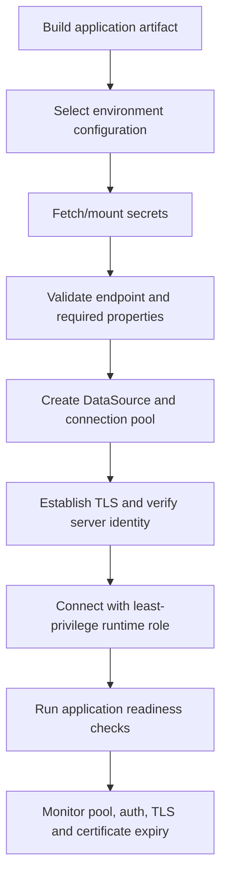

# Quản lý thông tin đăng nhập, TLS và cấu hình theo môi trường

Spring Data JDBC truy cập database thông qua `DataSource` và JDBC driver. Trong môi trường production, cấu hình kết nối không chỉ gồm JDBC URL, username và password. Ứng dụng còn phải quản lý nguồn cấp secret, xác thực database, TLS certificate, truststore, quyền truy cập, connection pool và khác biệt giữa development, test, staging và production.

Một cấu hình sai có thể làm lộ credential, cho phép kết nối tới database giả mạo, dùng nhầm database của môi trường khác hoặc khiến pool tiếp tục dùng credential cũ sau khi rotation. Bài học này trình bày cách externalize secrets, cấu hình datasource theo môi trường, xác minh TLS, quản lý quyền database, xoay credential/certificate và kiểm thử cấu hình an toàn.

## 1. Các thành phần của cấu hình kết nối database

Một ứng dụng Spring Data JDBC thường cần các nhóm cấu hình:

| Nhóm | Ví dụ | Mục đích |
| --- | --- | --- |
| Endpoint | Host, port, database name, JDBC URL | Xác định database đích. |
| Authentication | Username, password, token hoặc client certificate | Xác thực ứng dụng. |
| TLS | SSL mode, CA certificate, truststore, hostname verification | Mã hóa và xác minh server. |
| Pool | Maximum pool size, timeout, max lifetime | Quản lý JDBC connections. |
| Environment | Profile, region, schema, feature flag | Chọn cấu hình phù hợp môi trường. |
| Authorization | Database roles, grants, schema permissions | Giới hạn thao tác ứng dụng được phép. |
| Rotation | Secret version, certificate renewal, pool refresh | Thay credential/certificate an toàn. |
| Observability | Connection errors, TLS handshake failures, pool metrics | Phát hiện sự cố mà không lộ secret. |

Spring Data JDBC không cần biết password được lấy từ environment variable, mounted secret hay secret manager. Nó nhận một `DataSource` đã được cấu hình. Vì vậy, hãy tách nguồn cung cấp credential khỏi domain/repository code.

## 2. Không lưu credential trong source code hoặc repository

Không hardcode thông tin đăng nhập trong Java:

```java
// Không an toàn.
String url = "jdbc:postgresql://prod-db:5432/orders";
String username = "orders_app";
String password = "my-real-password";
```

Không commit password trong:

- `application.yml` hoặc `application.properties`.
- Dockerfile, image layer hoặc build argument.
- Gradle/Maven build script.
- Test fixture hoặc integration test resource.
- Shell script, CI pipeline definition hoặc sample config được copy nguyên vào production.
- Log, exception message, screenshot hoặc issue tracker.

Nếu secret từng được commit, xóa khỏi file hiện tại là chưa đủ: secret có thể vẫn tồn tại trong Git history, fork, CI log hoặc artifact. Hãy revoke/rotate secret trước, rồi xử lý history theo quy trình bảo mật của tổ chức.

### Externalize bằng environment variables

Spring Boot hỗ trợ bind environment variable vào datasource properties:

```yaml
spring:
  datasource:
    url: \${DB_JDBC_URL}
    username: \${DB_USERNAME}
    password: \${DB_PASSWORD}
    driver-class-name: org.postgresql.Driver
    hikari:
      maximum-pool-size: 15
      connection-timeout: 3000
      validation-timeout: 1000
      max-lifetime: 1500000
```

Các giá trị `DB_JDBC_URL`, `DB_USERNAME` và `DB_PASSWORD` được cung cấp bởi runtime/secret injection. File cấu hình chỉ chứa tên biến, không chứa giá trị bí mật.

Không truyền password bằng command-line argument nếu có thể tránh, vì command line có thể xuất hiện trong process listing, diagnostic dump hoặc log của hệ thống triển khai.

### Local development

Developer có thể dùng secret local qua environment variable, file `.env` được gitignore hoặc secret store của máy. File template chỉ nên chứa tên biến và ví dụ giả:

```text
DB_JDBC_URL=jdbc:postgresql://localhost:5432/orders
DB_USERNAME=orders_local
DB_PASSWORD=<provide-local-secret>
```

Không dùng chung production credential cho local development. Dùng database/container riêng và account có quyền giới hạn.

## 3. Quản lý secret theo môi trường

Mỗi môi trường nên có credential riêng:

- Development: account local hoặc database container.
- Test/CI: credential sinh cho test database, có quyền trên schema test.
- Staging: secret riêng, quyền và TLS gần production.
- Production: secret được cấp từ secret manager hoặc nền tảng triển khai có kiểm soát access.

Không dùng profile để lưu password. Profile chỉ chọn nhóm cấu hình; secret vẫn phải được lấy từ nguồn an toàn.

Ví dụ tách profile:

```yaml
# application.yml
spring:
  datasource:
    hikari:
      maximum-pool-size: 10
      connection-timeout: 3000
```

```yaml
# application-dev.yml
spring:
  datasource:
    url: \${DEV_DB_JDBC_URL}
    username: \${DEV_DB_USERNAME}
    password: \${DEV_DB_PASSWORD}
```

```yaml
# application-prod.yml
spring:
  datasource:
    url: \${PROD_DB_JDBC_URL}
    username: \${PROD_DB_USERNAME}
    password: \${PROD_DB_PASSWORD}
    hikari:
      maximum-pool-size: 30
      max-lifetime: 1500000
```

Profile `prod` chọn endpoint và pool settings phù hợp. Giá trị password vẫn đến từ môi trường triển khai. Tránh có default credential production trong cấu hình; nếu thiếu biến bắt buộc, ứng dụng nên fail fast thay vì âm thầm kết nối vào database mặc định.

### Nguồn cấp secret

Tùy nền tảng, secret có thể đến từ:

- Kubernetes Secret được mount thành file hoặc expose qua cơ chế secret integration đã được kiểm soát.
- HashiCorp Vault.
- AWS Secrets Manager hoặc Systems Manager Parameter Store.
- Azure Key Vault.
- Google Secret Manager.
- Secret store của CI/CD hoặc nền tảng cloud.

Chọn một nguồn được tổ chức quản lý, giới hạn quyền đọc theo workload identity/service account và ghi audit cho thao tác truy cập secret. Không in giá trị secret ra log khi debug.
## 4. Nạp secret từ file mount hoặc secret manager

Một số nền tảng cung cấp secret dưới dạng file mount. Spring Boot hỗ trợ config tree để bind tên file thành property:

```text
/run/secrets/
  spring.datasource.username
  spring.datasource.password
```

Cấu hình import:

```yaml
spring:
  config:
    import: "configtree:/run/secrets/"
```

Nội dung file `spring.datasource.password` là password thực tế do nền tảng mount. Không đưa file secret vào source control hoặc Docker image. Nếu secret là bắt buộc, không dùng `optional:` để ứng dụng khởi động với credential rỗng khi mount bị thiếu; fail fast giúp phát hiện cấu hình sai ngay khi deploy.

Với secret manager, cách tích hợp phụ thuộc nền tảng và thư viện được tổ chức lựa chọn. Có thể dùng Spring Cloud Vault, AWS/Azure/GCP integration hoặc agent sidecar để ghi secret vào filesystem. Dù chọn cách nào, nguyên tắc vẫn là:

- Workload identity có quyền đọc đúng secret cần thiết.
- Secret có version và rotation policy.
- Truy cập secret có audit trail.
- Secret không được log hoặc đưa vào metric label.
- Ứng dụng phát hiện được secret thiếu/hết hạn.
- Có quy trình refresh/restart pool khi secret đổi.

Không tự viết HTTP client gọi secret manager trong từng repository method. Nạp cấu hình một lần ở boundary khởi động hoặc qua một credential provider được thiết kế riêng.

## 5. Bind và xác thực cấu hình lúc khởi động

Với cấu hình do ứng dụng tự quản lý, dùng `@ConfigurationProperties` để bind và validate thay vì đọc `System.getenv()` rải rác:

```java
@ConfigurationProperties(prefix = "app.database")
@Validated
public record DatabaseSettings(
    @NotBlank String url,
    @NotBlank String username,
    @NotBlank String password,
    @NotBlank String expectedHost
) {
}
```

Đăng ký properties:

```java
@Configuration
@EnableConfigurationProperties(DatabaseSettings.class)
public class DatabaseConfiguration {
}
```

Ví dụ này minh họa cấu hình tùy chỉnh; nếu dùng Spring Boot auto-configured `spring.datasource.*`, hãy dùng `DataSourceProperties` hoặc cấu hình datasource theo cơ chế Boot thay vì tạo một bộ property song song không cần thiết.

Validation giúp ứng dụng fail fast khi thiếu URL, username, password hoặc hostname. Không đưa giá trị password vào validation error. Với endpoint, có thể kiểm tra scheme/host/port allowlist để tránh profile production vô tình kết nối đến localhost hoặc database không được phép.

### Không để profile sai chọn nhầm database

Trong production:

- Thiết lập `SPRING_PROFILES_ACTIVE` rõ ràng từ deployment manifest.
- Không dựa vào default profile development.
- Kiểm tra host/database name thuộc môi trường dự kiến.
- Không cho phép fallback sang local/test datasource khi biến production bị thiếu.
- Ghi log tên profile và database host đã làm sạch, không ghi credential hoặc URL chứa password.

Có thể log một cấu hình đã sanitize như `jdbc:postgresql://db-prod.internal:5432/orders`, nhưng không log nguyên URL nếu query parameters chứa secret hoặc token.

## 6. TLS bảo vệ kết nối JDBC

TLS bảo vệ dữ liệu trên đường truyền và giúp ứng dụng xác minh server database. Cấu hình an toàn cần hai phần:

1. **Encryption:** traffic được mã hóa khi truyền giữa application và database.
2. **Server identity verification:** certificate chain được tin cậy và hostname trong certificate khớp endpoint mà ứng dụng kết nối.

Chỉ bật encryption mà bỏ qua xác minh certificate có thể khiến ứng dụng mã hóa kết nối tới một server giả mạo. Vì vậy, dùng chế độ xác minh CA và hostname tương ứng với JDBC driver.

Một certificate server thường cần:

- Chưa hết hạn và chưa bị revoke.
- Có chuỗi certificate dẫn tới CA mà ứng dụng tin cậy.
- Subject Alternative Name (SAN) khớp hostname JDBC URL.
- Key usage/extended key usage phù hợp với server authentication.
- Thuật toán và TLS version được driver/JVM hỗ trợ.

Truststore chứa CA certificate hoặc trust anchor mà client dùng để xác minh server. Không cần đặt private key của database server trong application truststore. Nếu dùng mutual TLS, client certificate/private key là một credential riêng và phải được bảo vệ như secret.

## 7. Cấu hình TLS theo JDBC driver

Tên property và semantics phụ thuộc database/driver version. Hãy đối chiếu tài liệu đúng phiên bản driver và kiểm thử bằng certificate thật trong môi trường staging.

### PostgreSQL JDBC

Ví dụ JDBC URL yêu cầu xác minh CA và hostname:

```yaml
spring:
  datasource:
    url: "jdbc:postgresql://db-prod.example.internal:5432/orders?sslmode=verify-full&sslrootcert=/run/secrets/postgres-ca.crt"
```

`sslmode=verify-full` yêu cầu TLS, xác minh certificate chain và kiểm tra hostname theo quy tắc của driver. Certificate cần có SAN phù hợp với `db-prod.example.internal`. Chỉ dùng CA bundle được tổ chức tin cậy; không tắt verification để chữa lỗi hostname hoặc CA mismatch.

### MySQL Connector/J

Ví dụ dùng `sslMode=VERIFY_IDENTITY` và truststore:

```yaml
spring:
  datasource:
    url: "jdbc:mysql://mysql-prod.example.internal:3306/orders?sslMode=VERIFY_IDENTITY&trustCertificateKeyStoreUrl=file:/run/secrets/mysql-truststore.p12&trustCertificateKeyStoreType=PKCS12"
    hikari:
      data-source-properties:
        trustCertificateKeyStorePassword: \${MYSQL_TRUSTSTORE_PASSWORD}
```

`VERIFY_IDENTITY` yêu cầu xác minh CA và server identity/hostname. Tên property và cách truyền truststore password cần được kiểm tra theo Connector/J version đang dùng. Không đặt truststore password trực tiếp trong JDBC URL hoặc log.

### Microsoft SQL Server JDBC

Ví dụ:

```yaml
spring:
  datasource:
    url: "jdbc:sqlserver://sql-prod.example.internal:1433;databaseName=orders;encrypt=true;trustServerCertificate=false;hostNameInCertificate=sql-prod.example.internal"
```

`encrypt=true` bật mã hóa; `trustServerCertificate=false` yêu cầu driver xác minh certificate thay vì bỏ qua kiểm tra. Hostname trong certificate phải khớp endpoint/`hostNameInCertificate`. Cấu hình truststore, nếu cần, theo property và format được Microsoft JDBC driver version đó hỗ trợ.

### Những cấu hình cần tránh

- PostgreSQL `sslmode=disable` trong production.
- PostgreSQL `sslmode=require` khi policy yêu cầu xác minh CA/hostname đầy đủ; chế độ này chỉ đảm bảo TLS theo semantics driver, không thay thế verify-full.
- MySQL `sslMode=REQUIRED` nếu cần xác minh danh tính server; ưu tiên `VERIFY_IDENTITY`.
- SQL Server `trustServerCertificate=true` trong production.
- Trust-all TrustManager hoặc custom hostname verifier luôn trả true.
- Tắt kiểm tra certificate để vượt qua lỗi CA hết hạn hoặc SAN không khớp.

Không copy URL TLS giữa các database driver. Cú pháp, property casing và semantics có thể khác nhau.
## 8. Quyền database tối thiểu cho runtime application

Credential hợp lệ không có nghĩa ứng dụng nên có quyền quản trị database. Tạo role riêng cho từng mục đích:

| Role | Quyền điển hình |
| --- | --- |
| Application runtime | SELECT/INSERT/UPDATE/DELETE trên bảng cần thiết; EXECUTE function nếu use case yêu cầu. |
| Migration | DDL và quyền thay đổi schema trong giai đoạn migration. |
| Read-only/report | SELECT trên schema/view được phép đọc. |
| Operations/admin | Quyền quản trị được cấp riêng cho người hoặc automation vận hành. |

Không dùng tài khoản database owner hoặc superuser làm credential của Spring Boot application. Nếu runtime bị compromise, quyền tối thiểu giúp giới hạn phạm vi tác động.

Ví dụ PostgreSQL khái niệm:

```sql
CREATE ROLE orders_app LOGIN PASSWORD '<provided-by-secret-manager>';
GRANT CONNECT ON DATABASE orders TO orders_app;
GRANT USAGE ON SCHEMA public TO orders_app;
GRANT SELECT, INSERT, UPDATE, DELETE
    ON TABLE purchase_order, order_line TO orders_app;
```

Ví dụ cần được điều chỉnh theo schema, sequence/identity và quyền thực tế. Nếu database dùng sequence độc lập, runtime role có thể cần quyền phù hợp trên sequence. Không cấp `CREATE`/`ALTER`/`DROP` chỉ vì migration chạy từ cùng ứng dụng; dùng credential migration riêng khi triển khai.

Nếu ứng dụng route read/write, dùng credential read-only cho replica khi database hỗ trợ. Khi route nhầm write vào replica, database permission sẽ tạo thêm lớp bảo vệ thay vì chỉ dựa vào code.

## 9. Quản lý connection pool cùng credential

Spring Boot thường cấu hình HikariCP làm connection pool. Hikari giữ physical connection để tái sử dụng; mỗi connection được xác thực khi tạo. Vì vậy thay password trong secret store không tự động thay credential trên các connection đã mở.

Các thuộc tính quan trọng:

| Thuộc tính | Ý nghĩa |
| --- | --- |
| `maximum-pool-size` | Giới hạn tổng connection trong pool. |
| `minimum-idle` | Số connection nhàn rỗi tối thiểu nếu cấu hình. |
| `connection-timeout` | Thời gian chờ lấy connection từ pool. |
| `validation-timeout` | Thời gian kiểm tra connection. |
| `max-lifetime` | Tuổi thọ tối đa của physical connection. |
| `idle-timeout` | Thời gian connection nhàn rỗi có thể tồn tại khi pool vượt minimum idle. |
| `keepalive-time` | Kiểm tra/giữ connection nhàn rỗi theo cấu hình phù hợp. |

Không đặt pool size quá lớn chỉ để tránh chờ connection. Tổng số connection từ mọi application instance, job và tool phải nằm trong giới hạn database. Cấu hình `max-lifetime` cũng nên tương thích với giới hạn connection của proxy/load balancer/database.

Ví dụ:

```yaml
spring:
  datasource:
    hikari:
      maximum-pool-size: 20
      minimum-idle: 5
      connection-timeout: 3000
      validation-timeout: 1000
      max-lifetime: 1500000
      idle-timeout: 600000
```

Các con số chỉ là ví dụ, không phải cấu hình chung cho mọi hệ thống. Đo connection acquisition time, active/idle/pending và database capacity trước khi chọn pool size.

## 10. Xoay password hoặc token mà không làm gián đoạn ứng dụng

Credential rotation nên có giai đoạn overlap để ứng dụng chuyển sang credential mới trước khi credential cũ bị revoke.

Một quy trình điển hình:

1. Tạo credential mới hoặc version secret mới.
2. Cấp quyền tương đương nhưng tối thiểu cho credential mới.
3. Cập nhật secret manager/config source.
4. Triển khai hoặc refresh ứng dụng để pool tạo connection bằng credential mới.
5. Xác nhận connection mới hoạt động và không còn connection dùng credential cũ.
6. Chờ pool cũ được drain/đóng theo kế hoạch.
7. Revoke credential cũ.
8. Theo dõi authentication failure và connection pool metrics.

Hikari không tự thay username/password của các physical connection đã mở chỉ vì secret file đổi. Các connection cũ đã được xác thực khi tạo; chúng có thể tiếp tục hoạt động đến khi đóng, tùy chính sách database. Connection mới phải dùng credential mới. Để rotation có hiệu lực, ứng dụng cần refresh/recreate pool hoặc rolling restart theo cách triển khai đã kiểm thử.

`max-lifetime` giúp connection được thay thế định kỳ, nhưng không nên giả định nó tự reload secret value. Nếu credential được cập nhật trong runtime, cần một cơ chế rõ để tạo datasource/pool mới và drain pool cũ an toàn.

### Short-lived database token

Một số cloud database hỗ trợ token ngắn hạn thay password tĩnh. Khi dùng loại token này, token có thể cần được tạo mới cho mỗi physical connection. Không nên lấy token một lần lúc app startup rồi để pool cố tạo connection mới sau khi token hết hạn.

Cần một credential provider/connection factory phù hợp với driver và pool, có clock skew allowance, retry giới hạn và metrics. Kiểm thử cả lúc pool mở connection mới sau thời điểm token cũ hết hạn.

## 11. Xoay TLS certificate và CA trust

TLS certificate cũng cần rotation. Một quy trình an toàn thường dùng overlap:

1. Phân phối trust bundle có cả CA cũ và CA mới tới ứng dụng.
2. Xác nhận ứng dụng tin cậy cả hai chain.
3. Cập nhật certificate server database sang certificate mới có SAN đúng.
4. Tạo physical connections mới và xác nhận handshake thành công.
5. Drain/recycle connections cũ theo chính sách.
6. Gỡ CA cũ khỏi trust bundle sau khi không còn endpoint dùng chain cũ.

Connection JDBC đã thiết lập thường không thực hiện lại TLS handshake cho từng query. Vì vậy certificate mới sẽ được kiểm tra khi tạo connection mới; connection pool có thể tiếp tục giữ session cũ trong một khoảng thời gian. Hãy tính đến `max-lifetime`, rolling restart hoặc pool refresh.

Nếu certificate hết hạn hoặc hostname không khớp, không tắt hostname verification để khôi phục nhanh. Hãy sửa SAN, CA chain, truststore hoặc JDBC endpoint. Với nhiều endpoint primary/replica, xác nhận certificate của từng endpoint đều được tin cậy và khớp hostname.
## 12. Cấu hình an toàn trong container và Kubernetes

Không bake secret vào container image. Image nên chứa application artifact và cấu hình không nhạy cảm; secret được inject lúc runtime qua cơ chế của nền tảng.

Với Kubernetes:

- Dùng workload identity/service account để truy cập secret manager khi có thể.
- Nếu dùng Kubernetes Secret, hạn chế quyền đọc bằng RBAC và namespace isolation.
- Mount secret read-only; giới hạn file permission và tránh expose qua volume dùng chung không cần thiết.
- Không đưa secret vào ConfigMap.
- Không in manifest chứa secret đã decode vào CI log.
- Theo dõi thay đổi secret và có rollout/refresh policy rõ.
- Giữ secret của từng environment và tenant tách biệt.

Nếu dùng config tree, mount file theo property name rồi import directory. Nếu dùng CSI driver/agent, xác nhận secret file được cập nhật như thế nào và ứng dụng có tự reload không. File đổi không đồng nghĩa bean `DataSource` hoặc Hikari pool tự được tạo lại.

### Tách config không nhạy cảm khỏi secret

Cấu hình không nhạy cảm có thể nằm trong deployment config:

- JDBC host/database name.
- Pool size và timeout.
- TLS mode và đường dẫn CA certificate.
- Schema/migration version.
- Feature flag vận hành.

Credential và private key nằm trong secret store. Dù một URL có thể không chứa password, nó vẫn có thể tiết lộ hostname nội bộ hoặc database topology; chỉ log ở mức đã được policy cho phép.

## 13. Tránh lộ secret qua log, Actuator và diagnostics

Các nguồn rò rỉ thường gặp:

- Log toàn bộ `DataSourceProperties` hoặc Hikari config.
- Log JDBC URL chứa password/token query parameter.
- Exception message do driver trả về có chứa connection details.
- Spring Boot Actuator `env` hoặc `configprops` mở công khai.
- Heap dump, thread dump hoặc support bundle có object chứa credential.
- CI debug log in environment variables.
- Metric label chứa URL, username hoặc tenant secret.

Nguyên tắc:

- Không log password, token, private key, truststore password hoặc raw secret.
- Chỉ log operation, host đã làm sạch, database name, driver name/version và SQLState khi cần chẩn đoán.
- Bảo vệ Actuator endpoints bằng authentication/network policy; chỉ expose endpoint cần thiết.
- Kiểm tra masking behavior của Spring Boot version đang dùng, không giả định mọi custom property đều tự được che.
- Giới hạn quyền tải heap dump/diagnostic artifact và thời gian lưu.
- Redact URL query parameter có thể chứa token hoặc password.

Không trả secret hoặc thông tin nội bộ chi tiết trong health endpoint. Health check nên báo trạng thái chung như datasource reachable/unavailable và correlation ID phù hợp.

## 14. Kiểm thử cấu hình và TLS

Kiểm thử cấu hình nên có cả kiểm tra khởi động và kết nối thực tế.

### Configuration binding test

- Thiếu `DB_JDBC_URL` hoặc username/password bắt buộc phải làm app fail fast.
- Profile production không được fallback sang URL local/test.
- Property được bind đúng từ environment/config tree.
- Password không xuất hiện trong validation error hoặc startup log.
- Cấu hình pool nằm trong giới hạn dự kiến.
- Database host/schema thuộc environment đang chạy.

Có thể dùng `ApplicationContextRunner` hoặc Spring Boot configuration test để xác nhận binding mà không cần kết nối database thật.

### TLS integration test

Trên môi trường test/staging, kiểm tra:

1. Certificate chain hợp lệ và hostname đúng: kết nối thành công.
2. CA không được tin cậy: handshake thất bại.
3. Hostname không khớp SAN: verification thất bại.
4. Certificate hết hạn hoặc bị thay: ứng dụng không âm thầm bỏ qua verification.
5. Certificate rotation với trust bundle overlap: connection mới dùng chain mới thành công.
6. Replica endpoint cũng được xác minh TLS nếu ứng dụng route read/write.

Testcontainers database mặc định thường không bật TLS theo cấu hình production. Có thể dùng container/config riêng với TLS hoặc chạy contract test trên staging có certificate thật. Không dùng `trustServerCertificate=true` hay chế độ trust-all chỉ để làm test xanh.

### Kiểm thử credential rotation

- Tạo credential mới và xác nhận app mở connection mới bằng credential đó.
- Đổi secret rồi recycle/refresh pool theo quy trình triển khai.
- Revoke credential cũ và xác nhận app tiếp tục hoạt động.
- Xác nhận pool không tạo lại connection bằng credential cũ sau rotation.
- Mô phỏng secret manager unavailable và xác định startup/refresh behavior.
- Kiểm tra token ngắn hạn hết hạn trong khi pool cần mở physical connection mới.

Không cần dùng production secret để kiểm thử rotation. Dùng database test và credential tạm thời có quyền giới hạn.

## 15. Cấu hình theo môi trường và kiểm soát drift

Cùng một application artifact nên có thể triển khai qua nhiều môi trường bằng external configuration. Khác biệt giữa môi trường được biểu diễn bằng config/secret, không phải bằng code branch riêng.

| Thuộc tính | Development | Test/CI | Staging | Production |
| --- | --- | --- | --- | --- |
| Database | Local/container | Ephemeral database | Production-like | Managed/production |
| Credential | Local riêng | Random ephemeral | Secret riêng | Secret manager |
| TLS | Có thể local cert | Cert test nếu cần | Bắt buộc tương đương production | Bắt buộc verify identity |
| Database role | Dev-limited | Test-only | Runtime role | Least privilege runtime |
| Pool | Nhỏ | Nhỏ, giới hạn | Gần production | Theo capacity/load |
| Migration role | Dev/migration | Test migration | Controlled deploy | Separate migration identity |
| Secret rotation | Manual/dev | Per run | Diễn tập | Theo policy/automation |

### Tránh config drift

- Version control các file cấu hình không chứa secret.
- Quản lý secret bằng cùng cơ chế triển khai và policy.
- Kiểm tra cấu hình thực tế sau deploy bằng metadata đã sanitize.
- Đặt alert khi certificate gần hết hạn.
- Theo dõi driver/database version và TLS mode đang dùng.
- Không cho staging dùng CA/credential production trừ khi policy yêu cầu và có phê duyệt riêng.
- Giữ cùng JDBC driver major/minor tương thích giữa staging và production.

Nếu một môi trường cần giá trị khác biệt, ghi rõ lý do và owner. Đừng tạo một override bí mật hoặc không được quản lý chỉ để chữa sự cố tạm thời.

## 16. Read/write datasource và credential riêng

Nếu ứng dụng có primary và read replica, có thể dùng credential riêng:

- Primary runtime account có quyền đọc/ghi trên các bảng nghiệp vụ.
- Replica account chỉ có quyền SELECT.
- Migration account được dùng trong deployment job riêng.
- Mỗi datasource endpoint đều có TLS verification và secret riêng nếu hệ thống yêu cầu.

Không giả định chỉ primary cần TLS. Replica cũng chứa dữ liệu và có thể được truy cập từ network khác; mọi kết nối database đều phải tuân theo policy mã hóa/xác minh tương ứng.

Khi có tenant database riêng, secret và certificate có thể khác theo tenant. Registry datasource phải lấy secret từ nguồn tin cậy, giới hạn số pool và không log key/credential. Không cho tenant ID từ request tự tạo JDBC URL hoặc chọn secret tùy ý.
## 17. Các lỗi thường gặp khi vận hành datasource

| Lỗi | Hậu quả | Cách xử lý |
| --- | --- | --- |
| Hardcode password trong source/config | Secret có thể bị lộ qua Git, artifact hoặc log. | Externalize qua secret manager/environment injection. |
| Dùng cùng credential cho dev, staging và production | Một môi trường bị compromise có thể ảnh hưởng môi trường khác. | Credential riêng cho từng environment/workload. |
| Dùng database owner cho application runtime | Ứng dụng có quyền DDL/quản trị vượt nhu cầu. | Tạo least-privilege runtime role và migration role riêng. |
| Chỉ bật encryption, bỏ qua hostname verification | Có thể kết nối tới server giả mạo. | Bật verify CA và hostname theo driver. |
| Dùng trust-all hoặc bỏ qua certificate error | Mất khả năng xác minh server identity. | Sửa CA chain, SAN, truststore hoặc endpoint. |
| Đặt password trong JDBC URL | URL có thể xuất hiện trong log/diagnostics. | Dùng datasource username/password properties riêng. |
| Cho rằng secret file đổi sẽ cập nhật pool | Connection mới có thể vẫn dùng credential cũ. | Refresh/recreate pool hoặc rolling restart có kiểm soát. |
| Revoke credential cũ quá sớm | Instance chưa chuyển xong không tạo được connection mới. | Rotation có overlap, kiểm tra pool rồi mới revoke. |
| Chỉ xoay server certificate, không cập nhật trust bundle | Connection mới thất bại TLS handshake. | Cập nhật trust trước, overlap CA, rồi đổi server cert. |
| Đặt max pool quá lớn | Database cạn connection khi nhiều instance cùng chạy. | Tính tổng connection budget và đo pool metrics. |
| Expose Actuator env/configprops công khai | Có thể lộ topology hoặc cấu hình nhạy cảm. | Restrict endpoint, kiểm tra masking và sanitize. |
| Dùng profile production nhưng fallback URL local | App có thể khởi động vào sai database. | Bắt buộc property và validate endpoint theo environment. |
| Dùng một migration credential cho runtime | Runtime compromise có thể thay schema. | Tách migration job/identity. |
| Chỉ test TLS trên localhost | Không phát hiện SAN/CA/hostname mismatch production. | Test trên staging có chain/hostname thật. |
| Không theo dõi certificate expiry | Kết nối có thể đồng loạt thất bại khi cert hết hạn. | Alert trước hạn và diễn tập rotation. |

## 18. Không log cấu hình có chứa secret

Một record `@ConfigurationProperties` có thể tự sinh `toString()` chứa mọi field, kể cả password. Không log toàn bộ object cấu hình nếu nó có secret.

Ví dụ tránh:

```java
log.info("Database settings: {}", databaseSettings);
```

Thay bằng metadata đã sanitize:

```java
log.info(
    "Database configured: host={}, database={}, driver={}",
    safeHost,
    safeDatabaseName,
    driverVersion
);
```

Không ghi:

- Password, token, private key hoặc truststore password.
- Full JDBC URL nếu URL có thể chứa secret/query token.
- Secret manager response.
- Toàn bộ environment variables.
- Object cấu hình có field nhạy cảm trong `toString()`.

Nếu cần debug cấu hình, log tên property có mặt/thiếu hoặc version ID của secret, không log giá trị. Version ID cũng cần được đánh giá để tránh tiết lộ metadata nội bộ không cần thiết.

## 19. Checklist trước khi phát hành

Trước khi triển khai ứng dụng Spring Data JDBC tới một môi trường mới hoặc thay đổi credential/TLS, xác nhận:

1. JDBC URL, username và password đến từ nguồn cấu hình/secret đã được quản lý.
2. Không có secret trong Git, Docker image, build log hoặc sample configuration.
3. Profile/environment được chọn rõ ràng; thiếu property bắt buộc làm app fail fast.
4. Database runtime account có quyền tối thiểu; migration account tách riêng.
5. TLS bật encryption và verify CA/hostname theo driver.
6. CA bundle, SAN, certificate expiry và truststore đã được xác nhận.
7. Primary và replica đều có TLS/credential phù hợp.
8. Connection pool size nằm trong tổng connection budget của database.
9. Secret rotation có overlap và quy trình refresh/drain pool.
10. Certificate rotation cập nhật trust bundle trước khi server cert cũ hết hạn.
11. Actuator, logs, metrics và diagnostics không lộ secret.
12. CI dùng credential test riêng và không dùng production secret.
13. Staging đã kiểm thử TLS handshake với certificate/hostname thật.
14. Health check xác nhận database reachable mà không trả thông tin nhạy cảm.
15. Có alert cho authentication failure, TLS handshake failure, pool exhaustion và certificate expiry.

Sơ đồ triển khai:



## 20. Câu hỏi tự kiểm tra

- Vì sao không nên hardcode database password trong `application.yml`?
- Spring Boot có thể nhận datasource credential từ environment variable hoặc config tree như thế nào?
- Vì sao mỗi môi trường nên có credential riêng?
- Secret manager nên cấp quyền truy cập cho workload bằng cơ chế nào?
- TLS encryption khác server identity verification ra sao?
- Vì sao PostgreSQL `sslmode=verify-full` an toàn hơn chế độ chỉ yêu cầu TLS khi cần xác minh hostname?
- MySQL `VERIFY_IDENTITY` và SQL Server `trustServerCertificate=false` bảo vệ điều gì?
- Vì sao không nên tắt certificate verification để xử lý lỗi handshake?
- Runtime database role cần những quyền nào và vì sao migration role nên tách riêng?
- Hikari pool xử lý credential rotation như thế nào đối với physical connection đã mở?
- Vì sao certificate rotation cần overlap CA trust và recycle connection?
- Những cấu hình Actuator/log nào có thể làm lộ secret?
- Làm thế nào kiểm thử thiếu secret, untrusted CA và hostname mismatch?
- Những metrics/alerts nào giúp phát hiện lỗi credential, TLS hoặc pool?

Quản lý credential, TLS và cấu hình theo môi trường là một phần của vận hành Spring Data JDBC. Hãy externalize secret, cấp quyền database tối thiểu, xác minh cả certificate chain lẫn hostname, tách cấu hình theo environment và thiết kế rotation có overlap với connection pool. Kiểm thử bằng credential/certificate riêng của từng môi trường, giữ secret ngoài logs/diagnostics và theo dõi authentication, TLS, pool cùng certificate expiry để kết nối database an toàn trong suốt vòng đời ứng dụng.
