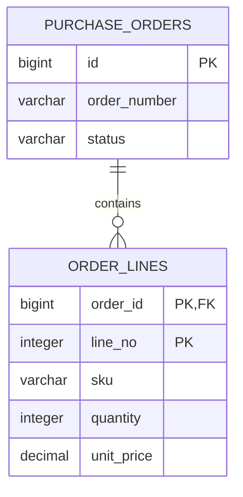

# Thực nghiệm lưu entity con và quan sát SQL thực tế

Spring Data JDBC lưu dữ liệu theo **aggregate**. Khi lưu một aggregate root, framework dùng mapping metadata để ghi root row và các entity con thuộc aggregate vào những bảng liên quan. Để hiểu chính xác điều gì xảy ra, cách tốt nhất là chạy một bài thực hành trên database thật, bật SQL logging và kiểm tra trực tiếp các bảng bằng JDBC.

Bài thực hành này xây dựng một đơn hàng gồm root `PurchaseOrder` và danh sách `OrderLine`. Ta sẽ lưu đơn hàng mới, đọc lại aggregate, thay đổi danh sách dòng hàng, xóa một dòng, rồi xóa toàn bộ đơn hàng. Ở mỗi bước, SQL log cho biết Spring Data JDBC gửi câu lệnh nào; truy vấn trực tiếp bằng `JdbcTemplate` xác nhận trạng thái cuối trong database.

Bài học tập trung vào entity con trong aggregate và SQL thực tế. Các ví dụ dùng PostgreSQL qua Testcontainers để kết quả gần với môi trường triển khai.

## 1. Mục tiêu thực hành

Sau bài này, bạn có thể:

- Phân biệt aggregate root với entity con được lưu cùng aggregate.
- Ánh xạ collection con bằng `@MappedCollection`.
- Thiết kế bảng con với foreign key và key của collection.
- Lưu aggregate mới và quan sát thứ tự insert.
- Thay đổi collection rồi quan sát cách Spring Data JDBC cập nhật child rows.
- Xóa một child hoặc toàn aggregate và xác nhận SQL được thực thi.
- Dùng SQL log và `JdbcTemplate` để quan sát dữ liệu thực tế.
- Hiểu vai trò của transaction khi root và child được ghi bằng nhiều statement.

## 2. Mô hình domain dùng trong bài lab

Ta mô hình hóa đơn hàng như sau:

- `PurchaseOrder` là aggregate root, có primary key và mã đơn hàng.
- `OrderLine` là entity con, chỉ tồn tại trong phạm vi một đơn hàng.
- Một đơn hàng có nhiều dòng hàng.
- Thứ tự các dòng hàng được giữ bằng vị trí trong `List`.

Sơ đồ quan hệ:



Trong ví dụ này, `OrderLine` không có ID độc lập. Khóa của row con gồm `order_id` và `line_no`. Đây là cách phù hợp khi child là một phần của aggregate và không có lifecycle độc lập.

## 3. Tạo schema cho PostgreSQL

Tạo migration Flyway tại:

```text
src/main/resources/db/migration/V1__create_order_tables.sql
```

Nội dung:

```sql
CREATE TABLE purchase_orders (
    id BIGINT GENERATED BY DEFAULT AS IDENTITY PRIMARY KEY,
    order_number VARCHAR(40) NOT NULL UNIQUE,
    status VARCHAR(20) NOT NULL
);

CREATE TABLE order_lines (
    order_id BIGINT NOT NULL,
    line_no INTEGER NOT NULL,
    sku VARCHAR(40) NOT NULL,
    quantity INTEGER NOT NULL CHECK (quantity > 0),
    unit_price NUMERIC(12, 2) NOT NULL CHECK (unit_price >= 0),
    PRIMARY KEY (order_id, line_no),
    CONSTRAINT fk_order_lines_order
        FOREIGN KEY (order_id)
        REFERENCES purchase_orders(id)
);
```

Các chi tiết quan trọng:

- `purchase_orders.id` là identity do database sinh.
- `order_lines.order_id` là foreign key trỏ tới aggregate root.
- `line_no` là vị trí của child trong danh sách.
- Primary key kép ngăn một đơn hàng có hai child cùng vị trí.
- Không khai báo `ON DELETE CASCADE` trong lab này để quan sát Spring Data JDBC xóa child rows theo aggregate lifecycle.

Nếu schema production có cascade rule, test cần dùng đúng migration production để quan sát behavior thật.

## 4. Khai báo entity bất biến

### 4.1. Entity con OrderLine

```java
import java.math.BigDecimal;

public record OrderLine(
        String sku,
        Integer quantity,
        BigDecimal unitPrice
) {
}
```

`OrderLine` không có `@Id` vì nó là child value/entity được quản lý qua aggregate root. Không tạo repository riêng cho child trong mô hình này.

### 4.2. Aggregate root PurchaseOrder

```java
import java.util.List;

import org.springframework.data.annotation.Id;
import org.springframework.data.relational.core.mapping.Column;
import org.springframework.data.relational.core.mapping.MappedCollection;
import org.springframework.data.relational.core.mapping.Table;

@Table("purchase_orders")
public record PurchaseOrder(
        @Id Long id,
        @Column("order_number") String orderNumber,
        String status,
        @MappedCollection(
                idColumn = "order_id",
                keyColumn = "line_no"
        )
        List<OrderLine> lines
) {

    public PurchaseOrder {
        lines = lines == null ? List.of() : List.copyOf(lines);
    }

    public PurchaseOrder withLines(List<OrderLine> newLines) {
        return new PurchaseOrder(
                id,
                orderNumber,
                status,
                newLines
        );
    }

    public PurchaseOrder withStatus(String newStatus) {
        return new PurchaseOrder(
                id,
                orderNumber,
                newStatus,
                lines
        );
    }
}
```

`@MappedCollection` kết nối collection với bảng child:

- `idColumn = "order_id"` là cột trong bảng con chứa ID của root.
- `keyColumn = "line_no"` là cột lưu key/index của collection.
- Vì property là `List`, Spring Data JDBC lưu vị trí phần tử để có thể tái tạo thứ tự khi đọc.

Constructor compact của record tạo defensive copy để collection không bị thay đổi từ bên ngoài. Các method `with...` tạo aggregate mới, giữ nguyên những component còn lại.

### 4.3. Repository

```java
import org.springframework.data.repository.CrudRepository;

public interface PurchaseOrderRepository
        extends CrudRepository<PurchaseOrder, Long> {
}
```

Chỉ cần repository cho aggregate root. Spring Data JDBC quản lý child rows thông qua mapping của `PurchaseOrder`.

## 5. Cấu hình dependencies và database test

Ví dụ dùng Gradle với Spring Boot dependency management:

```kotlin
dependencies {
    implementation("org.springframework.boot:spring-boot-starter-data-jdbc")
    implementation("org.flywaydb:flyway-core")

    runtimeOnly("org.postgresql:postgresql")

    testImplementation("org.springframework.boot:spring-boot-starter-test")
    testImplementation("org.testcontainers:junit-jupiter")
    testImplementation("org.testcontainers:postgresql")
}
```

Dùng BOM/dependency management phù hợp để các module Testcontainers có version tương thích.

### 5.1. PostgreSQL container cho integration test

```java
@Testcontainers
@DataJdbcTest
@AutoConfigureTestDatabase(
        replace = AutoConfigureTestDatabase.Replace.NONE
)
class PurchaseOrderRepositoryTest {

    @Container
    static final PostgreSQLContainer<?> postgres =
            new PostgreSQLContainer<>("postgres:16.4")
                    .withDatabaseName("orders_test")
                    .withUsername("test_user")
                    .withPassword("test_password");

    @DynamicPropertySource
    static void configureDatabase(DynamicPropertyRegistry registry) {
        registry.add("spring.datasource.url", postgres::getJdbcUrl);
        registry.add("spring.datasource.username", postgres::getUsername);
        registry.add("spring.datasource.password", postgres::getPassword);
        registry.add(
                "spring.datasource.driver-class-name",
                postgres::getDriverClassName
        );
    }

    @Autowired
    PurchaseOrderRepository orders;

    @Autowired
    JdbcTemplate jdbc;
}
```

Các annotation có vai trò:

- `@Testcontainers` bật JUnit 5 extension.
- `@Container` quản lý vòng đời container theo test class.
- `@DynamicPropertySource` đăng ký JDBC URL và credentials được container cấp.
- `@AutoConfigureTestDatabase(replace = NONE)` giữ DataSource của PostgreSQL thay vì thay bằng embedded database.
- `@DataJdbcTest` tạo test slice cho Spring Data JDBC.

Image tag chỉ là ví dụ. Hãy pin version tương ứng với database production. Docker-compatible runtime phải hoạt động trước khi chạy test.
## 6. Thực nghiệm 1: lưu aggregate mới

Tạo một đơn hàng có hai dòng hàng:

```java
@Test
void savesRootAndChildRows() {
    PurchaseOrder order = new PurchaseOrder(
            null,
            "PO-1001",
            "NEW",
            List.of(
                    new OrderLine("SKU-RED", 2, new BigDecimal("12.50")),
                    new OrderLine("SKU-BLUE", 1, new BigDecimal("20.00"))
            )
    );

    PurchaseOrder saved = orders.save(order);

    assertThat(saved.id()).isNotNull();

    Integer rootCount = jdbc.queryForObject(
            "SELECT COUNT(*) FROM purchase_orders WHERE id = ?",
            Integer.class,
            saved.id()
    );

    Integer lineCount = jdbc.queryForObject(
            "SELECT COUNT(*) FROM order_lines WHERE order_id = ?",
            Integer.class,
            saved.id()
    );

    assertThat(rootCount).isEqualTo(1);
    assertThat(lineCount).isEqualTo(2);
}
```

Test này kiểm tra hai kết quả:

- Database đã tạo root row và Spring Data JDBC trả generated ID.
- Hai child rows đã được ghi với cùng `order_id`.

### 6.1. SQL thường quan sát được khi insert

Với aggregate mới, SQL có hình dạng khái quát:

```sql
INSERT INTO purchase_orders (order_number, status)
VALUES (?, ?);

INSERT INTO order_lines (
    order_id, line_no, sku, quantity, unit_price
)
VALUES (?, ?, ?, ?, ?);

INSERT INTO order_lines (
    order_id, line_no, sku, quantity, unit_price
)
VALUES (?, ?, ?, ?, ?);
```

Câu lệnh thực tế phụ thuộc dialect, generated-key strategy, driver và phiên bản Spring Data JDBC. Framework cần insert root trước để có ID, sau đó dùng ID đó làm foreign key khi ghi child rows.

Không dùng exact SQL string ở trên làm assertion cứng cho mọi database. Dùng SQL log để hiểu shape và dùng query kiểm tra dữ liệu để xác nhận kết quả.

## 7. Thực nghiệm 2: đọc lại aggregate

Sau khi lưu, đọc aggregate bằng repository:

```java
@Test
void loadsRootAndChildCollection() {
    PurchaseOrder saved = orders.save(
            new PurchaseOrder(
                    null,
                    "PO-1002",
                    "NEW",
                    List.of(
                            new OrderLine("SKU-A", 1, new BigDecimal("5.00")),
                            new OrderLine("SKU-B", 3, new BigDecimal("7.25"))
                    )
            )
    );

    PurchaseOrder loaded = orders.findById(saved.id()).orElseThrow();

    assertThat(loaded.orderNumber()).isEqualTo("PO-1002");
    assertThat(loaded.lines()).hasSize(2);
    assertThat(loaded.lines())
            .extracting(OrderLine::sku)
            .containsExactly("SKU-A", "SKU-B");
}
```

`line_no` lưu vị trí phần tử trong collection. Khi đọc aggregate, Spring Data JDBC sử dụng key này để khôi phục thứ tự của list.

### 7.1. SQL thường quan sát được khi đọc

Thao tác load có thể tạo các câu SELECT riêng cho root và child table, ví dụ:

```sql
SELECT id, order_number, status
FROM purchase_orders
WHERE id = ?;

SELECT order_id, line_no, sku, quantity, unit_price
FROM order_lines
WHERE order_id = ?
ORDER BY line_no;
```

Đây là SQL minh họa cho ý tưởng mapping. Tên alias, projection và cách sắp xếp thực tế phụ thuộc mapping/dialect/version.

Không suy luận rằng mọi aggregate read luôn chỉ có một câu SELECT. Quan sát log để biết số statement thực tế và cân nhắc chi phí khi load nhiều aggregate.
## 8. Thực nghiệm 3: thay đổi child collection

Spring Data JDBC coi child rows là một phần của aggregate. Khi save aggregate hiện có, framework có thể thay thế các referenced rows theo collection hiện tại. Với child mapping trong lab này, hãy quan sát pattern xóa child rows cũ rồi insert collection mới.

Ví dụ, đơn hàng đang có hai dòng. Ta thay bằng ba dòng:

```java
@Test
void replacesChildCollectionWhenAggregateIsSaved() {
    PurchaseOrder saved = orders.save(
            new PurchaseOrder(
                    null,
                    "PO-1003",
                    "NEW",
                    List.of(
                            new OrderLine("SKU-A", 1, new BigDecimal("5.00")),
                            new OrderLine("SKU-B", 2, new BigDecimal("8.00"))
                    )
            )
    );

    PurchaseOrder loaded = orders.findById(saved.id()).orElseThrow();

    PurchaseOrder changed = loaded.withLines(
            List.of(
                    new OrderLine("SKU-A", 4, new BigDecimal("5.00")),
                    new OrderLine("SKU-C", 1, new BigDecimal("15.00")),
                    new OrderLine("SKU-D", 2, new BigDecimal("3.50"))
            )
    );

    orders.save(changed);

    Integer lineCount = jdbc.queryForObject(
            "SELECT COUNT(*) FROM order_lines WHERE order_id = ?",
            Integer.class,
            saved.id()
    );

    assertThat(lineCount).isEqualTo(3);
}
```

Với mapping child không có ID độc lập, Spring Data JDBC không thực hiện diff theo từng SKU để chỉ update row thay đổi. Hãy xem log để quan sát các thao tác child delete/insert mà phiên bản đang dùng tạo ra.

### 8.1. SQL thường quan sát được khi thay collection

Hình dạng thao tác thường thấy:

```sql
UPDATE purchase_orders
SET order_number = ?, status = ?
WHERE id = ?;

DELETE FROM order_lines
WHERE order_id = ?;

INSERT INTO order_lines (
    order_id, line_no, sku, quantity, unit_price
)
VALUES (?, ?, ?, ?, ?);

-- Lặp lại INSERT cho từng phần tử hiện tại trong collection.
```

SQL cụ thể có thể khác, nhưng điểm cần quan sát là dependent rows có thể được thay thế toàn bộ. Vì vậy, không nên giả định child row giữ nguyên physical identity chỉ vì SKU và giá trị domain giống nhau trước/sau.

## 9. Thực nghiệm 4: xóa một dòng hàng

Để xóa một child, tạo aggregate mới với danh sách không còn phần tử đó rồi save root:

```java
@Test
void removesLineWhenItIsRemovedFromAggregateCollection() {
    PurchaseOrder saved = orders.save(
            new PurchaseOrder(
                    null,
                    "PO-1004",
                    "NEW",
                    List.of(
                            new OrderLine("SKU-A", 1, new BigDecimal("5.00")),
                            new OrderLine("SKU-B", 2, new BigDecimal("8.00"))
                    )
            )
    );

    PurchaseOrder loaded = orders.findById(saved.id()).orElseThrow();

    PurchaseOrder changed = loaded.withLines(
            List.of(loaded.lines().get(0))
    );

    orders.save(changed);

    Integer remaining = jdbc.queryForObject(
            "SELECT COUNT(*) FROM order_lines WHERE order_id = ?",
            Integer.class,
            saved.id()
    );

    assertThat(remaining).isEqualTo(1);
}
```

Sau save, collection hiện tại có một phần tử nên bảng child chỉ còn row tương ứng với phần tử đó. Với chiến lược thay thế child rows, row còn lại có thể đã được insert lại cùng key/index mới.

Nếu cần cập nhật một child row độc lập mà không xóa/thêm lại cả collection, hãy đánh giá lại aggregate boundary hoặc dùng persistence operation riêng có chủ đích. Không nên dùng direct child repository để phá vỡ aggregate consistency.

## 10. Thực nghiệm 5: xóa aggregate root

Khi xóa aggregate root, Spring Data JDBC cần xử lý các row phụ thuộc theo mapping để không vi phạm foreign key.

```java
@Test
void deletesChildRowsAndRoot() {
    PurchaseOrder saved = orders.save(
            new PurchaseOrder(
                    null,
                    "PO-1005",
                    "NEW",
                    List.of(
                            new OrderLine("SKU-A", 1, new BigDecimal("5.00")),
                            new OrderLine("SKU-B", 2, new BigDecimal("8.00"))
                    )
            )
    );

    orders.deleteById(saved.id());

    Integer rootCount = jdbc.queryForObject(
            "SELECT COUNT(*) FROM purchase_orders WHERE id = ?",
            Integer.class,
            saved.id()
    );

    Integer lineCount = jdbc.queryForObject(
            "SELECT COUNT(*) FROM order_lines WHERE order_id = ?",
            Integer.class,
            saved.id()
    );

    assertThat(rootCount).isZero();
    assertThat(lineCount).isZero();
}
```

Khi quan sát log, tìm câu DELETE nhắm tới bảng child theo `order_id` và câu DELETE nhắm tới root theo ID. Thứ tự và số statement chính xác có thể thay đổi theo version và mapping.

Không thêm cascade delete chỉ để làm test pass. Hãy hiểu rõ Spring Data JDBC đang quản lý aggregate children ra sao và dùng cùng schema behavior với production.
## 11. Bật SQL logging để quan sát câu lệnh thực tế

Spring Data JDBC dùng Spring JDBC để thực thi statement. Có thể bật logger trong profile test:

```properties
logging.level.org.springframework.jdbc.core.JdbcTemplate=DEBUG
logging.level.org.springframework.jdbc.core.StatementCreatorUtils=TRACE
logging.level.org.springframework.data.jdbc.core.convert=DEBUG
```

Vai trò:

- Logger của `JdbcTemplate` giúp quan sát SQL statement được thực thi.
- `StatementCreatorUtils` ở mức TRACE có thể cho thấy kiểu và giá trị parameter được bind.
- Logger của Spring Data JDBC có thể bổ sung thông tin về mapping/conversion tùy version.

Không bật TRACE chứa parameter nhạy cảm trên production. Bind value có thể chứa email, địa chỉ, token hoặc dữ liệu cá nhân. Dùng profile test/local và tắt sau khi hoàn tất điều tra.

### 11.1. Hình dạng log có thể thấy

Log minh họa khi lưu aggregate mới có thể giống:

```text
Executing prepared SQL statement [
    INSERT INTO purchase_orders (order_number, status)
    VALUES (?, ?)
]

Executing prepared SQL statement [
    INSERT INTO order_lines
        (order_id, line_no, sku, quantity, unit_price)
    VALUES (?, ?, ?, ?, ?)
]
```

Với aggregate có hai dòng hàng, có thể thấy hai lần insert child hoặc một batch tùy implementation và version. Đừng coi số dòng log là hợp đồng API; kiểm tra SQL và dữ liệu trên database.

### 11.2. Log bind parameter

Khi bật logger bind ở TRACE, có thể thấy kiểu dữ liệu và giá trị được truyền vào PreparedStatement. Điều này giúp phát hiện:

- Thứ tự parameter không đúng.
- Giá trị null được bind vào cột NOT NULL.
- Java type được bind thành JDBC type không mong đợi.
- Giá trị decimal/temporal bị chuyển đổi sai.
- ID của root không được truyền vào child row.

Trong môi trường production, ưu tiên log metadata không nhạy cảm hoặc dùng tracing/SQL instrumentation có khả năng redact parameter.

### 11.3. SQL logging không thay thế database inspection

Log cho biết ứng dụng gửi statement nào. Nó không tự chứng minh statement đã commit hoặc row cuối cùng có giá trị như mong đợi.

Kết hợp ba nguồn:

1. SQL log từ Spring JDBC.
2. Exception/transaction log từ Spring.
3. Query trực tiếp trên database bằng `JdbcTemplate` hoặc SQL client.

## 12. Quan sát dữ liệu trực tiếp bằng JdbcTemplate

Có thể kiểm tra child rows sau mỗi thao tác bằng SQL đơn giản.

Đọc các dòng hàng theo thứ tự:

```java
List<OrderLineRow> rows = jdbc.query(
        """
        SELECT line_no, sku, quantity, unit_price
        FROM order_lines
        WHERE order_id = ?
        ORDER BY line_no
        """,
        (rs, rowNum) -> new OrderLineRow(
                rs.getInt("line_no"),
                rs.getString("sku"),
                rs.getInt("quantity"),
                rs.getBigDecimal("unit_price")
        ),
        orderId
);
```

DTO chỉ dùng cho quan sát trong test:

```java
public record OrderLineRow(
        Integer lineNo,
        String sku,
        Integer quantity,
        BigDecimal unitPrice
) {
}
```

Sau khi đọc, kiểm tra:

```java
assertThat(rows)
        .extracting(OrderLineRow::sku)
        .containsExactly("SKU-A", "SKU-B");
```

Query trực tiếp giúp tách hai vấn đề:

- Repository trả aggregate có mapping đúng không?
- Các row vật lý trong bảng child có đúng như mong đợi không?

Nếu repository load thiếu child nhưng query trực tiếp có đủ row, hãy kiểm tra mapping metadata, key column và conversion. Nếu query trực tiếp cũng thiếu row, hãy kiểm tra SQL ghi và transaction commit/rollback.

## 13. Transaction boundary khi lưu root và child

Lưu aggregate có thể tạo nhiều statement: insert/update root, delete child rows cũ và insert child rows mới. Nếu một statement thất bại, ứng dụng thường cần rollback toàn bộ thay đổi của use case.

Đặt transaction boundary ở application service:

```java
@Service
public class OrderApplicationService {

    private final PurchaseOrderRepository orders;

    public OrderApplicationService(PurchaseOrderRepository orders) {
        this.orders = orders;
    }

    @Transactional
    public PurchaseOrder create(PurchaseOrder order) {
        return orders.save(order);
    }

    @Transactional
    public PurchaseOrder replaceLines(
            Long orderId,
            List<OrderLine> newLines
    ) {
        PurchaseOrder current = orders.findById(orderId)
                .orElseThrow();

        return orders.save(current.withLines(newLines));
    }

    @Transactional
    public void delete(Long orderId) {
        orders.deleteById(orderId);
    }
}
```

Các thao tác repository trong một method service có thể tham gia cùng transaction nếu dùng cùng DataSource và transaction manager.

`@DataJdbcTest` thường tự bọc mỗi test method trong transaction và rollback khi test kết thúc. Vì vậy, query bằng `JdbcTemplate` trong cùng test có thể thấy các thay đổi vừa ghi dù chúng chưa commit ra ngoài test transaction.

Nếu cần kiểm tra commit thật, dùng test không transactional hoặc đọc từ transaction/connection độc lập sau khi service hoàn tất.

### 13.1. Thử nghiệm rollback khi child insert thất bại

Có thể cố ý tạo child không hợp lệ, ví dụ quantity bằng 0 để vi phạm CHECK constraint:

```java
PurchaseOrder invalid = new PurchaseOrder(
        null,
        "PO-ROLLBACK",
        "NEW",
        List.of(
                new OrderLine("SKU-OK", 1, new BigDecimal("2.00")),
                new OrderLine("SKU-BAD", 0, new BigDecimal("3.00"))
        )
);

assertThatThrownBy(() -> orderService.create(invalid))
        .isInstanceOf(DataAccessException.class);
```

Sau lỗi, kiểm tra bằng connection phù hợp rằng root row không còn tồn tại nếu cả thao tác nằm trong cùng transaction và rollback rule được áp dụng.

Test này giúp quan sát transaction atomicity. Exception class cụ thể có thể phụ thuộc database/driver và Spring exception translation; điều quan trọng là constraint được thực thi và dữ liệu không bị lưu dở dang.
## 14. Bảng đối chiếu thao tác và SQL quan sát được

Khi chạy từng test, ghi lại operation, SQL log và kết quả truy vấn trực tiếp:

| Thao tác | SQL thường thấy | Kết quả cần xác nhận |
|---|---|---|
| Save aggregate mới | INSERT root, sau đó INSERT child rows | Có một root và đủ số child |
| Find aggregate | SELECT root và SELECT child rows theo root ID | Collection được khôi phục đúng thứ tự |
| Save aggregate đã đổi collection | UPDATE root, DELETE child rows cũ, INSERT collection hiện tại | Child table phản ánh collection mới |
| Bỏ một child khỏi List rồi save | Child rows được thay thế theo collection mới | Child đã bỏ không còn trong bảng |
| Delete aggregate root | DELETE dependent rows rồi DELETE root | Không còn root hoặc child row |
| Child insert vi phạm CHECK/FK | Statement lỗi và transaction rollback | Không có dữ liệu aggregate dở dang |

Đây là hình dạng thao tác thường gặp với aggregate mapping trong Spring Data JDBC. Số statement, batch behavior, generated-key retrieval và thứ tự cụ thể có thể khác theo dialect, driver và version. Dùng log từ chính dự án để xác định hành vi thực tế.

## 15. Những lỗi thường gặp trong bài lab

| Triệu chứng | Nguyên nhân có thể | Cách xử lý |
|---|---|---|
| Save root thành công nhưng không có child | Collection null/rỗng hoặc mapping child chưa đúng | Kiểm tra `@MappedCollection`, `idColumn`, `keyColumn` |
| Child insert vi phạm foreign key | Root ID chưa được gán đúng hoặc FK trỏ sai bảng/cột | Kiểm tra generated ID và DDL |
| Child rows có key/index không như mong đợi | `keyColumn` hoặc collection type không đúng | Dùng key column rõ ràng và kiểm tra `line_no` |
| Read aggregate không có child | Child rows không khớp root ID hoặc mapping table sai | Query bảng con trực tiếp theo root ID |
| List đọc sai thứ tự | Không lưu key/order hoặc query custom thiếu ORDER BY | Kiểm tra key column và thứ tự ResultSet |
| Save aggregate tạo nhiều DELETE/INSERT | Spring Data thay dependent rows theo collection hiện tại | Đánh giá chi phí và semantics của aggregate |
| Child row bị xóa/tạo lại dù không đổi | Child được quản lý theo aggregate, không diff theo từng object | Không giả định child có identity độc lập |
| Delete root bị FK violation | Child row chưa được xử lý hoặc schema có quan hệ khác | Kiểm tra mapping và foreign key dependencies |
| Test chạy trên H2 | Test slice thay DataSource | Dùng `@AutoConfigureTestDatabase(replace = NONE)` |
| Không thấy SQL log | Logger chưa bật hoặc log level chưa đúng | Bật logger Spring JDBC trong profile test |
| Log lộ giá trị nhạy cảm | Bind parameter logging ở TRACE | Chỉ bật trong local/test và redact dữ liệu |
| Test không thấy commit | Test slice đang chạy trong transaction rollback | Kiểm tra từ transaction độc lập hoặc dùng test không transactional |

### 15.1. Kiểm tra mapping của child table

Nếu dùng `List<OrderLine>` với:

```java
@MappedCollection(idColumn = "order_id", keyColumn = "line_no")
List<OrderLine> lines
```

thì child table cần có cột `order_id` để liên kết root và cột `line_no` để lưu key của collection. Tên hai cột phải khớp DDL thật.

### 15.2. Không tạo repository cho child nếu child không phải aggregate root

Nếu `OrderLine` chỉ có ý nghĩa bên trong `PurchaseOrder`, thao tác thêm/xóa child nên đi qua aggregate root. Tạo repository độc lập cho child có thể cho phép caller thay đổi dữ liệu mà không áp dụng invariant hoặc lifecycle của root.

Nếu dòng hàng cần được truy cập, sửa và quản lý độc lập, hãy xem lại domain boundary: nó có thể cần trở thành aggregate root riêng với ID và use case riêng.

## 16. Quy trình chạy bài lab từ đầu đến cuối

1. Thêm dependency Spring Data JDBC, PostgreSQL driver, Flyway và Testcontainers.
2. Tạo migration cho bảng root và child.
3. Khai báo child record và aggregate root với `@MappedCollection`.
4. Tạo repository cho aggregate root.
5. Cấu hình PostgreSQL container và DataSource động.
6. Bật SQL logging trong profile test.
7. Chạy test save aggregate mới và xác nhận root/child rows.
8. Chạy test load aggregate và xác nhận thứ tự collection.
9. Thay đổi child list, save lại và quan sát SQL DELETE/INSERT.
10. Bỏ một child rồi xác nhận row không còn.
11. Delete root và xác nhận dependent rows được xử lý.
12. Tạo child không hợp lệ để kiểm tra constraint và rollback.
13. So sánh SQL log với dữ liệu đọc trực tiếp bằng `JdbcTemplate`.

## 17. Nguyên tắc ghi nhớ

- Spring Data JDBC lưu aggregate root và entity con theo một aggregate boundary.
- Dùng `@MappedCollection` để khai báo foreign key column và key/index column của collection.
- Child không có lifecycle độc lập thường không cần repository riêng.
- Khi insert aggregate mới, root cần được ghi để có ID trước khi child rows tham chiếu tới ID đó.
- Với collection child, save aggregate hiện có có thể thay dependent rows bằng DELETE và INSERT thay vì diff từng child.
- Xóa child bằng cách thay collection rồi save root; xóa aggregate qua repository root.
- Dùng SQL log để quan sát statement, nhưng dùng query trực tiếp để xác nhận dữ liệu đã ghi.
- SQL cụ thể thay đổi theo dialect, JDBC driver và Spring Data version; đừng assert cứng toàn bộ SQL string nếu không cần.
- Dùng database cùng loại với production để kiểm tra DDL, generated key, foreign key và transaction behavior.
- Đặt transaction boundary ở application service khi nhiều statement cần atomic.
- `@DataJdbcTest` thường rollback transaction test sau mỗi method; cần test riêng nếu muốn xác nhận commit thật.
- Bảo vệ dữ liệu nhạy cảm khi bật bind parameter logging.

Bài thực hành cho thấy entity con được lưu như một phần của aggregate root. `@MappedCollection` nối collection với bảng child, còn SQL log cho biết Spring Data JDBC thực thi insert, select, delete và update như thế nào trên database thật. Kết hợp repository assertion với truy vấn `JdbcTemplate` giúp phân biệt lỗi mapping với lỗi SQL và xác nhận trạng thái vật lý của child rows sau mỗi thao tác.


