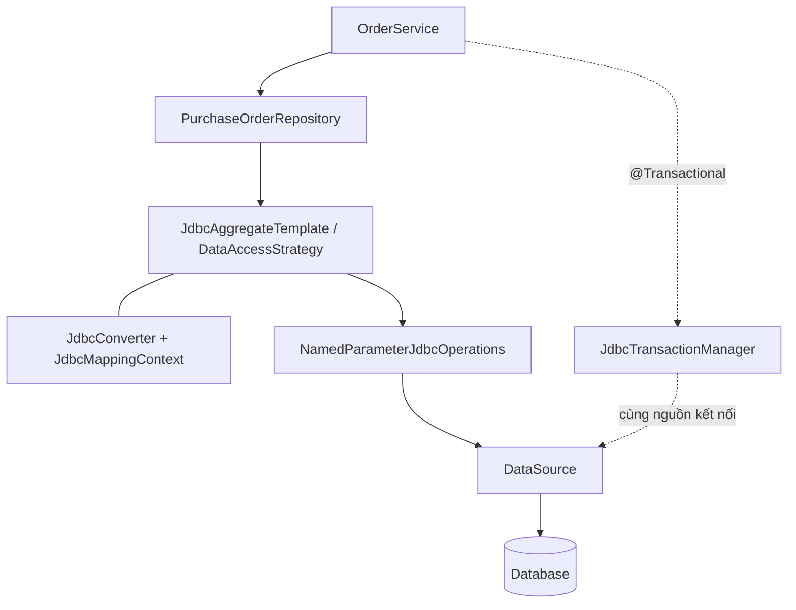
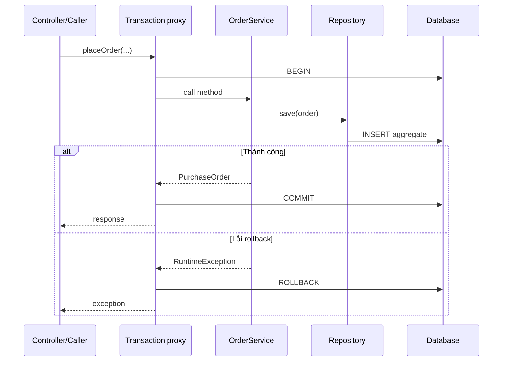

# Cấu hình thủ công Spring Data JDBC bằng `AbstractJdbcConfiguration`

Spring Data JDBC cung cấp repository để thao tác với dữ liệu quan hệ theo **aggregate**, nhưng repository chỉ hoạt động khi ứng dụng có kết nối cơ sở dữ liệu, bộ thực thi JDBC, bộ ánh xạ dữ liệu và quản lý giao dịch. Lớp `AbstractJdbcConfiguration` là điểm khởi đầu để đăng ký phần hạ tầng Spring Data JDBC khi muốn cấu hình bằng Java. Ứng dụng kế thừa lớp này, khai báo những bean kết nối còn thiếu và kích hoạt quét repository.

Bài này đi từ sơ đồ bean đến một ví dụ đơn hàng có thể chạy với **Spring Framework, Spring Data JDBC và H2**, sau đó giải thích cách phối hợp với Spring Boot, transaction, converter và những lỗi cấu hình thường gặp.

## 1. Hiểu đúng vai trò của `AbstractJdbcConfiguration`

Thông thường, một ứng dụng Spring Boot sử dụng `spring-boot-starter-data-jdbc` có thể chạy chỉ với dependency, JDBC driver và `spring.datasource.*`. Auto-configuration sẽ cung cấp nhiều bean mặc định.

Cấu hình thủ công hữu ích khi:

- Chạy Spring Framework không dùng Spring Boot auto-configuration.
- Muốn tự chọn `DataSource`, JDBC template, transaction manager và vùng quét repository.
- Cần quản lý rõ hạ tầng dữ liệu trong một kiến trúc nhiều module.
- Cần mở rộng quy ước ánh xạ, custom converters hoặc xử lý loại cơ sở dữ liệu đặc thù.
- Muốn chẩn đoán lỗi thiếu bean, trùng bean, sai database hoặc sai transaction.

`AbstractJdbcConfiguration` **không thay thế `DataSource`**. Nó cung cấp các bean liên quan đến Spring Data JDBC như mapping context, JDBC converter, chiến lược truy cập dữ liệu và template làm việc với aggregate. Khi sử dụng cấu hình thủ công, ta vẫn phải bảo đảm các bean JDBC nền tảng xuất hiện trong Spring ApplicationContext.

| Thành phần | Trách nhiệm | Nguồn cung cấp trong cấu hình thủ công |
| --- | --- | --- |
| `DataSource` | Mở kết nối đến cơ sở dữ liệu. | Ứng dụng tự tạo. |
| `NamedParameterJdbcOperations` | Chạy các lệnh SQL với tham số có tên. | Ứng dụng tạo `NamedParameterJdbcTemplate`. |
| `PlatformTransactionManager` | Mở, commit và rollback giao dịch. | Ứng dụng tạo `JdbcTransactionManager`. |
| `AbstractJdbcConfiguration` | Đăng ký các thành phần mapping và aggregate infrastructure. | Lớp cấu hình Spring Data JDBC. |
| `@EnableJdbcRepositories` | Quét interface repository và đăng ký implementation/proxy. | Annotation trong lớp cấu hình ứng dụng. |
| `@EnableTransactionManagement` | Kích hoạt proxy của `@Transactional` trong Spring thuần. | Annotation trong lớp cấu hình ứng dụng. |



**Nguyên tắc quan trọng:** JDBC operations và transaction manager phải sử dụng cùng `DataSource` cho một transaction JDBC thông thường. Nếu vô tình nối repository vào datasource A nhưng transaction manager dùng datasource B, hành vi đọc/ghi và rollback có thể sai mong đợi.

## 2. Thiết lập tình huống đơn hàng

Ta dùng một phần nhỏ của mô hình quản lý đơn hàng. Aggregate root là `PurchaseOrder`, gồm thông tin chung và nhiều `OrderLine`. Mỗi dòng ghi ID sản phẩm, số lượng và giá ở thời điểm đặt. Các dòng chỉ tồn tại trong vòng đời của đơn; không tạo repository độc lập cho `OrderLine`.

Cấu trúc nguồn:

```text
src/main/java/com/example/orders/
├── config/
│   └── ManualJdbcConfiguration.java
├── domain/
│   ├── PurchaseOrder.java
│   └── OrderLine.java
├── repository/
│   └── PurchaseOrderRepository.java
└── OrderDemo.java
src/main/resources/
└── schema.sql
```

Cần có Spring Context, Spring JDBC, Spring Data JDBC và H2 trên classpath. Một cách lấy dependency đồng bộ bằng hệ quản lý phiên bản của Spring Boot là:

```groovy
dependencies {
    implementation 'org.springframework.boot:spring-boot-starter-data-jdbc'
    runtimeOnly 'com.h2database:h2'
}
```

Việc có starter trên classpath **không tự khởi động Spring Boot auto-configuration** nếu chương trình chạy bằng `AnnotationConfigApplicationContext` như ví dụ dưới đây. Cần dùng các phiên bản Spring Boot, Spring Framework, Spring Data JDBC và driver tương thích, thông thường thông qua một BOM/platform thống nhất.

### Schema ban đầu

Tạo file `src/main/resources/schema.sql`:

```sql
CREATE TABLE purchase_order (
    id BIGINT GENERATED BY DEFAULT AS IDENTITY PRIMARY KEY,
    customer_id BIGINT NOT NULL,
    status VARCHAR(20) NOT NULL,
    total_amount DECIMAL(19, 2) NOT NULL
);

CREATE TABLE order_line (
    order_id BIGINT NOT NULL,
    line_no INTEGER NOT NULL,
    product_id BIGINT NOT NULL,
    quantity INTEGER NOT NULL CHECK (quantity > 0),
    unit_price DECIMAL(19, 2) NOT NULL CHECK (unit_price >= 0),
    PRIMARY KEY (order_id, line_no),
    CONSTRAINT fk_order_line_order
        FOREIGN KEY (order_id) REFERENCES purchase_order(id)
);
```

Bảng `order_line` dùng khóa ghép `(order_id, line_no)`. Cột `order_id` trỏ đến aggregate root; `line_no` thể hiện vị trí phần tử trong `List<OrderLine>`. Giá dùng `DECIMAL` ở database và `BigDecimal` trong Java để tránh sai số của số thực nhị phân.

Đây là schema tối thiểu phục vụ bài cấu hình, nên chưa có bảng `customer`, `product` hoặc kiểm tra toàn bộ quy tắc đặt hàng. Với hệ thống thực tế, bổ sung FK, index, trạng thái, chính sách dữ liệu và migration bằng công cụ như Flyway/Liquibase. Spring Data JDBC không tự tạo đầy đủ bảng SQL chỉ từ class Java.

## 3. Ánh xạ aggregate và khai báo repository

File `domain/OrderLine.java`:

```java
package com.example.orders.domain;

import java.math.BigDecimal;
import org.springframework.data.relational.core.mapping.Table;

@Table("order_line")
public record OrderLine(
    Long productId,
    int quantity,
    BigDecimal unitPrice
) {}
```

File `domain/PurchaseOrder.java`:

```java
package com.example.orders.domain;

import java.math.BigDecimal;
import java.util.List;
import org.springframework.data.annotation.Id;
import org.springframework.data.relational.core.mapping.MappedCollection;
import org.springframework.data.relational.core.mapping.Table;

@Table("purchase_order")
public record PurchaseOrder(
    @Id Long id,
    Long customerId,
    String status,
    BigDecimal totalAmount,
    @MappedCollection(
        idColumn = "order_id",
        keyColumn = "line_no"
    )
    List<OrderLine> lines
) {}
```

Ý nghĩa các điểm ánh xạ:

- `@Table("purchase_order")` ánh xạ record vào bảng có tên tường minh.
- `@Id` xác định khóa chính. Đơn mới được tạo với `id = null`.
- `@MappedCollection` xác định cột khóa ngoại `order_id` và cột chỉ số danh sách `line_no`.
- `customerId` và `productId` là ID scalar, không phải quan hệ object kiểu `@ManyToOne` của JPA.
- Spring Data JDBC xử lý các object con trong ranh giới aggregate; không cung cấp persistence context và dirty checking như JPA/Hibernate.

File `repository/PurchaseOrderRepository.java`:

```java
package com.example.orders.repository;

import java.util.List;
import com.example.orders.domain.PurchaseOrder;
import org.springframework.data.repository.CrudRepository;

public interface PurchaseOrderRepository
        extends CrudRepository<PurchaseOrder, Long> {

    List<PurchaseOrder> findByCustomerId(Long customerId);
}
```

Spring Data JDBC tự tạo implementation cho các thao tác `save`, `findById`, `deleteById` của `CrudRepository` và phương thức truy vấn suy ra từ tên `findByCustomerId(...)`. Để biến interface này thành bean Spring cần `@EnableJdbcRepositories`.

## 4. Cấu hình đầy đủ bằng `AbstractJdbcConfiguration`

File `config/ManualJdbcConfiguration.java`:

```java
package com.example.orders.config;

import javax.sql.DataSource;

import com.example.orders.repository.PurchaseOrderRepository;
import org.springframework.context.annotation.Bean;
import org.springframework.context.annotation.Configuration;
import org.springframework.data.jdbc.repository.config.AbstractJdbcConfiguration;
import org.springframework.data.jdbc.repository.config.EnableJdbcRepositories;
import org.springframework.jdbc.core.namedparam.NamedParameterJdbcOperations;
import org.springframework.jdbc.core.namedparam.NamedParameterJdbcTemplate;
import org.springframework.jdbc.datasource.embedded.EmbeddedDatabaseBuilder;
import org.springframework.jdbc.datasource.embedded.EmbeddedDatabaseType;
import org.springframework.jdbc.support.JdbcTransactionManager;
import org.springframework.transaction.PlatformTransactionManager;
import org.springframework.transaction.annotation.EnableTransactionManagement;

@Configuration
@EnableJdbcRepositories(
    basePackageClasses = PurchaseOrderRepository.class
)
@EnableTransactionManagement
public class ManualJdbcConfiguration
        extends AbstractJdbcConfiguration {

    @Bean
    public DataSource dataSource() {
        return new EmbeddedDatabaseBuilder()
            .setType(EmbeddedDatabaseType.H2)
            .generateUniqueName(true)
            .addScript("schema.sql")
            .build();
    }

    @Bean
    public NamedParameterJdbcOperations namedParameterJdbcOperations(
            DataSource dataSource) {

        return new NamedParameterJdbcTemplate(dataSource);
    }

    @Bean
    public PlatformTransactionManager transactionManager(
            DataSource dataSource) {

        return new JdbcTransactionManager(dataSource);
    }
}
```

### Vì sao cần từng phần?

**`@Configuration`.** Báo cho Spring đây là nguồn khai báo các bean. Vì lớp kế thừa `AbstractJdbcConfiguration`, Spring cũng xử lý các phương thức khai báo bean hạ tầng Data JDBC từ lớp cha.

**`@EnableJdbcRepositories`.** Quét package chứa `PurchaseOrderRepository` và các package con. Dùng `basePackageClasses` giúp hạn chế nhầm tên package khi refactor. Nếu interface repository nằm ngoài vùng quét, Spring không tạo bean tương ứng.

**`dataSource()`.** `EmbeddedDatabaseBuilder` khởi tạo H2 in-memory; `generateUniqueName(true)` tránh trùng tên giữa nhiều lần tạo context; `addScript("schema.sql")` chạy DDL ngay lúc khởi tạo database. H2 in-memory là lựa chọn cho ví dụ/test, dữ liệu mất khi database bị đóng.

**`namedParameterJdbcOperations(...)`.** Spring Data JDBC dùng giao diện `NamedParameterJdbcOperations` để thực thi SQL. Bean `NamedParameterJdbcTemplate` nhận `DataSource` do Spring tiêm vào phương thức, nhờ đó các thành phần có chung nguồn kết nối.

**`transactionManager(...)`.** `JdbcTransactionManager` quản lý transaction trên cùng datasource. Với hệ Spring Framework cũ, `DataSourceTransactionManager` cũng là một implementation phổ biến cho JDBC.

**`@EnableTransactionManagement`.** Trong Spring thuần, annotation này kích hoạt interceptor/proxy cho `@Transactional` của các bean service. Bean transaction manager riêng lẻ không bảo đảm rằng Spring đã xử lý annotation transaction.

**Phần lớp cha thực hiện.** `AbstractJdbcConfiguration` tạo các thành phần như mapping context, JDBC converter, data access strategy và aggregate template theo cách được hỗ trợ trong phiên bản đang dùng. Không cần tự viết các bean này chỉ để hoàn thiện cấu hình mặc định. Khi tạo lại một bean hạ tầng, cần hiểu các dependency giữa mapping, converter, dialect và aggregate operations để tránh cấu hình lệch nhau.

## 5. Chạy thử và quan sát kết quả

Tạo `OrderDemo.java` dùng Spring context trực tiếp:

```java
package com.example.orders;

import java.math.BigDecimal;
import java.util.List;

import com.example.orders.config.ManualJdbcConfiguration;
import com.example.orders.domain.OrderLine;
import com.example.orders.domain.PurchaseOrder;
import com.example.orders.repository.PurchaseOrderRepository;
import org.springframework.context.annotation.AnnotationConfigApplicationContext;

public class OrderDemo {

    public static void main(String[] args) {
        try (var context = new AnnotationConfigApplicationContext(
                ManualJdbcConfiguration.class)) {

            var orders = context.getBean(PurchaseOrderRepository.class);

            var lines = List.of(
                new OrderLine(11L, 2, new BigDecimal("120000.00")),
                new OrderLine(12L, 1, new BigDecimal("45000.00"))
            );

            var newOrder = new PurchaseOrder(
                null,
                1L,
                "CREATED",
                new BigDecimal("285000.00"),
                lines
            );

            PurchaseOrder saved = orders.save(newOrder);
            System.out.println("Saved ID = " + saved.id());

            PurchaseOrder loaded = orders.findById(saved.id())
                .orElseThrow();
            System.out.println("Status = " + loaded.status());
            System.out.println("Line count = " + loaded.lines().size());
        }
    }
}
```

Dòng `save(newOrder)` sẽ đi qua repository, aggregate infrastructure, `NamedParameterJdbcOperations` rồi xuống `DataSource`. Với ID `null`, thao tác tạo mới thêm header `purchase_order`, nhận ID từ database và ghi các dòng `order_line` với `order_id` và `line_no` tương ứng. Sau đó `findById(...)` tải lại aggregate gồm các dòng hàng.

Kết quả mong đợi là một ID đã được tạo, trạng thái `CREATED` và số dòng bằng `2`. Không nên giả định ID cụ thể luôn là `1` vì tùy trạng thái database và chiến lược sinh khóa.

Trong ví dụ, `totalAmount` được truyền trực tiếp để minh họa cách lưu dữ liệu. Ở ứng dụng thực tế, service phải xác nhận khách hàng/sản phẩm, lấy giá tin cậy từ database và **tự tính tổng** từ `quantity × unitPrice`. Không coi giá và tổng do client gửi là dữ liệu đáng tin.

### Có cần chạy thêm script khởi tạo trong Spring Boot?

Trong ví dụ Spring thuần, `EmbeddedDatabaseBuilder.addScript("schema.sql")` đã thực thi DDL. Nếu chuyển sang Boot và cho Boot tự khởi tạo SQL, hãy chọn **một chủ sở hữu** khởi tạo schema để tránh script chạy lại và lỗi bảng đã tồn tại. Trong môi trường production, nên sử dụng migration được quản lý thay vì tạo schema ngẫu nhiên mỗi khi ứng dụng khởi động.

## 6. Kết hợp `@Transactional` với cấu hình thủ công

Tạo repository bean là một bước; transaction của nhiều thao tác trong nghiệp vụ là bước khác. Khi tạo đơn cần đồng thời ghi một số dữ liệu khác, mọi thao tác tham gia transaction nên commit cùng nhau hoặc rollback cùng nhau.

Ví dụ `OrderService.java`:

```java
package com.example.orders.service;

import com.example.orders.domain.PurchaseOrder;
import com.example.orders.repository.PurchaseOrderRepository;
import org.springframework.stereotype.Service;
import org.springframework.transaction.annotation.Transactional;

@Service
public class OrderService {

    private final PurchaseOrderRepository orders;

    public OrderService(PurchaseOrderRepository orders) {
        this.orders = orders;
    }

    @Transactional
    public PurchaseOrder placeOrder(PurchaseOrder order) {
        // Ví dụ tập trung vào ranh giới transaction.
        // Nghiệp vụ thật cần validate và tính lại totalAmount.
        return orders.save(order);
    }

    @Transactional(readOnly = true)
    public PurchaseOrder requireOrder(Long id) {
        return orders.findById(id).orElseThrow();
    }
}
```

Để Spring tạo bean `@Service` trong cấu hình thuần, cần thêm `@ComponentScan(basePackageClasses = OrderService.class)` vào một lớp `@Configuration` thích hợp hoặc khai báo bean `OrderService` bằng `@Bean`. `@EnableJdbcRepositories` chỉ quét repository, **không tự quét mọi `@Service`**. `OrderDemo` ở phần trước thao tác repository trực tiếp nên chưa cần bước này.



Một số giới hạn cần nắm:

- Theo mặc định, `@Transactional` rollback đối với `RuntimeException` và `Error`; nếu checked exception phải gây rollback, cấu hình `rollbackFor` phù hợp.
- Gọi phương thức `@Transactional` từ một phương thức khác trên **cùng instance** thường không đi qua Spring proxy, nên advice transaction không được kích hoạt như kỳ vọng.
- `readOnly = true` là hint và hợp đồng sử dụng, không phải cơ chế chắc chắn chặn mọi câu lệnh ghi ở database.
- Thao tác JDBC tự mở connection ngoài cơ chế Spring có thể không tham gia transaction được quản lý.
- Transaction bảo đảm tính nguyên tử, nhưng không tự xử lý mọi tranh chấp cập nhật đồng thời; khi sửa đơn từ nhiều request, cân nhắc `@Version` hoặc một chiến lược khóa phù hợp.

## 7. Dùng `AbstractJdbcConfiguration` cùng Spring Boot

Cần phân biệt ba phương án:

| Phương án | Cách chuẩn bị hạ tầng | Khi sử dụng |
| --- | --- | --- |
| Spring Framework thuần + `AbstractJdbcConfiguration` | Khai báo datasource, template, transaction manager và repository scan bằng Java. | Cần kiểm soát thủ công hoàn toàn. |
| Spring Boot auto-configuration | Boot dựa vào starter, driver, properties và điều kiện bean để dựng hạ tầng. | Đa số ứng dụng thông thường. |
| Spring Boot + cấu hình tường minh | Boot cung cấp các bean mặc định còn thiếu, ứng dụng tự quản lý phần được chọn. | Có yêu cầu đặc thù nhưng vẫn muốn dùng Boot. |

Với Boot và PostgreSQL, cấu hình phổ biến có thể chỉ cần:

```yaml
spring:
  datasource:
    url: jdbc:postgresql://localhost:5432/orders
    username: orders_app
    password: ${ORDERS_DB_PASSWORD}
```

Cần thêm PostgreSQL driver và starter Spring Data JDBC. Secret đến từ môi trường/secret manager; không commit mật khẩu thật.

**Không mặc nhiên phải kế thừa `AbstractJdbcConfiguration` khi dùng Spring Boot.** Nếu ứng dụng đã có `DataSource`, `NamedParameterJdbcTemplate`, transaction manager và repository được tạo tự động, việc đăng ký lại chúng có thể phát sinh bean trùng, vùng scan chồng lấn hoặc cấu hình không thống nhất.

Khi cần tự cấu hình một phần trong Boot, hãy quyết định:

1. Bean `DataSource` do Boot sinh từ `spring.datasource.*` hay do ứng dụng định nghĩa?
2. `NamedParameterJdbcOperations` dùng datasource nào?
3. Transaction manager nào quản lý connection của repository?
4. Phần `@EnableJdbcRepositories` có quét trùng với auto-config repository không?
5. Có nhiều datasource/transaction manager hay không, và các bean cần qualifier/định danh nào?

Nếu khai báo `DataSource` bằng Java theo cách riêng, đừng giả định thuộc tính `spring.datasource.*` tự động bind vào bất kỳ loại bean tùy chỉnh nào; phải có cơ chế binding phù hợp. Trước khi loại trừ auto-config, xác định chính xác bean bị trùng hoặc thiếu thay vì tắt hàng loạt cấu hình.

### Chuyển sang datasource thật

Để thay H2 in-memory bằng PostgreSQL, MySQL hoặc hệ quản trị quan hệ khác, thay implementation của bean `DataSource` bằng datasource/pool dùng URL, credentials và driver thích hợp. Hai bean dưới đây vẫn có thể giữ nguyên và nhận `DataSource` do Spring inject:

```java
@Bean
public NamedParameterJdbcOperations namedParameterJdbcOperations(
        DataSource dataSource) {
    return new NamedParameterJdbcTemplate(dataSource);
}

@Bean
public PlatformTransactionManager transactionManager(
        DataSource dataSource) {
    return new JdbcTransactionManager(dataSource);
}
```

Cần quản lý connection pool, timeout, đóng tài nguyên, migration schema và thông tin kết nối an toàn. `EmbeddedDatabaseBuilder` là lựa chọn demo/test, không nên được dùng làm kho dữ liệu production.

## 8. Các điểm mở rộng của hạ tầng JDBC

### Naming strategy và tên cột

Spring Data JDBC có quy ước ánh xạ tên thuộc tính Java sang tên cột SQL; chẳng hạn `customerId` thường được chuyển thành `customer_id`. Có thể tùy chỉnh naming strategy khi schema có một quy ước khác.

Với khác biệt cục bộ, ưu tiên annotation tường minh như `@Table`, `@Column`, `@MappedCollection`. Custom naming strategy toàn cục có thể ảnh hưởng đồng thời nhiều bảng, cột FK và collection key.

### Converter cho value object

Các kiểu như `Long`, `String`, `BigDecimal` tương đối trực tiếp. Với kiểu miền nghiệp vụ tự tạo như `Money` hoặc `EmailAddress`, có thể cần custom reading/writing converter.

`AbstractJdbcConfiguration` cung cấp điểm mở rộng cho converter do ứng dụng đăng ký, thường qua phương thức `userConverters()` ở các phiên bản Spring Data JDBC tương ứng. Khi tạo converter, cần quyết định kiểu cột SQL, nullability, hướng đọc/ghi, scale/rounding và tính nhất quán hai chiều. Tránh đăng ký nhiều converter cùng mục đích ở các nguồn cấu hình khác nhau.

### SQL dialect

SQL dialect đại diện những khác biệt giữa các hệ cơ sở dữ liệu, chẳng hạn cú pháp phân trang hoặc cách lấy generated key. Với database được hỗ trợ, Spring Data JDBC thường xác định dialect từ metadata JDBC qua driver.

Nếu bị lỗi không nhận diện dialect, kiểm tra driver, khả năng mở kết nối, metadata, tính tương thích của database và việc chọn đúng datasource trước khi tự thay thế dialect. Không giả định cùng một cú pháp DDL hoặc truy vấn nâng cao sẽ hoạt động trên H2, PostgreSQL và MySQL.

### Nhiều datasource

Khi có nhiều datasource, dùng một cấu hình toàn cục không phân biệt nguồn có thể làm repository đọc sai database hoặc tạo `NoUniqueBeanDefinitionException`. Cần tách vùng quét repository, đặt tên/qualifier và chỉ rõ JDBC operations cùng transaction manager tương ứng theo cơ chế cấu hình của phiên bản đang dùng.

Hai `JdbcTransactionManager` độc lập quản lý hai database khác nhau **không tự tạo giao dịch phân tán nguyên tử**. Nếu một nghiệp vụ cần nhất quán xuyên nhiều datasource, phải lựa chọn giải pháp transaction/điều phối tương ứng với kiến trúc.

## 9. Nhận biết lỗi cấu hình thường gặp

| Triệu chứng | Nguyên nhân có thể | Cách kiểm tra |
| --- | --- | --- |
| `NoSuchBeanDefinitionException` cho `PurchaseOrderRepository` | Repository không nằm trong package được scan. | Kiểm tra `@EnableJdbcRepositories` và `basePackageClasses`. |
| Thiếu `NamedParameterJdbcOperations` | Không khai báo template và không có auto-config tạo giúp. | Xác minh bean `NamedParameterJdbcTemplate` và datasource. |
| Thiếu transaction manager | Chưa khai báo `PlatformTransactionManager`. | Kiểm tra bean manager và cùng datasource với repository. |
| `@Transactional` không có tác dụng | Chưa bật transaction proxy hoặc gọi nội bộ cùng instance. | Kiểm tra `@EnableTransactionManagement` và đường gọi qua bean proxy. |
| `BadSqlGrammarException` khi lưu | Tên bảng/cột không khớp hoặc schema chưa được tạo. | So sánh `schema.sql` với annotation và SQL log. |
| Lỗi khóa ngoại của `order_line` | Parent ID không hợp lệ hoặc mapping `order_id` sai. | Đối chiếu FK, thứ tự ghi aggregate và datasource. |
| `NoUniqueBeanDefinitionException` | Hai hoặc nhiều bean cùng loại, không có lựa chọn rõ ràng. | Liệt kê bean datasource/template/manager; dùng qualifier/định danh. |
| Không xác định SQL dialect | Driver, JDBC metadata hoặc DB chưa tương thích. | Kiểm tra kết nối, driver, phiên bản hệ quản trị. |
| Mất dữ liệu sau khi tắt app | Dùng H2 in-memory. | Chuyển sang database lưu trữ và migration phù hợp. |
| Lưu aggregate sinh DELETE/INSERT cho dòng con | Mô hình lưu aggregate của Spring Data JDBC có thể thay thế collection con. | Quan sát SQL thực tế, không kỳ vọng cơ chế dirty checking của JPA. |

Trong context Spring thuần, có thể quan sát số bean hạ tầng:

```java
System.out.println(
    context.getBeanNamesForType(DataSource.class).length
);
System.out.println(
    context.getBeanNamesForType(
        NamedParameterJdbcOperations.class
    ).length
);
System.out.println(
    context.getBeanNamesForType(
        PlatformTransactionManager.class
    ).length
);
```

Khi dùng Boot, bật log SQL cho môi trường phát triển nếu cần:

```yaml
logging:
  level:
    org.springframework.jdbc.core: DEBUG
    org.springframework.data.jdbc.core: DEBUG
```

Không bật log tham số có dữ liệu nhạy cảm trên production nếu chưa có kiểm soát thích hợp. Quan sát SQL giúp biết câu lệnh thực tế được thực thi qua datasource nào và aggregate được lưu như thế nào.

## 10. Bài thực hành đề xuất

1. **Khởi chạy bằng Spring thuần:** tạo schema H2, cấu hình `AbstractJdbcConfiguration`, lưu một đơn hai dòng và đọc lại theo ID.
2. **Thay vùng quét:** tạm chọn package repository không đúng để quan sát lỗi thiếu bean; khôi phục về đúng package.
3. **Thử ánh xạ sai:** đổi tên một cột trong `schema.sql` nhưng giữ annotation cũ, xem lỗi SQL rồi đồng bộ lại schema và Java.
4. **Bật transaction ở service:** đăng ký `OrderService` thông qua component scan/bean, gọi qua context và thử rollback khi một thao tác ghi xảy ra lỗi.
5. **Quan sát cập nhật collection:** thay số lượng một dòng, lưu toàn bộ aggregate và kiểm tra SQL ghi vào `order_line`.
6. **Đổi sang PostgreSQL:** thay datasource và driver, chạy schema/migration tương ứng, xác minh repository dùng đúng kết nối.
7. **So sánh với Boot:** làm lại phần kết nối bằng starter và `spring.datasource.*`, kiểm tra số bean cần tự khai báo thực sự.

Mỗi lần thử chỉ thay một yếu tố và đối chiếu kết quả để phân biệt lỗi **cấu hình bean**, lỗi **ánh xạ SQL** và lỗi **nghiệp vụ**.

## 11. Mô hình cần ghi nhớ

```text
DataSource (kết nối)
    ├── NamedParameterJdbcOperations (chạy SQL)
    └── JdbcTransactionManager (transaction)
               │
AbstractJdbcConfiguration (mapping và aggregate infrastructure)
               │
@EnableJdbcRepositories (tạo repository bean)
               │
PurchaseOrderRepository
               │
OrderService / API
```

Cấu hình thủ công bằng `AbstractJdbcConfiguration` giúp nhìn rõ từng trách nhiệm trong Spring Data JDBC: ứng dụng chọn datasource, template và transaction manager; lớp cha cung cấp hạ tầng ánh xạ aggregate; annotation repository tạo lớp truy cập dữ liệu. Sau khi hiểu được ba đường nối **repository → JDBC operations → datasource**, **transaction → datasource** và **aggregate → bảng/dòng con**, việc đổi database, thêm converter hoặc chẩn đoán lỗi cấu hình sẽ có cơ sở chắc chắn.
