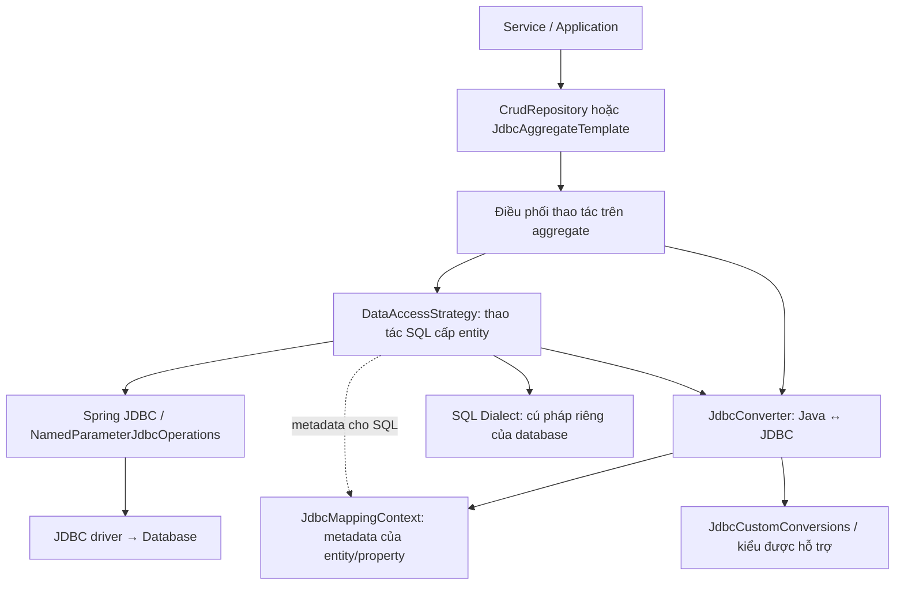
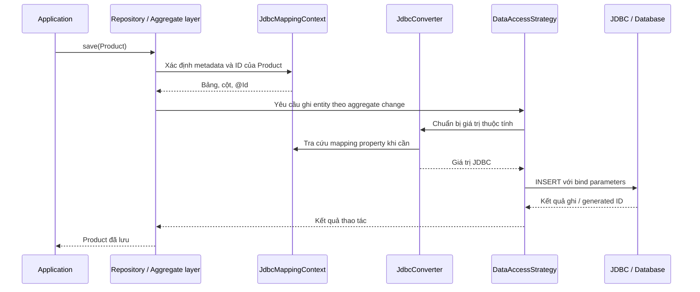
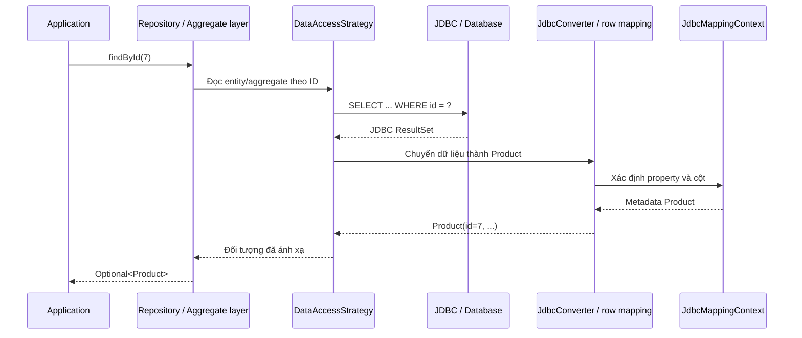

# Trách nhiệm của `JdbcMappingContext`, `JdbcConverter` và `DataAccessStrategy`

Trong **Spring Data Relational JDBC**, một lệnh đơn giản như `repository.save(product)` có nhiều công việc khác nhau: xác định đối tượng Java tương ứng với bảng/cột nào, đổi dữ liệu Java thành các giá trị JDBC, và thực hiện câu lệnh SQL trên database. Ba thành phần quan trọng tham gia vào quá trình đó là **`JdbcMappingContext`**, **`JdbcConverter`** và **`DataAccessStrategy`**.

Hiểu đúng ranh giới giữa chúng giúp giải thích vì sao annotation mapping có tác dụng, custom converter được gọi ở đâu, và một lần `save` có thể tạo nhiều câu lệnh SQL. Bài học tập trung vào kiến trúc của **Spring Data JDBC**, không phải Spring Data JPA hay R2DBC.

## 1. Bức tranh tổng thể: metadata → conversion → truy cập dữ liệu

| Thành phần | Câu hỏi nó giải quyết | Đầu vào điển hình | Đầu ra / tác dụng |
|---|---|---|---|
| **`JdbcMappingContext`** | “Class/property này được ánh xạ vào mô hình quan hệ như thế nào?” | Java domain class, các annotation, `NamingStrategy`, cấu hình kiểu đơn giản | Metadata về entity, property, bảng, cột, ID và quan hệ thuộc aggregate |
| **`JdbcConverter`** | “Giá trị Java được chuyển thành dữ liệu JDBC và đọc ngược lại ra sao?” | Metadata mapping, giá trị object, kết quả JDBC, custom conversions | Giá trị có thể bind vào JDBC và object/property được dựng từ kết quả đọc |
| **`DataAccessStrategy`** | “Đọc/ghi một entity bằng thao tác SQL nào?” | Kiểu entity, ID, giá trị cần ghi, converter, dialect và JDBC operations | Thực hiện `SELECT`, `INSERT`, `UPDATE`, `DELETE` cùng các thao tác dữ liệu cấp entity |

Sơ đồ luồng khái niệm:



Đây là **sơ đồ trách nhiệm**, không phải biểu đồ cuộc gọi 1:1 bắt buộc cho mọi phiên bản hay mọi truy vấn. Từng nhánh Spring Data JDBC có thể thay đổi cách triển khai và tối ưu hóa đọc dữ liệu, nhưng ba ranh giới kiến trúc này vẫn là điểm cần nắm.

Phía trên ba thành phần là **repository**, `JdbcAggregateTemplate` và các lớp điều phối thay đổi của aggregate. Phía dưới là **Spring JDBC** (`JdbcOperations`/`NamedParameterJdbcOperations`), `DataSource`, JDBC driver và database. `Dialect`, `NamingStrategy` và custom conversions là những thành phần cộng tác, không thay thế vai trò của ba thành phần chính.

## 2. `JdbcMappingContext`: biết *dữ liệu thuộc về đâu*

`org.springframework.data.jdbc.core.mapping.JdbcMappingContext` là implementation `MappingContext` cho JDBC, kế thừa `RelationalMappingContext`. Nó cung cấp và quản lý metadata của các entity Spring Data JDBC. Khi gặp một domain class, framework cần biết:

- Entity đó ánh xạ đến bảng nào? Tên do `@Table` chỉ định hay suy ra qua quy ước đặt tên?
- Property nào là khóa chính (`@Id`), property nào là cột thường (`@Column`)?
- Thuộc tính là giá trị đơn giản, embedded object, collection thuộc cùng aggregate hay tham chiếu cần xử lý theo quy tắc aggregate?
- Với quan hệ được ánh xạ, tên cột back-reference hoặc khóa của collection là gì?
- Những thông tin nào được cung cấp bởi các annotation, `NamingStrategy` và bộ kiểu đơn giản (`SimpleTypeHolder`)?

Ví dụ một entity cơ bản:

```java
package com.example.inventory;

import org.springframework.data.annotation.Id;
import org.springframework.data.relational.core.mapping.Column;
import org.springframework.data.relational.core.mapping.Table;

@Table("inventory_products")
public class Product {

    @Id
    private Long id;

    @Column("display_name")
    private String name;

    @Column("unit_price_cents")
    private int priceCents;

    public Product() {}

    public Product(String name, int priceCents) {
        this.name = name;
        this.priceCents = priceCents;
    }

    public Long getId() { return id; }
    public void setId(Long id) { this.id = id; }
    public String getName() { return name; }
    public void setName(String name) { this.name = name; }
    public int getPriceCents() { return priceCents; }
    public void setPriceCents(int priceCents) { this.priceCents = priceCents; }
}
```

Metadata dự kiến cho class trên:

| Java | Metadata quan hệ |
|---|---|
| `Product` | Bảng `inventory_products` |
| `id` | Property khóa chính, cột `id` |
| `name` | Cột `display_name` |
| `priceCents` | Cột `unit_price_cents` |

Đây là **mô tả mapping**; `JdbcMappingContext` không tự gửi `CREATE TABLE`, không thực hiện `INSERT` và không kiểm tra trực tiếp database đã có đủ cột hay chưa. Nếu annotation khai báo `display_name` nhưng bảng thực tế chỉ có `name`, lỗi SQL chỉ xuất hiện khi truy vấn/ghi dữ liệu liên quan.

### Metadata dùng ở đâu?

`JdbcMappingContext` hỗ trợ tạo `RelationalPersistentEntity<?>` và `RelationalPersistentProperty` để các thành phần khác tra cứu. Ví dụ đọc metadata của `Product` trong một ứng dụng đã cấu hình Spring Data JDBC:

```java
import org.springframework.data.jdbc.core.mapping.JdbcMappingContext;
import org.springframework.data.relational.core.mapping.RelationalPersistentEntity;
import org.springframework.data.relational.core.mapping.RelationalPersistentProperty;

RelationalPersistentEntity<?> entity =
        mappingContext.getRequiredPersistentEntity(Product.class);

RelationalPersistentProperty property =
        entity.getRequiredPersistentProperty("name");

System.out.println(entity.getTableName());    // inventory_products
System.out.println(property.getColumnName()); // display_name
```

Ở đây `mappingContext` là bean `JdbcMappingContext` được inject vào code (ví dụ thông qua constructor). Các giá trị in thể hiện đối tượng `SqlIdentifier`; cách biểu diễn có thể chịu ảnh hưởng cấu hình quoting/naming. Lợi ích của việc đọc metadata là nhìn được tên mà **Spring Data hiểu**, rồi đối chiếu với schema thực tế.

### Những thay đổi thường ảnh hưởng đến MappingContext

- `@Table`, `@Column`, `@Id`, `@MappedCollection`, `@Embedded` và cách tổ chức aggregate.
- Một `NamingStrategy` tùy biến, chẳng hạn thay quy tắc chuyển tên property thành tên cột.
- Cấu hình custom conversions và kiểu được xem là **simple value** thay vì đối tượng cần mapping tiếp.

**Giới hạn quan trọng:** MappingContext biết *hình dạng ánh xạ*. Nó không quản lý trạng thái entity kiểu JPA persistence context, không theo dõi dirty checking, không sinh SQL và không thay thế database schema migration.

## 3. `JdbcConverter`: biết *giá trị đi qua JDBC như thế nào*

`org.springframework.data.jdbc.core.convert.JdbcConverter` là abstraction chuyển đổi giữa domain object/value và biểu diễn dữ liệu quan hệ dùng trong JDBC. Implementation quen thuộc là `MappingJdbcConverter`.

Khi **ghi**, converter phối hợp với metadata để chuẩn bị các giá trị property cho JDBC: ví dụ lấy `Product.name`, nhận biết cột tương ứng là `display_name`, chuyển giá trị Java thành kiểu có thể bind vào statement. Khi **đọc**, nó phối hợp với metadata và các thành phần ánh xạ hàng dữ liệu để dựng entity/property từ kết quả JDBC. Với aggregate có entity con, quá trình dựng quan hệ còn liên quan đến `RelationResolver` và chiến lược đọc; converter không tự mình đóng vai trò bộ thực thi SQL độc lập.

Ví dụ với hàng dữ liệu:

```text
id = 7
display_name = 'Mechanical Keyboard'
unit_price_cents = 159000
```

Phần mapping/conversion sẽ tạo ra một `Product` tương đương:

```java
Product p = /* kết quả được Spring Data JDBC đọc từ DB */;
// p.getId()         == 7L
// p.getName()       == "Mechanical Keyboard"
// p.getPriceCents() == 159000
```

Không phải converter chạy một câu `SELECT` để lấy hàng này: `DataAccessStrategy` và các thành phần JDBC phụ trách truy cập, converter xử lý việc **hiểu và biến đổi dữ liệu**.

### Chuyển đổi mặc định và chuyển đổi tùy biến

Các kiểu thông thường như `String`, số, một số kiểu ngày giờ, enum và các kiểu được JDBC dialect hỗ trợ có cơ chế chuyển đổi sẵn. Khi domain dùng **value object** riêng, có thể đăng ký cặp converter ghi/đọc. Ví dụ `ProductCode` được lưu trong một cột `VARCHAR`:

```java
public record ProductCode(String value) {}
```

```java
import org.springframework.core.convert.converter.Converter;
import org.springframework.data.convert.ReadingConverter;
import org.springframework.data.convert.WritingConverter;

@WritingConverter
public final class ProductCodeToString
        implements Converter<ProductCode, String> {
    @Override
    public String convert(ProductCode source) {
        return source.value();
    }
}

@ReadingConverter
public final class StringToProductCode
        implements Converter<String, ProductCode> {
    @Override
    public ProductCode convert(String source) {
        return new ProductCode(source);
    }
}
```

Để Spring Data JDBC sử dụng hai lớp trên, cần **đăng ký** chúng với `JdbcCustomConversions` thông qua cơ chế cấu hình tương ứng với phiên bản dự án (ví dụ `userConverters()` trong cấu hình kế thừa `AbstractJdbcConfiguration`). Chỉ tạo file class converter không bảo đảm chúng đã được nạp. Annotation `@ReadingConverter` và `@WritingConverter` xác định hướng chuyển đổi, tránh mơ hồ giữa Java type và store type.

Với kiểu phức tạp hoặc kiểu đặc thù vendor, có thể cần hỗ trợ thêm của dialect và JDBC type thay vì chỉ một `Converter<X, String>`. Không nên giả định một converter sẽ tự thay đổi cấu trúc bảng hoặc cách generate SQL.

### Phân biệt mapping và conversion

Giả sử đổi `@Column("display_name")` thành `@Column("product_label")` mà giữ nguyên `String name`:

- `JdbcMappingContext` thấy **địa chỉ cột** mới.
- `JdbcConverter` vẫn có thể chuyển giá trị `String` bình thường.
- `DataAccessStrategy` sử dụng metadata/các thành phần SQL để truy cập `product_label`.
- Nếu database chưa có cột `product_label`, truy vấn sẽ báo lỗi cho dù converter hoạt động tốt.

Ngược lại, nếu giữ nguyên cột nhưng thay `String name` bằng value object `ProductCode` mà không đăng ký converter phù hợp, vấn đề nằm ở **chuyển đổi kiểu**, không phải tên cột.

## 4. `DataAccessStrategy`: biết *thực thi thao tác dữ liệu nào*

`org.springframework.data.jdbc.core.convert.DataAccessStrategy` là abstraction truy cập dữ liệu ở **cấp một entity**, với các phương thức thường có thể triển khai bằng một câu SQL. Nó khác `JdbcAggregateOperations`/`JdbcAggregateTemplate`, vốn thực hiện thao tác đối với **aggregate hoàn chỉnh**.

Nhiệm vụ chính của `DataAccessStrategy` gồm:

- Chèn một bản ghi entity (`INSERT`), xử lý khóa được sinh khi áp dụng.
- Cập nhật một entity (`UPDATE`), kể cả biến thể liên quan version/optimistic locking.
- Xóa, tìm theo ID, kiểm tra tồn tại, đếm hoặc thực hiện các thao tác truy vấn cần thiết ở cấp entity.
- Kết hợp metadata mapping, các phép chuyển đổi, SQL generation/dialect và `NamedParameterJdbcOperations` để thao tác thực tế với database.

Theo API của Spring Data JDBC, implementation mặc định `DefaultDataAccessStrategy` **tạo SQL dựa trên metadata entity**. Ở một số nhánh, `DataAccessStrategyFactory` có thể chọn cấu hình chiến lược hỗ trợ *single-query loading* với đường lui về default strategy. Vì thế không nên mặc định toàn bộ quá trình đọc aggregate luôn dùng đúng một SQL hoặc luôn là một implementation duy nhất.

Ví dụ SQL minh họa từ entity `Product`:

```sql
-- Ví dụ logic INSERT một Product mới
INSERT INTO inventory_products (display_name, unit_price_cents)
VALUES ('Mechanical Keyboard', 159000);

-- Ví dụ logic truy vấn một Product theo ID
SELECT id, display_name, unit_price_cents
FROM inventory_products
WHERE id = 7;
```

Đây là **SQL diễn giải**, không phải bản sao chính xác SQL mà mọi phiên bản Spring Data JDBC sẽ log. SQL thực tế thường dùng **bind parameters**, cách quoting/returning generated IDs phụ thuộc dialect, và một aggregate có quan hệ có thể cần nhiều statement.

### Ranh giới giữa `DataAccessStrategy` và `JdbcTemplate`

`JdbcTemplate`/`NamedParameterJdbcOperations` là hạ tầng **thực thi JDBC**: chuẩn bị SQL, bind parameter, chạy statement và xử lý `ResultSet`. `DataAccessStrategy` ở tầng cao hơn, biết **thao tác entity nào** đang được yêu cầu và cách dùng metadata, converter, dialect để tạo/triển khai thao tác đó.

Vì vậy:

```text
DataAccessStrategy : thao tác entity + SQL tương ứng
JdbcConverter      : chuyển object / giá trị Java ↔ JDBC
JdbcMappingContext : metadata ánh xạ entity / property
JdbcTemplate       : chạy câu lệnh JDBC đã chuẩn bị
JDBC driver        : giao tiếp với database server
```

`DataAccessStrategy` cũng không tự quyết định ranh giới transaction nghiệp vụ. Transaction được phối hợp bởi tầng repository/template/service cùng Spring transaction management. Việc viết `@Transactional` cho một use case nhiều thao tác là trách nhiệm ở tầng thích hợp; đừng nhầm một đối tượng strategy với transaction manager.

## 5. Theo dấu `save()` và `findById()` từ đầu đến cuối

Định nghĩa repository:

```java
package com.example.inventory;

import org.springframework.data.repository.CrudRepository;

public interface ProductRepository extends CrudRepository<Product, Long> {}
```

Khi gọi:

```java
Product saved = repository.save(new Product("Mechanical Keyboard", 159000));
Product loaded = repository.findById(saved.getId()).orElseThrow();
```

### Luồng ghi: `repository.save(new Product(...))`



Diễn giải: tầng repository/aggregate xác định entity mới hay đã tồn tại theo quy tắc nhận biết new-entity (`@Id`, có thể thêm `@Version`/`Persistable`), chuẩn bị các thay đổi cần thực hiện, rồi dùng `DataAccessStrategy` cho từng thao tác cấp entity. `JdbcConverter` tham gia xử lý giá trị/đọc ghi; `JdbcMappingContext` cung cấp metadata. Nếu khóa chính được database sinh, kết quả lưu cung cấp ID cho object được trả về.

**Điểm rất dễ nhầm:** Với một aggregate có danh sách entity con, `save()` là thao tác trên **aggregate**. Theo mô hình Spring Data JDBC, khi cập nhật aggregate đã tồn tại, các entity con có thể được xóa rồi chèn lại để đồng bộ trạng thái; `DataAccessStrategy.update(...)` riêng lẻ chỉ cập nhật **một entity**, không tự quản lý toàn bộ quan hệ con. Đó là lý do cần tầng điều phối aggregate ở trên strategy.

### Luồng đọc: `repository.findById(id)`



Với aggregate có collection, kết quả có thể được dựng qua nhiều câu SELECT hoặc chiến lược tối ưu phù hợp. Các lớp row mapper và relation resolver cộng tác với converter để hoàn thiện kết quả. Vì vậy sơ đồ nhấn mạnh **tách trách nhiệm** thay vì đóng đinh vào một đường gọi nội bộ duy nhất.

## 6. Ghép mô hình Java với database thật

Với `Product` ở trên, một bảng PostgreSQL phù hợp có thể được tạo bằng migration:

```sql
CREATE TABLE inventory_products (
    id BIGINT GENERATED BY DEFAULT AS IDENTITY PRIMARY KEY,
    display_name VARCHAR(200) NOT NULL,
    unit_price_cents INTEGER NOT NULL
);
```

Database phải thực sự có bảng/cột tương ứng; `JdbcMappingContext` chỉ giữ metadata và không tự tạo schema cho bạn. Một cấu hình `DataSource` ví dụ:

```yaml
spring:
  datasource:
    url: jdbc:postgresql://localhost:5432/inventory
    username: inventory_app
    password: ${DB_PASSWORD}
```

Trong dự án dùng `spring-boot-starter-data-jdbc`, driver PostgreSQL và cấu hình datasource hợp lệ, Spring Boot/Spring Data thường tự đăng ký các thành phần cần thiết. Code nghiệp vụ nên bắt đầu từ `ProductRepository` hoặc `JdbcAggregateTemplate`, không cần tự tạo `JdbcMappingContext`, `JdbcConverter`, `DataAccessStrategy` thủ công cho trường hợp thông thường.

Để quan sát SQL thực tế trong môi trường phát triển, có thể bật logging phù hợp, chẳng hạn:

```yaml
logging:
  level:
    org.springframework.jdbc.core: DEBUG
```

Khi xem log, hãy phân biệt **câu SQL được thực thi** (liên quan `DataAccessStrategy` và JDBC operations), **cột/tên bảng** (metadata mapping), và **giá trị hoặc lỗi ép kiểu** (converter/JDBC driver). Hạn chế bật logging chi tiết giá trị bind trong production vì có thể làm lộ dữ liệu nhạy cảm.

## 7. Khi nào nên tùy biến từng thành phần?

| Nhu cầu | Thành phần nên xét trước | Vì sao? |
|---|---|---|
| Đổi tên bảng/cột của một entity | `@Table`, `@Column` và metadata từ `JdbcMappingContext` | Thay mô tả mapping, chưa cần thay SQL engine |
| Đổi quy tắc tên bảng/cột cho toàn bộ entity | `NamingStrategy` | Áp dụng quy ước tên nhất quán ở tầng mapping |
| Lưu `ProductCode`, `Money`, value object xuống một cột | `JdbcCustomConversions`, `@ReadingConverter`, `@WritingConverter` | Xử lý biến đổi kiểu Java ↔ kiểu lưu trữ |
| Viết truy vấn đặc thù cho một repository | `@Query`, repository extension, `JdbcTemplate` khi phù hợp | Tránh thay thế chiến lược truy cập mặc định toàn ứng dụng |
| Đổi hành vi truy cập dữ liệu nền tảng cho nhiều entity | Cân nhắc `DataAccessStrategy` chuyên biệt | Đây là điểm mở rộng ở tầng SQL, cần hiểu sâu aggregate/dialect |
| Cập nhật nhiều entity cùng một transaction nghiệp vụ | Service + Spring transaction management | Transaction không phải vai trò của metadata/converter/strategy riêng lẻ |
| Chuyển PostgreSQL sang MySQL | Driver, `DataSource`, dialect, migration/schema | Sự khác biệt vendor không giải quyết chỉ bằng thay `JdbcConverter` |

Trong cấu hình Spring Data JDBC, `AbstractJdbcConfiguration` có các điểm tạo bean như `jdbcMappingContext(...)`, `jdbcConverter(...)`, `dataAccessStrategyBean(...)` và `jdbcAggregateTemplate(...)`. Chúng cho thấy quan hệ phụ thuộc: **converter nhận mapping context**; **data access strategy nhận converter và JDBC operations/dialect**; **aggregate template dùng cả metadata, converter và strategy**. Tên/signature chính xác có thể thay đổi theo nhánh Spring Data; khi tùy biến infrastructure, phải xem Javadoc của phiên bản đang dùng.

Ví dụ thay tên cột nên bắt đầu ở annotation:

```java
@Column("display_name")
private String name;
```

Ví dụ có yêu cầu tính toán truy vấn thống kê phức tạp, nên đưa truy vấn vào `@Query` hoặc một lớp JDBC riêng phù hợp, thay vì override `DataAccessStrategy` cho mọi repository. Tùy biến strategy ở mức thấp có thể tác động đến `save`, `delete`, loading của aggregate và các cơ chế generated keys hoặc optimistic locking.

## 8. Những nhầm lẫn kiến trúc thường gặp

### “MappingContext tạo bảng vì biết tên bảng”

Sai. Annotation mapping cung cấp **metadata trong ứng dụng**. Tạo/chỉnh schema là việc của migration (`Flyway`, `Liquibase`, SQL script có kiểm soát, hoặc cơ chế khởi tạo database được cấu hình riêng). Mapping đúng nhưng schema sai vẫn lỗi.

### “Converter gửi SQL và tự query entity con”

Không nên hiểu như vậy. Converter chịu trách nhiệm đọc/ghi **giá trị và object**. Khi aggregate có quan hệ, row mapper, resolver và data access components phối hợp để truy xuất dữ liệu; việc thực thi statement thuộc tầng truy cập dữ liệu.

### “DataAccessStrategy.save toàn bộ cây aggregate”

`DataAccessStrategy` có các thao tác **cấp entity**; `JdbcAggregateOperations`/`JdbcAggregateTemplate` ở tầng trên phụ trách vòng đời **aggregate**. Điều này giải thích vì sao một lệnh `repository.save(root)` có thể tương ứng nhiều statement cho root và các thành phần con.

### “Spring Data JDBC giống JPA, có persistence context và tự dirty check”

Spring Data JDBC không dùng JPA EntityManager và không duy trì cơ chế dirty checking giống Hibernate. Việc gọi `save()` thể hiện ý định ghi trạng thái aggregate. Chính tầng aggregate phải lập kế hoạch insert/update/delete phù hợp; không nên dựa vào giả định mọi sửa đổi property sẽ được theo dõi tự động.

### “Cứ có driver JDBC là DataAccessStrategy chạy được trên mọi database”

Driver cho phép kết nối, nhưng Spring Data JDBC còn cần **dialect phù hợp** để tạo SQL và xử lý khác biệt của database. Nếu database không được hỗ trợ trực tiếp, cần đánh giá dialect hoặc cơ chế truy cập khác; thay đổi converter không đủ.

### “Lỗi câu SQL luôn do converter”

Nếu lỗi báo cột hoặc bảng không tồn tại, nên kiểm tra mapping metadata và schema. Nếu lỗi kiểu `cannot convert`, `type mismatch` hoặc giá trị custom không ghi/đọc được, xem conversions và JDBC type. Nếu SQL hoặc bind parameter sai, kiểm tra strategy/dialect và JDBC logs.

## 9. Bảng phân tích tình huống nhanh

| Tình huống | Dấu hiệu | Điểm kiểm tra đầu tiên |
|---|---|---|
| Java field `name` đọc từ nhầm cột | Dữ liệu thiếu/sai cột hoặc SQL báo unknown column | `@Column`, `NamingStrategy`, `JdbcMappingContext` |
| `ProductCode` không lưu được trong `VARCHAR` | Type conversion exception | `JdbcConverter`, `JdbcCustomConversions`, JDBC type |
| `save(new Product(...))` không trả ID như mong đợi | Generated key/ID không đúng | `@Id`, schema identity/sequence, strategy/dialect |
| `save()` tạo nhiều INSERT/DELETE | Aggregate có collection entity con | Tầng aggregate và các thao tác `DataAccessStrategy` |
| Repository hoạt động với H2 nhưng lỗi PostgreSQL | SQL dialect/schema/kiểu dữ liệu khác biệt | Driver, dialect, migration và SQL thực tế |
| Muốn dùng query thống kê chuyên biệt | Không phù hợp CRUD mặc định | Repository query hoặc `JdbcTemplate` |
| Đọc `null` thành property non-null gây lỗi | Nullability/type mismatch | Kết quả DB, constructor/mapping và converter |

Một cách nhớ hữu ích là đặt ba câu hỏi theo thứ tự:

1. **Địa chỉ dữ liệu đúng chưa?** (`JdbcMappingContext` và schema.)
2. **Giá trị chuyển đúng chưa?** (`JdbcConverter` và custom conversions.)
3. **Thao tác dữ liệu đúng chưa?** (`DataAccessStrategy`, dialect, JDBC operations và aggregate orchestration.)

Khi trả lời được ba câu trên, việc đọc stack trace của Spring Data JDBC trở nên có hệ thống hơn. Ta cũng biết chỗ nào có thể tùy biến ở mức domain annotation, và chỗ nào là infrastructure chỉ nên thay khi có bằng chứng rõ ràng.

## Tài liệu tham khảo chính thức

- [Spring Data JDBC — Mapping](https://docs.spring.io/spring-data/relational/reference/jdbc/mapping.html): quy ước mapping, aggregate và referenced entities.
- [Spring Data JDBC — `JdbcMappingContext` API](https://docs.spring.io/spring-data/jdbc/docs/current/api/org/springframework/data/jdbc/core/mapping/JdbcMappingContext.html): implementation metadata JDBC.
- [Spring Data JDBC — `JdbcConverter` API](https://docs.spring.io/spring-data/jdbc/docs/current/api/org/springframework/data/jdbc/core/convert/JdbcConverter.html): chuyển đổi giá trị Java ↔ relational/JDBC.
- [Spring Data JDBC — `DataAccessStrategy` API](https://docs.spring.io/spring-data/jdbc/docs/current/api/org/springframework/data/jdbc/core/convert/DataAccessStrategy.html): các thao tác truy cập dữ liệu cấp entity.
- [Spring Data JDBC — `DefaultDataAccessStrategy` API](https://docs.spring.io/spring-data/relational/reference/api/java/org/springframework/data/jdbc/core/convert/DefaultDataAccessStrategy.html): SQL được tạo dựa trên metadata.
- [Spring Data JDBC — `AbstractJdbcConfiguration` API](https://docs.spring.io/spring-data/relational/reference/api/java/org/springframework/data/jdbc/repository/config/AbstractJdbcConfiguration.html): đăng ký các bean mapping, conversion, strategy và aggregate template.
- [Spring Data JDBC — `JdbcConfiguration` API](https://docs.spring.io/spring-data/relational/reference/api/java/org/springframework/data/jdbc/repository/config/JdbcConfiguration.html): quan hệ phụ thuộc khi tạo mapping context, converter và data access strategy.
