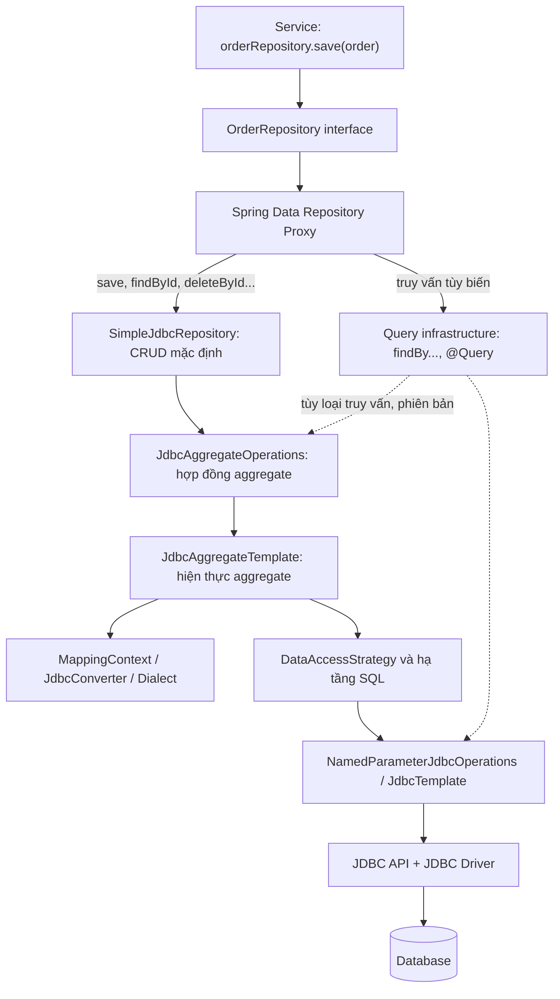
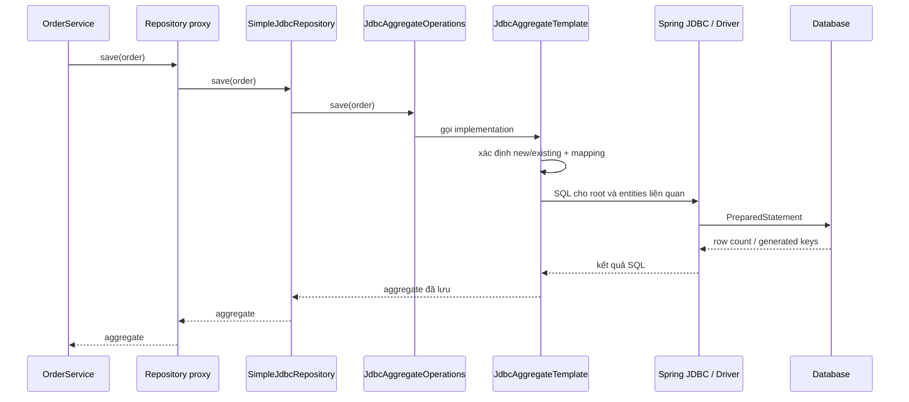

# Quan hệ giữa SimpleJdbcRepository, JdbcAggregateOperations và JDBC

Khi viết ứng dụng với **Spring Data Relational JDBC**, ta thường chỉ khai báo một interface như `OrderRepository extends CrudRepository<Order, Long>` rồi gọi `save()`, `findById()` hoặc `deleteById()`. Các phương thức đó vẫn dẫn đến câu lệnh SQL thật trên cơ sở dữ liệu quan hệ. Giữa lời gọi Java và SQL có nhiều lớp phối hợp, trong đó **`SimpleJdbcRepository`**, **`JdbcAggregateOperations`** và **JDBC** đảm nhiệm các trách nhiệm khác nhau.

Ba khái niệm cần phân biệt ngay từ đầu:

- **`SimpleJdbcRepository`:** lớp cung cấp hiện thực mặc định cho nhiều phương thức CRUD của repository Spring Data JDBC.
- **`JdbcAggregateOperations`:** interface mô tả các thao tác *lưu, đọc và xóa một aggregate*; `JdbcAggregateTemplate` là hiện thực phổ biến của interface.
- **JDBC:** API Java làm việc với database qua driver, connection, prepared statement và result set. Spring JDBC, chẳng hạn `JdbcTemplate` và `NamedParameterJdbcTemplate`, hỗ trợ việc thực hiện SQL dựa trên JDBC.

Vì thế, với những thao tác CRUD mặc định, có thể hình dung đường đi:

`Repository interface → Repository proxy → SimpleJdbcRepository → JdbcAggregateOperations → JdbcAggregateTemplate → Spring JDBC → JDBC Driver → Database`.

Đây là đường đi **điển hình**, không phải quy tắc cho tất cả các phương thức repository. Query được suy ra từ tên (`findBy...`) và SQL viết qua `@Query` có cơ chế thực thi riêng.

## 1. Sơ đồ kiến trúc tổng thể



Sơ đồ giúp xác định trách nhiệm, nhưng không cam kết mọi phiên bản Spring Data JDBC đều dùng đúng những lớp nội bộ hoặc thứ tự gọi như hình.

| Tầng | Thành phần | Trách nhiệm chính | Đầu vào thường gặp |
|---|---|---|---|
| Ứng dụng | Service, repository interface | Đưa ra yêu cầu nghiệp vụ | Object, ID, điều kiện lọc |
| Repository | Proxy, `SimpleJdbcRepository` | Xử lý lời gọi CRUD mặc định | `save`, `findById`, `deleteById` |
| Aggregate | `JdbcAggregateOperations` | Định nghĩa thao tác trên toàn aggregate | Aggregate root, loại domain |
| Hiện thực aggregate | `JdbcAggregateTemplate` | Phối hợp mapping, xác định hành động ghi/đọc | Metadata, converters, aggregate |
| Truy cập quan hệ | `DataAccessStrategy` và SQL infrastructure | Thực hiện thao tác ở mức entity/bảng | Bảng, cột, ID, điều kiện |
| Spring JDBC | `JdbcTemplate`, `NamedParameterJdbcOperations` | Thực hiện SQL, bind tham số, đọc kết quả, quản lý tài nguyên | SQL, tham số, `RowMapper` |
| JDBC | `Connection`, `PreparedStatement`, driver | Gửi yêu cầu đến hệ quản trị | Lệnh và giá trị SQL |

Một điểm dễ nhầm: **`JdbcAggregateOperations` không phải `JdbcOperations`**. Cả hai có chữ “Jdbc” và “Operations”, nhưng `JdbcAggregateOperations` thuộc Spring Data JDBC, còn `JdbcOperations` thuộc Spring JDBC ở tầng sát SQL hơn.

## 2. SimpleJdbcRepository ở tầng repository

Tên lớp đầy đủ:

`org.springframework.data.jdbc.repository.support.SimpleJdbcRepository`

Trong Spring Data JDBC, bạn có thể khai báo:

```java
import org.springframework.data.repository.CrudRepository;

public interface OrderRepository extends CrudRepository<PurchaseOrder, Long> {
}
```

Bạn không cần viết phần thân cho:

```java
PurchaseOrder persisted = orderRepository.save(order);
Optional<PurchaseOrder> found = orderRepository.findById(10L);
boolean exists = orderRepository.existsById(10L);
long total = orderRepository.count();
orderRepository.deleteById(10L);
```

Spring Data tạo repository bean qua **repository factory** và **proxy**. Các phương thức CRUD mặc định được hỗ trợ bằng một lớp repository cơ sở, điển hình là `SimpleJdbcRepository`.

### 2.1. Ủy quyền chứ không tự viết SQL cho từng entity

Hãy xem pseudocode sau. Đây là **mô phỏng rút gọn**, không phải bản sao mã nguồn Spring:

```java
// PSEUDOCODE: chỉ minh họa hướng ủy quyền
class SimpleJdbcRepository<T, ID> {

    private final JdbcAggregateOperations operations;
    private final Class<T> domainType;

    public <S extends T> S save(S aggregate) {
        return operations.save(aggregate);
    }

    public Optional<T> findById(ID id) {
        return Optional.ofNullable(
            operations.findById(id, domainType)
        );
    }

    public void deleteById(ID id) {
        operations.deleteById(id, domainType);
    }
}
```

Như vậy:

1. `SimpleJdbcRepository` biết **domain type** mà repository đang quản lý.
2. Nó chuyển các thao tác CRUD thông thường sang `JdbcAggregateOperations`.
3. Nó trả về đúng kiểu hợp đồng của repository: ví dụ `Optional<T>` cho `findById`.
4. Nó không phải nơi lập trình viên thường chỉnh SQL cho từng bảng.

Hiện thực thật sử dụng metadata như `PersistentEntity` và các thành phần converter, query-by-example, paging/sorting, transaction. Pseudocode trên chỉ thể hiện quan hệ quan trọng nhất.

### 2.2. Repository proxy khác SimpleJdbcRepository

Giả sử bạn mở rộng interface:

```java
import java.util.List;
import org.springframework.data.repository.CrudRepository;

public interface OrderRepository extends CrudRepository<PurchaseOrder, Long> {

    List<PurchaseOrder> findByStatus(String status);
}
```

`findByStatus` là **derived query method**, được Spring Data phân tích từ tên phương thức. Nó không tự nhiên xuất hiện thành một phương thức có sẵn trong `SimpleJdbcRepository`. Repository proxy phân biệt lời gọi CRUD, query method và custom fragment rồi định tuyến đến phần xử lý phù hợp.

Do đó, câu **“tất cả phương thức của repository đều gọi SimpleJdbcRepository”** là sai. Chỉ một phần phương thức, đặc biệt CRUD mặc định, đi qua lớp này theo cách trình bày ở trên.

## 3. JdbcAggregateOperations: hợp đồng thao tác trên aggregate

Tên đầy đủ:

`org.springframework.data.jdbc.core.JdbcAggregateOperations`

Các khả năng tiêu biểu của interface gồm:

```java
// Chữ ký tiêu biểu được lược bớt:
<T> T save(T aggregate);
<T> T insert(T aggregate);
<T> T update(T aggregate);
<T> T findById(Object id, Class<T> domainType);
<T> void deleteById(Object id, Class<T> domainType);
long count(Class<?> domainType);
```

Tùy phiên bản, interface còn các phương thức xử lý nhiều aggregate, sắp xếp, truy vấn theo điều kiện và kiểm tra tồn tại.

Khác biệt cốt lõi so với `JdbcTemplate` là interface này thao tác bằng **đối tượng domain**. Bạn truyền một aggregate, không truyền SQL kiểu `"INSERT INTO..."`.

### 3.1. Aggregate là gì?

Xét một đơn hàng:

```text
PurchaseOrder (aggregate root)
    id = 42
    customerId = 7
    items:
      OrderItem(productId=101, quantity=2)
      OrderItem(productId=102, quantity=1)
```

Dữ liệu có thể được lưu trong hai bảng:

```sql
CREATE TABLE purchase_orders (
    id BIGINT PRIMARY KEY,
    customer_id BIGINT NOT NULL
);

CREATE TABLE order_items (
    order_id BIGINT NOT NULL REFERENCES purchase_orders(id),
    product_id BIGINT NOT NULL,
    quantity INTEGER NOT NULL CHECK (quantity > 0),
    PRIMARY KEY (order_id, product_id)
);
```

Trong Java, `PurchaseOrder` là **aggregate root** nếu bạn mô hình hóa đơn hàng là đối tượng chịu trách nhiệm về các dòng `OrderItem` của nó. Khi đó, thao tác `save(order)` có thể yêu cầu ghi nhiều hàng trong các bảng liên quan.

Điểm quan trọng: *ranh giới aggregate do domain mapping xác định*, không phải cứ có khóa ngoại là Spring Data JDBC tự quản lý toàn bộ object liên quan trong cùng aggregate. Một aggregate có thể tham chiếu ID của aggregate khác mà không quản lý vòng đời của aggregate kia.

### 3.2. Các phương thức save, insert và update

| Phương thức | Ý nghĩa |
|---|---|
| `save(entity)` | Spring Data JDBC nhận biết entity mới hay đã tồn tại để chọn hướng lưu tương ứng |
| `insert(entity)` | Yêu cầu chèn aggregate, bỏ qua bước quyết định mới/cũ của `save` |
| `update(entity)` | Yêu cầu cập nhật aggregate, bỏ qua bước quyết định mới/cũ của `save` |
| `findById(id, Type.class)` | Tải aggregate theo ID và class domain |
| `deleteById(id, Type.class)` | Xóa aggregate theo ID và class domain |

`save` **không đồng nghĩa** với một lệnh SQL `UPSERT` nguyên tử của database. Khái niệm “new” có thể dựa vào `@Id`, `@Version` hoặc triển khai `Persistable`, tùy model và phiên bản. Với ID được database tự sinh, ví dụ phổ biến là `id == null` biểu thị entity mới.

Nếu ứng dụng tự cấp ID cho entity mới, `save` có thể nhận diện đối tượng là đã tồn tại tùy chiến lược newness; `insert` diễn đạt ý định chèn mới rõ hơn.

### 3.3. Vì sao cần sử dụng giá trị trả về?

```java
PurchaseOrder before = new PurchaseOrder(null, "An", "NEW");
PurchaseOrder after = operations.save(before);

Long assignedId = after.id();
```

Khi domain là immutable record, Spring Data JDBC có thể tạo đối tượng trả về có ID do database sinh. Vì thế, nên giữ **kết quả `save`/`insert` trả về** thay vì mặc định object ban đầu đã được thay đổi tại chỗ.

## 4. JdbcAggregateTemplate là hiện thực của hợp đồng aggregate

Tên đầy đủ:

`org.springframework.data.jdbc.core.JdbcAggregateTemplate`

Quan hệ interface/implementation:

```java
public class JdbcAggregateTemplate implements JdbcAggregateOperations {
    // Hiện thực thực tế gồm nhiều chi tiết mapping và lưu aggregate.
}
```

Ứng dụng được phép inject `JdbcAggregateOperations`; trong cấu hình thông dụng, Spring cung cấp implementation dựa trên `JdbcAggregateTemplate`.

`JdbcAggregateTemplate` phối hợp những thành phần như:

- **Mapping context:** hiểu domain class tương ứng bảng/cột nào, ID ở đâu, phần nào là entity thuộc aggregate.
- **`JdbcConverter`:** chuyển kiểu dữ liệu Java thành giá trị lưu trữ và dựng object từ kết quả.
- **`DataAccessStrategy`:** thao tác dữ liệu quan hệ ở mức thấp hơn, thường trên từng entity.
- **Dialect:** điều chỉnh câu SQL/khả năng database theo hệ quản trị.
- **Lifecycle callbacks và events:** mở các điểm can thiệp trước/sau khi chuyển đổi, lưu hoặc tải aggregate.

`JdbcAggregateTemplate` khác `JdbcTemplate` dù tên có chung hậu tố “Template”: một lớp hiểu **aggregate + mapping**, còn lớp kia hiểu **SQL + JDBC**.

### 4.1. Một lần save có thể tạo nhiều lệnh SQL

Với aggregate mới:

```text
operations.save(newOrder)
    → nhận biết Order mới
    → INSERT hàng Order vào bảng gốc
    → nhận ID do database sinh (nếu có)
    → INSERT các entity con thuộc aggregate
    → trả về aggregate đã lưu
```

Với aggregate đã tồn tại:

```text
operations.save(existingOrder)
    → nhận biết Order đã tồn tại
    → chuyển trạng thái aggregate thành các hành động ghi
    → cập nhật Order và đồng bộ các entity con
    → trả về aggregate đã lưu
```

Trong mô hình Spring Data JDBC thông thường, khi save một aggregate đã tồn tại có các entity con, **các hàng con có thể bị xóa và chèn lại**, kể cả khi chỉ một phần nhỏ của chúng thay đổi. Lý do là Spring Data JDBC không duy trì persistence context để lưu một snapshot đầy đủ và theo dõi dirty fields như JPA/Hibernate.

Vì vậy, khi thấy log SQL có nhiều `DELETE`/`INSERT` cho một lời gọi `repository.save(order)`, đừng kết luận ngay rằng code đang gọi save nhiều lần. Hãy xem mapping aggregate và cách Spring Data JDBC đồng bộ thành phần con.

### 4.2. JdbcAggregateTemplate không phải một driver JDBC

`JdbcAggregateTemplate` không tự mở socket đến PostgreSQL/MySQL. Nó dựa trên tầng Spring Data JDBC thấp hơn, Spring JDBC và JDBC driver được cấu hình từ `DataSource`.

Một cách phân lớp:

```text
JdbcAggregateTemplate
    aggregate root + conversion + lifecycle
             ↓
DataAccessStrategy / SQL infrastructure
    thao tác đối với bảng và entity
             ↓
NamedParameterJdbcOperations / JdbcTemplate
    SQL + bind parameters + ResultSet
             ↓
JDBC Connection / PreparedStatement / Driver
             ↓
Relational Database
```

## 5. JDBC: nơi SQL thật được thực thi

JDBC là API có sẵn trong hệ sinh thái Java để chương trình làm việc với cơ sở dữ liệu quan hệ:

- `DataSource` cung cấp connection (thường thông qua connection pool).
- `Connection` đại diện cho một phiên kết nối.
- `PreparedStatement` dùng SQL có tham số, tránh ghép giá trị người dùng vào chuỗi SQL.
- `ResultSet` chứa các hàng được truy vấn.
- JDBC driver chuyển các lời gọi Java thành giao thức với database.

Ví dụ JDBC thuần:

```java
String sql = """
    SELECT id, customer_name, status
    FROM purchase_orders
    WHERE id = ?
    """;

try (Connection connection = dataSource.getConnection();
     PreparedStatement statement = connection.prepareStatement(sql)) {

    statement.setLong(1, 42L);

    try (ResultSet result = statement.executeQuery()) {
        if (result.next()) {
            long id = result.getLong("id");
            String customerName = result.getString("customer_name");
            String status = result.getString("status");
            // Lập trình viên tự dựng Java object.
        }
    }
}
```

Khi sử dụng Spring JDBC, ta thường viết ngắn hơn:

```java
List<String> names = namedParameterJdbcTemplate.query(
    """
    SELECT customer_name
    FROM purchase_orders
    WHERE status = :status
    ORDER BY id
    """,
    Map.of("status", "NEW"),
    (rs, index) -> rs.getString("customer_name")
);
```

`NamedParameterJdbcTemplate` thực hiện binding tham số và quản lý tài nguyên JDBC. Tuy nhiên, nó **không tự biết** rằng `PurchaseOrder` có những entity con nào, hoặc save aggregate cần các hành động nào. Công việc đó thuộc tầng aggregate.

### 5.1. Vai trò DataAccessStrategy

Trong Spring Data JDBC, `DataAccessStrategy` là một mức trừu tượng cho các thao tác dữ liệu thường liên quan đến **một entity** và câu SQL tương ứng. Nó đứng thấp hơn `JdbcAggregateOperations`, vốn hiểu thao tác trên **toàn aggregate**.

Ví dụ thao tác save Order có hai OrderItem:

```text
"Save aggregate Order"
    JdbcAggregateTemplate
        → quyết định ghi root và 2 item
    DataAccessStrategy
        → thực hiện thao tác dữ liệu với từng bảng liên quan
    Spring JDBC
        → execute SQL và map kết quả
    JDBC Driver
        → gửi lệnh đến database
```

Các lớp cụ thể phía dưới có thể thay đổi qua các phiên bản, nhưng ranh giới giữa “tổ chức một aggregate” và “thực hiện câu SQL” vẫn hữu ích khi đọc code hoặc debug.

### 5.2. Phân biệt tên API gần giống nhau

| Kiểu | Package | Độ trừu tượng |
|---|---|---|
| `JdbcAggregateOperations` | `org.springframework.data.jdbc.core` | Toàn aggregate |
| `JdbcAggregateTemplate` | `org.springframework.data.jdbc.core` | Hiện thực thao tác aggregate |
| `JdbcOperations` | `org.springframework.jdbc.core` | SQL + row mapping |
| `NamedParameterJdbcOperations` | `org.springframework.jdbc.core.namedparam` | SQL + named parameters |
| `java.sql.Connection` | `java.sql` | Kết nối JDBC mức thấp |

## 6. Vòng đời một lời gọi save()

Giả sử service gọi:

```java
PurchaseOrder saved = orderRepository.save(
    new PurchaseOrder(null, "An", "NEW")
);
```

Các bước theo cách nhìn **logic**:

1. Ứng dụng gọi bean `OrderRepository`, thực chất là proxy do Spring Data tạo.
2. Proxy xác định `save` là CRUD mặc định, chuyển đến `SimpleJdbcRepository`.
3. `SimpleJdbcRepository.save` gọi `JdbcAggregateOperations.save`.
4. `JdbcAggregateTemplate` xác định aggregate mới hay cũ, xử lý mapping, callbacks và thay đổi cần ghi.
5. `DataAccessStrategy`/SQL infrastructure thực thi các hành động lưu entity.
6. Spring JDBC lấy JDBC connection, bind parameter, thực hiện SQL với driver.
7. Database trả về row count/ID/kết quả khác; mapping và aggregate layer hoàn thiện giá trị trả về rồi trả ngược về service.



Nếu aggregate chỉ có một root và không có entity con, SQL minh họa có thể là:

```sql
-- Lưu mới
INSERT INTO purchase_orders (customer_name, status)
VALUES (?, ?);

-- Đọc theo ID
SELECT id, customer_name, status
FROM purchase_orders
WHERE id = ?;

-- Cập nhật
UPDATE purchase_orders
SET customer_name = ?, status = ?
WHERE id = ?;
```

Đây **không phải bản chụp SQL được bảo đảm** của Spring Data JDBC. SQL thực tế tùy mapping, dialect, version, ID generation và các thành phần con.

## 7. Ví dụ ứng dụng Spring Boot hoàn chỉnh theo từng tầng

Ví dụ dùng Java 21, PostgreSQL và `spring-boot-starter-data-jdbc`. Để tập trung vào kiến trúc, aggregate trong phần này chỉ có **một bảng**, khác ví dụ Order có các entity con phía trên.

### 7.1. Schema tối thiểu

```sql
CREATE TABLE purchase_orders (
    id BIGINT GENERATED BY DEFAULT AS IDENTITY PRIMARY KEY,
    customer_name VARCHAR(120) NOT NULL,
    status VARCHAR(24) NOT NULL
);
```

ID được sinh bởi database, phù hợp với trường hợp tạo mới bằng `id = null`.

### 7.2. Entity

```java
import org.springframework.data.annotation.Id;
import org.springframework.data.relational.core.mapping.Table;

@Table("purchase_orders")
public record PurchaseOrder(
    @Id Long id,
    String customerName,
    String status
) {}
```

Theo naming strategy thông dụng, property `customerName` ánh xạ với cột `customer_name`. Với schema khác quy ước, hãy đặt tên bằng `@Column` một cách tường minh.

### 7.3. Repository

```java
import java.util.List;
import org.springframework.data.repository.CrudRepository;

public interface OrderRepository
        extends CrudRepository<PurchaseOrder, Long> {

    List<PurchaseOrder> findByStatus(String status);
}
```

`save` và `findById` là phương thức CRUD mặc định. `findByStatus` được query infrastructure của Spring Data xử lý từ tên.

### 7.4. Service vừa dùng repository, vừa dùng aggregate operations

```java
import java.util.List;
import java.util.NoSuchElementException;
import org.springframework.data.jdbc.core.JdbcAggregateOperations;
import org.springframework.stereotype.Service;
import org.springframework.transaction.annotation.Transactional;

@Service
public class OrderService {

    private final OrderRepository repository;
    private final JdbcAggregateOperations aggregateOperations;

    public OrderService(OrderRepository repository,
                        JdbcAggregateOperations aggregateOperations) {
        this.repository = repository;
        this.aggregateOperations = aggregateOperations;
    }

    @Transactional
    public PurchaseOrder createWithRepository(String name) {
        return repository.save(
            new PurchaseOrder(null, name, "NEW")
        );
    }

    @Transactional
    public PurchaseOrder createWithOperations(String name) {
        return aggregateOperations.insert(
            new PurchaseOrder(null, name, "NEW")
        );
    }

    @Transactional(readOnly = true)
    public PurchaseOrder find(long id) {
        return repository.findById(id)
            .orElseThrow(() -> new NoSuchElementException("Order not found"));
    }

    @Transactional(readOnly = true)
    public List<PurchaseOrder> listNew() {
        return repository.findByStatus("NEW");
    }

    @Transactional
    public PurchaseOrder confirm(long id) {
        PurchaseOrder previous = repository.findById(id)
            .orElseThrow(() -> new NoSuchElementException("Order not found"));

        return aggregateOperations.update(
            new PurchaseOrder(
                previous.id(),
                previous.customerName(),
                "CONFIRMED"
            )
        );
    }
}
```

**Giải thích từng nhánh:**

- `createWithRepository` gọi `repository.save`; đi qua hiện thực repository CRUD rồi đến aggregate operations.
- `createWithOperations` gọi trực tiếp `insert` của aggregate API; biểu đạt rõ ý định insert.
- `find` dùng `Optional` của repository; API aggregate `findById(id, PurchaseOrder.class)` có thể trả về `null` khi thiếu dữ liệu.
- `listNew` là derived query, được proxy giải quyết bằng cơ chế riêng.
- `confirm` dùng `update` ở cấp aggregate. Việc đọc rồi cập nhật trong ví dụ không tự ngăn hai request tranh chấp; với dữ liệu thường xuyên thay đổi, cần kiểm soát đồng thời phù hợp như `@Version` hoặc điều kiện UPDATE.

### 7.5. Phụ thuộc và datasource

```groovy
dependencies {
    implementation 'org.springframework.boot:spring-boot-starter-data-jdbc'
    runtimeOnly 'org.postgresql:postgresql'
}
```

```yaml
spring:
  datasource:
    url: jdbc:postgresql://localhost:5432/shop
    username: shop_user
    password: "<lấy từ cấu hình bí mật của môi trường>"
```

Trong một ứng dụng Boot được cấu hình đúng, Spring thường tự chuẩn bị bean datasource, Spring JDBC, mapping/converter, aggregate operations và repository infrastructure. Bạn không cần tạo `SimpleJdbcRepository` bằng `new`.

Schema cần tồn tại trước khi chạy các thao tác. Trong ứng dụng thực tế, Flyway hoặc Liquibase có thể quản lý các thay đổi schema.

## 8. Điều gì xảy ra với findBy... và @Query?

Thêm một phương thức `@Query`:

```java
import java.util.List;
import org.springframework.data.jdbc.repository.query.Query;
import org.springframework.data.repository.CrudRepository;

public interface OrderRepository
        extends CrudRepository<PurchaseOrder, Long> {

    List<PurchaseOrder> findByStatus(String status);

    @Query("""
        SELECT id, customer_name, status
        FROM purchase_orders
        WHERE customer_name = :name
        ORDER BY id
        """)
    List<PurchaseOrder> findByCustomerNameSql(String name);
}
```

| Lời gọi | Cơ chế chính |
|---|---|
| `repository.save(order)` | Repository proxy → CRUD base implementation → aggregate operations |
| `repository.findById(id)` | Repository proxy → CRUD base implementation → aggregate operations |
| `repository.findByStatus("NEW")` | Repository proxy → derived-query executor |
| `repository.findByCustomerNameSql("An")` | Repository proxy → khai báo SQL qua `@Query` |

Ở những phiên bản/loại query khác nhau, query executor có thể làm việc với `JdbcAggregateOperations` hoặc các thành phần Spring JDBC thấp hơn. Vì thế không nên vẽ một chuỗi **cố định duy nhất** cho mọi query method.

Một SQL `@Query` tùy biến không đương nhiên có vòng đời lưu aggregate giống `repository.save`. Với truy vấn thay đổi dữ liệu bằng `@Modifying`, cần phân biệt SQL update/delete trực tiếp với các operation quản lý toàn aggregate và các callback đi kèm.

### 8.1. Khi nào nên tách truy vấn báo cáo khỏi aggregate?

Ví dụ cần thống kê số đơn theo trạng thái:

```sql
SELECT status, COUNT(*) AS total_orders
FROM purchase_orders
GROUP BY status;
```

Kết quả có hai cột `status` và `total_orders`, không phải một aggregate `PurchaseOrder` hoàn chỉnh. Có thể xây dựng DTO/projection riêng và thực hiện SQL tường minh qua Spring JDBC hoặc repository query tương ứng. Không cần cưỡng ép kết quả thống kê vào aggregate được thiết kế để ghi và đọc theo ID.

## 9. Chọn API phù hợp với yêu cầu

| Nhu cầu | API thường phù hợp | Lý do |
|---|---|---|
| CRUD aggregate theo ID | `CrudRepository` | Ngắn gọn, hợp đồng repository rõ ràng |
| Truy vấn theo thuộc tính entity | Derived query hoặc `@Query` | Dễ diễn đạt điều kiện và kết quả |
| Chủ động insert aggregate có ID được cấp trước | `JdbcAggregateOperations.insert` | Chỉ định ý định insert |
| Chủ động update toàn aggregate | `JdbcAggregateOperations.update` | Chỉ định ý định update ở cấp aggregate |
| Viết custom repository fragment có mapping aggregate | `JdbcAggregateOperations` / `JdbcAggregateTemplate` | Tái sử dụng aggregate lifecycle |
| JOIN/GROUP BY báo cáo hoặc DTO đặc thù | `NamedParameterJdbcTemplate` | Kiểm soát SQL và mapping kết quả |
| UPDATE có điều kiện và đọc số hàng ảnh hưởng | Spring JDBC | Kiểm soát câu SQL nguyên tử |
| Cần chức năng driver rất đặc biệt | JDBC hoặc Spring JDBC | Truy cập gần database hơn |

### 9.1. Ví dụ dùng Spring JDBC cho chuyển trạng thái nguyên tử

Giả sử chỉ được chuyển đơn `NEW` sang `CONFIRMED` nếu trạng thái hiện tại vẫn là `NEW`. Khi đó:

```java
import java.util.Map;
import org.springframework.jdbc.core.namedparam.NamedParameterJdbcTemplate;

public int confirmIfNew(long id, NamedParameterJdbcTemplate jdbc) {
    return jdbc.update(
        """
        UPDATE purchase_orders
        SET status = :newStatus
        WHERE id = :id
          AND status = :expectedStatus
        """,
        Map.of(
            "id", id,
            "newStatus", "CONFIRMED",
            "expectedStatus", "NEW"
        )
    );
}
```

`jdbc.update(...)` trả về số hàng được xử lý. Thông thường:

- `1`: một hàng phù hợp, cập nhật thành công.
- `0`: đơn không tồn tại hoặc không còn trạng thái `NEW`.
- Nhiều hơn `1`: điều kiện/khóa định danh có vấn đề, nếu `id` đáng lẽ là khóa duy nhất.

SQL có điều kiện này khác việc `aggregateOperations.update(order)` vì nó tập trung vào **một chuyển trạng thái** với điều kiện cụ thể. Cần chọn đường phù hợp với quy tắc nghiệp vụ và lifecycle aggregate.

### 9.2. Mở rộng repository bằng custom fragment

Bạn có thể thêm API riêng mà vẫn dùng tầng aggregate:

```java
public interface OrderCustomOperations {
    PurchaseOrder createExplicitly(String name);
}
```

```java
import org.springframework.data.jdbc.core.JdbcAggregateOperations;

public class OrderCustomOperationsImpl implements OrderCustomOperations {

    private final JdbcAggregateOperations operations;

    public OrderCustomOperationsImpl(JdbcAggregateOperations operations) {
        this.operations = operations;
    }

    @Override
    public PurchaseOrder createExplicitly(String name) {
        return operations.insert(
            new PurchaseOrder(null, name, "NEW")
        );
    }
}
```

```java
public interface OrderRepository
        extends CrudRepository<PurchaseOrder, Long>, OrderCustomOperations {
}
```

Đây là hình thức fragment thường dùng để mở rộng repository, thay vì tự viết lại `SimpleJdbcRepository` cho một phương thức mới. Interface và class implementation cần đặt đúng package và tuân thủ naming convention/fragment setup của Spring Data trong dự án.

## 10. Cấu hình: các bean được tạo và kết nối như thế nào?

Một ứng dụng Spring Boot thông thường có các thành phần gần như:

```text
DataSource + JDBC Driver
        │
        ├─────────────── TransactionManager
        │
        ▼
Spring JDBC operations
        ▲
        │
Dialect + MappingContext + JdbcConverter
        │
        ▼
DataAccessStrategy
        │
        ▼
JdbcAggregateTemplate : JdbcAggregateOperations
        │
        ▼
JdbcRepositoryFactory / SimpleJdbcRepository
        │
        ▼
Repository proxy → OrderRepository
```

Sơ đồ này diễn đạt **liên hệ cấu hình**, không phải thứ tự khởi tạo bean chính xác. Một số thành phần mapping và database access có thể được nối theo cách khác giữa các phiên bản.

### 10.1. Repository factory hoạt động ra sao?

Repository factory là cơ chế tạo repository proxy dựa trên interface. Nó cần biết domain type, ID type, mapping metadata và các operations đã được cấu hình.

Trong ứng dụng Spring Boot có `spring-boot-starter-data-jdbc`, repository scanning/bean auto-configuration thường được bật theo cấu hình chuẩn. Khi tự cấu hình Spring Data JDBC, `@EnableJdbcRepositories` có thể dùng để kích hoạt repository scanning.

Ở các dòng Spring Data JDBC mới, cấu hình `@EnableJdbcRepositories` có thuộc tính `jdbcAggregateOperationsRef` để chọn bean aggregate operations dùng cho repository. Một số tùy chọn cấu hình cũ chỉ trỏ `DataAccessStrategy` hoặc JDBC operations đã bị deprecate trong phiên bản mới. Vì vậy, nếu tùy biến infrastructure, hãy đối chiếu JavaDoc đúng phiên bản phụ thuộc.

### 10.2. Khi nào cần custom JdbcAggregateTemplate?

Một số ứng dụng muốn kiểm soát cách aggregate được lưu, thêm khả năng quan sát, hoặc xây dựng cơ chế mapping riêng. Đó là các tình huống nâng cao; việc tạo bean `JdbcAggregateOperations` tùy biến phải bảo đảm converter, mapping context, dialect và data access strategy **đồng bộ**.

Đừng tự tạo thêm repository factory hoặc `JdbcAggregateTemplate` chỉ để “bật” CRUD cơ bản. Khi cấu hình thiếu, hãy tìm nguyên nhân ở datasource, driver, schema, package scan hoặc bean wiring trước.

### 10.3. Chẩn đoán lỗi theo tầng

| Hiện tượng | Tầng nên kiểm tra đầu tiên |
|---|---|
| Không thấy bean repository | Repository scanning, factory configuration |
| Inject `JdbcAggregateOperations` không được | Data JDBC configuration, bean registration |
| Bảng/cột bị mapping sai | `@Table`, `@Column`, mapping strategy, converter |
| Save aggregate con gây nhiều SQL | Aggregate mapping, `JdbcAggregateTemplate` |
| SQL syntax không hợp database | Dialect, generated SQL, database version |
| Lỗi connection / timeout | `DataSource`, pool, driver, database |
| Query `@Query` trả sai cột | SQL tùy biến, projection, row mapping |
| Transaction không rollback | Service `@Transactional`, exception, transaction manager |

## 11. Transaction: repository và aggregate operations có cùng giao dịch không?

Có thể, nếu được gọi trong một service mang `@Transactional` và đều tham gia cùng transaction manager cùng datasource.

```java
import org.springframework.transaction.annotation.Transactional;

@Transactional
public void createTwoOrders(
        OrderRepository repository,
        JdbcAggregateOperations operations) {

    repository.save(new PurchaseOrder(null, "An", "NEW"));
    operations.insert(new PurchaseOrder(null, "Bình", "NEW"));
}
```

Nếu thao tác thứ hai thất bại và exception dẫn đến rollback theo chính sách transaction, cả hai thay đổi có thể bị rollback cùng nhau. Với JDBC transaction của Spring, cùng datasource/transaction manager là điều kiện quan trọng; nếu tự mở một connection khác ngoài ngữ cảnh Spring, bạn có thể làm mất tính nhất quán mong đợi.

`SimpleJdbcRepository` có các khai báo transaction mặc định dành cho phương thức CRUD, nhưng điều đó **không tự ghép nhiều lời gọi repository riêng biệt thành một transaction nghiệp vụ**. Khi cần nhiều thao tác nguyên tử, hãy khai báo ranh giới ở service.

### 11.1. Transaction chưa giải quyết mọi xung đột đồng thời

Hai request có thể:

```text
Request A: findById(42) → status NEW
Request B: findById(42) → status NEW
Request A: save(status = CONFIRMED)
Request B: save(status = CANCELLED)
```

Transaction riêng lẻ không bảo đảm request B biết request A đã đổi trạng thái. Có thể dùng:

- `@Version` trên aggregate để hỗ trợ **optimistic locking**.
- `UPDATE ... WHERE id = ? AND status = ?` và kiểm tra row count.
- Lock hoặc isolation level phù hợp khi cần bảo đảm mạnh hơn.

Trong xử lý nghiệp vụ, tính đúng đắn là kết quả của **transaction + điều kiện đồng thời + ranh giới aggregate**, không chỉ là việc chọn `save`.

### 11.2. So với JPA/Hibernate

| Khía cạnh | Spring Data JDBC | JPA/Hibernate |
|---|---|---|
| Hướng thiết kế | Aggregate theo mô hình quan hệ | ORM với persistence context |
| `EntityManager` | Không có API tương đương theo mô hình JPA | Có `EntityManager` |
| Dirty checking | Không tự theo dõi field thay đổi như JPA | Có với managed entities |
| Entity con | Có thể delete/reinsert khi save aggregate | Có nhiều cơ chế đồng bộ quan hệ |
| Lazy-loading proxy | Không cung cấp kiểu lazy loading quan hệ như JPA | Có thể hỗ trợ |
| Mức SQL thủ công | Có thể kết hợp Spring JDBC trực tiếp | Có JPQL/native query/Criteria |

Không nên đem giả định JPA như dirty checking, cascading và lazy loading áp dụng trực tiếp cho Spring Data JDBC chỉ vì cả hai đều có `CrudRepository`.

## 12. Quan sát đường đi thực tế bằng log và debug

Trong môi trường phát triển, bạn có thể bật logging SQL ở mức phù hợp:

```yaml
logging:
  level:
    org.springframework.jdbc.core: DEBUG
    org.springframework.data.jdbc.core: DEBUG
```

Logger và mức chi tiết còn tùy phiên bản. Một số logger JDBC ở TRACE có thể hiển thị các giá trị bind; tránh bật logging tham số nhạy cảm trong production.

Với ví dụ:

```java
PurchaseOrder created = repository.save(
    new PurchaseOrder(null, "An", "NEW")
);

PurchaseOrder reloaded = repository.findById(created.id())
    .orElseThrow();
```

Hãy quan sát câu SQL được sinh, giá trị ID, thời điểm truy vấn và số lượng statement. Nếu mapping có entity con, thử thay đổi đúng một item rồi gọi `save` để thấy chiến lược đồng bộ aggregate.

Khi debug mã thư viện, tìm breakpoint ở `SimpleJdbcRepository.save` và `JdbcAggregateTemplate.save`. Sau đó lần theo lớp truy cập SQL của đúng phiên bản Spring Data JDBC đang được dùng. Nếu IDE tải source JAR khác phiên bản, stack trace và API có thể không khớp với mã bạn đang đọc.

### Các câu hỏi kiểm tra quan sát

1. `repository.save(newEntity)` đi qua lớp repository nào?
2. Chương trình dùng `JdbcAggregateOperations` dưới dạng interface hay implementation nào?
3. `JdbcAggregateTemplate` cần những metadata nào để tạo hành động ghi?
4. Một lần save sinh bao nhiêu SQL và vì sao?
5. `repository.findByStatus(...)` có đường gọi khác `repository.findById(...)` ra sao?
6. Driver/database trả lại ID tự sinh bằng cơ chế nào?
7. Lệnh SQL có tham gia transaction của service không?

## 13. Các hiểu nhầm cần tránh

| Hiểu nhầm | Cách hiểu đúng |
|---|---|
| “SimpleJdbcRepository là JDBC driver.” | Nó là hiện thực CRUD repository của Spring Data |
| “JdbcAggregateOperations cũng là JdbcOperations.” | Một bên thao tác aggregate, một bên là Spring JDBC cho SQL |
| “JdbcAggregateTemplate = JdbcTemplate.” | Hai lớp thuộc hai mức trừu tượng khác nhau |
| “Tất cả repository method dùng SimpleJdbcRepository.” | Derived queries và `@Query` có cơ chế thực thi riêng |
| “save luôn là một câu INSERT/UPDATE.” | Aggregate có thể sinh nhiều statement |
| “save chắc chắn là native UPSERT.” | Cơ chế nhận biết entity mới/cũ khác native UPSERT |
| “findById ở repository và aggregate ops giống hệt kiểu trả về.” | Repository dùng `Optional`; aggregate operations có thể trả `null` |
| “Có foreign key thì mọi bảng được lưu cùng aggregate.” | Chỉ thành phần được ánh xạ trong ranh giới aggregate tương ứng |
| “Có transaction thì không thể ghi đè dữ liệu đồng thời.” | Vẫn cần optimistic lock, điều kiện update hoặc chính sách isolation |
| “Muốn query tùy biến phải sửa SimpleJdbcRepository.” | Dùng derived query, `@Query`, custom fragment hoặc Spring JDBC |

## 14. Bài thực hành và câu hỏi tự kiểm tra

**Bài 1 — Giải thích lời gọi CRUD.** Với `repository.save(new PurchaseOrder(null, "An", "NEW"))`, mô tả từ repository proxy xuống JDBC. Vì sao phần code ứng dụng không cần tự tạo `PreparedStatement`?

*Định hướng:* `SimpleJdbcRepository` ủy quyền cho `JdbcAggregateOperations`; `JdbcAggregateTemplate` phối hợp mapping và SQL infrastructure, rồi Spring JDBC gửi SQL qua driver.

**Bài 2 — So sánh hai API.** Giải thích khác biệt giữa:

```java
repository.save(order);
aggregateOperations.insert(order);
```

*Định hướng:* `save` quyết định insert/update theo trạng thái new/existing, còn `insert` biểu đạt chèn mới trực tiếp.

**Bài 3 — Đọc kết quả.** Nếu truy vấn `findById(42L)` không tìm được đơn, repository và aggregate API thường diễn đạt việc thiếu kết quả thế nào?

*Định hướng:* Repository trả `Optional.empty()`. Aggregate API `findById(id, PurchaseOrder.class)` có thể trả `null`.

**Bài 4 — SQL nhiều bảng.** Tại sao một `save` có thể tạo một INSERT vào `purchase_orders` và hai INSERT vào `order_items`?

*Định hướng:* Vì thao tác ở cấp aggregate có thể lưu root cùng các entity con thuộc aggregate.

**Bài 5 — Query method.** `findByStatus` có nhất thiết là phương thức được viết trong `SimpleJdbcRepository` không?

*Định hướng:* Không. Spring Data query infrastructure phân tích tên rồi thực thi query.

**Bài 6 — Cạnh tranh.** Hai request cùng đọc trạng thái `NEW` rồi muốn đổi sang hai trạng thái khác nhau. Tại sao cần `@Version` hoặc UPDATE có điều kiện?

*Định hướng:* Transaction riêng lẻ không tự phát hiện và giải quyết lost update.

**Bài 7 — Lựa chọn API.** Bạn muốn thống kê số đơn theo trạng thái bằng `GROUP BY`, trả kết quả `status / totalOrders`. Hãy chọn giữa repository CRUD, aggregate template và Spring JDBC.

*Định hướng:* Đây là projection báo cáo; SQL có tham số và DTO/projection là hướng phù hợp, có thể thông qua repository query hoặc Spring JDBC.

## 15. Ghi nhớ mối quan hệ

`SimpleJdbcRepository` là nơi hiện thực các phương thức CRUD mặc định của repository. Nó **ủy quyền** thao tác aggregate cho `JdbcAggregateOperations`. `JdbcAggregateTemplate` là hiện thực tiêu biểu của interface đó; nó dùng mapping và chiến lược truy cập dữ liệu để chuyển aggregate thành các thao tác SQL. **Spring JDBC và JDBC driver** sau cùng thực hiện giao tiếp thật với database.

```text
CRUD repository call
    ↓
SimpleJdbcRepository
    ↓
JdbcAggregateOperations
    ↓
JdbcAggregateTemplate
    ↓
Mapping / DataAccessStrategy
    ↓
Spring JDBC
    ↓
JDBC Driver
    ↓
Database
```

Với **derived query hoặc `@Query`**, hãy bắt đầu theo dấu từ repository proxy sang query executor; đường thực thi có thể khác CRUD mặc định.

### Tài liệu tham khảo chính thức

- [Spring Data Relational — Persisting Entities](https://docs.spring.io/spring-data/relational/reference/jdbc/entity-persistence.html): cách Spring Data JDBC save aggregate và API template.
- [SimpleJdbcRepository JavaDoc](https://docs.spring.io/spring-data/relational/docs/current/api/org/springframework/data/jdbc/repository/support/SimpleJdbcRepository.html): vai trò lớp repository mặc định và dependency vào aggregate operations.
- [JdbcAggregateOperations JavaDoc](https://docs.spring.io/spring-data/jdbc/docs/current/api/org/springframework/data/jdbc/core/JdbcAggregateOperations.html): hợp đồng save/insert/update/read/delete aggregate.
- [JdbcAggregateTemplate JavaDoc](https://docs.spring.io/spring-data/relational/docs/current/api/org/springframework/data/jdbc/core/JdbcAggregateTemplate.html): hiện thực của `JdbcAggregateOperations`.
- [EnableJdbcRepositories JavaDoc](https://docs.spring.io/spring-data/jdbc/docs/current/api/org/springframework/data/jdbc/repository/config/EnableJdbcRepositories.html): cấu hình repository infrastructure.

Khi tra cứu mã nguồn hoặc JavaDoc, hãy dùng **đúng phiên bản Spring Data Relational mà ứng dụng đang chạy**, vì một số constructor, bean wiring và API có thể khác giữa các dòng phát hành.
