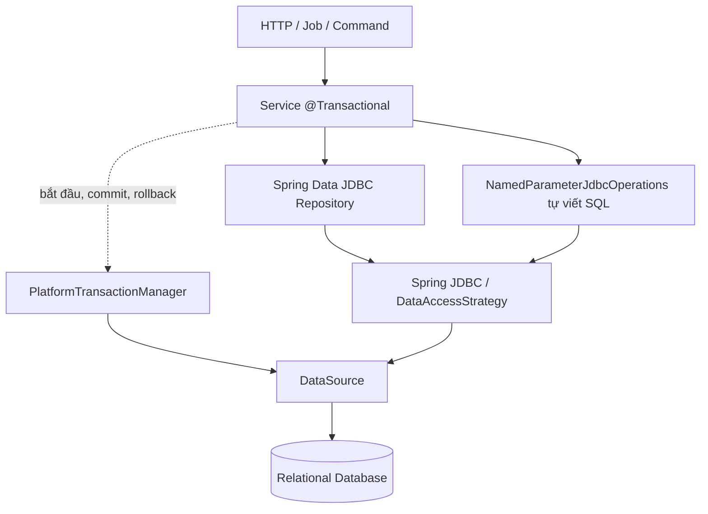
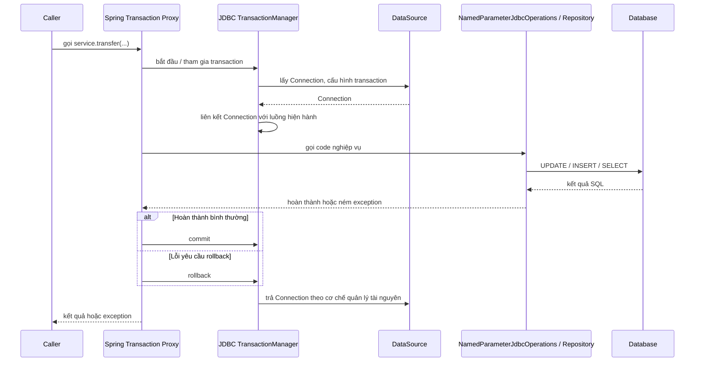

# Đăng ký `NamedParameterJdbcOperations` và transaction manager

Trong **Spring Data JDBC**, repository không tự mở một kết nối JDBC mới cho mỗi lệnh rồi tự quyết định commit hoặc rollback. Nó dựa trên các thành phần được đăng ký vào **Spring ApplicationContext**: `DataSource` cung cấp kết nối tới cơ sở dữ liệu; `NamedParameterJdbcOperations` thực thi SQL với tham số đặt tên; và **transaction manager** quản lý ranh giới giao dịch. Cấu hình ba thành phần này nhất quán là nền tảng để repository, mã SQL tự viết và các phương thức `@Transactional` cùng làm việc trên đúng cơ sở dữ liệu, đúng transaction.

Bài học tập trung vào cách đăng ký các bean đó trong hai trường hợp: **Spring Boot tự cấu hình** và **cấu hình Java thủ công**, sau đó giải thích cách chúng phối hợp, cách dùng trong service và các lỗi thường gặp.

## 1. Ba thành phần đảm nhận việc gì?

| Thành phần | Kiểu Java tiêu biểu | Trách nhiệm |
| --- | --- | --- |
| Nguồn kết nối | `javax.sql.DataSource` | Cấp `Connection` tới database; trong ứng dụng thật thường dùng connection pool |
| Truy cập JDBC có tham số tên | `org.springframework.jdbc.core.namedparam.NamedParameterJdbcOperations` | Cung cấp `query`, `queryForObject`, `update`, `batchUpdate`… bằng các tham số như `:customerId` |
| Quản lý giao dịch | `org.springframework.transaction.PlatformTransactionManager` | Bắt đầu, commit, rollback giao dịch theo cấu hình `@Transactional` hoặc API giao dịch tường minh |

Các triển khai phổ biến cho ứng dụng JDBC một database là:

- `NamedParameterJdbcTemplate` triển khai `NamedParameterJdbcOperations`, dựa vào Spring JDBC để gửi lệnh SQL.
- `JdbcTransactionManager` là transaction manager dành cho JDBC, mở rộng `DataSourceTransactionManager` với khả năng chuyển đổi ngoại lệ khi commit/rollback. `DataSourceTransactionManager` cũng là lựa chọn hợp lệ trong cấu hình thuần JDBC.
- `HikariDataSource` thường được Spring Boot dùng để quản lý pool nếu HikariCP có trên classpath và không có cấu hình thay thế.



`DataSource` trong nhánh thực thi SQL và trong transaction manager **phải cùng trỏ đến tài nguyên giao dịch được quản lý**. Nếu repository ghi vào database A còn transaction manager dùng database B, `@Transactional` có thể trông như đang chạy nhưng không bảo vệ các thao tác cần thiết trên A.

## 2. `NamedParameterJdbcOperations` khác gì `JdbcTemplate`?

Với JDBC truyền thống, người lập trình thao tác `Connection`, `PreparedStatement` và `ResultSet` trực tiếp. Spring JDBC cung cấp `JdbcTemplate` để giảm mã lặp và xử lý tài nguyên/ngoại lệ. `NamedParameterJdbcTemplate` xây dựng trên cơ chế đó, bổ sung **tham số đặt tên** thay cho vị trí dấu `?`.

SQL với tham số theo vị trí:

```java
String sql = "SELECT id FROM customers WHERE status = ? AND city = ?";
// Cần đảm bảo thứ tự giá trị trùng thứ tự dấu ?.
```

SQL với tham số đặt tên:

```java
String sql = """
    SELECT id
    FROM customers
    WHERE status = :status AND city = :city
    """;
```

`NamedParameterJdbcOperations` là **interface** để khai báo phụ thuộc theo hợp đồng. `NamedParameterJdbcTemplate` là một **implementation** có thể đăng ký thành bean:

```java
@Bean
NamedParameterJdbcOperations namedParameterJdbcTemplate(DataSource dataSource) {
    return new NamedParameterJdbcTemplate(dataSource);
}
```

Tham số `:status`, `:city` được chuyển thành giá trị bind cho prepared statement; chúng giúp phân tách **giá trị dữ liệu** khỏi SQL. Tuy nhiên, tham số không thay thế được tên bảng hoặc tên cột động: nếu nghiệp vụ cần chọn tên bảng/cột, phải dùng danh sách cho phép ở tầng ứng dụng, không ghép tùy ý dữ liệu người dùng vào chuỗi SQL.

`NamedParameterJdbcOperations` **không phải** transaction manager. Nó thực thi SQL và tham gia giao dịch hiện hành nếu Spring đã quản lý giao dịch cho `DataSource` đó; việc bắt đầu và kết thúc giao dịch là trách nhiệm của `PlatformTransactionManager`.

## 3. Cách khuyến nghị với Spring Boot: để auto-configuration đăng ký bean

Với một ứng dụng Spring Boot dùng **một database quan hệ**, thường chỉ cần starter Spring Data JDBC, JDBC driver và cấu hình `spring.datasource`. Spring Boot tạo các bean JDBC cần thiết nếu các điều kiện tự cấu hình được đáp ứng. Không cần tự khai báo `NamedParameterJdbcTemplate` hoặc transaction manager chỉ để dùng repository thông thường.

### 3.1. Dependency và cấu hình kết nối

Ví dụ Gradle (Groovy DSL, trong dự án đã sử dụng Spring Boot và quản lý phiên bản dependency):

```groovy
dependencies {
    implementation 'org.springframework.boot:spring-boot-starter-data-jdbc'
    runtimeOnly 'org.postgresql:postgresql'
}
```

Ví dụ `application.yml`:

```yaml
spring:
  datasource:
    url: jdbc:postgresql://localhost:5432/shopdb
    username: shop_app
    password: ${DB_PASSWORD}
```

Mẫu trên giả định database và tài khoản đã tồn tại, môi trường có biến `DB_PASSWORD`, và ứng dụng được phép kết nối tới PostgreSQL. Spring Boot thường đăng ký:

1. Một `DataSource` được cấu hình từ `spring.datasource.*`.
2. Một `JdbcTemplate` và một `NamedParameterJdbcTemplate` (triển khai `NamedParameterJdbcOperations`) sử dụng `DataSource` đó.
3. Một transaction manager phù hợp cho JDBC khi chưa có bean transaction manager khác được người dùng cung cấp.
4. Các thành phần Spring Data JDBC để tạo repository từ interface và ánh xạ aggregate.

Các cấu hình tự động phụ thuộc phiên bản Spring Boot, các starter hiện diện, số lượng `DataSource` và những bean đã tự khai báo. Vì vậy, **đừng xem các bean auto-config là bất biến**: khi thêm database thứ hai hoặc cung cấp transaction manager tùy chỉnh, cần kiểm tra lại thành phần thực sự được tạo.

### 3.2. Sử dụng bean đã được đăng ký

```java
package com.example.shop.customer;

import java.util.Map;
import org.springframework.jdbc.core.namedparam.NamedParameterJdbcOperations;
import org.springframework.stereotype.Repository;

@Repository
public class CustomerStatisticsDao {
    private final NamedParameterJdbcOperations jdbc;

    public CustomerStatisticsDao(NamedParameterJdbcOperations jdbc) {
        this.jdbc = jdbc;
    }

    public long countByStatus(String status) {
        String sql = """
            SELECT COUNT(*)
            FROM customers
            WHERE status = :status
            """;

        Long count = jdbc.queryForObject(
            sql,
            Map.of("status", status),
            Long.class
        );
        return count == null ? 0 : count;
    }
}
```

Constructor injection nhận bean đã được quản lý, nên DAO này dùng chung tài nguyên JDBC với các thành phần khác. Không cần gọi `new NamedParameterJdbcTemplate(dataSource)` trong từng phương thức.

Các repository Spring Data JDBC như sau cũng được Spring Boot phát hiện khi đặt trong phạm vi package scan thích hợp:

```java
import org.springframework.data.repository.CrudRepository;

public interface CustomerRepository extends CrudRepository<Customer, Long> {
}
```

Trong đó `Customer` là aggregate đã được ánh xạ bằng Spring Data JDBC, ví dụ `@Table("customers")` và một thuộc tính `@Id`. Repository được tạo bởi Spring Data JDBC; `CustomerStatisticsDao` là DAO sử dụng SQL thủ công cho truy vấn riêng. Hai cách tiếp cận có thể cùng tồn tại trong một ứng dụng.

### 3.3. Khi nào cần đăng ký thủ công?

Chỉ cân nhắc thay hoặc thêm bean khi có nhu cầu cụ thể như:

- Không dùng Spring Boot auto-configuration hoặc khởi tạo ApplicationContext theo cách riêng.
- Muốn điều khiển rõ `DataSource`, transaction manager, pool hoặc chiến lược quản lý kết nối.
- Có nhiều `DataSource`, mỗi nhóm repository cần kết nối và transaction manager tương ứng.
- Cần dùng một `NamedParameterJdbcOperations` được cấu hình riêng để tích hợp với cơ chế truy cập dữ liệu chuyên biệt.

Việc thêm một bean cùng loại có thể khiến auto-configuration **back off**, tạo mơ hồ khi dependency injection, hoặc làm repository trỏ vào bean khác dự kiến. Do đó cần xác định rõ mục đích của cấu hình trước khi ghi đè mặc định.

## 4. Cấu hình Java thủ công cho Spring Data JDBC

Trong ứng dụng sử dụng Spring Framework mà không dựa vào auto-configuration của Spring Boot, Spring Data JDBC có thể được kích hoạt qua `@EnableJdbcRepositories`. Lớp `AbstractJdbcConfiguration` cung cấp các bean hạ tầng cho Spring Data JDBC; ứng dụng cần cung cấp `DataSource`, `NamedParameterJdbcOperations` và transaction manager.

Ví dụ dưới đây sử dụng H2 nhúng để minh họa đầy đủ cách đăng ký; thêm dependency phù hợp cho H2 và đặt file `schema.sql` trong classpath khi chạy ví dụ:

```java
package com.example.shop.config;

import javax.sql.DataSource;

import org.springframework.context.annotation.Bean;
import org.springframework.context.annotation.Configuration;
import org.springframework.data.jdbc.repository.config.AbstractJdbcConfiguration;
import org.springframework.data.jdbc.repository.config.EnableJdbcRepositories;
import org.springframework.jdbc.core.namedparam.NamedParameterJdbcOperations;
import org.springframework.jdbc.core.namedparam.NamedParameterJdbcTemplate;
import org.springframework.jdbc.datasource.embedded.EmbeddedDatabaseBuilder;
import org.springframework.jdbc.datasource.embedded.EmbeddedDatabaseType;
import org.springframework.jdbc.support.JdbcTransactionManager;
import org.springframework.transaction.PlatformTransactionManager;
import org.springframework.transaction.annotation.EnableTransactionManagement;

@Configuration
@EnableJdbcRepositories(basePackages = "com.example.shop.repository")
@EnableTransactionManagement
public class JdbcPersistenceConfiguration extends AbstractJdbcConfiguration {

    @Bean
    DataSource dataSource() {
        return new EmbeddedDatabaseBuilder()
            .setType(EmbeddedDatabaseType.H2)
            .addScript("schema.sql")
            .build();
    }

    @Bean("namedParameterJdbcTemplate")
    NamedParameterJdbcOperations namedParameterJdbcOperations(
            DataSource dataSource) {
        return new NamedParameterJdbcTemplate(dataSource);
    }

    @Bean("transactionManager")
    PlatformTransactionManager transactionManager(DataSource dataSource) {
        return new JdbcTransactionManager(dataSource);
    }
}
```

Ví dụ `schema.sql` tối thiểu cho bảng khách hàng:

```sql
CREATE TABLE customers (
    id BIGINT GENERATED BY DEFAULT AS IDENTITY PRIMARY KEY,
    email VARCHAR(255) NOT NULL UNIQUE,
    status VARCHAR(30) NOT NULL
);
```

Ý nghĩa từng phần:

| Thành phần trong cấu hình | Tác dụng |
| --- | --- |
| `@Configuration` | Đưa các khai báo `@Bean` vào Spring ApplicationContext |
| `@EnableJdbcRepositories` | Quét package chứa các interface repository và đăng ký implementation của Spring Data JDBC |
| `extends AbstractJdbcConfiguration` | Cung cấp các bean mapping, converter, dialect và hạ tầng repository JDBC theo cấu hình Spring Data JDBC |
| `dataSource()` | Tạo nguồn kết nối database; H2 nhúng chỉ phục vụ ví dụ học tập |
| `namedParameterJdbcOperations(...)` | Đăng ký interface truy cập SQL, tên bean rõ ràng `namedParameterJdbcTemplate` |
| `transactionManager(...)` | Đăng ký trình quản lý transaction JDBC, tên bean `transactionManager` |
| `@EnableTransactionManagement` | Kích hoạt cơ chế xử lý annotation `@Transactional` ở tầng service trong cấu hình Spring thủ công |

**Tên bean và kiểu bean có vai trò khác nhau.** `NamedParameterJdbcOperations` và `PlatformTransactionManager` là các kiểu dùng khi injection; `namedParameterJdbcTemplate` và `transactionManager` là tên bean để một số cơ chế repository/transaction chọn bằng tên. Dùng tên mặc định dễ tích hợp với Spring Data JDBC. Nếu đặt tên khác, cần chỉ định đúng tham chiếu hoặc xây dựng cấu hình hạ tầng tương ứng với phiên bản đang dùng.

Ví dụ cấu hình trên **không nên chép nguyên xi** vào ứng dụng Spring Boot đã tự động cung cấp các bean tương đương. Với Spring Boot, có thể giữ phần cấu hình datasource trong `application.yml` và để framework đảm nhận phần còn lại.

### `JdbcTransactionManager` hay `DataSourceTransactionManager`?

Hai class này đều quản lý giao dịch JDBC cục bộ theo một `DataSource`:

```java
@Bean("transactionManager")
PlatformTransactionManager transactionManager(DataSource dataSource) {
    return new JdbcTransactionManager(dataSource);
}
```

Hoặc:

```java
@Bean("transactionManager")
PlatformTransactionManager transactionManager(DataSource dataSource) {
    return new DataSourceTransactionManager(dataSource);
}
```

Ở ví dụ thứ hai, import là `org.springframework.jdbc.datasource.DataSourceTransactionManager`; ở ví dụ đầu, import là `org.springframework.jdbc.support.JdbcTransactionManager`. `JdbcTransactionManager` kế thừa cơ chế quản lý JDBC thông thường và hỗ trợ chuyển đổi ngoại lệ commit/rollback theo hệ thống exception của Spring JDBC. Cả hai đều phù hợp với một database quan hệ truy cập qua JDBC; chọn một bean transaction manager đúng theo phiên bản và nhu cầu thực tế.

## 5. Một giao dịch JDBC được mở và kết thúc như thế nào?

Khi gọi một phương thức `@Transactional` qua Spring proxy, luồng xử lý điển hình là:



Spring JDBC sử dụng các cơ chế như `DataSourceUtils` để lấy connection đang được transaction manager quản lý, nhờ đó những lời gọi tới repository và `NamedParameterJdbcOperations` **có thể cùng tham gia một giao dịch** khi chúng dùng cùng `DataSource` và được gọi trong cùng ngữ cảnh giao dịch phù hợp. Không cần truyền đối tượng `Connection` từ DAO này sang DAO khác.

Với transaction manager JDBC thông thường, transaction gắn với **luồng thực thi (thread)**. Nếu tự ý chuyển việc ghi database sang một luồng khác, hoặc gọi bất đồng bộ qua `@Async`, không thể mặc định cho rằng giao dịch ở luồng gọi sẽ tự đi theo. `@Transactional` ở đây là mô hình transaction JDBC kiểu imperative, không phải cơ chế transaction phản ứng của R2DBC.

## 6. Ví dụ dùng `NamedParameterJdbcOperations` trong giao dịch thật

Giả sử có bảng ví điện tử đơn giản để học giao dịch:

```sql
CREATE TABLE wallets (
    id BIGINT PRIMARY KEY,
    balance DECIMAL(18, 2) NOT NULL CHECK (balance >= 0)
);

INSERT INTO wallets (id, balance)
VALUES (1, 1000.00), (2, 100.00);
```

Nghiệp vụ chuyển tiền cần hai thay đổi có tính nguyên tử: trừ ở ví nguồn, cộng vào ví đích. Nếu trừ thành công nhưng cộng thất bại thì cả hai thay đổi phải rollback.

```java
package com.example.shop.wallet;

import java.math.BigDecimal;
import java.util.Map;

import org.springframework.jdbc.core.namedparam.NamedParameterJdbcOperations;
import org.springframework.stereotype.Service;
import org.springframework.transaction.annotation.Transactional;

@Service
public class WalletTransferService {
    private final NamedParameterJdbcOperations jdbc;

    public WalletTransferService(NamedParameterJdbcOperations jdbc) {
        this.jdbc = jdbc;
    }

    @Transactional
    public void transfer(long fromId, long toId, BigDecimal amount) {
        if (fromId == toId) {
            throw new IllegalArgumentException("Hai ví phải khác nhau");
        }
        if (amount == null || amount.signum() <= 0) {
            throw new IllegalArgumentException("Số tiền phải dương");
        }

        int debited = jdbc.update("""
            UPDATE wallets
            SET balance = balance - :amount
            WHERE id = :id AND balance >= :amount
            """, Map.of("id", fromId, "amount", amount));

        if (debited != 1) {
            throw new IllegalStateException("Ví nguồn không tồn tại hoặc thiếu tiền");
        }

        int credited = jdbc.update("""
            UPDATE wallets
            SET balance = balance + :amount
            WHERE id = :id
            """, Map.of("id", toId, "amount", amount));

        if (credited != 1) {
            throw new IllegalStateException("Không tìm thấy ví đích");
        }
    }
}
```

Nếu ví đích không tồn tại, phương thức ném `IllegalStateException` (một `RuntimeException`). Với giao dịch mặc định, Spring rollback cả câu lệnh trừ tiền trước đó. Ngược lại, nếu hai câu SQL hoàn thành, transaction manager commit cùng lúc. Điều kiện `balance >= :amount` trong câu `UPDATE` giúp tránh kiểm tra số dư theo kiểu *đọc trước, cập nhật sau* không an toàn dưới nhiều giao dịch đồng thời; ràng buộc `CHECK` trong database cũng bảo vệ số dư không âm.

Ví dụ này minh họa tính nguyên tử trong một database. Một hệ thống tài chính thực tế còn cần sổ cái, idempotency, xử lý đối soát, kiểu dữ liệu tiền tệ, kiểm soát quyền, khả năng retry, xử lý deadlock và các quy tắc nghiệp vụ khác.

**Điều kiện để rollback thực sự bảo vệ cả hai lệnh:** `WalletTransferService` là bean Spring, phương thức `transfer` được gọi qua Spring proxy, transaction manager được đăng ký, và `NamedParameterJdbcOperations` dùng `DataSource` mà transaction manager quản lý. Nếu DAO tự lấy kết nối mới từ `DriverManager` hoặc tự commit độc lập, hai câu lệnh có thể không tham gia cùng giao dịch.

### Cùng một giao dịch cho repository và SQL thủ công

```java
@Service
public class OrderService {
    private final OrderRepository orders;
    private final NamedParameterJdbcOperations jdbc;

    public OrderService(OrderRepository orders,
                        NamedParameterJdbcOperations jdbc) {
        this.orders = orders;
        this.jdbc = jdbc;
    }

    @Transactional
    public void confirmOrder(Long orderId) {
        Order order = orders.findById(orderId).orElseThrow();
        order.confirm();
        orders.save(order);

        jdbc.update("""
            INSERT INTO order_audit (order_id, action)
            VALUES (:orderId, :action)
            """, Map.of("orderId", orderId, "action", "CONFIRMED"));
    }
}
```

Đoạn này giả định đã có entity `Order`, `OrderRepository` và bảng `order_audit`. Nếu cả hai thành phần dùng cùng cơ sở dữ liệu/transaction manager, lưu đơn hàng và ghi nhật ký sẽ cùng thành công hoặc rollback khi có lỗi. Không cần cài một transaction manager riêng cho từng repository.

## 7. `@Transactional`: lựa chọn ranh giới, propagation và rollback

**Ranh giới transaction** nên đại diện cho một thao tác nghiệp vụ nhất quán, ví dụ `confirmOrder`, `transfer`, hoặc `createCustomerAndAddress`. Việc đánh dấu `@Transactional` trên method service cho phép nhiều lời gọi repository/DAO tham gia cùng một giao dịch.

```java
@Transactional
public void createOrder(...) {
    // Nhiều thao tác ghi cùng một đơn vị công việc.
}

@Transactional(readOnly = true)
public OrderView findOrder(...) {
    // Các bước đọc dữ liệu thuộc cùng một ranh giới giao dịch đọc.
}
```

Một số thuộc tính thường gặp:

| Thuộc tính | Ý nghĩa thực tế |
| --- | --- |
| `propagation = REQUIRED` (mặc định) | Tham gia transaction có sẵn, hoặc bắt đầu transaction mới nếu chưa có |
| `propagation = REQUIRES_NEW` | Tạm dừng transaction hiện tại (nếu có) và chạy trong transaction độc lập; có thể cần thêm kết nối và tăng áp lực lên pool |
| `readOnly = true` | Gửi gợi ý đọc tới hạ tầng/driver; **không** mặc định là lớp bảo vệ chắc chắn ngăn mọi thao tác ghi |
| `isolation = READ_COMMITTED` | Yêu cầu mức cách ly nếu transaction mới; mức hỗ trợ và tác dụng phụ thuộc DB/driver |
| `timeout = 10` | Cấu hình giới hạn thời gian transaction ở những nơi được transaction manager hỗ trợ |
| `rollbackFor = SomeCheckedException.class` | Mở rộng quy tắc rollback cho checked exception được chỉ định |

Mặc định, Spring đánh dấu rollback khi có `RuntimeException` hoặc `Error`; **checked exception** thường không gây rollback trừ khi có cấu hình bổ sung. Ngoài ra, nếu service bắt lỗi rồi trả về bình thường, proxy có thể coi transaction là thành công và commit. Chỉ nên bắt và nuốt ngoại lệ khi cố ý chấp nhận thay đổi đã thực hiện.

Đối với Spring Data JDBC, các phương thức CRUD thừa kế từ repository thường đã có cấu hình transaction mặc định; phương thức đọc đặt `readOnly = true`, thao tác ghi dùng transaction thông thường. **Các phương thức query tự khai báo** nên được cấu hình transaction phù hợp, đặc biệt khi framework cần nhiều truy vấn để dựng aggregate. Giao dịch ở service bao trùm nhiều repository call sẽ quyết định ranh giới dùng chung.

Trong Spring Framework chạy dưới cơ chế proxy mặc định, `@Transactional` có hiệu lực khi lời gọi đi **qua Spring proxy**. Những tình huống thường gây hiểu nhầm:

```java
@Service
class ExampleService {
    public void outer() {
        inner(); // Tự gọi trong cùng đối tượng, thường bỏ qua proxy.
    }

    @Transactional
    public void inner() {
        // Không tự động có transaction chỉ vì outer() gọi inner().
    }
}
```

Tạo đối tượng bằng `new ExampleService()` ở ngoài container cũng không kích hoạt cơ chế proxy transaction. Cách đơn giản là đặt phương thức transaction thành API public của bean service rồi để một bean khác gọi qua dependency injection; tránh đặt toàn bộ transaction chỉ trên những phương thức được gọi nội bộ.

## 8. Nhiều `DataSource`: chỉ định đúng JDBC operations và transaction manager

Khi ứng dụng kết nối hai database (ví dụ `sales` và `reporting`), tự cấu hình thêm hai `DataSource` không có nghĩa Spring Data JDBC tự phân biệt mọi repository theo ý định của lập trình viên.

Ví dụ phần đăng ký các bean theo từng nguồn kết nối:

```java
@Configuration(proxyBeanMethods = false)
public class TwoDatabaseJdbcBeans {

    @Bean("salesNamedJdbc")
    NamedParameterJdbcOperations salesNamedJdbc(
            @Qualifier("salesDataSource") DataSource dataSource) {
        return new NamedParameterJdbcTemplate(dataSource);
    }

    @Bean("salesTransactionManager")
    PlatformTransactionManager salesTransactionManager(
            @Qualifier("salesDataSource") DataSource dataSource) {
        return new JdbcTransactionManager(dataSource);
    }

    @Bean("reportingNamedJdbc")
    NamedParameterJdbcOperations reportingNamedJdbc(
            @Qualifier("reportingDataSource") DataSource dataSource) {
        return new NamedParameterJdbcTemplate(dataSource);
    }

    @Bean("reportingTransactionManager")
    PlatformTransactionManager reportingTransactionManager(
            @Qualifier("reportingDataSource") DataSource dataSource) {
        return new JdbcTransactionManager(dataSource);
    }
}
```

Đoạn trên giả định có sẵn hai bean `DataSource` tên `salesDataSource` và `reportingDataSource`, và các import Spring tương ứng (`@Bean`, `@Configuration`, `@Qualifier`, `DataSource`, `PlatformTransactionManager`, `NamedParameterJdbcOperations`, `NamedParameterJdbcTemplate`, `JdbcTransactionManager`). Đây là **phần đăng ký JDBC/transaction**, chưa phải cấu hình đầy đủ cho hai nhóm Spring Data JDBC repository.

Service cần chọn cặp phù hợp:

```java
@Service
public class SalesReportService {
    private final NamedParameterJdbcOperations salesJdbc;

    public SalesReportService(
            @Qualifier("salesNamedJdbc") NamedParameterJdbcOperations salesJdbc) {
        this.salesJdbc = salesJdbc;
    }

    @Transactional(transactionManager = "salesTransactionManager")
    public void markProcessed(long id) {
        salesJdbc.update("""
            UPDATE sales_jobs SET processed = TRUE WHERE id = :id
            """, Map.of("id", id));
    }
}
```

Với repository Spring Data JDBC, còn phải cấu hình phạm vi `@EnableJdbcRepositories` và các thành phần aggregate/mapping tương ứng. Ở **Spring Data JDBC 3.x**, thuộc tính `jdbcOperationsRef` và `transactionManagerRef` của `@EnableJdbcRepositories` có thể được dùng để chọn các bean tham chiếu trong cấu hình thích hợp. Từ **Spring Data JDBC 4.0**, `jdbcOperationsRef` và `dataAccessStrategyRef` đã bị deprecated; cấu hình đa repository được hướng tới `jdbcAggregateOperationsRef` để lựa chọn **toàn bộ chuỗi aggregate operations** nhất quán. Vì vậy, khi thiết kế nhiều nguồn dữ liệu, phải tra API chính xác của phiên bản đang triển khai và xác định cả dialect, converter, strategy, aggregate operations, tên transaction manager; chỉ đặt `@Primary` cho một `DataSource` không giải quyết đầy đủ phân tuyến repository.

**Lưu ý về giao dịch qua nhiều database:** hai `JdbcTransactionManager` cục bộ không tự tạo thành một distributed transaction. Một `@Transactional(transactionManager = "salesTransactionManager")` chỉ bảo vệ giao dịch của `salesDataSource`. Nếu cùng thao tác có ghi vào reporting database, việc rollback của sales không đảm bảo reporting cũng rollback. Muốn tính nguyên tử xuyên nhiều tài nguyên cần kiến trúc giao dịch phù hợp (ví dụ JTA/XA khi được hỗ trợ) hoặc thiết kế nhất quán cuối cùng như outbox/saga tùy bài toán.

## 9. Kiểm tra bean được Spring thực sự đăng ký

Có thể inspect theo **type** để thấy cấu hình đang được container cung cấp. Ví dụ một component phục vụ chẩn đoán khi phát triển:

```java
import java.util.Arrays;
import javax.sql.DataSource;
import org.springframework.boot.ApplicationRunner;
import org.springframework.context.ApplicationContext;
import org.springframework.context.annotation.Bean;
import org.springframework.context.annotation.Configuration;
import org.springframework.jdbc.core.namedparam.NamedParameterJdbcOperations;
import org.springframework.transaction.PlatformTransactionManager;

@Configuration(proxyBeanMethods = false)
class JdbcBeanInspection {
    @Bean
    ApplicationRunner logJdbcBeans(ApplicationContext context) {
        return args -> {
            System.out.println("DataSources: " + Arrays.toString(
                context.getBeanNamesForType(DataSource.class)));
            System.out.println("Named JDBC: " + Arrays.toString(
                context.getBeanNamesForType(NamedParameterJdbcOperations.class)));
            System.out.println("Transaction managers: " + Arrays.toString(
                context.getBeanNamesForType(PlatformTransactionManager.class)));
        };
    }
}
```

Đây là đoạn chẩn đoán tùy chọn dành cho ứng dụng Spring Boot; không cần giữ nó trong mã production. Khi có nhiều bean cùng type, kết quả tên bean giúp xác định vì sao constructor injection yêu cầu `@Qualifier`. Có thể kiểm tra cụ thể implementation và `DataSource` tham chiếu bằng các công cụ giám sát/cấu hình phù hợp, nhưng tránh in password hoặc thông tin kết nối nhạy cảm ra log.

Để quan sát SQL trong môi trường phát triển, có thể tăng mức log theo package Spring JDBC:

```yaml
logging:
  level:
    org.springframework.jdbc.core: DEBUG
```

Tùy phiên bản/driver, log ở mức chi tiết hơn có thể hiển thị tham số SQL, bao gồm dữ liệu nhạy cảm. Không bật vô điều kiện trong production.

## 10. Các lỗi cấu hình thường gặp

| Triệu chứng | Nguyên nhân đáng kiểm tra | Hướng xử lý |
| --- | --- | --- |
| Không inject được `NamedParameterJdbcOperations` | Thiếu `spring-jdbc`, thiếu `DataSource`, auto-configuration không thỏa điều kiện hoặc chưa khai báo bean thủ công | Kiểm tra dependency, `DataSource` và đăng ký `NamedParameterJdbcTemplate` |
| Không có bean transaction manager | Chưa có cấu hình JDBC transaction trong context, hoặc auto-config đã bị điều kiện khác vô hiệu hóa | Đăng ký một `PlatformTransactionManager` phù hợp hoặc khôi phục auto-config |
| `NoUniqueBeanDefinitionException` | Có nhiều JDBC operations/transaction manager cùng type mà không có bean ưu tiên/chỉ định | Dùng `@Qualifier`, `@Primary` có chủ đích hoặc tên manager trong `@Transactional` |
| `@Transactional` không rollback | Service không được Spring quản lý, gọi nội bộ bỏ qua proxy, bắt và nuốt lỗi, checked exception không được cấu hình rollback, hoặc SQL chạy ngoài connection của manager | Kiểm tra ranh giới gọi, rollback rule, datasource và quyền quản lý kết nối |
| Repository ghi vào sai database | Các bean mặc định hoặc `@Primary` làm Spring chọn sai đường kết nối trong ứng dụng đa datasource | Phân tuyến repository và toàn bộ hạ tầng aggregate theo từng datasource |
| Nhiều thao tác không cùng rollback | Dùng manager thuộc datasource khác, tự mở connection độc lập, hoặc ghi sang hệ thống/database khác | Dùng cùng transaction manager cho tài nguyên cần atomic; thiết kế transaction phân tán nếu thật sự cần |
| Lỗi repository không được phát hiện | Chưa có package scan thích hợp hoặc thiếu `@EnableJdbcRepositories` khi cấu hình thuần Spring | Kiểm tra package của config và repository, cấu hình bật JDBC repository |
| Transaction kéo dài, pool cạn kết nối | Giao dịch bao quanh I/O chậm, dùng nhiều `REQUIRES_NEW`, hoặc query chưa tối ưu | Thu hẹp ranh giới transaction, tối ưu SQL và đánh giá số kết nối pool |
| SQL chạy nhưng cập nhật dữ liệu sai | Nhầm parameter name hoặc thiếu điều kiện WHERE; `update` trả về số hàng khác dự kiến | Kiểm tra tên tham số, điều kiện SQL, số hàng cập nhật và constraint ở database |

Đặc biệt, **không nhầm tên bean** với tên Java method hoặc loại class. Spring có thể xác định bean theo type khi chỉ có một lựa chọn, nhưng một số thành phần repository và transaction có quy tắc chọn theo tên. Khi nhiều bean tồn tại, đặt tên rõ ràng và chỉ định tham chiếu phù hợp sẽ giúp dự đoán được hành vi.

## 11. Những ranh giới quan trọng khi thiết kế

### JDBC transaction và R2DBC transaction khác nhau

Spring Data JDBC dùng các API blocking (`DataSource`, `Connection`, `NamedParameterJdbcOperations`). Spring Data R2DBC dùng `ConnectionFactory`, `DatabaseClient` và `R2dbcTransactionManager` theo mô hình reactive. Không thể thay `JdbcTransactionManager` bằng `R2dbcTransactionManager` trong ứng dụng JDBC và kỳ vọng các lời gọi SQL blocking tự tham gia transaction reactive.

### Spring Data JDBC không tự thay thế schema migration

`AbstractJdbcConfiguration` cung cấp mapping và hạ tầng repository, **không có nghĩa database được tạo theo entity Java**. Bảng, khóa, chỉ mục, constraint vẫn cần được tạo bằng migration (ví dụ Flyway/Liquibase) hoặc script khởi tạo có kiểm soát. Cấu hình đăng ký bean thành công không xác nhận schema đã đúng.

### Cơ chế `@Transactional` không quyết định mọi quy tắc nhất quán

Một transaction giúp nhóm thao tác thành một đơn vị commit/rollback. Nhưng việc tránh ghi trùng, mất cập nhật, dữ liệu không hợp lệ và tranh chấp đồng thời vẫn cần constraint database, isolation/locking hoặc optimistic locking tùy tình huống. `readOnly = true` chỉ là hint; `@Transactional` không tự thay cho thiết kế schema.

### Không nên tùy tiện tạo `Connection` riêng

Khi cần truy cập JDBC trực tiếp, ưu tiên những API được Spring JDBC quản lý hoặc sử dụng `DataSourceUtils` đúng cách thay vì `DriverManager.getConnection(...)`. Việc tự mở connection khác và gọi `commit()` độc lập có thể phá vỡ ranh giới transaction Spring đang kiểm soát.

## 12. Hướng thực hành

**Bài thực hành A — Spring Boot tự cấu hình:** tạo ứng dụng có starter Spring Data JDBC và PostgreSQL. Đặt cấu hình kết nối trong `application.yml`, tạo bảng `customers`, định nghĩa `CustomerRepository`, rồi inject `NamedParameterJdbcOperations` vào DAO để chạy `SELECT COUNT(*) FROM customers`. Xác định các bean `DataSource`, `NamedParameterJdbcOperations`, `PlatformTransactionManager` thực sự có trong context và thử gọi repository cùng SQL thủ công từ một service.

**Bài thực hành B — Cấu hình Java thuần:** sử dụng `@EnableJdbcRepositories`, `AbstractJdbcConfiguration`, `@Bean NamedParameterJdbcOperations` và `@Bean PlatformTransactionManager` với H2 nhúng. Thử đổi tên bean transaction manager và cấu hình lại tham chiếu tương ứng để hiểu vai trò của tên bean.

**Bài thực hành C — Rollback:** chuẩn bị hai ví có ID `1` và `2`, gọi `transfer(1, 9999, new BigDecimal("50.00"))`. Xác nhận phương thức báo lỗi và số dư ví `1` **không bị trừ** sau rollback. Sau đó thử `transfer(1, 2, new BigDecimal("50.00"))` và xác nhận hai số dư thay đổi cùng nhau. Những bài thử này cần chạy trong môi trường dữ liệu học tập được phép chỉnh sửa.

Tự trả lời các câu hỏi:

1. Tại sao cùng một `DataSource` phải được dùng bởi JDBC operations và transaction manager?
2. Tại sao với Spring Boot một database thường không cần tự tạo `NamedParameterJdbcTemplate`?
3. `@Bean("transactionManager")` khác gì `@Transactional(transactionManager = "salesTransactionManager")`?
4. Vì sao một phương thức có `@Transactional` vẫn có thể không rollback khi bị gọi nội bộ trong cùng class?
5. Khi có hai database, tại sao đăng ký hai `JdbcTransactionManager` không đủ để có một transaction nguyên tử trên cả hai?
6. Với Spring Data JDBC 4.x, vì sao cần chú ý `jdbcAggregateOperationsRef` khi phân tuyến repository thay vì chỉ dựa vào `jdbcOperationsRef`?

## 13. Tài liệu tham khảo chính thức

- [Spring Data Relational — Getting Started: JDBC Configuration](https://docs.spring.io/spring-data/relational/reference/jdbc/getting-started.html): ví dụ dùng `@EnableJdbcRepositories`, `AbstractJdbcConfiguration`, `NamedParameterJdbcOperations` và transaction manager; nêu sự đơn giản hóa nhờ Spring Boot.
- [Spring Data Relational — JDBC Transactionality](https://docs.spring.io/spring-data/relational/reference/jdbc/transactions.html): ranh giới transaction của CRUD repository, query methods và service.
- [Spring Data JDBC — `@EnableJdbcRepositories` API](https://docs.spring.io/spring-data/jdbc/docs/current/api/org/springframework/data/jdbc/repository/config/EnableJdbcRepositories.html): các thuộc tính chọn infrastructure bean theo phiên bản, bao gồm tham chiếu transaction manager.
- [Spring Boot — SQL Databases](https://docs.spring.io/spring-boot/reference/data/sql.html): cấu hình `DataSource`, `JdbcTemplate` và truy cập SQL trong ứng dụng Boot.

Điểm cốt lõi của kiến trúc là sự nhất quán giữa **nguồn kết nối**, **thành phần thực thi SQL** và **trình quản lý transaction**. Với một datasource trong Spring Boot, hãy ưu tiên auto-configuration và inject các bean sẵn có. Với cấu hình thuần Spring hoặc nhiều datasource, hãy đăng ký và chọn các bean tường minh, bảo đảm repository và DAO tham gia đúng transaction tương ứng.
