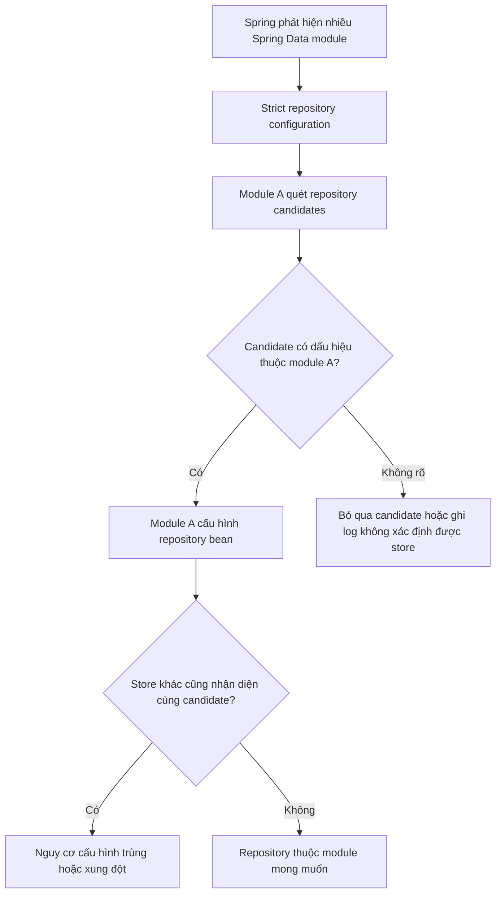

# Phối hợp nhiều Spring Data module và tránh nhận diện repository sai

Một ứng dụng Spring Boot có thể dùng **Spring Data JDBC** để lưu đơn hàng trong cơ sở dữ liệu quan hệ, **Spring Data JPA** cho một phần hệ thống cũ, **Spring Data MongoDB** cho tài liệu, hoặc **Spring Data R2DBC** cho truy cập quan hệ theo mô hình reactive. Khi nhiều Spring Data module cùng xuất hiện, Spring phải trả lời câu hỏi trước khi tạo bean: **repository interface này thuộc module lưu trữ nào?**

Câu hỏi tưởng đơn giản nhưng có tác động trực tiếp tới cấu hình và kiến trúc. Một interface như `CrudRepository<Customer, Long>` thuộc **Spring Data Commons**, nên bản thân nó không nói `Customer` sẽ được lưu qua JDBC, JPA hay một store khác. Nếu Spring gắn repository vào factory không phù hợp, ứng dụng có thể không khởi động, không đăng ký repository mong đợi hoặc gặp lỗi ánh xạ dữ liệu.

Bài học tập trung vào cách Spring Data nhận diện repository, cơ chế **strict repository configuration mode**, phương pháp tách phạm vi quét repository khi nhiều module cùng tồn tại, và những lưu ý riêng khi Spring Data JDBC phối hợp với JPA, MongoDB hoặc R2DBC.

## 1. Phân biệt Spring Data Commons và các module lưu trữ

**Spring Data** là một họ dự án. Các module chia sẻ nhiều abstraction nhưng mỗi module có cách ánh xạ, truy vấn và quản lý dữ liệu khác nhau.

| Thành phần | Vai trò | Ví dụ |
|---|---|---|
| **Spring Data Commons** | Cung cấp các interface, khái niệm repository và metadata dùng chung | `Repository`, `CrudRepository`, `PagingAndSortingRepository`, `@Id` |
| **Spring Data JDBC** | Ánh xạ aggregate quan hệ bằng JDBC, lưu trực tiếp qua SQL | `@Table` từ Spring Data Relational, `JdbcAggregateTemplate` |
| **Spring Data JPA** | Repository dựa trên JPA và persistence context | `JpaRepository`, `jakarta.persistence.Entity` |
| **Spring Data MongoDB** | Truy cập collection/document MongoDB | `MongoRepository`, `@Document` |
| **Spring Data R2DBC** | Truy cập cơ sở dữ liệu quan hệ theo API reactive | `R2dbcRepository`, `ReactiveCrudRepository` |
| **Spring Data Redis** | Lưu key/value hoặc hash theo mô hình Redis repository | `@RedisHash` và infrastructure tương ứng |

Các module không tương đương nhau chỉ vì cùng dùng tên *repository*.

Ví dụ:

```java
// Cả JDBC, JPA và một số store khác đều có thể dùng
// interface dùng chung trong Spring Data Commons.
import org.springframework.data.repository.CrudRepository;

public interface CustomerRepository extends CrudRepository<Customer, Long> {
}
```

Nếu trên classpath chỉ có infrastructure repository cho một store phù hợp, cấu hình thường tương đối rõ. Nếu có cả JDBC và một hoặc nhiều module khác, Spring cần thêm thông tin để xác định repository này thuộc store nào.

**Điểm cần nhớ:** `CrudRepository` thể hiện thao tác CRUD phổ biến, **không chỉ định công nghệ persistence**. Các marker dùng chung như `org.springframework.data.annotation.Id` cũng không đủ để khẳng định một entity thuộc JDBC hay MongoDB.

### 1.1. Spring Data JDBC khác Spring Data JPA ở điểm nào?

Cả hai có thể truy cập cùng loại hệ quản trị cơ sở dữ liệu quan hệ, nhưng mô hình vận hành không giống nhau.

- **JDBC:** ánh xạ aggregate theo quy tắc Spring Data JDBC; bạn gọi `save(...)` để ghi aggregate. Không có persistence context và dirty checking kiểu JPA.
- **JPA:** quản lý entity qua `EntityManager`; entity ở trạng thái managed có thể được đồng bộ xuống DB theo cơ chế flush và dirty checking.
- **Chú thích khác nhau:** JDBC dùng `org.springframework.data.relational.core.mapping.Table`; JPA thường dùng `jakarta.persistence.Entity` và có thể dùng `jakarta.persistence.Table` để chọn tên bảng.
- **Repository khác nhau:** JPA cung cấp `JpaRepository`; JDBC thường sử dụng `CrudRepository` hoặc các abstraction chung phù hợp.

Vì vậy không nên suy luận “cùng dùng PostgreSQL nên hai repository giống nhau”. Spring phải chọn repository factory, mapping context, truy vấn và transaction infrastructure tương ứng.

## 2. Strict repository configuration mode là gì?

Khi Spring Data phát hiện **nhiều module repository** cùng tham gia cấu hình, nó có thể chuyển sang **strict repository configuration mode**. Mục tiêu của chế độ này là hạn chế việc tự ý gán một repository không rõ thuộc tính cho một store.

Log khởi động thường có thông báo tương tự:

```text
Multiple Spring Data modules found, entering strict repository configuration mode
```

**Đây là thông tin về cơ chế cấu hình, tự nó không phải lỗi.** Cần đọc tiếp các log phát hiện repository để biết Spring có nhận diện đúng hay bỏ qua candidate nào không. Câu chữ log cụ thể thay đổi theo phiên bản Spring Data.

Ở mức khái niệm, mỗi module có `RepositoryConfigurationExtension` để xử lý repository thuộc store của mình. Trong strict mode, Spring Data tìm những dấu hiệu nhận diện phù hợp trước khi giao candidate cho repository factory. Các dấu hiệu quan trọng thường bao gồm:

1. **Loại interface trong hệ kế thừa:** repository có kế thừa interface đặc trưng của module như `JpaRepository` hoặc `MongoRepository` hay không.
2. **Annotation trên domain type:** domain class có annotation ánh xạ mà module nhận diện, ví dụ `@Entity` của JPA, `@Document` của MongoDB hay `@Table` của Spring Data Relational hay không.
3. **Phạm vi repository scanning:** cấu hình `@Enable...Repositories` đang quét package nào, interface nào được đưa vào danh sách candidate.
4. **Các bộ lọc và quy tắc của module:** việc module chấp nhận hoặc bỏ qua candidate còn tùy store, phiên bản và các cấu hình liên quan.

Có thể hình dung:



Sơ đồ mô tả logic tổng quát. Thực tế Spring Data có thể áp dụng nhiều vòng quét và cơ chế đăng ký bean theo từng module; **strict mode không phải thuật toán toàn cục tự chọn đúng duy nhất một store cho mọi interface**.

### 2.1. Dấu hiệu nhận diện theo module

| Module | Dấu hiệu đặc trưng thường gặp | Điều cần chú ý |
|---|---|---|
| Spring Data JPA | `JpaRepository<T, ID>`; domain có `@Entity` của JPA | Annotation `jakarta.persistence.Table` riêng lẻ không thay thế `@Entity` |
| Spring Data MongoDB | `MongoRepository<T, ID>`; domain có `@Document` của MongoDB | `@Id` chung từ Spring Data Commons không đủ chỉ định MongoDB |
| Spring Data JDBC | Domain có `@Table` của Spring Data Relational; package repository được cấu hình riêng | `CrudRepository` bản thân là interface dùng chung |
| Spring Data R2DBC | `R2dbcRepository<T, ID>`; mô hình repository reactive và mapping relational | `@Table` của Spring Data Relational có thể dùng chung với JDBC |
| Spring Data Redis | Domain có `@RedisHash` và các dấu hiệu phù hợp của Redis repository | Không nhầm đối tượng cache thông thường với repository được cấu hình cho Redis |

Bảng chỉ nêu dấu hiệu điển hình; những dấu hiệu thực sự được mỗi extension hỗ trợ cần xem theo phiên bản đang dùng. **Khi nhiều store có cơ chế ánh xạ gần nhau, tách package bằng cấu hình tường minh thường đáng tin cậy hơn việc chỉ dựa vào annotation.**

### 2.2. Một tình huống không thể suy ra đúng store

Giả sử ứng dụng có `spring-boot-starter-data-jdbc` và `spring-boot-starter-data-mongodb`:

```java
import org.springframework.data.annotation.Id;
import org.springframework.data.repository.CrudRepository;

public class Customer {
    @Id
    private Long id;
    private String name;
    // constructors, getters, setters...
}

public interface CustomerRepository extends CrudRepository<Customer, Long> {
}
```

`@Id` ở đây thuộc Spring Data Commons. `CrudRepository` cũng thuộc Commons. Spring không có cơ sở chắc chắn để khẳng định đây là JDBC repository hay MongoDB repository chỉ từ hai dấu hiệu này.

Trong strict mode, một module có thể bỏ qua repository và ghi log theo ý nghĩa “không xác định an toàn store assignment”. Hậu quả có thể là ứng dụng không có bean `CustomerRepository` và một service tiêm dependency này gặp lỗi khởi động. Việc chính xác module nào xử lý candidate ra sao phụ thuộc cấu hình đang hoạt động.

Một cách sửa nhất quán là **đặt repository và domain model của từng store vào package riêng, dùng annotation ánh xạ đúng, rồi chỉ định phạm vi quét repository một cách tường minh**.

## 3. Thiết kế package để mỗi module có ranh giới rõ ràng

Giả sử một dịch vụ dùng:

- **Spring Data JDBC** để lưu `CustomerRow` trong bảng `customers`.
- **Spring Data MongoDB** để lưu `CustomerDocument` trong collection `customer_profiles`.

Một cấu trúc package dễ theo dõi:

```text
com.example.catalog
├── CatalogApplication.java
├── config
│   └── PersistenceRepositoriesConfig.java
├── jdbc
│   ├── domain
│   │   └── CustomerRow.java
│   └── repository
│       └── JdbcCustomerRepository.java
├── mongo
│   ├── domain
│   │   └── CustomerDocument.java
│   └── repository
│       └── MongoCustomerRepository.java
└── service
    └── CustomerCatalogService.java
```

Đây không phải quy tắc đặt tên bắt buộc. Điều quan trọng là repository interface của từng module nằm trong **package quét riêng**, domain có **model riêng phù hợp với store** và service không bị phụ thuộc vào việc Spring tự đoán store.

### 3.1. Dependency của ví dụ JDBC + MongoDB

Ví dụ sử dụng cú pháp Gradle trong một ứng dụng Spring Boot có dependency management phù hợp:

```gradle
dependencies {
    implementation("org.springframework.boot:spring-boot-starter-data-jdbc")
    implementation("org.springframework.boot:spring-boot-starter-data-mongodb")

    // Ví dụ khi JDBC truy cập PostgreSQL.
    runtimeOnly("org.postgresql:postgresql")
}
```

Các starter đưa infrastructure repository tương ứng vào ứng dụng. Vẫn phải cấu hình kết nối JDBC và MongoDB theo môi trường sử dụng. Thêm starter **không tự động làm cho một repository interface không rõ store được nhận diện đúng**.

### 3.2. Định nghĩa domain và repository của JDBC

**`jdbc/domain/CustomerRow.java`:**

```java
package com.example.catalog.jdbc.domain;

import org.springframework.data.annotation.Id;
import org.springframework.data.relational.core.mapping.Table;

@Table("customers")
public record CustomerRow(
        @Id Long id,
        String name,
        String email
) {
}
```

**`jdbc/repository/JdbcCustomerRepository.java`:**

```java
package com.example.catalog.jdbc.repository;

import com.example.catalog.jdbc.domain.CustomerRow;
import org.springframework.data.repository.CrudRepository;

public interface JdbcCustomerRepository
        extends CrudRepository<CustomerRow, Long> {
}
```

Ở đây:

- `@Table` là **`org.springframework.data.relational.core.mapping.Table`**, dành cho mapping relational của Spring Data; không phải annotation bảng của JPA.
- `@Id` chỉ định identifier. Mặc dù là annotation dùng chung, nó được Spring Data JDBC diễn giải trong mapping context của JDBC.
- Repository dùng `CrudRepository`. Việc gán nó cho JDBC được làm rõ bởi domain mapping **và** cấu hình package quét JDBC ở bước tiếp theo.

Trong ứng dụng thực tế, bảng `customers` và các cột phải khớp quy tắc mapping hoặc được cấu hình bằng `@Column`. Repository mapping đúng store không có nghĩa là schema database đã tự tồn tại.

### 3.3. Định nghĩa domain và repository của MongoDB

**`mongo/domain/CustomerDocument.java`:**

```java
package com.example.catalog.mongo.domain;

import org.springframework.data.annotation.Id;
import org.springframework.data.mongodb.core.mapping.Document;

@Document(collection = "customer_profiles")
public record CustomerDocument(
        @Id String id,
        String displayName,
        String preferences
) {
}
```

**`mongo/repository/MongoCustomerRepository.java`:**

```java
package com.example.catalog.mongo.repository;

import com.example.catalog.mongo.domain.CustomerDocument;
import org.springframework.data.mongodb.repository.MongoRepository;

public interface MongoCustomerRepository
        extends MongoRepository<CustomerDocument, String> {
}
```

`MongoRepository` là một interface **đặc trưng của Spring Data MongoDB**. `@Document` cũng mô tả domain như một MongoDB document. Cả hai giúp ý định lưu trữ rõ ràng hơn.

Không dùng một class `Customer` duy nhất rồi gắn thêm annotation của mọi store chỉ để “Spring biết đây là entity”. Hai store có các quy tắc khác nhau cho identifier, quan hệ, thay đổi dữ liệu và truy vấn; hai model nhỏ có thể rõ ràng hơn một model đa mục đích.

### 3.4. Khóa phạm vi quét bằng `@Enable...Repositories`

**`config/PersistenceRepositoriesConfig.java`:**

```java
package com.example.catalog.config;

import com.example.catalog.jdbc.repository.JdbcCustomerRepository;
import com.example.catalog.mongo.repository.MongoCustomerRepository;
import org.springframework.context.annotation.Configuration;
import org.springframework.data.jdbc.repository.config.EnableJdbcRepositories;
import org.springframework.data.mongodb.repository.config.EnableMongoRepositories;

@Configuration(proxyBeanMethods = false)
@EnableJdbcRepositories(
        basePackageClasses = JdbcCustomerRepository.class
)
@EnableMongoRepositories(
        basePackageClasses = MongoCustomerRepository.class
)
public class PersistenceRepositoriesConfig {
}
```

Với `basePackageClasses`, Spring sử dụng **package chứa class/interface đã chỉ định** làm điểm bắt đầu quét repository tương ứng. Trong ví dụ:

- JDBC scanning bắt đầu ở `com.example.catalog.jdbc.repository`.
- MongoDB scanning bắt đầu ở `com.example.catalog.mongo.repository`.
- `JdbcCustomerRepository` chỉ nằm trong phạm vi dành cho JDBC.
- `MongoCustomerRepository` chỉ nằm trong phạm vi dành cho MongoDB.

Tính chất *type-safe* của `basePackageClasses` giúp refactor package dễ hơn so với một chuỗi hard-code. Nếu muốn chỉ ra package bằng chuỗi, có thể dùng:

```java
@EnableJdbcRepositories(
        basePackages = "com.example.catalog.jdbc.repository"
)
@EnableMongoRepositories(
        basePackages = "com.example.catalog.mongo.repository"
)
```

Hai cú pháp đều là **cấu hình phạm vi quét repository**, không thay thế cấu hình kết nối `DataSource` hoặc MongoDB client. Chỉ nên kích hoạt những module thực sự sử dụng.

**Chú ý:** package dùng cho một module không nên là package cha bao trùm toàn bộ repository của các module còn lại. Ví dụ quét JDBC từ `com.example.catalog` có thể kéo cả các interface MongoDB vào danh sách candidate trước khi bộ lọc strict mode quyết định có nhận diện hay không.

### 3.5. Chọn tên repository để tránh đụng tên bean

Ngay cả khi hai interface nằm ở package khác nhau, nếu đều tên `CustomerRepository`, cách đặt tên bean mặc định có thể tạo xung đột tên (chẳng hạn đều trở thành `customerRepository`) trong một context.

Tên `JdbcCustomerRepository` và `MongoCustomerRepository` rõ mục đích, dễ đọc trong cấu hình và tránh xung đột phổ biến. Đây là một lựa chọn kiến trúc; không phải yêu cầu bắt buộc của Spring Data.

## 4. Phối hợp Spring Data JDBC với Spring Data JPA

Một kịch bản thường gặp là ứng dụng đang dùng JPA và bắt đầu đưa một số chức năng sang Spring Data JDBC. Cả hai dùng database quan hệ, nên càng dễ nhầm lẫn các annotation cùng tên.

### 4.1. Domain annotation không giống nhau

**JDBC domain:**

```java
import org.springframework.data.annotation.Id;
import org.springframework.data.relational.core.mapping.Table;

@Table("invoices")
public class JdbcInvoice {
    @Id
    private Long id;
    // Các thuộc tính và constructor phù hợp.
}
```

**JPA domain:**

```java
import jakarta.persistence.Entity;
import jakarta.persistence.Id;
import jakarta.persistence.Table;

@Entity
@Table(name = "legacy_invoices")
public class JpaInvoice {
    @Id
    private Long id;
    // JPA entity cần constructor và mapping theo quy tắc JPA.
}
```

Cùng tên `@Table` nhưng khác package và khác vai trò:

| Annotation | Module | Ý nghĩa |
|---|---|---|
| `org.springframework.data.relational.core.mapping.Table` | Spring Data JDBC / R2DBC (relational mapping) | Liên kết aggregate với bảng quan hệ |
| `jakarta.persistence.Entity` | JPA | Đánh dấu class là entity JPA |
| `jakarta.persistence.Table` | JPA | Tùy chỉnh thông tin bảng cho entity JPA |
| `org.springframework.data.mongodb.core.mapping.Document` | MongoDB | Liên kết domain với collection/document MongoDB |

Trong file có nhiều annotation trùng tên, nên dùng import thật rõ hoặc viết fully qualified name. **Không lấy annotation cùng tên từ một module khác chỉ vì IDE tự import.**

### 4.2. JPA repository có interface riêng

```java
import org.springframework.data.jpa.repository.JpaRepository;

public interface LegacyInvoiceRepository
        extends JpaRepository<JpaInvoice, Long> {
}
```

`JpaRepository` thể hiện rõ repository thuộc JPA. Ngược lại, JDBC repository thường dùng interface CRUD chung:

```java
import org.springframework.data.repository.CrudRepository;

public interface JdbcInvoiceRepository
        extends CrudRepository<JdbcInvoice, Long> {
}
```

Khi chạy cả hai module, hãy giới hạn riêng phạm vi quét:

```java
import com.example.billing.jdbc.repository.JdbcInvoiceRepository;
import com.example.billing.jpa.repository.LegacyInvoiceRepository;
import org.springframework.context.annotation.Configuration;
import org.springframework.data.jdbc.repository.config.EnableJdbcRepositories;
import org.springframework.data.jpa.repository.config.EnableJpaRepositories;

@Configuration(proxyBeanMethods = false)
@EnableJdbcRepositories(
        basePackageClasses = JdbcInvoiceRepository.class
)
@EnableJpaRepositories(
        basePackageClasses = LegacyInvoiceRepository.class
)
class BillingRepositoriesConfig {
}
```

Đoạn cấu hình minh họa ranh giới repository. Để chạy JPA, ứng dụng cũng cần `EntityManagerFactory`, datasource và entity scanning phù hợp. Để chạy JDBC, ứng dụng cần JDBC infrastructure và mapping tương ứng.

### 4.3. Không dùng một class như cả JPA entity lẫn JDBC aggregate theo thói quen

Ví dụ một class đồng thời có:

```java
@jakarta.persistence.Entity
@org.springframework.data.relational.core.mapping.Table("customers")
class Customer {
    // ...
}
```

Cách này có thể làm nhiều module nhận diện cùng domain là ứng viên hợp lệ, nhất là khi repository interface chỉ extends `CrudRepository` và được đưa vào nhiều phạm vi quét. Ngoài vấn đề nhận diện, lifecycle, mapping quan hệ và dirty checking của hai module cũng khác nhau.

Cách thiết kế rõ hơn là đặt `JpaCustomer` và `JdbcCustomer` ở hai package riêng, rồi ánh xạ sang **DTO hoặc mô hình nghiệp vụ độc lập** ở ranh giới service nếu cần dùng chung dữ liệu. Nếu hai module cùng truy cập một bảng, cần thêm chính sách sở hữu dữ liệu, cập nhật và nhất quán; việc quét repository đúng chỉ giải quyết bước tạo bean.

## 5. Trường hợp đặc biệt: JDBC và R2DBC cùng dùng relational mapping

Spring Data JDBC và Spring Data R2DBC chia sẻ một phần mô hình ánh xạ **Spring Data Relational**. Vì vậy, `@Table` từ:

```java
org.springframework.data.relational.core.mapping.Table
```

không đủ để luôn phân biệt một domain thuộc JDBC hay R2DBC khi cả hai module cùng xuất hiện.

Tuy nhiên mô hình repository và thực thi khác nhau:

```java
// JDBC: API đồng bộ/blocking.
public interface JdbcTaskRepository
        extends CrudRepository<JdbcTask, Long> {
}

// R2DBC: API reactive.
public interface ReactiveTaskRepository
        extends R2dbcRepository<ReactiveTask, Long> {
}
```

Các import tương ứng:

```java
import org.springframework.data.repository.CrudRepository;
import org.springframework.data.r2dbc.repository.R2dbcRepository;
```

Không dùng `ReactiveCrudRepository` như thể nó là một JDBC repository, cũng không giả định việc dùng `@Table` khiến R2DBC repository tự xuất hiện trong JDBC configuration. Với cả hai module, nên:

1. Tách package repository JDBC và R2DBC.
2. Dùng interface riêng phù hợp với API đồng bộ hoặc reactive.
3. Chỉ định `@EnableJdbcRepositories` và `@EnableR2dbcRepositories` trong đúng package khi cấu hình cần tường minh.
4. Kiểm tra hạ tầng riêng: **JDBC dùng `DataSource` và `PlatformTransactionManager`**; **R2DBC dùng `ConnectionFactory` và `ReactiveTransactionManager`**.

R2DBC giữ transaction context theo luồng publisher reactive; JDBC transaction thường gắn connection với thread đang chạy. Không nên mong hai cơ chế này tự chia sẻ một transaction chỉ vì cùng nói chuyện với một PostgreSQL database.

## 6. Các cấu hình tưởng đúng nhưng dễ gán nhầm repository

### 6.1. Đặt tất cả repository trong một package chung

```text
com.example.app.repository
├── OrderRepository.java          // JDBC
├── ProductRepository.java        // JPA
└── SearchDocumentRepository.java // MongoDB
```

Nếu nhiều `@Enable...Repositories` cùng quét toàn bộ package này, từng module có thể phải xét tất cả interface. Với interface chung và domain thiếu metadata store, khả năng nhận diện nhầm, bỏ qua hoặc cấu hình trùng tăng lên.

Nên tách repository theo store hoặc theo module chức năng có ranh giới cấu hình không chồng nhau:

```text
com.example.app.jdbc.repository
com.example.app.jpa.repository
com.example.app.mongo.repository
```

Nếu kiến trúc bắt buộc giữ một package chung, có thể cấu hình include/exclude filters cho từng scanner, nhưng cần nêu rõ quy tắc và bảo trì khi thêm repository. Tách package thường dễ hiểu hơn.

### 6.2. Dùng `@ComponentScan` để mong kiểm soát repository scanning

`@ComponentScan` chủ yếu phát hiện các bean component thông thường như service, controller, configuration. Spring Data repository được đăng ký bởi **repository infrastructure** với cơ chế quét của riêng nó.

Ví dụ:

```java
@SpringBootApplication(scanBasePackages = "com.example.app.service")
class Application {
}
```

không có nghĩa là đã chỉ định JDBC repositories nằm trong `com.example.app.jdbc.repository`. Ngược lại, chỉ quét component không đảm bảo repository được tạo. Khi cần giới hạn repository cho từng module, hãy cấu hình `@EnableJdbcRepositories`, `@EnableJpaRepositories`, `@EnableMongoRepositories` tương ứng, hoặc dựa vào auto-configuration với package layout đúng.

### 6.3. Gắn `@Repository` lên interface như một cách chọn store

`org.springframework.stereotype.Repository` là stereotype của Spring để biểu thị vai trò truy cập dữ liệu. Nó **không phải một chỉ dẫn chung rằng interface này phải do Spring Data JDBC tạo**.

```java
@Repository
public interface CustomerRepository extends CrudRepository<Customer, Long> {
}
```

Lớp này vẫn có thể không mang đủ tín hiệu store nếu domain không có mapping phù hợp và phạm vi quét bị chồng lấn. Trong Spring Data, các interface repository hợp lệ thường được repository infrastructure phát hiện mà không cần gắn thêm `@Repository`.

### 6.4. Tưởng `@Id` hoặc `@RepositoryDefinition` tự chọn store

`@Id` từ Commons đánh dấu identifier, không nói gì về JDBC/MongoDB. Tương tự, `@RepositoryDefinition` cho phép khai báo một repository không nhất thiết kế thừa `Repository`, nhưng bản thân annotation đó cũng không đảm bảo store assignment trong ứng dụng nhiều module.

Nếu đã dùng abstraction Commons, hãy bổ sung **store-specific domain metadata** và **phạm vi scan rõ ràng**.

### 6.5. Dùng sai `@Query`

Tên `@Query` xuất hiện ở nhiều Spring Data module nhưng cách diễn giải khác nhau.

```java
// Spring Data JDBC: SQL.
import org.springframework.data.jdbc.repository.query.Query;

// Spring Data JPA: thường là JPQL, có thể dùng native SQL theo cấu hình.
import org.springframework.data.jpa.repository.Query;

// Spring Data MongoDB: query document/filter dạng MongoDB.
import org.springframework.data.mongodb.repository.Query;
```

Không thể lấy một `@Query` của JPA rồi mong Spring Data JDBC tự hiểu JPQL. Cần import chính xác và viết query theo store repository đã chọn.

### 6.6. Đưa interface cơ sở dùng chung vào danh sách repository thật

Khi muốn các repository chia sẻ phương thức, nhiều dự án định nghĩa interface trung gian:

```java
public interface BaseRepository<T, ID> extends CrudRepository<T, ID> {
    // Các phương thức dùng chung.
}
```

Nếu interface này bị scan như repository cụ thể, nó thiếu domain type và có thể gây lỗi cấu hình. Dùng `@NoRepositoryBean`:

```java
import org.springframework.data.repository.CrudRepository;
import org.springframework.data.repository.NoRepositoryBean;

@NoRepositoryBean
public interface BaseRepository<T, ID>
        extends CrudRepository<T, ID> {
}

public interface JdbcCustomerRepository
        extends BaseRepository<CustomerRow, Long> {
}
```

`@NoRepositoryBean` nói rằng **không tự tạo bean repository từ interface cơ sở này**. Nó **không thay cho tín hiệu JDBC/Mongo/JPA** ở repository con; vẫn cần mapping và phạm vi scan thích hợp.

## 7. Spring Boot auto-configuration và lúc nào cần cấu hình tường minh

Với một Spring Data module duy nhất, cấu trúc package hợp lý và dependency tương ứng, Spring Boot thường tự thiết lập repository scanning. Ví dụ lớp `@SpringBootApplication` ở `com.example.catalog` sẽ cung cấp điểm bắt đầu quét tự động cho những thành phần trong các package con theo quy ước của Boot.

Khi nhiều module cùng được kích hoạt, cần phân biệt ba lớp cấu hình:

| Lớp | Câu hỏi nó giải quyết |
|---|---|
| **Dependency/classpath** | Infrastructure của những module nào hiện diện? |
| **Repository scanning** | Interface repository nào thuộc phạm vi quản lý của từng module? |
| **Data-access infrastructure** | Repository ấy dùng `DataSource`, `EntityManagerFactory`, MongoDB client hay `ConnectionFactory` nào? |

**Không thể giải quyết tất cả bằng một annotation.** Ví dụ bật `@EnableJdbcRepositories` đúng package nhưng cấu hình `DataSource` sai thì repository vẫn không truy cập được database. Ngược lại, datasource kết nối thành công chưa chứng minh JDBC repository đã được tạo.

### 7.1. Khi nào đủ để dùng mặc định?

Mặc định thường phù hợp nếu:

- Ứng dụng chỉ có một Spring Data repository module;
- package application, domain và repository phù hợp với cơ chế tự quét của Boot;
- cấu hình kết nối và transaction manager đơn giản, một nguồn dữ liệu;
- không có repository base interface hoặc module phụ làm thay đổi cách nhận diện.

Khi ứng dụng chỉ dùng JDBC, không nên viết thêm hàng loạt `@Enable...Repositories` một cách máy móc nếu Boot đã tự cấu hình đúng.

### 7.2. Khi nào chủ động phân vùng scan?

Cân nhắc cấu hình rõ ràng khi:

- có JDBC + JPA, JDBC + MongoDB hoặc JDBC + R2DBC;
- từng module sở hữu những package repository khác nhau;
- chuyển dần từ JPA sang JDBC và cần tránh hai module cùng nhận một repository;
- dùng nhiều `DataSource` hoặc `EntityManagerFactory`;
- có repository interface dùng chung từ một thư viện hoặc module nội bộ;
- log strict configuration cho biết candidate không được nhận diện hoặc có số lượng repository không đúng dự kiến.

Một số thuộc tính `@Enable...Repositories` còn cho phép trỏ tới infrastructure tương ứng. Chẳng hạn cấu hình `@EnableJpaRepositories` có thể chọn `entityManagerFactoryRef` và `transactionManagerRef`; `@EnableJdbcRepositories` có các tham chiếu JDBC tương ứng như `jdbcOperationsRef` trong những cấu hình phức tạp. Tên thuộc tính/cách auto-configure cần đối chiếu với phiên bản Spring Data đang dùng trước khi áp dụng.

### 7.3. Đừng quên thư viện kéo theo module ngoài dự kiến

Một dependency có thể đưa thêm Spring Data module vào classpath theo cách gián tiếp. Nếu log báo strict mode dù dự án “chỉ định dùng JDBC”, hãy kiểm tra cây dependency ở **runtime classpath** và những starter thực sự có mặt.

Việc thêm thư viện JDBC driver thuần không đồng nghĩa với việc thêm Spring Data JDBC. Ngược lại, một starter Spring Data hoàn chỉnh thường bổ sung repository infrastructure. Chỉ ra đúng dependency làm thay đổi chế độ quét sẽ giúp quyết định nên giữ, cấu hình tường minh hay loại bỏ dependency không cần dùng.

## 8. Giao dịch và ranh giới nhất quán khi nhiều store cùng tham gia

**Nhận diện đúng repository chỉ giải quyết việc tạo bean.** Từ góc nhìn nghiệp vụ, nhiều store còn đưa ra một câu hỏi khác: transaction manager nào điều khiển lời gọi ghi dữ liệu?

Ví dụ một service dùng JDBC repository và MongoDB repository:

```java
@Service
public class CustomerSynchronizationService {
    private final JdbcCustomerRepository jdbcCustomers;
    private final MongoCustomerRepository mongoCustomers;

    public CustomerSynchronizationService(
            JdbcCustomerRepository jdbcCustomers,
            MongoCustomerRepository mongoCustomers) {
        this.jdbcCustomers = jdbcCustomers;
        this.mongoCustomers = mongoCustomers;
    }

    public void synchronize(CustomerRow row, CustomerDocument document) {
        jdbcCustomers.save(row);
        mongoCustomers.save(document);
    }
}
```

Việc hai lời gọi xuất hiện trong cùng một phương thức **không tự tạo một transaction phân tán**. Nếu JDBC ghi thành công nhưng MongoDB thất bại, dữ liệu có thể không đồng bộ. Ngay cả khi đặt `@Transactional` trên phương thức, Spring phải chọn transaction manager cụ thể; một JDBC transaction manager không thể tự rollback một thao tác MongoDB đã hoàn thành.

### 8.1. Chọn transaction manager có chủ đích

Khi có nhiều `PlatformTransactionManager`, việc chọn mặc định cho `@Transactional` có thể trở nên mơ hồ nếu ứng dụng không định nghĩa cách phân giải. Có thể chỉ định bean cụ thể:

```java
@Transactional(transactionManager = "jdbcTransactionManager")
public void saveJdbcData() {
    // Các thao tác được điều phối bởi JDBC transaction manager đã chọn.
}
```

Tên `jdbcTransactionManager` là **tên minh họa**; chỉ dùng khi ứng dụng có bean transaction manager tương ứng. JPA transaction manager và MongoDB transaction manager có điều kiện cấu hình, ngữ nghĩa và yêu cầu hạ tầng riêng. MongoDB multi-document transactions cũng cần môi trường server/topology hỗ trợ.

Khi dùng cùng cơ sở dữ liệu với JDBC và JPA, có một số cấu hình cho phép phối hợp JDBC access trong transaction JPA nếu connection và transaction manager được thiết lập tương thích. **Không mặc định coi các transaction manager độc lập là một giao dịch chung**, dù cả hai đều truy cập một database. Cần kiểm chứng đúng cách cấu hình datasource, entity manager và việc lấy connection.

Với JDBC và R2DBC, sự khác biệt giữa transaction gắn thread và transaction theo reactive context càng khiến việc “gộp” hai cơ chế bằng một annotation trở nên không phù hợp.

### 8.2. Cơ chế phối hợp dữ liệu giữa store

Nếu quy trình phải cập nhật nhiều store nhưng không có transaction chung được bảo đảm, các lựa chọn kiến trúc thường là:

- Một store **sở hữu dữ liệu nguồn**, store còn lại giữ projection/copy phục vụ truy vấn.
- Phát hành event sau khi dữ liệu nguồn commit, thiết kế consumer xử lý lặp an toàn (*idempotent*).
- Với DB quan hệ, dùng **transactional outbox** để ghi dữ liệu nghiệp vụ và sự kiện cần phát đi trong cùng transaction của DB nguồn; một tiến trình khác chuyển sự kiện tới hệ thống ngoài.
- Nếu quy trình nhiều bước có thể thất bại, thiết kế retry và thao tác bù theo yêu cầu (ví dụ saga), thay vì giả định rollback JDBC sẽ đảo ngược mọi hệ thống.

Những cơ chế này xử lý **nhất quán liên store**; tách package repository là điều kiện để kiến trúc dễ quản lý nhưng không giải quyết nhất quán thay cho giao dịch.

## 9. Đọc log và xử lý khi repository bị nhận diện sai

Một dự án nhiều module nên quan sát hai nhóm log: Spring Data nhận diện **module** và Spring Data phát hiện **repository interfaces**.

Ví dụ các dòng sau mang tính minh họa, câu chữ phụ thuộc phiên bản:

```text
Multiple Spring Data modules found, entering strict repository configuration mode
Bootstrapping Spring Data JDBC repositories ...
Spring Data JDBC - Could not safely identify store assignment for repository candidate interface ...
Finished Spring Data repository scanning ... Found 0 JDBC repository interfaces.
```

Cần phân biệt:

- Dòng **strict mode**: thông báo chế độ cấu hình.
- Dòng **could not safely identify store assignment**: candidate không được module đó khẳng định là thuộc mình; cần xem đúng type/domain/package.
- Dòng **Found 0 ... repositories**: có thể bình thường nếu module không sở hữu repository nào, nhưng cần điều tra nếu bạn mong nó tạo bean.
- Lỗi **No qualifying bean**: service/controller cần repository nhưng không tìm thấy bean trong context.
- Lỗi **duplicate bean definition** hoặc bean name conflict: có thể nhiều scanner đăng ký trùng hoặc nhiều interface trùng tên bean.
- Lỗi mapping/query sau khi startup: có thể repository đã được tạo nhưng domain annotation, query hoặc schema thuộc store không tương thích.

### 9.1. Bảng chẩn đoán

| Hiện tượng | Nguyên nhân có thể | Điều cần kiểm tra |
|---|---|---|
| Log strict configuration xuất hiện | Nhiều repository module trên classpath | Có thật sự cần từng Spring Data starter không; quan sát log tiếp theo |
| `JdbcCustomerRepository` không có bean | JDBC scanner không quét package hoặc strict mode bỏ qua candidate | `@EnableJdbcRepositories`, package, `@Table` đúng import |
| `CustomerRepository` bị nhiều module xem là candidate | Dùng `CrudRepository` chung, domain/scan không phân biệt | Tách package, domain mapping và phạm vi quét |
| Repository JDBC bị đăng ký vào JPA infrastructure | Ranh giới scanner chồng lấn hoặc thiếu tín hiệu store rõ ràng | `@EnableJpaRepositories`, `JpaRepository`, `@Entity` và các import |
| Repository R2DBC và JDBC mơ hồ | Cả hai dùng mapping Spring Data Relational | Tách package; dùng interface repository blocking/reactive tương ứng |
| Hai repository khác package đụng tên bean | Tên interface trùng, tên bean suy ra giống nhau | Đổi tên interface hoặc cấu hình tên bean phù hợp |
| `BaseRepository` bị xem là repository thật | Thiếu `@NoRepositoryBean` | Đánh dấu interface cơ sở, giữ domain type cụ thể ở interface con |
| Repository có bean nhưng query lỗi | Dùng `@Query` sai module hoặc domain/table/collection không khớp | Kiểm tra import và cú pháp truy vấn theo store |
| Service không xác định transaction manager | Có nhiều manager phù hợp mà không có cách chọn rõ ràng | Chọn transaction manager theo chức năng và store |
| Chạy riêng module đúng, kết hợp thì lỗi | Context bổ sung scanner và mapping khác | Kiểm tra application context với đầy đủ các starter/runtime config |

### 9.2. Trình tự điều tra khi startup lỗi

1. **Xem runtime classpath:** xác định chính xác những Spring Data module nào hiện diện.
2. **Tìm repository interface bị lỗi:** ghi lại package, kiểu cha (`CrudRepository` / `JpaRepository` / `MongoRepository` / `R2dbcRepository`) và domain generic.
3. **Xem domain annotation bằng tên import đầy đủ:** phân biệt Spring Data `@Table` với JPA `@Table`, `@Document` theo store, `@Id` dùng chung.
4. **Đọc ranh giới scanner:** mỗi `@Enable...Repositories` quét những package nào? Có package cha vô tình bao cả các module không?
5. **Đọc số lượng repository được khởi tạo:** liệu module đã nhận đúng interface hay đã bỏ qua toàn bộ?
6. **Xác định infrastructure tương ứng:** nếu bean repository được tạo, kiểm tra datasource, entity manager, MongoDB client, connection factory, mapping và transaction manager mà nó thực sự dùng.

Trình tự này tách được lỗi **không nhận diện repository** khỏi lỗi **kết nối hoặc truy vấn**, vốn có cách khắc phục khác nhau.

## 10. Kiểm chứng cấu hình trong ứng dụng

Sau khi tách package và scanner, cần kiểm chứng hành vi thực tế của application context, không chỉ thấy code biên dịch thành công.

### 10.1. Kiểm tra bằng các repository bean

Một bài kiểm tra tích hợp có thể yêu cầu Spring inject đúng repository của hai store:

```java
@SpringBootTest
class RepositoryWiringTest {
    @Autowired
    JdbcCustomerRepository jdbcCustomers;

    @Autowired
    MongoCustomerRepository mongoCustomers;

    @Test
    void bothStoresHaveRepositories() {
        assertThat(jdbcCustomers).isNotNull();
        assertThat(mongoCustomers).isNotNull();
    }
}
```

Các import `@SpringBootTest`, `@Autowired`, `@Test` và `assertThat` dùng từ thư viện kiểm thử mà dự án lựa chọn (ví dụ Spring Boot Test, JUnit 5, AssertJ). Để context khởi động được, test phải có cấu hình cho những infrastructure thực sự kích hoạt, bao gồm JDBC và MongoDB. Với test tích hợp, có thể dùng container database phù hợp.

Kiểm tra bean hiện diện là bước khởi đầu. Cần thêm những trường hợp lưu/đọc dữ liệu trên từng store để xác nhận repository sử dụng mapping và kết nối đúng.

### 10.2. Test slice và toàn bộ context kiểm tra các khía cạnh khác nhau

Spring Boot cung cấp test slice chuyên biệt như:

- `@DataJdbcTest`: tập trung vào JDBC persistence.
- `@DataJpaTest`: tập trung vào JPA.
- `@DataMongoTest`: tập trung vào MongoDB.

Một slice có thể chỉ khởi tạo một phần cấu hình, nên **pass một test slice chưa chứng minh nhiều module kết hợp đúng trong application context thật**. Với dự án đa store, nên có kiểm tra startup của context chứa toàn bộ những module cần dùng và kiểm tra các luồng nghiệp vụ quan trọng.

### 10.3. Tiêu chí đánh giá cấu hình thành công

Một cấu hình được xem là đúng về mặt phối hợp repository khi:

- JDBC repository được tạo bởi JDBC repository infrastructure và dùng relational mapping tương ứng.
- Repository của JPA/MongoDB/R2DBC được tạo bởi factory của store tương ứng.
- Không có interface repository bị scan trùng ngoài ý định.
- Mỗi repository có kết nối và transaction infrastructure phù hợp.
- Các thao tác lưu/đọc cơ bản chạy trên đúng bảng, collection hoặc connection.
- Với workflow qua nhiều store, thiết kế đã thể hiện rõ giới hạn transaction và cách xử lý lỗi giữa các store.

Đây là các tiêu chí thiết kế và tích hợp dành cho người học; không phải một cam kết rằng mọi store đều có thể được gom vào cùng một transaction.

## 11. Tình huống thực hành

Bạn có ứng dụng ban đầu chỉ dùng Spring Data JDBC:

```java
public interface OrderRepository extends CrudRepository<Order, Long> {
}
```

Sau khi thêm `spring-boot-starter-data-mongodb` để lưu document phục vụ tìm kiếm, ứng dụng ghi log strict mode. `Order` chỉ có `@Id` từ Commons và repository nằm ở package `com.example.app.repository`. Bạn cũng thêm:

```java
public interface SearchRepository
        extends MongoRepository<SearchDocument, String> {
}
```

Hãy xác định:

1. Vì sao thêm MongoDB starter có thể làm thay đổi cách Spring Data xem xét `OrderRepository`?
2. Vì sao `@Id` và `CrudRepository` chưa đủ để khẳng định `OrderRepository` thuộc JDBC?
3. Nếu `OrderRepository` không được tạo bean, bạn cần kiểm tra package scanning và mapping annotation nào?
4. Làm cách nào để `SearchRepository` không bị JDBC scanner xét như candidate của JDBC?
5. Nếu một service ghi đơn hàng qua JDBC rồi ghi document qua MongoDB, lỗi ở thao tác MongoDB có tự rollback JDBC không?

**Hướng giải:**

- Việc có nhiều module repository kích hoạt strict mode; Spring phải dùng dấu hiệu phân biệt store thay vì tự coi mọi interface Commons là của module mặc định.
- Tách `com.example.app.jdbc.repository` và `com.example.app.mongo.repository`; dùng `@EnableJdbcRepositories` và `@EnableMongoRepositories` với phạm vi phù hợp khi cần cấu hình tường minh.
- Đánh dấu `Order` theo Spring Data JDBC bằng `org.springframework.data.relational.core.mapping.Table` (cùng các mapping cần thiết) và `SearchDocument` bằng `org.springframework.data.mongodb.core.mapping.Document`.
- Giữ `OrderRepository` ở mô hình blocking JDBC, `SearchRepository` với `MongoRepository`.
- Không giả định một transaction JDBC có thể rollback thao tác MongoDB. Thiết kế ranh giới dữ liệu và cơ chế đồng bộ/xử lý lỗi riêng.

## 12. Tổng hợp nguyên tắc kiến trúc

Khi làm việc với **Spring Data Relational JDBC** trong ứng dụng có nhiều Spring Data module, hãy tư duy theo bốn tầng:

1. **Domain model** có mapping đúng store: `@Table` của Spring Data Relational cho JDBC, `@Entity` của JPA, `@Document` cho MongoDB; hiểu rằng một số annotation có thể dùng chung giữa JDBC và R2DBC.
2. **Repository interface** phản ánh API thích hợp; `CrudRepository` là abstraction chung, còn `JpaRepository`, `MongoRepository` và `R2dbcRepository` là các tín hiệu theo module.
3. **Repository scanning** giới hạn package để mỗi factory xét đúng tập interface; sử dụng `@Enable...Repositories(basePackageClasses = ...)` khi phải phối hợp nhiều module một cách tường minh.
4. **Infrastructure và transaction** được cấu hình cho đúng store và ranh giới nghiệp vụ; nhận diện repository đúng không tự mang lại một giao dịch xuyên nhiều công nghệ dữ liệu.

**Strict repository configuration mode là cơ chế bảo vệ trước sự mơ hồ, không phải một lỗi cần tắt bằng mọi giá.** Thay vì dựa vào heuristic khó kiểm soát, kiến trúc dễ bảo trì nên làm rõ mỗi repository thuộc module nào, quét ở đâu và dùng transaction manager nào.
