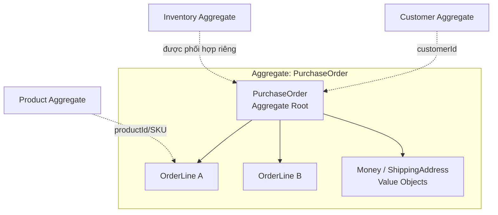

# Aggregate và aggregate root trong thiết kế hướng miền

Khi thiết kế một ứng dụng theo **Domain-Driven Design (DDD)**, cơ sở dữ liệu có thể chứa hàng chục bảng liên quan nhau, nhưng không phải mỗi bảng đều cần một repository riêng và cũng không phải mọi quan hệ khóa ngoại đều có nghĩa là một đối tượng phải được lưu cùng đối tượng khác. DDD sử dụng **aggregate** và **aggregate root** để xác định những đối tượng nào thuộc cùng một ranh giới nghiệp vụ, ai có quyền thay đổi chúng và những quy tắc nào phải được giữ nhất quán trong một thao tác.

Trong **Spring Data Relational/JDBC**, khái niệm aggregate đặc biệt quan trọng vì cơ chế ánh xạ và lưu dữ liệu được xây dựng quanh aggregate root. Thiết kế ranh giới aggregate hợp lý giúp code phản ánh đúng nghiệp vụ, hạn chế tình trạng cập nhật dữ liệu sai quy tắc và tránh những thao tác SQL tốn kém không cần thiết.

## 1. Aggregate giải quyết vấn đề gì?

Xét một hệ thống bán hàng có các dữ liệu:

- Đơn hàng (`PurchaseOrder`).
- Các dòng hàng trong đơn (`OrderLine`).
- Khách hàng (`Customer`).
- Sản phẩm (`Product`).
- Thanh toán (`Payment`).
- Kho hàng (`Inventory`).

Ở mức quan hệ dữ liệu, tất cả có thể liên kết bằng khóa chính và khóa ngoại. Tuy nhiên, ở mức nghiệp vụ, không phải tất cả đều phải được cập nhật cùng nhau.

Một số quy tắc có thể là:

1. Đơn hàng đang ở trạng thái nháp mới được thêm hoặc xóa dòng hàng.
2. Một dòng hàng phải có số lượng lớn hơn 0 và đơn giá không âm.
3. Không thể xác nhận đơn hàng không có dòng hàng nào.
4. Tổng tiền đơn hàng phải được tính từ những dòng hàng hợp lệ.
5. Khách hàng có thể tồn tại và thay đổi độc lập với đơn hàng.
6. Tồn kho có vòng đời và cơ chế cạnh tranh cập nhật riêng, không nên bị sửa gián tiếp khi chỉ lưu đơn hàng.

Các quy tắc 1–4 gợi ý rằng đơn hàng và những dòng hàng của nó cần nằm trong cùng một **ranh giới nhất quán**. Quy tắc 5–6 cho thấy khách hàng và tồn kho có thể thuộc các aggregate độc lập.

Aggregate giúp trả lời ba câu hỏi thiết kế:

- **Đâu là ranh giới dữ liệu phải nhất quán ngay trong một thao tác nghiệp vụ?**
- **Đối tượng nào được phép là điểm truy cập và thay đổi duy nhất của nhóm đối tượng đó?**
- **Phần nào có thể thay đổi độc lập và chỉ được tham chiếu qua định danh?**

## 2. Phân biệt entity, value object, aggregate và aggregate root

| Khái niệm | Đặc điểm chính | Ví dụ trong quản lý đơn hàng |
| --- | --- | --- |
| **Entity** | Có **định danh** và vòng đời riêng; hai entity có thể khác nhau dù thuộc tính bằng nhau. | `PurchaseOrder` với `orderId`; `OrderLine` với `lineId` nếu cần theo dõi danh tính dòng hàng. |
| **Value Object** | Được nhận diện bởi **giá trị**, thường bất biến, không cần danh tính nghiệp vụ riêng. | `Money` (số tiền + đơn vị tiền tệ), `Address` (địa chỉ giao hàng). |
| **Aggregate** | Nhóm entity/value object được xem là **một đơn vị nhất quán** theo các bất biến nghiệp vụ (*invariants*). | Đơn hàng và các dòng hàng thuộc đơn đó. |
| **Aggregate Root** | Entity đứng đầu aggregate, là **điểm truy cập và sửa đổi được kiểm soát** từ bên ngoài. | `PurchaseOrder`. |

Một aggregate có thể chỉ gồm **một entity**. Không bắt buộc aggregate phải có nhiều bảng hay nhiều đối tượng con.

### 2.1. Entity không đồng nghĩa với aggregate root

Một `OrderLine` có thể có `id` và được lưu ở bảng riêng, nhưng nếu nó chỉ có ý nghĩa trong đơn hàng thì nó vẫn là **entity con** của aggregate `PurchaseOrder`. Có khóa chính không tự biến `OrderLine` thành aggregate root.

Ngược lại, `Customer` thường có vòng đời độc lập: đăng ký, thay đổi hồ sơ, vô hiệu hóa tài khoản. Vì vậy, `Customer` phù hợp làm root của aggregate riêng, ngay cả khi đơn hàng có cột `customer_id` liên kết tới khách hàng.

### 2.2. Value object không phải bảng phụ bắt buộc

Một `Money` có thể chỉ gồm `amount` và `currency`, được lưu thành các cột trong bảng của entity sở hữu. Value object được thiết kế dựa trên ngữ nghĩa miền, không dựa trên việc dữ liệu nằm ở một hay nhiều bảng. Trong Spring Data Relational, `@Embedded` có thể được dùng để ánh xạ các trường của một value object vào bảng chứa nó.

### 2.3. Root giữ quyền điều khiển bất biến

Thay vì cho service bên ngoài gọi `order.getLines().add(...)`, root cung cấp những hành vi như:

```java
order.addLine("SKU-BOOK", 2, price);
order.removeLine(lineId);
order.submit();
```

Mỗi hành vi có thể kiểm tra trạng thái và điều kiện nghiệp vụ trước khi thay đổi. Điều đó khiến aggregate root trở thành nơi bảo vệ tính đúng đắn của domain model, không chỉ là một lớp Java chứa getter/setter.

## 3. Ranh giới aggregate là ranh giới nhất quán

Một **invariant** là điều kiện miền bắt buộc luôn đúng tại thời điểm một thao tác thay đổi aggregate được hoàn tất. Ví dụ:

- `quantity > 0` với mọi dòng hàng.
- Đơn đã xác nhận không được tùy ý sửa dòng hàng.
- Tổng tiền tính từ các dòng hàng phải phù hợp với quy tắc tính giá/chiết khấu được xác định.

Khi thực hiện `order.submit()`, root có thể kiểm tra các điều kiện rồi chuyển trạng thái; toàn bộ thay đổi của aggregate được lưu trong transaction thích hợp.



Mũi tên liền thể hiện thành phần **thuộc quyền sở hữu của root**. Mũi tên đứt thể hiện **tham chiếu/quan hệ nghiệp vụ giữa các aggregate**, không hàm ý cơ chế tự động tải hoặc ghi dữ liệu.

### 3.1. Quy tắc nhất quán bên trong và bên ngoài

Bên trong aggregate, các invariant nên được thực thi trước khi hoàn tất thao tác và ghi vào cơ sở dữ liệu trong một transaction nhất quán.

Giữa những aggregate độc lập, có thể phối hợp thông qua application service, domain event, outbox hoặc saga khi nghiệp vụ cần. Chúng thường được thiết kế để thay đổi độc lập và có thể đạt nhất quán sau (*eventual consistency*) ở các quy trình phân tán.

**Không nên hiểu rằng tuyệt đối không thể cập nhật hai aggregate trong cùng database transaction.** Về kỹ thuật có thể làm như vậy; DDD khuyến khích tránh những quy tắc liên kết chặt khiến nhiều aggregate thường xuyên phải cùng thay đổi mới hợp lệ. Mục tiêu là có những đơn vị nhất quán nhỏ, rõ trách nhiệm.

### 3.2. Aggregate không phải bản sao của một sơ đồ khóa ngoại

Ví dụ, `purchase_orders.customer_id` có thể là khóa ngoại tới `customers.id`. Nhưng ý nghĩa thiết kế vẫn là: khách hàng thuộc aggregate khác và thay đổi khách hàng không làm đơn hàng phải được lưu lại.

Tương tự, `order_lines.order_id` là liên kết trong database, đồng thời thể hiện một quan hệ sở hữu trong aggregate nếu dòng hàng chỉ được tạo, sửa và xóa thông qua đơn hàng.

**Khóa ngoại mô tả ràng buộc quan hệ dữ liệu; aggregate mô tả ranh giới hành vi và tính nhất quán của nghiệp vụ.** Hai cách nhìn có thể tương thích nhưng không phải một.

## 4. Một ví dụ domain: đơn hàng và các dòng hàng

Giả sử quy tắc ban đầu:

- Chỉ tạo đơn hàng mới khi có `customerId` hợp lệ.
- Chỉ chỉnh sửa các dòng hàng khi đơn còn `DRAFT`.
- Số lượng phải dương; đơn giá không âm.
- Chỉ có thể gửi xác nhận đơn nếu có ít nhất một dòng hàng.
- Giá trị đơn hàng được tính từ dòng hàng; phần kiểm tra tồn kho/thanh toán thuộc những thành phần khác.

Mô hình minh họa dưới đây dùng class có field mutable để dễ thấy quá trình Spring Data JDBC khôi phục object từ database. Các phương thức thay đổi quan trọng vẫn được đặt trên root.

### 4.1. Aggregate root `PurchaseOrder`

```java
package example.order;

import java.math.BigDecimal;
import java.util.ArrayList;
import java.util.Collections;
import java.util.List;

import org.springframework.data.annotation.Id;
import org.springframework.data.annotation.Version;
import org.springframework.data.relational.core.mapping.MappedCollection;
import org.springframework.data.relational.core.mapping.Table;

@Table("purchase_orders")
public class PurchaseOrder {

    @Id
    private Long id;

    @Version
    private Long version;

    private Long customerId;

    private OrderStatus status;

    @MappedCollection(
        idColumn = "order_id",
        keyColumn = "line_position"
    )
    private List<OrderLine> lines = new ArrayList<>();

    protected PurchaseOrder() {
        // Constructor cho cơ chế materialization.
    }

    private PurchaseOrder(Long customerId) {
        if (customerId == null || customerId <= 0) {
            throw new IllegalArgumentException("customerId không hợp lệ");
        }
        this.customerId = customerId;
        this.status = OrderStatus.DRAFT;
    }

    public static PurchaseOrder draftFor(Long customerId) {
        return new PurchaseOrder(customerId);
    }

    public void addLine(
        String sku, int quantity, BigDecimal unitPrice
    ) {
        requireDraft();
        lines.add(new OrderLine(sku, quantity, unitPrice));
    }

    public void submit() {
        requireDraft();
        if (lines.isEmpty()) {
            throw new IllegalStateException(
                "Không thể xác nhận đơn hàng trống"
            );
        }
        this.status = OrderStatus.SUBMITTED;
    }

    public BigDecimal total() {
        return lines.stream()
            .map(OrderLine::subtotal)
            .reduce(BigDecimal.ZERO, BigDecimal::add);
    }

    public List<OrderLine> getLines() {
        return Collections.unmodifiableList(lines);
    }

    public Long getId() {
        return id;
    }

    public Long getCustomerId() {
        return customerId;
    }

    public OrderStatus getStatus() {
        return status;
    }

    private void requireDraft() {
        if (status != OrderStatus.DRAFT) {
            throw new IllegalStateException(
                "Chỉ có thể sửa đơn hàng ở trạng thái DRAFT"
            );
        }
    }
}
```

Lưu ý các điểm thiết kế:

- `PurchaseOrder` là **aggregate root**, nên bên ngoài chỉ yêu cầu thay đổi thông qua các phương thức như `addLine` hoặc `submit`.
- `getLines()` trả về danh sách không cho sửa trực tiếp; nếu muốn thay đổi từng dòng, root cần có phương thức nghiệp vụ riêng, ví dụ `changeQuantity(...)`.
- `@Id` cung cấp định danh của root; `@Version` hỗ trợ optimistic locking khi lưu.
- `@MappedCollection` mô tả danh sách đối tượng được **root sở hữu** và ánh xạ xuống bảng con.
- `customerId` là tham chiếu tới aggregate khách hàng độc lập. Lớp `PurchaseOrder` không nhúng cả `Customer` làm phần con sở hữu.

### 4.2. Entity con `OrderLine`

```java
package example.order;

import java.math.BigDecimal;

import org.springframework.data.annotation.Id;
import org.springframework.data.relational.core.mapping.Table;

@Table("order_lines")
public class OrderLine {

    @Id
    private Long id;

    private String sku;
    private int quantity;
    private BigDecimal unitPrice;

    protected OrderLine() {
        // Constructor cho cơ chế materialization.
    }

    OrderLine(String sku, int quantity, BigDecimal unitPrice) {
        if (sku == null || sku.isBlank()) {
            throw new IllegalArgumentException("SKU bắt buộc");
        }
        if (quantity <= 0) {
            throw new IllegalArgumentException("Số lượng phải dương");
        }
        if (unitPrice == null || unitPrice.signum() < 0) {
            throw new IllegalArgumentException("Đơn giá không hợp lệ");
        }

        this.sku = sku;
        this.quantity = quantity;
        this.unitPrice = unitPrice;
    }

    public BigDecimal subtotal() {
        return unitPrice.multiply(BigDecimal.valueOf(quantity));
    }
}
```

```java
package example.order;

public enum OrderStatus {
    DRAFT,
    SUBMITTED
}
```

Ví dụ này cố ý không cung cấp service/repository riêng để sửa `OrderLine`. Một dòng hàng có thể có ID trong database nhưng vòng đời nghiệp vụ của nó vẫn phụ thuộc đơn hàng.

Trong ứng dụng thực tế, tổng tiền có thể cần áp dụng `Money`, quy tắc làm tròn, thuế, khuyến mãi và ảnh chụp giá tại thời điểm đặt hàng. Khi đó nên định nghĩa những bất biến tương ứng trong aggregate hoặc một domain service phù hợp; ví dụ trên chỉ nhằm làm rõ ranh giới aggregate.

### 4.3. Repository dành cho root

```java
package example.order;

import org.springframework.data.repository.ListCrudRepository;

public interface PurchaseOrderRepository
        extends ListCrudRepository<PurchaseOrder, Long> {
}
```

`ListCrudRepository` là hợp đồng từ **Spring Data Commons**; **Spring Data JDBC** tạo implementation để lưu và nạp aggregate `PurchaseOrder`; **Spring Data Relational** cung cấp metadata ánh xạ như `@Table` và `@MappedCollection`.

Với thiết kế này, application service có thể:

```java
package example.order;

import java.math.BigDecimal;

import org.springframework.stereotype.Service;
import org.springframework.transaction.annotation.Transactional;

@Service
public class OrderApplicationService {

    private final PurchaseOrderRepository orders;

    public OrderApplicationService(PurchaseOrderRepository orders) {
        this.orders = orders;
    }

    @Transactional
    public Long createDraft(Long customerId) {
        PurchaseOrder order = PurchaseOrder.draftFor(customerId);
        order.addLine(
            "BOOK-001", 2, new BigDecimal("120000.00")
        );
        return orders.save(order).getId();
    }

    @Transactional
    public void submit(Long orderId) {
        PurchaseOrder order = orders.findById(orderId)
            .orElseThrow(() ->
                new IllegalArgumentException("Không tìm thấy đơn hàng")
            );

        order.submit();
        orders.save(order);
    }
}
```

Ở đây, application service **điều phối use case và transaction**, còn root **thực thi quy tắc trạng thái**. Repository là cổng persistence; nó không phải nơi quyết định đơn hàng nào được xác nhận.

Khi một service gọi `order.submit()` mà quên `orders.save(order)`, Spring Data JDBC không có JPA persistence context/dirty checking để tự phát hiện mọi thay đổi khi transaction kết thúc. Trong mô hình này, thao tác lưu root cần được gọi tường minh.

## 5. Bảng dữ liệu và cách Spring Data JDBC ánh xạ aggregate

Một schema quan hệ minh họa cho ví dụ:

```sql
CREATE TABLE purchase_orders (
    id BIGINT GENERATED BY DEFAULT AS IDENTITY PRIMARY KEY,
    version BIGINT,
    customer_id BIGINT NOT NULL,
    status VARCHAR(24) NOT NULL
);

CREATE TABLE order_lines (
    id BIGINT GENERATED BY DEFAULT AS IDENTITY PRIMARY KEY,
    order_id BIGINT NOT NULL,
    line_position INT NOT NULL,
    sku VARCHAR(64) NOT NULL,
    quantity INT NOT NULL,
    unit_price DECIMAL(18, 2) NOT NULL,
    CONSTRAINT fk_order_lines_order
        FOREIGN KEY (order_id) REFERENCES purchase_orders(id),
    CONSTRAINT uq_order_line_position
        UNIQUE (order_id, line_position)
);
```

Bảng `order_lines` được gắn với root bằng `order_id`. Thuộc tính `keyColumn = "line_position"` là cột lưu **vị trí trong danh sách `List`**, thông thường sử dụng chỉ số từ 0. Với `Set` hoặc `Map`, cách biểu diễn khóa/vị trí của collection khác và cần ánh xạ tương ứng.

Các annotation có nguồn gốc khác nhau:

| Annotation | Package | Vai trò |
| --- | --- | --- |
| `@Id` | `org.springframework.data.annotation` | Định danh entity theo Spring Data Commons. |
| `@Version` | `org.springframework.data.annotation` | Thông tin version cho optimistic locking. |
| `@Table` | `org.springframework.data.relational.core.mapping` | Tên bảng quan hệ. |
| `@Column` | `org.springframework.data.relational.core.mapping` | Tên cột quan hệ khi cần đặt rõ. |
| `@MappedCollection` | `org.springframework.data.relational.core.mapping` | Quan hệ sở hữu đối tượng con/collection bên trong aggregate. |

**Quan trọng:** Việc định nghĩa Java entity không tự tạo các bảng `purchase_orders` và `order_lines` theo cơ chế Hibernate DDL. Spring Data JDBC thường làm việc với schema đã tồn tại; nên quản lý schema qua Flyway/Liquibase hoặc SQL initialization được cấu hình rõ ràng.

## 6. Điều gì xảy ra khi lưu aggregate?

Một thao tác như:

```java
PurchaseOrder order = PurchaseOrder.draftFor(42L);
order.addLine("BOOK-001", 2, new BigDecimal("120000.00"));
PurchaseOrder saved = repository.save(order);
```

có thể được nhìn theo các bước logic:

1. Repository nhận **root** `PurchaseOrder`.
2. Hạ tầng Spring Data JDBC xác định trạng thái mới hay đã tồn tại của aggregate, thường dựa trên `@Id` hoặc `@Version` và có thể tùy biến.
3. Ánh xạ quan hệ xác định root ở bảng `purchase_orders` và collection con ở `order_lines`.
4. Spring Data JDBC thực hiện các câu lệnh INSERT/UPDATE/DELETE cần thiết thông qua Spring JDBC và JDBC driver.
5. Lệnh `save` trả về root đã được lưu; khi cần dùng kết quả persist (ví dụ ID được database sinh), nên sử dụng object trả về.

### 6.1. Tính chất quan trọng khi cập nhật collection con

Spring Data JDBC không hoạt động như JPA ORM có persistence context và dirty checking từng association. Với mô hình lưu aggregate truyền thống, khi cập nhật một root đã tồn tại, framework **có thể xóa và tạo lại các hàng thuộc collection con** để đồng bộ trạng thái aggregate, thay vì chỉ cập nhật dòng con vừa thay đổi.

Hệ quả thực tế:

- Một aggregate có hàng nghìn dòng con có thể tạo ra nhiều lệnh ghi khi lưu.
- Nếu bảng con có trigger, audit hoặc tham chiếu từ nơi khác, việc xóa/tạo lại có thể tác động ngoài dự kiến.
- ID riêng của entity con cần được thiết kế có chủ đích; đừng giả định chúng luôn được giữ nguyên qua mọi cách cập nhật.
- Một aggregate rất lớn có thể là dấu hiệu ranh giới domain đang bị chọn quá rộng.

Cách giảm vấn đề không phải chỉ là tối ưu SQL. Trước hết nên kiểm tra xem các phần tử đó có thực sự thuộc **cùng một vòng đời và một tập invariant** hay nên tách thành những aggregate độc lập.

### 6.2. Transaction và lưu aggregate

Lưu aggregate nhiều bảng có thể cần nhiều SQL statements. Đặt thao tác trong transaction giúp thay đổi root và các dòng con nhất quán khi một bước gặp lỗi:

```java
@Transactional
public void addProduct(Long orderId, String sku) {
    PurchaseOrder order = orders.findById(orderId)
        .orElseThrow();
    order.addLine(sku, 1, new BigDecimal("99000.00"));
    orders.save(order);
}
```

Nếu ứng dụng thực thi thêm các thao tác database khác trong cùng transaction, cần xác định đâu là nghiệp vụ thực sự phải cùng commit. Annotation `@Transactional` thuộc cơ chế quản lý transaction của Spring, không phải annotation riêng của DDD.

## 7. Giao tiếp giữa các aggregate: tham chiếu bằng ID

Một nguyên tắc thiết kế phổ biến trong DDD là **mỗi aggregate độc lập tham chiếu aggregate khác thông qua định danh**.

Thay vì:

```java
// Dễ làm mờ ranh giới sở hữu nếu ánh xạ như một object con.
private Customer customer;
```

có thể dùng:

```java
private Long customerId;
```

Trong Spring Data JDBC, một lựa chọn mô tả ý nghĩa mạnh hơn là kiểu `AggregateReference`:

```java
import org.springframework.data.jdbc.core.mapping.AggregateReference;

// Customer là aggregate root độc lập.
// Thuộc tính dưới đây mang ID, không nhúng toàn bộ Customer.
private AggregateReference<Customer, Long> customer;
```

Khi tạo giá trị tham chiếu, có thể dùng `AggregateReference.to(customerId)`. Kiểu này biểu diễn tham chiếu đến **root khác**, nhưng nó **không tự động fetch `Customer`** và không mang nghĩa cascade save/delete.

### 7.1. Vì sao cần ranh giới?

Giả sử một đơn hàng có tham chiếu tới khách hàng. Khi thay đổi địa chỉ liên hệ của khách hàng:

- Service khách hàng tải, sửa, lưu **Customer aggregate**.
- Không cần nạp toàn bộ các đơn hàng từng thuộc khách hàng đó.
- Không cần gọi `PurchaseOrderRepository.save` cho mỗi đơn hàng.
- Không tạo ra ngầm một tập hợp tất cả đơn hàng thành aggregate khổng lồ.

Nếu nghiệp vụ yêu cầu **lưu địa chỉ giao hàng đã chốt tại thời điểm đặt hàng**, đơn hàng có thể giữ bản sao *ShippingAddress* như một **value object thuộc đơn hàng**. Đây là quyết định nghiệp vụ: địa chỉ giao hàng của một đơn đã đặt không nhất thiết thay đổi khi khách hàng sửa hồ sơ.

### 7.2. Root độc lập không nhất thiết không có khóa ngoại

Database vẫn có thể định nghĩa `purchase_orders.customer_id` là foreign key trỏ tới `customers.id` nhằm bảo vệ toàn vẹn tham chiếu. Điều đó không buộc code phải nhúng `Customer` vào aggregate `PurchaseOrder`. DDD quyết định ownership; constraint quan hệ hỗ trợ độ đúng của dữ liệu lưu trữ.

## 8. Cách lựa chọn ranh giới aggregate

Để quyết định đối tượng nào thuộc cùng aggregate, có thể lần lượt đặt những câu hỏi sau.

### 8.1. Có invariant nào bắt buộc đồng bộ tức thời?

Nếu không được phép xác nhận đơn hàng trống, `PurchaseOrder` cần có khả năng biết tập dòng hàng thuộc nó khi thực hiện `submit()`. Những dòng đó là ứng viên hợp lý cho các entity/value object bên trong aggregate.

Nếu quy tắc chỉ là “khách hàng còn hoạt động khi tạo đơn”, việc kiểm tra trạng thái khách hàng có thể do application service và policy phù hợp thực hiện; không vì thế mà toàn bộ `Customer` phải trở thành con của `PurchaseOrder`.

### 8.2. Thành phần con có vòng đời độc lập không?

Hãy hỏi:

- Thành phần con có thể tồn tại khi root bị xóa không?
- Nó có thể được chuyển sang root khác với cùng danh tính không?
- Có use case nào cần sửa nó độc lập với root không?
- Ai chịu trách nhiệm duy trì quy tắc nghiệp vụ của nó?

Một `OrderLine` chỉ có ý nghĩa trong một đơn hàng thường thuộc về `PurchaseOrder`. Ngược lại, `Product` tồn tại độc lập, được nhiều đơn tham chiếu và có vòng đời riêng nên hợp lý hơn khi là aggregate khác.

### 8.3. Các thay đổi có cạnh tranh trên cùng một root không?

Aggregate là đơn vị kiểm soát cập nhật. Nếu hàng trăm thao tác độc lập phải cùng tải và lưu một root rất lớn, có thể xuất hiện xung đột optimistic locking hoặc nhiều SQL ghi con. Khi đó xem xét ranh giới nhỏ hơn hoặc tách use case, miễn là không phá vỡ invariant thực sự cần giữ đồng bộ.

### 8.4. Aggregate có bị thiết kế theo màn hình UI hoặc JOIN không?

Không nên gom các entity vào một aggregate chỉ vì:

- Một màn hình cần hiển thị chúng cùng lúc.
- Database có foreign key giữa các bảng.
- Truy vấn SQL có thể JOIN chúng.
- Một API response cần biểu diễn thành một JSON object lồng nhau.

Nhu cầu **đọc dữ liệu** có thể được giải quyết bằng query model, projection hoặc SQL JOIN. Nhu cầu **ghi có tính nhất quán** mới là yếu tố trung tâm khi chọn aggregate boundary.

## 9. Mối quan hệ giữa repository và aggregate root

Theo cách tổ chức DDD thường gặp, **repository được định nghĩa cho aggregate root**. Mã ứng dụng tải root, gọi hành vi miền và lưu lại root.

```text
Application Service
    │
    ├── PurchaseOrderRepository.findById(orderId)
    │          │
    │          ▼
    │     PurchaseOrder (root)
    │          ├── OrderLine
    │          └── OrderLine
    │
    ├── PurchaseOrder.submit()
    │
    └── PurchaseOrderRepository.save(root)
```

Nếu tạo thêm `OrderLineRepository` để bất kỳ service nào cũng được sửa trực tiếp dòng hàng, nhiều quy tắc của đơn hàng có thể bị bỏ qua:

- Thêm dòng hàng sau khi đơn đã xác nhận.
- Đặt quantity về 0 mà không qua validate.
- Xóa dòng cuối cùng khỏi một đơn được yêu cầu phải có dòng hàng.
- Làm sai tổng tiền/trạng thái mà root không hề biết.

Spring Data JDBC có khả năng chạy SQL trực tiếp để cập nhật bảng, nhưng **khả năng kỹ thuật không thay thế hợp đồng miền**. Nếu có use case bắt buộc sửa theo SQL trực tiếp, cần đảm bảo vẫn bảo vệ invariant và kiểm soát đồng thời phù hợp.

### 9.1. Repository trong domain hay trong infrastructure?

Trong thiết kế phân lớp/hexagonal, interface repository của root có thể nằm gần domain/application, còn adapter Spring Data JDBC nằm ở infrastructure. Trong ứng dụng nhỏ, interface kế thừa `ListCrudRepository` trực tiếp cũng có thể thực dụng. Dù chọn cách tổ chức nào, nguyên tắc ổn định là các thao tác ghi nghiệp vụ phải bảo vệ ranh giới aggregate.

## 10. Aggregate và concurrent update

Hai request đồng thời có thể tải cùng phiên bản của một `PurchaseOrder`:

```text
Thời điểm     Request A                  Request B
---------     ---------------------      ---------------------
T1            Load Order(version=3)
T2                                       Load Order(version=3)
T3            Add line
T4                                       Submit order
T5            Save(version 3 -> 4)
T6                                       Save(version=3) -> conflict
```

Khi root được gắn `@Version` và cột version được hỗ trợ, Spring Data JDBC có thể phát hiện một cập nhật dựa trên phiên bản cũ và báo **optimistic locking failure** (thường là `OptimisticLockingFailureException` hoặc subtype).

Điều cần nhớ:

- Version được quản lý trên **root**, giúp nhận ra xung đột khi hai thao tác cùng ghi một aggregate.
- Với optimistic locking, ứng dụng cần có hành vi rõ ràng sau xung đột: báo người dùng, thử đọc lại rồi tính lại command, hoặc retry có điều kiện.
- Không nên retry mù mọi thao tác: command không idempotent có thể tạo tác dụng phụ lặp.
- Nếu mã khác cập nhật trực tiếp các hàng con mà không đi qua root, version của root có thể không thay đổi, khiến cơ chế kiểm soát tổng thể bị phá vỡ.

Lưu ý rằng `@Version` không thay cho database constraint, transaction isolation hay khóa thích hợp khi kiểm tra invariant xuyên nhiều nguồn dữ liệu.

## 11. Những sai lầm thường gặp

| Thiết kế dễ gặp | Vấn đề | Hướng tiếp cận tốt hơn |
| --- | --- | --- |
| “Mỗi bảng là một aggregate” | Lầm giữa mô hình lưu trữ và ranh giới nghiệp vụ. | Xác định invariant, vòng đời và điểm điều khiển thay đổi. |
| Một aggregate chứa mọi dữ liệu khách hàng, đơn hàng, thanh toán, tồn kho | Ranh giới quá rộng, khó phối hợp, tải/ghi nặng và dễ xung đột. | Chia theo ownership và tính nhất quán cần thiết. |
| Service sửa trực tiếp collection con | Root không bảo vệ được invariant. | Cung cấp phương thức miền trên root. |
| Tạo repository CRUD độc lập cho mọi entity con | Có thể bỏ qua quy tắc root. | Thiết kế repository chủ yếu cho aggregate root. |
| Ánh xạ mọi foreign key thành object lồng nhau | Dễ hiểu nhầm aggregate khác thành thành phần sở hữu, dẫn đến cascade không mong muốn. | Tham chiếu aggregate độc lập bằng ID hoặc `AggregateReference`. |
| Xem `save(root)` như dirty checking JPA | Không hiểu hành vi ghi lại collection con. | Hiểu cơ chế lưu aggregate của JDBC và chọn ranh giới đủ nhỏ. |
| Dùng một aggregate lớn chỉ để lấy dữ liệu cho màn hình báo cáo | Gây tải nhiều object/SQL không cần thiết. | Tạo read query/DTO/projection phù hợp. |
| Để các root cùng kiểm tra một invariant bắt buộc đồng bộ nhưng không có quy trình phối hợp | Có thể xuất hiện trạng thái sai khi xử lý song song. | Đánh giá lại ranh giới hoặc xây dựng coordination/transaction phù hợp. |

## 12. Tình huống thiết kế: đơn hàng, thanh toán và tồn kho

Hãy xem yêu cầu “Khách bấm Đặt hàng và hệ thống cần giữ hàng, tạo đơn và thu tiền”. Một thiết kế có thể phân tách:

- **Order aggregate**: root `PurchaseOrder`, các `OrderLine`, trạng thái đơn, thông tin giá đã chốt.
- **Inventory aggregate**: số lượng tồn/đặt giữ theo SKU hoặc vị trí kho; nơi bảo vệ quy tắc không đặt giữ vượt khả năng cung ứng.
- **Payment aggregate**: phiên thanh toán, trạng thái giao dịch và mã tham chiếu từ cổng thanh toán.
- **Customer aggregate**: hồ sơ khách hàng và trạng thái tài khoản.

Quy trình application/service-level có thể:

1. Kiểm tra yêu cầu và tạo lệnh đặt hàng phù hợp.
2. Phối hợp với Inventory để giữ hàng theo quy tắc của aggregate tồn kho.
3. Tạo hoặc chuyển trạng thái Order.
4. Phát sự kiện yêu cầu thanh toán, theo dõi kết quả.
5. Khi thanh toán thành công/thất bại, áp dụng lệnh nghiệp vụ thích hợp lên những aggregate liên quan.

Trong một hệ thống nhỏ sử dụng duy nhất database, một số bước có thể dùng transaction cùng database nếu yêu cầu tính nhất quán như vậy. Trong hệ thống nhiều dịch vụ hoặc có cổng thanh toán ngoài, transaction database không thể bao trùm một cách trực tiếp mọi tác vụ; cần thiết kế idempotency, event/outbox, retry và hành vi bù trừ có kiểm soát.

Điểm quan trọng là **mỗi root sở hữu trạng thái và invariant của chính nó**. Không nên đưa toàn bộ đối tượng `Inventory` hoặc `Payment` vào `PurchaseOrder` chỉ vì quy trình đặt hàng có sử dụng chúng.

## 13. Khi nào nên tách một aggregate lớn?

Giả sử một `Project` có hàng nghìn `Task`, mỗi task được nhiều người cập nhật độc lập. Nếu toàn bộ task là collection con của `Project`, mỗi lần lưu root có thể phải đồng bộ một lượng lớn dữ liệu. Trong trường hợp đó, hãy đặt câu hỏi:

- Có quy tắc nào buộc tất cả task phải được cập nhật đồng bộ với project không?
- Task có vòng đời, người phụ trách và trạng thái độc lập không?
- Các quy tắc cấp project có thể được thực thi bằng policy hoặc một cơ chế tổng hợp phù hợp không?
- Những use case nào cần thao tác riêng với từng task mà không yêu cầu tải cả project?

Nếu task thực sự là đơn vị cập nhật độc lập, mô hình `Project` và `Task` thành hai aggregate với tham chiếu bằng ID có thể phù hợp hơn. Tuy nhiên, đừng tách chỉ vì có nhiều dòng dữ liệu: nếu invariant thật sự yêu cầu mọi dòng phải nhất quán đồng bộ, cần cân nhắc lại hành vi nghiệp vụ, transaction và chi phí cập nhật.

## 14. Checklist tư duy trước khi viết mapping

Trước khi tạo annotation `@Table` hoặc `@MappedCollection`, hãy tự trả lời:

1. **Root là ai?** Entity nào có danh tính và vòng đời đại diện cho nghiệp vụ?
2. **Invariant là gì?** Điều kiện nào bắt buộc đúng ngay sau mỗi command?
3. **Ai được sửa?** Những phương thức nào của root sẽ kiểm soát thay đổi?
4. **Thành phần nào được sở hữu?** Có phải vòng đời của nó gắn chặt với root?
5. **Thành phần nào độc lập?** Chúng nên được tham chiếu bằng ID hay `AggregateReference`?
6. **Độ lớn và cạnh tranh ghi ra sao?** Việc lưu root có dẫn đến nhiều SQL hoặc version conflict không?
7. **Chiến lược transaction là gì?** Các thao tác nào cùng cần commit; trường hợp nào cần phối hợp giữa aggregate?
8. **Truy vấn đọc có phải yêu cầu ghi?** Có thể giải quyết báo cáo/UI bằng SQL projection mà không mở rộng aggregate?

Sau khi trả lời những câu hỏi này, mới nên quyết định cấu trúc repository, mapping quan hệ và transaction boundary.

## 15. Kết nối lại với Spring Data Relational/JDBC

Ba tầng liên quan trong hệ sinh thái đóng vai trò khác nhau:

| Thành phần | Vai trò đối với aggregate |
| --- | --- |
| **DDD/domain model** | Quy định aggregate gồm những đối tượng nào, root là ai và invariant nào cần bảo vệ. |
| **Spring Data Commons** | Cung cấp repository contracts, metadata chung (`@Id`, `@Version`) và cơ chế hỗ trợ repository. |
| **Spring Data Relational** | Cung cấp ánh xạ bảng/cột và collection sở hữu (`@Table`, `@MappedCollection`). |
| **Spring Data JDBC** | Lưu/nạp root và các thành phần thuộc aggregate bằng JDBC; thực thi persistence theo mapping đã khai báo. |
| **Spring JDBC + database** | Thực thi SQL, quản lý kết nối/transaction theo cấu hình Spring và bảo vệ ràng buộc dữ liệu ở database. |

> **Aggregate là đơn vị bảo vệ tính nhất quán nghiệp vụ; aggregate root là cổng điều khiển thay đổi của đơn vị đó.** Trong Spring Data JDBC, root còn là đơn vị persistence quan trọng. Thiết kế aggregate theo invariant và vòng đời miền trước khi thiết kế quan hệ lưu trữ sẽ giúp tránh việc biến mỗi khóa ngoại hoặc mỗi JOIN thành một quan hệ sở hữu không phù hợp.

### Tài liệu tham khảo

- [Martin Fowler — DDD Aggregate](https://martinfowler.com/bliki/DDD_Aggregate.html): khái niệm aggregate và ranh giới tính nhất quán.
- [Spring Data Relational — Reference](https://docs.spring.io/spring-data/relational/reference/): tổng quan các mô-đun quan hệ.
- [Spring Data JDBC — Domain-Driven Design and Relational Databases](https://docs.spring.io/spring-data/relational/reference/jdbc/domain-driven-design.html): cách Spring Data JDBC nhìn nhận aggregate và trách nhiệm persistence.
- [Spring Data JDBC — Object Mapping](https://docs.spring.io/spring-data/relational/reference/jdbc/mapping.html): các quy tắc ánh xạ aggregate và entity.
