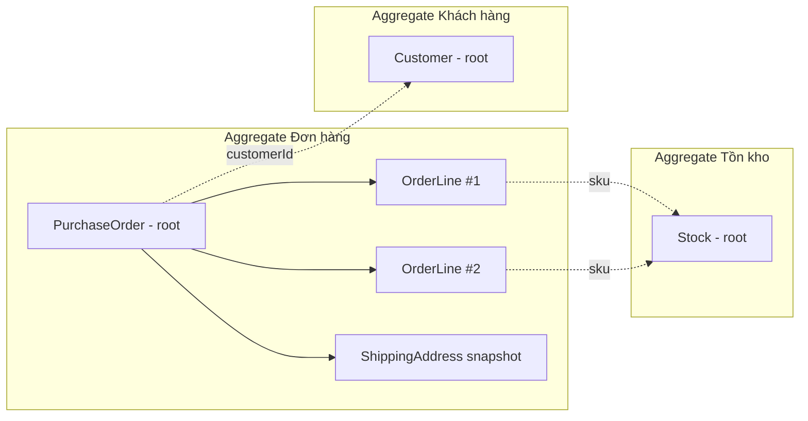
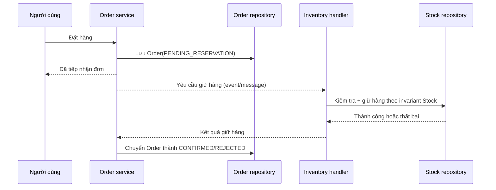
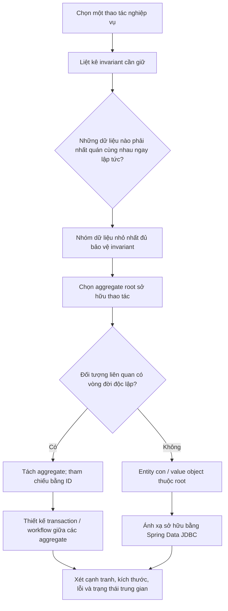

# Xác định ranh giới aggregate từ quy tắc nghiệp vụ và tính nhất quán

Trong **Spring Data JDBC**, thiết kế aggregate quyết định dữ liệu nào được nạp, thay đổi và lưu như **một đơn vị nghiệp vụ**. Nếu ranh giới quá rộng, một thao tác nhỏ có thể kéo theo nhiều SQL, tạo tranh chấp cập nhật và khó mở rộng. Nếu ranh giới quá hẹp, các quy tắc buộc nhiều đối tượng phải thay đổi cùng nhau sẽ dễ bị vi phạm. Vì thế, cách xác định aggregate tốt nhất bắt đầu từ **quy tắc nghiệp vụ cần được bảo vệ**, rồi mới đến bảng, khóa ngoại hay cấu trúc class.

Bài học tập trung vào câu hỏi: **Những đối tượng nào phải luôn nhất quán với nhau ngay sau khi một thao tác nghiệp vụ hoàn tất, và đối tượng nào có thể được phối hợp qua ID, giao dịch ứng dụng hoặc sự kiện?** Từ câu trả lời đó, ta xác định aggregate root, thành phần bên trong và quan hệ giữa các aggregate, sau đó ánh xạ thiết kế sang Spring Data JDBC.

## 1. Aggregate là ranh giới nhất quán, không phải sơ đồ quan hệ

Trong Domain-Driven Design (DDD), **aggregate** là một nhóm đối tượng thuộc cùng một ranh giới nhất quán. Chúng được truy cập và thay đổi qua một **aggregate root**. Một aggregate có thể chứa:

- **Aggregate root**: entity đại diện và kiểm soát các thao tác nghiệp vụ của toàn nhóm, chẳng hạn `PurchaseOrder`.
- **Entity con**: có danh tính hoặc vòng đời được quản lý trong phạm vi aggregate, chẳng hạn dòng hàng thuộc đơn đặt hàng.
- **Value object**: biểu diễn một giá trị không cần danh tính độc lập, chẳng hạn thông tin địa chỉ giao hàng được chụp tại thời điểm đặt hàng.
- **Invariant**: điều kiện phải luôn đúng khi một thao tác nghiệp vụ được chấp nhận, ví dụ *đơn đã gửi phải có ít nhất một dòng hàng hợp lệ*.

Ví dụ với hệ thống đặt hàng:



Các đường liền thể hiện thành phần **bên trong** đơn hàng; các đường đứt thể hiện **tham chiếu tới aggregate khác bằng ID/khóa nghiệp vụ**. Đơn hàng có thể cần biết khách hàng nào đặt và mã hàng nào được mua, nhưng điều đó **không có nghĩa** toàn bộ dữ liệu khách hàng và tồn kho phải thuộc aggregate `PurchaseOrder`.

Một khóa ngoại SQL chỉ cho biết mối liên hệ hoặc ràng buộc tham chiếu ở database. Nó **không tự xác định** ranh giới aggregate. Một database có thể có nhiều bảng trong một aggregate, và nhiều aggregate có thể cùng nằm trong một bảng nếu mô hình và mapping phù hợp.

### Đặc điểm cần nhớ trong Spring Data JDBC

Spring Data JDBC coi **aggregate root** là đầu mối làm việc qua repository. Khi lưu một aggregate, framework có thể ghi nhiều bảng thuộc cấu trúc sở hữu của root. Không có persistence context và dirty checking như JPA: thay đổi đối tượng trong bộ nhớ không tự tạo SQL `UPDATE`; thường phải gọi `repository.save(root)`.

Do đó, sai lầm về ranh giới không chỉ tạo rủi ro nghiệp vụ mà còn ảnh hưởng trực tiếp đến **lượng dữ liệu được ghi lại** và **độ tranh chấp cập nhật**.

## 2. Bắt đầu từ quy tắc nghiệp vụ, không bắt đầu từ bảng

Giả sử sản phẩm có các yêu cầu:

1. Mỗi dòng hàng phải có số lượng lớn hơn 0 và đơn giá không âm.
2. Đơn hàng chỉ được gửi khi có ít nhất một dòng hàng.
3. Tổng tiền đơn hàng bằng tổng `quantity × unitPrice` của các dòng hàng, theo quy tắc làm tròn của nghiệp vụ.
4. Không được xác nhận lượng hàng xuất vượt quá số lượng còn có thể cấp phát trong kho.
5. Thay đổi tên khách hàng về sau không được làm đổi địa chỉ giao hàng đã xác nhận trên đơn cũ.

Những quy tắc này có phạm vi khác nhau. Việc **một đơn hàng** phải có dòng hàng hợp lệ cần được bảo vệ ngay trong `PurchaseOrder`. Còn số lượng còn lại của **một mặt hàng trong kho** có thể phải được bảo vệ tại `Stock` hoặc `InventoryItem`, vì nhiều đơn hàng cùng tranh chấp nguồn hàng đó.

| Quy tắc | Đối tượng tham gia | Nơi phù hợp để bảo vệ | Yêu cầu nhất quán |
|---|---|---|---|
| Số lượng mỗi dòng hàng phải dương | `OrderLine` | Tạo/sửa dòng hàng trong `PurchaseOrder` | Ngay lập tức trong đơn |
| Không gửi đơn rỗng | `PurchaseOrder`, danh sách dòng | `PurchaseOrder.submit()` | Ngay lúc chuyển trạng thái |
| Tổng tiền khớp các dòng | Root và dòng hàng | Tính từ dòng hàng, hoặc cập nhật có kiểm soát trong root | Cùng một phiên bản đơn |
| Không cấp phát tồn kho âm | Các yêu cầu cấp phát chung một mặt hàng | Aggregate `Stock` và cơ chế chống cập nhật đồng thời | Ngay lúc xác nhận cấp phát |
| Địa chỉ trên đơn cũ không đổi khi khách sửa hồ sơ | Đơn hàng và khách hàng | Lưu snapshot địa chỉ vào đơn | Đơn đã xác nhận giữ nguyên |

Khi liệt kê quy tắc, cần hỏi rõ **“ngay lập tức”** có nghĩa gì: sau khi một phương thức domain hoàn tất, sau khi transaction commit, hay có thể sau vài giây khi một tiến trình khác xử lý sự kiện? Sự khác biệt này quyết định ranh giới và cách phối hợp giữa các aggregate.

## 3. Invariant mạnh và nhất quán cuối cùng

**Invariant** là điều kiện không được phép sai tại một ranh giới nghiệp vụ đã chọn. Chẳng hạn, `PurchaseOrder` ở trạng thái `SUBMITTED` phải có ít nhất một dòng hàng. Nếu ứng dụng có thể gọi `submit()` rồi để đơn ở trạng thái `SUBMITTED` nhưng rỗng, aggregate đã không bảo vệ được quy tắc của mình.

### Nhất quán mạnh trong phạm vi aggregate

Với quy tắc phải giữ ngay khi lưu, ta nên thiết kế hành vi sao cho root **kiểm tra và thay đổi những dữ liệu liên quan cùng nhau**:

```text
PurchaseOrder.submit()
    -> Kiểm tra trạng thái hiện tại
    -> Kiểm tra ít nhất một OrderLine hợp lệ
    -> Chuyển trạng thái sang SUBMITTED
    -> repository.save(order) trong transaction
```

Một transaction database giúp nhóm các câu SQL có liên quan được commit hoặc rollback nhất quán. Đối với Spring Data JDBC, một lần `save` aggregate có collection có thể sinh ra nhiều lệnh SQL; cần quan tâm transaction khi đảm bảo các lệnh cùng thành công. Nếu nghiệp vụ phối hợp nhiều lời gọi repository, đặt `@Transactional` tại tầng application service để bao toàn bộ công việc cần thiết.

### Nhất quán cuối cùng giữa các aggregate

Một số quy tắc cho phép độ trễ. Ví dụ đơn hàng được tạo ở trạng thái `PENDING_RESERVATION`, sau đó bộ phận tồn kho xử lý yêu cầu giữ hàng, rồi đơn chuyển sang `CONFIRMED` hoặc `REJECTED`. Đây là một **quy trình nhiều bước**, không phải một lần lưu đồng thời toàn bộ object graph.



Lúc chờ xử lý, đơn hàng có thể ở trạng thái trung gian hợp lệ. **Nhất quán cuối cùng chỉ phù hợp khi nghiệp vụ chấp nhận trạng thái trung gian đó**. Nếu cam kết của hệ thống là *không bao giờ xác nhận đơn khi chưa giữ được hàng*, không được gắn nhãn `CONFIRMED` trước bước giữ hàng rồi hy vọng cập nhật sau.

Trong hệ thống thực tế, cơ chế gửi sự kiện cần xét lỗi truyền thông, xử lý lặp, thứ tự xử lý và phục hồi. **Transactional outbox** thường được dùng để lưu thông tin sự kiện cùng transaction thay đổi aggregate, sau đó chuyển sự kiện đi một cách đáng tin cậy hơn. Handler nên có khả năng xử lý idempotent; không mặc định mỗi thông điệp chỉ đến đúng một lần.

## 4. Quy trình xác định ranh giới aggregate

Có thể áp dụng quy trình sau trước khi thiết kế bảng hoặc repository.

### Bước 1 — Liệt kê thao tác nghiệp vụ và trạng thái

Tìm các lệnh nghiệp vụ thay đổi dữ liệu, chẳng hạn:

- `createOrder`, `addLine`, `removeLine`, `submitOrder`, `cancelOrder`.
- `reserveStock`, `releaseStock`, `adjustStock`.
- `changeCustomerAddress`, `deactivateCustomer`.

Tránh chỉ liệt kê các CRUD tổng quát như “thêm một dòng trong bảng”. Các câu như *“chỉ được hủy đơn chưa giao”* hoặc *“không được đặt số lượng âm”* bộc lộ ranh giới nhất quán tốt hơn tên bảng.

### Bước 2 — Ghi rõ invariant và dữ liệu cần có để kiểm tra

Với từng lệnh, đặt câu hỏi: điều kiện nào phải đúng trước và sau lệnh? Dữ liệu cần kiểm tra nằm ở đâu? Nếu chỉ cần trạng thái đơn và các dòng hàng, invariant đó thuộc `PurchaseOrder`. Nếu cần số tồn kho đang chịu tác động từ hàng nghìn đơn khác nhau, invariant đó cần một owner độc lập như `Stock`.

### Bước 3 — Xác định đơn vị cần commit cùng nhau

Các phần dữ liệu cần được thay đổi **cùng một thao tác nhất quán** thường là ứng viên để đặt chung aggregate. Nhưng không có quy tắc “mọi dữ liệu cần cùng transaction thì phải nằm trong cùng aggregate”: ứng dụng có thể dùng transaction trên nhiều repository khi thật sự cần. Việc đó không làm hai aggregate trở thành một aggregate duy nhất.

Điểm quyết định là **ai chịu trách nhiệm bảo vệ invariant** và có thể duy trì invariant ấy mà không cần nạp một object graph không giới hạn hay không.

### Bước 4 — Chọn root và che thao tác nguy hiểm

Aggregate root cần có danh tính rõ ràng và API nghiệp vụ:

```text
order.addLine(...)
order.submit()
order.cancel(reason)
```

Thay vì để mọi service tùy ý sửa:

```text
order.lines.clear()
order.status = SUBMITTED
```

Những thay đổi có nguy cơ phá invariant nên đi qua phương thức của root. Child không được sửa độc lập qua repository riêng nếu nó thuộc phạm vi sở hữu của root.

### Bước 5 — Biểu diễn quan hệ xuyên ranh giới bằng danh tính

Nếu `PurchaseOrder` cần tham chiếu `Customer`, lưu `customerId` hoặc một reference giá trị phù hợp. Đơn hàng chỉ cần tham chiếu khách hàng; nó không sở hữu toàn bộ hồ sơ khách hàng. Nếu `OrderLine` cần sản phẩm, có thể lưu `sku`/`productId` và các thông tin đã chốt như tên, đơn giá tại lúc đặt, tùy quy tắc nghiệp vụ.

### Bước 6 — Xét kích thước, cạnh tranh và vòng đời

Thử các tình huống vận hành thực tế: một khách hàng có 100.000 đơn; một sản phẩm có 50.000 lần thay đổi tồn kho; hai người cùng chỉnh đơn; một dòng hàng bị xóa. Nếu mỗi thay đổi nhỏ buộc lưu lại quá nhiều dữ liệu, hoặc mọi thay đổi không liên quan đều tranh chấp cùng một version, ranh giới có thể đang quá rộng.

## 5. Ví dụ thiết kế: đơn hàng và dòng hàng thuộc một aggregate

Giả sử quy tắc nghiệp vụ của đơn hàng là:

- Chỉ sửa dòng hàng khi đơn đang `DRAFT`.
- Dòng hàng phải có `quantity > 0`, `unitPrice >= 0`.
- Chỉ `submit` khi đơn có ít nhất một dòng.
- Khi đã `SUBMITTED`, không được sửa dòng hàng bằng thao tác thông thường.

Các điều kiện trên đều dựa vào root và các dòng hàng của **cùng một đơn**. Vì vậy, nhóm `PurchaseOrder` với `OrderLine` là một lựa chọn hợp lý.

### 5.1. Phác thảo mã miền có hành vi bảo vệ invariant

```java
import java.math.BigDecimal;
import java.util.ArrayList;
import java.util.List;
import java.util.Objects;
import org.springframework.data.annotation.Id;
import org.springframework.data.annotation.Version;
import org.springframework.data.relational.core.mapping.MappedCollection;
import org.springframework.data.relational.core.mapping.Table;

enum OrderStatus { DRAFT, SUBMITTED }

@Table("purchase_orders")
public class PurchaseOrder {
    @Id
    private Long id;

    @Version
    private Long version;

    private Long customerId;
    private OrderStatus status = OrderStatus.DRAFT;

    @MappedCollection(idColumn = "order_id", keyColumn = "line_position")
    private List<OrderLine> lines = new ArrayList<>();

    protected PurchaseOrder() { }

    public PurchaseOrder(Long customerId) {
        this.customerId = Objects.requireNonNull(customerId);
    }

    public void addLine(String sku, int quantity, BigDecimal unitPrice) {
        ensureDraft();
        lines.add(new OrderLine(sku, quantity, unitPrice));
    }

    public void submit() {
        ensureDraft();
        if (lines.isEmpty()) {
            throw new IllegalStateException("Không thể gửi đơn rỗng");
        }
        status = OrderStatus.SUBMITTED;
    }

    public BigDecimal total() {
        return lines.stream()
                .map(OrderLine::subtotal)
                .reduce(BigDecimal.ZERO, BigDecimal::add);
    }

    public Long getId() { return id; }
    public OrderStatus getStatus() { return status; }
    public List<OrderLine> getLines() { return List.copyOf(lines); }

    private void ensureDraft() {
        if (status != OrderStatus.DRAFT) {
            throw new IllegalStateException("Đơn không còn ở trạng thái DRAFT");
        }
    }
}

@Table("order_lines")
class OrderLine {
    private String sku;
    private int quantity;
    private BigDecimal unitPrice;

    protected OrderLine() { }

    OrderLine(String sku, int quantity, BigDecimal unitPrice) {
        if (sku == null || sku.isBlank()) {
            throw new IllegalArgumentException("SKU không được trống");
        }
        if (quantity <= 0) {
            throw new IllegalArgumentException("Số lượng phải dương");
        }
        if (unitPrice == null || unitPrice.signum() < 0) {
            throw new IllegalArgumentException("Đơn giá không được âm");
        }
        this.sku = sku;
        this.quantity = quantity;
        this.unitPrice = unitPrice;
    }

    BigDecimal subtotal() {
        return unitPrice.multiply(BigDecimal.valueOf(quantity));
    }
}
```

Đây là phần lõi minh họa cho thiết kế aggregate; trong dự án thật có thể thêm các constructor, enum, quy tắc tiền tệ, kiểm tra chuyển trạng thái, equals/hashCode theo nhu cầu. Điểm quan trọng là `PurchaseOrder` **sở hữu danh sách dòng hàng** và kiểm soát đường thay đổi. Trả bản sao không thể sửa trực tiếp từ `getLines()` giúp mã bên ngoài không tùy ý thêm/xóa dòng rồi bỏ qua `addLine()`.

`@MappedCollection(idColumn = "order_id", keyColumn = "line_position")` chỉ cho Spring Data JDBC cách lưu collection `List<OrderLine>`: dòng con mang cột khóa tham chiếu về root (`order_id`) và cột lưu vị trí trong danh sách (`line_position`). Tên cột và thiết kế khóa phải khớp schema database. `@Version` là cơ sở để kiểm soát ghi đè do hai lần cập nhật aggregate cùng tồn tại.

### 5.2. Repository đặt tại aggregate root

```java
import org.springframework.data.repository.CrudRepository;

public interface PurchaseOrderRepository
        extends CrudRepository<PurchaseOrder, Long> {
}
```

Thông thường **không cần `OrderLineRepository`** nếu `OrderLine` chỉ sống trong đơn hàng. Tạo repository ghi trực tiếp dòng hàng con làm cho application service có thể thay đổi dữ liệu mà không đi qua các quy tắc của `PurchaseOrder`.

Một application service thực hiện use case:

```java
import org.springframework.stereotype.Service;
import org.springframework.transaction.annotation.Transactional;

@Service
public class OrderApplicationService {
    private final PurchaseOrderRepository orders;

    public OrderApplicationService(PurchaseOrderRepository orders) {
        this.orders = orders;
    }

    @Transactional
    public PurchaseOrder submit(Long orderId) {
        PurchaseOrder order = orders.findById(orderId)
                .orElseThrow(() -> new IllegalArgumentException("Không có đơn"));

        order.submit();
        return orders.save(order);
    }
}
```

Ở đây, service điều phối `findById` và `save` trong transaction; còn chính aggregate quyết định **đơn có đủ điều kiện để submit không**. Ranh giới domain logic và điều phối application được phân tách rõ ràng.

### 5.3. Schema minh họa

```sql
CREATE TABLE purchase_orders (
    id BIGINT GENERATED BY DEFAULT AS IDENTITY PRIMARY KEY,
    version BIGINT,
    customer_id BIGINT NOT NULL,
    status VARCHAR(30) NOT NULL
);

CREATE TABLE order_lines (
    order_id BIGINT NOT NULL,
    line_position INTEGER NOT NULL,
    sku VARCHAR(100) NOT NULL,
    quantity INTEGER NOT NULL,
    unit_price DECIMAL(18, 2) NOT NULL,
    PRIMARY KEY (order_id, line_position),
    CONSTRAINT fk_order_lines_order
        FOREIGN KEY (order_id) REFERENCES purchase_orders(id)
);
```

Ví dụ dùng cú pháp identity phổ biến trong H2 và một số database, không phải DDL tương thích hoàn toàn với mọi dialect. `version` phục vụ optimistic locking. `customer_id` là ID tham chiếu tới **aggregate khách hàng**, nhưng không nhất thiết phải được mô hình thành object `Customer` bên trong `PurchaseOrder`.

Quan hệ `OrderLine` là **sở hữu bởi aggregate**: dòng hàng không cần có vòng đời độc lập bên ngoài đơn. Nếu nghiệp vụ sau này yêu cầu mỗi dòng hàng có định danh riêng, lịch sử hoàn trả và quy trình phê duyệt độc lập, cần xem xét lại mô hình, nhưng không mặc nhiên tách chỉ vì thêm một cột ID.

## 6. Điều gì xảy ra khi `save` một aggregate trong Spring Data JDBC?

Spring Data JDBC không hoạt động như một ORM có dirty checking tự động. Khi gọi:

```java
PurchaseOrder order = orders.findById(id).orElseThrow();
order.addLine("SKU-01", 2, new BigDecimal("50.00"));
orders.save(order);
```

Framework xử lý **trạng thái aggregate được cung cấp**, không chỉ một cột `quantity` hay dòng hàng vừa sửa. Với các collection thuộc aggregate, cách lưu mặc định của Spring Data JDBC có thể **xóa và tạo lại nhiều bản ghi con** khi cập nhật root, thay vì tính diff tối thiểu từng child như nhiều người kỳ vọng ở JPA.

Luồng khái quát:

```mermaid
flowchart TD
    A[orders.save(order)] --> B{Root mới hay đã tồn tại?}
    B -->|Mới| C[INSERT purchase_orders]
    B -->|Đã tồn tại| D[UPDATE purchase_orders; kiểm tra version nếu có]
    C --> E[Ghi các order_lines thuộc aggregate]
    D --> F[Đồng bộ/recreate các order_lines theo mapping]
    F --> G[Trả aggregate sau khi lưu]
    E --> G
```

Hệ quả thiết kế:

- Một aggregate có hàng chục phần tử con còn dễ hiểu và thường phù hợp với việc nạp/lưu theo root; một aggregate tăng không giới hạn hàng chục nghìn phần tử con có thể khiến `save` rất tốn chi phí.
- Với thành phần con không cần sống tách biệt, việc lưu theo root là lợi ích: root kiểm soát các quy tắc chung.
- Nếu child cần được hàng trăm tiến trình độc lập cập nhật với tần suất cao, mô hình một aggregate root duy nhất có thể tạo điểm tranh chấp.
- Không nên mặc định rằng thêm `@MappedCollection` cho mọi quan hệ SQL là cách đúng. Chỉ dùng cho **quan hệ sở hữu bên trong aggregate**.

Đó là lý do kích thước aggregate phải phản ánh **đơn vị nhất quán nghiệp vụ nhỏ nhất có thể**, không phản ánh mọi bảng có khóa ngoại liên quan.

## 7. Aggregate độc lập: tồn kho không nên là child của đơn hàng

Giả sử SKU `P100` còn 5 sản phẩm. Hai đơn hàng khác nhau cùng yêu cầu mỗi đơn 4 sản phẩm. Nếu mỗi `PurchaseOrder` chứa một bản sao `Stock(available=5)` và tự giảm nó, cả hai đơn có thể cùng thấy đủ hàng và cùng xác nhận, gây bán vượt tồn kho.

Quy tắc **“không cấp phát vượt tồn kho”** liên quan đến mọi yêu cầu trên một SKU, nên cần một chủ thể sở hữu việc kiểm tra và giảm tồn kho, chẳng hạn aggregate `Stock`:

```java
public class Stock {
    // sku/ID, available, reserved, version...

    public void reserve(int quantity) {
        if (quantity <= 0) {
            throw new IllegalArgumentException("Số lượng không hợp lệ");
        }
        if (available < quantity) {
            throw new IllegalStateException("Không đủ tồn kho");
        }
        available -= quantity;
        reserved += quantity;
    }
}
```

Đây là **mã minh họa hành vi miền**, chưa khai báo toàn bộ field, mapping hay repository. Để đảm bảo invariant khi có nhiều transaction đồng thời, chỉ kiểm tra biến `available` trong bộ nhớ là chưa đủ. Cần cơ chế thực thi phù hợp như `@Version`/optimistic locking với xử lý xung đột, khóa database, hoặc câu `UPDATE ... WHERE available >= ?` nguyên tử tùy thiết kế.

Nếu đơn và tồn kho trong **cùng database**, application service có thể dùng `@Transactional` để phối hợp nhiều repository cho nghiệp vụ cần nguyên tử. Điều đó là quyết định transaction của use case, **không bắt buộc nhập `Stock` vào aggregate `PurchaseOrder`**. Với các hệ thống tách database hoặc service, transaction cục bộ không thể tự bảo đảm nguyên tử xuyên hệ thống; cần thiết kế workflow và trạng thái bù/trung gian rõ ràng.

Ví dụ quan hệ giữa các aggregate:

```text
PurchaseOrder
  id = 2001
  customerId = 51          -> Customer aggregate
  lines = [
    { sku = "P100", quantity = 4 } -> Stock/Item aggregate by SKU
  ]

Stock
  sku = "P100"
  available = 5
```

Hai aggregate bảo vệ **hai invariant khác nhau**: `PurchaseOrder` bảo đảm đơn hợp lệ, còn `Stock` bảo đảm số lượng có thể giữ không âm. Lệnh nghiệp vụ đặt hàng có thể điều phối cả hai mà vẫn giữ ranh giới sở hữu riêng.

## 8. Xác định thành phần con dựa trên vòng đời và quyền sở hữu

Ngoài invariant, hãy xét **vòng đời**:

| Câu hỏi | Nếu câu trả lời là “có” | Gợi ý ranh giới |
|---|---|---|
| Đối tượng chỉ có ý nghĩa khi root tồn tại? | Dòng hàng của một đơn bị xóa cùng đơn. | Có thể là thành phần con của root. |
| Thao tác với đối tượng con luôn phải xét trạng thái root? | Không sửa dòng hàng khi đơn đã gửi. | Nên được root kiểm soát. |
| Đối tượng được quản lý/tra cứu/cập nhật độc lập bởi nhiều quy trình? | Hồ sơ khách hàng được sửa độc lập với đơn. | Aggregate riêng. |
| Đối tượng được nhiều root khác nhau cùng tham chiếu? | Nhiều đơn cùng dùng một SKU. | Không nhúng cùng entity mutable vào từng root; tham chiếu bằng ID. |
| Đối tượng có thể thay đổi mà dữ liệu lịch sử không nên đổi theo? | Địa chỉ trên hóa đơn phải giữ nguyên sau khi khách sửa hồ sơ. | Lưu snapshot/value object trong aggregate lịch sử. |

Ví dụ, địa chỉ trong hồ sơ khách hàng (`Customer`) và địa chỉ giao hàng trên đơn (`PurchaseOrder`) dù có các trường giống nhau vẫn có **vòng đời khác nhau**. Địa chỉ trên đơn là giá trị đã chốt tại thời điểm đặt; tham chiếu trực tiếp tới địa chỉ hiện tại của khách có thể làm lịch sử thay đổi ngoài ý muốn. Một value object địa chỉ được sao chép vào đơn thường phù hợp hơn.

Ngược lại, nếu dòng hàng thực chất là một nhiệm vụ hậu cần có vòng đời riêng, có người phụ trách riêng và trạng thái thay đổi độc lập, việc đặt nó trong aggregate đơn hàng lớn có thể gây khó khăn. Khi ấy có thể tách aggregate hậu cần, lưu `orderId` và phối hợp trạng thái qua application service hoặc sự kiện.

## 9. Tính đồng thời: `@Version` bảo vệ ranh giới như thế nào?

Hãy hình dung hai request cùng đọc `PurchaseOrder` phiên bản 3:

```text
Request A: đọc Order #2001 (version 3), thêm SKU-A
Request B: đọc Order #2001 (version 3), thêm SKU-B

A: save -> phiên bản mới, ví dụ version 4
B: save dựa trên version 3 -> xung đột, không ghi đè âm thầm
```

Đặt `@Version` trên root giúp Spring Data JDBC kiểm tra phiên bản khi cập nhật aggregate. Khi điều kiện phiên bản không còn khớp, thao tác sẽ báo lỗi optimistic locking thay vì mặc nhiên dùng bản ghi cũ đè lên dữ liệu mới. Ứng dụng có thể thông báo cho người dùng tải lại, hoặc retry **toàn bộ use case** sau khi đọc trạng thái mới nếu thao tác cho phép retry an toàn.

```mermaid
sequenceDiagram
    participant A as Request A
    participant B as Request B
    participant DB as Order row
    A->>DB: Đọc version 3
    B->>DB: Đọc version 3
    A->>DB: Ghi với expectedVersion=3
    DB-->>A: Thành công; version 4
    B->>DB: Ghi với expectedVersion=3
    DB-->>B: Optimistic locking conflict
```

**Giới hạn:** optimistic locking của root có tác dụng khi các thay đổi đi qua đường lưu aggregate và cập nhật version phù hợp. Một đoạn SQL tự viết thao tác trực tiếp vào bảng `order_lines` mà không cập nhật/kiểm tra version root có thể phá invariant và bỏ qua cơ chế này. Ranh giới aggregate vì vậy cũng là **quy ước về đường ghi dữ liệu** của toàn ứng dụng.

Không nên tự động retry vô hạn một lệnh có tác dụng ngoài database như gửi email, thu tiền hoặc phát sự kiện, vì retry có thể nhân đôi tác dụng phụ. Những thao tác đó cần idempotency và ranh giới transaction phù hợp.

## 10. Aggregate nhỏ hay lớn: cân bằng thực tế

Quy tắc “aggregate càng nhỏ càng tốt” cần hiểu đúng: **nhỏ nhất mà vẫn tự bảo vệ được các invariant mạnh của nó**. Không tách dữ liệu chỉ để giảm số lượng class hoặc để mỗi bảng có một repository.

| Tiêu chí | Aggregate quá lớn | Aggregate quá nhỏ |
|---|---|---|
| **Invariant** | Dễ gộp nhiều quy tắc không liên quan. | Quy tắc đơn lẻ phải kiểm tra trên nhiều root. |
| **Ghi dữ liệu** | Một thay đổi nhỏ có thể ghi lại nhiều phần tử con. | Một use case phải điều phối nhiều repository. |
| **Đồng thời** | Nhiều thao tác độc lập tranh chấp cùng version root. | Dễ có khoảng trống nhất quán giữa các thay đổi. |
| **Vòng đời** | Object tồn tại độc lập bị phụ thuộc root không cần thiết. | Child không có vòng đời riêng bị tách và sửa tùy tiện. |
| **Mở rộng** | Root trở thành nút thắt khi collection tăng mạnh. | Workflow xuyên aggregate phức tạp hơn. |

Nếu một đơn thường có 3–20 dòng và các quy tắc sửa dòng phụ thuộc trạng thái đơn, `OrderLine` nằm trong `PurchaseOrder` là thiết kế tự nhiên. Nhưng nếu “dòng công việc” có thể lên tới hàng trăm nghìn, được phân công và thay đổi độc lập, cần xem nó thực sự là child của đơn hay là aggregate riêng có `orderId`.

Chi phí đọc cũng cần xét: một màn hình chỉ hiển thị danh sách đơn và tổng tiền không nhất thiết phải gọi `findAll()` rồi materialize toàn bộ object graph của từng đơn. Có thể dùng query đọc riêng, projection hoặc bảng tổng hợp để đáp ứng giao diện. **Read model** phục vụ tra cứu không bắt buộc trùng hệt cấu trúc aggregate dùng để ghi.

## 11. Quan hệ giữa aggregate trong Spring Data JDBC

Spring Data JDBC cung cấp mapping cho thành phần được root sở hữu, nhưng **không có cơ chế ORM tự động lazy-load toàn bộ quan hệ tùy ý**. Chỉ vì trong schema có `FOREIGN KEY customer_id REFERENCES customers(id)` không có nghĩa entity `PurchaseOrder` nên có field `Customer customer` được nạp như quan hệ JPA.

Trong mô hình thông dụng:

```java
@Table("purchase_orders")
public class PurchaseOrder {
    @Id Long id;
    Long customerId; // Chỉ giữ ID của aggregate Customer
    // ...
}
```

Khi cần thông tin khách hàng cho màn hình, ứng dụng có thể gọi `CustomerRepository` riêng hoặc dùng truy vấn đọc kết hợp (`JOIN`) để dựng DTO. Kết hợp dữ liệu để **đọc** không làm thay đổi quyền sở hữu dữ liệu khi **ghi**.

Spring Data JDBC còn có kiểu `AggregateReference<T, ID>` để biểu đạt quan hệ tới aggregate khác bằng ID với ngữ nghĩa rõ ràng hơn một trường scalar, khi thấy hữu ích:

```java
import org.springframework.data.jdbc.core.mapping.AggregateReference;

AggregateReference<Customer, Long> customerRef = AggregateReference.to(51L);
```

Đoạn trên minh họa việc tạo reference, không tự tải `Customer`. Tùy phiên bản và chiến lược mapping, cần khai báo trường và converter phù hợp nếu dùng kiểu tham chiếu chuyên biệt. Với nhiều mô hình, một `Long customerId` đơn giản đã đủ rõ.

**Không đưa hai root vào cùng cây `@MappedCollection` chỉ để thuận tiện khi đọc.** Nếu một root được xem như child của root khác, đường lưu của Spring Data JDBC sẽ có ý nghĩa sở hữu và có thể tác động đến vòng đời của đối tượng đó. Hãy tạo read query/DTO cho nhu cầu hiển thị thay vì làm biến dạng ranh giới ghi.

## 12. Tình huống phản ví dụ: một `Customer` chứa toàn bộ đơn hàng

Thiết kế ban đầu có thể trông tiện:

```text
Customer aggregate
  -> CustomerProfile
  -> ShippingAddresses
  -> PurchaseOrders
       -> OrderLines
  -> Payments
  -> Shipments
```

Nhưng hãy xét một khách có hàng nghìn đơn. Sửa tên khách không cần cập nhật lịch sử đơn. Một nhân viên kho cập nhật giao hàng không cần sửa thông tin cá nhân. Các đơn có vòng đời khác nhau và được xử lý đồng thời. Nếu tất cả được mô hình thành một aggregate `Customer`, thao tác nhỏ có thể phải nạp và lưu khối dữ liệu lớn, các lệnh không liên quan tranh chấp cùng root và trách nhiệm bị trộn lẫn.

Thiết kế sát invariant hơn:

```text
Customer aggregate: customerId, profile, addresses currently managed by customer
PurchaseOrder aggregate: orderId, customerId, order lines, order status, address snapshot
Payment aggregate: paymentId, orderId, payment lifecycle (nếu nghiệp vụ yêu cầu độc lập)
Shipment aggregate: shipmentId, orderId, fulfillment lifecycle (nếu độc lập)
```

Các aggregate có thể cùng nằm trong một database và liên kết bằng khóa ngoại, nhưng **quyền thay đổi** thuộc root tương ứng. Application service hoặc workflow điều phối một use case đi qua nhiều ranh giới khi cần.

## 13. Những dấu hiệu cần xem lại ranh giới

| Dấu hiệu trong code hoặc vận hành | Vấn đề thiết kế có thể tồn tại |
|---|---|
| `LineItemRepository.save(...)` thay đổi được dòng thuộc đơn `SUBMITTED`. | Child đang bị sửa ngoài sự kiểm soát của root. |
| `Customer` có `List<PurchaseOrder>` tăng mãi theo thời gian. | Đưa các đối tượng có vòng đời độc lập vào aggregate quá lớn. |
| Hai thao tác độc lập liên tục gặp optimistic lock cùng root. | Ranh giới quá rộng hoặc một root đang gom nhiều luồng cập nhật độc lập. |
| `submitOrder` cần sửa trực tiếp `Stock` và `Customer` object nằm trong `Order`. | Trộn nhiều chủ sở hữu invariant vào một object graph. |
| `findById(root)` nạp lượng dữ liệu con rất lớn cho một lệnh nhỏ. | Aggregate quá lớn hoặc đường đọc chưa phù hợp mục đích. |
| SQL tự viết thay đổi bảng con mà không xét trạng thái root. | Đường ghi dữ liệu phá ranh giới nhất quán. |
| Mọi bảng đều có repository CRUD công khai dù dữ liệu là child. | Thiết kế dựa theo bảng thay vì lifecycle và hành vi domain. |
| Phải dùng nhiều transaction riêng nhưng lại đòi invariant tức thời toàn hệ thống. | Cần xem lại yêu cầu, ranh giới giao dịch và cách phối hợp xuyên hệ thống. |

Một số trường hợp có lý do kỹ thuật chính đáng để dùng custom SQL, query tối ưu hoặc transaction nhiều repository. Điểm cần giữ là **mọi đường ghi dữ liệu đều phải tôn trọng nơi sở hữu invariant**, kể cả khi không gọi trực tiếp một phương thức domain của root.

## 14. Bài tập suy luận ranh giới từ quy tắc nghiệp vụ

Xét hệ thống thư viện với các thực thể `BookTitle`, `BookCopy`, `Member`, `Loan`:

> A. Mỗi bản sách vật lý có mã định danh và chỉ được cho mượn nếu chưa có lượt mượn đang hoạt động.  
> B. Thành viên không được có quá 5 lượt mượn đang hoạt động.  
> C. Người dùng có thể đổi tên sách trong catalog mà không thay đổi nội dung lịch sử mượn.  
> D. Một lượt mượn có ngày mượn, hạn trả và trạng thái hoàn trả riêng.

Cách phân tích:

1. Quy tắc A đòi bảo vệ trạng thái của **một bản sách vật lý** trước các lượt mượn cạnh tranh. Có thể tạo aggregate `BookCopy` làm chủ trạng thái khả dụng hoặc thiết kế một aggregate quản lý đăng ký lượt mượn theo copy, cùng cơ chế đồng thời.
2. Quy tắc B là invariant **theo thành viên**, nhưng các lượt mượn là những thực thể có vòng đời riêng; có thể cần một bộ đếm/giấy phép mượn được quản lý nhất quán, transaction phù hợp hoặc mô hình một aggregate điều phối hạn mức. Không nên tự động nhét toàn bộ lịch sử `Loan` vào `Member`.
3. Quy tắc C chỉ ra thông tin sách lịch sử nên được snapshot ở nơi cần giữ, hoặc lịch sử không phụ thuộc tên hiện tại trong catalog.
4. Quy tắc D cho thấy `Loan` có thể phù hợp làm aggregate độc lập nếu việc gia hạn, trả sách và quá hạn cần được xử lý riêng.

Không có một đáp án class diagram duy nhất cho mọi tổ chức: ranh giới còn phụ thuộc **cam kết nghiệp vụ về tính nhất quán**, số lượng dữ liệu và mức độ đồng thời. Bài tập yêu cầu giải thích *vì sao* một ranh giới bảo vệ được quy tắc, không chỉ liệt kê các bảng liên quan.

## 15. Mô hình quyết định ngắn gọn

Khi thiết kế một aggregate mới, có thể đi theo luồng quyết định:



Nguyên tắc xuyên suốt là **một aggregate giữ những invariant mà nó có thể bảo vệ nhất quán từ bên trong**, root kiểm soát các thay đổi và các aggregate khác được nhận diện qua danh tính. Với Spring Data JDBC, lựa chọn ranh giới còn gắn trực tiếp với cách `save` ghi toàn bộ cấu trúc sở hữu, cách `@MappedCollection` quản lý child và cách `@Version` phát hiện ghi đồng thời. Nếu bắt đầu từ lệnh nghiệp vụ và thời điểm cần nhất quán, mô hình thường rõ ràng hơn, ít phụ thuộc triển khai SQL hơn và dễ mở rộng hơn khi yêu cầu thay đổi.
