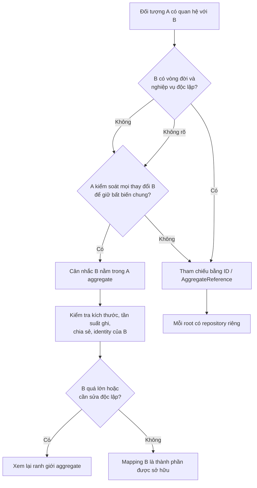

# Phân biệt quan hệ sở hữu bên trong aggregate và tham chiếu giữa các aggregate

Trong **Spring Data JDBC**, thiết kế quan hệ giữa các đối tượng bắt đầu từ một câu hỏi nghiệp vụ: **đối tượng nào thực sự thuộc quyền quản lý của một aggregate root, và đối tượng nào có vòng đời riêng nên chỉ được tham chiếu qua định danh?**

Cả hai trường hợp đều có thể được lưu trong các bảng có khóa ngoại, nhưng **ý nghĩa quản lý dữ liệu hoàn toàn khác nhau**. Nếu xem mọi khóa ngoại là quan hệ sở hữu, ứng dụng dễ tạo aggregate quá lớn, thao tác `save` không như mong đợi hoặc vô tình thay đổi dữ liệu của đối tượng độc lập. Nếu tách tất cả thành những aggregate riêng, việc bảo đảm quy tắc nhất quán của các thành phần vốn phải đi cùng nhau lại trở nên khó khăn.

Bài học này phân biệt hai kiểu quan hệ qua ví dụ hệ thống bán hàng, giới thiệu ánh xạ của Spring Data JDBC và hướng dẫn lựa chọn ranh giới aggregate dựa trên nghiệp vụ.

## 1. Aggregate và aggregate root là gì?

Theo cách tiếp cận *Domain-Driven Design* (DDD), **aggregate** là một nhóm đối tượng thuộc cùng một **ranh giới nhất quán**. Các quy tắc nghiệp vụ cần luôn đúng bên trong nhóm thường được duy trì thông qua một đối tượng đại diện gọi là **aggregate root**.

Ví dụ: một đơn hàng có trạng thái, các dòng hàng và tổng tiền. Quy tắc “đơn hàng không thể xác nhận nếu không có dòng hàng hợp lệ” nên được kiểm soát tại `Order`, thay vì cho phép các phần còn lại của hệ thống sửa từng dòng hàng tùy ý.

```text
                      Aggregate Order
              ┌──────────────────────────┐
              │ Order (aggregate root)   │
              │  id, status              │
              │                          │
              │  ├── OrderLine #1        │
              │  │   SKU, quantity       │
              │  └── OrderLine #2        │
              │      SKU, quantity       │
              └──────────────────────────┘
                   Một ranh giới nhất quán
```

Ở đây:

- `Order` là **aggregate root**, điểm truy cập chính cho việc tạo, sửa, lưu và xóa đơn hàng.
- `OrderLine` là thành phần **được sở hữu bên trong aggregate**; nó sống trong ranh giới nghiệp vụ của đơn hàng.
- Mã nghiệp vụ thường thao tác thông qua `OrderRepository` và các phương thức như `order.addLine(...)`, thay vì tạo `OrderLineRepository` độc lập cho từng dòng.

Một aggregate **không nhất thiết tương ứng với một bảng**: đơn hàng và dòng hàng có thể được lưu ở hai bảng nhưng vẫn thuộc cùng một aggregate. Ngược lại, hai bảng có khóa ngoại không có nghĩa chúng phải nằm trong cùng một aggregate.

## 2. Quan hệ sở hữu bên trong aggregate

**Quan hệ sở hữu** (*owned relationship*) nghĩa là đối tượng con thuộc vòng đời và ranh giới nhất quán của aggregate root.

Ví dụ, `OrderLine` mô tả một dòng cụ thể trong `Order`:

- Một dòng hàng được thêm khi nghiệp vụ thêm sản phẩm vào đơn hàng.
- Khi số lượng thay đổi, quy tắc về số lượng hợp lệ được kiểm soát qua đơn hàng.
- Khi dòng bị xóa khỏi đơn, nó không còn là một phần của aggregate này.
- Khi lưu đơn hàng, trạng thái dòng hàng thuộc aggregate cũng được lưu theo.
- Dòng hàng thường không được chia sẻ như cùng **một thực thể sống** giữa hai đơn hàng độc lập.

Quan hệ này có thể mô tả bằng lời: **“Order sở hữu các OrderLine của nó.”**

### 2.1. Các dấu hiệu nhận biết quan hệ sở hữu

| Câu hỏi nghiệp vụ | Dấu hiệu nghiêng về quan hệ sở hữu |
| --- | --- |
| Đối tượng con có ý nghĩa độc lập ngoài cha không? | Không; `OrderLine` chỉ có ý nghĩa trong đơn hàng tương ứng. |
| Ai kiểm soát việc tạo, xóa, sửa đối tượng con? | Aggregate root kiểm soát. |
| Có quy tắc phải luôn đúng trên toàn nhóm không? | Có, ví dụ tổng số lượng, tổng tiền hoặc trạng thái đơn hàng. |
| Có cần chia sẻ cùng đối tượng con cho nhiều root không? | Không. |
| Khi thao tác với đối tượng con có luôn phải xét trạng thái cha không? | Thường có. |
| Có cần repository công khai riêng cho đối tượng con không? | Thường không. |

Đây là các **tiêu chí thiết kế**, không phải luật cứng chỉ nhìn vào tên class. Một đối tượng có khóa chính trong database vẫn có thể là thực thể con được sở hữu; bản thân sự tồn tại của `id` không biến nó thành aggregate root.

### 2.2. Sở hữu không đồng nghĩa với “object lồng trong Java”

Một class có trường `private List<OrderLine> lines` là dấu hiệu cấu trúc, nhưng ranh giới aggregate phải được quyết định bởi **quy tắc nghiệp vụ và vòng đời**, sau đó mới ánh xạ sang Java và database.

Ví dụ, `Customer` có thể được lưu trong một object field của `Order` khi xây dựng DTO cho API, nhưng điều đó không tự biến toàn bộ khách hàng thành thành phần do đơn hàng sở hữu.

## 3. Tham chiếu giữa các aggregate độc lập

**Tham chiếu giữa aggregate** (*cross-aggregate reference*) được dùng khi hai đối tượng là **hai aggregate root có vòng đời riêng**. Một aggregate cần biết đối tượng còn lại là ai, nhưng **không sở hữu và không tự quản lý trạng thái bên trong** của đối tượng đó.

Ví dụ, khách hàng có thể tồn tại trước khi đặt hàng, tiếp tục tồn tại sau khi đơn hàng hoàn tất và có thể có nhiều đơn hàng. Vì vậy, `Customer` và `Order` là hai aggregate độc lập:

```text
       Customer aggregate                  Order aggregate
    ┌────────────────────┐            ┌─────────────────────────┐
    │ Customer           │            │ Order (root)            │
    │ id = 42            │◄───────────│ customerId = 42         │
    │ name = "Ngọc"      │  tham chiếu│ status = "DRAFT"        │
    └────────────────────┘            │  ├── OrderLine #1       │
                                      │  └── OrderLine #2       │
                                      └─────────────────────────┘

     CustomerRepository                     OrderRepository
     quản lý Customer                      quản lý Order + lines
```

Ở đây:

- `CustomerRepository` quản lý thông tin khách hàng.
- `OrderRepository` quản lý đơn hàng và các dòng hàng thuộc đơn hàng.
- `Order` chỉ giữ `customerId`, tức là **định danh tham chiếu** đến `Customer`.
- Khi cần chi tiết khách hàng, service truy vấn `CustomerRepository` riêng.
- Lưu `Order` không có nghĩa Spring Data JDBC phải lưu lại toàn bộ `Customer`.
- Xóa một đơn hàng không có nghĩa phải xóa khách hàng.

Một tình huống khác là `OrderLine` chứa `productId`. Bản thân dòng hàng vẫn **thuộc Order aggregate**, nhưng ID sản phẩm nó sử dụng có thể **tham chiếu đến Product aggregate** riêng. Một thành phần được sở hữu vẫn có thể giữ tham chiếu đến aggregate khác.

### 3.1. Các dấu hiệu nhận biết tham chiếu độc lập

| Câu hỏi nghiệp vụ | Dấu hiệu nghiêng về tham chiếu giữa aggregate |
| --- | --- |
| Đối tượng được tham chiếu có thể tồn tại độc lập không? | Có, như `Customer` hoặc `Product`. |
| Nó có repository và quy tắc nghiệp vụ riêng không? | Có. |
| Nhiều aggregate khác có thể tham chiếu đến nó không? | Có, ví dụ nhiều `Order` cùng tham chiếu một `Customer`. |
| Việc thay đổi nó có luôn cần lưu lại aggregate gọi đến không? | Không; đổi tên khách hàng không đòi hỏi lưu lại tất cả đơn hàng. |
| Khi xóa aggregate gọi đến, đối tượng được tham chiếu có nên bị xóa không? | Thường không. |
| Có cần tải toàn bộ đối tượng còn lại mỗi lần đọc aggregate hiện tại không? | Không; nhiều thao tác chỉ cần ID. |

Ví dụ ở đây mang tính định hướng: với một lĩnh vực khác, cùng tên gọi “Address”, “Payment” hoặc “Line” có thể dẫn đến ranh giới aggregate khác vì vòng đời và quy tắc khác.

## 4. So sánh trực tiếp hai kiểu quan hệ

| Tiêu chí | Sở hữu bên trong aggregate | Tham chiếu giữa các aggregate |
| --- | --- | --- |
| Ví dụ | `Order` → `OrderLine` | `Order` → `Customer` |
| Quyền quản lý | Root quản lý dữ liệu con. | Mỗi root quản lý trạng thái của chính mình. |
| Vòng đời | Con thường phụ thuộc vào root. | Đối tượng đích có vòng đời độc lập. |
| Cách biểu diễn Java với Spring Data JDBC | Collection/đối tượng con được mapping vào aggregate, ví dụ `@MappedCollection`. | ID đơn giản, hoặc `AggregateReference<T, ID>`. |
| Repository | Thường chỉ cần repository của root. | Mỗi aggregate root có repository riêng. |
| Khi `save(root)` | Lưu trạng thái root và dữ liệu được sở hữu. | Không tự lưu aggregate khác chỉ vì ID được tham chiếu. |
| Khi xóa root | Phần được sở hữu thường bị xóa theo aggregate. | Aggregate được tham chiếu vẫn tồn tại, theo quy tắc nghiệp vụ và ràng buộc database. |
| Tải dữ liệu | Các thành phần thuộc aggregate được ánh xạ như một đơn vị logic. | Aggregate khác không tự được tải thông qua một trường ID. |
| Nhất quán | Quy tắc liên quan được bảo vệ ở ranh giới root. | Quy tắc xuyên aggregate có thể cần service, giao dịch hoặc quy trình phối hợp. |
| Quan hệ SQL | Thường có khóa ngoại từ bảng con về root. | Cũng có thể có khóa ngoại từ bảng tham chiếu sang root khác. |

**Lưu ý:** cả hai kiểu đều có thể được triển khai bằng cột chứa ID và ràng buộc `FOREIGN KEY`. Ý nghĩa **sở hữu** nằm ở mô hình domain và cách Spring Data JDBC quản lý aggregate, không nằm ở việc có hay không có khóa ngoại.

## 5. Ví dụ dữ liệu: cùng dùng khóa ngoại, nhưng ý nghĩa khác nhau

Hãy xét ba bảng của hệ thống bán hàng trên PostgreSQL:

```sql
CREATE TABLE customers (
    id BIGINT GENERATED BY DEFAULT AS IDENTITY PRIMARY KEY,
    full_name VARCHAR(150) NOT NULL
);

CREATE TABLE purchase_orders (
    id BIGINT GENERATED BY DEFAULT AS IDENTITY PRIMARY KEY,
    customer_id BIGINT NOT NULL REFERENCES customers(id),
    status VARCHAR(30) NOT NULL
);

CREATE TABLE order_lines (
    order_id BIGINT NOT NULL REFERENCES purchase_orders(id),
    line_position INTEGER NOT NULL,
    sku VARCHAR(80) NOT NULL,
    quantity INTEGER NOT NULL CHECK (quantity > 0),
    PRIMARY KEY (order_id, line_position)
);
```

Có **hai khóa ngoại** với ý nghĩa domain khác nhau:

1. `order_lines.order_id` trỏ đến đơn hàng **sở hữu dòng hàng**. Một dòng hàng thuộc đơn hàng cụ thể; nếu không còn thuộc đơn đó, nó không có vòng đời độc lập theo mô hình hiện tại.
2. `purchase_orders.customer_id` trỏ đến khách hàng **được tham chiếu**. Khách hàng có vòng đời riêng; nhiều đơn hàng có thể cùng tham chiếu khách hàng này.

```text
customers                  purchase_orders              order_lines
---------                  ---------------              -----------
id (PK) ◄─────── FK ────── customer_id
                           id (PK) ◄──────── FK ──────── order_id
                           status                        line_position
                                                         sku
                                                         quantity

FK #1: Order -> Customer = tham chiếu độc lập
FK #2: OrderLine -> Order = sở hữu bên trong aggregate
```

Ràng buộc database giúp bảo vệ tính toàn vẹn tham chiếu. Nó **không thay thế** quy tắc aggregate: nếu chỉ nhìn schema, ta chưa thể kết luận bảng nào là aggregate root.

### 5.1. Xóa đơn hàng và xóa khách hàng có ý nghĩa khác nhau

Nếu xóa `Order`, các `OrderLine` thuộc đơn đó cần được xử lý theo vòng đời của đơn. Spring Data JDBC có thể thực hiện thao tác xóa các hàng con khi xóa aggregate; schema cũng có thể có chính sách `ON DELETE CASCADE` phù hợp nếu yêu cầu.

Nếu xóa `Customer` đang được các đơn hàng tham chiếu, việc **xóa toàn bộ đơn hàng** thường không hợp lý. Ràng buộc `FOREIGN KEY` mặc định có thể ngăn xóa khách hàng đang được tham chiếu; ứng dụng phải có chính sách nghiệp vụ riêng, ví dụ hạn chế xóa, ẩn danh hóa có kiểm soát hoặc giữ lịch sử giao dịch. Không nên tùy tiện đặt `ON DELETE CASCADE` cho `purchase_orders.customer_id`.

## 6. Ánh xạ quan hệ sở hữu bằng Spring Data JDBC

Spring Data JDBC cung cấp annotation như `@Table`, `@Id` và `@MappedCollection` để mô tả aggregate lưu trong bảng quan hệ.

Ví dụ dưới đây dùng `PurchaseOrder` làm root; danh sách `OrderLine` nằm bên trong aggregate. `Customer` độc lập và được tham chiếu qua `customerId`.

### 6.1. Một aggregate độc lập: Customer

```java
import org.springframework.data.annotation.Id;
import org.springframework.data.relational.core.mapping.Table;

@Table("customers")
public record Customer(
        @Id Long id,
        String fullName
) {
}
```

`Customer` có thể được quản lý bởi repository riêng. Trong ví dụ, nó không bị lồng vào `PurchaseOrder`.

### 6.2. Thành phần được sở hữu: OrderLine

```java
import org.springframework.data.relational.core.mapping.Table;

@Table("order_lines")
public record OrderLine(String sku, int quantity) {

    public OrderLine {
        if (sku == null || sku.isBlank()) {
            throw new IllegalArgumentException("SKU is required");
        }
        if (quantity <= 0) {
            throw new IllegalArgumentException("Quantity must be positive");
        }
    }
}
```

`OrderLine` biểu diễn dữ liệu của một dòng hàng. Không khai báo repository riêng vì trong ví dụ này nó không phải aggregate root. Việc không có `@Id` riêng cho dòng là **lựa chọn của mô hình minh họa**, không phải yêu cầu chung: một entity con bên trong aggregate vẫn có thể có khóa định danh nếu cần.

### 6.3. Aggregate root: PurchaseOrder

```java
import java.util.ArrayList;
import java.util.Collections;
import java.util.List;

import org.springframework.data.annotation.Id;
import org.springframework.data.relational.core.mapping.Column;
import org.springframework.data.relational.core.mapping.MappedCollection;
import org.springframework.data.relational.core.mapping.Table;

@Table("purchase_orders")
public class PurchaseOrder {

    @Id
    private Long id;

    @Column("customer_id")
    private Long customerId;

    private String status;

    @MappedCollection(
            idColumn = "order_id",
            keyColumn = "line_position"
    )
    private List<OrderLine> lines = new ArrayList<>();

    public PurchaseOrder() {
    }

    public PurchaseOrder(
            Long customerId, String status, List<OrderLine> lines
    ) {
        this.customerId = customerId;
        this.status = status;
        this.lines = new ArrayList<>(lines);
    }

    public Long getId() {
        return id;
    }

    public Long getCustomerId() {
        return customerId;
    }

    public String getStatus() {
        return status;
    }

    public List<OrderLine> getLines() {
        return Collections.unmodifiableList(lines);
    }

    public void addLine(String sku, int quantity) {
        if (!"DRAFT".equals(status)) {
            throw new IllegalStateException(
                    "Only draft orders can be edited"
            );
        }
        lines.add(new OrderLine(sku, quantity));
    }

    public void confirm() {
        if (lines.isEmpty()) {
            throw new IllegalStateException(
                    "Order needs at least one line"
            );
        }
        if (!"DRAFT".equals(status)) {
            throw new IllegalStateException(
                    "Only draft orders can be confirmed"
            );
        }
        status = "CONFIRMED";
    }
}
```

Điểm cần đọc kỹ:

- `@Table("purchase_orders")` và `@Id` ánh xạ aggregate root sang bảng và khóa chính.
- `@Column("customer_id") private Long customerId` ánh xạ **tham chiếu đến Customer aggregate** thành một cột ID. Nó không yêu cầu Spring Data JDBC tải đối tượng `Customer`.
- `@MappedCollection(idColumn = "order_id", keyColumn = "line_position")` ánh xạ **danh sách thành phần được sở hữu**.
- `idColumn = "order_id"` cho biết cột ở bảng con dùng để lưu khóa của `PurchaseOrder` sở hữu nó.
- `keyColumn = "line_position"` cho biết cột lưu khóa phần tử, với `List` dùng để khôi phục vị trí/thứ tự các phần tử trong collection.
- `addLine` và `confirm` kiểm soát quy tắc nghiệp vụ tại root. Caller không thể sửa trực tiếp danh sách thông qua `getLines()` do danh sách trả về là bất biến ở góc nhìn API.

Trong mapping mặc định của Spring Data JDBC, khi persist aggregate, framework xử lý các trường được sở hữu dựa trên metadata. Bảng `order_lines` của ví dụ được thiết kế để dùng `order_id` và `line_position` khi lưu danh sách.

**Lưu ý về đối tượng:** class minh họa có constructor rỗng để Spring Data JDBC có thể khôi phục đối tượng và sử dụng field access; trong thiết kế thực tế, có thể chọn constructor mapping rõ ràng và cân nhắc tính bất biến theo yêu cầu. Quy tắc ở `addLine`/`confirm` minh họa cách bảo vệ aggregate qua API nghiệp vụ; cơ sở dữ liệu vẫn cần các constraint tương ứng cho những yêu cầu bất biến thiết yếu.

### 6.4. Repository cho từng aggregate root

```java
import org.springframework.data.repository.CrudRepository;

public interface PurchaseOrderRepository
        extends CrudRepository<PurchaseOrder, Long> {
}

public interface CustomerRepository
        extends CrudRepository<Customer, Long> {
}
```

Có repository cho `PurchaseOrder` và `Customer` vì **cả hai là aggregate root độc lập**. Không cần khai báo `OrderLineRepository` cho dòng hàng trong ví dụ này.

### 6.5. Tạo đơn hàng và đọc khách hàng tham chiếu

```java
import java.util.List;

import org.springframework.stereotype.Service;
import org.springframework.transaction.annotation.Transactional;

@Service
public class PurchaseOrderService {

    private final PurchaseOrderRepository orders;
    private final CustomerRepository customers;

    public PurchaseOrderService(
            PurchaseOrderRepository orders,
            CustomerRepository customers
    ) {
        this.orders = orders;
        this.customers = customers;
    }

    @Transactional
    public PurchaseOrder createOrder(Long customerId) {
        if (!customers.existsById(customerId)) {
            throw new IllegalArgumentException(
                    "Customer does not exist"
            );
        }

        PurchaseOrder order = new PurchaseOrder(
                customerId,
                "DRAFT",
                List.of(new OrderLine("BOOK-001", 2))
        );

        return orders.save(order);
    }

    @Transactional(readOnly = true)
    public Customer findCustomerOfOrder(Long orderId) {
        PurchaseOrder order = orders.findById(orderId)
                .orElseThrow();

        return customers.findById(order.getCustomerId())
                .orElseThrow();
    }
}
```

Luồng `createOrder`:

```text
createOrder(customerId)
         |
         +--> CustomerRepository.existsById(customerId)
         |       kiểm tra ID tham chiếu (nghiệp vụ)
         |
         +--> new PurchaseOrder(customerId, ...)
         |         |
         |         +-- owned List<OrderLine>
         |
         +--> PurchaseOrderRepository.save(order)
                 |
                 +-- lưu PurchaseOrder root
                 +-- lưu OrderLine được sở hữu
                 +-- customerId chỉ là cột tham chiếu

Không có CustomerRepository.save(...) trong thao tác lưu Order.
```

Kiểm tra `existsById` là ví dụ về phản hồi nghiệp vụ dễ hiểu, **không thay thế foreign key**. Một yêu cầu khác vẫn có thể thay đổi dữ liệu giữa lúc kiểm tra và ghi. Ràng buộc database và xử lý ngoại lệ vẫn cần được áp dụng cho tình huống cạnh tranh đồng thời.

Hàm `findCustomerOfOrder` cho thấy tham chiếu ID được **giải quyết tường minh** qua `CustomerRepository`. Khi chỉ cần hiển thị đơn hàng, ứng dụng không bắt buộc phải truy xuất khách hàng.

## 7. Biểu diễn tham chiếu bằng AggregateReference

Ngoài `Long customerId`, Spring Data JDBC hỗ trợ kiểu `AggregateReference<T, ID>` để diễn đạt rõ hơn rằng giá trị đang lưu là **tham chiếu đến một aggregate root khác**, không phải đối tượng được sở hữu.

Ví dụ thay riêng field `customerId` bằng:

```java
import org.springframework.data.jdbc.core.mapping.AggregateReference;
import org.springframework.data.relational.core.mapping.Column;

@Column("customer_id")
private AggregateReference<Customer, Long> customer;
```

Khi tạo giá trị tham chiếu:

```java
AggregateReference<Customer, Long> customerRef =
        AggregateReference.to(customerId);
```

Khi cần ID để truy vấn khách hàng:

```java
Long referencedId = customerRef.getId();
Customer customer = customerRepository
        .findById(referencedId)
        .orElseThrow();
```

`AggregateReference<Customer, Long>` giúp **làm rõ ý nghĩa ở mức kiểu dữ liệu** so với một `Long` bất kỳ: đó là ID của `Customer`. Tuy nhiên, cần nhớ rằng:

- Nó **không phải** đối tượng `Customer` đã được tải đầy đủ.
- Nó **không tự động gọi repository** để tải `Customer` khi truy cập.
- Nó **không tạo cơ chế lazy loading giống quan hệ JPA**.
- Nó **không tự bảo đảm khóa ngoại hoặc sự tồn tại của hàng đích**; constraint vẫn do schema đảm nhận.

Hai cách `Long customerId` và `AggregateReference<Customer, Long>` đều hợp lệ; hãy chọn cách giúp domain của dự án dễ đọc và nhất quán. Nếu đổi sang `AggregateReference` trong ví dụ đầy đủ, cần chỉnh constructor/getter/service tương ứng; không khai báo đồng thời hai field ánh xạ vào cùng một cột khi không có chủ đích.

## 8. Hành vi lưu, cập nhật và xóa theo ranh giới sở hữu

Hành vi của `save` là lý do quan trọng khiến việc phân biệt hai kiểu quan hệ ảnh hưởng đến thiết kế hệ thống.

### 8.1. Lưu aggregate mới

Khi một `PurchaseOrder` có `id == null` được lưu, Spring Data JDBC có thể thực hiện:

1. Chèn hàng vào `purchase_orders`.
2. Nhận ID của đơn hàng được database tạo.
3. Chèn các `OrderLine` vào `order_lines` với `order_id` bằng ID vừa nhận và `line_position` tương ứng.

Trong thao tác này, `customer_id` được ghi như một giá trị khóa ngoại; **không** có việc chèn hoặc cập nhật bản ghi `customers` chỉ vì đơn hàng mang ID của khách hàng.

### 8.2. Cập nhật aggregate đã có

Khi gọi `save` với aggregate đã tồn tại, Spring Data JDBC lưu **trạng thái aggregate hiện tại**. Với các phần được sở hữu như collection, framework thường sử dụng chiến lược **xóa và chèn lại hàng con** để tái tạo trạng thái của aggregate, thay vì tự động theo dõi và chỉ cập nhật đúng một hàng con vừa thay đổi như ORM có dirty checking.

Ví dụ người dùng bỏ dòng thứ hai khỏi `Order` rồi lưu:

```text
Trước:
Order 500
   |- Line A
   |- Line B

Sau khi sửa object và gọi save(root):
Order 500
   |- Line A
```

Kết quả mong muốn là dữ liệu được sở hữu trong database phản ánh collection mới. Ở mức SQL, thao tác có thể bao gồm nhiều lệnh `DELETE` và `INSERT` cho bảng con; **không nên mặc định rằng framework chỉ phát đúng một lệnh UPDATE cho Line B**.

Vì vậy, một tập hợp rất lớn hoặc có nhiều thành phần bị sửa riêng lẻ với tần suất cao có thể là dấu hiệu cần xem lại ranh giới aggregate. Nếu hàng con phải duy trì identity ổn định để nhiều aggregate khác tham chiếu hoặc cần được cập nhật độc lập, hãy cân nhắc liệu nó có thực sự là thành phần được sở hữu hay không.

### 8.3. Xóa aggregate

Xóa `PurchaseOrder` phải xử lý các `OrderLine` thuộc quyền sở hữu của nó. Với `Customer` được tham chiếu, logic **không có quyền suy luận** rằng xóa đơn hàng cũng được xóa khách hàng.

Ngược lại, việc xóa `Customer` có thể bị database từ chối nếu các đơn hàng vẫn tham chiếu đến nó. Đây là một chính sách toàn vẹn tham chiếu phù hợp với nhiều bài toán lưu lịch sử giao dịch; ứng dụng nên xác định chính sách xóa khách hàng dựa trên yêu cầu nghiệp vụ và pháp lý riêng.

### 8.4. Cẩn trọng với các giả định về cascade

Trong JPA, người học thường quen các khái niệm như `@OneToMany`, `cascade = ALL`, `FetchType.LAZY`. **Spring Data JDBC có mô hình mapping khác**:

- Không dùng quan hệ JPA `@OneToMany`/`@ManyToOne` làm cách khai báo aggregate của Spring Data JDBC.
- Ownership được diễn đạt bằng cấu trúc aggregate cùng metadata mapping của Spring Data Relational, chẳng hạn `@MappedCollection`.
- Tham chiếu độc lập thường được biểu diễn bằng ID hoặc `AggregateReference`.
- Không có persistence context và lazy loading theo kiểu JPA/Hibernate.

Do đó, không nên sao chép nguyên sơ đồ quan hệ của một JPA entity graph sang Spring Data JDBC mà chưa quyết định lại ranh giới aggregate.

## 9. Nhất quán và giao dịch: một aggregate hay nhiều aggregate?

**Ranh giới aggregate** chủ yếu là quyết định về **những bất biến nghiệp vụ cần được bảo vệ cùng nhau**. **Giao dịch database** là công cụ kỹ thuật để nhiều thay đổi được commit hoặc rollback theo cấu hình. Hai khái niệm liên quan nhưng không đồng nhất.

### 9.1. Quy tắc nằm trong một aggregate

Ví dụ: đơn hàng chỉ được `CONFIRMED` khi có ít nhất một dòng hàng, số lượng mỗi dòng phải dương. Những quy tắc này nằm trong `Order` và các `OrderLine`, nên việc xác nhận và lưu đơn hàng có thể tổ chức qua một root.

```java
@Transactional
public void confirmOrder(Long orderId) {
    PurchaseOrder order = orders.findById(orderId)
            .orElseThrow();

    order.confirm();
    orders.save(order);
}
```

Trong ví dụ, `confirm()` kiểm tra quy tắc ở root trước khi cập nhật trạng thái. Để xử lý hai yêu cầu cùng sửa một đơn hàng, có thể xem xét **optimistic locking** với `@Version` trên root hoặc cơ chế đồng thời phù hợp. `@Transactional` tự nó không bảo đảm tránh mọi tình huống ghi đè dữ liệu khi có nhiều request.

### 9.2. Quy tắc liên quan hai aggregate

Ví dụ khi đặt hàng phải **giảm tồn kho** trong `ProductStock` aggregate độc lập và tạo một `Order`. Hai aggregate có vòng đời và lượng truy cập khác nhau. Có nhiều cách phối hợp tùy yêu cầu:

- Nếu cả hai cập nhật cùng một database và nghiệp vụ đòi hỏi nguyên tử, service có thể dùng **một giao dịch database** để phối hợp hai repository.
- Nếu các aggregate nằm ở dịch vụ/database khác nhau, có thể cần **event, outbox, saga** hoặc một quy trình điều phối khác, kèm chính sách xử lý thất bại và eventual consistency.
- Việc phối hợp hai aggregate trong một giao dịch **không khiến một aggregate sở hữu aggregate còn lại**.

Không nên suy luận rằng mọi quan hệ tham chiếu đều phải được xử lý bất đồng bộ, hoặc mọi quy tắc liên quan nhiều aggregate đều có thể giải quyết bằng cách ghép chúng thành một aggregate khổng lồ.

## 10. Quy tắc đặt ranh giới aggregate trước khi viết annotation

Khi gặp hai class liên quan đến nhau, có thể dùng chuỗi câu hỏi sau.

**Bước 1 — Xác định vòng đời.** Đối tượng B có ý nghĩa khi không có A không? Ví dụ `OrderLine` thường không tồn tại độc lập ngoài đơn hàng; `Customer` thì có.

**Bước 2 — Xác định quyền sửa đổi.** Ai được phép thay đổi B? Nếu mọi thay đổi đều phải thông qua A để duy trì quy tắc, B có thể là thành phần được sở hữu. Nếu B có nghiệp vụ và người quản lý riêng, nó có thể là aggregate độc lập.

**Bước 3 — Liệt kê bất biến bắt buộc.** Những quy tắc nào cần đúng ngay sau mỗi thao tác nghiệp vụ? Ví dụ tổng tiền của Order và các dòng hàng; hay hạn mức tín dụng của Customer thuộc một domain riêng.

**Bước 4 — Xem xét chia sẻ và tham chiếu.** Một B có được nhiều A cùng dùng không? Nhiều đơn hàng cùng có một khách hàng hoặc sản phẩm là dấu hiệu mạnh để giữ B là aggregate riêng.

**Bước 5 — Xem xét tải và ghi dữ liệu.** Mỗi lần đọc/sửa A có thật sự cần toàn bộ B không? Một aggregate chứa hàng chục nghìn hàng con được cập nhật liên tục có thể gây chi phí lớn vì cách Spring Data JDBC lưu lại collection.

**Bước 6 — Quyết định ánh xạ.** Nếu B thuộc A, mô hình hóa như thành phần bên trong root và dùng mapping quan hệ phù hợp. Nếu B độc lập, dùng ID/`AggregateReference` và repository riêng.



Sơ đồ là gợi ý phân tích, không thay thế quyết định domain. Một entity con có ID riêng và được lưu ở bảng riêng vẫn có thể là thành phần được sở hữu nếu vòng đời của nó thực sự nằm trong root.

## 11. Các tình huống thiết kế dễ gây nhầm lẫn

### 11.1. “Có khóa ngoại thì chắc chắn là sở hữu”

Sai. `purchase_orders.customer_id` và `order_lines.order_id` đều là khóa ngoại, nhưng chỉ quan hệ `Order → OrderLine` được xem là sở hữu trong ví dụ này.

Hãy xét **vòng đời và bất biến nghiệp vụ**, không suy luận ownership từ ràng buộc SQL.

### 11.2. “Có nhiều đơn hàng thì nên cho Order chứa toàn bộ Customer”

Không. Nếu `Order` chứa cả `Customer` dưới dạng đối tượng được sở hữu, hành vi lưu aggregate có thể không phù hợp với việc khách hàng được chia sẻ giữa nhiều đơn hàng. Giữ `customerId` để tách vòng đời và quyền cập nhật.

### 11.3. “OrderLine phải có repository riêng vì được lưu trong bảng riêng”

Không nhất thiết. `OrderLine` vẫn có thể là thành phần của `Order` dù được ánh xạ sang bảng `order_lines`. Repository thường được thiết kế cho **aggregate root**, không cho mỗi bảng.

### 11.4. “Chỉ cần đặt trường kiểu Customer trong Order là nó được tham chiếu”

Không an toàn. Trong Spring Data JDBC, một trường đối tượng lồng trực tiếp có thể được diễn giải theo mapping aggregate được sở hữu, không phải quan hệ độc lập tương tự `@ManyToOne` của JPA. Nếu `Customer` là root độc lập, hãy biểu diễn tham chiếu rõ ràng qua `customerId` hoặc `AggregateReference<Customer, Long>`.

### 11.5. “Một đơn hàng tham chiếu sản phẩm nghĩa là sản phẩm bị sở hữu”

Không. `OrderLine` được sở hữu bởi `Order` có thể lưu `productId` để tham chiếu `Product`. Sản phẩm có thể thay tên, giá niêm yết hoặc ngừng kinh doanh mà đơn hàng quá khứ vẫn giữ nguyên dữ liệu giao dịch đã chốt. Một số hệ thống lưu **snapshot** tên/giá bán tại thời điểm mua ngay trong `OrderLine`; snapshot là dữ liệu giá trị thuộc đơn hàng, không phải đối tượng `Product` được sở hữu.

Ví dụ về ý nghĩa dữ liệu:

```text
Order (root)
  └── OrderLine (owned)
        ├── productId = 88          -> tham chiếu Product aggregate
        ├── purchasedName = "Book"  -> snapshot thuộc OrderLine
        ├── unitPrice = 120000      -> snapshot giá giao dịch
        └── quantity = 2

Product (root riêng)
  ├── id = 88
  ├── currentName = "Book, new edition"
  └── currentPrice = 135000
```

### 11.6. “Đọc một aggregate phải JOIN tất cả aggregate liên quan”

Không. Khi tải `Order`, ứng dụng cần dữ liệu của root và các thành phần thuộc aggregate theo cơ chế mapping; thông tin từ `Customer` hay `Product` thường được truy vấn riêng khi thật sự cần.

Đối với báo cáo cần dữ liệu từ nhiều aggregate, có thể dùng SQL `JOIN`, projection hoặc query model riêng. **Truy vấn nhiều bảng để đọc báo cáo không làm thay đổi ranh giới sở hữu của domain.**

### 11.7. “Bên trong aggregate muốn sửa dòng nào cũng nên gọi repository dòng đó”

Cách này có thể bỏ qua bất biến của root và tạo nhiều điểm ghi không nhất quán. Với `OrderLine` được sở hữu, nên có các operation như `Order.addLine`, `Order.changeQuantity` hoặc `Order.removeLine`, sau đó lưu `Order`. Nếu yêu cầu nghiệp vụ thực sự cần thay đổi một dòng hàng hoàn toàn độc lập với đơn, đó có thể là lý do để **xem lại thiết kế aggregate**.

### 11.8. “Xóa hàng con trong database và xóa aggregate là một việc”

Không hoàn toàn. Database `ON DELETE CASCADE` là một cơ chế toàn vẹn ở tầng lưu trữ. Ownership của domain bao gồm ai được tạo/sửa/xóa, phương thức thực thi quy tắc và ranh giới thao tác. Một foreign key `ON DELETE CASCADE` không tự xác định được aggregate root.

## 12. Ví dụ mở rộng: quan hệ một-nhiều và nhiều-nhiều

Giả sử một hệ thống quản lý khóa học có `Student`, `Course` và `Enrollment`.

`Student` và `Course` thường có vòng đời độc lập. Một học viên đăng ký nhiều khóa học, một khóa có nhiều học viên. Nếu vẽ giản đơn `Student.courses: List<Course>` rồi xem toàn bộ `Course` là thành phần được sở hữu, ta tạo ra xung đột vì **cùng một Course sẽ xuất hiện trong aggregate của nhiều Student**.

Một cách mô hình hóa là biến `Enrollment` thành aggregate riêng nếu việc ghi danh có lifecycle và trạng thái độc lập (đăng ký, thanh toán, bảo lưu, hoàn thành):

```text
Student aggregate           Enrollment aggregate           Course aggregate
┌──────────────────┐       ┌──────────────────────┐      ┌───────────────────┐
│ Student id = 3   │◄──────│ studentId = 3        │      │ Course id = 17    │
└──────────────────┘       │ courseId = 17        │─────►└───────────────────┘
                           │ status = "ACTIVE"    │
                           └──────────────────────┘
```

Nếu `Enrollment` chỉ là một thành phần rất nhỏ, không có vòng đời riêng, mô hình khác cũng có thể hợp lý tùy nghiệp vụ. Điều quan trọng là quyết định dựa trên **ngữ nghĩa và ranh giới thay đổi**, chứ không rập khuôn quan hệ nhiều-nhiều thành object graph được sở hữu.

## 13. Tự thực hành phân biệt ownership và reference

Hãy phân loại những trường hợp sau theo tiêu chí sở hữu/tham chiếu, rồi giải thích lý do:

| Tình huống | Gợi ý phân tích |
| --- | --- |
| `Invoice` có nhiều `InvoiceLine` | Mỗi dòng thường gắn với hóa đơn, cùng tham gia tổng tiền và không có vòng đời độc lập. |
| `Invoice` gắn với `Customer` | Khách hàng thường là root độc lập và được nhiều hóa đơn tham chiếu. |
| `ShoppingCart` có nhiều `CartItem` | Các item thường được sở hữu bởi giỏ, nhưng cần xem xét chính sách hết hạn và số lượng. |
| `OrderLine` mang `ProductId` | Dòng là thành phần của đơn; sản phẩm là root riêng. |
| `BlogPost` có hàng triệu `Comment` | Cần cân nhắc vòng đời, tần suất ghi, phân trang và yêu cầu xóa/moderation trước khi đưa mọi bình luận vào aggregate bài viết. |
| `Account` có `ContactInfo` | Nếu thông tin chỉ là một bộ giá trị của tài khoản, có thể thuộc aggregate; nếu được quản lý/chia sẻ độc lập, mô hình sẽ khác. |

Sau đó thử phác thảo sơ đồ có **ranh giới aggregate**, đánh dấu root, thành phần được sở hữu và mũi tên tham chiếu ID. Chỉ sau khi mô hình rõ ràng, hãy thiết kế các bảng, khóa ngoại, `@MappedCollection` và repository.

Một bài thực hành nhỏ với ví dụ đơn hàng:

1. Tạo `Customer` và lưu bằng `CustomerRepository`.
2. Tạo `PurchaseOrder` chứa hai `OrderLine` và `customerId` hợp lệ; lưu bằng `PurchaseOrderRepository`.
3. Đọc `PurchaseOrder` để thấy danh sách dòng hàng thuộc root được khôi phục; dùng ID để truy vấn `Customer` khi cần.
4. Thêm một dòng hàng qua phương thức root rồi lưu lại đơn hàng; quan sát dữ liệu bảng con.
5. Thay đổi tên `Customer` và lưu qua `CustomerRepository`; kiểm tra đơn hàng không phải cập nhật theo.
6. Thử xóa `Customer` khi đơn hàng còn tham chiếu và quan sát tác dụng của ràng buộc khóa ngoại; xác định chính sách nghiệp vụ phù hợp.

## 14. Ghi nhớ khi thiết kế với Spring Data JDBC

- **Quan hệ sở hữu:** đối tượng con thuộc cùng ranh giới nhất quán và vòng đời của root; được mapping như thành phần của aggregate, thường thông qua `@MappedCollection` với collection.
- **Tham chiếu độc lập:** mỗi aggregate root quản lý trạng thái riêng; aggregate khác chỉ giữ ID hoặc `AggregateReference<T, ID>` rồi truy vấn tường minh khi cần.
- **Foreign key không quyết định ownership:** hai kiểu quan hệ đều có thể dùng khóa ngoại trong database; quyết định domain là ở vòng đời, bất biến và quyền thay đổi.
- **Repository đi theo root:** tránh tạo điểm cập nhật độc lập cho entity con vốn phải được kiểm soát bởi root.
- **Chú ý cách `save` hoạt động:** lưu aggregate có thể xóa và chèn lại hàng con được sở hữu; một aggregate quá lớn có thể gây chi phí ghi đáng kể.
- **Giao dịch và ràng buộc database vẫn cần thiết:** domain quyết định ranh giới nghiệp vụ; database bảo vệ tính toàn vẹn dữ liệu và giao dịch hỗ trợ tính nguyên tử theo yêu cầu.

Khi phân biệt đúng **“Order sở hữu OrderLine”** với **“Order tham chiếu Customer”**, bạn sẽ thiết kế Spring Data JDBC gần hơn với quy tắc nghiệp vụ, tránh coi mọi quan hệ bảng là một object graph phải lưu cùng nhau và hiểu được tác động của thao tác repository đến dữ liệu thực tế.

