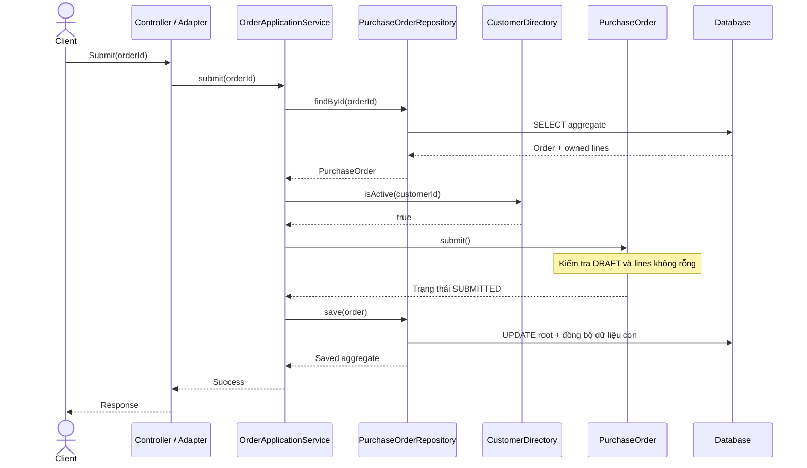

# Đặt quy tắc nghiệp vụ ở mô hình và điều phối ở tầng dịch vụ

## 1. Vì sao cần phân chia trách nhiệm?

Khi sử dụng Spring Data JDBC, ta thường bắt đầu bằng một lớp `@Table`, một `CrudRepository` và một service gọi `save(...)`. Với CRUD đơn giản, cách làm này có vẻ đủ. Nhưng khi xuất hiện các quy tắc như *“đơn hàng đã gửi không được sửa”*, *“không thể gửi đơn hàng rỗng”* hoặc *“số lượng sản phẩm phải dương”*, câu hỏi quan trọng trở thành: **quy tắc nằm ở đâu để mọi đường đi đều phải tuân thủ?**

Trong thiết kế aggregate, hãy tách hai loại trách nhiệm:

- **Mô hình miền (domain model, đặc biệt là aggregate root)** giữ trạng thái hợp lệ, định nghĩa những hành vi làm thay đổi trạng thái và bảo vệ các *bất biến nghiệp vụ* (business invariants).
- **Tầng dịch vụ ứng dụng (application service)** điều phối một use case: tiếp nhận yêu cầu đã được chuẩn hóa, tải aggregate qua repository, lấy thông tin từ những thành phần khác khi cần, gọi hành vi miền, lưu kết quả và thiết lập ranh giới giao dịch.

Mục tiêu là làm cho một đơn hàng không thể chuyển sang trạng thái không hợp lệ chỉ vì sau này có thêm một REST controller, một job xử lý theo lịch hoặc một consumer đọc message.

> Nguyên tắc cốt lõi: **Aggregate quyết định một thay đổi có hợp lệ theo quy tắc của chính nó hay không; application service quyết định cần phối hợp những thành phần nào để thực hiện use case đó.**

Điều này đặc biệt hợp với Spring Data JDBC vì framework khuyến khích mô hình aggregate có ranh giới rõ và repository thao tác qua aggregate root.

## 2. Phân biệt quy tắc miền với điều phối

Giả sử có một ứng dụng bán hàng:

1. Nhân viên mở một đơn hàng nháp cho khách hàng.
2. Nhân viên thêm các dòng hàng.
3. Khi gửi đơn hàng, hệ thống kiểm tra khách hàng còn hoạt động và đơn hàng không rỗng.
4. Sau khi gửi, đơn hàng không còn được thêm dòng.
5. Hệ thống lưu trạng thái và có thể phát một thông báo cho bộ phận xử lý.

Những yêu cầu này liên quan tới nhiều cấp trách nhiệm.

| Yêu cầu | Nơi đặt logic chính | Lý do |
| --- | --- | --- |
| Số lượng mỗi dòng hàng phải lớn hơn 0 | `OrderLine` hoặc hành vi thêm dòng của `PurchaseOrder` | Đây là điều kiện đúng cho bất kỳ dòng hàng nào, ở mọi cách gọi. |
| Giá đơn vị không được âm | `OrderLine` | Giữ giá trị của đối tượng con hợp lệ ngay khi được tạo. |
| Đơn hàng đã gửi không thể thêm dòng | `PurchaseOrder.addLine(...)` | Quy tắc phụ thuộc trạng thái của chính aggregate. |
| Không thể gửi đơn hàng rỗng | `PurchaseOrder.submit()` | Aggregate có đủ dữ liệu để tự bảo vệ bất biến. |
| Kiểm tra khách hàng còn hoạt động | Application service phối hợp với nguồn thông tin khách hàng; chính sách miền tách riêng nếu phức tạp | Khách hàng có vòng đời riêng, không thuộc aggregate đơn hàng. |
| Lấy giá hiện tại của sản phẩm từ catalog | Application service hoặc một adapter được service gọi | Cần đọc dữ liệu từ aggregate/hệ thống khác. |
| Tải đơn theo ID, gọi hành vi và lưu | Application service + repository | Đây là trình tự thực hiện use case. |
| Bắt đầu/commit/rollback transaction | Application service, thông qua `@Transactional` | Transaction bao phủ các bước truy cập dữ liệu cần nhất quán. |
| Trả HTTP 404/409/422 và định dạng JSON | Controller/adapter HTTP | Đây là hợp đồng giao tiếp với client. |
| Đẩy thông báo tới hệ thống ngoài | Application/infrastructure, thường sau commit hoặc qua outbox | Giao tiếp bên ngoài không phải hành vi thay đổi trạng thái bên trong aggregate. |

### Bất biến nghiệp vụ là gì?

**Bất biến (invariant)** là điều kiện phải đúng đối với trạng thái aggregate ở các điểm mà nghiệp vụ cho phép quan sát/ghi nhận nó. Chẳng hạn:

- Một đơn hàng ở trạng thái `SUBMITTED` phải có ít nhất một dòng hàng.
- Một dòng hàng không có số lượng âm hoặc bằng 0.
- Không thể thay đổi các dòng của một đơn hàng đã gửi.

Không phải mọi quy tắc đều chỉ kiểm tra tại constructor. Một đơn hàng `DRAFT` mới mở có thể chưa có dòng; việc bắt buộc đơn hàng có ít nhất một dòng chỉ áp dụng **khi chuyển sang `SUBMITTED`**. Vì thế, vị trí kiểm tra phù hợp là hành vi `submit()`.

Điều kiện như “email đúng định dạng” có thể được kiểm tra ở tầng nhận request, nhưng nếu email hợp lệ là quy tắc của đối tượng miền thì mô hình vẫn cần tự bảo vệ. Validation tại HTTP không thay thế được bất biến: job nội bộ và consumer message có thể không đi qua controller.

## 3. Ranh giới aggregate trong Spring Data JDBC

Với bài toán trên, một cách chia hợp lý là:

```text
PurchaseOrder (aggregate root)
├── id, version, customerId, status
└── List<OrderLine>       (được đơn hàng sở hữu)
    ├── productId
    ├── quantity
    └── unitPrice

Customer                 (aggregate root độc lập)
└── id, active, ...

Product                  (aggregate root / catalog độc lập)
└── id, currentPrice, ...
```

**Đơn hàng sở hữu các dòng hàng**: thêm, xóa và sửa dòng là thay đổi trạng thái của đơn hàng. Nhưng **đơn hàng không sở hữu khách hàng hay sản phẩm**; nó chỉ giữ `customerId` và `productId` để tham chiếu. Nếu nhét cả `Customer` và `Product` vào collection thuộc `PurchaseOrder`, có thể tạo ra aggregate quá lớn và sai vòng đời.

Trong Spring Data JDBC, quan hệ sở hữu có ý nghĩa quan trọng đối với việc lưu dữ liệu. Khi gọi `save` trên một aggregate root đã tồn tại, các entity con được sở hữu có thể bị xóa và chèn lại để phản ánh trạng thái mới của aggregate. Điều đó làm cho việc thiết kế ranh giới và quy mô collection trở thành một quyết định về cả nghiệp vụ lẫn hiệu năng.

Một repository cho `PurchaseOrder` lưu aggregate đơn hàng. Repository của `Customer` hoặc `Product`, nếu có, quản lý những aggregate riêng của chúng.

## 4. Thiết kế mô hình với hành vi có ý nghĩa

Ta dùng `PurchaseOrder` làm aggregate root và `OrderLine` làm đối tượng con. Ví dụ sử dụng Java 21, Spring Boot với Spring Data JDBC. Các lớp minh họa đặt trong package `com.example.orders`; mỗi `public class`/`public record` nên lưu thành một file Java riêng.

### 4.1. Trạng thái đơn hàng

```java
package com.example.orders;

public enum OrderStatus {
    DRAFT,
    SUBMITTED
}
```

Định nghĩa enum giúp tránh các chuỗi trạng thái tùy ý trong code nghiệp vụ.

### 4.2. Đối tượng con tự bảo vệ điều kiện của mình

```java
package com.example.orders;

import java.math.BigDecimal;
import java.util.Objects;

public record OrderLine(
        Long productId,
        int quantity,
        BigDecimal unitPrice
) {
    public OrderLine {
        Objects.requireNonNull(productId, "productId is required");
        Objects.requireNonNull(unitPrice, "unitPrice is required");

        if (productId <= 0) {
            throw new IllegalArgumentException("productId must be positive");
        }
        if (quantity <= 0) {
            throw new IllegalArgumentException("quantity must be positive");
        }
        if (unitPrice.signum() < 0) {
            throw new IllegalArgumentException("unitPrice must not be negative");
        }
    }

    public BigDecimal lineTotal() {
        return unitPrice.multiply(BigDecimal.valueOf(quantity));
    }
}
```

Ở đây, constructor của record từ chối trạng thái sai. Quy tắc “số lượng dương” không cần được lặp lại trong mọi controller và service. Phép tính `lineTotal()` cũng nằm cùng dữ liệu mà nó sử dụng.

Lưu ý: `unitPrice` trong dòng hàng là *giá đã được chốt cho dòng đó* tại thời điểm thêm vào đơn. Nó không tự biến động theo bảng giá hiện tại của sản phẩm; nếu nghiệp vụ cần tái định giá, phải thiết kế hành vi riêng.

### 4.3. Aggregate root bảo vệ chuyển trạng thái

```java
package com.example.orders;

import java.math.BigDecimal;
import java.util.ArrayList;
import java.util.List;
import java.util.Objects;

import org.springframework.data.annotation.Id;
import org.springframework.data.annotation.Version;
import org.springframework.data.relational.core.mapping.MappedCollection;
import org.springframework.data.relational.core.mapping.Table;

@Table("purchase_orders")
public class PurchaseOrder {

    @Id
    private Long id;

    @Version
    private Long version;

    private Long customerId;
    private OrderStatus status;

    @MappedCollection(idColumn = "order_id", keyColumn = "line_no")
    private List<OrderLine> lines = new ArrayList<>();

    // Constructor để Spring Data JDBC materialize dữ liệu từ DB.
    protected PurchaseOrder() {
    }

    private PurchaseOrder(Long customerId) {
        this.customerId = Objects.requireNonNull(
                customerId, "customerId is required");
        if (customerId <= 0) {
            throw new IllegalArgumentException("customerId must be positive");
        }
        this.status = OrderStatus.DRAFT;
    }

    public static PurchaseOrder newDraft(Long customerId) {
        return new PurchaseOrder(customerId);
    }

    public void addLine(Long productId, int quantity, BigDecimal unitPrice) {
        requireDraft();

        boolean alreadyPresent = lines.stream()
                .anyMatch(line -> line.productId().equals(productId));
        if (alreadyPresent) {
            throw new IllegalStateException(
                    "Product already exists in this order");
        }

        lines.add(new OrderLine(productId, quantity, unitPrice));
    }

    public void submit() {
        requireDraft();
        if (lines.isEmpty()) {
            throw new IllegalStateException(
                    "Cannot submit an order without lines");
        }

        status = OrderStatus.SUBMITTED;
    }

    public BigDecimal totalAmount() {
        return lines.stream()
                .map(OrderLine::lineTotal)
                .reduce(BigDecimal.ZERO, BigDecimal::add);
    }

    private void requireDraft() {
        if (status != OrderStatus.DRAFT) {
            throw new IllegalStateException(
                    "Only a draft order can be modified");
        }
    }

    public Long id() {
        return id;
    }

    public Long customerId() {
        return customerId;
    }

    public OrderStatus status() {
        return status;
    }

    public List<OrderLine> lines() {
        return List.copyOf(lines);
    }
}
```

Những điểm quan trọng:

1. `newDraft(...)` diễn đạt cách tạo đơn hàng mới, đồng thời thiết lập trạng thái `DRAFT`.
2. `addLine(...)` chỉ nhận lời gọi khi đơn hàng còn là nháp; nó cũng ngăn thêm trùng một `productId` theo quy tắc giả định của ví dụ.
3. `submit()` vừa kiểm tra trạng thái hiện tại, vừa cấm gửi đơn rỗng, rồi mới chuyển trạng thái.
4. Không có `setStatus(...)` hoặc `setLines(...)` công khai, vì chúng cho phép bỏ qua các hành vi nghiệp vụ.
5. `lines()` trả danh sách sao chép không sửa được; caller không thể thay đổi collection của aggregate bằng `order.lines().clear()`.
6. `@Id` và `@MappedCollection` là annotation của Spring Data, **không phải** quan hệ `@OneToMany` của JPA.
7. `@Version` được thêm để hỗ trợ optimistic locking khi nhiều giao dịch cùng sửa đơn hàng.

Trường `version` cùng `id` là chi tiết persistence. Chúng không nhất thiết phải trở thành quy tắc nghiệp vụ. Việc dùng annotation Spring Data ngay trong aggregate là một lựa chọn thực dụng cho ứng dụng Spring Data JDBC; nếu kiến trúc cần domain thuần, có thể tách mapping và domain model với chi phí chuyển đổi cao hơn.

**Chú ý ranh giới tính hợp lệ:** constructor không tham số để framework ánh xạ dữ liệu không đồng nghĩa ứng dụng được tự do tạo một `PurchaseOrder` trống rồi gọi `save`. Code nghiệp vụ chỉ nên khởi tạo qua `newDraft(...)` và thao tác qua các hành vi công khai đã định nghĩa.

## 5. Repository làm nhiệm vụ truy cập dữ liệu

```java
package com.example.orders;

import org.springframework.data.repository.CrudRepository;

public interface PurchaseOrderRepository
        extends CrudRepository<PurchaseOrder, Long> {
}
```

Repository biết cách truy cập dữ liệu; nó không nên chứa toàn bộ quy trình “kiểm tra khách hàng, tính giá, gửi đơn và phát thông báo”. Repository là công cụ để application service tải/lưu root, không phải nơi thay thế hành vi miền.

Ví dụ, việc một câu `UPDATE purchase_orders SET status = 'SUBMITTED' WHERE id = ?` có thể chạy thành công **không chứng minh** đơn hàng đáp ứng điều kiện “phải có ít nhất một dòng”. Phần kiểm tra đó vẫn phải có trong `submit()`.

Trong các tác vụ cập nhật aggregate qua repository, cần nhớ `save(...)` có thể tạo nhiều thao tác SQL đối với collection con. Với collection rất lớn hoặc yêu cầu update từng dòng độc lập, hãy xem lại ranh giới aggregate và chiến lược lưu; không mặc định mọi thay đổi nhỏ đều có chi phí ghi nhỏ.

## 6. Application service điều phối use case

Service của ví dụ cần làm ba việc: mở đơn nháp, thêm sản phẩm và gửi đơn. Để lấy dữ liệu từ những aggregate/hệ thống khác, ta định nghĩa hai cổng đọc:

```java
package com.example.orders;

import java.math.BigDecimal;

public interface CustomerDirectory {
    boolean isActive(Long customerId);
}

public interface ProductPricing {
    BigDecimal currentPrice(Long productId);
}
```

Đây là **hợp đồng minh họa**: ứng dụng thực tế cần có implementation, chẳng hạn adapter đọc từ repository riêng hoặc SQL query. Nếu truy xuất một dịch vụ từ xa, cần cân nhắc độ trễ, lỗi mạng và thời điểm thực hiện so với transaction.

Sau đó tạo service:

```java
package com.example.orders;

import org.springframework.stereotype.Service;
import org.springframework.transaction.annotation.Transactional;

@Service
public class OrderApplicationService {

    private final PurchaseOrderRepository orders;
    private final CustomerDirectory customers;
    private final ProductPricing pricing;

    public OrderApplicationService(
            PurchaseOrderRepository orders,
            CustomerDirectory customers,
            ProductPricing pricing
    ) {
        this.orders = orders;
        this.customers = customers;
        this.pricing = pricing;
    }

    @Transactional
    public Long openDraft(Long customerId) {
        PurchaseOrder draft = PurchaseOrder.newDraft(customerId);
        return orders.save(draft).id();
    }

    @Transactional
    public void addProduct(
            Long orderId,
            Long productId,
            int quantity
    ) {
        PurchaseOrder order = load(orderId);
        var unitPrice = pricing.currentPrice(productId);

        order.addLine(productId, quantity, unitPrice);
        orders.save(order);
    }

    @Transactional
    public void submit(Long orderId) {
        PurchaseOrder order = load(orderId);

        if (!customers.isActive(order.customerId())) {
            throw new IllegalStateException(
                    "Customer is not active");
        }

        order.submit();
        orders.save(order);
    }

    private PurchaseOrder load(Long orderId) {
        return orders.findById(orderId)
                .orElseThrow(() -> new IllegalArgumentException(
                        "Order not found: " + orderId));
    }
}
```

**Đọc use case `submit(...)` từ trên xuống:**

1. Mở transaction qua `@Transactional`.
2. Tải `PurchaseOrder` bằng repository.
3. Hỏi nguồn thông tin khách hàng có còn hoạt động không.
4. Gọi `order.submit()` để chính aggregate kiểm tra và chuyển trạng thái.
5. Gọi `orders.save(order)` để ghi lại aggregate.
6. Nếu mọi thao tác thành công, transaction được commit khi phương thức kết thúc bình thường.

Service **không trực tiếp gán** `order.status = SUBMITTED`; điều kiện “không rỗng”, “chỉ nháp mới được gửi” vẫn nằm trong mô hình. Ngược lại, model **không truy cập** `CustomerDirectory`, `ProductPricing`, database hay HTTP client để tự tìm dữ liệu cần thiết.

Trong `addProduct(...)`, service lấy giá hiện tại từ catalog rồi chuyển giá đó cho aggregate. Aggregate kiểm tra tính hợp lệ của giá và quyết định có thể thêm dòng ở trạng thái hiện tại hay không. Nếu quy tắc định giá có thuật toán phức tạp, có thể tách thành một domain service thuần tính toán hoặc value object chuyên trách; thao tác lấy dữ liệu bên ngoài vẫn do application layer điều phối.

Các exception trong ví dụ cố tình tối giản. Ứng dụng thật nên định nghĩa exception/domain error rõ nghĩa (`OrderNotFound`, `OrderAlreadySubmitted`, `InactiveCustomer`...), rồi ánh xạ sang HTTP hoặc message error ở adapter. Domain model không nên ném `ResponseStatusException` hay tự biết mã HTTP.

### Luồng điều phối



Sơ đồ thể hiện trách nhiệm, **không quy định số lệnh SQL chính xác**. Trong Spring Data JDBC, tải/lưu một aggregate có collection con có thể cần nhiều câu SQL tùy mapping và trạng thái dữ liệu.

## 7. Tại sao không gom tất cả vào service?

Xét một cách viết dễ gặp khi mô hình chỉ có getter và setter:

```java
@Transactional
public void submit(Long orderId) {
    PurchaseOrder order = orders.findById(orderId).orElseThrow();

    if (order.lines().isEmpty()) {
        throw new IllegalStateException("Order is empty");
    }
    // Giả sử model có setter công khai:
    order.setStatus(OrderStatus.SUBMITTED);
    orders.save(order);
}
```

Cách này đặt quy tắc gửi đơn ở service. Nếu sau này có `BatchSubmitService` hoặc message consumer cũng thay đổi trạng thái, họ có thể quên kiểm tra “đơn hàng rỗng”. Một model chỉ chứa dữ liệu còn mọi quy tắc nằm ở service thường được gọi là **anemic domain model**; không phải lúc nào cũng sai, nhưng rủi ro lớn hơn khi nghiệp vụ có nhiều bất biến và chuyển trạng thái.

Khi chuyển điều kiện vào `PurchaseOrder.submit()`, mọi caller dùng hành vi này đều nhận cùng một quy tắc. Service tập trung điều phối và transaction, dễ đọc và dễ thay đổi thứ tự các bước bên ngoài aggregate.

Tuy nhiên, **không bắt buộc mọi hệ thống CRUD đều cần mô hình miền giàu hành vi**. Với một bảng tra cứu gần như chỉ có thêm/sửa/xóa và không có quy tắc nghiệp vụ đáng kể, service mỏng và entity đơn giản có thể là lựa chọn đủ tốt. Điều quan trọng là bảo vệ các quy tắc thực sự tồn tại, không tạo một lớp domain service cho mỗi phép gán field.

## 8. Khi nào nên dùng domain service?

Application service và domain service có tên gần nhau nhưng không đồng nghĩa:

| Tiêu chí | Application service | Domain service |
| --- | --- | --- |
| Mục đích | Tổ chức một use case từ đầu đến cuối | Biểu diễn một quy tắc/nghiệp vụ miền không thuộc tự nhiên về một entity/value object |
| Phối hợp repository, transaction, I/O | Có | Tránh phụ thuộc I/O nếu có thể; tách quyền truy cập bên ngoài qua cổng rõ ràng khi cần |
| Trạng thái nghiệp vụ của aggregate | Gọi hành vi của aggregate | Thường áp dụng chính sách trên các giá trị/aggregate được truyền vào |
| Ví dụ | `submit(orderId)` tải đơn, kiểm tra khách hàng, gọi `submit`, lưu | Tính mức chiết khấu theo hạng khách hàng và tổng tiền dựa trên dữ liệu đã có |

Giả sử chính sách chiết khấu phụ thuộc vào `CustomerTier` và tổng tiền, không thuộc trọn vẹn về đơn hàng hay khách hàng. Có thể đặt phép tính trong domain service thuần Java:

```java
package com.example.orders;

import java.math.BigDecimal;

public class DiscountPolicy {

    public BigDecimal discount(
            BigDecimal orderTotal,
            boolean premiumCustomer
    ) {
        if (orderTotal.signum() < 0) {
            throw new IllegalArgumentException("Invalid order total");
        }
        return premiumCustomer
                ? orderTotal.multiply(new BigDecimal("0.10"))
                : BigDecimal.ZERO;
    }
}
```

Application service tải thông tin cần thiết từ repository/catalog, sau đó truyền dữ liệu vào chính sách tính toán. Chính sách này không cần biết database nào đang dùng hay HTTP endpoint nào được gọi.

Trường hợp chính sách chỉ liên quan đúng một aggregate, hãy ưu tiên đưa hành vi vào aggregate đó. Tránh tạo domain service để bọc những dòng có thể diễn đạt rõ bằng `order.submit()` hoặc `order.addLine(...)`.

## 9. Giao dịch: ranh giới thực thi của use case

Một invariant do aggregate kiểm tra trong bộ nhớ vẫn cần được **lưu nhất quán**. Với Spring Data JDBC, `@Transactional` thường đặt trên phương thức application service thực hiện một nghiệp vụ đầy đủ.

```java
@Transactional
public void submit(Long orderId) {
    PurchaseOrder order = load(orderId);
    // Các bước xác minh và thay đổi trạng thái...
    order.submit();
    orders.save(order);
}
```

Các điểm cần nhớ:

1. `@Transactional` mở transaction cho các thao tác dữ liệu dùng cùng transaction manager phù hợp khi phương thức được gọi qua Spring proxy. Gọi nội bộ từ một phương thức khác cùng bean có thể không đi qua proxy, nên không nên giả định annotation luôn kích hoạt ở tình huống tự gọi.
2. Với cấu hình giao dịch Spring thông thường, runtime exception và `Error` khiến transaction rollback mặc định; checked exception cần cấu hình rollback phù hợp nếu nghiệp vụ đòi hỏi.
3. Không đặt `@Transactional` trực tiếp lên mọi phương thức domain như `addLine(...)` hay `submit()`. Các phương thức đó chỉ chuyển đổi/truy xét trạng thái trong bộ nhớ; application service chịu trách nhiệm ranh giới lưu.
4. Spring Data JDBC không có persistence context/dirty checking kiểu JPA. **Thay đổi đối tượng trong bộ nhớ không tự phát sinh lệnh UPDATE khi commit**; application service vẫn cần gọi `save(...)` hoặc một thao tác ghi phù hợp.
5. Transaction cơ sở dữ liệu không tự bao trùm hệ thống HTTP, broker hoặc database độc lập khác. Cần giải pháp riêng cho nhất quán giữa nhiều tài nguyên.

### Một transaction có thể cập nhật nhiều aggregate?

Có. Ranh giới aggregate là quy tắc quản lý trạng thái và thiết kế nghiệp vụ; một transaction cơ sở dữ liệu có thể ghi nhiều aggregate khi use case thực sự cần. Tuy nhiên, mỗi root vẫn nên bảo vệ các quy tắc nội tại. Với các aggregate có vòng đời độc lập, hãy cân nhắc mức kết dính, độ cạnh tranh ghi và khả năng tách thành các bước/event.

Ví dụ chuyển hàng giữa hai vị trí kho có thể yêu cầu cùng một transaction nếu tất cả dữ liệu nằm trong một database và quy tắc đòi hỏi tính nguyên tử. Application service phối hợp hai aggregate, nhưng mỗi aggregate vẫn cần từ chối tồn kho âm theo quy tắc của mình.

## 10. Đồng thời: kiểm tra trong model chưa đủ

Giả sử hai người cùng tải đơn hàng `DRAFT`:

```text
T1: SELECT order(id=7, version=3) -> DRAFT
T2: SELECT order(id=7, version=3) -> DRAFT
T1: addLine(...); save -> version=4
T2: submit(); save -> dùng version=3
```

Nếu không có bảo vệ cạnh tranh, một thay đổi có thể ghi đè thay đổi khác. Trong ví dụ, `@Version` trên root giúp Spring Data JDBC dùng **optimistic locking**: lệnh cập nhật root kiểm tra version hiện tại. Khi một request lưu phiên bản đã cũ, framework có thể ném `OptimisticLockingFailureException` hoặc một ngoại lệ cùng họ, thay vì âm thầm coi cả hai lần ghi đều thành công.

Điều quan trọng là:

- `@Version` bảo vệ các cập nhật cạnh tranh trên **cùng aggregate root**, không giải quyết mọi quy tắc xuyên aggregate.
- Lỗi optimistic locking cần được ánh xạ thành một phản hồi phù hợp (ví dụ HTTP 409) hoặc chiến lược retry có điều kiện. Retry mù có thể chạy lại nghiệp vụ sai hoặc gây trùng side effect.
- Các ràng buộc `UNIQUE`, `NOT NULL`, `CHECK`, `FOREIGN KEY` trong database vẫn cần thiết. Quy tắc ở model giúp thể hiện nghiệp vụ; database chặn dữ liệu sai khi có luồng ghi khác hoặc trường hợp cạnh tranh.
- Kiểm tra `customers.isActive(...)` rồi lưu đơn không bảo đảm khách hàng vẫn active đến cuối transaction nếu dữ liệu được thay đổi đồng thời ở transaction khác. Với quy tắc xuyên aggregate cần nhất quán mạnh, phải thiết kế cơ chế khóa, isolation, constraint hoặc điều phối thích hợp theo yêu cầu thực tế.

Đặc biệt, collection thuộc aggregate có thể được Spring Data JDBC đồng bộ bằng cách xóa/chèn lại các entity con. Khi có nhiều người liên tục sửa một aggregate lớn, số lệnh ghi và khả năng tranh chấp tăng lên. Đó là tín hiệu cần xem lại kích thước aggregate hoặc cách thực hiện use case.

## 11. Sự kiện miền và thao tác bên ngoài database

Một hành vi như `submit()` có thể dẫn tới nhu cầu gửi email, đặt lịch giao hàng hoặc phát message. Đây là những bước liên quan nghiệp vụ nhưng **không nên để aggregate tự gọi email client hay message broker**.

Một luồng trách nhiệm phù hợp:

```text
Application service
  -> load aggregate
  -> aggregate.submit()              (kiểm tra và đổi trạng thái)
  -> repository.save(aggregate)      (ghi DB)
  -> ghi outbox trong cùng transaction nếu cần phát sự kiện tin cậy
  -> commit
Worker / publisher
  -> đọc outbox
  -> gửi sự kiện tới hệ thống ngoài
  -> đánh dấu đã xử lý, có retry/idempotency
```

Với tác vụ đơn giản, có thể dùng `@TransactionalEventListener(phase = AFTER_COMMIT)` để chỉ chạy listener sau khi transaction commit. Nhưng một listener chạy sau commit **không tự bảo đảm giao sự kiện** nếu tiến trình chết trước khi gửi thành công. Khi phát sự kiện là yêu cầu nghiệp vụ quan trọng và cần khôi phục sau lỗi, transactional outbox thường đáng cân nhắc.

Domain có thể tạo ra một sự kiện mang ý nghĩa như `OrderSubmitted`. Application service hoặc infrastructure chịu trách nhiệm **thời điểm và cách phát** sự kiện. Nội dung của sự kiện là kiến thức miền, còn giao thức HTTP/Kafka/email và retry là trách nhiệm phối hợp/kỹ thuật.

Không gọi API thanh toán hoặc gửi email ngay trong `PurchaseOrder.submit()`. Điều đó khiến hành vi miền khó sử dụng độc lập và kéo lỗi mạng vào quá trình duy trì trạng thái aggregate.

## 12. Liên hệ với schema của Spring Data JDBC

Ví dụ trên dùng hai bảng và một cột version. DDL minh họa theo PostgreSQL:

```sql
CREATE TABLE purchase_orders (
    id          BIGINT GENERATED BY DEFAULT AS IDENTITY PRIMARY KEY,
    version     BIGINT,
    customer_id BIGINT NOT NULL,
    status      VARCHAR(20) NOT NULL
);

CREATE TABLE order_lines (
    order_id    BIGINT NOT NULL REFERENCES purchase_orders(id),
    line_no     INTEGER NOT NULL,
    product_id  BIGINT NOT NULL,
    quantity    INTEGER NOT NULL CHECK (quantity > 0),
    unit_price  DECIMAL(14, 2) NOT NULL CHECK (unit_price >= 0),
    PRIMARY KEY (order_id, line_no)
);
```

`@MappedCollection(idColumn = "order_id", keyColumn = "line_no")` thể hiện rằng các dòng hàng thuộc về root đơn hàng; `order_id` là khóa ngoại và `line_no` là chỉ số phần tử trong `List`. `@Version` cần cột `version` tương ứng.

Đây là schema minh họa để giải thích mapping và bất biến. Trong dự án thực tế phải kiểm tra mapping, quy tắc đặt tên, quoting identifier, dialect, migration và cách biểu diễn các quan hệ khác. Nếu customer/product được lưu trong cùng database, có thể có các ràng buộc foreign key tương ứng; **không tạo một bảng khách hàng/sản phẩm do đơn hàng sở hữu** chỉ để tiện tải aggregate.

Spring Data JDBC **không tự tạo hoặc cập nhật schema như cơ chế DDL của Hibernate**. Sử dụng migration (ví dụ Flyway/Liquibase) hoặc script SQL được quản lý rõ ràng. Những ràng buộc như `CHECK(quantity > 0)` là lớp bảo vệ thứ hai sau domain model; chúng không làm cho việc định nghĩa hành vi miền trở nên thừa.

## 13. Nhận diện ba cách tổ chức code thường gây khó khăn

### 13.1. Service trở thành một “khối” chứa toàn bộ nghiệp vụ

Dấu hiệu: service có nhiều đoạn `if (status == ...)`, truy cập trực tiếp getter/setter, tự kiểm tra mọi trạng thái của đơn và tự tính tổng tiền.

Hệ quả: mỗi use case phải nhớ lặp lại các quy tắc, dễ phát sinh khác biệt giữa REST, batch và message consumer.

Hướng tổ chức: chuyển các quy tắc thuộc nội tại một aggregate thành hành vi trên root hoặc value object; service chỉ điều phối các bước cần tương tác bên ngoài.

### 13.2. Aggregate tự gọi repository hoặc dịch vụ bên ngoài

Ví dụ không phù hợp:

```java
// Chỉ để minh họa điều nên tránh:
public void submit(
        PurchaseOrderRepository repository,
        CustomerDirectory customers,
        EmailSender email
) {
    if (!customers.isActive(customerId)) {
        throw new IllegalStateException("Inactive customer");
    }
    // thay đổi trạng thái...
    repository.save(this);
    email.sendConfirmation(id);
}
```

Hệ quả: model bị buộc vào database, network, transaction và adapter cụ thể. Nó khó kiểm tra quy tắc riêng lẻ và dễ gây side effect trong lúc object chỉ đang được thay đổi.

Hướng tổ chức: đưa hoạt động tải/lưu và giao tiếp ra application/infrastructure; để model nhận những giá trị miền cần thiết và thực hiện thay đổi hợp lệ.

### 13.3. Bỏ qua aggregate bằng câu SQL cập nhật trạng thái tùy ý

Ví dụ một job dùng `JdbcTemplate` cập nhật trực tiếp `status` mà không kiểm tra đơn rỗng hoặc trạng thái hiện tại. Job đó có thể ghi ra dữ liệu trái quy tắc dù API thông thường luôn gọi `order.submit()`.

SQL trực tiếp không phải lúc nào cũng sai: bulk update hoặc thao tác vận hành đôi khi cần nó. Nhưng phải định nghĩa rõ **ai được phép thay đổi aggregate**, những invariant nào cần được bảo đảm bằng điều kiện SQL, ràng buộc database hoặc quy trình riêng, và cách giữ nhất quán với các đường ghi khác.

## 14. Quy trình thiết kế một use case mới

Khi thêm hành vi nghiệp vụ vào hệ thống Spring Data JDBC, có thể làm theo thứ tự:

1. **Mô tả trạng thái hợp lệ.** Ví dụ đơn hàng có `DRAFT` và `SUBMITTED`; chỉ đơn `DRAFT` mới được đổi dòng, và không gửi đơn rỗng.
2. **Chọn aggregate root.** Xác định đối tượng sở hữu collection nào, đối tượng nào chỉ được tham chiếu qua ID, và vòng đời thuộc về ai.
3. **Đặt hành vi trên model.** Viết những phương thức có tên nghiệp vụ như `addLine`, `removeLine`, `submit`, `cancel`; kiểm tra invariant trước khi chuyển trạng thái.
4. **Xác định dữ liệu từ bên ngoài.** Chính sách có cần trạng thái khách hàng, giá sản phẩm, tỷ giá hoặc quyền truy cập? Giao cho service/cổng phù hợp cung cấp dữ liệu đó.
5. **Viết application service.** Nhận request đã chuẩn hóa, tải aggregate, hỏi các nguồn dữ liệu cần thiết, gọi hành vi, lưu aggregate.
6. **Đặt transaction đúng chỗ.** Bảo đảm các thao tác database thuộc một use case được commit/rollback theo quy tắc nghiệp vụ; thiết kế cạnh tranh và version.
7. **Thiết kế side effect.** Nếu phải thông báo hệ thống khác, xác định sau commit có đủ hay cần outbox, retry và idempotency.
8. **Đối chiếu mapping và schema.** Kiểm tra key, version, collection sở hữu, constraint và chi phí lưu lại aggregate.

Một bảng ghi nhớ hữu ích:

| Câu hỏi khi đọc code | Nếu “Có”, trách nhiệm thường thuộc |
| --- | --- |
| Phương thức này có quyết định trạng thái của chính đơn hàng được phép thay đổi thế nào? | Aggregate |
| Quy tắc này chỉ dùng các giá trị nội tại của dòng hàng? | Value object/entity con |
| Cần tải nhiều aggregate, gọi catalog hoặc ghép các bước của một use case? | Application service |
| Có một phép tính nghiệp vụ không thuộc tự nhiên về một đối tượng nào? | Domain service |
| Đang chuyển exception thành HTTP status hoặc đọc JSON request? | Controller/adapter |
| Đang chạy SQL, gửi message, gọi HTTP hay lưu outbox? | Repository/infrastructure do application service điều phối |

## 15. Bài tập áp dụng

**Bài tập 1 — Hủy đơn hàng.** Thêm trạng thái `CANCELLED` và hành vi `cancel()`. Quy định chỉ đơn `DRAFT` mới được hủy. Đặt điều kiện ở `PurchaseOrder` rồi tạo `OrderApplicationService.cancel(orderId)` để tải và lưu root. Thử suy luận điều gì xảy ra nếu caller cố hủy lại một đơn đã hủy.

**Bài tập 2 — Giới hạn số lượng.** Giả sử tổng số lượng trên đơn không được vượt 100. Thêm điều kiện trong `addLine(...)`; quy tắc phải dựa trên tổng các dòng đã có và dòng chuẩn bị thêm. Tại sao kiểm tra ở mỗi controller là chưa đủ?

**Bài tập 3 — Quy tắc xuyên aggregate.** Khi gửi đơn, khách hàng phải còn hoạt động. Đặt câu hỏi: trạng thái khách hàng được lấy từ một bảng trong cùng database hay từ dịch vụ ngoài? Nếu khách hàng bị khóa đúng lúc đơn được gửi, nghiệp vụ cần nhất quán mạnh hay chấp nhận nhất quán cuối cùng? Từ câu trả lời, chọn thiết kế transaction, lock hoặc quy trình bù trừ phù hợp.

**Bài tập 4 — Xử lý cạnh tranh.** Hai request cùng đọc một `PurchaseOrder` rồi mỗi request thêm một dòng khác nhau. Giải thích vai trò của `@Version`, kết quả khi một request lưu với version cũ, và vì sao retry phải tải lại trạng thái mới trước khi gọi hành vi miền.

Các bài tập này buộc phải phân biệt: **điều kiện hợp lệ nằm ở đâu**, **ai lấy dữ liệu để xét điều kiện**, và **ai bảo đảm thay đổi được lưu an toàn**.

## 16. Kết luận

Thiết kế tốt với Spring Data JDBC không chỉ là chọn đúng annotation và repository. Khi mô hình có quy tắc nghiệp vụ, aggregate root cần sở hữu những hành vi bảo vệ trạng thái của nó: thêm dòng, gửi đơn, tính tổng, từ chối chuyển trạng thái không hợp lệ. Application service chịu trách nhiệm điều phối use case: tải dữ liệu, lấy thông tin từ aggregate/hệ thống khác, gọi hành vi miền, lưu kết quả, quản lý transaction và phối hợp side effect.

Giữ được sự phân chia này giúp quy tắc không bị rải ở nhiều REST controller, scheduled job hoặc consumer; đồng thời làm rõ ranh giới giao dịch và ranh giới nhất quán. Với Spring Data JDBC, hãy kết hợp thiết kế miền đó với hiểu biết về cách `save` lưu aggregate sở hữu collection, optimistic locking và constraint của database để hệ thống vừa đúng nghiệp vụ vừa có hiệu năng dự đoán được.
