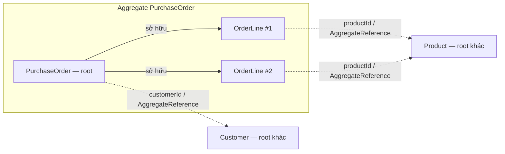

# Tránh aggregate quá lớn, tham chiếu vòng và đồ thị đối tượng tùy ý

Trong **Spring Data Relational JDBC**, thiết kế aggregate là quyết định kiến trúc có ảnh hưởng trực tiếp đến cách framework đọc, ghi và xóa dữ liệu. Nếu một class chứa tham chiếu đến một entity khác, Spring Data JDBC có xu hướng hiểu entity đó là **thành phần được sở hữu trong cùng aggregate**. Vì vậy, mô hình đối tượng được thiết kế như một mạng liên kết tự do có thể dẫn đến một aggregate rất lớn, quan hệ sở hữu sai hoặc vòng tham chiếu khó ánh xạ.

Bài này hướng dẫn cách đặt **ranh giới aggregate** dựa trên quy tắc nghiệp vụ, cách tách tham chiếu giữa các aggregate, và cách tránh ba sai lầm: aggregate chứa quá nhiều dữ liệu, tham chiếu vòng hai chiều và đồ thị object tùy ý kiểu ORM.

## 1. Aggregate là ranh giới nhất quán, không phải toàn bộ mạng quan hệ dữ liệu

Theo Domain-Driven Design (DDD), **aggregate** là nhóm entity/value object cần giữ các quy tắc bất biến (*invariant*) nhất quán trong một lần thay đổi nguyên tử. Mỗi aggregate có đúng **một aggregate root** — điểm vào để thao tác với nhóm đó.

Ví dụ hệ thống bán hàng có các khái niệm:

- `PurchaseOrder`: một đơn hàng, có các dòng `OrderLine` và tổng tiền phải khớp nội dung đơn.
- `Customer`: khách hàng có hồ sơ, trạng thái và vòng đời riêng.
- `Product`: sản phẩm có thông tin và vòng đời riêng.

Quy tắc “số lượng của mỗi dòng phải dương” và “tổng tiền đơn hàng được tính từ các dòng” thường thuộc aggregate `PurchaseOrder`. Quy tắc “đổi địa chỉ liên hệ của khách” thuộc aggregate `Customer`. Chúng không nhất thiết phải nằm chung một aggregate chỉ vì đơn hàng có `customer_id`.



Các đường **sở hữu** nằm trong ranh giới của một aggregate; các đường **tham chiếu bằng ID** chỉ ghi nhận quan hệ giữa các aggregate. Trong sơ đồ, `PurchaseOrder` được lưu qua `PurchaseOrderRepository`, `Customer` qua `CustomerRepository`, `Product` qua `ProductRepository`.

### Spring Data JDBC diễn giải một tham chiếu Java như thế nào?

| Property trong domain model | Cách hiểu của Spring Data JDBC | Ý nghĩa đối với vòng đời dữ liệu |
|---|---|---|
| `List<OrderLine> lines` trong `PurchaseOrder` | Các `OrderLine` thuộc aggregate đơn hàng | Lưu/xóa aggregate có thể thao tác cả các dòng con |
| `ShippingAddress address` được ánh xạ `@Embedded` | Value object nằm trong cùng hàng của root | Lưu cùng root, không có repository riêng |
| `Customer customer` trong `PurchaseOrder` | Tham chiếu entity trực tiếp, có thể bị xem là **owned entity** | Dễ vô tình biến khách hàng thành thành phần của đơn hàng |
| `Long customerId` | Scalar chứa khóa ngoại ở mức nghiệp vụ | Không tự tải hay ghi `Customer` |
| `AggregateReference<Customer, Long> customer` | Tham chiếu có kiểu đến **aggregate root khác** | Chỉ lưu ID; không tự kéo `Customer` vào vòng đời của đơn |

**Nguyên tắc trung tâm:** nếu entity có thể được tạo, sửa, xóa và kiểm soát tính nhất quán độc lập với aggregate hiện tại, hãy cân nhắc đặt nó thành một **aggregate root khác**. Quan hệ trong database không bắt buộc trở thành quan hệ sở hữu trong object model.

## 2. Vì sao aggregate quá lớn gây vấn đề trong Spring Data JDBC?

Giả sử một `Customer` chứa `List<PurchaseOrder>`, mỗi `PurchaseOrder` chứa `List<OrderLine>`, mỗi dòng lại chứa trực tiếp `Product`, `Supplier`, `InventoryMovement`... Thoạt nhìn mã Java có vẻ tiện: từ `customer` có thể đi qua mọi đối tượng. Nhưng nếu tất cả được ánh xạ thành entity tham chiếu trực tiếp, aggregate sẽ trải rộng qua nhiều bảng và nhiều vòng đời nghiệp vụ.

### 2.1. Chi phí ghi tăng theo số entity con

Theo cơ chế lưu aggregate được mô tả trong tài liệu Spring Data JDBC, khi `save()` một aggregate mới, framework chèn root và các entity con. Khi lưu **một aggregate đã tồn tại**, các entity con được tham chiếu có thể được **xóa rồi chèn lại**, trong khi root được cập nhật. Cách làm này phản ánh việc Spring Data JDBC không giữ snapshot trạng thái cũ của cả đồ thị như một persistence context kiểu JPA.

Ví dụ đơn có **500 dòng** và người dùng chỉ sửa ghi chú tại root:

```text
repository.save(existingOrder)
  ├─ Xóa các OrderLine cũ thuộc aggregate
  ├─ UPDATE PurchaseOrder
  └─ INSERT lại các OrderLine hiện có
```

Đây là mô hình hành vi cần tính đến khi thiết kế; thứ tự/cú pháp SQL chi tiết có thể khác theo phiên bản và dialect. Với vài dòng con, chi phí thường chấp nhận được. Với hàng chục nghìn bản ghi con, việc xóa/chèn lại có thể tạo nhiều I/O, transaction log, lock và tác động đến khóa được sinh cho entity con. Nếu ID của child cần được hệ thống khác tham chiếu ổn định, đó còn là dấu hiệu cần xem lại việc coi child là owned entity.

> Đừng áp dụng một ngưỡng cố định như “trên 100 phần tử là sai”. Kích thước phù hợp phụ thuộc vào tần suất sửa, kích thước dữ liệu, thời gian giao dịch, contention, số statement và nhu cầu đọc/ghi thực tế.

### 2.2. Chi phí đọc và bộ nhớ tăng theo cấu trúc

Trong cách tải aggregate truyền thống, Spring Data JDBC đọc root và các entity được sở hữu bằng những truy vấn bổ sung. Với aggregate lớn, số dòng và lượng dữ liệu cần dựng thành object tăng lên. Một số phiên bản có **Single Query Loading** cho cấu trúc đủ điều kiện, nhưng tính năng này có những giới hạn về hình dạng aggregate, dialect và kiểu truy vấn; không nên dựa vào nó để hợp thức hóa một ranh giới aggregate quá rộng.

Một màn hình chỉ cần `customerName`, `orderCount`, `latestOrderDate` không nhất thiết phải tải `Customer` rồi duyệt toàn bộ `orders`, `lines`, `products`. Một **truy vấn đọc chuyên biệt** (DTO/projection, JDBC query, SQL tổng hợp) thường diễn đạt đúng nhu cầu hơn.

### 2.3. Phạm vi tranh chấp và transaction phình to

Khi nhiều hành động độc lập cùng sửa một aggregate root lớn, chúng có thể tranh chấp cùng ranh giới nhất quán. `@Version` trên root giúp **phát hiện** cập nhật đồng thời nhưng không tự làm aggregate nhỏ đi. Một transaction chứa nhiều child cũng làm tăng thời gian nắm giữ tài nguyên database.

Ví dụ: chỉnh email khách hàng không nên yêu cầu ghi lại toàn bộ lịch sử đơn hàng. Ngược lại, thay số lượng của một `OrderLine` có thể cần kiểm tra và tính lại tổng tiền của **chính đơn hàng đó**; các dòng của đơn có lý do để cùng thuộc một aggregate.

### Dấu hiệu nên xem lại kích thước aggregate

| Dấu hiệu | Vì sao đáng lưu ý | Hướng suy nghĩ |
|---|---|---|
| Cập nhật một thuộc tính nhỏ nhưng tạo rất nhiều SQL | Entity con bị xem là một phần của cùng aggregate | Tách dữ liệu có vòng đời độc lập thành root khác |
| Collection tăng theo thời gian không giới hạn | Mỗi lần tải/lưu aggregate ngày càng nặng | Dùng repository riêng, truy vấn phân trang hoặc mô hình lịch sử độc lập |
| Hai nhóm chức năng thường cập nhật hai phần dữ liệu khác nhau | Ranh giới nhất quán có thể đang quá rộng | Xem lại invariant nào thực sự cần transaction nguyên tử |
| Child có ID được tham chiếu từ hệ thống khác | Child có vòng đời/identity độc lập | Cân nhắc nâng child thành aggregate root |
| Một thay đổi phải khóa hoặc xác thực quá nhiều đối tượng | Khả năng ràng buộc chéo bị gom vào một aggregate | Diễn đạt liên kết qua ID và phối hợp ở application service |
| Chỉ cần một bản ghi hiển thị nhưng phải tải cả cây | Read model và write model bị trộn | Viết query/projection cho trường hợp đọc |

## 3. Tránh tham chiếu vòng và quan hệ hai chiều không đúng ranh giới

Trong Java, việc viết quan hệ hai chiều có vẻ tự nhiên:

```java
// MÔ HÌNH CẦN TRÁNH khi cả hai đều là entity được mapping trực tiếp
class Customer {
    @Id Long id;
    List<PurchaseOrder> orders;
}

class PurchaseOrder {
    @Id Long id;
    Customer customer;
    List<OrderLine> lines;
}
```

Ở đây `Customer -> PurchaseOrder -> Customer` tạo **vòng tham chiếu trong object graph**. Nếu hai class đều được Spring Data JDBC xem như entity được sở hữu, mô hình không có một hướng sở hữu rõ ràng: aggregate nào chứa aggregate nào, vòng đời xóa thuộc root nào, back-reference nằm ở bảng nào? Ngoài vấn đề mapping, việc duyệt/serialize đồ thị bằng JSON cũng có thể lặp vô hạn nếu không có cơ chế hạn chế riêng.

Điểm cần phân biệt:

- **Khóa ngoại trong SQL không phải vòng tham chiếu Java.** Bảng `purchase_order.customer_id` có thể tham chiếu `customer.id` mà không cần field `Customer` trực tiếp trong `PurchaseOrder`.
- **Back-reference vật lý không cần field Java ngược chiều.** Khi `PurchaseOrder` chứa `List<OrderLine>`, Spring Data JDBC dùng cột FK trong bảng `order_line` để gắn dòng với root. Không cần thêm `PurchaseOrder order` hay `Long orderId` có mapping trong `OrderLine` để framework quản lý FK đó.
- **Tham chiếu giữa aggregate có thể dùng ID hai chiều ở cấp truy vấn.** Khách hàng muốn xem danh sách đơn hàng thì query bằng `customer_id`, không cần giữ `List<PurchaseOrder>` làm field persisted trong `Customer`.

### Cách biểu diễn hợp lý

```text
Customer aggregate                         PurchaseOrder aggregate
------------------                         ------------------------
Customer(id, name)     ← customer_id ←     PurchaseOrder(id, customerId)
                                              |
                                              +-- owns OrderLine #1
                                              +-- owns OrderLine #2
```

Để tìm đơn của khách hàng, có thể khai báo query ở **`PurchaseOrderRepository`**, thay vì đặt danh sách đơn vào `Customer`:

```java
public interface PurchaseOrderRepository
        extends CrudRepository<PurchaseOrder, Long> {

    // Với model dùng AggregateReference, có thể dùng truy vấn SQL rõ ràng
    // hoặc query chuyên biệt thay vì suy đoán property path.
    @Query("SELECT id, version, customer_id FROM purchase_order WHERE customer_id = :customerId")
    List<PurchaseOrder> findRootsByCustomerId(@Param("customerId") Long customerId);
}
```

Đoạn trên minh họa hướng đặt **query bên phía order**. Khi cần tải đầy đủ aggregate có collection, hãy xem quy tắc ánh xạ kết quả của phiên bản Spring Data JDBC đang dùng; một query trả root và cách đọc relation có thể có giới hạn khác với `findById`. Với màn hình danh sách, nên trả về **projection/DTO** phù hợp, tránh nạp toàn bộ `OrderLine` chỉ để hiển thị thông tin tóm tắt.

**Không dùng `@Transient` như một cách chữa tất cả vòng tham chiếu.** Annotation này loại property khỏi persistence mapping; nó thích hợp cho dữ liệu phụ trợ không lưu trữ, nhưng không tạo được quan hệ domain đúng hoặc tự động tải entity khác. Hãy sửa **ranh giới aggregate** trước.

## 4. Spring Data JDBC không ánh xạ đồ thị entity tùy ý như một ORM

Một mô hình đối tượng có dạng:

```text
User → Team → Projects → Members → User → ...
```

có thể dùng để **điều hướng thông tin** trong bộ nhớ, nhưng không thể mặc nhiên chuyển từng cạnh thành entity property được Spring Data JDBC lưu theo cơ chế aggregate. Framework áp dụng quy tắc ownership: tham chiếu trực tiếp đến entity được xem là thành viên của aggregate, và quan hệ tham chiếu đó chủ yếu phù hợp với **1-1 hoặc 1-n được sở hữu**.

Các quan hệ **n-1**, **n-n** hoặc chia sẻ cùng một entity giữa nhiều root thường cần mô hình khác:

| Quan hệ nghiệp vụ | Mô hình nên cân nhắc | Điều tránh |
|---|---|---|
| Một order có nhiều line | Root `PurchaseOrder` sở hữu `List<OrderLine>` | Tạo repository công khai để sửa line mà bỏ qua invariant của order |
| Nhiều order thuộc một customer | `PurchaseOrder.customerId` hoặc `AggregateReference<Customer, Long>` | Nhúng `Customer` và cả danh sách order vào nhau |
| Nhiều line tham chiếu cùng product | `OrderLine.productId` hoặc `AggregateReference<Product, Long>` | Copy nguyên `Product` thành owned entity trong mỗi line |
| Nhiều student tham gia nhiều course | `Enrollment` có identity và vòng đời phù hợp, hoặc bảng liên kết + service/query rõ ràng | Mapping hai collection hai chiều rồi kỳ vọng tự động quản lý many-to-many |
| Một entity có nhiều sự kiện lịch sử | Aggregate/history riêng có query phân trang | Giữ `List<Event>` tăng vô hạn trong root |

Đối với **many-to-many**, không có một công thức duy nhất. Nếu bản thân quan hệ mang thuộc tính và vòng đời (`Enrollment.status`, `enrolledAt`), có thể thiết kế `Enrollment` làm một aggregate root. Nếu quan hệ thuần là dữ liệu liên kết, có thể quản lý bằng bảng nối và câu lệnh truy cập chuyên biệt. Điểm cốt lõi là không buộc hai root cùng **sở hữu** một entity.

### `AggregateReference` là tham chiếu đến root khác

Spring Data JDBC cung cấp `org.springframework.data.jdbc.core.mapping.AggregateReference<T, ID>`, một wrapper quanh ID mang thêm thông tin kiểu của aggregate được tham chiếu:

```java
import org.springframework.data.jdbc.core.mapping.AggregateReference;

AggregateReference<Customer, Long> customerRef = AggregateReference.to(42L);
Long customerId = customerRef.getId();
```

`AggregateReference` **không phải proxy lazy-loading**: gọi `getId()` trả ID, không truy vấn để lấy `Customer`. Nếu nghiệp vụ cần thông tin khách hàng, gọi `CustomerRepository` hoặc truy vấn đọc tương ứng. Spring Data JDBC không tự cascade `save` từ `PurchaseOrder` sang aggregate `Customer` chỉ vì trường chứa `AggregateReference`.

Nếu domain không cần wrapper có kiểu, một trường `Long customerId` cũng hợp lệ. Chọn cách diễn đạt rõ ràng và thống nhất trong toàn dự án.

## 5. Ví dụ thiết kế aggregate hợp lý: đơn hàng và các dòng

Mô hình dưới đây dùng **`PurchaseOrder` làm root**, sở hữu `OrderLine` và tham chiếu `Customer`/`Product` qua ID. Các class `Customer` và `Product` là **aggregate root độc lập**, được định nghĩa trong những phần domain riêng. Ví dụ hướng đến Spring Data JDBC hiện đại, dùng Java 17+.

### Root `PurchaseOrder`

```java
package com.example.sales;

import java.util.ArrayList;
import java.util.List;

import org.springframework.data.annotation.Id;
import org.springframework.data.annotation.Version;
import org.springframework.data.jdbc.core.mapping.AggregateReference;
import org.springframework.data.relational.core.mapping.Column;
import org.springframework.data.relational.core.mapping.MappedCollection;
import org.springframework.data.relational.core.mapping.Table;

@Table("purchase_order")
public class PurchaseOrder {

    @Id
    private Long id;

    @Version
    private Long version;

    @Column("customer_id")
    private AggregateReference<Customer, Long> customer;

    @MappedCollection(idColumn = "order_id", keyColumn = "line_no")
    private List<OrderLine> lines = new ArrayList<>();

    protected PurchaseOrder() {} // Dùng khi Spring Data dựng entity từ DB

    public PurchaseOrder(Long customerId) {
        if (customerId == null) {
            throw new IllegalArgumentException("customerId is required");
        }
        this.customer = AggregateReference.to(customerId);
    }

    public void addLine(Long productId, int quantity, long priceCents) {
        if (productId == null || quantity <= 0 || priceCents < 0) {
            throw new IllegalArgumentException("Invalid order line");
        }
        lines.add(new OrderLine(productId, quantity, priceCents));
    }

    public long totalCents() {
        return lines.stream()
                .mapToLong(line -> Math.multiplyExact(
                        line.getQuantity(), line.getPriceCents()))
                .reduce(0L, Math::addExact);
    }

    public Long getId() { return id; }

    public Long getCustomerId() { return customer.getId(); }

    public List<OrderLine> getLines() { return List.copyOf(lines); }
}
```

`addLine` là hành vi của root và kiểm tra một phần invariant. `getLines()` trả một bản danh sách không thể sửa trực tiếp, giúp application code không vô tình thêm/bớt dòng mà bỏ qua phương thức domain. Khi nghiệp vụ có các quy tắc phức tạp hơn — giới hạn số dòng, trạng thái đã thanh toán, chiết khấu — đặt kiểm tra ở các hành vi tương ứng của root.

### Entity con `OrderLine`

```java
package com.example.sales;

import org.springframework.data.annotation.Id;
import org.springframework.data.jdbc.core.mapping.AggregateReference;
import org.springframework.data.relational.core.mapping.Column;
import org.springframework.data.relational.core.mapping.Table;

@Table("order_line")
public class OrderLine {

    @Id
    private Long id;

    @Column("product_id")
    private AggregateReference<Product, Long> product;

    private int quantity;

    @Column("price_cents")
    private long priceCents;

    protected OrderLine() {}

    public OrderLine(Long productId, int quantity, long priceCents) {
        this.product = AggregateReference.to(productId);
        this.quantity = quantity;
        this.priceCents = priceCents;
    }

    public int getQuantity() { return quantity; }

    public long getPriceCents() { return priceCents; }
}
```

Lưu giá tại thời điểm đặt hàng (`priceCents`) là một **snapshot nghiệp vụ** hợp lý: thay đổi giá hiện tại của `Product` không được viết lại lịch sử đơn. `OrderLine` vẫn tham chiếu `Product` để biết sản phẩm nào được mua, nhưng không sở hữu toàn bộ aggregate sản phẩm.

Ở đây **không có** field `PurchaseOrder order` hay `Long orderId` trong `OrderLine`. Spring Data JDBC quản lý cột back-reference vật lý `order_id` theo cấu hình `@MappedCollection`. Với `List`, `keyColumn = "line_no"` lưu vị trí của phần tử. Không cần tự ánh xạ hai cột này thành property thường trong child; tránh việc framework và mã ứng dụng cùng cố ghi một quan hệ.

### Repository và thao tác với root

```java
package com.example.sales;

import org.springframework.data.repository.CrudRepository;

public interface PurchaseOrderRepository
        extends CrudRepository<PurchaseOrder, Long> {}
```

```java
PurchaseOrder order = new PurchaseOrder(customerId);
order.addLine(productId, 2, 150_000L);

PurchaseOrder saved = purchaseOrderRepository.save(order);
Long orderId = saved.getId();
```

Nếu muốn hiển thị tên khách hàng, lấy `order.getCustomerId()` rồi truy vấn `CustomerRepository`, hoặc dùng một **read query** trả DTO gồm thông tin nhiều bảng. Nên tách việc lấy dữ liệu hiển thị khỏi cấu trúc sở hữu của aggregate.

### Schema SQL tương ứng (PostgreSQL)

Giả sử hai bảng root `customer` và `product` đã tồn tại với khóa chính `BIGINT`. Migration cho đơn hàng có thể như sau:

```sql
CREATE TABLE purchase_order (
    id BIGINT GENERATED BY DEFAULT AS IDENTITY PRIMARY KEY,
    version BIGINT NOT NULL,
    customer_id BIGINT NOT NULL REFERENCES customer(id)
);

CREATE TABLE order_line (
    id BIGINT GENERATED BY DEFAULT AS IDENTITY PRIMARY KEY,
    order_id BIGINT NOT NULL REFERENCES purchase_order(id),
    line_no INTEGER NOT NULL,
    product_id BIGINT NOT NULL REFERENCES product(id),
    quantity INTEGER NOT NULL CHECK (quantity > 0),
    price_cents BIGINT NOT NULL CHECK (price_cents >= 0),
    UNIQUE (order_id, line_no)
);

CREATE INDEX idx_order_line_order_id ON order_line(order_id);
CREATE INDEX idx_purchase_order_customer_id ON purchase_order(customer_id);
```

Hai loại khóa ngoại có **ngữ nghĩa domain khác nhau** dù cùng dùng FK trong SQL:

| Cột FK | Ngữ nghĩa | Thành phần quản lý vòng đời |
|---|---|---|
| `order_line.order_id` | Quan hệ **owned child → aggregate root** | `PurchaseOrder` qua Spring Data JDBC aggregate mapping |
| `purchase_order.customer_id` | Tham chiếu **root → root** | `Customer` có vòng đời riêng; order chỉ lưu ID |
| `order_line.product_id` | Tham chiếu **child → root khác** | `Product` có vòng đời riêng; order line chỉ lưu ID |

Ràng buộc FK trong database giúp phát hiện ID không tồn tại, nhưng **không tự giải quyết mọi invariant xuyên aggregate**. Ví dụ khi đặt hàng, service có thể cần kiểm tra trạng thái khách và tồn kho; tùy yêu cầu nhất quán, dùng transaction phù hợp, cơ chế giữ chỗ tồn kho, hoặc xử lý sự kiện. Không nên gộp toàn bộ `Customer` và `Inventory` vào `PurchaseOrder` chỉ để có một phương thức `save()`.

## 6. Khi nào nên tách entity con thành aggregate root khác?

Không phải mọi danh sách đều nên nằm trong root. Hãy hỏi bốn câu trước khi giữ một quan hệ trực tiếp:

1. **Invariant:** việc thay đổi child có cần kiểm tra trạng thái root và các child khác trong cùng transaction không?
2. **Ownership:** child có bị xóa theo root không, hay có thể tồn tại và được tra cứu độc lập?
3. **Cardinality:** danh sách có giới hạn nghiệp vụ tự nhiên, hay tăng vô hạn theo thời gian?
4. **Access pattern:** phần lớn use case cần tải/sửa cả nhóm, hay chỉ một phần nhỏ và phân trang?

Ví dụ đối chiếu:

| Miền nghiệp vụ | Nên nằm trong một aggregate? | Lý do |
|---|---|---|
| `PurchaseOrder` và vài `OrderLine` đang được chỉnh sửa | **Thường có** | Các dòng và tổng tiền cần nhất quán khi xác nhận đơn |
| `Customer` và toàn bộ đơn đã mua nhiều năm | **Thường không** | Hàng chục nghìn đơn có vòng đời riêng, cần phân trang/truy vấn |
| `Product` và mọi dòng order từng mua sản phẩm đó | **Không** | Product không sở hữu lịch sử đơn của khách hàng |
| `Invoice` và các item dùng để tính tổng hóa đơn | **Có thể có** | Invariant tổng, thuế và trạng thái phát hành thường nằm trong một ranh giới |
| `BlogPost` và hàng triệu comment | **Thường không** | Comment được phân trang, kiểm duyệt và ghi đồng thời độc lập |
| `Account` và toàn bộ log giao dịch lịch sử | **Thường không** | Log tăng liên tục, nên có mô hình ghi/đọc riêng và quy tắc cân đối rõ ràng |

Nếu một child được nhiều aggregate truy cập và cập nhật bằng danh tính riêng, nó thường là **ứng viên aggregate root**. Nhưng không nên chia nhỏ máy móc: nếu hai giá trị **bắt buộc** cùng thay đổi nguyên tử để giữ một invariant, tách chúng có thể làm nghiệp vụ phức tạp hơn. Ranh giới do **tính nhất quán của nghiệp vụ** quyết định trước, sau đó đo hiệu năng để điều chỉnh.

## 7. Hành vi lưu dữ liệu: hệ quả của ranh giới aggregate

Xét hai phương án cho 1000 sự kiện lịch sử của một đơn:

### Phương án A: giữ toàn bộ trong `PurchaseOrder`

```java
@Table("purchase_order")
class PurchaseOrder {
    @Id Long id;
    @MappedCollection(idColumn = "order_id")
    Set<OrderEvent> allHistoricalEvents;
}
```

Nếu các event là owned entities, thao tác `save()` aggregate đã tồn tại có thể gây xóa/chèn lại tập child lớn, dù chỉ sửa phần khác của root. Danh sách lịch sử cũng khó phân trang nếu đọc nó qua aggregate.

### Phương án B: lịch sử là mô hình riêng

```java
@Table("order_event")
class OrderEvent {
    @Id Long id;
    Long orderId;       // tham chiếu bằng ID, không phải owned entity
    String eventType;
}
```

`OrderEvent` có thể có repository, append-only policy hoặc cơ chế truy vấn chuyên biệt. Đọc lịch sử bằng `WHERE order_id = ? ORDER BY id LIMIT ...` (cú pháp phân trang tùy database) thay vì giữ toàn bộ collection trong root. Nếu nghiệp vụ đòi hỏi ghi event và cập nhật order trong **cùng transaction**, service vẫn có thể điều phối hai repository bằng Spring transaction management; **ranh giới aggregate** và **ranh giới database transaction** là hai khái niệm liên quan nhưng không đồng nhất.

**Cẩn trọng:** nếu event thực sự là phần của invariant của order, cần thiết kế cách bảo đảm invariant sau khi tách; không chỉ tách vì muốn giảm kích thước collection. Với luồng bất đồng bộ, phải mô tả rõ điều gì nhất quán ngay và điều gì có thể nhất quán sau.

## 8. Cách quản lý quan hệ nhiều-nhiều và các đối tượng dùng chung

Giả sử học viên đăng ký nhiều khóa, và mỗi khóa có nhiều học viên. Thiết kế kiểu:

```java
// MÔ HÌNH DỄ SAI RANH GIỚI TRONG SPRING DATA JDBC
class Student {
    @Id Long id;
    List<Course> courses;
}

class Course {
    @Id Long id;
    List<Student> students;
}
```

vừa biểu diễn quan hệ hai chiều, vừa vô tình coi hai root là các entity được sở hữu bởi nhau. Thay vào đó, với nghiệp vụ đăng ký có trạng thái và thời điểm đăng ký:

```text
Student (aggregate root)
  id

Course (aggregate root)
  id

Enrollment (aggregate root hoặc mô hình quan hệ độc lập)
  id
  student_id
  course_id
  enrolled_at
  status
```

`Enrollment` tham chiếu bằng ID đến `Student` và `Course`; truy vấn “khóa của học viên” dùng bảng enrollment. Kiến trúc này không cần object graph đi vòng `Student -> Course -> Student`. Khi enrollment có invariant riêng như “một học viên không được đăng ký trùng một khóa”, một **unique constraint** trên `(student_id, course_id)` giúp enforce điều kiện ở database, cùng với validation ở tầng nghiệp vụ.

## 9. Giữ mô hình ghi nhỏ, đáp ứng màn hình đọc bằng query

Một lý do khiến nhiều dự án tạo aggregate quá lớn là muốn trả JSON dạng cây cho một trang web:

```json
{
  "orderId": 101,
  "customerName": "An",
  "items": [
    { "productName": "Bàn phím", "quantity": 2 }
  ]
}
```

Không cần biến `PurchaseOrder` thành object sở hữu `Customer` và `Product` để đáp ứng DTO này. Có thể dùng truy vấn SQL `JOIN` kết hợp projection/read model:

```sql
SELECT o.id AS order_id,
       c.name AS customer_name,
       l.line_no,
       p.name AS product_name,
       l.quantity
FROM purchase_order o
JOIN customer c ON c.id = o.customer_id
JOIN order_line l ON l.order_id = o.id
JOIN product p ON p.id = l.product_id
WHERE o.id = :orderId
ORDER BY l.line_no;
```

Sau đó nhóm các hàng thành `OrderDetailDto` ở tầng đọc. Query này không thay đổi quyền sở hữu của `Customer`, `Product`, `OrderLine`; nó chỉ tổng hợp dữ liệu để hiển thị. Những trang danh sách có phân trang và thống kê cũng nên dùng query trực tiếp, tránh khởi tạo aggregate lớn nếu không cần thao tác trên toàn bộ invariant.

## 10. Transaction, optimistic locking và nhất quán giữa các aggregate

Tách aggregate làm giảm phạm vi cập nhật nhưng cũng đòi hỏi xác định ranh giới nhất quán rõ ràng:

- **Trong một aggregate:** thực hiện thay đổi qua root và `repository.save(root)`. Với một thao tác ghi gồm nhiều statement, transaction giúp đảm bảo tính nguyên tử trong database.
- **Nhiều aggregate trong cùng database:** application service có thể dùng `@Transactional` để phối hợp các repository nếu use case cần. Điều đó không biến chúng thành cùng một aggregate trong mô hình domain.
- **Nhiều dịch vụ/database:** cần thiết kế cách xử lý lỗi, retry và tính nhất quán theo thời gian; không thể trông đợi `save()` một object graph sẽ tự cập nhật mọi nơi.
- **Cập nhật đồng thời:** `@Version` trên root giúp kiểm tra optimistic locking. Khi xảy ra `OptimisticLockingFailureException`, ứng dụng phải xử lý xung đột (chẳng hạn yêu cầu người dùng tải lại hoặc retry có kiểm soát).

Ví dụ `PurchaseOrder` có `version` nhưng `Customer`/`Product` có phiên bản và vòng đời khác. Một thay đổi giá bán trong `Product` không nên vô tình cập nhật version của mọi đơn hàng đã từng mua sản phẩm. Với thông tin cần **đóng băng tại thời điểm giao dịch** (giá, tên mô tả hóa đơn), hãy lưu snapshot nghiệp vụ trong order line hoặc invoice thay vì chỉ dựa vào entity dùng chung.

## 11. Kiểm tra thiết kế qua ba tình huống

### Tình huống A — Một Customer có hàng triệu order

Nếu `Customer` giữ `List<PurchaseOrder>`, việc tải và lưu hồ sơ khách có thể dính một collection khổng lồ. Giải pháp thường là giữ `PurchaseOrder.customerId`/`AggregateReference`, và truy vấn phân trang các đơn theo khách hàng khi cần. Bản thân `Customer` nhỏ và có vòng đời riêng.

### Tình huống B — Dòng đơn hàng có trỏ ngược về PurchaseOrder

Nếu `PurchaseOrder.lines` chứa `OrderLine` và `OrderLine.order` lại là `PurchaseOrder`, tạo quan hệ sở hữu hai chiều. Dùng `@MappedCollection(idColumn = "order_id")` cho root quản lý FK, không thêm property parent mapping trong child. Nếu child cần biết `orderId` trong một DTO, đưa nó vào DTO/read model; không nhất thiết nhét vào persistent object graph.

### Tình huống C — OrderLine tham chiếu Product, Product lại chứa danh sách OrderLine

Nếu dùng trực tiếp `Product` và `List<OrderLine>` hai chiều, vòng đời sản phẩm và lịch sử mua bị trộn. Dùng `AggregateReference<Product, Long>`/`productId` trong `OrderLine`. Khi cần tên sản phẩm, truy vấn riêng hoặc JOIN; khi cần giá tại thời điểm mua, sử dụng snapshot được lưu trong `OrderLine`.

## 12. Cách quyết định khi thêm một quan hệ mới

Thay vì bắt đầu từ câu hỏi “class này có thể có field trỏ đến class kia không?”, hãy đi theo thứ tự:

1. **Viết invariant nghiệp vụ.** Những entity nào bắt buộc nhất quán ngay sau cùng một hành động?
2. **Chọn một aggregate root.** Mọi thay đổi cấu trúc bên trong đi qua root; các entity con không có vòng đời độc lập.
3. **Xác định hướng ownership.** Với quan hệ owned, chỉ một root sở hữu child; cấu trúc nên là cây/đồ thị có hướng không vòng theo quan hệ sở hữu.
4. **Tách liên kết giữa các aggregate thành ID hoặc `AggregateReference`.** Không tự động biến FK thành property entity trực tiếp.
5. **Kiểm tra khả năng tăng trưởng.** Collection có thể phình theo thời gian không? Cần phân trang hay cập nhật phần tử độc lập không?
6. **Thiết kế read model riêng khi cần.** Dùng query/DTO tổng hợp dữ liệu xuyên aggregate cho màn hình; không thay đổi mô hình sở hữu chỉ để tiện JSON.
7. **Xác định transaction và concurrency.** Dùng `@Version`, constraint, transaction hoặc cơ chế nhất quán theo thời gian phù hợp với use case.
8. **Quan sát SQL thực tế.** Khi chạy tích hợp, xem số statement, số dòng và thời gian lưu/tải với kích thước dữ liệu thực tế; điều chỉnh ranh giới khi bằng chứng cho thấy chi phí không phù hợp.

### Ghi nhớ ranh giới quan trọng

| Câu hỏi | Nếu câu trả lời là “có” | Khả năng thiết kế |
|---|---|---|
| Child bị xóa khi root bị xóa và không tồn tại độc lập? | Có | Owned entity/value object trong cùng aggregate |
| Cần kiểm tra invariant của root khi thay child? | Có | Thao tác qua phương thức root |
| Entity được nhiều root tham chiếu hoặc cập nhật độc lập? | Có | Aggregate root riêng, tham chiếu bằng ID |
| Collection có thể tăng không giới hạn hoặc cần phân trang? | Có | Tách mô hình lịch sử/quan hệ hoặc dùng read query chuyên biệt |
| Object graph có cạnh quay về ancestor/root khác? | Có | Xem lại ownership; dùng ID/reference hoặc DTO |
| Dữ liệu chỉ được ghép lại để hiển thị? | Có | Projection/DTO hoặc SQL JOIN ở tầng đọc |

**Kết luận:** trong Spring Data JDBC, một aggregate tốt bao trọn **những gì phải thay đổi nhất quán cùng nhau**, không cố bao trọn **mọi thứ có liên quan trong database**. Cấu trúc owned entity nhỏ, một chiều; các aggregate root khác nhau kết nối qua ID; còn nhu cầu hiển thị một đồ thị thông tin lớn được giải quyết bằng truy vấn đọc riêng. Thiết kế như vậy giúp tránh vòng tham chiếu, giảm SQL không cần thiết và làm rõ trách nhiệm của từng aggregate.

## Tài liệu tham khảo chính thức

- [Spring Data JDBC — Domain Driven Design and Relational Databases](https://docs.spring.io/spring-data/relational/reference/jdbc/domain-driven-design.html): ranh giới aggregate và quy tắc mỗi root sở hữu entity con.
- [Spring Data JDBC — Mapping](https://docs.spring.io/spring-data/relational/reference/jdbc/mapping.html): entity reference, back-reference, `@MappedCollection`, `AggregateReference` và `@Version`.
- [Spring Data JDBC — Persisting Entities](https://docs.spring.io/spring-data/relational/reference/jdbc/entity-persistence.html): quy tắc insert/update aggregate, xóa và chèn lại entity con, cách đọc aggregate.
- [Spring Data JDBC — Repository Query Methods](https://docs.spring.io/spring-data/relational/reference/jdbc/query-methods.html): truy vấn có điều kiện và `@Query`.
- [Spring Data JDBC — `AggregateReference` API](https://docs.spring.io/spring-data/relational/docs/current/api/org/springframework/data/jdbc/core/mapping/AggregateReference.html): `AggregateReference.to(...)` và `getId()`.
- [Spring Data JDBC — `MappedCollection` API](https://docs.spring.io/spring-data/relational/docs/current/api/org/springframework/data/relational/core/mapping/MappedCollection.html): `idColumn` và `keyColumn`.
