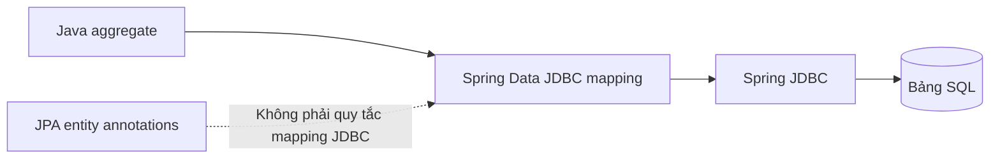
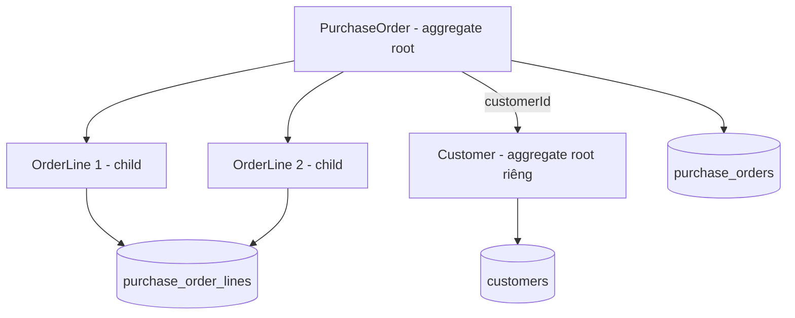
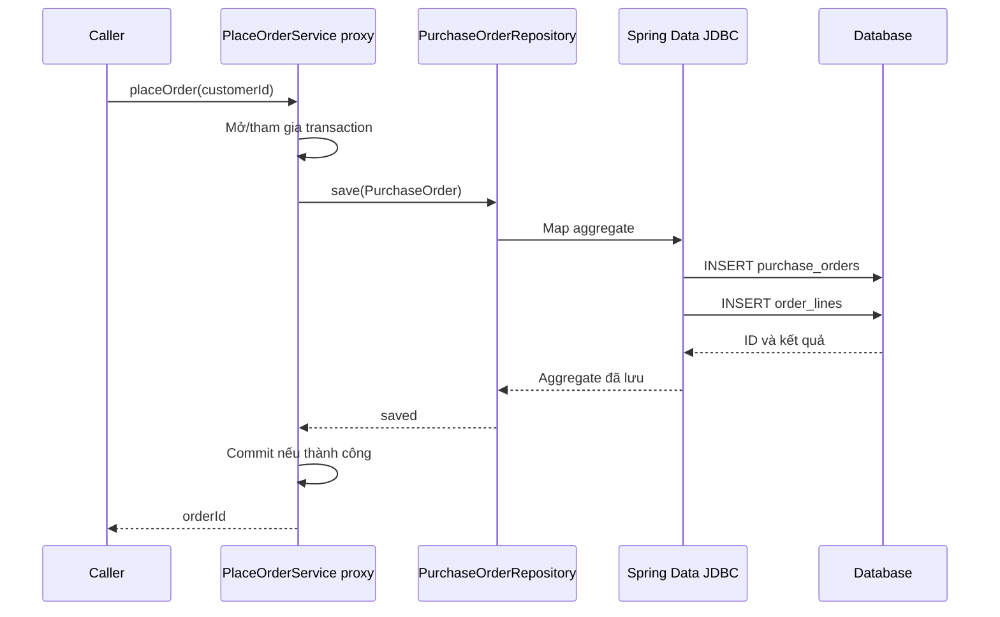

# Sử dụng đúng annotation Spring Data thay cho annotation JPA

Trong **Spring Data Relational JDBC** (Spring Data JDBC), một lớp Java có thể đại diện cho hàng dữ liệu trong bảng SQL, nhưng **nó không phải entity JPA được quản lý bằng `EntityManager`**. Vì vậy, khi xây dựng aggregate, khóa chính, cột, quan hệ và auditing cho Spring Data JDBC, cần import **annotation của Spring Data**, thay vì sao chép `@Entity`, `@OneToMany`, `@ManyToOne` hay `@GeneratedValue` từ tài liệu Spring Data JPA.

Điều này đặc biệt quan trọng khi IDE tự động thêm import, khi dự án có cả `spring-boot-starter-data-jdbc` và `spring-boot-starter-data-jpa`, hoặc khi chuyển một entity JPA sang JDBC. Một annotation trùng tên không có nghĩa là cùng cơ chế ánh xạ.

Bài học trình bày các annotation đúng, cách sử dụng với bảng SQL, các ví dụ aggregate có collection và embedded value object, cùng những lỗi thực tế phát sinh khi lẫn các annotation JPA.

## 1. Hai mô hình lưu trữ, hai bộ quy tắc ánh xạ

Spring Data JDBC và Spring Data JPA cùng làm việc với cơ sở dữ liệu quan hệ, nhưng cách quản lý đối tượng khác nhau:

| Khía cạnh | Spring Data JDBC | Spring Data JPA |
|---|---|---|
| Nền tảng | Spring JDBC và mô hình aggregate của Spring Data Relational | JPA với `EntityManager` và JPA provider |
| Mapping root | `@Table` của Spring Data Relational; không yêu cầu `@Entity` | `@Entity` của Jakarta Persistence |
| Identifier | `@Id` của Spring Data Commons | `@Id` của Jakarta Persistence |
| Quan hệ sở hữu dữ liệu | Aggregate reference và child entity/value object trong aggregate; dùng `@MappedCollection` khi cần | `@OneToMany`, `@ManyToOne`, `@JoinColumn`, ... |
| Theo dõi thay đổi | Không có JPA persistence context/dirty checking | Entity managed có thể được tự động flush thay đổi |
| Lazy-loading association kiểu JPA | Không có cơ chế proxy lazy relationship như JPA | Có thể cấu hình lazy loading qua JPA provider |
| Lưu dữ liệu | Gọi repository/`JdbcAggregateTemplate` để lưu aggregate | `persist`/`merge`/repository và lifecycle của persistence context |
| Transaction | Spring transaction manager gắn với JDBC | JPA transaction manager và JPA persistence context |

Spring Data JDBC xem **aggregate root** là ranh giới nhất quán. Khi gọi `save(root)`, framework lưu root và các đối tượng được root sở hữu theo cách ánh xạ JDBC. Nó không diễn giải graph entity và cascade/fetch theo `@OneToMany`/`@ManyToOne` của JPA.



Vì thế câu hỏi cần đặt ra khi nhìn một annotation là: **annotation này nằm trong package nào, và Spring Data JDBC có hiểu metadata của nó không?**

## 2. Bảng đối chiếu annotation cần nhớ

| Mục đích | Spring Data JDBC / Spring Data Relational | Annotation JPA dễ dùng nhầm | Ghi chú |
|---|---|---|---|
| Đánh dấu đối tượng lưu trữ | `@Table`: `org.springframework.data.relational.core.mapping.Table`; có thể dựa vào convention nếu không khai báo | `jakarta.persistence.Entity` | JDBC **không cần `@Entity`** |
| Chọn tên bảng | `@Table("purchase_orders")` | `jakarta.persistence.Table` | Hai `@Table` thuộc hai package khác nhau |
| Khóa chính | `org.springframework.data.annotation.Id` | `jakarta.persistence.Id` | Với JDBC, import Spring Data `@Id` |
| Chọn tên cột | `org.springframework.data.relational.core.mapping.Column` | `jakarta.persistence.Column` | `@Column` của JDBC phục vụ mapping tên cột |
| Giá trị ID tự tăng | DB tự sinh ID; Spring Data JDBC nhận ID sau khi insert khi được hỗ trợ | `@GeneratedValue` | Không dùng `@GeneratedValue` để ra lệnh cho JDBC sinh khóa |
| Khóa lạc quan | `org.springframework.data.annotation.Version` | `jakarta.persistence.Version` | Khác package và lifecycle cập nhật |
| Bỏ qua property | `org.springframework.data.annotation.Transient` | `jakarta.persistence.Transient` | Chỉ `@Transient` phù hợp mới điều khiển mapping JDBC |
| Thành phần embedded | `org.springframework.data.relational.core.mapping.Embedded` | `jakarta.persistence.Embedded`, `@Embeddable` | JDBC làm phẳng value object vào cột của bảng root |
| Collection con trong aggregate | `org.springframework.data.relational.core.mapping.MappedCollection` | `@OneToMany`, `@JoinColumn`, `@OrderColumn` | Cần thiết kế quan hệ theo aggregate |
| Tham chiếu aggregate khác | Lưu ID scalar hoặc `AggregateReference<T, ID>` | `@ManyToOne`, `@OneToOne` | JDBC không tự load object quan hệ bằng JPA annotation |
| Audit thời gian | `@CreatedDate`, `@LastModifiedDate` của Spring Data | `@PrePersist`, `@PreUpdate` trong JPA | Cần bật cơ chế auditing thích hợp |
| Audit người dùng | `@CreatedBy`, `@LastModifiedBy` của Spring Data | JPA listeners tùy chỉnh | Có thể cần `AuditorAware` |
| Chọn constructor dựng entity | `org.springframework.data.annotation.PersistenceCreator` | `jakarta.persistence.` constructor/lifecycle convention | Records và constructor mapping tuân theo Spring Data |
| Enum / chuyển đổi kiểu | Mapping/converter của Spring Data JDBC | `@Enumerated`, JPA `@Convert` | Không áp dụng converter JPA bằng cách đổi import tùy tiện |
| Lifecycle callback | Spring Data `EntityCallback` / events tương ứng | `@EntityListeners`, `@PrePersist`, `@PostLoad` | Hai cơ chế lifecycle tách biệt |

Các annotation `@Id`, `@Version`, `@Transient` và `@CreatedDate` nằm trong **Spring Data Commons** (`org.springframework.data.annotation`), không nằm trong package `org.springframework.data.jdbc`. Đây là thiết kế có chủ đích: nhiều Spring Data module dùng chung metadata cơ bản.

**Lưu ý quan trọng:** Spring Data JDBC có thể suy ra một số tên bảng/cột hoặc identifier theo convention, nên việc code dùng annotation sai đôi khi **vẫn chạy được trong tình huống đơn giản**. Điều đó không chứng minh annotation JPA đã có hiệu lực; cần xem mapping metadata và SQL thật sự.

## 3. `@Table`: ánh xạ aggregate root vào bảng

### 3.1. Import đúng

```java
import org.springframework.data.relational.core.mapping.Table;

@Table("customers")
public class Customer {
    // ...
}
```

Ở đây `@Table("customers")` xác định tên bảng được Spring Data JDBC dùng cho aggregate root. Nếu không ghi `@Table`, Spring Data Relational thường suy ra tên bảng từ tên class qua naming strategy. Dùng annotation tường minh làm tên bảng dễ kiểm soát, đặc biệt khi quy ước tên khác code hoặc có nhiều Spring Data module.

**Không nhầm với:**

```java
import jakarta.persistence.Entity;
import jakarta.persistence.Table;

@Entity
@Table(name = "customers")
public class Customer {
    // Đây là mapping hướng JPA.
}
```

JPA `@Table` thường được dùng cùng `@Entity` và thuộc `jakarta.persistence`. Thêm các annotation trên vào lớp dùng bởi Spring Data JDBC không làm lớp đó được quản lý như một JPA entity, cũng không tự biến repository JDBC thành JPA repository.

### 3.2. Một lớp JDBC không cần `@Entity`

Đây là aggregate root JDBC hợp lệ ở mức mapping:

```java
package com.example.orders.jdbc.domain;

import org.springframework.data.annotation.Id;
import org.springframework.data.relational.core.mapping.Column;
import org.springframework.data.relational.core.mapping.Table;

@Table("customers")
public class Customer {

    @Id
    private Long id;

    @Column("display_name")
    private String displayName;

    protected Customer() {
        // Cho Spring Data có thể dựng object khi đọc dữ liệu.
    }

    public Customer(String displayName) {
        this.displayName = displayName;
    }

    public Long getId() {
        return id;
    }

    public String getDisplayName() {
        return displayName;
    }

    public void rename(String newName) {
        this.displayName = newName;
    }
}
```

Với lược đồ tương ứng:

```sql
CREATE TABLE customers (
    id BIGINT GENERATED BY DEFAULT AS IDENTITY PRIMARY KEY,
    display_name VARCHAR(160) NOT NULL
);
```

Cú pháp DDL ở đây dành cho PostgreSQL; cách khai báo identity/auto-increment của những database khác có thể khác. Spring Data JDBC cần bảng và cột thực tế tương thích với mapping. `@Table` **không phải lệnh tự tạo schema**.

Trong ứng dụng Spring Boot, hãy cấu hình cơ chế tạo schema hoặc migration riêng theo nhu cầu (ví dụ file SQL cho môi trường học tập, Flyway hoặc Liquibase cho môi trường vận hành).

## 4. `@Id` và cách tạo khóa chính trong Spring Data JDBC

### 4.1. Dùng `org.springframework.data.annotation.Id`

```java
import org.springframework.data.annotation.Id;

@Id
private Long id;
```

**Không dùng nhầm**:

```java
import jakarta.persistence.Id; // JPA @Id, không phải metadata ID ưu tiên cho JDBC.
```

Cơ chế xác định entity mới (`isNew`) ảnh hưởng đến việc Spring Data JDBC sẽ insert hay update. Thông thường, identifier kiểu wrapper `Long` mang giá trị `null` báo đối tượng chưa được lưu; sau thao tác insert, Spring có thể nhận generated ID do database trả về và gán lại vào entity.

Ví dụ nghiệp vụ tạo customer:

```java
import org.springframework.data.repository.CrudRepository;

public interface CustomerRepository
        extends CrudRepository<Customer, Long> {
}

// Trong service:
Customer customer = new Customer("An");
Customer stored = customerRepository.save(customer);
Long generatedId = stored.getId();
```

Luôn dùng **đối tượng được `save` trả về** nếu cần các giá trị được cập nhật sau khi lưu. Điều này đặc biệt quan trọng với entity immutable/record: Spring Data có thể tạo instance mới để biểu diễn ID/version thay đổi.

### 4.2. Vì sao `@GeneratedValue` của JPA không phù hợp?

`jakarta.persistence.GeneratedValue` mô tả chiến lược sinh khóa dưới cơ chế JPA provider. Spring Data JDBC **không điều khiển sinh khóa theo annotation này**.

Trong JDBC, cách phổ biến là:

1. Database định nghĩa cột ID tự sinh (identity/auto-increment hoặc cơ chế được hỗ trợ).
2. Entity mới có ID chưa gán.
3. Repository thực hiện insert và nhận ID được driver/database trả về khi hỗ trợ.
4. Ứng dụng dùng entity sau khi lưu để biết ID.

Không nhất thiết mọi database, kiểu ID và chiến lược sinh khóa đều giống nhau. Nếu dùng UUID hoặc khóa do ứng dụng tạo trước, cần xem quy tắc xác định entity mới và thiết kế cách cấp khóa phù hợp; ID khác `null` có thể khiến framework coi entity là đã tồn tại.

### 4.3. Có trường tên `id` nhưng import sai: vì sao lỗi khó thấy?

Spring Data có quy ước nhất định khi phát hiện ID property và tên field. Vì vậy một class có field tên `id` và gắn JPA `@Id` **có thể trông như đang hoạt động** do trùng quy ước, khiến người đọc hiểu nhầm annotation JPA đã được xử lý.

Không dựa vào sự trùng hợp này. Hãy dùng `org.springframework.data.annotation.Id` rõ ràng và kiểm tra trường hợp cần tên khóa khác `id`, đặc biệt khi cấu trúc domain được chỉnh sửa về sau.

## 5. `@Column`: ánh xạ tên cột, không phải JPA DDL metadata

Trong Spring Data JDBC:

```java
import org.springframework.data.relational.core.mapping.Column;

@Column("display_name")
private String displayName;
```

`@Column` xác định tên cột được sử dụng khi ghi/đọc property. Nếu bỏ qua, Spring Data Relational áp dụng naming strategy, thường chuyển tên Java `displayName` thành tên dạng snake_case `display_name` theo quy ước mặc định.

JPA cũng có `@Column` nhưng khác package:

```java
import jakarta.persistence.Column;

@Column(
    name = "display_name",
    nullable = false,
    length = 160,
    unique = true
)
private String displayName;
```

Các thuộc tính như `nullable`, `unique`, `length` ở ví dụ JPA không thể được chuyển nguyên xi sang Spring Data JDBC `@Column`. Ràng buộc thực tế được định nghĩa và thực thi tại **schema database**:

```sql
CREATE TABLE customers (
    id BIGINT GENERATED BY DEFAULT AS IDENTITY PRIMARY KEY,
    display_name VARCHAR(160) NOT NULL UNIQUE
);
```

Validation ở ứng dụng, ví dụ `@NotBlank`, là một lớp kiểm soát khác và không thay thế ràng buộc DB. Spring Data JDBC không tự suy ra toàn bộ DDL từ annotation JDBC như một ORM JPA đang cấu hình schema generation.

Nếu bảng có identifier chữ hoa/được quote hoặc schema riêng, cần chú ý cách database xử lý hoa/thường, naming strategy và cấu hình schema. Tên bảng/cột khai báo tường minh vẫn phải khớp cách DB thực sự đặt tên.

## 6. `@Version`: optimistic locking đúng package

Spring Data JDBC hỗ trợ optimistic locking bằng:

```java
import org.springframework.data.annotation.Version;

@Version
private Long version;
```

Khi một aggregate được cập nhật, Spring Data JDBC có thể dùng giá trị version cũ trong điều kiện cập nhật để phát hiện người khác đã thay đổi bản ghi trước đó. Nếu không còn bản ghi có version mong đợi, thao tác lưu báo xung đột phiên bản (thường qua một ngoại lệ optimistic locking). Code nghiệp vụ cần quyết định trả lỗi, reload dữ liệu hoặc retry phù hợp.

Ví dụ:

```java
import org.springframework.data.annotation.Id;
import org.springframework.data.annotation.Version;
import org.springframework.data.relational.core.mapping.Table;

@Table("accounts")
public class Account {
    @Id
    private Long id;

    @Version
    private Long version;

    private long balanceCents;

    protected Account() {
    }

    public Account(long openingBalanceCents) {
        this.balanceCents = openingBalanceCents;
    }

    public void debit(long amountCents) {
        if (amountCents <= 0 || balanceCents < amountCents) {
            throw new IllegalArgumentException("Invalid debit");
        }
        balanceCents -= amountCents;
    }
}
```

Schema minh họa:

```sql
CREATE TABLE accounts (
    id BIGINT GENERATED BY DEFAULT AS IDENTITY PRIMARY KEY,
    version BIGINT,
    balance_cents BIGINT NOT NULL CHECK (balance_cents >= 0)
);
```

Không nhập `jakarta.persistence.Version` chỉ vì đọc hướng dẫn JPA. Spring Data JDBC tìm metadata mapping theo cơ chế của Spring Data.

**Một chi tiết về newness:** property có `@Version` cũng có thể được dùng để xác định object mới, đặc biệt khi ID được cấp trước. Với kiểu wrapper (`Long`), `null` thường đại diện chưa lưu; với kiểu nguyên thủy, giá trị 0 thường tương ứng trạng thái mới theo quy tắc Spring Data. Vì ID/version tác động đến insert/update, cần thiết kế constructor và quá trình lưu nhất quán.

**Optimistic locking không đồng nghĩa với tự retry.** Khi hai giao dịch cạnh tranh cập nhật cùng aggregate, ứng dụng phải xác định hành vi phù hợp khi phát hiện conflict.

## 7. `@Transient`: không lưu những thuộc tính tính toán

Nếu một property chỉ tồn tại trong logic Java, không phải dữ liệu cần persist:

```java
import org.springframework.data.annotation.Transient;

@Table("products")
public class Product {
    @Id
    private Long id;

    private long priceCents;

    @Transient
    private String displayPrice;

    // ...
}
```

`displayPrice` sẽ không được đưa vào mapping persistence của Spring Data JDBC. Khi đọc lại từ database, nếu cần giá trị hiển thị, ứng dụng tự tính hoặc xây DTO:

```java
public String priceLabel(long priceCents) {
    return (priceCents / 100) + "." +
            String.format("%02d", priceCents % 100);
}
```

Annotation đúng là `org.springframework.data.annotation.Transient`. Đừng dùng `jakarta.persistence.Transient` rồi cho rằng JDBC sẽ bỏ qua property.

Lưu ý: nếu constructor persistence yêu cầu một tham số đại diện cho property đã `@Transient`, Spring Data có thể không có giá trị từ database để cung cấp. Hãy thiết kế constructor map các property thực sự được lưu; các giá trị tính toán nên có cách tạo riêng.

## 8. Tư duy aggregate quyết định annotation quan hệ

Quan hệ là nơi lỗi nhập nhằng JPA–JDBC xuất hiện nhiều nhất. Trong JPA, một developer có thể viết:

```java
@OneToMany(mappedBy = "order", cascade = CascadeType.ALL)
private List<OrderLine> lines;

@ManyToOne(fetch = FetchType.LAZY)
@JoinColumn(name = "customer_id")
private Customer customer;
```

Đoạn này dựa vào JPA association, cascade và fetch semantics. Spring Data JDBC **không dùng các annotation ấy để dựng quan hệ**.

Với Spring Data JDBC, trước hết cần xác định ranh giới aggregate:

- `PurchaseOrder` là **aggregate root**.
- `OrderLine` là phần tử thuộc lifecycle của `PurchaseOrder` và được lưu qua root.
- `Customer` là **aggregate root khác**; đơn hàng có thể giữ `customerId` thay vì tham chiếu đối tượng `Customer` sẽ được framework tự lazy-load.



Từ sơ đồ này có thể chọn annotation:

- `@MappedCollection` cho những thành phần con được sở hữu trong aggregate.
- `@Embedded` cho value object cần được làm phẳng vào cột của bảng cha.
- Trường ID hoặc `AggregateReference` cho tham chiếu sang aggregate root khác.
- `@Table`/`@Column` để khớp schema.

### 8.1. `@MappedCollection` cho danh sách đối tượng con

Ví dụ một đơn hàng có nhiều dòng hàng, các dòng hàng do đơn hàng sở hữu:

```java
import java.util.ArrayList;
import java.util.List;

import org.springframework.data.annotation.Id;
import org.springframework.data.annotation.Version;
import org.springframework.data.relational.core.mapping.Column;
import org.springframework.data.relational.core.mapping.MappedCollection;
import org.springframework.data.relational.core.mapping.Table;

@Table("purchase_orders")
public class PurchaseOrder {

    @Id
    private Long id;

    @Version
    private Long version;

    @Column("order_code")
    private String code;

    @Column("customer_id")
    private Long customerId;

    @MappedCollection(
        idColumn = "order_id",
        keyColumn = "line_index"
    )
    private List<OrderLine> lines = new ArrayList<>();

    protected PurchaseOrder() {
    }

    public PurchaseOrder(String code, Long customerId) {
        this.code = code;
        this.customerId = customerId;
    }

    public void addLine(String sku, int quantity) {
        lines.add(new OrderLine(sku, quantity));
    }

    public Long getId() {
        return id;
    }

    public List<OrderLine> getLines() {
        return lines;
    }
}
```

Child class:

```java
import org.springframework.data.annotation.Id;

public class OrderLine {
    @Id
    private Long id;

    private String sku;
    private int quantity;

    protected OrderLine() {
    }

    public OrderLine(String sku, int quantity) {
        if (quantity <= 0) {
            throw new IllegalArgumentException("Quantity must be positive");
        }
        this.sku = sku;
        this.quantity = quantity;
    }

    public String getSku() {
        return sku;
    }

    public int getQuantity() {
        return quantity;
    }
}
```

Schema PostgreSQL minh họa:

```sql
CREATE TABLE purchase_orders (
    id BIGINT GENERATED BY DEFAULT AS IDENTITY PRIMARY KEY,
    version BIGINT,
    order_code VARCHAR(40) NOT NULL,
    customer_id BIGINT NOT NULL REFERENCES customers(id)
);

CREATE TABLE order_lines (
    id BIGINT GENERATED BY DEFAULT AS IDENTITY PRIMARY KEY,
    order_id BIGINT NOT NULL REFERENCES purchase_orders(id),
    line_index INTEGER NOT NULL,
    sku VARCHAR(64) NOT NULL,
    quantity INTEGER NOT NULL CHECK (quantity > 0),
    UNIQUE (order_id, line_index)
);
```

Trong `@MappedCollection`:

- **`idColumn = "order_id"`:** cột ở bảng child dùng để liên kết child với ID của aggregate root; đây là *reverse reference/foreign key*, không phải ID field của child.
- **`keyColumn = "line_index"`:** cột lưu vị trí phần tử của `List` (hoặc khóa với `Map` trong mapping phù hợp).
- **`@Id` của `OrderLine`:** là ID riêng của dòng hàng khi mô hình dùng child identity.

Tên bảng child được suy ra từ class/naming strategy nếu không khai báo `@Table` cho child. Ví dụ class `OrderLine` thông thường có thể ánh xạ sang bảng `order_line`, trong khi DDL phía trên đặt `order_lines`. Để khớp chính xác, gắn annotation tường minh:

```java
import org.springframework.data.relational.core.mapping.Table;

@Table("order_lines")
public class OrderLine {
    // Các trường như ví dụ trước.
}
```

**Ý nghĩa lifecycle:** child thuộc aggregate. Lưu lại aggregate có thể dẫn tới thao tác ghi lại các phần tử con theo chiến lược của Spring Data JDBC, bao gồm xóa/chèn lại dependent rows trong các trường hợp cập nhật. Đừng cho rằng collection con có cùng dirty checking, orphan-removal và cascade options như JPA.

### 8.2. `@Embedded` cho value object cùng bảng

Một địa chỉ giao hàng gồm `street` và `city` có thể lưu trực tiếp trong bảng đơn hàng, không nhất thiết là child table.

```java
public record ShippingAddress(
        String street,
        String city
) {
}
```

Trên aggregate root:

```java
import org.springframework.data.relational.core.mapping.Embedded;

@Embedded(
    onEmpty = Embedded.OnEmpty.USE_NULL,
    prefix = "ship_"
)
private ShippingAddress shippingAddress;
```

Các cột ở `purchase_orders` cần tương ứng:

```sql
ALTER TABLE purchase_orders
ADD COLUMN ship_street VARCHAR(180),
ADD COLUMN ship_city VARCHAR(100);
```

`@Embedded` sử dụng **Spring Data Relational**, không phải `jakarta.persistence.Embedded`. Cấu hình `prefix = "ship_"` giúp tách tên cột khi aggregate có nhiều value object sở hữu các field trùng tên.

`onEmpty` quyết định cách khôi phục embedded value khi mọi cột tương ứng đều `NULL`:

- `Embedded.OnEmpty.USE_NULL`: property embedded có thể là `null`.
- `Embedded.OnEmpty.USE_EMPTY`: Spring Data cố tạo instance embedded rỗng theo constructor/mapping phù hợp.

Với trường hợp nested embedded hoặc các constructor nhận value object, cần thiết kế sao cho cấu trúc bảng, prefix và điều kiện null phù hợp. **Không dùng `@Embeddable` của JPA** để chỉ dẫn Spring Data JDBC.

### 8.3. Tham chiếu root khác bằng ID

Trong ví dụ trên:

```java
@Column("customer_id")
private Long customerId;
```

là tham chiếu khóa ngoại theo dữ liệu. Spring Data JDBC không tự thực hiện `customer.get...()` qua một JPA proxy.

Khi muốn biểu diễn rõ một tham chiếu định kiểu, Spring Data JDBC có `AggregateReference<T, ID>`:

```java
import org.springframework.data.jdbc.core.mapping.AggregateReference;
import org.springframework.data.relational.core.mapping.Column;

@Column("customer_id")
private AggregateReference<Customer, Long> customer;
```

Với giá trị ID đã biết:

```java
AggregateReference<Customer, Long> customerReference =
        AggregateReference.to(customerId);
```

`AggregateReference` lưu ý nghĩa **tham chiếu tới aggregate khác bằng ID**; nó không chứa toàn bộ `Customer` và không có lazy-loading proxy. Khi nghiệp vụ cần thông tin khách hàng, hãy đọc riêng qua `CustomerRepository` hoặc dùng truy vấn phù hợp.

**Đừng thay một ID field bằng `@ManyToOne` chỉ để IDE gợi ý autocompletion.** Nên coi association giữa các aggregate là lựa chọn thiết kế explicit.

### 8.4. Khi nào là collection, khi nào là aggregate riêng?

Ví dụ:

- `OrderLine` chỉ sống cùng `PurchaseOrder` và không được sửa độc lập → phù hợp làm child collection.
- `Customer` có lifecycle, quyền truy cập và nghiệp vụ riêng → phù hợp aggregate root riêng, được tham chiếu bằng ID.
- Danh sách hàng trăm nghìn bản ghi thay đổi độc lập → nên cân nhắc aggregate nhỏ hơn hoặc mô hình truy cập khác; không đưa mọi thứ vào một `@MappedCollection` khổng lồ chỉ vì có khóa ngoại.
- Quan hệ nhiều–nhiều cần làm rõ bảng liên kết, entity sở hữu và các aggregate; Spring Data JDBC không tự dịch `@ManyToMany` của JPA.

Bản chất quan trọng hơn tên annotation: aggregate là ranh giới nhất quán, nên quan hệ phải được thiết kế theo thao tác ghi mà nghiệp vụ thực sự yêu cầu.

## 9. Các annotation thường dùng ngoài mapping cột

### 9.1. Auditing: `@CreatedDate` và `@LastModifiedDate`

Spring Data JDBC hỗ trợ cơ chế auditing của Spring Data khi được cấu hình.

```java
import java.time.Instant;
import org.springframework.data.annotation.CreatedDate;
import org.springframework.data.annotation.LastModifiedDate;
import org.springframework.data.relational.core.mapping.Table;

@Table("customers")
public class Customer {
    // @Id, các field khác...

    @CreatedDate
    private Instant createdAt;

    @LastModifiedDate
    private Instant updatedAt;
}
```

Các import phải thuộc `org.springframework.data.annotation`. Để bật auditing trong cấu hình JDBC:

```java
import org.springframework.context.annotation.Configuration;
import org.springframework.data.jdbc.repository.config.EnableJdbcAuditing;

@Configuration(proxyBeanMethods = false)
@EnableJdbcAuditing
public class JdbcAuditingConfiguration {
}
```

Schema cần các cột tương ứng (`created_at`, `updated_at` theo naming strategy). Các timestamp do DB tự cấp mặc định và auditing do Spring cấp là hai cơ chế khác nhau; hãy chọn rõ nguồn sự thật để tránh xung đột giá trị.

Nếu cần ghi người tạo/người sửa, có thể dùng:

```java
import org.springframework.data.annotation.CreatedBy;
import org.springframework.data.annotation.LastModifiedBy;

@CreatedBy
private String createdBy;

@LastModifiedBy
private String lastModifiedBy;
```

Đồng thời cấu hình `AuditorAware<String>` để xác định tác nhân hiện tại:

```java
import java.util.Optional;
import org.springframework.context.annotation.Bean;
import org.springframework.context.annotation.Configuration;
import org.springframework.data.domain.AuditorAware;

@Configuration(proxyBeanMethods = false)
class AuditorConfiguration {
    @Bean
    AuditorAware<String> auditorProvider() {
        // Ví dụ người dùng hệ thống; ứng dụng thực lấy từ security context.
        return () -> Optional.of("system");
    }
}
```

Khi có nhiều `AuditorAware`, cần chọn bean phù hợp theo khả năng cấu hình auditing tương ứng. Trong ví dụ trên, `system` là giá trị minh họa cho tác vụ backend, không phải cách truy vết người dùng thực tế.

**Không mang nguyên `@EntityListeners(AuditingEntityListener.class)` của JPA sang JDBC.** Spring Data JDBC sử dụng infrastructure auditing/event/callback của Spring Data, không chạy JPA entity lifecycle.

### 9.2. Constructor mapping và `@PersistenceCreator`

Spring Data JDBC cần dựng lại object từ các cột đã đọc. Những lựa chọn thường gặp:

- Constructor không tham số rồi gán các property được hỗ trợ.
- Constructor phù hợp có tham số.
- Java record có constructor chính rõ ràng.
- Khi có nhiều constructor cần phân biệt, dùng `@PersistenceCreator` từ Spring Data.

Ví dụ với class bất biến:

```java
import org.springframework.data.annotation.Id;
import org.springframework.data.annotation.PersistenceCreator;
import org.springframework.data.relational.core.mapping.Table;

@Table("product_categories")
public class ProductCategory {
    @Id
    private final Long id;
    private final String label;

    @PersistenceCreator
    public ProductCategory(Long id, String label) {
        this.id = id;
        this.label = label;
    }

    public ProductCategory(String label) {
        this(null, label);
    }

    public Long getId() {
        return id;
    }

    public String getLabel() {
        return label;
    }
}
```

Khi entity immutable nhận ID sinh bởi DB, Spring Data cần có cách tạo lại/biến đổi instance để đưa ID mới vào giá trị trả về. Các constructor/with-method mapping được hỗ trợ tuân theo cơ chế của Spring Data; vì thế dùng `save(...)` và giá trị trả về một cách nhất quán.

Không lấy các yêu cầu constructor JPA (như default constructor theo quy tắc entity JPA) làm tiêu chuẩn duy nhất cho lớp Spring Data JDBC.

### 9.3. Enum và custom conversion

Ví dụ domain có:

```java
enum OrderStatus {
    NEW, CONFIRMED, CANCELLED
}

private OrderStatus status;
```

Spring Data JDBC có cơ chế chuyển đổi enum và các kiểu thông dụng thông qua conversion infrastructure. Trường hợp enum được chuyển thành tên chuỗi là cách mapping thường gặp, nhưng **schema phải tương thích với kiểu SQL được dùng**.

Không dùng `@Enumerated(EnumType.STRING)` của JPA để điều khiển Spring Data JDBC. Nếu database lưu mã như `N`, `C` thay vì tên enum, hãy định nghĩa converter đọc/ghi phù hợp trong hệ thống Spring Data JDBC và đăng ký qua cấu hình conversions của module.

Tương tự, `jakarta.persistence.Convert` và JPA `AttributeConverter` không phải cơ chế tự động mà repository JDBC sẽ gọi. Với domain property đặc biệt, hãy xét Spring Data JDBC converters hoặc thiết kế kiểu dữ liệu đơn giản có mapping rõ ràng.

### 9.4. Lifecycle callback thay vì JPA `@PrePersist`

JPA thường cho phép:

```java
@PrePersist
void beforeInsert() {
    // JPA callback
}
```

Spring Data JDBC có **Spring Data entity callbacks/events**, chẳng hạn callback trước khi convert/save và sau khi lưu. Đây là cơ chế khác với JPA lifecycle callback. Nếu nghiệp vụ cần chuẩn hóa dữ liệu trước khi lưu, có thể đặt logic trong constructor/method nghiệp vụ, service hoặc callback Spring Data JDBC tùy phạm vi. Đừng gắn JPA callback rồi chờ nó được gọi bởi repository JDBC.

Nếu logic cập nhật timestamps và auditing là mục tiêu chính, cơ chế Spring Data auditing đã có thường rõ ràng hơn tự viết callback.

## 10. Ví dụ gắn kết annotation, repository và schema

Giả sử ứng dụng cần tạo một đơn hàng, trong đó:

- `PurchaseOrder` lưu ở bảng `purchase_orders`.
- `OrderLine` lưu ở bảng `order_lines` với khóa liên kết `order_id` và thứ tự `line_index`.
- `Customer` nằm ở bảng `customers`, được tham chiếu bằng `customerId`.
- Địa chỉ giao hàng được làm phẳng thành `ship_street` và `ship_city`.
- `@Version` giúp phát hiện cập nhật đồng thời lên đơn hàng.

Lớp root được mở rộng từ ví dụ ở phần 8:

```java
import java.util.ArrayList;
import java.util.List;

import org.springframework.data.annotation.Id;
import org.springframework.data.annotation.Version;
import org.springframework.data.relational.core.mapping.Column;
import org.springframework.data.relational.core.mapping.Embedded;
import org.springframework.data.relational.core.mapping.MappedCollection;
import org.springframework.data.relational.core.mapping.Table;

@Table("purchase_orders")
public class PurchaseOrder {

    @Id
    private Long id;

    @Version
    private Long version;

    @Column("order_code")
    private String code;

    @Column("customer_id")
    private Long customerId;

    @Embedded(onEmpty = Embedded.OnEmpty.USE_NULL, prefix = "ship_")
    private ShippingAddress shippingAddress;

    @MappedCollection(idColumn = "order_id", keyColumn = "line_index")
    private List<OrderLine> lines = new ArrayList<>();

    protected PurchaseOrder() {
    }

    public PurchaseOrder(
            String code,
            Long customerId,
            ShippingAddress shippingAddress
    ) {
        this.code = code;
        this.customerId = customerId;
        this.shippingAddress = shippingAddress;
    }

    public void addLine(String sku, int quantity) {
        lines.add(new OrderLine(sku, quantity));
    }

    public Long getId() {
        return id;
    }
}
```

`ShippingAddress`:

```java
public record ShippingAddress(String street, String city) {
}
```

`OrderLine` (với bảng được đặt tên tường minh):

```java
import org.springframework.data.annotation.Id;
import org.springframework.data.relational.core.mapping.Table;

@Table("order_lines")
public class OrderLine {

    @Id
    private Long id;
    private String sku;
    private int quantity;

    protected OrderLine() {
    }

    public OrderLine(String sku, int quantity) {
        if (quantity <= 0) {
            throw new IllegalArgumentException("Quantity must be positive");
        }
        this.sku = sku;
        this.quantity = quantity;
    }
}
```

Repository:

```java
import org.springframework.data.repository.CrudRepository;

public interface PurchaseOrderRepository
        extends CrudRepository<PurchaseOrder, Long> {
}
```

Service dùng transaction của Spring:

```java
import org.springframework.stereotype.Service;
import org.springframework.transaction.annotation.Transactional;

@Service
public class PlaceOrderService {

    private final PurchaseOrderRepository orders;

    public PlaceOrderService(PurchaseOrderRepository orders) {
        this.orders = orders;
    }

    @Transactional
    public Long placeOrder(Long customerId) {
        PurchaseOrder order = new PurchaseOrder(
                "PO-2026-001",
                customerId,
                new ShippingAddress("12 Main Street", "Hanoi")
        );

        order.addLine("BOOK-001", 2);
        order.addLine("PEN-002", 3);

        PurchaseOrder saved = orders.save(order);
        return saved.getId();
    }
}
```

Đường đi khi service được gọi thông qua Spring bean:



Đây là luồng khái quát; SQL cụ thể, số statement và cách framework phân bổ ID phụ thuộc mapping và phiên bản. Điểm đáng chú ý là **không có `@Entity`, `@GeneratedValue`, `@OneToMany` hay `@ManyToOne` của JPA**. Tất cả annotation ánh xạ đều đi theo mô hình Spring Data JDBC.

### 10.1. Schema cần khớp với mapping

Để tập hợp các ví dụ khớp nhau, schema PostgreSQL có thể viết như sau:

```sql
CREATE TABLE customers (
    id BIGINT GENERATED BY DEFAULT AS IDENTITY PRIMARY KEY,
    display_name VARCHAR(160) NOT NULL
);

CREATE TABLE purchase_orders (
    id BIGINT GENERATED BY DEFAULT AS IDENTITY PRIMARY KEY,
    version BIGINT,
    order_code VARCHAR(40) NOT NULL,
    customer_id BIGINT NOT NULL REFERENCES customers(id),
    ship_street VARCHAR(180),
    ship_city VARCHAR(100)
);

CREATE TABLE order_lines (
    id BIGINT GENERATED BY DEFAULT AS IDENTITY PRIMARY KEY,
    order_id BIGINT NOT NULL REFERENCES purchase_orders(id),
    line_index INTEGER NOT NULL,
    sku VARCHAR(64) NOT NULL,
    quantity INTEGER NOT NULL CHECK (quantity > 0),
    UNIQUE (order_id, line_index)
);
```

Dữ liệu mẫu:

```sql
INSERT INTO customers (display_name)
VALUES ('Nguyen An');
```

Service có thể nhận `customerId` sau khi tạo customer bằng repository. Ràng buộc khóa ngoại do database bảo đảm, còn `@MappedCollection` cho Spring Data JDBC biết cách ghi/đọc child theo `order_id` và `line_index`.

Đối với collection lớn, schema phức tạp hoặc cập nhật con độc lập thường xuyên, cần cân nhắc tách aggregate để tránh ghi lại quá nhiều child rows mỗi lần lưu.

## 11. Phối hợp JDBC và JPA trong một dự án

Khi project có cả hai starter, Spring Data có thể chuyển sang **strict repository configuration mode** để nhận diện repository theo store. Do `CrudRepository` đến từ Spring Data Commons nên bản thân interface này không luôn đủ để phân biệt repository của JDBC với JPA.

Vì vậy, ngoài import annotation đúng, cần tổ chức package rõ ràng:

```text
com.example.app
├── jdbc
│   ├── domain
│   │   └── PurchaseOrder.java
│   └── repository
│       └── PurchaseOrderRepository.java
├── jpa
│   ├── entity
│   │   └── LegacyInvoiceEntity.java
│   └── repository
│       └── LegacyInvoiceJpaRepository.java
└── config
    └── RepositoryConfiguration.java
```

Với cấu hình tường minh:

```java
import org.springframework.context.annotation.Configuration;
import org.springframework.data.jdbc.repository.config.EnableJdbcRepositories;
import org.springframework.data.jpa.repository.config.EnableJpaRepositories;

@Configuration(proxyBeanMethods = false)
@EnableJdbcRepositories(
    basePackages = "com.example.app.jdbc.repository"
)
@EnableJpaRepositories(
    basePackages = "com.example.app.jpa.repository"
)
public class RepositoryConfiguration {
}
```

Nếu chỉ dùng một Spring Data module và Spring Boot đã auto-configure repository scanning phù hợp thì không nhất thiết phải khai báo thủ công như trên. Ví dụ này hữu ích khi phải phối hợp cả JDBC và JPA.

Hãy tránh một class vừa gắn `jakarta.persistence.Entity` vừa gắn `org.springframework.data.relational.core.mapping.Table` chỉ để hai repository dùng chung. Mỗi module có cách quản lý entity, quan hệ và lifecycle khác nhau; nên tạo **mô hình persistence riêng** khi chức năng cần cả hai store. Ranh giới repository scanning rõ ràng giúp tránh hai factory cùng cố đăng ký một interface.

Transaction cũng là vấn đề riêng: một JDBC transaction manager thông thường không tự động điều phối mọi thao tác của một JPA `EntityManager` độc lập. Nếu hai cơ chế cùng dùng một database, khả năng phối hợp tùy thuộc cấu hình thực tế của datasource, manager và connection. **Nhận diện đúng annotation không mặc định tạo ra một transaction chung.**

## 12. Cách phát hiện lỗi import và lỗi mapping

### 12.1. Nhìn package import trước tiên

Khi code có annotation trùng tên, hãy rà soát:

```java
// ĐÚNG cho Spring Data JDBC:
import org.springframework.data.annotation.Id;
import org.springframework.data.annotation.Version;
import org.springframework.data.annotation.Transient;
import org.springframework.data.relational.core.mapping.Table;
import org.springframework.data.relational.core.mapping.Column;
import org.springframework.data.relational.core.mapping.MappedCollection;
import org.springframework.data.relational.core.mapping.Embedded;

// Không phải mapping annotation tương ứng của JDBC:
import jakarta.persistence.Entity;
import jakarta.persistence.Id;
import jakarta.persistence.Table;
import jakarta.persistence.Column;
import jakarta.persistence.OneToMany;
import jakarta.persistence.ManyToOne;
import jakarta.persistence.GeneratedValue;
```

**Không đưa cả hai nhóm có class tên trùng vào cùng một file rồi để IDE tự chọn import.** Nếu vì lý do đặc biệt phải tham chiếu nhiều annotation cùng tên, dùng tên fully qualified rõ ràng, nhưng một JDBC aggregate bình thường không cần bộ annotation JPA.

### 12.2. Triệu chứng và nguyên nhân thường gặp

| Triệu chứng | Nguyên nhân cần kiểm tra | Cách xử lý |
|---|---|---|
| Spring Data JDBC không xác định đúng ID | Dùng `jakarta.persistence.Id`, thiếu metadata ID Spring Data | Đổi sang `org.springframework.data.annotation.Id`, kiểm tra mapping |
| `save(...)` insert/update sai kỳ vọng | Quy tắc xác định entity mới bị ảnh hưởng bởi giá trị ID/version | Dùng `@Id`/`@Version` đúng, thiết kế ID mới và cách cấp khóa |
| SQL tham chiếu sai tên bảng | Import nhầm JPA `@Table` hoặc reliance vào tên suy ra | Dùng relational `@Table`, kiểm tra table thực |
| SQL tham chiếu sai cột | Import nhầm JPA `@Column` hoặc naming strategy khác DB | Dùng relational `@Column` và sửa schema/mapping |
| Child collection không được lưu/đọc như mong đợi | Dùng `@OneToMany` của JPA hoặc foreign-key column sai | Ánh xạ theo aggregate, `@MappedCollection(idColumn, keyColumn)` |
| Tham chiếu khác aggregate không tự load | Mong `@ManyToOne(fetch=LAZY)` hoạt động | Lưu ID/`AggregateReference`, truy vấn riêng |
| Embedded fields không đúng cột | Dùng JPA `@Embedded` hoặc thiếu prefix phù hợp | Dùng relational `@Embedded` với `prefix`/`onEmpty` |
| Không phát hiện cập nhật cạnh tranh | Import nhầm JPA `@Version` hoặc không khai báo version | Dùng Commons `@Version` và xem cách xử lý conflict |
| Field tính toán bị coi là property persistent | Dùng JPA `@Transient` | Dùng Commons `@Transient` |
| Timestamp auditing không được ghi | Chỉ thêm `@CreatedDate` nhưng chưa bật auditing hoặc thiếu cột | Cấu hình `@EnableJdbcAuditing`, schema và giá trị audit |
| Enum lưu không đúng dạng database | Mong JPA `@Enumerated` hoặc `@Convert` hoạt động | Cấu hình converter của JDBC tương ứng |
| Repository không tạo được bean khi thêm JPA starter | Strict repository config không nhận diện rõ store; scan overlap | Tách package, mapping metadata đúng, cấu hình `@Enable...Repositories` |

Nếu gặp lỗi SQL, nên đọc câu query và thông tin database trả về để xác định chính xác tên bảng/cột. Nếu lỗi xảy ra lúc context khởi động, hãy quan sát log repository scanning và dependency. Đây là hai tầng lỗi khác nhau.

### 12.3. Phân biệt lỗi annotation với lỗi giao dịch

`@Transactional` trong `org.springframework.transaction.annotation` điều phối transaction theo mô hình Spring AOP. Nó **không sửa lại mapping sai** của `@Table`/`@Id`.

Ví dụ một service:

```java
@Service
public class CustomerService {
    private final CustomerRepository customers;

    public CustomerService(CustomerRepository customers) {
        this.customers = customers;
    }

    @Transactional
    public Customer create(String name) {
        return customers.save(new Customer(name));
    }
}
```

Dù đã có `@Transactional`, nếu entity dùng `@Column` JPA và schema không theo tên Spring Data JDBC suy ra, câu SQL vẫn có thể thất bại. Khi chẩn đoán, tách rõ:

1. **Mapping:** property Java được đọc/ghi vào bảng/cột nào?
2. **Repository:** interface được module nào tạo proxy?
3. **Transaction:** lời gọi service đi qua proxy và transaction manager nào?
4. **Schema:** database có bảng, cột, khóa và ràng buộc phù hợp không?

## 13. Câu hỏi vận dụng

**Tình huống 1.** Dự án dùng `spring-boot-starter-data-jdbc`, có entity:

```java
import jakarta.persistence.Entity;
import jakarta.persistence.Id;
import jakarta.persistence.Table;

@Entity
@Table(name = "books")
public class Book {
    @Id
    private Long id;
    private String title;
}
```

*Hỏi:* Bạn cần đổi những gì để mapping rõ ràng theo Spring Data JDBC?

*Gợi ý:* Bỏ `@Entity`; đổi sang `org.springframework.data.relational.core.mapping.Table`; dùng `org.springframework.data.annotation.Id`; xem constructor và schema cho phù hợp. Không cần `@GeneratedValue` của JPA để cột identity của database hoạt động.

**Tình huống 2.** Một `PurchaseOrder` sở hữu `List<OrderLine>`. Developer thêm `@OneToMany(cascade = ALL)` vì đã học JPA.

*Hỏi:* Spring Data JDBC có tự áp dụng JPA cascade không? Cần đổi sang mô hình nào?

*Gợi ý:* Thiết kế aggregate root sở hữu child collection và sử dụng `@MappedCollection`; kiểm tra tên child table, ID/FK column và list index khi dùng `List`.

**Tình huống 3.** Lớp `Customer` có property `name` và property `displayName` chỉ được tạo từ `name`. Sau khi lưu, SQL báo cột `display_name` không tồn tại.

*Hỏi:* Annotation nào làm rõ `displayName` không persist?

*Gợi ý:* `org.springframework.data.annotation.Transient` hoặc thiết kế getter/DTO để tính toán khi cần, tùy mô hình property của bạn.

**Tình huống 4.** Ứng dụng cần lưu một mã trạng thái enum thành `"N"` trong database. Developer đặt `@Enumerated(EnumType.STRING)`.

*Hỏi:* Cách đó có đảm bảo JDBC lưu `"N"` không?

*Gợi ý:* Không; JPA `@Enumerated` không điều khiển Spring Data JDBC conversions. Sử dụng cơ chế custom conversion thích hợp hoặc một property dạng code rõ ràng.

**Tình huống 5.** Ứng dụng thêm JPA starter để hỗ trợ legacy module, sau đó một `CrudRepository` của JDBC không còn được phát hiện đúng.

*Hỏi:* Những nơi đầu tiên cần kiểm tra?

*Gợi ý:* Repository package, strict repository configuration log, `@Table` của Spring Data Relational trên domain, các `@EnableJdbcRepositories`/`@EnableJpaRepositories`, và import `@Id`.

## 14. Nguyên tắc ghi nhớ

Khi viết **Spring Data JDBC**, hãy bắt đầu bằng những ý sau:

1. **`@Table` và `@Column`:** chọn từ `org.springframework.data.relational.core.mapping`.
2. **`@Id`, `@Version`, `@Transient` và auditing annotations:** chọn từ `org.springframework.data.annotation`.
3. **`@MappedCollection`, `@Embedded`:** chọn từ `org.springframework.data.relational.core.mapping` và thiết kế quan hệ theo aggregate.
4. **Khóa tự sinh:** cấu hình theo database và Spring Data JDBC identifier handling; không sao chép `@GeneratedValue` của JPA.
5. **Tham chiếu aggregate khác:** lưu ID hoặc `AggregateReference`, không dùng `@ManyToOne` để mong có lazy-loading.
6. **Repository và transaction:** dùng infrastructure của Spring Data JDBC và Spring transaction tương ứng; không dựa vào lifecycle hoặc mapping của JPA.
7. **Schema:** luôn đối chiếu tên bảng, cột, khóa và ràng buộc của database với mapping thực tế.

Nhìn vào tên annotation là chưa đủ. **Nhìn đầy đủ package import, loại repository và mô hình aggregate** mới giúp đảm bảo Spring Data JDBC ánh xạ dữ liệu theo đúng cơ chế mà ứng dụng dự định sử dụng.
