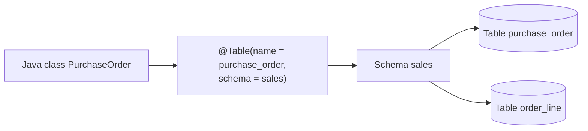
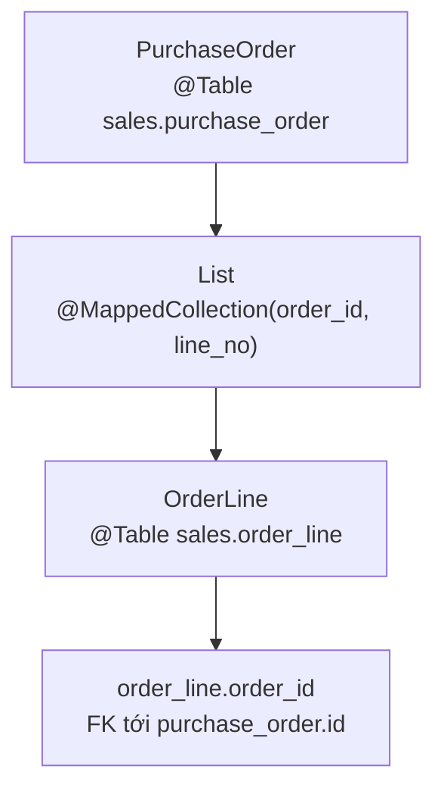

# Định nghĩa bảng và schema bằng `@Table` trong Spring Data JDBC

Khi Spring Data JDBC lưu một đối tượng Java, framework phải biết đối tượng đó thuộc bảng nào trong cơ sở dữ liệu quan hệ. **`@Table` là annotation để chỉ định đích ánh xạ đó**. Annotation này có thể nêu tên bảng và tên *database schema*; nó không tự tạo bảng, không định nghĩa cột SQL và không thay thế migration.

Bài học sử dụng mô hình đơn hàng gồm `PurchaseOrder` và `OrderLine` để thực hành với PostgreSQL. Trọng tâm là hiểu mối liên hệ giữa **lớp Java → tên bảng/schema → câu SQL Spring Data JDBC thực thi**, đồng thời tránh nhầm `@Table` của Spring Data Relational với annotation JPA.

## 1. Phân biệt class, table và schema

Ba khái niệm dễ bị trộn lẫn:

| Khái niệm | Thuộc tầng nào? | Vai trò |
| --- | --- | --- |
| Class/record `PurchaseOrder` | Java/domain | Biểu diễn đơn hàng với trạng thái, tổng tiền, khách hàng và các dòng. |
| Table `purchase_order` | Cơ sở dữ liệu quan hệ | Chứa các dòng dữ liệu của đơn hàng, mỗi dòng có khóa chính. |
| Schema `sales` | Namespace trong database | Gom các đối tượng như `sales.purchase_order` và `sales.order_line`. |

Với PostgreSQL, cú pháp tên bảng được chỉ định đầy đủ có dạng `schema_name.table_name`. Ví dụ:

```sql
SELECT id, customer_id, status
FROM sales.purchase_order
WHERE id = 1001;
```

Ở đây:

- `sales` là **database schema**.
- `purchase_order` là **table** bên trong schema đó.
- `1001` là ID của một bản ghi, không phải tên bảng hay schema.

Cũng có thể có hai bảng trùng tên trong hai schema khác nhau, chẳng hạn `sales.purchase_order` và `archive.purchase_order`. Khi viết SQL không chỉ rõ schema, cơ sở dữ liệu sẽ dùng cơ chế tìm tên mặc định, chẳng hạn `search_path` của PostgreSQL. Nếu ứng dụng kỳ vọng một schema còn kết nối đang tìm bảng ở schema khác, truy vấn có thể báo không tìm thấy bảng hoặc đọc nhầm dữ liệu.



Trong Spring Data JDBC, `@Table` chỉ cấu hình **metadata ánh xạ**. Không có câu lệnh `CREATE SCHEMA` hoặc `CREATE TABLE` nào tự xuất hiện chỉ vì đã viết annotation này.

## 2. Import đúng `@Table`

`@Table` của Spring Data JDBC thuộc package:

```java
import org.springframework.data.relational.core.mapping.Table;
```

Ví dụ ngắn nhất:

```java
import org.springframework.data.annotation.Id;
import org.springframework.data.relational.core.mapping.Table;

@Table("purchase_order")
public record PurchaseOrder(
    @Id Long id,
    Long customerId,
    String status
) {}
```

Ý nghĩa:

- `@Table("purchase_order")` đặt tên bảng đích là `purchase_order`.
- `@Id` đánh dấu thuộc tính dùng làm định danh của aggregate.
- `customerId` và `status` là các thuộc tính sẽ được ánh xạ sang cột theo quy ước hoặc annotation khác.
- Repository có thể sử dụng thông tin trên để tạo SQL phù hợp khi lưu/đọc object.

**Không import nhầm** `jakarta.persistence.Table`. Annotation JPA thường đi cùng `@Entity`, `@Id` của JPA và cơ chế ORM/Hibernate; đó không phải hệ annotation được sử dụng để cấu hình aggregate của Spring Data JDBC. Trong các ví dụ của bài, ID phải import từ `org.springframework.data.annotation.Id`.

### Các tham số của `@Table`

Với Spring Data Relational hiện đại, `@Table` có ba thuộc tính chính:

| Cú pháp | Ý nghĩa | Ghi chú |
| --- | --- | --- |
| `@Table("purchase_order")` | Tên bảng thông qua `value`. | Cách viết ngắn gọn. |
| `@Table(name = "purchase_order")` | Tên bảng thông qua `name`. | `name` và `value` là alias cùng mục đích. |
| `@Table(name = "purchase_order", schema = "sales")` | Bảng `purchase_order` trong database schema `sales`. | Thích hợp khi cần chỉ rõ namespace. |

Có thể viết:

```java
@Table(value = "purchase_order", schema = "sales")
public record PurchaseOrder(@Id Long id) {}
```

hoặc:

```java
@Table(name = "purchase_order", schema = "sales")
public record PurchaseOrder(@Id Long id) {}
```

Hai kiểu nêu tên bảng trên có cùng mục đích. **Không nên cố đặt `value` và `name` thành hai tên bảng khác nhau**. `schema` là một thuộc tính khác, dành cho namespace; nó không phải nơi chỉ định JDBC URL hoặc tên database.

Các phiên bản Spring Data JDBC có thể thay đổi chi tiết xử lý expression/dialect và cách trích dẫn identifier, nên khi dự án cố định một phiên bản hãy đối chiếu Javadoc tương ứng. Cú pháp `name`/`value`/`schema` có trong các dòng Spring Data Relational 3.x hiện đại.

## 3. Quy ước tên mặc định và lý do dùng `@Table`

Ngay cả khi không chỉ định tên bảng tường minh, Spring Data JDBC có thể xác định tên dựa trên tên kiểu Java và `NamingStrategy`. Với quy ước mặc định, các phần của tên CamelCase thường được phân tách theo snake_case:

| Tên Java | Tên SQL được suy ra về mặt quy ước |
| --- | --- |
| `PurchaseOrder` | `purchase_order` |
| `OrderLine` | `order_line` |
| `customerId` | `customer_id` |
| `totalAmount` | `total_amount` |

Việc **chữ hoa/chữ thường và dấu quote** khi SQL được tạo còn phụ thuộc cấu hình mapping, dialect và quy tắc identifier của database. PostgreSQL gập các identifier *không quote* về chữ thường; identifier *được quote* giữ nguyên cách viết. Vì vậy, đừng kết luận rằng mọi tổ hợp của tên Java, tên SQL và dấu quote đều tương đương.

Nên dùng `@Table` tường minh khi:

1. Tên bảng thực tế khác với tên mà naming strategy tạo ra.
2. Cần sử dụng một schema rõ ràng, chẳng hạn `sales`, `billing` hoặc `reporting`.
3. Muốn giảm phụ thuộc vào thay đổi quy ước tên toàn ứng dụng.
4. Có tên miền nghiệp vụ khác tên bảng, ví dụ class `PurchaseOrder` nhưng bảng `order_header`.
5. Đang khớp ứng dụng với schema có sẵn do DBA hoặc migration quản lý.

**Quy tắc thực tế:** chọn tên bảng/schema nhất quán, ngắn gọn, thường là snake_case chữ thường cho PostgreSQL. Tránh tên cần phải quote do chứa khoảng trắng, ký tự lạ hoặc trùng từ khóa SQL.

## 4. Ví dụ DDL: tạo schema `sales` và hai bảng đơn hàng

Trước khi chạy repository, database phải tồn tại và user kết nối cần đủ quyền. DDL sau minh họa PostgreSQL:

```sql
CREATE SCHEMA IF NOT EXISTS sales;

CREATE TABLE sales.purchase_order (
    id BIGINT GENERATED BY DEFAULT AS IDENTITY PRIMARY KEY,
    customer_id BIGINT NOT NULL,
    status VARCHAR(20) NOT NULL
        CHECK (status IN ('CREATED', 'CONFIRMED', 'CANCELLED')),
    total_amount NUMERIC(19, 2) NOT NULL
        CHECK (total_amount >= 0)
);

CREATE TABLE sales.order_line (
    order_id BIGINT NOT NULL,
    line_no INTEGER NOT NULL,
    product_id BIGINT NOT NULL,
    quantity INTEGER NOT NULL CHECK (quantity > 0),
    unit_price NUMERIC(19, 2) NOT NULL
        CHECK (unit_price >= 0),
    PRIMARY KEY (order_id, line_no),
    CONSTRAINT fk_order_line_purchase_order
        FOREIGN KEY (order_id)
        REFERENCES sales.purchase_order(id)
);

CREATE INDEX idx_purchase_order_customer
    ON sales.purchase_order (customer_id);
```

Bảng cha chứa trạng thái và tổng tiền; bảng con chứa danh sách dòng. `order_line.order_id` liên kết mỗi dòng với đơn hàng. `line_no` là vị trí dòng trong `List<OrderLine>`, đồng thời tạo khóa ghép với `order_id`.

Trong một mô hình đầy đủ hơn, `customer_id` và `product_id` sẽ tham chiếu bảng khách hàng/sản phẩm với khóa ngoại riêng; ví dụ này để chúng dưới dạng ID nhằm tập trung vào ánh xạ `@Table` và quan hệ sở hữu trong aggregate.

### Vì sao viết DDL riêng?

`@Table(name = "purchase_order", schema = "sales")` **không thực hiện**:

- `CREATE SCHEMA sales`.
- `CREATE TABLE sales.purchase_order`.
- Tạo khóa chính, khóa ngoại hoặc index.
- Tự thêm cột mới vào bảng khi ta thêm field vào record.
- Kiểm tra mọi ràng buộc nghiệp vụ như trạng thái chuyển đổi hoặc tổng tiền phải khớp các dòng.

Những việc đó phải được xử lý bởi script SQL, công cụ migration như Flyway/Liquibase hoặc quy trình cấp phát database của hệ thống. Trong production nên dùng migration có phiên bản, áp dụng có kiểm soát và được review, thay vì thay đổi DDL thủ công sau mỗi lần triển khai.

## 5. Ánh xạ bảng cha bằng `@Table(schema = ...)`

Tạo file `PurchaseOrder.java`:

```java
package com.example.orders.domain;

import java.math.BigDecimal;
import java.util.List;

import org.springframework.data.annotation.Id;
import org.springframework.data.relational.core.mapping.MappedCollection;
import org.springframework.data.relational.core.mapping.Table;

@Table(name = "purchase_order", schema = "sales")
public record PurchaseOrder(
    @Id Long id,
    Long customerId,
    String status,
    BigDecimal totalAmount,
    @MappedCollection(
        idColumn = "order_id",
        keyColumn = "line_no"
    )
    List<OrderLine> lines
) {}
```

Mỗi thành phần có trách nhiệm rõ ràng:

| Thành phần | Ánh xạ |
| --- | --- |
| `@Table(name = "purchase_order", schema = "sales")` | Root nằm ở bảng `sales.purchase_order`. |
| `@Id Long id` | Cột khóa chính `id`. |
| `Long customerId` | Cột `customer_id` theo quy ước tên. |
| `String status` | Cột `status`. |
| `BigDecimal totalAmount` | Cột `total_amount`, cùng ý nghĩa với `NUMERIC(19,2)`. |
| `@MappedCollection(...) List<OrderLine>` | Danh sách thuộc root, được ánh xạ bằng cột `order_id` và `line_no` ở bảng con. |

Spring Data JDBC sử dụng `@Table` ở cấp **kiểu Java**, còn `@Id`, `@Column`, `@MappedCollection` ở cấp **thuộc tính** theo vai trò tương ứng. Không thể dùng riêng `@Table` để chỉ ra tất cả cột, khóa chính và quan hệ.

`PurchaseOrder` là aggregate root vì repository thao tác trực tiếp với nó. `OrderLine` thuộc aggregate đơn hàng; việc có bảng SQL riêng không tự làm nó trở thành aggregate root độc lập.

## 6. Ánh xạ bảng con trong schema

Tạo file `OrderLine.java`:

```java
package com.example.orders.domain;

import java.math.BigDecimal;
import org.springframework.data.relational.core.mapping.Table;

@Table(name = "order_line", schema = "sales")
public record OrderLine(
    Long productId,
    int quantity,
    BigDecimal unitPrice
) {}
```

Hai nơi định nghĩa phải khớp nhau:

- `@Table(name = "order_line", schema = "sales")` cho biết dữ liệu dòng đơn hàng nằm ở `sales.order_line`.
- `PurchaseOrder.lines` khai báo `@MappedCollection(idColumn = "order_id", keyColumn = "line_no")` để Spring Data JDBC biết cách liên kết hàng con với hàng cha và lưu vị trí phần tử.

Đặt schema ở `@Table` của root **không có nghĩa mọi kiểu con và mọi aggregate khác sẽ tự kế thừa schema đó**. Với schema đặt riêng cho cả hai bảng như ví dụ, hãy nêu rõ `schema = "sales"` trên những kiểu dữ liệu được ánh xạ vào bảng tương ứng, hoặc áp dụng một naming strategy chung có chủ đích.

Ở ví dụ này `OrderLine` không có `@Id` riêng; khóa hàng SQL dựa vào `(order_id, line_no)`. Đó là một lựa chọn cho collection được sở hữu. Nếu miền nghiệp vụ yêu cầu ID độc lập cho dòng, cần thiết kế lại cách ánh xạ, schema và vòng đời của dòng.

### Phân biệt `@Table` với `@MappedCollection`



- `@Table`: dữ liệu của một kiểu được lưu trong **bảng nào**.
- `@MappedCollection`: dữ liệu của thành phần con **liên kết với root bằng cột nào**, và cột nào giữ thứ tự/key của collection.
- Foreign key SQL: đảm bảo giá trị khóa tham chiếu hợp lệ ở **mức database**.

Chỉ có `@Table` ở `OrderLine` mà quên cấu hình cột liên kết phù hợp có thể khiến Spring Data JDBC tìm một tên cột mặc định khác với `order_id` do schema đã tạo.

## 7. Khi cột thực tế không theo quy ước: kết hợp `@Column`

`@Table` không thay thế việc ánh xạ **tên cột**. Nếu cơ sở dữ liệu có cột `order_state` nhưng Java đặt thuộc tính `status`, phải chỉ rõ bằng `@Column`:

```java
import org.springframework.data.relational.core.mapping.Column;
import org.springframework.data.relational.core.mapping.Table;

@Table(name = "purchase_order", schema = "sales")
public record PurchaseOrder(
    @Id Long id,
    Long customerId,
    @Column("order_state") String status,
    BigDecimal totalAmount
) {}
```

Ví dụ rút gọn này chỉ minh họa cột tùy chỉnh; nó tương ứng với **một schema khác** có cột `order_state` thay cho `status`. Không dùng nguyên đoạn trên với DDL phần 4 nếu chưa đổi cột SQL cho khớp.

Các annotation bổ trợ thường gặp:

| Annotation | Đặt ở đâu? | Dùng để làm gì? |
| --- | --- | --- |
| `@Table` | Class/record | Chỉ định tên bảng và có thể cả schema. |
| `@Id` | Thuộc tính/record component | Đánh dấu khóa chính của entity. |
| `@Column` | Thuộc tính/record component | Ghi đè tên cột suy ra. |
| `@MappedCollection` | Thuộc tính quan hệ con/list/map | Chỉ định cột tham chiếu parent và cột key/index. |
| `@Transient` | Thuộc tính | Loại một thuộc tính khỏi ánh xạ lưu trữ. |
| `@Version` | Thuộc tính | Hỗ trợ optimistic locking khi cập nhật entity. |

Tất cả những annotation trên thuộc hệ Spring Data phù hợp. Không tự trộn chúng với `@Entity`, `@JoinColumn` hoặc `@GeneratedValue` của JPA nếu đang triển khai Spring Data JDBC thuần.

## 8. Repository dùng bảng và schema như thế nào?

Interface repository không cần biết tên schema bằng cách nối chuỗi SQL thủ công:

```java
package com.example.orders.repository;

import java.util.List;
import org.springframework.data.repository.CrudRepository;
import com.example.orders.domain.PurchaseOrder;

public interface PurchaseOrderRepository
        extends CrudRepository<PurchaseOrder, Long> {

    List<PurchaseOrder> findByCustomerId(Long customerId);
}
```

Với cấu hình Spring Data JDBC phù hợp, framework lấy metadata từ `PurchaseOrder` và các kiểu con:

1. Khi `save(order)`, truy cập bảng `sales.purchase_order` của root.
2. Với `lines`, truy cập `sales.order_line` và ghi `order_id`/`line_no`.
3. Khi `findById(id)`, tải root và các dòng thuộc aggregate theo mapping.
4. Khi `findByCustomerId(customerId)`, Spring Data JDBC dùng thuộc tính của root để tạo truy vấn tương ứng.

Minh họa SQL ý nghĩa (SQL thật có thể khác về quote identifier, trình tự câu lệnh và cách lấy generated ID theo dialect):

```sql
INSERT INTO sales.purchase_order
    (customer_id, status, total_amount)
VALUES
    (7, 'CREATED', 285000.00);

-- Giả sử ID của đơn vừa được sinh là 1001.
INSERT INTO sales.order_line
    (order_id, line_no, product_id, quantity, unit_price)
VALUES
    (1001, 0, 11, 2, 120000.00),
    (1001, 1, 12, 1, 45000.00);

SELECT id, customer_id, status, total_amount
FROM sales.purchase_order
WHERE id = 1001;
```

Các câu lệnh trên chỉ mô tả dữ liệu cần tồn tại; **không phải output SQL được cam kết của repository**. Spring Data JDBC có thể chọn cách thực thi nhiều câu lệnh, giá trị tham số và cơ chế lấy ID khác nhau. Khi cần chẩn đoán, hãy bật logging SQL và quan sát truy vấn thực tế.

### Mã tạo đơn minh họa

```java
var lines = List.of(
    new OrderLine(11L, 2, new BigDecimal("120000.00")),
    new OrderLine(12L, 1, new BigDecimal("45000.00"))
);

var unsaved = new PurchaseOrder(
    null,
    7L,
    "CREATED",
    new BigDecimal("285000.00"),
    lines
);

PurchaseOrder saved = purchaseOrderRepository.save(unsaved);
Long generatedId = saved.id();

PurchaseOrder reloaded = purchaseOrderRepository
    .findById(generatedId)
    .orElseThrow();
```

Đoạn này giả định mã nằm trong service đã được inject repository và import `List`, `BigDecimal`. Không coi số tiền do máy khách gửi là nguồn sự thật: trong nghiệp vụ thật service phải kiểm tra mã sản phẩm, lấy đơn giá đáng tin cậy và tính tổng.

Với Java record bất biến, hãy sử dụng instance được `save(...)` trả về vì ID được sinh có thể xuất hiện trên một instance mới.

## 9. Tạo schema và khởi tạo bảng trong ứng dụng Spring Boot

Trong Spring Boot, cấu hình datasource chỉ nói **kết nối đến database nào**. Nó không tạo ra schema PostgreSQL `sales` theo `@Table`.

Ví dụ `application.yml`:

```yaml
spring:
  datasource:
    url: jdbc:postgresql://localhost:5432/shopdb
    username: shop_app
    password: ${SHOP_DB_PASSWORD}
```

Với Spring Boot có starter Spring Data JDBC và PostgreSQL JDBC driver, các repository thường được cấu hình tự động khi thỏa điều kiện. Nhưng bạn vẫn phải áp dụng DDL từ phần 4 hoặc migration tương đương.

Có hai hướng khởi tạo:

**Hướng A — Script SQL cho bài thực hành.** Đặt DDL trong `src/main/resources/schema.sql` và bật SQL initialization cho database không embedded:

```yaml
spring:
  sql:
    init:
      mode: always
```

Trong môi trường demo dùng DB trống, Boot có thể chạy script tạo schema/bảng khi khởi động. Script cần có quyền tương ứng và phải tính đến việc chạy lại; `CREATE TABLE` không có `IF NOT EXISTS` sẽ lỗi nếu bảng đã tồn tại. Không đồng thời để nhiều cơ chế khởi tạo cùng sở hữu DDL.

**Hướng B — Migration có phiên bản.** Dùng Flyway hoặc Liquibase để tạo và phát triển `sales.purchase_order`, `sales.order_line`. Ví dụ tên migration của Flyway là `V1__create_order_schema.sql`, chứa câu lệnh DDL đã review. Cách này phù hợp hơn với môi trường chia sẻ và production vì có lịch sử phiên bản và kiểm soát thay đổi.

Với PostgreSQL, quyền `CREATE` trên database/schema hoặc quyền sở hữu schema ảnh hưởng đến khả năng chạy migration. App user chỉ dùng để đọc/ghi hằng ngày có thể được cấp quyền hẹp hơn migration user; không nên âm thầm dùng quyền cao chỉ để tránh một lỗi cấu hình.

### Cần hiểu `search_path`

Trong PostgreSQL, một kết nối có thể có `search_path` mặc định như `"$user", public` (tùy hệ thống). Nếu Spring Data JDBC tạo truy vấn **không chỉ rõ schema**, database sẽ dò theo thứ tự path. Việc gắn `@Table(schema = "sales")` giúp metadata ánh xạ nhắm tới schema có chủ đích. Cấu hình `search_path` và `@Table(schema=...)` là hai cơ chế khác nhau; cần quyết định cách dùng nhất quán thay vì mong một cơ chế tự chỉnh cơ chế kia.

Một số JDBC driver/pool cho phép đặt schema mặc định cho kết nối. Tính khả dụng và cú pháp tùy database/driver; nếu đã chỉ rõ `@Table(schema = "sales")`, hãy bảo đảm schema đó thực sự tồn tại và user có quyền truy cập.

## 10. Khi dùng nhiều schema hoặc đặt lại tên bảng

Cùng một database có thể phân chia các loại dữ liệu:

```text
shopdb
├── sales
│   ├── purchase_order
│   └── order_line
└── catalog
    └── product
```

Các kiểu tương ứng có thể khai báo:

```java
@Table(name = "purchase_order", schema = "sales")
public record PurchaseOrder(@Id Long id) {}

@Table(name = "product", schema = "catalog")
public record Product(@Id Long id) {}
```

Đây là hai record rút gọn để giải thích tên table/schema. Khi triển khai, mỗi kiểu `public` nằm trong file riêng và cần khai báo đủ thuộc tính/cột theo schema thật.

Lưu ý:

- Schema khác nhau **không tự làm hai đối tượng thuộc cùng aggregate**.
- `Product` có vòng đời độc lập có thể là root riêng; `PurchaseOrder` chỉ giữ `productId` trong dòng hàng.
- SQL foreign key có thể tham chiếu qua schema, nhưng phải khai báo rõ ở DDL.
- Không phải database nào cũng có khái niệm schema giống PostgreSQL. Ví dụ MySQL thường coi `SCHEMA` như tên database; hành vi `@Table(schema=...)` cần được kiểm tra với dialect và driver cụ thể.
- Nếu thay đổi tên bảng/schema trong ứng dụng mà không migration dữ liệu, repository sẽ truy cập một địa chỉ mới nhưng dữ liệu cũ vẫn ở bảng cũ.

### NamingStrategy khi muốn quy ước schema mặc định

Spring Data Relational cho phép cung cấp một `NamingStrategy` riêng. Điểm mở rộng này có thể định nghĩa tên bảng, cột hoặc schema mặc định theo chính sách của ứng dụng. Khác với `@Table(schema = "sales")` ở một class, naming strategy có phạm vi rộng hơn và ảnh hưởng đến nhiều kiểu.

Chọn giải pháp theo yêu cầu:

| Nhu cầu | Cách phù hợp |
| --- | --- |
| Một class có tên bảng khác quy ước | `@Table(name = "...")`. |
| Một class nằm ở schema riêng | `@Table(name = "...", schema = "...")`. |
| Một cột có tên khác quy ước | `@Column("...")`. |
| Collection con có tên khóa ngoại/chỉ số khác mặc định | `@MappedCollection(idColumn = "...", keyColumn = "...")`. |
| Cả ứng dụng dùng quy ước tên/schema nhất quán khác mặc định | Xem xét custom `NamingStrategy`. |
| Cần tạo/sửa schema hoặc index | DDL/migration, không dùng `@Table`. |

Khi thay đổi naming strategy, cần xem cả tên cột parent ID và key/index của bảng con. Đây là thay đổi mapping toàn cục, không chỉ là đổi tên hiển thị của class.

## 11. Một số tình huống lỗi dễ gặp

| Biểu hiện | Khả năng xảy ra | Cách xử lý |
| --- | --- | --- |
| PostgreSQL báo `relation "sales.purchase_order" does not exist` | Chưa chạy DDL, tên schema/table sai, hoặc kết nối nhầm DB. | Kiểm tra tên DB trong JDBC URL, danh sách schema/bảng và lịch sử migration. |
| `permission denied for schema sales` | User kết nối chưa có quyền trên schema/bảng. | Kiểm tra owner, `USAGE` trên schema và quyền SELECT/INSERT/UPDATE/DELETE cần thiết. |
| App truy cập `public.purchase_order` thay vì `sales.purchase_order` | Thiếu cấu hình schema/đang dùng naming strategy khác. | Đối chiếu `@Table(schema=...)`, SQL log và search path. |
| `column "customer_id" does not exist` | Thuộc tính Java và cột SQL không được ánh xạ đúng. | So tên DDL, naming strategy và `@Column`. |
| `column "order_id" does not exist` khi tải lines | Cột liên kết child không trùng quy ước hoặc annotation. | Kiểm tra `@MappedCollection(idColumn="order_id")` và DDL `order_line`. |
| `BadSqlGrammarException` khi chạy tên viết hoa hoặc từ khóa SQL | Quote identifier/case hoặc tên cột/bảng chưa khớp dialect. | Ưu tiên tên snake_case chữ thường; xem SQL thực tế, tránh từ khóa. |
| DDL chạy hai lần rồi lỗi bảng tồn tại | Hai cơ chế khởi tạo cùng quản lý schema hoặc script không idempotent. | Chọn một nguồn migration, tắt init chồng lấn. |
| Dữ liệu có bảng nhưng repository không load được dòng con | Mapping collection sai table/schema hoặc foreign key/index. | So `@Table` của child và `@MappedCollection` ở root. |
| Sửa `@Table` nhưng dữ liệu không chuyển sang bảng mới | Annotation chỉ đổi đích truy vấn, không di chuyển record SQL. | Viết migration chuyển dữ liệu và điều chỉnh ứng dụng. |
| Kỳ vọng `@Table` tự tạo constraint/column | Nhầm mapping metadata với DDL generation. | Viết script SQL/migration có đầy đủ PK, FK, CHECK và index. |

Để quan sát những gì Spring JDBC thực sự gửi xuống database trong môi trường phát triển, có thể bật logging:

```yaml
logging:
  level:
    org.springframework.jdbc.core: DEBUG
    org.springframework.data.jdbc.core: DEBUG
```

Tên logger và độ chi tiết có thể thay đổi theo phiên bản. Không bật log giá trị nhạy cảm ở môi trường production nếu chưa có cơ chế kiểm soát.

Trên PostgreSQL, một số truy vấn kiểm tra đối tượng rất hữu ích:

```sql
SELECT schema_name
FROM information_schema.schemata
WHERE schema_name = 'sales';

SELECT table_schema, table_name
FROM information_schema.tables
WHERE table_schema = 'sales'
ORDER BY table_name;

SELECT column_name, data_type, is_nullable
FROM information_schema.columns
WHERE table_schema = 'sales'
  AND table_name = 'purchase_order'
ORDER BY ordinal_position;

SHOW search_path;
```

Các lệnh này giúp phân biệt lỗi do **không tồn tại schema**, **không tồn tại bảng/cột**, hay **đang tìm bảng trong namespace khác**.

## 12. Bài thực hành từng bước

1. **Tạo schema:** chạy DDL `CREATE SCHEMA sales` và hai bảng từ phần 4 trên PostgreSQL; xem metadata bảng/cột từ `information_schema`.
2. **Khai báo mapping:** viết `PurchaseOrder`, `OrderLine` với `@Table(name=..., schema=...)` và `@MappedCollection` như ví dụ.
3. **Ghi thử:** dùng repository lưu một đơn có hai dòng, đọc lại và xác minh `status`, `totalAmount`, danh sách `lines`.
4. **Quan sát SQL:** bật log và kiểm tra schema/table nào xuất hiện trong lệnh INSERT, SELECT; so sánh với tên Java.
5. **Tạo lỗi có kiểm soát:** tạm đổi `schema="sales"` thành một schema không có bảng, chạy thao tác đọc rồi khôi phục. Ghi nhận khác biệt giữa lỗi mapping và lỗi DDL.
6. **Đổi tên cột:** đổi `status` thành `order_state` trong một bản schema thử nghiệm, thêm `@Column("order_state")` trên property rồi đọc/ghi lại.
7. **Tách schema:** tạo bảng `catalog.product`, ánh xạ một `Product` root riêng bằng `@Table(schema="catalog")`; chỉ dùng `productId` để tham chiếu từ `OrderLine`.
8. **Chuyển từ script sang migration:** đưa DDL vào migration có phiên bản; bảo đảm ứng dụng mới khởi động tạo đúng schema trong database trống và không tạo lại bảng ở lần chạy sau.

Mỗi bài thực hành cần đối chiếu ba bằng chứng: annotation Java, metadata schema thực tế và câu SQL/giá trị đọc được. Khi ba nơi khớp nhau, mapping tên bảng/schema đã nhất quán.

## 13. Câu hỏi tự kiểm tra

- `@Table` của Spring Data JDBC import từ package nào? Khác gì với `jakarta.persistence.Table`?
- `@Table("purchase_order")` và `@Table(name="purchase_order")` khác nhau về mục đích không?
- Nếu muốn lưu vào `sales.purchase_order`, khai báo `schema` ở đâu? Có cần tạo schema SQL trước không?
- Vì sao chỉ thêm `@Table(schema = "sales")` mà chưa chạy migration thì repository vẫn có thể báo bảng không tồn tại?
- `@Table` và `@Column` giải quyết hai lớp tên khác nhau như thế nào?
- `@MappedCollection` giữ thông tin nào mà `@Table` không cung cấp?
- Nếu một PostgreSQL connection có `search_path` khác dự kiến, những lỗi ánh xạ nào có thể xuất hiện?
- Chuyển tên bảng từ `purchase_order` sang `order_header` cần thay những gì ngoài annotation?

Một mô hình ánh xạ đúng phải trả lời được bốn câu hỏi: **Java type là gì, bảng SQL nào lưu nó, bảng nằm trong schema nào, và cơ chế nào tạo/duy trì schema thực tế?** `@Table` trả lời phần đích ánh xạ; DDL/migration giải quyết cấu trúc lưu trữ. Nắm rõ ranh giới này giúp mở rộng repository và aggregate một cách ổn định.

### Tài liệu chính thức để tra cứu thêm

- [Spring Data Relational – JDBC Mapping](https://docs.spring.io/spring-data/relational/reference/jdbc/mapping.html): quy ước tên, các annotation ánh xạ và collection.
- [Spring Data Relational – Javadoc `@Table`](https://docs.spring.io/spring-data/jdbc/docs/3.3.x/api/org/springframework/data/relational/core/mapping/Table.html): các tham số `value`, `name` và `schema` của annotation.
