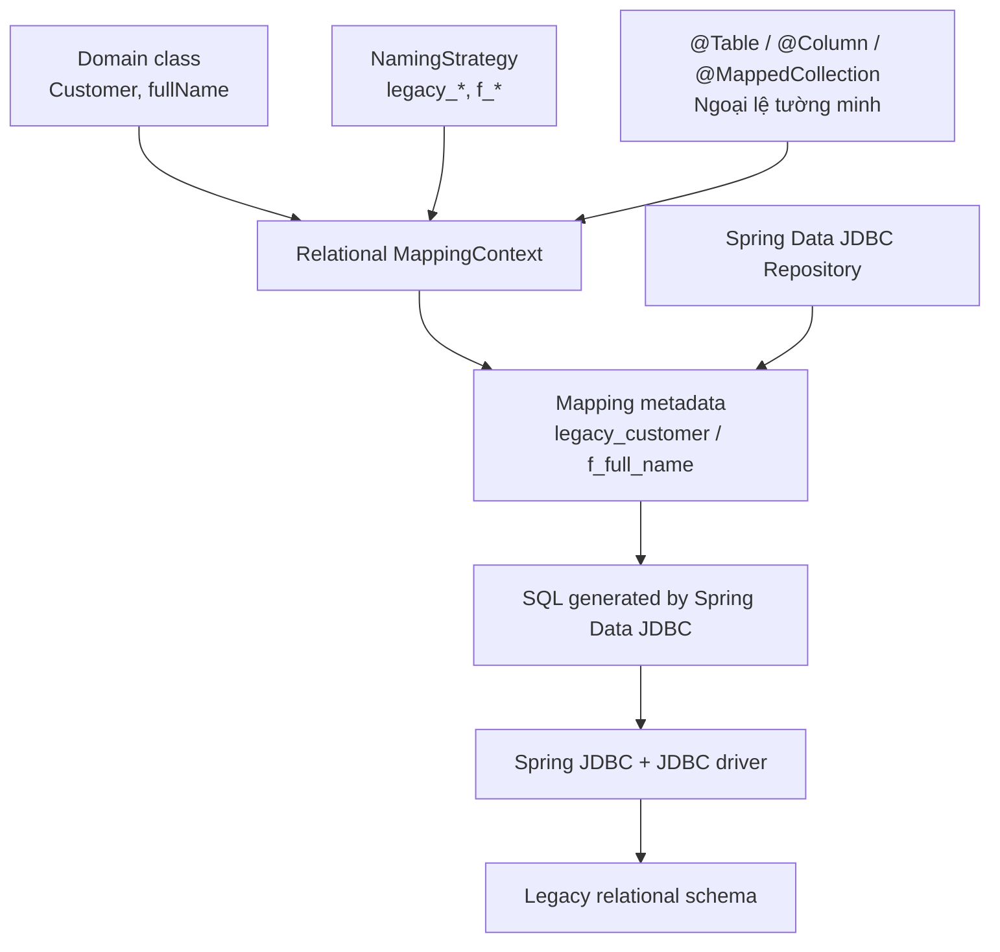

# Tùy chỉnh NamingStrategy cho schema có sẵn

Khi ứng dụng Spring Data JDBC kết nối với một **cơ sở dữ liệu đã tồn tại**, tên bảng và cột thường không được đặt theo quy ước mặc định của framework. Một hệ thống cũ có thể dùng tiền tố cho mọi bảng, cột viết hoa, tên viết tắt của nghiệp vụ, cột khóa ngoại theo quy định của DBA hoặc schema được nhiều ứng dụng sử dụng chung.

Nếu chỉnh sửa tên bảng trong database không khả thi, ứng dụng cần điều chỉnh **quy tắc ánh xạ tên** giữa Java và SQL. **`NamingStrategy`** của Spring Data Relational giải quyết trường hợp các tên tuân theo một **quy luật chung**; các annotation như `@Table`, `@Column` và `@MappedCollection` xử lý trường hợp ngoại lệ.

Bài học hướng dẫn cách thiết kế và đăng ký `NamingStrategy` cho Spring Data JDBC, cách kết hợp với mapping tường minh và cách xác nhận ứng dụng truy cập đúng schema legacy.

## 1. Vì sao schema có sẵn cần NamingStrategy?

Giả sử ứng dụng quản lý khách hàng có lớp Java:

```java
public record Customer(
    Long id,
    String fullName,
    String contactEmail
) {}
```

Trong khi nhóm vận hành đã tạo bảng theo quy ước cũ:

```sql
CREATE TABLE legacy_customer (
    f_id BIGINT GENERATED BY DEFAULT AS IDENTITY PRIMARY KEY,
    f_full_name VARCHAR(160) NOT NULL,
    f_contact_email VARCHAR(255) NOT NULL UNIQUE
);
```

Tên trong Java và database không trùng nhau:

| Thành phần Java | Tên thực tế trong database |
| --- | --- |
| Class `Customer` | Bảng `legacy_customer` |
| Field `id` | Cột `f_id` |
| Field `fullName` | Cột `f_full_name` |
| Field `contactEmail` | Cột `f_contact_email` |

Hai quy luật có thể nhận thấy:

1. Tên bảng dùng `legacy_` + tên class theo `snake_case`.
2. Tên cột dùng `f_` + tên field theo `snake_case`.

Nếu có hàng chục bảng áp dụng quy tắc này, lặp lại `@Table` và `@Column` cho tất cả class/field rất dễ tốn công và khó duy trì. `NamingStrategy` cho phép mô tả quy luật tại một chỗ, để hạ tầng ánh xạ quan hệ sử dụng nhất quán.

**Giới hạn cốt lõi:** `NamingStrategy` chỉ điều chỉnh cách tạo **tên identifier cho mapping**, không tạo bảng, không đổi schema vật lý và không tự viết lại tất cả SQL do lập trình viên cung cấp.

## 2. NamingStrategy nằm ở đâu trong Spring Data JDBC?

Ba thành phần trong hệ sinh thái Spring Data có vai trò riêng:

- **Spring Data Commons** cung cấp repository abstraction, các kiểu định danh và cơ sở hạ tầng chung.
- **Spring Data Relational** cung cấp `NamingStrategy` và metadata ánh xạ quan hệ như `@Table`, `@Column`, `@MappedCollection`.
- **Spring Data JDBC** dựa trên metadata đó để xây dựng thao tác đọc/ghi aggregate rồi thực thi SQL qua Spring JDBC và JDBC driver.



Spring Data Relational giữ metadata mô tả thực thể và thuộc tính; `NamingStrategy` là một nguồn để xác định tên mặc định của chúng. Khi repository thực hiện `save`, `findById` hoặc một truy vấn được dẫn xuất hỗ trợ, Spring Data JDBC dùng metadata đã được cấu hình để tìm đúng bảng/cột.

Ngược lại, khi tự viết:

```java
jdbcTemplate.queryForList("SELECT * FROM legacy_customer");
```

chuỗi SQL này do lập trình viên cung cấp. `NamingStrategy` **không biến đổi** nó thành SQL khác.

## 3. Quy tắc mặc định và vấn đề tên legacy

Không tùy chỉnh gì, Spring Data JDBC thường suy ra tên bảng từ class và tên cột từ property, đồng thời áp dụng quy tắc chuyển tên kiểu Java sang tên phù hợp với SQL như `camelCase` → `snake_case`. Việc biểu diễn chữ hoa/chữ thường hoặc quote identifier còn phụ thuộc dialect và database.

Với `Customer.fullName`, tên suy ra thông thường có dạng `customer.full_name`. Nhưng bảng legacy lại là `legacy_customer`, cột `f_full_name`. Hai bên không trùng nhau nên các lệnh truy cập có thể gặp lỗi như:

```text
relation "customer" does not exist
column "full_name" does not exist
invalid identifier
```

Thông báo chính xác khác nhau giữa PostgreSQL, MySQL, SQL Server, Oracle và các driver.

Trong thiết kế ánh xạ, cần phân biệt:

| Loại tên | Ví dụ | Ai quyết định? |
| --- | --- | --- |
| Tên Java class/property | `Customer.fullName` | Domain model |
| Tên bảng/cột được suy ra | `legacy_customer.f_full_name` | `NamingStrategy` hoặc annotation |
| Identifier được render trong câu SQL | `legacy_customer`, `"legacy_customer"`, ... | Hạ tầng SQL cùng dialect và quy tắc quoting |
| Tên vật lý thực tế | Tên có trong `CREATE TABLE` / database catalog | Schema đã tồn tại |

Không nên nhét dấu quote, tên đầy đủ có schema hoặc dấu phân cách tùy tiện vào chuỗi trả về của `NamingStrategy` rồi trông chờ mọi dialect xử lý giống nhau.

## 4. Thiết kế một NamingStrategy riêng cho schema legacy

`NamingStrategy` thuộc package:

```java
org.springframework.data.relational.core.mapping.NamingStrategy
```

Điểm mở rộng thường sử dụng gồm:

| Phương thức | Vai trò |
| --- | --- |
| `getTableName(Class<?> type)` | Tên bảng mặc định cho một kiểu domain. |
| `getColumnName(RelationalPersistentProperty property)` | Tên cột mặc định cho một property đơn giản. |
| `getReverseColumnName(RelationalPersistentProperty property)` | Tên cột tham chiếu ngược tới aggregate owner trong những quan hệ được ánh xạ. |
| `getKeyColumn(RelationalPersistentProperty property)` | Tên cột giữ key/index của các collection được ánh xạ. |
| `getSchema()` | Tên schema mặc định nếu chiến lược có cung cấp và cấu hình/dialect dùng đến. |

Các phương thức liên quan quan hệ collection cần được xem xét riêng: tên foreign key trong bảng con không nhất thiết tuân theo cùng quy luật với field bình thường. Nếu schema đang dùng tên đặc biệt, `@MappedCollection(idColumn = ..., keyColumn = ...)` thường dễ hiểu và an toàn hơn.

### 4.1. Một implementation áp dụng tiền tố thống nhất

Với quy tắc `legacy_` cho bảng và `f_` cho cột:

```java
package example.catalog.persistence;

import java.util.Locale;
import org.springframework.data.relational.core.mapping.NamingStrategy;
import org.springframework.data.relational.core.mapping.RelationalPersistentProperty;

public final class LegacyNamingStrategy implements NamingStrategy {

    @Override
    public String getTableName(Class<?> type) {
        return "legacy_" + toSnakeCase(type.getSimpleName());
    }

    @Override
    public String getColumnName(RelationalPersistentProperty property) {
        return "f_" + toSnakeCase(property.getName());
    }

    private static String toSnakeCase(String input) {
        String separated = input
            .replaceAll("([A-Z])([A-Z][a-z])", "$1_$2")
            .replaceAll("([a-z0-9])([A-Z])", "$1_$2");
        return separated.toLowerCase(Locale.ROOT);
    }
}
```

Ví dụ chuyển đổi:

| Đầu vào | `toSnakeCase` | Tên cuối cùng |
| --- | --- | --- |
| `Customer` (class) | `customer` | `legacy_customer` |
| `PurchaseOrder` (class) | `purchase_order` | `legacy_purchase_order` |
| `fullName` (field) | `full_name` | `f_full_name` |
| `contactEmail` (field) | `contact_email` | `f_contact_email` |
| `URLValue` (field) | `url_value` | `f_url_value` |

`Locale.ROOT` tránh việc quy tắc đổi chữ hoa/thường bị ảnh hưởng bởi locale của JVM. Hàm chuyển đổi trên phù hợp tên Java dạng camel/PascalCase thông thường; nếu hệ thống có nhiều acronym, Unicode hoặc quy tắc viết tắt ngoại lệ, cần thiết kế quy tắc tương ứng hoặc gắn annotation tường minh.

**Không hardcode mật khẩu hay tên bảng có tính nghiệp vụ đặc thù vào một phép biến đổi chung.** Ví dụ table `legacy_customer` khớp quy luật, nhưng `CUST_MST` và `CUSTOMER_DATA_2021` không thể suy ra đáng tin cậy chỉ từ class `Customer`.

### 4.2. Đăng ký chiến lược thành Spring bean

Trong ứng dụng Spring Boot có Spring Data JDBC starter, cấu hình một `NamingStrategy` bean:

```java
package example.catalog.persistence;

import org.springframework.context.annotation.Bean;
import org.springframework.context.annotation.Configuration;
import org.springframework.data.relational.core.mapping.NamingStrategy;

@Configuration(proxyBeanMethods = false)
public class LegacyRelationalMappingConfiguration {

    @Bean
    NamingStrategy namingStrategy() {
        return new LegacyNamingStrategy();
    }
}
```

Khi configuration được quét/nạp vào `ApplicationContext`, Spring Data JDBC sử dụng chiến lược tên được cấu hình để xây dựng metadata ánh xạ.

Nếu ứng dụng đã tự định nghĩa cấu hình repository bằng `AbstractJdbcConfiguration` hoặc nhiều `NamingStrategy` bean, cần kiểm soát rõ cách cấu hình đó chọn chiến lược; tránh vô tình để hai bean cạnh tranh hoặc tự khởi tạo mapping context khác với context mà repository sử dụng.

Đây là **một quyết định toàn cục cho mapping context liên quan**. Vì vậy không nên thêm bean chỉ để sửa tên của một entity duy nhất nếu các entity khác vẫn dựa vào quy ước mặc định.

### 4.3. Khai báo dependency tối thiểu

Với Spring Boot và Gradle Groovy:

```groovy
dependencies {
    implementation 'org.springframework.boot:spring-boot-starter-data-jdbc'
    runtimeOnly 'org.postgresql:postgresql'
}
```

Starter cung cấp Spring Data JDBC cùng Spring Data Relational và Spring Data Commons. Không cần thêm riêng artifact `spring-data-relational` chỉ để dùng interface `NamingStrategy` trong cấu hình starter thông thường.

Ứng dụng vẫn cần `DataSource` kết nối tới cơ sở dữ liệu có schema tương thích.

## 5. Sử dụng chiến lược trên entity và repository

Entity sử dụng Spring Data JDBC:

```java
package example.catalog.domain;

import org.springframework.data.annotation.Id;

public record Customer(
    @Id Long id,
    String fullName,
    String contactEmail
) {}
```

Không có `@Table` và `@Column`, các tên được suy ra qua `LegacyNamingStrategy`:

```text
Customer            -> legacy_customer
Customer.id         -> f_id
Customer.fullName   -> f_full_name
Customer.contactEmail -> f_contact_email
```

Repository:

```java
package example.catalog.domain;

import java.util.Optional;
import org.springframework.data.repository.ListCrudRepository;

public interface CustomerRepository
        extends ListCrudRepository<Customer, Long> {

    Optional<Customer> findByContactEmail(String contactEmail);
}
```

Service minh họa:

```java
package example.catalog.application;

import example.catalog.domain.Customer;
import example.catalog.domain.CustomerRepository;
import org.springframework.stereotype.Service;
import org.springframework.transaction.annotation.Transactional;

@Service
public class CustomerService {

    private final CustomerRepository customers;

    public CustomerService(CustomerRepository customers) {
        this.customers = customers;
    }

    @Transactional
    public Customer register(String name, String email) {
        Customer candidate = new Customer(null, name, email);
        return customers.save(candidate);
    }
}
```

Với schema `legacy_customer(f_id, f_full_name, f_contact_email)` tương ứng và cấu hình hợp lệ, Spring Data JDBC có thể lưu bản ghi mới và đọc lại qua repository. Khi database sinh ID, nên sử dụng object `save` trả về, đặc biệt với entity dạng `record` bất biến.

Khi khai báo query method `findByContactEmail`, hệ thống phân tích tên property `contactEmail` theo domain model và ánh xạ sang tên cột phù hợp. Trường hợp tên phương thức không thuộc mẫu được Spring Data JDBC hỗ trợ cần dùng query tường minh hoặc custom repository.

## 6. Khi tên không theo quy luật: dùng annotation tường minh

Không phải legacy schema nào cũng tuân theo một thuật toán đặt tên. Có thể gặp:

```sql
CREATE TABLE crm_customer_master (
    cust_no BIGINT PRIMARY KEY,
    cust_display VARCHAR(160) NOT NULL,
    e_mail VARCHAR(255) NOT NULL
);
```

Với các tên như `cust_no`, `cust_display`, `e_mail`, việc tạo một hàm suy luận từ `id`, `fullName`, `contactEmail` không đáng tin cậy. Cách đơn giản hơn là khai báo tường minh:

```java
import org.springframework.data.annotation.Id;
import org.springframework.data.relational.core.mapping.Column;
import org.springframework.data.relational.core.mapping.Table;

@Table("crm_customer_master")
public record Customer(
    @Id @Column("cust_no") Long id,
    @Column("cust_display") String fullName,
    @Column("e_mail") String contactEmail
) {}
```

Các annotation này xác định trực tiếp tên bảng/cột của entity. Chúng hữu ích khi chỉ có một vài ngoại lệ trong hệ thống vẫn dùng NamingStrategy chung, hoặc schema hoàn toàn không có quy luật có thể suy ra.

Quy tắc lựa chọn:

| Tình huống | Cách tiếp cận thường phù hợp |
| --- | --- |
| Nhiều bảng có cùng tiền tố và cùng quy ước đặt cột | `NamingStrategy` |
| Một vài bảng có tên riêng ngoài quy luật | `@Table` trên entity đó |
| Một vài cột viết tắt không thể suy ra | `@Column` trên property đó |
| Cột liên kết collection có tên đặc thù | `@MappedCollection(idColumn, keyColumn)` |
| Một truy vấn cần SQL JOIN hoặc biểu thức database đặc thù | `@Query` / custom query / `NamedParameterJdbcOperations` |
| Cần thay đổi tên bảng/cột vật lý trong database | Migration DDL, không phải `NamingStrategy` |

Lựa chọn hợp lý thường là **NamingStrategy cho quy luật phổ biến, annotation cho ngoại lệ**.

## 7. Quan hệ aggregate và cột khóa ngoại trong bảng con

Trong Spring Data JDBC, aggregate root có thể sở hữu các entity con. Khi đó bảng con thường chứa một cột tham chiếu tới root và đôi khi có cột giữ chỉ số/key của collection.

Giả sử schema đã tồn tại:

```sql
CREATE TABLE legacy_purchase_order (
    f_id BIGINT GENERATED BY DEFAULT AS IDENTITY PRIMARY KEY,
    f_customer_id BIGINT NOT NULL
);

CREATE TABLE legacy_order_line (
    f_id BIGINT GENERATED BY DEFAULT AS IDENTITY PRIMARY KEY,
    order_header_id BIGINT NOT NULL,
    line_seq INTEGER NOT NULL,
    f_sku VARCHAR(64) NOT NULL,
    f_quantity INTEGER NOT NULL,
    CONSTRAINT fk_line_to_order FOREIGN KEY (order_header_id)
        REFERENCES legacy_purchase_order(f_id)
);
```

Ứng dụng biểu diễn `PurchaseOrder` là root và `OrderLine` là phần tử con:

```java
import java.util.ArrayList;
import java.util.List;
import org.springframework.data.annotation.Id;
import org.springframework.data.relational.core.mapping.MappedCollection;

public class PurchaseOrder {

    @Id
    private Long id;

    private Long customerId;

    @MappedCollection(
        idColumn = "order_header_id",
        keyColumn = "line_seq"
    )
    private List<OrderLine> lines = new ArrayList<>();

    // Constructor, getter và hành vi miền được lược bớt.
}
```

```java
import org.springframework.data.annotation.Id;

public class OrderLine {

    @Id
    private Long id;

    private String sku;
    private int quantity;

    // Constructor và accessor được lược bớt.
}
```

Chiến lược ở phần 4 tiếp tục suy ra:

- `PurchaseOrder` → `legacy_purchase_order`, field `customerId` → `f_customer_id`.
- `OrderLine` → `legacy_order_line`, field `sku` → `f_sku`.
- `@MappedCollection(idColumn = "order_header_id")` chỉ ra cột tham chiếu từ bảng `legacy_order_line` tới root.
- `keyColumn = "line_seq"` chỉ ra cột giữ vị trí cho `List`.

Ở ví dụ này, tên foreign key `order_header_id` và tên thứ tự `line_seq` **không theo quy luật `f_`**. Ta khai báo tường minh để tránh suy luận sai.

### 7.1. Khi nào cần `getReverseColumnName` và `getKeyColumn`?

Nếu tất cả collection của mọi aggregate cùng theo một quy định riêng về tên cột back-reference và key, có thể cân nhắc ghi đè các phương thức tương ứng của `NamingStrategy`.

Tuy nhiên, cần hiểu metadata mà mỗi phương thức nhận được và kiểm tra quy tắc naming thực tế cho loại property/collection đang ánh xạ. Một prefix tên field thông thường không đủ để suy ra mọi bảng con. Ví dụ, root tên `PurchaseOrder` có thể dùng cột `po_id`, còn root `CustomerGroup` dùng `group_master_no`.

Trong schema legacy không nhất quán, cách rõ ràng là đặt `idColumn`/`keyColumn` tại chính collection, để người đọc mapping biết cột nào thực hiện quan hệ sở hữu.

**Lưu ý:** `@MappedCollection` mô tả một phần của **aggregate được root sở hữu**. Với một aggregate độc lập khác, nên dùng ID hoặc `AggregateReference` thay vì nhúng đối tượng đó như một child chỉ để tận dụng ánh xạ foreign key.

## 8. Tên schema, chữ hoa/chữ thường và identifier có quote

Tên **schema** trong RDBMS không đồng nghĩa với tên **database** trong JDBC URL.

Ví dụ PostgreSQL:

```sql
CREATE SCHEMA legacy_app;
CREATE TABLE legacy_app.legacy_customer (
    f_id BIGINT GENERATED BY DEFAULT AS IDENTITY PRIMARY KEY,
    f_full_name VARCHAR(160) NOT NULL,
    f_contact_email VARCHAR(255) NOT NULL UNIQUE
);
```

Có những cách cấu hình vị trí bảng tùy tình huống:

1. Định nghĩa schema trong mapping tại entity nếu annotation/phiên bản đang dùng hỗ trợ thuộc tính schema.
2. Sử dụng chiến lược naming có schema mặc định khi áp dụng nhất quán.
3. Thiết lập schema search path hoặc default schema của connection/database phù hợp.

Ví dụ triển khai chiến lược có tên schema mặc định:

```java
@Override
public String getSchema() {
    return "legacy_app";
}
```

Cần bảo đảm schema này tồn tại và tài khoản database được quyền sử dụng. Nếu database chưa có schema tương ứng, thay đổi NamingStrategy không thể tự tạo nó.

### 8.1. Case sensitivity

Một số RDBMS chuyển identifier **không được quote** về chữ thường hoặc chữ hoa; các identifier **có quote** thường giữ nguyên case. Ví dụ trên PostgreSQL:

```sql
CREATE TABLE LEGACY_CUSTOMER (...);
```

thực tế tạo bảng `legacy_customer` nếu không dùng dấu quote. Trong khi:

```sql
CREATE TABLE "LEGACY_CUSTOMER" (...);
```

tạo bảng có tên chữ hoa cần được tham chiếu bằng cách quote phù hợp.

Vì vậy, không nên đổi `getTableName` thành trả về `"LEGACY_CUSTOMER"` có sẵn dấu double quote chỉ để sửa một lỗi case. Hãy phân biệt **tên identifier** và **cách SQL dialect quote/render identifier**, rồi xác định chính xác tên trong database catalog.

### 8.2. Tên từ khóa và ký tự đặc biệt

Một số schema cũ đặt bảng/cột trùng từ khóa SQL hoặc chứa khoảng trắng. Những trường hợp này cần kiểm tra khả năng quote identifier của phiên bản Spring Data/dialect đang dùng, hoặc đặt tên tường minh phù hợp; tự nối ký tự quote trong chuỗi tên không phải giải pháp đa cơ sở dữ liệu.

Nếu schema do ứng dụng được quyền thay đổi, một migration chuẩn hóa tên có thể giảm chi phí duy trì về lâu dài. Nếu schema thuộc hệ thống chung, annotation/strategy phải tôn trọng hợp đồng hiện có.

## 9. NamingStrategy không đổi SQL viết tay

Giả sử repository có truy vấn:

```java
import java.util.Optional;
import org.springframework.data.jdbc.repository.query.Query;
import org.springframework.data.repository.ListCrudRepository;
import org.springframework.data.repository.query.Param;

public interface CustomerRepository
        extends ListCrudRepository<Customer, Long> {

    @Query("""
        SELECT f_id, f_full_name, f_contact_email
        FROM legacy_customer
        WHERE f_contact_email = :email
        """)
    Optional<Customer> findByEmailSql(@Param("email") String email);
}
```

Chuỗi SQL bên trong `@Query` dùng **tên bảng và cột vật lý** của schema. `NamingStrategy` không quét chuỗi để thay `Customer` thành `legacy_customer` hay `contactEmail` thành `f_contact_email`.

Tương tự, các công cụ sau vẫn chịu trách nhiệm riêng với SQL của chúng:

- `JdbcTemplate`, `NamedParameterJdbcTemplate` / `NamedParameterJdbcOperations`.
- File SQL initialization (`schema.sql`, `data.sql`).
- Migration Flyway/Liquibase.
- Stored procedure, view, function hoặc báo cáo SQL độc lập.

Khi cấu trúc schema thay đổi, có thể phải sửa cả code mapping lẫn SQL thủ công. Vì vậy, việc tập trung các quy tắc chung vào NamingStrategy không làm mất nhu cầu quản lý migration và query contract.

## 10. Thử nghiệm trên schema hiện có

Để xác nhận mapping, cần một database thử nghiệm có cấu trúc giống schema mục tiêu. Có thể dùng PostgreSQL Testcontainers hoặc một database test được tạo từ chính bộ migration/schema legacy. Ví dụ dưới đây minh họa kiểm tra repository trên schema đã được tạo sẵn.

Một test slice cho Spring Data JDBC:

```java
import static org.assertj.core.api.Assertions.assertThat;

import example.catalog.domain.Customer;
import example.catalog.domain.CustomerRepository;
import example.catalog.persistence.LegacyRelationalMappingConfiguration;

import org.junit.jupiter.api.Test;
import org.springframework.beans.factory.annotation.Autowired;
import org.springframework.boot.test.autoconfigure.data.jdbc.DataJdbcTest;
import org.springframework.context.annotation.Import;

@DataJdbcTest
@Import(LegacyRelationalMappingConfiguration.class)
class LegacyCustomerRepositoryTest {

    @Autowired
    CustomerRepository customers;

    @Test
    void saveAndReadUsingExistingNames() {
        Customer saved = customers.save(
            new Customer(null, "Nguyen An", "an@example.test")
        );

        assertThat(saved.id()).isNotNull();

        Customer reloaded = customers.findById(saved.id())
            .orElseThrow();

        assertThat(reloaded.fullName()).isEqualTo("Nguyen An");
        assertThat(reloaded.contactEmail())
            .isEqualTo("an@example.test");
    }
}
```

Các điều kiện để test này có thể chạy:

- Test classpath có đúng JDBC driver và `DataSource` được cấu hình trỏ đến **database test**, không phải production.
- Bảng `legacy_customer` đã tồn tại với tên cột và kiểu dữ liệu đúng.
- Nếu dùng `@DataJdbcTest`, cần bảo đảm test context thực sự nạp cấu hình `LegacyRelationalMappingConfiguration`, như `@Import` ở trên.
- Nếu dùng Testcontainers PostgreSQL, cần cấu hình Spring Boot test không thay `DataSource` đã chọn bằng embedded database; có thể dùng `@AutoConfigureTestDatabase(replace = NONE)`.
- Test database phải cô lập, có cách reset dữ liệu/rollback phù hợp với các thao tác test.

Đây là ví dụ minh họa về kiểm thử mapping. Một ứng dụng hoàn chỉnh có thể cần thêm migration, test configuration, JDBC URL, PostgreSQL driver và khởi tạo dữ liệu.

### 10.1. Đối chiếu từng lớp mapping

Khi xuất hiện lỗi “table/column not found”, hãy lần theo các bước sau:

| Câu hỏi | Cách đối chiếu |
| --- | --- |
| Ứng dụng đang kết nối database/schema nào? | Kiểm tra `spring.datasource.url`, user, default schema và active profile. |
| Entity nào là aggregate root? | Kiểm tra class sử dụng bởi repository. |
| Tên bảng được lấy từ đâu? | `@Table` hoặc `getTableName`. |
| Cột property có annotation riêng không? | `@Column` hoặc `getColumnName`. |
| Collection con có cột quan hệ đặc thù không? | `@MappedCollection`, `getReverseColumnName`, `getKeyColumn`. |
| Query được framework sinh hay SQL viết tay? | Phân biệt CRUD/derived query với `@Query`/`JdbcTemplate`. |
| Database có dùng identifier quoted/case sensitive không? | Đối chiếu DDL và metadata trong database catalog. |

Khi cần quan sát SQL do framework gửi đi, có thể bật logging phù hợp với Spring JDBC/driver trong **môi trường kiểm thử**. Lưu ý log SQL và giá trị bind parameter có thể chứa dữ liệu nhạy cảm, nên dùng fixtures giả lập và không bật mức log chi tiết bừa bãi trên production.

## 11. Chiến lược migration khi đã có nhiều bảng legacy

Với schema lớn, nên chọn mức độ tùy chỉnh phù hợp thay vì đưa toàn bộ mapping vào một hàm chứa hàng trăm điều kiện `if`:

### 11.1. Quy luật toàn cục

Nếu đại đa số bảng đều có mẫu `T_...` và cột đều có mẫu `C_...`, tạo một `NamingStrategy` thuần quy tắc. Ưu điểm là dễ đọc, dễ áp dụng và dễ điều chỉnh tập trung.

### 11.2. Quy luật chung với một số ngoại lệ

Dùng NamingStrategy cho tên thông thường; riêng `CUSTOMER_MASTER`, `EXT_ORDER_NO` hay cột foreign key không chuẩn thì khai báo `@Table`, `@Column`, `@MappedCollection` tương ứng. Các ngoại lệ nằm sát entity nên dễ truy vết.

### 11.3. Hầu hết tên không tuân quy luật

Nếu mỗi bảng là một kiểu viết tắt khác nhau, việc đưa tất cả vào NamingStrategy thường làm mã khó hiểu. Tên tường minh trong annotation có thể rõ ràng hơn. Nếu cần mapping phức tạp tới nhiều schema, nhiều nguồn dữ liệu hay bảng runtime, cần đánh giá kiến trúc repository/DataSource thay vì kỳ vọng một NamingStrategy giải quyết mọi trường hợp.

### 11.4. Thay đổi quy luật ảnh hưởng nhiều entity

`NamingStrategy` là cấu hình dùng chung. Một thay đổi từ `f_` sang `col_` có thể ảnh hưởng hàng chục repository. Vì vậy thay đổi này cần được xem như **thay đổi hợp đồng persistence**, phối hợp với migration/schema và kiểm tra thực tế ở bước triển khai thích hợp.

## 12. Những nhầm lẫn thường gặp

### “Chỉ cần sửa `@Column` trên một field là mọi field dùng quy luật mới?”

Không. `@Column` áp dụng cho property được khai báo. Các property còn lại vẫn dùng tên suy ra từ `NamingStrategy` hoặc cấu hình khác.

### “NamingStrategy có thể tự đổi tên database và tạo bảng?”

Không. Nó chỉ cung cấp tên cho mapping. DDL/schema phải được quản lý riêng bằng công cụ database/migration.

### “NamingStrategy tự đổi cả SQL trong `@Query`?”

Không. Với SQL viết tay, bạn phải dùng tên thực tế của bảng/cột hoặc chủ động xây một abstraction query khác.

### “Có thể gắn `@Table` cho một lớp và vẫn dùng NamingStrategy cho các cột của lớp đó?”

Có. Tên bảng đã được khai báo tường minh, còn các cột không có `@Column` vẫn có thể sử dụng NamingStrategy. Điều này cho phép xử lý những ngoại lệ riêng lẻ mà không bỏ chiến lược chung.

### “NamingStrategy quyết định foreign key của mọi quan hệ?”

Không phải mọi quan hệ của database đều là quan hệ sở hữu của aggregate Spring Data JDBC. `@MappedCollection` và các phương thức naming liên quan giúp ánh xạ thành phần con; aggregate độc lập thường được tham chiếu bằng ID. Các quan hệ phức tạp hoặc truy vấn JOIN thủ công vẫn cần xử lý đúng ý nghĩa domain và schema.

### “Không nhìn thấy bean NamingStrategy có nghĩa framework không dùng NamingStrategy?”

Không. Spring Data Relational có chiến lược đặt tên mặc định. Bean tùy chỉnh chỉ cần thiết khi schema thực tế khác quy luật mặc định hoặc muốn chủ động kiểm soát quy tắc.

## 13. Ví dụ tổng hợp: quy luật chung và ngoại lệ

Một hệ thống CRM có hai bảng:

```sql
CREATE TABLE legacy_customer (
    f_id BIGINT GENERATED BY DEFAULT AS IDENTITY PRIMARY KEY,
    f_full_name VARCHAR(160) NOT NULL,
    f_contact_email VARCHAR(255) NOT NULL
);

CREATE TABLE legacy_customer_note (
    f_id BIGINT GENERATED BY DEFAULT AS IDENTITY PRIMARY KEY,
    f_customer_id BIGINT NOT NULL,
    memo_text VARCHAR(1000) NOT NULL
);
```

Trong Java:

```java
import org.springframework.data.annotation.Id;
import org.springframework.data.relational.core.mapping.Column;

public record CustomerNote(
    @Id Long id,
    Long customerId,
    @Column("memo_text") String text
) {}
```

Với `LegacyNamingStrategy`:

| Entity/property | Cách xác định | Tên trong database |
| --- | --- | --- |
| `CustomerNote` | `getTableName` | `legacy_customer_note` |
| `id` | `getColumnName` | `f_id` |
| `customerId` | `getColumnName` | `f_customer_id` |
| `text` | `@Column("memo_text")` | `memo_text` |

Một cột đặc thù được khai báo tường minh, trong khi toàn bộ mapping còn lại dùng quy luật thống nhất. Cách này ít lặp code hơn việc gắn annotation cho tất cả property và minh bạch hơn việc đưa ngoại lệ `memo_text` vào một quy tắc toàn cục phức tạp.

**Cần phân biệt `customerId` trong `CustomerNote` với collection sở hữu:** trong ví dụ này, `CustomerNote` có thể được thiết kế là aggregate riêng tham chiếu tới khách hàng qua ID. Nếu `CustomerNote` thực sự là con của aggregate `Customer`, nên mô hình hóa ownership bằng mapping collection phù hợp, đồng thời xử lý cột tham chiếu và vòng đời con theo semantics Spring Data JDBC.

## 14. Nguyên tắc áp dụng trong dự án thật

Khi đưa một schema có sẵn vào Spring Data JDBC:

1. **Đọc DDL thật** và lập bảng đối chiếu class/property với table/column, bao gồm ID, foreign key, schema và cách đặt identifier.
2. **Tìm quy luật lặp lại** (tiền tố, hậu tố, camel/snake, viết hoa/chữ thường).
3. **Tạo NamingStrategy** chỉ cho quy luật đủ ổn định, tránh biến nó thành danh sách ngoại lệ khổng lồ.
4. **Gắn annotation** cho những tên không thể suy ra, đặc biệt là foreign key và key column của collection con.
5. **Đăng ký bean đúng context** của Spring Data JDBC và bảo đảm không có cấu hình cạnh tranh ngoài ý muốn.
6. **Đối chiếu bằng truy cập thật** trên database test chứa schema tương ứng; lưu ý các SQL viết tay và sự khác nhau giữa các dialect.
7. **Giữ quyền sở hữu schema rõ ràng**: cập nhật DDL/migration và mapping cùng nhau khi hợp đồng database thay đổi.

> **`NamingStrategy` là quy tắc chuyển đổi tên ở tầng Spring Data Relational; `@Table`, `@Column` và `@MappedCollection` giúp ghi đè từng ngoại lệ.** Với Spring Data JDBC và schema có sẵn, thiết kế tốt là tôn trọng tên vật lý hiện hữu, giữ quy luật nhất quán và xác nhận mapping trên database thực tế.

### Tài liệu tham khảo

- [Spring Data Relational — Reference Documentation](https://docs.spring.io/spring-data/relational/reference/): nền tảng ánh xạ quan hệ.
- [Spring Data JDBC — Object Mapping](https://docs.spring.io/spring-data/relational/reference/jdbc/mapping.html): quy tắc ánh xạ object, bảng và cột.
- [Spring Data JDBC — Custom Conversions and Mapping](https://docs.spring.io/spring-data/relational/reference/jdbc/mapping.html): mở rộng mapping khi tích hợp schema có sẵn.
- [Spring Boot — SQL Databases](https://docs.spring.io/spring-boot/reference/data/sql.html): kết nối datasource và cơ chế khởi tạo schema.
