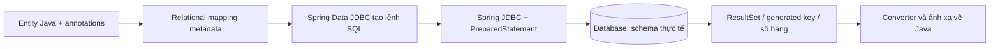

# Đối chiếu metadata ánh xạ với DDL và câu SQL thực tế

Trong **Spring Data JDBC**, một class Java được ánh xạ thành bảng và cột của cơ sở dữ liệu thông qua metadata của Spring Data Relational. Nhưng metadata chỉ mô tả **Spring Data sẽ đọc, ghi ở đâu và như thế nào**; chính database mới quyết định bảng có tồn tại không, cột có đúng kiểu không, khóa có hợp lệ không và câu SQL có chạy được không.

Vì vậy, khi xây dựng hoặc sửa một entity, cần đối chiếu **ba góc nhìn của cùng một mô hình dữ liệu**:

1. **Metadata ánh xạ**: class, thuộc tính, `@Table`, `@Id`, `@Column`, `@Transient` và các quy ước tên.
2. **DDL (Data Definition Language)**: `CREATE TABLE`, kiểu cột, khóa chính, khóa ngoại, ràng buộc `NOT NULL`, `UNIQUE`, `CHECK`, index.
3. **SQL thực thi**: `SELECT`, `INSERT`, `UPDATE`, `DELETE` mà Spring Data JDBC tạo hoặc được lập trình viên khai báo qua `@Query`, bao gồm các tham số JDBC.

Chúng phải thống nhất với nhau: **thuộc tính Java → tên cột vật lý → giá trị SQL/JDBC → đối tượng Java trả về**. Bài học sử dụng một ví dụ xuyên suốt để chỉ cách đối chiếu và tìm nguyên nhân lỗi thay vì sửa thử từng annotation.

## 1. Metadata, DDL và SQL không đồng nghĩa

| Góc nhìn | Được định nghĩa ở đâu? | Chịu trách nhiệm | Không tự làm được |
|---|---|---|---|
| **Metadata Spring Data Relational** | Entity Java, annotation, naming strategy, custom converter | Xác định bảng/cột, ID, thuộc tính cần lưu, quy tắc chuyển kiểu | Không tự tạo hay cập nhật schema của Spring Data JDBC |
| **DDL database** | Migration SQL, `schema.sql`, công cụ quản trị DB | Tạo bảng/cột, kiểu dữ liệu, khóa và ràng buộc | Không tự quyết định entity Java có property nào |
| **SQL thao tác dữ liệu** | Spring Data JDBC tạo hoặc SQL tự viết | Đọc/ghi các cột cụ thể, bind tham số, nhận kết quả | Không bảo đảm đúng nếu metadata và DDL lệch nhau |

Ví dụ, `@Table("catalog_products")` làm cho Spring Data JDBC tìm bảng `catalog_products`; annotation ấy **không tương đương** với `CREATE TABLE catalog_products (...)`. Nếu bảng thật có tên `products`, repository vẫn cố truy vấn `catalog_products` và database báo không tìm thấy bảng.

Tương tự, `@Column("product_code")` cho biết thuộc tính Java cần dùng cột `product_code`. Nó không tự tạo cột đó, không chuyển đổi `product_code` thành `VARCHAR` và không tạo ràng buộc `UNIQUE`.



Điều quan trọng khi debug là nhận diện lỗi nằm ở **bên nào của ranh giới**: Spring Data đã chọn sai tên bảng/cột hay tên đúng nhưng database không có cấu trúc tương ứng?

## 2. Ví dụ chuẩn: bảng `catalog_products` và entity `Product`

Giả sử ứng dụng quản lý danh mục sản phẩm. Mỗi sản phẩm có mã SKU duy nhất, tên hiển thị, số lượng trong kho, trạng thái và ngày tạo.

### 2.1. DDL làm nguồn tham chiếu

Ví dụ sau dùng cú pháp tương thích với H2 cho bài thực hành. Các hệ quản trị khác có thể cần thay đổi cú pháp identity, kiểu dữ liệu hoặc cách quote identifier.

Đặt vào `src/main/resources/schema.sql`:

```sql
CREATE TABLE catalog_products (
    id BIGINT GENERATED BY DEFAULT AS IDENTITY PRIMARY KEY,
    product_code VARCHAR(40) NOT NULL,
    display_name VARCHAR(150) NOT NULL,
    stock_quantity INTEGER NOT NULL,
    status VARCHAR(20) NOT NULL,
    created_at TIMESTAMP NOT NULL,

    CONSTRAINT uq_catalog_products_code UNIQUE (product_code),
    CONSTRAINT ck_catalog_products_stock CHECK (stock_quantity >= 0)
);
```

DDL xác định các quy tắc vật lý:

- `id` là khóa chính kiểu `BIGINT`, có thể do database sinh khi `INSERT`.
- `product_code` không được `NULL`, tối đa 40 ký tự và phải duy nhất.
- `stock_quantity` là số nguyên không âm; ràng buộc `CHECK` bảo vệ dữ liệu ngay trong database.
- `status` được lưu dạng chuỗi tối đa 20 ký tự.
- `created_at` là timestamp bắt buộc; DDL này **chưa có `DEFAULT`**, nên khi insert ứng dụng phải cung cấp giá trị hợp lệ.

### 2.2. Entity mang metadata ánh xạ

Tạo `Product.java`:

```java
import java.time.LocalDateTime;
import org.springframework.data.annotation.Id;
import org.springframework.data.relational.core.mapping.Column;
import org.springframework.data.relational.core.mapping.Table;

enum ProductStatus {
    ACTIVE, ARCHIVED
}

@Table("catalog_products")
public record Product(
        @Id Long id,
        @Column("product_code") String sku,
        String displayName,
        int stockQuantity,
        ProductStatus status,
        LocalDateTime createdAt
) {}
```

Một `record` phù hợp ở đây vì Spring Data JDBC có thể dựng object qua constructor và tạo đối tượng mới khi cần gán khóa được sinh. `@Id` của Spring Data đến từ `org.springframework.data.annotation.Id`; không dùng `jakarta.persistence.Id` chỉ vì tên annotation giống nhau. `@Table` và `@Column` thuộc `org.springframework.data.relational.core.mapping`, không phải annotation JPA.

Các metadata cần chú ý:

- `@Table("catalog_products")` ghi rõ tên bảng, thay vì phụ thuộc tên bảng suy ra từ `Product`.
- `@Id Long id` đánh dấu thuộc tính định danh của aggregate root.
- `@Column("product_code") String sku` ánh xạ **tên Java khác tên cột**.
- `displayName`, `stockQuantity`, `createdAt` dùng quy tắc đặt tên mặc định để ánh xạ lần lượt tới `display_name`, `stock_quantity`, `created_at`.
- `ProductStatus` là `enum`; trong trường hợp ánh xạ thông dụng, tên enum như `ACTIVE` được lưu vào cột chuỗi `status`. Nếu muốn mã hóa enum theo cách khác, cần custom converter phù hợp.

Naming strategy mặc định của Spring Data Relational thường chuyển camel case sang snake case. Tuy nhiên, dự án có thể tùy biến strategy, còn database có quy tắc khác nhau về chữ hoa/chữ thường; đừng dựa hoàn toàn vào phỏng đoán tên cột khi cần xử lý lỗi thực tế.

### 2.3. Bảng đối chiếu từng thuộc tính

| Thuộc tính Java | Metadata/chiến lược | Cột DDL | Kiểu Java ↔ SQL | Điều kiện cần khớp |
|---|---|---|---|---|
| `id` | `@Id` | `id` | `Long` ↔ `BIGINT` | Khóa chính, cơ chế sinh ID tương thích |
| `sku` | `@Column("product_code")` | `product_code` | `String` ↔ `VARCHAR(40)` | Không null, unique, đủ độ dài |
| `displayName` | Tên suy ra | `display_name` | `String` ↔ `VARCHAR(150)` | Không null, đủ độ dài |
| `stockQuantity` | Tên suy ra | `stock_quantity` | `int` ↔ `INTEGER` | Không âm theo `CHECK` |
| `status` | Tên suy ra + enum conversion | `status` | `ProductStatus` ↔ `VARCHAR(20)` | Giá trị lưu và enum phải tương thích |
| `createdAt` | Tên suy ra | `created_at` | `LocalDateTime` ↔ `TIMESTAMP` | Không null, múi giờ và kiểu thời gian phù hợp |

Đây là **bảng đối chiếu vận hành**: mỗi hàng phải tìm được một thuộc tính Java và cột vật lý tương ứng. DDL còn có thể có cột do database quản lý hoặc bảng kỹ thuật không ánh xạ vào entity; điều đó không nhất thiết sai, miễn các lệnh do framework sinh ra vẫn hợp lệ.

## 3. Khởi tạo môi trường để nhìn thấy SQL thật

Ví dụ Gradle sử dụng Spring Boot với Spring Data JDBC và H2:

```groovy
dependencies {
    implementation 'org.springframework.boot:spring-boot-starter-data-jdbc'
    runtimeOnly 'com.h2database:h2'
}
```

Tạo `src/main/resources/application.yml`:

```yaml
spring:
  datasource:
    url: jdbc:h2:mem:mappingdemo;DB_CLOSE_DELAY=-1
    driver-class-name: org.h2.Driver
    username: sa
    password: ''
  sql:
    init:
      mode: always

logging:
  level:
    org.springframework.jdbc.core: DEBUG
    org.springframework.jdbc.core.StatementCreatorUtils: TRACE
```

`spring.sql.init.mode=always` yêu cầu chạy SQL initialization khi khởi động. Với H2 in-memory, các bảng được tạo lại khi database mới được dựng; nếu dùng database persistent, cần xử lý việc script `CREATE TABLE` chạy lặp hoặc dùng migration.

Để có dữ liệu đọc ngay, tạo `src/main/resources/data.sql`:

```sql
INSERT INTO catalog_products (
    product_code, display_name, stock_quantity, status, created_at
) VALUES (
    'BOOK-001', 'Spring JDBC Handbook', 12, 'ACTIVE',
    TIMESTAMP '2026-01-10 09:30:00'
);
```

Spring Boot chạy schema script rồi data script theo cơ chế khởi tạo SQL. `data.sql` không dùng các tên property Java như `sku` hay `displayName`: nó phải dùng **tên cột thực** trong DDL.

Mức `DEBUG` trên `org.springframework.jdbc.core` thường cho thấy các lệnh được thực thi qua Spring JDBC; mức `TRACE` trên `StatementCreatorUtils` có thể ghi thêm cách bind tham số. Log có thể khác giữa phiên bản và đường thực thi, và tham số có thể chứa dữ liệu nhạy cảm; nên bật chi tiết chủ yếu trong môi trường phát triển.

## 4. Từ repository đến `SELECT`: đối chiếu tên property với tên cột

Tạo repository:

```java
import java.util.Optional;
import org.springframework.data.repository.CrudRepository;

public interface ProductRepository extends CrudRepository<Product, Long> {
    Optional<Product> findBySku(String sku);
}
```

Gọi:

```java
Optional<Product> product = repository.findById(1L);
Optional<Product> bySku = repository.findBySku("BOOK-001");
```

### `findById(1L)`

Spring Data JDBC dựa vào `@Id`, `@Table` và tên cột đã ánh xạ để tạo truy vấn có ý nghĩa tương đương:

```sql
SELECT id, product_code, display_name, stock_quantity, status, created_at
FROM catalog_products
WHERE id = ?;
-- bind: 1
```

Database trả rows qua JDBC, rồi Spring Data chuyển từng giá trị thành đối tượng `Product`. Nếu không tìm thấy bản ghi, `findById` trả `Optional.empty()`; nếu có, trả `Optional<Product>` chứa dữ liệu đã ánh xạ.

### `findBySku("BOOK-001")`

**`Sku` trong tên phương thức là tên property Java**, được phân tích theo quy tắc query derivation. Metadata `@Column("product_code")` khiến điều kiện SQL sử dụng `product_code`:

```sql
SELECT id, product_code, display_name, stock_quantity, status, created_at
FROM catalog_products
WHERE product_code = ?;
-- bind: 'BOOK-001'
```

Đây là điểm khác biệt thường gây nhầm lẫn: ở **method repository**, viết `findBySku`; trong **SQL thuần**, viết `WHERE product_code = ...`. Nếu viết `findByProductCode` nhưng entity không có property `productCode`, Spring Data có thể không suy diễn được truy vấn dù database có cột `product_code`.

Các câu SQL minh họa thể hiện logic truy vấn; SQL framework sinh ra thực tế có thể có tên bảng trước tên cột, alias, dấu quote, thứ tự cột hoặc cú pháp đặc thù của dialect. Khi kiểm tra lỗi, so sánh **identifier và điều kiện SQL thật trong log** với DDL, thay vì đòi khớp từng ký tự ví dụ.

## 5. Từ `save` đến `INSERT`: đối chiếu các cột cần ghi

Với entity mới có `id == null`:

```java
Product draft = new Product(
        null,
        "BOOK-002",
        "Data Access Basics",
        8,
        ProductStatus.ACTIVE,
        LocalDateTime.of(2026, 2, 3, 14, 0)
);

Product saved = repository.save(draft);
Long generatedId = saved.id();
```

Với quy tắc nhận diện entity mới thông dụng, `@Id Long id` bằng `null` khiến Spring Data JDBC thực hiện `INSERT`. SQL minh họa:

```sql
INSERT INTO catalog_products (
    product_code, display_name, stock_quantity, status, created_at
) VALUES (?, ?, ?, ?, ?);

-- bind lần lượt:
-- 'BOOK-002', 'Data Access Basics', 8, 'ACTIVE',
-- 2026-02-03 14:00:00
```

Vì DDL khai báo `id` tự sinh, Spring Data JDBC có thể nhận generated key qua JDBC và trả lại `Product` với ID. Với `record` bất biến, hãy dùng **đối tượng trả về từ `save`**; `draft.id()` vẫn là `null` còn `saved.id()` là ID được cấp.

Những điểm cần đối chiếu:

1. **Bảng đích**: câu `INSERT` phải hướng đến `catalog_products`.
2. **Danh sách cột**: `sku` đi vào `product_code`, không phải một cột tên `sku`; `displayName` vào `display_name`.
3. **Số và thứ tự tham số**: mỗi `?` phải nhận đúng giá trị/kiểu JDBC; thứ tự thực tế lấy từ log hoặc cách framework xây câu lệnh.
4. **Generated ID**: DDL và cách xác định entity mới phải tương thích; nếu ID do ứng dụng cấp thì chiến lược cần được thiết kế khác.
5. **Ràng buộc database**: `stock_quantity < 0`, trùng `product_code`, `display_name` quá dài hoặc `created_at = NULL` sẽ bị database chặn theo schema.

Với một số database, `INSERT` có thể dùng cú pháp `RETURNING`, cách lấy generated key riêng hoặc trích dẫn tên cột đặc thù. Đây là chi tiết của dialect/driver; ý nghĩa ánh xạ vẫn giống nhau.

## 6. Từ `save` đến `UPDATE`: đối chiếu ID và ràng buộc

Đối tượng đã có ID thường được Spring Data JDBC coi là entity đã tồn tại, nên `save` đi theo nhánh cập nhật:

```java
Product current = repository.findById(1L).orElseThrow();

Product changed = new Product(
        current.id(),
        current.sku(),
        "Spring JDBC Handbook, 2nd Edition",
        15,
        current.status(),
        current.createdAt()
);

Product updated = repository.save(changed);
```

SQL có ý nghĩa tương đương:

```sql
UPDATE catalog_products
SET product_code = ?,
    display_name = ?,
    stock_quantity = ?,
    status = ?,
    created_at = ?
WHERE id = ?;
```

Spring Data JDBC **không có persistence context/dirty checking kiểu JPA**. Việc tạo `changed` không tự cập nhật database; cần gọi `save`. Trong thao tác cập nhật thông thường, framework ghi trạng thái được truyền vào chứ không nhất thiết chỉ ghi đúng property đã đổi. Do đó, khi một cột có `NOT NULL`, đối tượng gửi vào cần cung cấp dữ liệu hợp lệ cho các thuộc tính được ghi.

Đừng xem `save` là SQL `UPSERT` tự động. Nếu entity có ID nhưng bản ghi tương ứng không tồn tại, thao tác cập nhật có thể thất bại thay vì tự insert, tùy quy tắc trạng thái và cơ chế kiểm tra kết quả cập nhật.

Nếu entity có `@Version`, DDL cần thêm cột version tương ứng và lệnh cập nhật có thể kiểm tra cả ID lẫn version cũ để phát hiện xung đột ghi đồng thời:

```sql
-- Minh họa khi có cột version và @Version trên entity.
UPDATE catalog_products
SET display_name = ?, version = ?
WHERE id = ? AND version = ?;
```

Ở ví dụ nền tảng, `Product` chưa có `@Version`, nên không được kỳ vọng điều kiện version xuất hiện trong SQL. **Thêm annotation mà không cập nhật DDL** thường sẽ tạo lỗi thiếu cột.

## 7. `@Query`: SQL viết tay phải dùng tên bảng/cột thật

Với derived query, framework chuyển **tên property Java** thành cột vật lý. Với `@Query` chứa SQL thuần, người viết phải dùng **identifier của database**:

```java
import java.util.List;
import org.springframework.data.jdbc.repository.query.Query;
import org.springframework.data.repository.query.Param;

public interface ProductRepository extends CrudRepository<Product, Long> {

    @Query("""
        SELECT id, product_code, display_name, stock_quantity,
               status, created_at
        FROM catalog_products
        WHERE stock_quantity >= :minimumStock
        ORDER BY product_code
        """)
    List<Product> findWithMinimumStock(
            @Param("minimumStock") int minimumStock);
}
```

Trong SQL này:

- `catalog_products`, `product_code`, `stock_quantity` là tên **database**, không phải tên class/property.
- `:minimumStock` là tên tham số được bind vào truy vấn; nó **không phải** tên cột.
- `Product` cần các cột tương ứng với constructor của record để dựng object đúng cách. Thiếu cột cần thiết trong custom query có thể dẫn đến lỗi ánh xạ hoặc giá trị không mong muốn.

Đặt câu SQL kiểu `SELECT sku, displayName FROM Product` theo thói quen JPQL sẽ sai khi dùng `@Query` của Spring Data JDBC. Đây là **SQL trực tiếp**, không phải JPQL/HQL. Khi muốn trả về một DTO/projection giới hạn cột, thiết kế kiểu kết quả và mapping cho phù hợp thay vì ép một row thiếu dữ liệu thành full aggregate.

## 8. Xem metadata mà Spring Data thực sự xây dựng

Chỉ đọc source code entity đôi khi không đủ để biết tên cột cuối cùng, đặc biệt khi dự án có **custom naming strategy** hoặc các annotation ánh xạ đặt trên trường/constructor. Có thể truy cập `RelationalMappingContext` để nhìn tên mà Spring Data Relational đã nhận diện.

Ví dụ một `ApplicationRunner` in thông tin ánh xạ:

```java
import org.springframework.boot.ApplicationRunner;
import org.springframework.context.annotation.Bean;
import org.springframework.context.annotation.Configuration;
import org.springframework.data.relational.core.mapping.RelationalMappingContext;
import org.springframework.data.relational.core.mapping.RelationalPersistentEntity;
import org.springframework.data.relational.core.mapping.RelationalPersistentProperty;

@Configuration
class MappingDiagnosticsConfiguration {

    @Bean
    ApplicationRunner inspectProductMapping(RelationalMappingContext context) {
        return args -> {
            RelationalPersistentEntity<?> entity =
                    context.getRequiredPersistentEntity(Product.class);

            System.out.println("Table mapping: " + entity.getTableName());

            for (RelationalPersistentProperty property : entity) {
                System.out.printf(
                        "%s -> %s%s%n",
                        property.getName(),
                        property.getColumnName(),
                        property.isIdProperty() ? " [ID]" : ""
                );
            }
        };
    }
}
```

Kết quả về mặt ý nghĩa phải giúp xác định mapping như `sku → product_code`, `displayName → display_name`, `id → id`. Đối tượng `SqlIdentifier` được in ra đại diện cho tên trong metadata; **SQL chính xác với quote/case** vẫn cần được đối chiếu ở log truy vấn thực thi và dialect.

Trong dự án có `@Transient`, property bị loại khỏi mapping persistent có thể không xuất hiện khi duyệt các thuộc tính bền vững. Với quan hệ collection/embedded, thông tin metadata nhiều tầng hơn và không nên mặc định mỗi property tương ứng một cột đơn giản.

## 9. Xem schema thực sự của database, không chỉ file `schema.sql`

File `schema.sql` là ý định tạo schema. Schema hiện tại có thể khác vì migration đã chạy trước đó, phiên bản ứng dụng khác, profile khác, hoặc ứng dụng đang trỏ tới database khác.

Trên H2, có thể xem danh sách cột bằng:

```sql
SELECT TABLE_NAME, COLUMN_NAME, DATA_TYPE, IS_NULLABLE
FROM INFORMATION_SCHEMA.COLUMNS
WHERE TABLE_SCHEMA = 'PUBLIC'
  AND TABLE_NAME = 'CATALOG_PRODUCTS'
ORDER BY ORDINAL_POSITION;
```

Trên database khác, dùng `information_schema`, lệnh mô tả bảng của DBMS hoặc công cụ quản trị để kiểm tra tên, kiểu, nullability, khóa và index. Ví dụ PostgreSQL hỗ trợ truy vấn `information_schema.columns`; MySQL và SQL Server có những khác biệt về catalog/schema và hiển thị kiểu.

Các câu hỏi kiểm tra:

1. Ứng dụng **đang kết nối database/schema nào**? Kiểm tra JDBC URL, database name, schema/search path và profile đang chạy.
2. Bảng vật lý có đúng tên mà metadata trỏ tới không?
3. Tất cả cột trong lệnh `SELECT`/`INSERT`/`UPDATE` có tồn tại không?
4. Kiểu JDBC có chuyển được thành kiểu Java mong muốn không? `NULL` có phù hợp với primitive như `int` không?
5. `PRIMARY KEY`, `FOREIGN KEY`, `UNIQUE`, `CHECK`, `DEFAULT` và độ dài cột có khớp quy tắc nhập liệu không?
6. Nếu cột ID database sinh, lệnh `INSERT` và cấu hình identity/sequence có hỗ trợ lấy khóa sinh về không?

Nếu kết quả query cấu trúc database khác với file SQL đang mở, cần tìm **nguồn schema hiện đang có hiệu lực**: migration, container database cũ, schema khác hoặc script không được thực thi.

## 10. Xem SQL runtime và giá trị bind

Spring Data JDBC tạo SQL từ metadata entity, truy vấn repository và **dialect** tương ứng hệ quản trị. Spring JDBC dùng `PreparedStatement` và các tham số được bind. Vì vậy, nhìn SQL với dấu `?` chưa đủ để biết toàn bộ thao tác.

Ví dụ log minh họa:

```text
Executing prepared SQL statement [SELECT ... FROM catalog_products WHERE product_code = ?]
Setting SQL statement parameter value: column index 1, parameter value [BOOK-001]
```

Đây chỉ là **dạng log minh họa**, không phải nguyên văn cam kết từ một phiên bản framework cụ thể. Khi kiểm tra, đối chiếu cả SQL và bind:

| Quan sát runtime | Cần đối chiếu với gì? | Sai lệch thường gặp |
|---|---|---|
| `FROM catalog_products` | `@Table` và bảng vật lý | Sai tên bảng, sai schema |
| `WHERE product_code = ?` | `@Column`, DDL, repository method | Nhầm `sku` với `product_code` |
| `SET display_name = ?` | Property `displayName` và kiểu cột | Giá trị null hoặc quá độ dài |
| `INSERT ... created_at ...` | Kiểu thời gian và `NOT NULL` | Không truyền giá trị cần thiết |
| `WHERE id = ?` | `@Id` và khóa chính | ID sai hoặc entity chưa tồn tại |
| `?` được bind chuỗi/number/time | Converter + JDBC driver | Sai kiểu hoặc định dạng dữ liệu |

Việc log parameter ở `TRACE` có thể tiết lộ email, token, thông tin khách hàng hoặc dữ liệu nghiệp vụ; chỉ bật trong môi trường kiểm soát và tắt khi không cần. Với công cụ quan sát SQL bổ sung, cần nhớ sự khác nhau giữa **SQL đã bind** và **SQL chứa literal**: framework vẫn thường truyền giá trị dưới dạng tham số, dù công cụ hiển thị câu SQL dễ đọc hơn.

## 11. Khi nào `@Column`, `@Transient` và converter tác động đến SQL?

### Đổi tên cột bằng `@Column`

Nếu Java đổi tên `sku` thành `productCode` nhưng database giữ nguyên `product_code`, có thể ánh xạ tường minh:

```java
@Column("product_code")
private String productCode;
```

Lệnh SQL vẫn dùng `product_code`. Ngược lại, nếu DDL thực sự đổi tên cột từ `product_code` sang `sku_code`, cần sửa metadata hoặc migration tương ứng. Đổi tên field Java và đổi tên cột database là **hai quyết định khác nhau**.

### Loại thuộc tính khỏi ánh xạ bằng `@Transient`

Một trường phục vụ giao diện hoặc tính toán tạm không nhất thiết là cột trong database:

```java
import org.springframework.data.annotation.Transient;

@Transient
private String displayLabel;
```

Khi được đánh dấu `@Transient` theo Spring Data, trường này không tham gia ánh xạ persistent thông thường, vì thế không được kỳ vọng có cột `display_label` trong `SELECT`/`INSERT`/`UPDATE` do framework tạo. Chú ý phân biệt `org.springframework.data.annotation.Transient` với cơ chế Java `transient` và annotation của JPA.

### Custom conversion tác động đến giá trị, không tự đổi DDL

Giả sử muốn lưu một `Money` value object vào cột `DECIMAL(18,2)` hoặc mã hóa enum theo mã riêng (`A`, `R`) thay vì `ACTIVE`, `ARCHIVED`. Có thể dùng converter đọc/ghi của Spring Data JDBC để chuyển đổi giữa object và kiểu lưu trữ được JDBC hỗ trợ.

```text
Java property             Converter               SQL column
Money(125.50, VND)   ->   giá trị DECIMAL    ->   amount DECIMAL(18, 2)
```

Converter phải phù hợp cả chiều ghi và đọc. Đăng ký converter không tự thêm cột `amount`, không tự tăng precision của `DECIMAL` và không thay thế migration. Nếu cột chỉ chứa phần số tiền, metadata/mô hình phải có cách bảo toàn hoặc xác định đơn vị tiền tệ; không nên mặc định `Money` có thể khôi phục đủ thông tin nếu dữ liệu lưu không chứa currency.

### Embedded object cũng cần cột vật lý

Nếu một value object được nhúng bằng `@Embedded` theo Spring Data Relational, các property bên trong thường được trải thành các cột trong bảng của root (có thể kèm tiền tố). Ví dụ địa chỉ có `street`, `city` với prefix `shipping_` đòi bảng sở hữu có cột tương ứng như `shipping_street`, `shipping_city`. Không phải vì Java có một object `Address` mà database cần có một cột JSON `address`.

`@Embedded` có các lựa chọn về cách dựng object khi các cột đều null; nên chọn cấu hình tương thích với nullability thực tế trong DDL và constructor của value object. Nếu prefix hoặc tên trường thay đổi, câu SQL có thể trỏ sang tên cột khác ngay cả khi schema không thay đổi.

## 12. Ánh xạ quan hệ: kiểm tra cả cột khóa ngoại và bảng child

Spring Data JDBC xử lý aggregate theo **quan hệ sở hữu**. Với collection bên trong aggregate, `@MappedCollection` định nghĩa các cột như khóa về root hoặc chỉ số phần tử, nên cần đối chiếu **nhiều bảng**.

Ví dụ đơn hàng có danh sách dòng hàng:

```java
import java.util.List;
import org.springframework.data.annotation.Id;
import org.springframework.data.relational.core.mapping.MappedCollection;
import org.springframework.data.relational.core.mapping.Table;

@Table("orders")
public record Order(
        @Id Long id,
        @MappedCollection(idColumn = "order_id", keyColumn = "line_index")
        List<OrderLine> lines
) {}

@Table("order_lines")
public record OrderLine(String sku, int quantity) {}
```

DDL minh họa:

```sql
CREATE TABLE orders (
    id BIGINT GENERATED BY DEFAULT AS IDENTITY PRIMARY KEY
);

CREATE TABLE order_lines (
    order_id BIGINT NOT NULL,
    line_index INTEGER NOT NULL,
    sku VARCHAR(40) NOT NULL,
    quantity INTEGER NOT NULL,
    PRIMARY KEY (order_id, line_index),
    FOREIGN KEY (order_id) REFERENCES orders(id)
);
```

Ở đây `order_id` là cột liên hệ về root, `line_index` biểu diễn vị trí trong `List` và các cột `sku`, `quantity` chứa dữ liệu dòng hàng. Nếu tên `idColumn` trong annotation là `order_id` nhưng DDL đặt `purchase_order_id`, các truy vấn quản lý collection sẽ lỗi. Một lần `save(order)` có thể cần **nhiều câu SQL** để ghi root và các child; trong cập nhật aggregate, framework có thể thay thế nhiều hàng child thay vì cập nhật từng field tối thiểu.

Lưu ý rằng khóa ngoại SQL **không đồng nghĩa** mọi quan hệ phải dùng `@MappedCollection`. Nếu `Order` chỉ tham chiếu aggregate `Customer` độc lập, lưu một `customerId`/`AggregateReference` thường phù hợp hơn việc nhúng cả `Customer` thành object con được `save(order)` quản lý.

## 13. Lỗi thường gặp và cách lần ngược từ SQL về mapping

| Thông báo hoặc hiện tượng | Kiểm tra metadata | Kiểm tra DDL/SQL | Cách xử lý phù hợp |
|---|---|---|---|
| *Table not found* | `@Table`, tên schema, naming strategy | Tên bảng thực tế, schema/search path | Sửa đúng bảng/schema hoặc migration tạo bảng |
| *Column not found* | `@Column`, tên suy ra, `@Embedded` prefix | Cột trong `SELECT`/`UPDATE` có tồn tại? | Đồng bộ tên vật lý và mapping |
| `findByProductCode` không suy diễn được | Property Java có tên `productCode` không? | Không liên quan tới việc DB có cột `product_code` | Đổi phương thức theo property thật hoặc viết `@Query` |
| SQL tự viết `WHERE sku = ...` lỗi | `sku` được ánh xạ sang `product_code`? | SQL thuần cần cột `product_code` | Viết identifier vật lý trong `@Query` |
| *NOT NULL violation* | Property có thể null không, có bỏ qua cột không? | Cột bắt buộc, `DEFAULT`, giá trị bind | Truyền giá trị hợp lệ hoặc điều chỉnh schema có chủ đích |
| *Duplicate key / unique violation* | ID, property `sku` | `PRIMARY KEY`, `UNIQUE`, giá trị bind | Kiểm tra dữ liệu trùng và quy tắc nghiệp vụ |
| Lỗi đọc enum | Enum và converter | Giá trị chuỗi thực tế trong cột | Đồng bộ giá trị lưu và cách giải mã |
| Thời gian bị lệch hoặc sai kiểu | `LocalDateTime`/`Instant` và converter | `TIMESTAMP` vs kiểu có timezone, driver | Chọn mô hình thời gian thống nhất |
| Lỗi `INSERT` ID hoặc ID không trở về | `@Id`, quy tắc entity mới | `IDENTITY`, `SEQUENCE`, generated key | Đồng bộ chiến lược sinh ID |
| Lỗi ánh xạ constructor/record | Tên/tham số constructor, property | Các cột được `SELECT`, kiểu và nullability | Sửa constructor/mapping hoặc truy vấn tùy chỉnh |
| Thiếu `version` trong SQL | Có `@Version` không? | DDL đã có cột version chưa? | Migration thêm cột phù hợp |
| Mất dữ liệu child sau `save` | `@MappedCollection`, đường sở hữu aggregate | SQL thao tác bảng con, khóa tham chiếu | Xem lại aggregate root và cấu trúc collection |

Một cách điều tra có hệ thống là đi từ **lệnh lỗi gần nhất**:

```text
Exception / SQL trong log
       |
       v
Xác định bảng, cột, điều kiện WHERE và tham số thật
       |
       v
Đối chiếu schema database đang kết nối
       |
       v
Đối chiếu @Table, @Column, @Id, converter, naming strategy
       |
       v
Sửa metadata hoặc thay đổi schema qua script/migration
       |
       v
Chạy lại thao tác nghiệp vụ bị ảnh hưởng
```

Không nên chữa lỗi *column not found* bằng cách thêm cột ngẫu nhiên nếu nguyên nhân là ứng dụng đang dùng sai schema. Tương tự, nếu SQL `INSERT` hợp lệ nhưng bị `CHECK` từ chối, metadata vẫn có thể đúng; cần sửa dữ liệu đầu vào hoặc quy tắc nghiệp vụ.

## 14. Thay đổi schema và kiểm soát tương thích

Giả sử cần đổi tên cột `product_code` thành `sku_code`. Đây là thay đổi **hợp đồng giữa ba lớp**:

1. **DDL/migration** đổi tên hoặc tạo cột mới, đồng thời xử lý dữ liệu hiện có và index/ràng buộc liên quan.
2. **Metadata Java** đổi `@Column("product_code")` thành `@Column("sku_code")` hoặc đổi naming strategy có chủ đích.
3. **SQL viết tay** như `@Query`, report SQL hoặc query chạy ngoài ứng dụng cần được cập nhật nếu đang dùng tên `product_code`.

Nếu chỉ đổi một trong ba, sẽ có giai đoạn SQL lỗi hoặc dữ liệu cũ không đọc được. Đối với môi trường có nhiều phiên bản ứng dụng chạy đồng thời, cần lập kế hoạch tương thích theo từng bước (ví dụ thêm cột mới, chuyển dữ liệu, cập nhật ứng dụng, loại bỏ cột cũ) thay vì đổi tên trực tiếp mà không xét phiên bản còn hoạt động.

Spring Data JDBC không tự nâng cấp schema theo thay đổi trong entity. Có thể dùng `schema.sql` khi tạo database thử nghiệm hoặc Flyway/Liquibase để quản lý thay đổi có phiên bản và lịch sử triển khai.

Đối với kiểu và ràng buộc cột, cũng cần kiểm tra tương thích:

- Đổi `String` sang `enum` trong Java đòi giá trị đang lưu chuyển được thành enum.
- Đổi `String` thành `int` không có nghĩa mọi giá trị cũ trong `VARCHAR` đều chuyển đổi an toàn.
- Đổi cột từ nullable sang `NOT NULL` cần xử lý các hàng cũ đang có `NULL`.
- Rút ngắn `VARCHAR(150)` xuống `VARCHAR(40)` cần kiểm tra dữ liệu hiện có và quy tắc nhập liệu.
- Bổ sung `@Version` đòi cột version và phương án khởi tạo version cho các hàng đã tồn tại.

## 15. Bài thực hành: phát hiện ba lỗi ánh xạ khác nhau

Sử dụng entity `Product`, `schema.sql`, `data.sql` và repository ở các phần trên. Sau khi chạy được `findBySku("BOOK-001")`, có thể thử từng tình huống sau **trên database H2 dùng cho học tập**:

**Tình huống A — Sai tên bảng.** Đổi `@Table("catalog_products")` thành `@Table("product_catalog")` nhưng giữ nguyên DDL. Gọi `findById`. Lần theo tên bảng xuất hiện trong SQL runtime và bảng thực sự có trong `INFORMATION_SCHEMA` để xác định sai lệch.

**Tình huống B — Sai tên cột.** Đổi `@Column("product_code")` thành `@Column("sku_code")` mà không sửa DDL. Gọi `findBySku`. Kiểm tra câu `SELECT` đã dùng cột nào và vì sao database không tìm thấy nó. Sau đó khôi phục mapping.

**Tình huống C — Lỗi dữ liệu, mapping vẫn đúng.** Giữ nguyên metadata và DDL, nhưng gọi `save` với `stockQuantity = -1`. Quan sát ràng buộc `CHECK` từ chối `INSERT`. Phân biệt lỗi **dữ liệu vi phạm invariant** với lỗi **tên bảng/cột không khớp**.

Khi giải thích từng lỗi, ghi lại cùng bốn thông tin: **(1) property/annotation; (2) cột DDL; (3) SQL và tham số thật; (4) kết quả database trả về**. Cách này giúp tránh việc sửa từng phần theo cảm tính.

## 16. Checklist đối chiếu trước khi sử dụng repository

Trước khi xem một entity là đã khớp database, nên lần lượt xác nhận:

1. `@Table` trỏ tới đúng bảng và schema ứng dụng đang kết nối.
2. Mỗi property được persist có cột tương ứng hoặc được ánh xạ đúng theo loại quan hệ/embedded.
3. `@Id` tương ứng khóa chính; cơ chế sinh hoặc cấp ID rõ ràng.
4. `@Column` và naming strategy thống nhất với tên cột vật lý.
5. Kiểu Java, kiểu SQL, nullable, độ dài và converter phù hợp dữ liệu thực tế.
6. Các ràng buộc `UNIQUE`, `CHECK`, `FOREIGN KEY` phản ánh đúng quy tắc nghiệp vụ cần bảo vệ ở database.
7. `@Query` viết SQL với identifier vật lý và bind tham số phù hợp; query materialize đủ dữ liệu cho kiểu trả về.
8. `@MappedCollection` dùng đúng cột khóa về root/vị trí của collection khi entity có child được sở hữu.
9. Câu SQL runtime đúng bảng, cột và điều kiện; lỗi được đối chiếu với schema **thực sự đang chạy**, không chỉ file trong source.
10. Mọi thay đổi schema được quản lý bằng script hoặc migration, đồng bộ với phiên bản ứng dụng sử dụng nó.

Hiểu được mối liên hệ **metadata Java ↔ DDL vật lý ↔ SQL runtime** là nền tảng để làm việc hiệu quả với Spring Data JDBC. Metadata quyết định framework định truy cập dữ liệu thế nào; database quyết định cấu trúc nào tồn tại và ràng buộc nào được áp dụng; SQL cùng các tham số JDBC là bằng chứng quan sát được nối hai phía. Khi ba góc nhìn thống nhất, repository có thể đọc và ghi đối tượng Java đúng như mô hình nghiệp vụ mong muốn.
