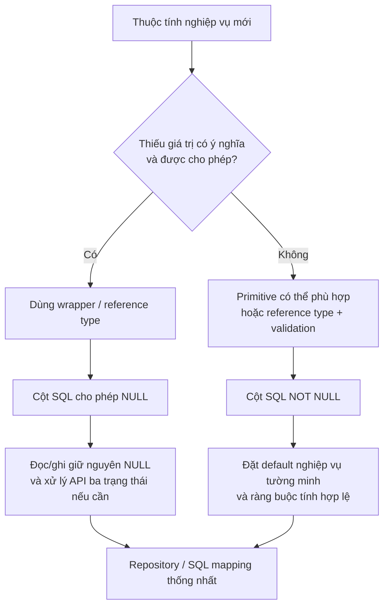

# Ánh xạ kiểu nguyên thủy, kiểu bao và giá trị SQL NULL

Khi sử dụng **Spring Data JDBC** để lưu và đọc dữ liệu từ cơ sở dữ liệu quan hệ, mỗi thuộc tính Java phải được chuyển đổi phù hợp với kiểu dữ liệu của cột SQL. Khác biệt quan trọng nhất ở nhóm giá trị đơn giản là: **kiểu nguyên thủy (primitive) của Java không chứa được `null`, còn kiểu bao (wrapper) và các kiểu tham chiếu có thể biểu diễn `null`**.

Sự khác biệt này tác động trực tiếp đến việc đọc các cột cho phép SQL `NULL`, thiết kế ràng buộc `NOT NULL`, xử lý giá trị mặc định, tạo aggregate mới và viết logic nghiệp vụ. Chọn nhầm `int` thay cho `Integer` có thể khiến “chưa thiết lập ngưỡng cảnh báo” bị hiểu thành “ngưỡng bằng 0”. Chọn `boolean` thay cho `Boolean` có thể khiến “chưa xác nhận” bị hiểu thành “đã xác nhận là sai”.

Bài học tập trung vào **Spring Data Relational / Spring Data JDBC**, đồng thời giải thích lớp JDBC phía dưới để bạn hiểu vì sao cùng một cột SQL lại có cách ánh xạ khác nhau ở Java.

## 1. Ba khái niệm cần phân biệt ngay từ đầu

| Khái niệm | Ví dụ | Ý nghĩa |
| --- | --- | --- |
| **Java primitive** | `int`, `long`, `boolean` | Lưu trực tiếp giá trị; **không thể** giữ `null`. |
| **Java wrapper / kiểu tham chiếu** | `Integer`, `Long`, `Boolean`, `String`, `BigDecimal` | Có thể giữ đối tượng hoặc giá trị `null`. |
| **SQL `NULL`** | `restock_threshold INTEGER NULL` | Cột không có giá trị SQL; khác với `0`, `FALSE` hay chuỗi rỗng. |

Ví dụ trong quản lý kho:

- `stockQuantity = 0`: đã biết rằng số lượng tồn kho bằng **0**.
- `restockThreshold = null`: chưa cấu hình ngưỡng cảnh báo đặt hàng bổ sung.
- `active = false`: sản phẩm đã được xác định là **không hoạt động**.
- `featured = null`: trạng thái nổi bật **chưa được đánh giá**.
- `featured = false`: đã đánh giá và kết luận sản phẩm **không nổi bật**.

Giá trị SQL `NULL` thường biểu diễn **thiếu, chưa biết hoặc chưa áp dụng**, nhưng ý nghĩa chính xác phải do nghiệp vụ xác định. Nó không mặc nhiên là “bằng 0” hoặc “sai”.

```text
         Đối tượng Java                       Cơ sở dữ liệu quan hệ

         int stockQuantity = 0   <------->     stock_quantity = 0
         Integer threshold = null <------>     restock_threshold IS NULL
         boolean active = false  <------->     active = FALSE
         Boolean featured = null <------->     featured IS NULL

             Spring Data JDBC chuyển đổi thuộc tính ↔ cột
                       JDBC driver thực thi SQL
```

## 2. Kiểu nguyên thủy và kiểu bao của Java

Java có tám kiểu nguyên thủy. Mỗi kiểu thường có một kiểu bao tương ứng:

| Primitive | Wrapper | Giá trị mặc định của **field** primitive | Wrapper có thể `null`? |
| --- | --- | --- | --- |
| `byte` | `Byte` | `0` | Có |
| `short` | `Short` | `0` | Có |
| `int` | `Integer` | `0` | Có |
| `long` | `Long` | `0L` | Có |
| `float` | `Float` | `0.0f` | Có |
| `double` | `Double` | `0.0d` | Có |
| `boolean` | `Boolean` | `false` | Có |
| `char` | `Character` | `'\u0000'` | Có |

**Lưu ý phạm vi của “giá trị mặc định”:** các giá trị ở bảng áp dụng cho **field của object** hoặc phần tử mảng sau khi khởi tạo. Biến cục bộ Java phải được gán trước khi đọc; không thể tự động lấy `0` hoặc `false` chỉ vì nó là biến primitive.

Ví dụ:

```java
public class TypeExample {
    private int quantity;       // Mặc định 0
    private Integer threshold;  // Mặc định null

    private boolean enabled;    // Mặc định false
    private Boolean reviewed;   // Mặc định null

    public void printValues() {
        System.out.println(quantity);   // 0
        System.out.println(threshold);  // null
        System.out.println(enabled);    // false
        System.out.println(reviewed);   // null
    }
}
```

Wrapper là **kiểu tham chiếu**, vì thế có thể dùng `null` để biểu thị việc chưa có dữ liệu. Wrapper còn cung cấp các API như `Integer.parseInt(...)`, nhưng không nên chọn wrapper trong persistent entity chỉ vì các phương thức tiện ích này: lý do quan trọng hơn là **ngữ nghĩa có thể vắng giá trị**.

### 2.1. Primitive không nhận `null`

```java
int stockQuantity = 0;
Integer threshold = null;

// int invalid = null; // Không biên dịch được

System.out.println(stockQuantity == 0);  // true
System.out.println(threshold == null);    // true
```

Hai biến `stockQuantity` và `threshold` không biểu diễn cùng một trạng thái, dù tại một thời điểm chúng đều chưa được gán giá trị nghiệp vụ qua giao diện người dùng.

### 2.2. Wrapper tạo thêm trạng thái

```java
Boolean featured = null;  // Chưa được đánh giá
featured = Boolean.FALSE; // Đã xác định là không nổi bật
featured = Boolean.TRUE;  // Đã xác định là nổi bật
```

Kiểu `Boolean` có **ba trạng thái biểu diễn được** ở tầng Java: `true`, `false` và `null`. Trong khi đó, `boolean` chỉ có hai trạng thái.

Điều này hữu ích với dữ liệu tùy chọn, nhưng cũng tạo thêm trách nhiệm: mã sử dụng wrapper phải xử lý trường hợp `null` để tránh diễn giải sai hoặc phát sinh `NullPointerException`.

## 3. SQL `NULL` khác số 0, `FALSE`, chuỗi rỗng và `DEFAULT`

Trong SQL, `NULL` là một marker biểu thị **không có giá trị**, không phải một literal số hoặc chuỗi bình thường.

| Giá trị SQL | Có phải `NULL`? | Ví dụ ý nghĩa |
| --- | --- | --- |
| `NULL` | Có | Ngưỡng cảnh báo chưa được cấu hình. |
| `0` | Không | Ngưỡng đã cấu hình bằng 0. |
| `FALSE` | Không | Trạng thái xác định là không hoạt động. |
| `''` | Không ở một số DB như PostgreSQL | Chuỗi có độ dài 0; cách xử lý chuỗi rỗng tùy database. |
| `'null'` | Không | Chuỗi văn bản gồm bốn ký tự `n`, `u`, `l`, `l`. |
| `DEFAULT` khi ghi SQL | Không phải một giá trị cụ thể | Yêu cầu database dùng mặc định được khai báo cho cột. |

Trong PostgreSQL, `''` và `NULL` khác nhau. Một số database khác, chẳng hạn Oracle, có quy tắc xử lý chuỗi rỗng khác; khi thiết kế mapping cần xét **dialect của cơ sở dữ liệu đang dùng**.

Ví dụ:

```sql
SELECT
    0 AS configured_zero,
    FALSE AS explicit_false,
    NULL AS missing_value,
    '' AS empty_text;
```

Sự phân biệt này đặc biệt quan trọng khi dữ liệu đi qua JSON, Java, repository rồi vào database. Không nên tự động đổi mọi giá trị bị thiếu thành `0` hoặc `false` nếu nghiệp vụ còn cần phân biệt “chưa cung cấp”.

## 4. Quy tắc chọn kiểu Java cho cột SQL

Một nguyên tắc thiết kế thực tế:

- **Cột bắt buộc (`NOT NULL`) và luôn có giá trị hợp lệ:** primitive có thể phù hợp, nhất là `int`, `long`, `boolean` với ngữ nghĩa rõ ràng. Wrapper vẫn có thể được dùng nếu cần biểu diễn trạng thái “chưa điền” trước khi validate/ghi.
- **Cột được phép `NULL` và `NULL` có ý nghĩa nghiệp vụ:** dùng wrapper hoặc kiểu tham chiếu phù hợp, ví dụ `Integer`, `Long`, `Boolean`, `String`, `BigDecimal`.
- **Khóa chính được sinh bởi database:** thường chọn wrapper như `Long id` để phân biệt object mới (`id == null`) với object đã có ID.
- **Số thập phân cần độ chính xác như tiền:** ưu tiên `BigDecimal` cho giá trị nghiệp vụ; đây là kiểu tham chiếu nên cũng có thể `null` nếu schema cho phép.
- **Trường có tập trạng thái nghiệp vụ rõ ràng hơn hai hoặc ba trạng thái:** cân nhắc enum/kiểu giá trị riêng thay vì ép mọi trạng thái vào `Boolean` nullable.

### 4.1. Bảng mapping thường gặp

| Java | Kiểu SQL gợi ý | Có thể biểu diễn SQL `NULL` ở Java? | Ghi chú |
| --- | --- | --- | --- |
| `int` | `INTEGER NOT NULL` | Không | Phù hợp số lượng bắt buộc; Java `0` không phải SQL `NULL`. |
| `Integer` | `INTEGER NULL` hoặc `NOT NULL` | Có | Thích hợp số tùy chọn như ngưỡng đặt hàng. |
| `long` | `BIGINT NOT NULL` | Không | Giá trị số nguyên dài bắt buộc. |
| `Long` | `BIGINT NULL` hoặc `NOT NULL` | Có | Thường dùng cho `@Id` được database sinh. |
| `boolean` | `BOOLEAN NOT NULL` | Không | Giá trị true/false đã xác định. |
| `Boolean` | `BOOLEAN NULL` hoặc `NOT NULL` | Có | Thêm trạng thái chưa biết/chưa xét nếu cho phép NULL. |
| `double` / `Double` | `DOUBLE PRECISION` (tùy DB) | Chỉ `Double` | Kiểu dấu phẩy động, có sai số biểu diễn. |
| `String` | `VARCHAR` / `TEXT` | Có | `null` khác chuỗi rỗng; quy tắc có thể tùy DB. |
| `BigDecimal` | `NUMERIC(p,s)` / `DECIMAL(p,s)` | Có | Phù hợp tiền và giá trị cần độ chính xác thập phân. |
| `char` / `Character` | `CHAR(1)` hoặc kiểu tương ứng | Chỉ `Character` | Việc chuyển đổi cụ thể cần xét driver/dialect; với code nghiệp vụ, đôi khi dùng `String` dài 1 rõ ràng hơn. |

Đây là **gợi ý thiết kế schema**, không phải cam kết rằng mọi JDBC driver và mọi database ánh xạ từng kiểu giống hệt nhau. Driver, dialect, SQL type cụ thể và bộ chuyển đổi của Spring Data JDBC quyết định cách đọc ghi cuối cùng.

## 5. Thiết kế bảng minh họa

Giả sử một ứng dụng quản lý sản phẩm muốn lưu những thông tin sau:

- `stockQuantity`: số lượng tồn kho luôn phải có, có thể bằng `0`.
- `restockThreshold`: ngưỡng nhập thêm hàng, được phép bỏ trống trước khi quản trị viên thiết lập.
- `active`: sản phẩm có đang hoạt động không, luôn là true hoặc false.
- `featured`: sản phẩm đã được đánh giá là nổi bật hay chưa; `null` mang nghĩa **chưa đánh giá**.
- `price`: đơn giá bắt buộc, lưu số thập phân chính xác.
- `id`: khóa chính do database tự sinh.

Với **PostgreSQL**, có thể tạo bảng:

```sql
CREATE TABLE products (
    id BIGINT GENERATED BY DEFAULT AS IDENTITY PRIMARY KEY,
    name VARCHAR(200) NOT NULL,
    stock_quantity INTEGER NOT NULL CHECK (stock_quantity >= 0),
    restock_threshold INTEGER NULL CHECK (
        restock_threshold IS NULL OR restock_threshold >= 0
    ),
    active BOOLEAN NOT NULL,
    featured BOOLEAN NULL,
    price NUMERIC(12, 2) NOT NULL CHECK (price >= 0)
);
```

Các điểm cần lưu ý:

1. `stock_quantity INTEGER NOT NULL` ngăn database lưu SQL `NULL`; `CHECK (stock_quantity >= 0)` bảo vệ thêm quy tắc không âm.
2. `restock_threshold INTEGER NULL` cho phép cột không có giá trị. `CHECK` cho phép `NULL` hoặc số không âm.
3. `active BOOLEAN NOT NULL` chỉ nhận trạng thái boolean hợp lệ theo PostgreSQL, không chấp nhận `NULL`.
4. `featured BOOLEAN NULL` cho phép `TRUE`, `FALSE` và `NULL`.
5. `price NUMERIC(12,2) NOT NULL` giữ số thập phân theo độ chính xác/scale định nghĩa trong schema.
6. `id` là `BIGINT` với cơ chế sinh identity của database; ở Java có thể dùng `Long id` trước khi tạo hàng.

**Spring Data JDBC ánh xạ vào schema đã có**, không dùng cơ chế `hibernate.ddl-auto` để tự sinh bảng như JPA/Hibernate. Trong ứng dụng thực tế, bảng thường được tạo/thay đổi bằng migration như Flyway hoặc Liquibase.

### 5.1. Những bản ghi hợp lệ về mặt ý nghĩa

```sql
INSERT INTO products (
    name, stock_quantity, restock_threshold, active, featured, price
)
VALUES (
    'Bút bi', 0, NULL, TRUE, NULL, 7500.00
);

INSERT INTO products (
    name, stock_quantity, restock_threshold, active, featured, price
)
VALUES (
    'Sổ tay', 50, 10, FALSE, FALSE, 35000.00
);
```

Ở hàng đầu, “tồn kho bằng `0`” và “chưa đặt ngưỡng nhập hàng” là **hai trạng thái khác nhau**. Ở hàng thứ hai, `featured = FALSE` có nghĩa trạng thái đã xác định là không nổi bật, không phải “chưa biết”.

## 6. Ánh xạ bảng với aggregate Spring Data JDBC

Sử dụng `@Table`, `@Id` và `@Column` từ Spring Data JDBC:

```java
import java.math.BigDecimal;

import org.springframework.data.annotation.Id;
import org.springframework.data.relational.core.mapping.Column;
import org.springframework.data.relational.core.mapping.Table;

@Table("products")
public record Product(
        @Id Long id,
        String name,
        @Column("stock_quantity") int stockQuantity,
        @Column("restock_threshold") Integer restockThreshold,
        boolean active,
        Boolean featured,
        BigDecimal price
) {
    public Product {
        if (name == null || name.isBlank()) {
            throw new IllegalArgumentException("Name is required");
        }
        if (stockQuantity < 0) {
            throw new IllegalArgumentException("Negative stock");
        }
        if (restockThreshold != null && restockThreshold < 0) {
            throw new IllegalArgumentException("Negative threshold");
        }
        if (price == null || price.signum() < 0) {
            throw new IllegalArgumentException("Invalid price");
        }
    }
}
```

Trong lớp này:

| Thuộc tính | Java type | Cột SQL | Có thể vắng giá trị? |
| --- | --- | --- | --- |
| `id` | `Long` | `id BIGINT ... PRIMARY KEY` | `null` khi aggregate chưa được lưu và chờ ID tự sinh. |
| `name` | `String` | `name VARCHAR(200) NOT NULL` | Java có thể chứa `null`, constructor kiểm tra và database từ chối giá trị đó. |
| `stockQuantity` | `int` | `stock_quantity INTEGER NOT NULL` | Không có `null` ở Java hoặc SQL theo schema. |
| `restockThreshold` | `Integer` | `restock_threshold INTEGER NULL` | Có; `null` nghĩa chưa có ngưỡng. |
| `active` | `boolean` | `active BOOLEAN NOT NULL` | Không; bắt buộc true/false. |
| `featured` | `Boolean` | `featured BOOLEAN NULL` | Có; `null` nghĩa chưa xác định trạng thái. |
| `price` | `BigDecimal` | `price NUMERIC(12,2) NOT NULL` | Java có thể null về mặt kiểu; constructor và database ràng buộc bắt buộc có giá trị. |

`@Column` xác định tên cột; nó **không tạo cột, không đặt `NOT NULL` và không tự tạo SQL constraint**. Một số tên theo quy ước, như Java `stockQuantity` thành SQL `stock_quantity`, có thể được mapping tự động; viết `@Column` tường minh giúp người đọc thấy rõ sự tương ứng.

Chọn `record` vì dữ liệu mẫu gọn và dễ đọc. Spring Data JDBC hỗ trợ ánh xạ đối tượng bất biến qua constructor; với record và ID sinh ra, hãy **sử dụng kết quả trả về từ `save`** vì đó có thể là một instance mới chứa ID vừa được database tạo.

## 7. Dùng repository để lưu và đọc các giá trị nullable

Khai báo repository:

```java
import org.springframework.data.repository.CrudRepository;

public interface ProductRepository
        extends CrudRepository<Product, Long> {
}
```

Đối với một aggregate mới:

```java
import java.math.BigDecimal;

Product newProduct = new Product(
        null,                         // id chưa được cấp
        "Bút bi",
        0,                            // đã biết là hết hàng
        null,                         // chưa đặt ngưỡng tồn kho
        true,                         // đang hoạt động
        null,                         // chưa đánh giá nổi bật
        new BigDecimal("7500.00")
);

Product saved = productRepository.save(newProduct);

System.out.println(saved.id());                 // ID do database cấp
System.out.println(saved.stockQuantity());      // 0
System.out.println(saved.restockThreshold());   // null
System.out.println(saved.featured());           // null
```

Về mặt ý nghĩa, Spring Data JDBC cần đưa các giá trị primitive/wrapper sang JDBC driver, lưu vào cột tương ứng, rồi ánh xạ ngược khi truy vấn.

Một bản ghi được truy xuất:

```java
Product loaded = productRepository.findById(saved.id())
        .orElseThrow();

int quantity = loaded.stockQuantity();       // 0
Integer threshold = loaded.restockThreshold(); // null
boolean active = loaded.active();           // true
Boolean featured = loaded.featured();       // null
```

Với `@Id Long id`, giá trị `null` thường giúp Spring Data JDBC nhận biết aggregate mới để thực hiện `INSERT`. Sau khi lưu, ID được cấp và aggregate được xem là đã có. Cơ chế xác định entity mới cũng có thể phụ thuộc `@Version` hoặc hợp đồng `Persistable` nếu dự án dùng chúng; ở ví dụ cơ bản, ID wrapper nullable là lựa chọn dễ hiểu.

### 7.1. Tại sao thường dùng `Long` thay cho `long` cho ID?

Hai khai báo sau có ý nghĩa khác nhau:

```java
@Id
private Long id;  // null -> chưa có ID

@Id
private long id;  // field chưa gán sẽ là 0
```

Nếu dùng primitive `long`, trạng thái trước khi lưu thường là `0`; Spring Data có quy tắc riêng để nhận diện giá trị ID ban đầu, nhưng `0` là một con số hợp lệ ở cấp kiểu Java. Wrapper `Long` cho phép biểu diễn rõ **“ID chưa tồn tại”** bằng `null`, đặc biệt hữu ích khi database sinh khóa chính. Đây là một quy ước nên ưu tiên cho entity có ID tự sinh, không phải yêu cầu rằng mọi ID của Spring Data JDBC đều bắt buộc là wrapper.

## 8. Đọc SQL `NULL` vào wrapper và primitive

Khi database trả về một hàng, Spring Data JDBC dùng cơ chế mapping và chuyển đổi kiểu để dựng đối tượng Java. **Wrapper như `Integer` có thể nhận SQL `NULL` dưới dạng Java `null`. Primitive như `int` không biểu diễn được SQL `NULL`.**

Đối với field tương ứng một cột `NOT NULL`, như `stock_quantity`, việc dùng `int` có thể phù hợp. Nếu ai đó sửa schema hoặc dữ liệu làm cho cột được phép `NULL` trong khi Java vẫn là `int`, ứng dụng sẽ có một **bất đồng về hợp đồng dữ liệu**.

Hệ quả cụ thể phụ thuộc cách mapper tạo instance, constructor/field access và bộ chuyển đổi: dữ liệu `NULL` có thể gây lỗi chuyển đổi hoặc khiến kết quả không mang được ý nghĩa của trạng thái thiếu dữ liệu. **Không nên dựa vào việc `int` có giá trị mặc định `0` để suy luận rằng SQL `NULL` luôn được ánh xạ an toàn thành `0`.**

Nếu SQL `NULL` có ý nghĩa cần giữ lại, hãy sử dụng `Integer`; nếu `NULL` bị cấm theo nghiệp vụ, hãy đặt `NOT NULL` trong schema và kiểm tra đầu vào ở application.

### 8.1. Cặp `int` / `Integer`

```java
int inventory = 0;       // Chắc chắn có số nguyên
Integer reorderPoint = null; // Chưa cấu hình
```

Đây là cách hợp lý khi database có:

```sql
stock_quantity INTEGER NOT NULL,
restock_threshold INTEGER NULL
```

Nếu trong cơ sở dữ liệu có:

```text
stock_quantity   restock_threshold
--------------   -----------------
0                NULL
10               0
10               5
```

Thì ba bản ghi có ý nghĩa khác nhau:

- `0, NULL`: không còn hàng, chưa thiết lập ngưỡng.
- `10, 0`: có 10 hàng, ngưỡng được thiết lập thành 0.
- `10, 5`: có 10 hàng, cần bổ sung khi chạm ngưỡng 5 theo quy tắc nghiệp vụ.

Dùng `int` cho `restockThreshold` sẽ khiến mô hình Java không thể biểu diễn rõ bản ghi đầu tiên.

### 8.2. Cặp `boolean` / `Boolean`

```java
boolean active = false;     // Đã có trạng thái không hoạt động
Boolean featured = null;    // Chưa có kết luận
```

Với ba giá trị SQL:

```text
featured
--------
TRUE
FALSE
NULL
```

`Boolean` giữ nguyên cả ba; `boolean` chỉ giữ được `true` hoặc `false`. Nếu nghiệp vụ bắt buộc có câu trả lời nhị phân, hãy dùng `BOOLEAN NOT NULL` trong schema và có thể dùng `boolean` trong domain. Nếu trạng thái thứ ba có ý nghĩa, cần wrapper hoặc một kiểu mô hình riêng.

## 9. Khi cần tự dùng JDBC: đọc NULL đúng cách

Spring Data JDBC repository thông thường đã thực hiện việc ánh xạ. Tuy nhiên, hiểu hành vi JDBC gốc sẽ giúp bạn viết đúng `RowMapper`, custom SQL hoặc tích hợp hệ thống cũ.

### 9.1. `ResultSet.getInt` trả `0` khi SQL là `NULL`

Một điểm dễ gây lỗi: các getter primitive của JDBC như `ResultSet.getInt(...)` và `ResultSet.getBoolean(...)` không thể trả về Java `null`. Theo hợp đồng JDBC, khi cột là SQL `NULL`, `getInt(...)` trả `0` và `getBoolean(...)` trả `false`. Muốn biết giá trị thực sự có phải `NULL` hay không, **phải gọi `wasNull()` ngay sau getter tương ứng**.

Ví dụ dùng `JdbcTemplate`:

```java
import java.sql.ResultSet;
import java.sql.SQLException;

private Integer readNullableThreshold(ResultSet rs)
        throws SQLException {
    int value = rs.getInt("restock_threshold");
    return rs.wasNull() ? null : value;
}
```

Cần đọc `wasNull()` ngay sau `getInt(...)` vì nó báo tình trạng `NULL` của **cột vừa được đọc gần nhất**. Nếu đọc thêm cột khác trước khi gọi `wasNull()` thì kết quả không còn là của `restock_threshold`.

### 9.2. Với JDBC driver hỗ trợ typed `getObject`

Một cách khác là:

```java
Integer threshold =
        rs.getObject("restock_threshold", Integer.class);
Boolean featured =
        rs.getObject("featured", Boolean.class);
```

Với driver hỗ trợ chuyển đổi kiểu tương ứng, `getObject(..., Integer.class)` và `getObject(..., Boolean.class)` có thể trả về `null` khi cột SQL là `NULL`. Kiểu SQL/driver cụ thể có thể có giới hạn; nếu gặp vấn đề tương thích, cách `getInt/getBoolean` + `wasNull` là cơ chế JDBC rõ ràng.

**Không nên viết:**

```java
int threshold = rs.getInt("restock_threshold");
// threshold == 0: không biết cột thật sự là 0 hay SQL NULL!
```

Nếu nghiệp vụ phân biệt hai trường hợp, mã trên đã làm mất thông tin.

### 9.3. Ghi SQL NULL bằng PreparedStatement

Với một cột tùy chọn, JDBC có thể ghi SQL `NULL` thông qua `setNull`:

```java
import java.sql.Types;

jdbcTemplate.update(
        "UPDATE products SET restock_threshold = ? WHERE id = ?",
        ps -> {
            ps.setNull(1, Types.INTEGER);
            ps.setLong(2, productId);
        }
);
```

Nếu có giá trị thực:

```java
jdbcTemplate.update(
        "UPDATE products SET restock_threshold = ? WHERE id = ?",
        ps -> {
            ps.setInt(1, 10);
            ps.setLong(2, productId);
        }
);
```

Trong một repository Spring Data JDBC thông thường, framework sẽ đảm nhận việc bind tham số và chuyển đổi `null` cho property được mapping; bạn không cần tự viết `setNull` cho mọi lần lưu.

## 10. Giá trị mặc định SQL không giống giá trị mặc định Java

Giả sử schema quy định:

```sql
CREATE TABLE demo_defaults (
    id BIGINT GENERATED BY DEFAULT AS IDENTITY PRIMARY KEY,
    quantity INTEGER NOT NULL DEFAULT 0,
    approved BOOLEAN NOT NULL DEFAULT FALSE,
    note VARCHAR(100) DEFAULT 'N/A'
);
```

Nếu SQL **bỏ qua** các cột này:

```sql
INSERT INTO demo_defaults DEFAULT VALUES;
```

Database dùng các `DEFAULT` được định nghĩa.

Nhưng nếu SQL ghi **tường minh** `NULL`:

```sql
INSERT INTO demo_defaults (quantity)
VALUES (NULL);
```

PostgreSQL sẽ từ chối vì `quantity` có ràng buộc `NOT NULL`. `DEFAULT 0` không tự biến giá trị `NULL` được truyền tường minh thành `0`.

Trong Spring Data JDBC, không nên mặc định rằng một property Java `null` sẽ khiến câu lệnh `INSERT` **bỏ qua cột** để database áp dụng `DEFAULT`. Cách framework tạo SQL phụ thuộc mapping và thao tác cụ thể; với property được đưa vào SQL dưới dạng `NULL`, default SQL sẽ không phát huy như khi bỏ qua cột.

**Thiết kế thực tế:**

- Nếu business rule quy định sản phẩm mới bắt đầu với `stockQuantity = 0`, gán giá trị đó trong constructor/factory/service trước khi `save`.
- Nếu giá trị phải luôn tồn tại, dùng `NOT NULL` trong database.
- Nếu có default ở tầng database, hãy xem nó là quy tắc dành cho các đường ghi SQL phù hợp; tránh dựa vào default để chữa lỗi mapping từ Java.
- Khi dùng primitive `boolean` chưa gán, giá trị Java mặc định `false` có thể được ghi tường minh, khiến default SQL `TRUE` của cột không được sử dụng.

Ví dụ một factory đơn giản:

```java
public static Product createNew(String name, BigDecimal price) {
    return new Product(
            null,
            name,
            0,       // Giá trị khởi tạo nghiệp vụ rõ ràng
            null,    // Chưa cấu hình ngưỡng
            true,    // Sản phẩm mới đang hoạt động
            null,    // Chưa đánh giá nổi bật
            price
    );
}
```

Đây là một phương thức minh họa **có thể đặt bên trong record `Product`** ở ví dụ trước, hoặc đặt trong factory riêng. Giá trị mặc định do nghiệp vụ quyết định được tạo một cách chủ động, không phụ thuộc sự trùng hợp giữa Java default và SQL default.

## 11. So sánh giá trị NULL trong câu lệnh SQL

SQL dùng **logic ba giá trị**: điều kiện có thể là `TRUE`, `FALSE` hoặc `UNKNOWN`. Vì vậy, so sánh thông thường với `NULL` không hoạt động như so sánh với số nguyên.

### 11.1. `= NULL` không tìm được dòng NULL

**Sai:**

```sql
SELECT *
FROM products
WHERE restock_threshold = NULL;
```

Với SQL chuẩn, biểu thức so sánh `= NULL` cho kết quả `UNKNOWN`, kể cả khi cột cũng là `NULL`; điều kiện `WHERE` không chọn những hàng này.

**Đúng:**

```sql
SELECT *
FROM products
WHERE restock_threshold IS NULL;
```

Và để lấy các sản phẩm đã được cấu hình ngưỡng:

```sql
SELECT *
FROM products
WHERE restock_threshold IS NOT NULL;
```

### 11.2. `NULL` và điều kiện boolean

Ví dụ:

```sql
SELECT *
FROM products
WHERE featured = FALSE;
```

Câu này chọn những sản phẩm được đánh dấu **FALSE**, nhưng **không** chọn sản phẩm có `featured IS NULL`.

Nếu muốn lấy các sản phẩm **chưa được đánh dấu TRUE** và cố ý gồm cả trường hợp chưa đánh giá:

```sql
SELECT *
FROM products
WHERE featured = FALSE OR featured IS NULL;
```

Việc có gộp `FALSE` với `NULL` hay không là quyết định nghiệp vụ; đừng để câu SQL vô tình làm quyết định thay bạn.

### 11.3. `COALESCE` khi cần giá trị thay thế lúc truy vấn

`COALESCE` lấy biểu thức đầu tiên không phải `NULL`:

```sql
SELECT
    id,
    name,
    COALESCE(restock_threshold, 0) AS effective_threshold
FROM products;
```

Kết quả trình bày `NULL` thành `0` để phục vụ **một phép tính hoặc màn hình cụ thể**, nhưng **không cập nhật giá trị gốc trong bảng**. Tránh dùng kết quả `COALESCE` để suy luận rằng `NULL` và `0` có cùng ý nghĩa trong domain.

### 11.4. `COUNT(*)` và `COUNT(column)`

```sql
SELECT
    COUNT(*) AS total_products,
    COUNT(restock_threshold) AS configured_thresholds
FROM products;
```

`COUNT(*)` đếm mọi hàng được chọn; `COUNT(restock_threshold)` chỉ đếm hàng có giá trị **khác `NULL`** ở cột đó. Đây là ví dụ khác về ảnh hưởng thực tế của SQL `NULL`.

## 12. Truy vấn nullable với Spring Data JDBC repository

Repository vẫn có thể cung cấp truy vấn dựa trên điều kiện `IS NULL`. Ví dụ viết SQL tường minh bằng `@Query`:

```java
import java.util.List;
import org.springframework.data.jdbc.repository.query.Query;
import org.springframework.data.repository.CrudRepository;

public interface ProductRepository
        extends CrudRepository<Product, Long> {

    @Query("""
            SELECT id, name, stock_quantity, restock_threshold,
                   active, featured, price
              FROM products
             WHERE restock_threshold IS NULL
            """)
    List<Product> findWithoutRestockThreshold();
}
```

Câu truy vấn có thể tạo `Product` với `restockThreshold() == null`; đó chính là trạng thái cần thể hiện trong Java.

Ở trường hợp phù hợp, Spring Data JDBC cũng hỗ trợ suy diễn truy vấn từ tên phương thức, trong đó có các dạng điều kiện null theo khả năng của phiên bản Spring Data đang dùng. SQL tường minh ở ví dụ giúp quan sát rõ `IS NULL` và không nhầm với `= NULL`.

**Khác biệt cần nhớ:** `Optional<Product>` trong kết quả `findById` diễn đạt **có hay không có cả bản ghi Product**. `Integer restockThreshold` trong `Product` diễn đạt **một thuộc tính có hay không có giá trị**. Hai khái niệm vắng mặt này không giống nhau.

```java
Optional<Product> maybeProduct = repository.findById(123L);

// Trường hợp 1: Optional.empty() -> Không tìm thấy Product id=123
// Trường hợp 2: Có Product, restockThreshold() == null
//             -> Product tồn tại nhưng chưa có ngưỡng nhập hàng
```

Tránh dùng `Optional<Integer>` như một property persisted của entity chỉ để “chữa” null mà chưa xét cơ chế mapping và API cập nhật. Với thuộc tính SQL nullable đơn giản, wrapper `Integer` thường dễ hiểu hơn; `Optional` hữu ích ở **API trả về kết quả** hoặc cách biểu đạt rõ sự vắng mặt bên ngoài entity.

## 13. Boxing, unboxing và lỗi NullPointerException

Java tự chuyển giữa primitive và wrapper trong một số ngữ cảnh, gọi là **autoboxing** và **unboxing**:

```java
Integer a = 5; // Boxing: int -> Integer
int b = a;     // Unboxing: Integer -> int
```

Tuy nhiên, **unboxing một wrapper đang là `null` sẽ gây `NullPointerException`**:

```java
Integer threshold = null;

// int unsafe = threshold; // Ném NullPointerException khi chạy
```

Tương tự với `Boolean`:

```java
Boolean featured = null;

// if (featured) { ... } // Ném NullPointerException
```

Nếu cần kiểm tra rõ cả ba trạng thái, hãy viết:

```java
Boolean featured = product.featured();

if (Boolean.TRUE.equals(featured)) {
    System.out.println("Sản phẩm nổi bật");
} else if (Boolean.FALSE.equals(featured)) {
    System.out.println("Đã xác định không nổi bật");
} else {
    System.out.println("Chưa đánh giá");
}
```

Cách này bảo toàn ý nghĩa `NULL` thay vì ngầm đổi nó thành `false`.

Với số nullable:

```java
Integer threshold = product.restockThreshold();

if (threshold == null) {
    System.out.println("Chưa cấu hình ngưỡng nhập thêm");
} else if (product.stockQuantity() <= threshold) {
    System.out.println("Đến ngưỡng nhập thêm");
}
```

Không nên viết phép so sánh `stockQuantity <= threshold` trước khi kiểm tra `threshold != null` vì Java phải unbox `Integer` khi so sánh.

## 14. Đọc, tạo mới, cập nhật và xóa giá trị nullable

Khi thiết kế luồng dữ liệu, cần phân biệt **giá trị Java null** và **ý định của người dùng**.

### 14.1. Tạo mới: có thể gán null có chủ đích

Ví dụ sản phẩm mới chưa có ngưỡng tồn kho:

```java
Product draft = new Product(
        null,
        "Bút chì",
        20,
        null,  // Chưa thiết lập
        true,
        null,  // Chưa đánh giá
        new BigDecimal("4000.00")
);

Product saved = repository.save(draft);
```

Với cột `restock_threshold` và `featured` cho phép `NULL`, việc persist `null` là trạng thái hợp lệ.

### 14.2. Cập nhật: null có thể mang nghĩa “xóa giá trị cũ”

Giả sử sản phẩm đã có `restockThreshold = 10`. Nếu người dùng chủ động yêu cầu **bỏ ngưỡng**, trạng thái mới phải là `null`:

```java
Product current = repository.findById(productId)
        .orElseThrow();

Product updated = new Product(
        current.id(),
        current.name(),
        current.stockQuantity(),
        null, // Chủ động xóa ngưỡng đã cấu hình
        current.active(),
        current.featured(),
        current.price()
);

repository.save(updated);
```

Spring Data JDBC lưu trạng thái của aggregate được truyền vào. Khi cập nhật property đã được mapping thành `null`, cột tương ứng có thể được đặt về SQL `NULL`. Với record bất biến, cần tạo instance mới chứa đầy đủ các giá trị khác mà bạn muốn giữ lại.

### 14.3. API PATCH: “không gửi field” khác “gửi field = null”

Giả sử client gửi:

```json
{}
```

Có thể hiểu là **không thay đổi ngưỡng**. Nhưng nếu gửi:

```json
{
  "restockThreshold": null
}
```

Có thể hiểu là **xóa ngưỡng hiện có**. Nếu DTO chỉ có một field `Integer restockThreshold`, cả hai tình huống có thể bị deserializer đưa về `null` và mất thông tin về **sự hiện diện của field**.

Để hỗ trợ PATCH có ba trạng thái (không gửi / đặt NULL / đặt giá trị), cần một hợp đồng DTO, JSON handling hoặc cơ chế đánh dấu field đã xuất hiện rõ ràng. Không nên dùng trực tiếp entity của Spring Data JDBC làm DTO PATCH rồi gọi `save` khi chưa xử lý khác biệt này.

Bài toán đó thuộc tầng API, nhưng nguyên nhân bắt nguồn từ việc một biến Java nullable không tự phân biệt được **“vắng thuộc tính trong request”** và **“thuộc tính được chỉ định null”**.

## 15. Ràng buộc database, kiểm tra ứng dụng và type Java

Ba lớp bảo vệ có mục đích riêng:

| Tầng | Ví dụ | Bảo vệ điều gì? |
| --- | --- | --- |
| **Kiểu Java** | `int stockQuantity` | Ngăn biến Java giữ `null` ở mức kiểu; không cấm giá trị âm. |
| **Kiểm tra nghiệp vụ** | `if (quantity < 0) throw ...` | Ngăn giá trị không hợp lệ trước khi ghi; thông báo rõ nguyên nhân. |
| **Ràng buộc SQL** | `INTEGER NOT NULL CHECK (stock_quantity >= 0)` | Bảo vệ dữ liệu ở database, kể cả khi có luồng ghi khác ngoài ứng dụng. |

Một số ngộ nhận phổ biến:

- `String` là kiểu tham chiếu nên có thể `null` **dù cột SQL là `NOT NULL`**. Constructor/validation và database phải quyết định cấm giá trị này.
- `@Column("name")` chỉ định tên cột, **không có tác dụng tự tạo ràng buộc `NOT NULL`**.
- Primitive `int` không thể null nhưng vẫn có thể bằng `-5`; `NOT NULL` không thay thế `CHECK` và validation nghiệp vụ.
- Wrapper `Integer` có thể null, nhưng database `NOT NULL` vẫn từ chối giá trị thiếu nếu cố ghi.
- Annotation Bean Validation như `@NotNull` (khi dùng hạ tầng validation phù hợp) có thể hỗ trợ kiểm tra input/object; **không thay thế migration và SQL constraint**, và không nên giả định mọi lời gọi repository tự chạy Bean Validation nếu chưa cấu hình.

Đối với Spring Data JDBC, **schema chính xác là hợp đồng persistence quan trọng**. Kiểu Java và quy tắc domain nên thống nhất với ràng buộc ở cơ sở dữ liệu.

## 16. Những lỗi thiết kế thường gặp

### 16.1. Dùng `int` cho cột có SQL NULL

Nếu `restock_threshold` được phép `NULL`, khai báo:

```java
private int restockThreshold;
```

khiến domain không có trạng thái “chưa cấu hình”. Đổi sang `Integer` hoặc thay đổi nghiệp vụ/schema để cấm NULL nếu thực sự bắt buộc có số.

### 16.2. Dùng `boolean` khi cần ba trạng thái

Nếu “chưa đánh giá” có ý nghĩa riêng, dùng `Boolean`, enum hoặc một value object thay vì ép về `false`. Chỉ dùng `boolean` khi nghiệp vụ là nhị phân và dữ liệu bắt buộc có giá trị.

### 16.3. Chờ Java `0` thay thế SQL `NULL`

Default của Java field không phải một chính sách chuyển đổi SQL NULL. Với cột nullable, phải dùng kiểu Java có khả năng giữ null hoặc viết quy tắc chuyển đổi **tường minh, có giải thích nghiệp vụ**.

### 16.4. Dựa vào SQL `DEFAULT` khi framework ghi `NULL`

SQL `DEFAULT` thường áp dụng khi cột bị bỏ qua hoặc được chỉ định `DEFAULT` trong câu lệnh ghi. Nếu ứng dụng gửi `NULL` tường minh, ràng buộc `NOT NULL` có thể từ chối; hãy chủ động khởi tạo giá trị domain và đọc cách framework ghi cột.

### 16.5. Unboxing wrapper mà chưa kiểm tra null

`Integer` được cộng, so sánh hay gán cho `int` có thể bị unbox tự động. Khi đang là `null`, thao tác này gây `NullPointerException`. Dùng kiểm tra null hoặc viết chính sách fallback rõ ràng.

### 16.6. So sánh SQL `= NULL`

Dùng `IS NULL` / `IS NOT NULL` trong câu SQL. `= NULL` không có ý nghĩa như so sánh Java với `null`.

### 16.7. Dùng `double` cho tiền

Đây là lỗi độc lập với nullability. `double` là số dấu phẩy động nhị phân, có thể không biểu diễn chính xác nhiều giá trị thập phân. Dùng `BigDecimal` với `NUMERIC/DECIMAL` cho dữ liệu tiền có yêu cầu chính xác; lưu ý xử lý scale, rounding và các phép tính theo chính sách nghiệp vụ.

### 16.8. Coi mọi wrapper null như dữ liệu hợp lệ

Wrapper có thể null về mặt kiểu, nhưng không đồng nghĩa nghiệp vụ cho phép null. Ví dụ `name String` và `price BigDecimal` trong `Product` vẫn là dữ liệu bắt buộc. Hãy kết hợp constructor/validation và SQL `NOT NULL` để bảo vệ quy tắc.

## 17. Quy trình lựa chọn kiểu và mapping cho một cột

Khi thêm một thuộc tính mới vào aggregate, có thể lần lượt quyết định:

1. **Xác định ý nghĩa nghiệp vụ:** giá trị có bắt buộc không? `0` hoặc `false` có khác “chưa biết” không?
2. **Xác định SQL type:** `INTEGER`, `BIGINT`, `BOOLEAN`, `NUMERIC`, `VARCHAR`… có phù hợp phạm vi và độ chính xác không?
3. **Xác định nullability trong schema:** dùng `NOT NULL` khi phải có giá trị; dùng `NULL` khi thiếu giá trị là trạng thái được phép.
4. **Chọn kiểu Java tương ứng:** primitive cho giá trị luôn bắt buộc và hợp lệ; wrapper hoặc reference type cho trạng thái có thể vắng.
5. **Xác định giá trị ban đầu:** constructor/factory đặt mặc định nghiệp vụ rõ ràng; không dựa ngầm vào `0`/`false` hay SQL DEFAULT.
6. **Xác định quy tắc cập nhật:** có cho xóa giá trị về `null` không? API PATCH phân biệt không gửi và yêu cầu xóa thế nào?
7. **Đặt ràng buộc bảo vệ:** validation tại ứng dụng và `NOT NULL`/`CHECK`/constraint phù hợp ở database.
8. **Kiểm soát truy vấn:** với cột nullable, biết lúc nào cần `IS NULL`, `IS NOT NULL` hoặc `COALESCE` để tính toán mà không làm đổi nghĩa dữ liệu gốc.



Lưu ý: sơ đồ nói về **quyết định thiết kế**, không bắt buộc tất cả cột `NOT NULL` phải dùng primitive. Ví dụ `String` và `BigDecimal` là kiểu tham chiếu nhưng thường ánh xạ sang cột `NOT NULL`.

## 18. Câu hỏi tự luyện

1. Một cột `quantity INTEGER NOT NULL` luôn tồn tại và được phép bằng 0. Dùng `int` hay `Integer`? Vì sao `0` khác `NULL`?
2. Một cột `discount_percent INTEGER NULL`, trong đó `NULL` nghĩa “chưa có chính sách giảm giá” còn `0` nghĩa “có chính sách nhưng giảm 0%”. Nên dùng kiểu Java nào?
3. Một cột `verified BOOLEAN NULL` cần ba trạng thái “đã xác thực”, “không đạt xác thực” và “chưa kiểm tra”. Điều gì xảy ra nếu dùng `boolean`?
4. Vì sao `ResultSet.getInt(...)` không đủ để phân biệt SQL `NULL` với giá trị `0`? Cần gọi phương thức nào?
5. Vì sao `WHERE featured = NULL` không tìm được hàng có `featured IS NULL`?
6. Với `id BIGINT GENERATED ...`, vì sao `@Id Long id` thường rõ nghĩa hơn `@Id long id` trước khi lưu?
7. Schema có `stock_quantity INTEGER NOT NULL DEFAULT 0`. Nếu một lệnh `INSERT` truyền `NULL` tường minh vào cột đó, database có nhất thiết thay bằng 0 không?
8. API PATCH không gửi `restockThreshold` khác gì với gửi `"restockThreshold": null`? Một field `Integer` đơn lẻ có giữ được khác biệt này sau deserialization hay không?
9. Vì sao `BigDecimal price` vẫn cần ràng buộc `NOT NULL` và kiểm tra nghiệp vụ mặc dù không có primitive tương ứng?
10. Khi thấy một lỗi ánh xạ từ SQL NULL vào Java, nên thay đổi Java type, SQL constraint hay logic mặc định? Câu trả lời phụ thuộc thông tin nghiệp vụ nào?

### Bài tập thực hành

Dùng bảng `products` và `Product` ở phần trên, hãy thử thực hiện các thao tác:

- Tạo sản phẩm với `stockQuantity = 0`, `restockThreshold = null` và `featured = null`; đọc lại bằng repository.
- Tạo sản phẩm có `restockThreshold = 0` và `featured = false`; so sánh trạng thái với sản phẩm đầu.
- Truy vấn sản phẩm chưa có ngưỡng bằng SQL `IS NULL`.
- Thử cập nhật ngưỡng từ `10` về `null` có chủ đích.
- Sử dụng `Boolean.TRUE.equals(...)` để xử lý trạng thái featured một cách an toàn.
- Tự viết một `RowMapper` đọc `restock_threshold` bằng `getInt` rồi `wasNull` để quan sát khác biệt so với getter primitive đơn lẻ.
- Thử một câu `INSERT` có `stock_quantity = NULL` để thấy constraint `NOT NULL` bảo vệ dữ liệu.

Khi hoàn thành, điều cốt lõi cần nắm là: **Spring Data JDBC có thể ánh xạ kiểu nguyên thủy, kiểu bao và các kiểu tham chiếu sang cột SQL, nhưng nullability là một quyết định nghiệp vụ phải được thể hiện nhất quán ở kiểu Java, schema SQL, logic cập nhật và câu truy vấn.** `0`, `false` và `NULL` không thể hoán đổi tùy tiện mà không làm thay đổi ý nghĩa dữ liệu.

