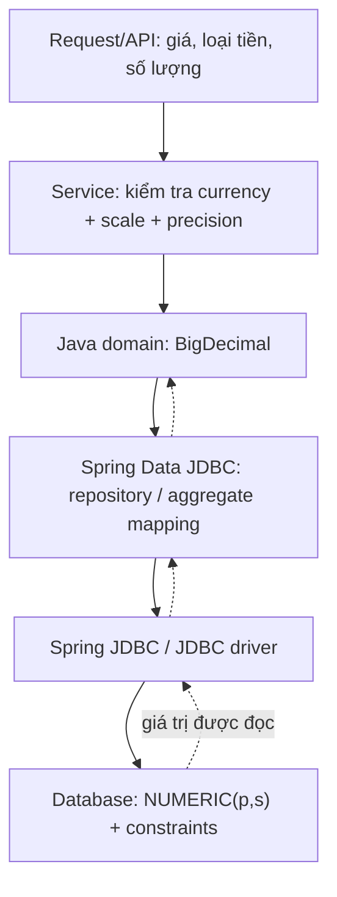

# BigDecimal, precision và scale cho dữ liệu tiền tệ

Khi xây dựng ứng dụng với **Spring Data Relational JDBC**, những giá trị như giá sản phẩm, số tiền thanh toán, thuế, chiết khấu hoặc số dư thường đi qua nhiều lớp: Java → Spring Data JDBC → JDBC driver → cột SQL trong cơ sở dữ liệu. Nếu mỗi lớp biểu diễn số thập phân khác nhau, hệ thống có thể làm tròn ngoài ý muốn, làm mất phần lẻ, không ghi được giá trị hoặc đưa ra tổng tiền sai.

Để lưu và tính toán các khoản tiền có phần thập phân chính xác, cách thông dụng trong Java là dùng **`java.math.BigDecimal`** và cột SQL có kiểu thập phân chính xác, ví dụ **`NUMERIC(19, 2)`** hoặc **`DECIMAL(19, 2)`**. Tuy nhiên, chỉ chọn hai kiểu dữ liệu ấy vẫn chưa đủ. Cần hiểu **precision**, **scale**, quy tắc làm tròn, đơn vị tiền tệ và cách ánh xạ giữa Java với SQL.

Bài học này tập trung vào cách sử dụng `BigDecimal` đúng trong ngữ cảnh **Spring Data JDBC**, đồng thời đưa ra ví dụ có thể áp dụng cho nghiệp vụ thanh toán và hóa đơn.

## 1. Vì sao không nên dùng float hoặc double để tính tiền?

`float` và `double` là kiểu dấu phẩy động nhị phân. Nhiều phân số thập phân quen thuộc như `0.1` và `0.2` không có biểu diễn nhị phân hữu hạn, nên giá trị được lưu chỉ là xấp xỉ.

```java
double a = 0.1;
double b = 0.2;

System.out.println(a + b);
// 0.30000000000000004
```

Sai khác rất nhỏ có thể chấp nhận được trong một số phép đo khoa học, nhưng đối với tiền, những vấn đề sau dễ xảy ra:

- So sánh tổng tiền với ngưỡng thanh toán cho kết quả ngoài dự kiến.
- Nhân số lượng, cộng nhiều dòng hóa đơn khiến sai số tích lũy.
- Chuyển qua JSON, JDBC, SQL hoặc hệ thống khác làm lộ sai số.
- Quy tắc làm tròn của nghiệp vụ không được thực thi nhất quán.

`BigDecimal` biểu diễn số thập phân với **giá trị nguyên không chia tỷ lệ** (*unscaled value*) và **scale**. Khi khởi tạo từ chuỗi thập phân, nó giữ giá trị đúng theo chữ số đã nhập:

```java
import java.math.BigDecimal;

BigDecimal a = new BigDecimal("0.1");
BigDecimal b = new BigDecimal("0.2");

BigDecimal result = a.add(b);

System.out.println(result); // 0.3
```

Điều này không có nghĩa mọi phép toán `BigDecimal` đều tự đưa ra một kết quả hợp lệ về mặt nghiệp vụ. Ví dụ `1 / 3` có vô hạn chữ số thập phân; bạn vẫn phải chọn cách làm tròn.

### 1.1. Những cách tạo BigDecimal

```java
BigDecimal fromString = new BigDecimal("19.99"); // Nên dùng cho hằng số tiền
BigDecimal fromInt = BigDecimal.valueOf(20);    // Chính xác với số nguyên
BigDecimal fromLong = BigDecimal.valueOf(1500L);
BigDecimal fromDouble = BigDecimal.valueOf(0.1);
```

`BigDecimal.valueOf(double)` sử dụng cách biểu diễn chuỗi của `double` và thường tránh được vấn đề dễ thấy của constructor nhận trực tiếp `double`. Dù vậy, khi dữ liệu gốc đã trải qua các phép tính `double` thì độ chính xác ban đầu có thể đã mất.

Tránh viết:

```java
BigDecimal wrong = new BigDecimal(0.1);

System.out.println(wrong);
// 0.1000000000000000055511151231257827021181583404541015625...
```

Với dữ liệu tiền nhập từ biểu mẫu, file CSV hoặc API, hãy giữ dạng thập phân chuẩn rồi chuyển sang `BigDecimal`. Không cần đi qua `double` trung gian.

## 2. Precision, scale và unscaled value trong BigDecimal

Một giá trị `BigDecimal` có thể hiểu theo công thức:

**giá trị số = unscaledValue × 10^(-scale)**

Trong đó:

- **`unscaledValue()`**: số nguyên chứa các chữ số của giá trị.
- **`scale()`**: số chữ số bên phải dấu thập phân theo cách biểu diễn hiện tại; có thể bằng 0 hoặc âm.
- **`precision()`**: số chữ số của unscaled value, không tính dấu âm; với số 0, precision là 1.

Ví dụ:

```java
BigDecimal price = new BigDecimal("123.4500");

System.out.println(price.unscaledValue()); // 1234500
System.out.println(price.scale());         // 4
System.out.println(price.precision());     // 7
```

Với `scale = 4`, giá trị `1234500 × 10^-4 = 123.4500`. Hai chữ số 0 sau cùng **được giữ trong cách biểu diễn**, dù không làm thay đổi giá trị số học.

| Chuỗi tạo BigDecimal | Unscaled value | Precision | Scale | Giá trị |
|---|---:|---:|---:|---|
| `"123.45"` | 12345 | 5 | 2 | 123.45 |
| `"123.4500"` | 1234500 | 7 | 4 | 123.4500 |
| `"0.0010"` | 10 | 2 | 4 | 0.0010 |
| `"1000"` | 1000 | 4 | 0 | 1000 |
| `"1E+3"` | 1 | 1 | -3 | 1000 |
| `"0.00"` | 0 | 1 | 2 | 0.00 |

### 2.1. Scale không phải số chữ số sau dấu thập phân của mọi cách hiển thị

Với `new BigDecimal("1E+3")`, scale là `-3`. Giá trị vẫn là một nghìn, nhưng có thể được biểu diễn bằng dạng số mũ. Vì vậy không nên suy đoán scale chỉ bằng cách nhìn chuỗi được in ra.

```java
BigDecimal amount = new BigDecimal("1000.00");
BigDecimal stripped = amount.stripTrailingZeros();

System.out.println(stripped);             // 1E+3
System.out.println(stripped.scale());     // -3
System.out.println(stripped.toPlainString()); // 1000
```

`stripTrailingZeros()` loại bỏ chữ số 0 không cần thiết, nhưng nó có thể thay đổi scale và cách in. Nếu hệ thống yêu cầu lưu tiền với scale cố định, hãy dùng `setScale` theo chính sách được xác định, không xem `stripTrailingZeros` là bước chuẩn hóa tiền tệ mặc định.

### 2.2. Precision và scale là thuộc tính của cách biểu diễn

Hai đối tượng có giá trị số học bằng nhau vẫn có precision/scale khác nhau:

```java
BigDecimal x = new BigDecimal("1.2");
BigDecimal y = new BigDecimal("1.200");

System.out.println(x.scale());     // 1
System.out.println(y.scale());     // 3
System.out.println(x.precision()); // 2
System.out.println(y.precision()); // 4
```

Đây là lý do cần phân biệt **độ lớn giá trị**, **độ chính xác được biểu diễn** và **chính sách số chữ số thập phân của tiền**.

## 3. NUMERIC(p, s) và DECIMAL(p, s) trong cơ sở dữ liệu

Trong SQL, hai tên kiểu `NUMERIC` và `DECIMAL` thường dùng để lưu số thập phân chính xác. Tuy nhiên, cú pháp, giới hạn hỗ trợ và quy tắc làm tròn cụ thể cần được kiểm tra theo hệ quản trị.

Ví dụ với PostgreSQL:

```sql
CREATE TABLE products (
    id BIGINT GENERATED BY DEFAULT AS IDENTITY PRIMARY KEY,
    name VARCHAR(120) NOT NULL,
    price NUMERIC(19, 2) NOT NULL,
    CONSTRAINT ck_products_price_nonnegative CHECK (price >= 0)
);
```

Ở đây **`NUMERIC(19, 2)`** có nghĩa:

- **Precision `p = 19`**: tối đa 19 chữ số thập phân được cho phép trong số theo quy tắc của cột.
- **Scale `s = 2`**: lưu 2 chữ số sau dấu thập phân.
- Phần nguyên tối đa **`p − s = 17`** chữ số đối với các giá trị hợp lệ của cột.

Ví dụ giá trị dương lớn nhất có thể biểu diễn ở định dạng hai chữ số thập phân của `NUMERIC(19,2)` là:

`99,999,999,999,999,999.99`

Dấu âm và dấu thập phân không được tính vào precision. Độ lớn âm đối xứng có giới hạn tương ứng.

### 3.1. Ví dụ nhỏ để hiểu giới hạn

Cột:

```sql
amount NUMERIC(5, 2)
```

Có 5 chữ số tổng cộng, trong đó 2 chữ số ở phần lẻ. Giá trị tối đa theo định dạng này là `999.99`.

| Giá trị đưa vào | Khả năng lưu vào NUMERIC(5,2) | Lý do |
|---|---|---|
| `12.34` | Hợp lệ | 2 chữ số phần nguyên, 2 phần lẻ |
| `999.99` | Hợp lệ | 3 chữ số phần nguyên, 2 phần lẻ |
| `1000.00` | Không hợp lệ | Phần nguyên cần 4 chữ số |
| `1.2` | Hợp lệ | Có thể được lưu ở scale 2 |
| `1.234` | Tùy quy tắc chuyển/rounding của DB | Đầu vào có hơn 2 chữ số lẻ |

Đối với PostgreSQL, giá trị có nhiều chữ số lẻ hơn scale khai báo có thể được **làm tròn trước khi lưu**. Nếu sau làm tròn phần nguyên không còn vừa với precision, câu lệnh có thể thất bại. Không nên phụ thuộc ngầm vào hành vi này cho tính tiền: ứng dụng cần áp dụng quy tắc scale/rounding rõ ràng.

### 3.2. Precision trong Java không tự trùng với precision của cột SQL

`new BigDecimal("1.200")` có `precision() == 4` và `scale() == 3`, trong khi cột `NUMERIC(19,2)` chỉ lưu 2 chữ số lẻ. Giá trị số học vẫn có thể được chuẩn hóa thành `1.20` mà không làm mất thông tin định lượng, bởi chữ số thứ ba là 0.

Ngược lại:

```java
BigDecimal value = new BigDecimal("1.234");
value.setScale(2, RoundingMode.UNNECESSARY);
```

Lệnh này ném `ArithmeticException` vì muốn biểu diễn `1.234` với 2 chữ số lẻ phải bỏ đi một chữ số có giá trị. Khi tiền phải có đúng hai chữ số lẻ mà **không được làm tròn tự động**, hành vi đó là cách phát hiện input sai.

### 3.3. Chọn p và s theo miền nghiệp vụ

| Dữ liệu | Ví dụ định dạng | Ghi chú |
|---|---|---|
| Giá đơn vị hoặc tổng tiền có 2 số lẻ | `NUMERIC(19,2)` | Ví dụ phổ biến, đủ rộng với nhiều hệ thống |
| Tiền không có đơn vị lẻ trong nghiệp vụ | `NUMERIC(19,0)` | Có thể phù hợp với số tiền VND/JPY nguyên đơn vị |
| Tỷ lệ thuế hoặc chiết khấu | `NUMERIC(9,6)` | Có thể cần độ chính xác cao hơn tiền cuối cùng |
| Tỷ giá quy đổi | `NUMERIC(22,10)` | Ví dụ minh họa; chọn theo yêu cầu tỷ giá thực tế |

Đừng mặc định mọi số liên quan đến tiền đều cần `scale = 2`. Tỷ giá, hệ số chiết khấu, đơn giá đo theo khối lượng hoặc tiền của các đồng tiền khác nhau có thể cần scale riêng.

## 4. BigDecimal là kiểu số; tiền còn cần đơn vị và quy tắc

`BigDecimal("100.00")` mới chỉ cho biết một giá trị thập phân. Nó chưa nói đó là **100 USD**, **100 VND**, hay **100 đơn vị tiền tệ khác**.

Một mô hình tiền tệ có ý nghĩa đầy đủ thường gồm:

```text
Money
  amount: BigDecimal
  currency: USD / VND / JPY / ...
  roundingPolicy: do nghiệp vụ định nghĩa khi cần
```

Một số đồng tiền có số chữ số thập phân nhỏ nhất theo chuẩn tiền tệ khác nhau. Ví dụ trong giao dịch thông dụng, USD có 2 chữ số thập phân, còn VND và JPY thường sử dụng 0 chữ số nhỏ nhất. Bên cạnh chuẩn tiền tệ, một hệ thống kế toán có thể chọn scale lưu trữ nội bộ lớn hơn để phục vụ phép tính tạm thời; phải phân biệt **scale lưu trữ**, **scale tính toán** và **scale thanh toán/hiển thị**.

### 4.1. Không cộng tiền khác loại trực tiếp

```java
BigDecimal usd = new BigDecimal("10.00");
BigDecimal vnd = new BigDecimal("200000");

// Phép cộng BigDecimal có thể chạy, nhưng không tạo tổng tiền có ý nghĩa:
BigDecimal invalidTotal = usd.add(vnd);
```

Cách đúng là xác nhận cùng đơn vị tiền hoặc thực hiện **quy đổi tỷ giá có nguồn, thời điểm và chính sách làm tròn rõ ràng** trước khi cộng.

Ví dụ record biểu diễn tiền:

```java
import java.math.BigDecimal;
import java.util.Currency;
import java.util.Objects;

public record Money(BigDecimal amount, Currency currency) {

    public Money {
        Objects.requireNonNull(amount, "amount");
        Objects.requireNonNull(currency, "currency");
    }

    public Money add(Money other) {
        Objects.requireNonNull(other, "other");

        if (!currency.equals(other.currency())) {
            throw new IllegalArgumentException("Currency mismatch");
        }

        return new Money(amount.add(other.amount()), currency);
    }
}
```

Record này minh họa việc ghép **amount + currency** và chặn phép cộng sai đơn vị; nó chưa tự thực hiện kiểm tra scale, giới hạn precision hay xử lý quy đổi. Những quy tắc đó cần bổ sung theo nghiệp vụ trước khi dùng trong hệ thống thanh toán thật.

## 5. Những phép toán BigDecimal quan trọng khi tính tiền

`BigDecimal` là immutable: các phép toán trả về đối tượng mới, không sửa đối tượng cũ.

```java
BigDecimal price = new BigDecimal("19.99");

price.add(new BigDecimal("5.00"));
System.out.println(price); // Vẫn là 19.99

price = price.add(new BigDecimal("5.00"));
System.out.println(price); // 24.99
```

### 5.1. Cộng, trừ, nhân

```java
BigDecimal unitPrice = new BigDecimal("19.99");
BigDecimal quantity = BigDecimal.valueOf(3);

BigDecimal subtotal = unitPrice.multiply(quantity);
BigDecimal discount = new BigDecimal("4.00");
BigDecimal afterDiscount = subtotal.subtract(discount);

System.out.println(subtotal);      // 59.97
System.out.println(afterDiscount); // 55.97
```

Các phép cộng, trừ và nhân có thể biểu diễn kết quả thập phân chính xác, nhưng **scale kết quả không nhất thiết đúng scale tiền muốn lưu**. Hãy chọn điểm chuẩn hóa theo nghiệp vụ, chẳng hạn sau khi tính thuế hoặc dòng hóa đơn.

### 5.2. Chia: luôn suy nghĩ về quy tắc làm tròn

```java
import java.math.BigDecimal;
import java.math.RoundingMode;

BigDecimal total = new BigDecimal("10.00");

BigDecimal each = total.divide(
    BigDecimal.valueOf(3),
    2,
    RoundingMode.HALF_UP
);

System.out.println(each); // 3.33
```

Nếu gọi `total.divide(BigDecimal.valueOf(3))` mà không chỉ định cách làm tròn, `BigDecimal` có thể ném `ArithmeticException` vì kết quả thập phân vô hạn tuần hoàn.

Cần nhớ thêm rằng `3.33 × 3 = 9.99`, còn thiếu `0.01` so với `10.00`. Khi chia tiền cho nhiều người hoặc phân bổ giảm giá cho nhiều dòng, hệ thống cần một **quy tắc phân bổ phần dư**. Ví dụ ba phần `3.33`, `3.33`, `3.34` sẽ có tổng đúng `10.00`.

### 5.3. setScale và RoundingMode

```java
BigDecimal amount = new BigDecimal("2.345");

BigDecimal halfUp = amount.setScale(2, RoundingMode.HALF_UP);
BigDecimal halfEven = amount.setScale(2, RoundingMode.HALF_EVEN);

System.out.println(halfUp);   // 2.35
System.out.println(halfEven); // 2.34
```

- **`HALF_UP`**: khi đúng nửa đơn vị làm tròn, chuyển về phía xa số 0.
- **`HALF_EVEN`**: khi đúng nửa đơn vị làm tròn, chọn kết quả có chữ số giữ lại cuối cùng là chẵn.
- **`DOWN`**: bỏ phần chữ số vượt quá theo hướng về 0.
- **`UP`**: làm tròn ra xa 0 nếu có phần bị bỏ.
- **`UNNECESSARY`**: yêu cầu không được mất giá trị; nếu cần làm tròn thì ném exception.

Ví dụ bổ sung:

```java
new BigDecimal("2.355").setScale(2, RoundingMode.HALF_EVEN);
// 2.36

new BigDecimal("2.345").setScale(2, RoundingMode.HALF_EVEN);
// 2.34

new BigDecimal("2.345").setScale(2, RoundingMode.HALF_UP);
// 2.35
```

Không có một `RoundingMode` đúng cho mọi loại thuế, hóa đơn và quốc gia. Quy tắc phải đến từ yêu cầu nghiệp vụ, hợp đồng và pháp lý áp dụng. Hãy định nghĩa rõ **làm tròn lúc nào** và **làm tròn theo chế độ nào**.

### 5.4. setScale khác MathContext

```java
import java.math.MathContext;

BigDecimal value = new BigDecimal("12345.6789");

BigDecimal byScale = value.setScale(2, RoundingMode.HALF_UP);
BigDecimal byPrecision = value.round(new MathContext(5, RoundingMode.HALF_UP));

System.out.println(byScale);     // 12345.68
System.out.println(byPrecision); // 12346
```

`setScale(2, ...)` điều khiển **số chữ số sau dấu thập phân**. `MathContext(5, ...)` điều khiển **số chữ số có nghĩa tổng cộng** khi làm tròn. Hai khái niệm này không thay thế cho nhau; dùng MathContext precision 2 không đồng nghĩa với tiền có hai chữ số lẻ.

## 6. So sánh BigDecimal: equals và compareTo

Hai số bằng nhau về giá trị vẫn có thể có scale khác nhau:

```java
BigDecimal a = new BigDecimal("1.0");
BigDecimal b = new BigDecimal("1.00");

System.out.println(a.equals(b));             // false
System.out.println(a.compareTo(b) == 0);     // true
```

- `equals` xét cả **giá trị** và **scale**.
- `compareTo` so sánh **giá trị số học**, không yêu cầu scale giống nhau.

Với nghiệp vụ như kiểm tra số tiền bằng 0, lớn hơn mức tối thiểu, hoặc hai khoản có cùng giá trị, `compareTo` thường phù hợp hơn:

```java
BigDecimal balance = new BigDecimal("0.00");

if (balance.compareTo(BigDecimal.ZERO) == 0) {
    // Số dư bằng 0 về mặt số học.
}

if (balance.signum() < 0) {
    throw new IllegalArgumentException("Negative balance");
}
```

### 6.1. Cảnh giác với HashSet và HashMap

Vì `equals` phân biệt scale, hai khóa `1.0` và `1.00` có thể được xem là **hai phần tử khác nhau** trong `HashSet<BigDecimal>`. Trong `TreeSet` dùng thứ tự tự nhiên, `compareTo` lại coi chúng bằng nhau.

Nếu nghiệp vụ muốn mọi giá trị tiền cùng một scale, hãy chuẩn hóa trước khi dùng làm key hoặc đặt trong value object có quy tắc bình đẳng nhất quán.

## 7. Thiết kế cột dữ liệu tiền trong Spring Data JDBC

Giả sử một hệ thống bán hàng cần lưu **đơn giá** của từng dòng hóa đơn, số lượng và loại tiền. Ví dụ này chọn tiền USD với quy tắc lưu **hai chữ số thập phân**.

### 7.1. Tạo schema SQL

```sql
CREATE TABLE invoice_lines (
    id BIGINT GENERATED BY DEFAULT AS IDENTITY PRIMARY KEY,
    currency_code VARCHAR(3) NOT NULL,
    quantity INTEGER NOT NULL CHECK (quantity > 0),
    unit_price NUMERIC(19, 2) NOT NULL CHECK (unit_price >= 0)
);
```

Giải thích:

- `unit_price NUMERIC(19,2)` lưu đơn giá dưới dạng thập phân chính xác với scale hai chữ số.
- `NOT NULL` tránh đơn giá bị thiếu.
- `CHECK (unit_price >= 0)` giúp database bảo vệ bất biến giá không âm.
- `quantity INTEGER` biểu diễn số lượng nguyên dương của ví dụ.
- `currency_code` lưu đơn vị tiền tệ đi cùng giá trị số.

Nếu sản phẩm được bán theo cân nặng hoặc số lượng phân số, `quantity` có thể là `NUMERIC` với scale thích hợp thay vì `INTEGER`; lúc đó cả đơn vị đo và quy tắc làm tròn tổng cũng cần được xác định.

### 7.2. Entity Spring Data JDBC

```java
import java.math.BigDecimal;
import org.springframework.data.annotation.Id;
import org.springframework.data.relational.core.mapping.Column;
import org.springframework.data.relational.core.mapping.Table;

@Table("invoice_lines")
public record InvoiceLine(
    @Id Long id,

    @Column("currency_code")
    String currencyCode,

    int quantity,

    @Column("unit_price")
    BigDecimal unitPrice
) {}
```

`BigDecimal` có thể được Spring Data JDBC ánh xạ vào cột `NUMERIC/DECIMAL` thông qua conversion/JDBC infrastructure. Bạn không cần tự đổi đơn giá thành `double` hoặc chuỗi trước khi lưu.

`@Table` và `@Column` ở đây là annotation của **Spring Data Relational**. Không nên sử dụng annotation `@Column(precision = ..., scale = ...)` của JPA rồi kỳ vọng Spring Data JDBC tự quản lý DDL theo ý nghĩa JPA. Trong ví dụ này, **precision và scale thuộc schema database**; schema nên được quản lý có kiểm soát qua SQL migration.

### 7.3. Repository

```java
import org.springframework.data.repository.CrudRepository;

public interface InvoiceLineRepository
        extends CrudRepository<InvoiceLine, Long> {
}
```

Tầng service có thể lưu dòng hóa đơn:

```java
InvoiceLine line = new InvoiceLine(
    null,
    "USD",
    3,
    new BigDecimal("19.99")
);

InvoiceLine saved = invoiceLineRepository.save(line);
Long generatedId = saved.id();
```

Với cột ID được database tự sinh, record mới có ID `null`. Kết quả `save` có thể mang ID mới; nên dùng **giá trị trả về** vì Java record là bất biến.

### 7.4. Vì sao không đưa precision và scale vào record là đủ?

Record chỉ mô tả kiểu Java và mapping. Nếu schema khai báo `unit_price NUMERIC(5, 2)`, giá trị `1000.00` sẽ không vừa với cột dù `BigDecimal` có thể lưu rất chính xác trong bộ nhớ.

Ngược lại, nếu schema cho `NUMERIC(19, 4)` nhưng nghiệp vụ chỉ cho thanh toán USD đến 2 chữ số lẻ, database có thể lưu giá trị như `19.9999` dù Java type vẫn là `BigDecimal`. Ứng dụng phải kiểm tra chính sách tiền tệ; bản thân kiểu `BigDecimal` không tự giới hạn hai chữ số.

## 8. Kiểm tra scale và precision trước khi lưu

Có hai chính sách khác nhau cần được phân biệt:

1. **Chỉ nhận số tiền đã hợp lệ**: nếu có hơn 2 chữ số thập phân có nghĩa, báo lỗi.
2. **Cho phép tính toán có nhiều chữ số rồi làm tròn**: làm tròn tại một bước nghiệp vụ được xác định.

Khi dữ liệu đầu vào là **đơn giá USD đã chốt và không cho phép làm tròn âm thầm**, có thể dùng `UNNECESSARY`.

### 8.1. Bộ chuẩn hóa giá USD

```java
import java.math.BigDecimal;
import java.math.RoundingMode;
import java.util.Objects;

public final class UsdAmountRules {

    private static final int DATABASE_PRECISION = 19;
    private static final int MONEY_SCALE = 2;

    private UsdAmountRules() {}

    public static BigDecimal normalizeUnitPrice(BigDecimal input) {
        Objects.requireNonNull(input, "unit price");

        final BigDecimal scaled;
        try {
            scaled = input.setScale(
                MONEY_SCALE,
                RoundingMode.UNNECESSARY
            );
        } catch (ArithmeticException ex) {
            throw new IllegalArgumentException(
                "Unit price cannot contain fractional cents", ex
            );
        }

        if (scaled.signum() < 0) {
            throw new IllegalArgumentException(
                "Unit price must be nonnegative"
            );
        }

        if (scaled.precision() > DATABASE_PRECISION) {
            throw new IllegalArgumentException(
                "Unit price exceeds NUMERIC(19,2)"
            );
        }

        return scaled;
    }
}
```

Một vài kết quả minh họa:

| Input | Kết quả |
|---|---|
| `new BigDecimal("12.3")` | `12.30` |
| `new BigDecimal("12.30")` | `12.30` |
| `new BigDecimal("12.3000")` | `12.30` |
| `new BigDecimal("12.345")` | Báo lỗi vì phải làm tròn |
| `new BigDecimal("-1.00")` | Báo lỗi vì âm |
| `new BigDecimal("100000000000000000.00")` | Báo lỗi vì vượt precision |

`setScale(2, UNNECESSARY)` có thể bỏ **các chữ số 0 thừa** mà không làm thay đổi giá trị số học. Vì đã chuẩn hóa về scale 2, `scaled.precision() > 19` kiểm soát số chữ số tương thích với cột `NUMERIC(19,2)` cho các số không âm của ví dụ.

### 8.2. Đặt validation tại service

```java
import java.math.BigDecimal;
import org.springframework.stereotype.Service;
import org.springframework.transaction.annotation.Transactional;

@Service
public class InvoiceLineService {

    private final InvoiceLineRepository repository;

    public InvoiceLineService(InvoiceLineRepository repository) {
        this.repository = repository;
    }

    @Transactional
    public InvoiceLine createUsdLine(
            BigDecimal unitPrice,
            int quantity) {

        if (quantity <= 0) {
            throw new IllegalArgumentException(
                "Quantity must be positive"
            );
        }

        BigDecimal normalized =
            UsdAmountRules.normalizeUnitPrice(unitPrice);

        InvoiceLine entity = new InvoiceLine(
            null,
            "USD",
            quantity,
            normalized
        );

        return repository.save(entity);
    }
}
```

Ví dụ cố ý chỉ hỗ trợ USD để chính sách scale đơn giản và tường minh. Nếu cho phép nhiều đồng tiền, hãy chọn policy theo `currencyCode` và xác thực mã tiền; đừng dùng cùng một scale cho mọi loại chỉ vì schema đang khai báo `NUMERIC(19,2)`.

**Hai lớp bảo vệ bổ sung cho nhau:** service kiểm tra theo nghiệp vụ, còn database kiểm tra constraints để tránh dữ liệu sai từ luồng ghi khác hoặc do bug. Database có thể từ chối giá trị không hợp lệ; đừng dùng lỗi database thay cho quy tắc làm tròn rõ ràng ở lớp ứng dụng.

## 9. Phép tính hóa đơn: giữ độ chính xác trung gian

Giả sử một dòng hàng có:

- Đơn giá: `19.99 USD`
- Số lượng: `3`
- Thuế suất minh họa: `8.25% = 0.0825`
- Chính sách minh họa: tính thuế trên subtotal, làm tròn số thuế đến 2 chữ số bằng `HALF_UP`.

```java
import java.math.BigDecimal;
import java.math.RoundingMode;

BigDecimal unitPrice = new BigDecimal("19.99");
BigDecimal quantity = BigDecimal.valueOf(3);
BigDecimal taxRate = new BigDecimal("0.0825");

BigDecimal subtotal = unitPrice.multiply(quantity);
BigDecimal rawTax = subtotal.multiply(taxRate);
BigDecimal tax = rawTax.setScale(2, RoundingMode.HALF_UP);
BigDecimal grandTotal = subtotal.add(tax);

System.out.println(subtotal);   // 59.97
System.out.println(rawTax);     // 4.947525
System.out.println(tax);        // 4.95
System.out.println(grandTotal); // 64.92
```

Vì sao **không** làm tròn `taxRate` thành 2 chữ số trước khi nhân? Vì `0.0825` thành `0.08` làm thay đổi mức thuế từ 8.25% xuống 8%, gây sai tiền.

### 9.1. Làm tròn theo từng dòng hay theo toàn hóa đơn?

Hai chính sách có thể cho số tiền cuối khác nhau:

- Tính thuế từng dòng, làm tròn từng dòng rồi cộng.
- Cộng tất cả subtotal, tính thuế một lần và làm tròn ở cấp hóa đơn.

Nếu các dòng tạo ra khoản thuế nhỏ hơn một cent, tổng số thuế của hai cách có thể khác. Chính sách hợp lệ phụ thuộc quy định thuế và nghiệp vụ. Một hệ thống phải **xác định và duy trì cùng một quy tắc** ở tất cả luồng tính toán, lưu trữ và hoàn tiền.

### 9.2. Không làm tròn mọi kết quả ngay khi vừa tính

Cần phân biệt những đối tượng tiền đã chốt (`unitPrice`, `chargedTax`, `payableAmount`) với giá trị trung gian (`taxRate`, `rawTax`, `exchangeRate`). Giá trị trung gian có thể cần nhiều chữ số lẻ hơn; chỉ chuẩn hóa khi đến **điểm quy định nghiệp vụ**.

Nếu cứ `setScale(2)` sau mọi phép nhân/chia, hệ thống có thể mất thông tin trước khi hoàn thành phép tính.

### 9.3. Tổng tiền có thể vượt độ lớn cho phép của cột đơn giá

`unitPrice` vừa với `NUMERIC(19,2)` không có nghĩa `unitPrice × quantity` luôn vừa với một cột tổng tiền cùng precision. Với số lượng lớn, tích hoặc tổng các dòng có thể tăng độ lớn.

Nếu cần lưu `invoice_total NUMERIC(19,2)`, hãy kiểm tra riêng giá trị tổng trước khi ghi, hoặc chọn precision rộng hơn cho tổng tiền theo giới hạn của hệ thống. Không suy ra an toàn của phép nhân chỉ từ kiểu dữ liệu từng toán hạng.

## 10. Từ BigDecimal đến JDBC và SQL

Khi Spring Data JDBC ghi entity, dữ liệu đi xuống Spring JDBC/JDBC driver. `BigDecimal` thích hợp với JDBC API:

```java
String sql = """
    INSERT INTO invoice_lines (currency_code, quantity, unit_price)
    VALUES (?, ?, ?)
    """;

try (Connection connection = dataSource.getConnection();
     PreparedStatement statement = connection.prepareStatement(sql)) {

    statement.setString(1, "USD");
    statement.setInt(2, 3);
    statement.setBigDecimal(3, new BigDecimal("19.99"));

    statement.executeUpdate();
}
```

Đọc từ cột `NUMERIC`:

```java
String sql = "SELECT unit_price FROM invoice_lines WHERE id = ?";

try (Connection connection = dataSource.getConnection();
     PreparedStatement statement = connection.prepareStatement(sql)) {

    statement.setLong(1, 1L);

    try (ResultSet result = statement.executeQuery()) {
        if (result.next()) {
            BigDecimal unitPrice = result.getBigDecimal("unit_price");
            // Có thể dùng BigDecimal trực tiếp, không qua double.
        }
    }
}
```

Các đoạn JDBC thuần để minh họa API. Trong code Spring Data JDBC bình thường, repository và mapping infrastructure thường thực hiện phần thao tác này; lập trình viên không phải tự mở `Connection` cho `save`.

### 10.1. Giá trị NULL khi đọc

`ResultSet.getBigDecimal(...)` có thể trả về `null` nếu cột là `NULL`. Đừng mặc định NULL đồng nghĩa với `BigDecimal.ZERO`. Ví dụ schema dùng `NOT NULL` cho `unit_price` để tránh trạng thái không rõ nghĩa.

### 10.2. Vì sao không chuyển qua double khi mapping?

Tránh:

```java
double price = result.getDouble("unit_price");
BigDecimal amount = new BigDecimal(price);
```

Hai thao tác đó đưa dữ liệu chính xác trong SQL trở lại `double` xấp xỉ rồi lại chuyển về decimal. Hãy dùng `getBigDecimal`, hoặc để Spring Data JDBC/JdbcConverter ánh xạ cột `NUMERIC` trực tiếp thành `BigDecimal`.

## 11. Truy vấn tổng tiền bằng Spring JDBC

Có thể tính tổng các dòng hóa đơn ngay trong database:

```sql
SELECT COALESCE(SUM(unit_price * quantity), 0) AS total_amount
FROM invoice_lines
WHERE currency_code = 'USD';
```

`SUM` cộng các giá trị theo kiểu numeric của SQL; với tập rỗng, `SUM` trả `NULL` nên dùng `COALESCE(..., 0)` nếu nghiệp vụ muốn tổng bằng 0.

Trong Spring, dùng tham số có tên:

```java
import java.math.BigDecimal;
import java.util.Map;
import org.springframework.jdbc.core.namedparam.NamedParameterJdbcTemplate;
import org.springframework.stereotype.Repository;

@Repository
public class InvoiceReportRepository {

    private final NamedParameterJdbcTemplate jdbc;

    public InvoiceReportRepository(NamedParameterJdbcTemplate jdbc) {
        this.jdbc = jdbc;
    }

    public BigDecimal totalForCurrency(String currencyCode) {
        String sql = """
            SELECT COALESCE(SUM(unit_price * quantity), 0)
            FROM invoice_lines
            WHERE currency_code = :currencyCode
            """;

        BigDecimal total = jdbc.queryForObject(
            sql,
            Map.of("currencyCode", currencyCode),
            BigDecimal.class
        );

        return total == null
            ? BigDecimal.ZERO.setScale(2)
            : total;
    }
}
```

Ở đây `:currencyCode` là **bind parameter** của Spring JDBC, không phải phép nối chuỗi SQL. Nếu dự án hỗ trợ nhiều đồng tiền, hãy tính hoặc gom nhóm **theo currency**, không cộng tiền USD và VND rồi gọi đó là một tổng.

SQL numeric có thể giữ độ chính xác ở các phép tính trung gian, nhưng cách suy diễn kiểu/precision cho từng biểu thức và phép tổng hợp có thể khác giữa các hệ quản trị. Nếu kết quả cần lưu lại vào cột precision/scale cố định, hãy chuẩn hóa và kiểm tra giới hạn trước khi ghi.

### 11.1. Aggregation theo đơn vị tiền

```sql
SELECT currency_code,
       SUM(unit_price * quantity) AS total_amount
FROM invoice_lines
GROUP BY currency_code
ORDER BY currency_code;
```

Một hàng kết quả tương ứng một đơn vị tiền. Cách này giữ ý nghĩa phép tổng; việc hiển thị, thanh toán hoặc quy đổi từng loại tiền cần được xử lý ở nghiệp vụ tương ứng.

## 12. Định dạng hiển thị không phải chuẩn hóa dữ liệu

Người dùng có thể muốn thấy `1.234,50 €` hoặc `$1,234.50`, tùy ngôn ngữ và loại tiền. Đó là vấn đề của **locale và presentation**, không nên làm thay đổi số tiền đang lưu.

```java
import java.math.BigDecimal;
import java.text.NumberFormat;
import java.util.Locale;

BigDecimal amount = new BigDecimal("1234.50");

NumberFormat formatter = NumberFormat.getCurrencyInstance(Locale.US);

System.out.println(formatter.format(amount)); // $1,234.50
```

Một số điểm cần lưu ý:

- Dấu chấm, dấu phẩy và vị trí ký hiệu tiền thay đổi theo locale.
- Hiển thị có thể làm tròn theo quy tắc formatter; không dùng chuỗi hiển thị để tính tiền.
- `BigDecimal.toPlainString()` hữu ích khi cần xuất dạng thập phân không có ký hiệu khoa học.
- JSON có thể chứa number hoặc string. Nếu cần truyền giá trị decimal lớn qua JavaScript, hãy quy định rõ API contract vì JavaScript `Number` không bảo toàn mọi số nguyên/decimal có precision lớn.
- Khi deserialize từ JSON, đảm bảo tầng đọc dữ liệu chuyển trực tiếp sang `BigDecimal` theo decimal token/chuỗi, không qua `double` nếu độ chính xác cao là yêu cầu.

Ví dụ:

```java
BigDecimal amount = new BigDecimal("1000000000000000.00");

System.out.println(amount.toPlainString());
// 1000000000000000.00
```

## 13. Những tình huống lỗi thường gặp

| Triệu chứng | Nguyên nhân có thể | Hướng xử lý |
|---|---|---|
| `0.1 + 0.2` không bằng 0.3 | Dùng `double` hoặc chuyển qua `double` | Dùng `BigDecimal` tạo từ chuỗi decimal |
| Hai `BigDecimal` bằng giá trị nhưng `equals` là false | Scale khác nhau | Dùng `compareTo` cho so sánh giá trị |
| `divide` ném `ArithmeticException` | Chia không cho thập phân hữu hạn | Chọn scale và `RoundingMode` |
| Giá `12.345` được lưu thành `12.35` mà nghiệp vụ không cho phép | Database hoặc code đã làm tròn ngầm | Validate bằng `UNNECESSARY` trước khi lưu |
| INSERT bị từ chối vì numeric overflow | Giá trị vượt `NUMERIC(p,s)` | Kiểm tra giới hạn, chọn p/s theo nhu cầu |
| Thuế bị tính thiếu | Làm tròn tỷ lệ quá sớm | Giữ độ chính xác trung gian |
| Tổng tiền khác sau khi phân bổ | Làm tròn nhiều phần rồi cộng | Quy định thuật toán phân bổ phần dư |
| Báo cáo cộng USD và VND | Không mang theo currency | Lưu và tổng hợp theo currency |
| JSON/JS làm sai một số tiền lớn | Chuyển vào JavaScript Number mất precision | Quy định serialization và cách xử lý decimal |
| JDBC đọc thành `double` | Dùng `getDouble` | Dùng `getBigDecimal` hoặc converter thích hợp |
| Cột SQL không có p/s như mong muốn | Chỉ đặt Java type/annotation | Kiểm tra DDL/migration của database |
| Giao dịch tài chính ghi thiếu một phần | Nhiều lệnh không cùng transaction | Dùng transaction và kiểm soát kết quả |

## 14. Thực hành có hướng dẫn

### Bài 1. Xác định precision và scale

Cho:

```java
BigDecimal price = new BigDecimal("75.2500");
```

Hãy xác định `unscaledValue`, `precision` và `scale`.

**Đáp án:** `unscaledValue = 752500`, `precision = 6`, `scale = 4`. Giá trị toán học bằng `75.25` nhưng cách biểu diễn có bốn chữ số thập phân.

### Bài 2. Kiểm tra cột SQL

Cột `NUMERIC(6,2)` có thể lưu những giá trị nào dưới đây?

- `9999.99`
- `10000.00`
- `25.50`

**Đáp án:** `9999.99` và `25.50` vừa với cột; `10000.00` cần năm chữ số phần nguyên nên vượt giới hạn `6 − 2 = 4`.

### Bài 3. So sánh BigDecimal

```java
BigDecimal x = new BigDecimal("5.0");
BigDecimal y = new BigDecimal("5.00");
```

**Đáp án:** `x.equals(y)` trả false, nhưng `x.compareTo(y) == 0` trả true. Nếu lưu tiền theo scale 2, bạn có thể chuẩn hóa cả hai về scale 2 trước khi dùng làm khóa/giá trị chuẩn.

### Bài 4. Tính tiền chính xác

Đơn giá `35.75`, số lượng `4`, chiết khấu cố định `10.00`. Tổng trước thuế là bao nhiêu?

```java
BigDecimal price = new BigDecimal("35.75");
BigDecimal quantity = BigDecimal.valueOf(4);
BigDecimal discount = new BigDecimal("10.00");

BigDecimal total = price.multiply(quantity).subtract(discount);

System.out.println(total); // 133.00
```

### Bài 5. Làm tròn thuế

Subtotal `100.00`, thuế suất `7.375%` và chính sách làm tròn cuối cùng tới hai chữ số theo `HALF_UP`.

```java
BigDecimal subtotal = new BigDecimal("100.00");
BigDecimal rate = new BigDecimal("0.07375");

BigDecimal rawTax = subtotal.multiply(rate);
BigDecimal roundedTax = rawTax.setScale(2, RoundingMode.HALF_UP);

System.out.println(rawTax);     // 7.3750000
System.out.println(roundedTax); // 7.38
```

Giữ thuế suất ở scale phù hợp cho đến khi tính được khoản thuế cần chốt.

### Bài 6. Lưu tiền vào database

Cần lưu `new BigDecimal("19.999")` vào `unit_price NUMERIC(19,2)`. Có nên để database tự làm tròn?

**Đáp án:** Không nên mặc định. Nếu `unit_price` đại diện cho giá đã chốt chính xác tới cent, hãy từ chối dữ liệu có phần lẻ không hợp lệ. Nếu đây là kết quả tính toán được phép làm tròn, hãy áp dụng đúng policy tại tầng nghiệp vụ trước khi lưu và giải thích nguồn gốc của số tiền cuối cùng.

### Bài 7. Tìm ranh giới lỗi

Ứng dụng nhận giá dưới dạng `BigDecimal("100000000000000000.00")`. Java lưu được giá trị, nhưng INSERT vào `NUMERIC(19,2)` thất bại. Hãy giải thích.

**Đáp án:** `BigDecimal` không bị giới hạn bởi precision 19 của cột, còn `NUMERIC(19,2)` chỉ chứa tối đa 17 chữ số phần nguyên. Ví dụ có 18 chữ số phần nguyên nên vượt phạm vi cho phép.

## 15. Kết nối với kiến trúc Spring Data JDBC

Dữ liệu tiền đi qua nhiều tầng:



Vai trò từng tầng:

- **API/service:** xác thực đầu vào, loại tiền, đơn vị, tỷ lệ, quy tắc làm tròn, giới hạn nghiệp vụ.
- **Java domain:** dùng `BigDecimal` cho phép tính decimal; tránh chuyển sang `double`.
- **Spring Data JDBC:** ánh xạ property `BigDecimal` sang cột SQL thông qua repository và converter.
- **JDBC driver:** truyền và nhận giá trị decimal phù hợp với SQL database.
- **Database:** áp dụng precision, scale, `NOT NULL`, `CHECK` và transaction constraints.

Một thao tác `repository.save(invoiceLine)` không tự đảm bảo chính sách tiền tệ. Nó chỉ ghi dữ liệu theo mapping. Tính chính xác cần được thiết kế liên tục từ đầu vào đến schema; đồng thời, **BigDecimal và NUMERIC không thay thế transaction, kiểm soát đồng thời hoặc quy trình đối soát** khi xử lý thanh toán.

## 16. Điều cần ghi nhớ

1. **Dùng `BigDecimal` cho các phép tính thập phân chính xác về tiền**, khởi tạo từ chuỗi hoặc nguồn decimal đáng tin cậy.
2. **`precision()`** là số chữ số có nghĩa của biểu diễn `BigDecimal`; **`scale()`** là số mũ tỷ lệ thập phân, có thể âm.
3. **`NUMERIC(p,s)`** là ràng buộc lưu trữ của database, với tối đa `p − s` chữ số phần nguyên khi `s ≥ 0`.
4. **Dùng `setScale` để kiểm soát phần lẻ**, chọn `RoundingMode` và thời điểm làm tròn theo nghiệp vụ.
5. **Dùng `compareTo` khi cần so sánh giá trị số học**; `equals` còn so cả scale.
6. **Mang theo đơn vị tiền tệ** và tránh cộng trực tiếp số tiền của các currency khác nhau.
7. **Spring Data JDBC ánh xạ `BigDecimal` sang cột decimal**, nhưng schema và validation vẫn phải được thiết kế tường minh.
8. **Kiểm tra cả đơn giá, thuế và tổng tiền**: phép nhân, cộng và tỷ giá có thể cần precision/scale khác nhau.

### Tham khảo để học sâu hơn

- [Java SE — BigDecimal API](https://docs.oracle.com/en/java/javase/21/docs/api/java.base/java/math/BigDecimal.html)
- [Java SE — RoundingMode API](https://docs.oracle.com/en/java/javase/21/docs/api/java.base/java/math/RoundingMode.html)
- [Spring Data Relational — JDBC Mapping](https://docs.spring.io/spring-data/relational/reference/jdbc/mapping.html)
- [Spring Framework — JDBC Core](https://docs.spring.io/spring-framework/reference/data-access/jdbc/core.html)
- [PostgreSQL — Numeric Types](https://www.postgresql.org/docs/current/datatype-numeric.html)

Khi làm việc với hệ quản trị khác PostgreSQL hoặc Spring Data JDBC phiên bản khác, cần đối chiếu DDL và mapping theo phiên bản đang chạy. Các quy tắc nghiệp vụ về tiền, thuế và làm tròn luôn phải được xác định rõ trong hệ thống cụ thể.
