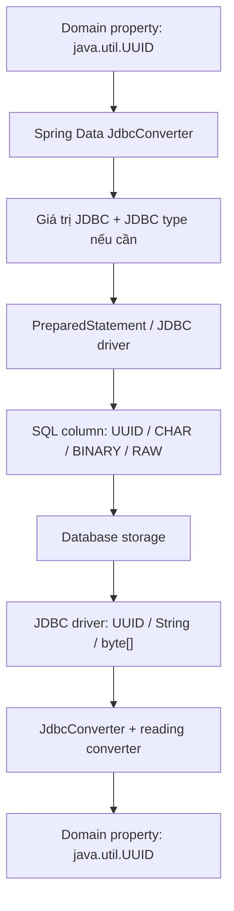

# UUID và sự khác biệt biểu diễn giữa các JDBC driver

Trong Java, `java.util.UUID` luôn biểu diễn một định danh 128 bit. Tuy nhiên, khi lưu giá trị đó qua **Spring Data JDBC**, kiểu cột, kiểu JDBC và kiểu Java mà driver trả về có thể khác nhau giữa PostgreSQL, H2, MySQL, SQL Server và Oracle. Một field Java `UUID` vì thế không tự động có cùng cách lưu trên mọi database.

Muốn dùng UUID ổn định, cần xác định ba điều: **database lưu UUID dưới dạng nào**, **JDBC driver nhận/trả kiểu Java nào**, và **Spring Data JDBC cần converter hay JDBC type hint nào**. Bài này đi từ biểu diễn chuẩn đến ví dụ cấu hình cho từng nhóm driver, tập trung vào UUID làm khóa chính hoặc một thuộc tính của aggregate.

## 1. UUID trong Java có dạng gì?

UUID (*Universally Unique Identifier*) là một giá trị 128 bit, thường được hiển thị dưới dạng năm nhóm hexadecimal, phân tách bởi dấu gạch ngang:

```text
550e8400-e29b-41d4-a716-446655440000
```

Chuỗi canonical có **32 chữ số hexadecimal + 4 dấu gạch ngang = 36 ký tự**. Hai biểu diễn phổ biến của cùng một giá trị là:

| Biểu diễn | Kích thước | Ví dụ / ý nghĩa |
|---|---:|---|
| Java `UUID` | 128 bit | `new UUID(mostSignificantBits, leastSignificantBits)` |
| Chuỗi canonical | 36 ký tự | `550e8400-e29b-41d4-a716-446655440000` |
| Hex không dấu gạch ngang | 32 ký tự | `550e8400e29b41d4a716446655440000` |
| Dãy byte | 16 byte | 16 octet của cùng giá trị UUID |
| Cột UUID native của database | Thường 16 byte nội bộ | Tên và quy tắc JDBC phụ thuộc hệ quản trị |

Java tạo và phân tích UUID bằng API chuẩn:

```java
import java.util.UUID;

UUID id = UUID.randomUUID();

String canonical = id.toString();
UUID parsed = UUID.fromString(canonical);

long high = id.getMostSignificantBits();
long low = id.getLeastSignificantBits();

System.out.println(canonical);
System.out.println(parsed.equals(id)); // true
```

`UUID.randomUUID()` tạo UUID version 4. UUID là **định danh**, không phải mật khẩu, access token hay cơ chế phân quyền. Không nên dựa vào việc UUID khó đoán để bảo vệ endpoint hoặc dữ liệu. Nếu cần UUID có thứ tự gần thời gian tạo để cải thiện locality của index, hãy nghiên cứu UUID version 7 và khả năng tạo/đọc nó trong môi trường Java đang dùng; đừng tự thay đổi byte order mà không có một quy ước chung.

## 2. Vì sao các JDBC driver biểu diễn UUID khác nhau?

JDBC cung cấp các API tổng quát như `PreparedStatement.setObject(...)`, `setString(...)`, `setBytes(...)`, `ResultSet.getObject(...)`, `getString(...)` và `getBytes(...)`. Tuy nhiên, JDBC không định nghĩa một hằng `java.sql.Types.UUID` phổ quát mà mọi database/driver bắt buộc phải dùng. Một driver có thể biểu diễn UUID bằng `Types.OTHER`, driver khác bằng `CHAR`, `BINARY` hoặc `VARBINARY`.

Vì thế, cùng một cột UUID có thể cho kết quả khác nhau khi gọi `getObject()`:

```text
Database column       JDBC metadata / driver result      Java value
--------------------------------------------------------------------------
PostgreSQL uuid       Types.OTHER                         java.util.UUID
H2 UUID               UUID type                           java.util.UUID
MySQL CHAR(36)        CHAR                                String
MySQL BINARY(16)      BINARY                              byte[]
SQL Server uniqueidentifier CHAR                           String
Oracle RAW(16)        RAW / VARBINARY                     byte[]
```

Đây là bảng định hướng theo các mapping của driver/vendor, không phải cam kết rằng mọi phiên bản driver đều trả về đúng cùng một lớp trong mọi overload của `getObject`. Một số driver có hỗ trợ `getObject(column, UUID.class)` ở phiên bản mới dù `getObject(column)` mặc định vẫn trả về `String` hoặc `byte[]`.

Luồng mapping trong Spring Data JDBC có thể hình dung như sau:



Spring Data JDBC hỗ trợ các kiểu mà database driver chấp nhận, cùng các kiểu được chuyển đổi bằng custom converter. Khi kiểu Java không được driver chấp nhận trực tiếp, ta định nghĩa **một biểu diễn lưu trữ rõ ràng** bằng `JdbcCustomConversions`.

## 3. Các kiểu lưu trữ UUID thường gặp

### 3.1. Cột UUID native

PostgreSQL và H2 có kiểu SQL `UUID` riêng. Ứng dụng có thể dùng `java.util.UUID` trực tiếp nếu driver tương ứng hỗ trợ binding/reading kiểu này.

Ưu điểm:

- Cột thể hiện đúng ý nghĩa UUID, không phải một chuỗi bất kỳ.
- Database có thể kiểm tra định dạng và hỗ trợ so sánh/index theo kiểu dữ liệu riêng.
- Không phải tự parse dấu gạch ngang hoặc chuyển 16 byte ở mọi câu SQL.

Điểm cần lưu ý: native type của hai database không có nghĩa là cùng một JDBC type code. PostgreSQL pgJDBC đăng ký `uuid` như `Types.OTHER` và ánh xạ sang `java.util.UUID`; H2 cho phép `setObject(uuid)` và `getObject()` trả về `java.util.UUID`. Đây là hỗ trợ cụ thể của driver/database.

### 3.2. Cột chuỗi `CHAR(36)` hoặc `VARCHAR(36)`

UUID được lưu dưới dạng canonical text:

```sql
CREATE TABLE account (
    id CHAR(36) PRIMARY KEY,
    email VARCHAR(255) NOT NULL
);
```

Ưu điểm là dễ đọc trong SQL client, log, file export và tương thích với nhiều hệ thống. Nhược điểm là tốn dung lượng/index hơn biểu diễn 16 byte; collation/case rules có thể ảnh hưởng so sánh nếu dữ liệu không được chuẩn hóa. Với MySQL có thể chọn charset/collation ASCII phù hợp cho chuỗi UUID.

### 3.3. Cột nhị phân `BINARY(16)` hoặc `VARBINARY(16)`

Một UUID có đúng 16 byte, do đó có thể lưu trực tiếp dưới dạng binary:

```sql
CREATE TABLE account (
    id BINARY(16) PRIMARY KEY,
    email VARCHAR(255) NOT NULL
);
```

Ưu điểm là lưu gọn và giảm kích thước index so với chuỗi 36 ký tự. Đổi lại, giá trị khó đọc trực tiếp; code phải thống nhất thứ tự byte khi encode/decode. `BINARY(16)` là fixed-length, trong khi `VARBINARY(16)` cho phép độ dài biến đổi; nếu chọn binary UUID, cần ràng buộc và kiểm tra để giá trị luôn đủ 16 byte.

### 3.4. Cột `RAW(16)` của Oracle

Oracle thường lưu 16 byte UUID trong `RAW(16)`. JDBC driver ánh xạ `RAW` sang `byte[]`, vì vậy Java có thể dùng converter từ `UUID` sang `byte[]` và ngược lại. Oracle Database 26 còn cung cấp các hàm `UUID()`, `UUID_TO_RAW()` và `RAW_TO_UUID()`; các hàm này làm việc với giá trị `RAW(16)`, không có nghĩa mọi phiên bản Oracle đều có một SQL column type tên `UUID`.

## 4. Khác biệt tiêu biểu giữa các driver

| Database | Kiểu SQL thường dùng | Java type driver thường cung cấp | Ghi chú |
|---|---|---|---|
| PostgreSQL | `UUID` | `java.util.UUID` | pgJDBC nhận UUID bằng `setObject` và nhận diện kiểu PostgreSQL `uuid`; JDBC metadata dùng `Types.OTHER` |
| H2 | `UUID` | `java.util.UUID` | Tài liệu H2 ghi rõ `setObject(uuid)` và `getObject()` trả `java.util.UUID` |
| MySQL | `CHAR(36)` / `BINARY(16)` | `String` / `byte[]` | MySQL không có SQL column type UUID native tương đương PostgreSQL; Connector/J 9.4 thêm overload `getObject(column, UUID.class)` |
| SQL Server | `uniqueidentifier` | `String` theo mapping mặc định | Microsoft JDBC mapping công bố `uniqueidentifier → CHAR → String`; dùng converter rõ ràng nếu domain là UUID |
| Oracle | `RAW(16)` hoặc `CHAR(36)` | `byte[]` hoặc `String` | Driver ánh xạ `RAW` sang dữ liệu byte; Oracle 26 có hàm chuyển UUID ↔ RAW |

### PostgreSQL: UUID native

PostgreSQL có cột `uuid` và pgJDBC hỗ trợ `java.util.UUID`. Ví dụ:

```sql
CREATE TABLE account (
    id UUID PRIMARY KEY,
    email VARCHAR(255) NOT NULL
);
```

Ở JDBC thuần, driver có thể nhận `UUID` bằng `PreparedStatement.setObject(1, id)` và trả `java.util.UUID` qua `ResultSet.getObject(...)`. Trong pgJDBC, kiểu PostgreSQL `uuid` được đăng ký với JDBC type `OTHER` và Java class `java.util.UUID`. Nếu một luồng binding cụ thể cần chỉ định JDBC type, có thể dùng `Types.OTHER`/`JDBCType.OTHER`; thường không cần chuyển UUID thành chuỗi nếu driver đã nhận trực tiếp.

### H2: UUID native

H2 cũng hỗ trợ cột `UUID`:

```sql
CREATE TABLE account (
    id UUID PRIMARY KEY,
    email VARCHAR(255) NOT NULL
);
```

Tài liệu H2 nêu rõ có thể ghi bằng `setObject(uuid)` (hoặc `setBytes`/`setString`) và `ResultSet.getObject()` trả về `java.util.UUID`. Vì thế H2 thường là môi trường thuận tiện để viết test cho field UUID. Tuy nhiên, test qua H2 không chứng minh code sẽ hoạt động giống PostgreSQL, MySQL hay SQL Server; cần integration test với database mục tiêu.

### MySQL: chuỗi hoặc 16 byte

MySQL thường dùng `CHAR(36)` khi ưu tiên khả năng đọc và `BINARY(16)` khi ưu tiên kích thước lưu trữ/index. MySQL Connector/J có bảng mapping cho `CHAR`/`VARCHAR` sang `String`, `BINARY`/`VARBINARY` sang `byte[]`. Connector/J **9.4.0** bổ sung khả năng gọi `ResultSet.getObject(column, UUID.class)`; điều này không biến `CHAR(36)` và `BINARY(16)` thành một SQL UUID type duy nhất, và không nên suy ra mọi overload `getObject()` hay `setObject(UUID)` có cùng hành vi ở mọi phiên bản.

Với Spring Data JDBC, cách rõ ràng là đăng ký converter `UUID ↔ String` cho `CHAR(36)`, hoặc `UUID ↔ byte[]` cho `BINARY(16)`. Như vậy domain vẫn dùng `UUID` dù driver làm việc với kiểu lưu trữ đơn giản.

### SQL Server: `uniqueidentifier`

SQL Server có kiểu `uniqueidentifier` 16 byte. Tuy nhiên, tài liệu mapping mặc định của Microsoft JDBC Driver công bố:

```text
SQL Server type       JDBC type       Java type
uniqueidentifier      CHAR            String
```

Vì vậy, khi domain model dùng `UUID`, nên chuyển sang chuỗi canonical lúc ghi và parse chuỗi lúc đọc, hoặc dùng API riêng của driver sau khi đã kiểm tra phiên bản. Cần kiểm tra cả cách binding lẫn cách đọc; đừng giả định rằng tên SQL type có chữ “uniqueidentifier” đồng nghĩa driver luôn trả `java.util.UUID`.

### Oracle: `RAW(16)`

Oracle JDBC mapping `RAW` về `byte[]`. Có thể lưu UUID trong `RAW(16)` và dùng converter binary như ví dụ ở phần sau. Với Oracle Database 26, các hàm `UUID_TO_RAW('...')` và `RAW_TO_UUID(raw_value)` hỗ trợ chuyển đổi ở SQL. Với phiên bản cũ hơn, dùng logic byte/string trong ứng dụng hoặc SQL tương thích với phiên bản đó; không gọi các hàm 26 trong migration dành cho server cũ.

## 5. Chọn biểu diễn nào cho dự án?

| Tiêu chí | Native UUID | `CHAR(36)` | `BINARY(16)` / `RAW(16)` |
|---|---|---|---|
| Dễ đọc khi kiểm tra SQL | Khá tốt (tùy client hiển thị) | Tốt nhất | Kém, thường phải format/hex |
| Kích thước dữ liệu | Thường 16 byte | 36 ký tự | 16 byte |
| Hỗ trợ driver | Phụ thuộc database và driver | Rộng, thường dùng String | Rộng, thường dùng byte array |
| Converter trong Spring Data JDBC | Có thể không cần nếu driver nhận `UUID` | UUID ↔ String | UUID ↔ byte[] |
| Khả năng mang sang DB khác | Cần kiểm tra native type | Cao | Cao nếu quy định byte order rõ |

Gợi ý lựa chọn:

- Dùng **PostgreSQL/H2 native UUID** nếu database mục tiêu hỗ trợ và driver đã được kiểm thử.
- Dùng **`CHAR(36)`** khi ưu tiên dễ đọc, export và tương tác với nhiều hệ thống.
- Dùng **`BINARY(16)`/`RAW(16)`** khi muốn lưu gọn và chấp nhận việc mọi ứng dụng phải tuân theo một quy ước byte order.
- Không chọn binary chỉ vì “nhỏ hơn” nếu hệ thống thường xuyên phải debug bằng SQL hoặc nhiều ngôn ngữ khác nhau cùng ghi dữ liệu mà chưa có chuẩn chuyển đổi.

## 6. Spring Data JDBC: để driver xử lý UUID hay đăng ký converter?

`MappingJdbcConverter` chuyển đổi property của entity sang giá trị mà JDBC có thể bind. Theo tài liệu Spring Data JDBC, các kiểu được hỗ trợ bao gồm **bất kỳ kiểu nào mà database driver chấp nhận**, và các kiểu có custom converter thích hợp. Do đó:

1. Nếu driver nhận trực tiếp `java.util.UUID` (ví dụ pgJDBC với PostgreSQL `uuid` hoặc H2 `UUID`), có thể dùng field `UUID` trực tiếp sau khi xác nhận bằng integration test.
2. Nếu driver trả `String` hoặc `byte[]`, đăng ký converter hai chiều cho đúng kiểu cột.
3. Nếu cần chỉ định JDBC type thay vì để Spring/driver suy luận, converter ghi có thể trả `JdbcValue` để cung cấp cả value lẫn `JDBCType`.

Các converter được áp dụng ở **property level**: một property Java đổi thành một giá trị database và ngược lại. Không dùng converter này để biến một UUID thành nhiều cột hoặc tự tạo cấu trúc quan hệ phức tạp.

### 6.1. Ví dụ converter cho `CHAR(36)`

Hai converter sau chuyển UUID thành chuỗi canonical và parse ngược:

```java
import java.util.UUID;

import org.springframework.core.convert.converter.Converter;
import org.springframework.data.convert.ReadingConverter;
import org.springframework.data.convert.WritingConverter;

@WritingConverter
public final class UuidToStringConverter implements Converter<UUID, String> {
    @Override
    public String convert(UUID source) {
        return source.toString();
    }
}

@ReadingConverter
public final class StringToUuidConverter implements Converter<String, UUID> {
    @Override
    public UUID convert(String source) {
        return UUID.fromString(source);
    }
}
```

Đăng ký chúng qua `AbstractJdbcConfiguration.userConverters()`:

```java
import java.util.List;

import org.springframework.context.annotation.Configuration;
import org.springframework.data.jdbc.repository.config.AbstractJdbcConfiguration;

@Configuration
public class MyJdbcConfiguration extends AbstractJdbcConfiguration {

    @Override
    protected List<?> userConverters() {
        return List.of(
                new UuidToStringConverter(),
                new StringToUuidConverter()
        );
    }
}
```

`@WritingConverter` và `@ReadingConverter` rất quan trọng vì cả `UUID` và `String` đều là kiểu đơn giản. Chúng xác định hướng chuyển đổi để Spring không suy luận sai chiều. Ở các phiên bản Spring Data JDBC hiện đại, nên thêm converter người dùng qua `userConverters()`; không tự override `jdbcCustomConversions()` theo hướng dẫn cũ nếu điều đó làm mất các converter mà dialect đăng ký.

### 6.2. Ví dụ converter cho `BINARY(16)`

`UUID` có hai phần 64 bit. Để có một định dạng 16 byte xác định, ví dụ dưới đây ghi **most-significant bits trước, least-significant bits sau**, theo thứ tự big-endian của `ByteBuffer`:

```java
import java.nio.ByteBuffer;
import java.util.UUID;

import org.springframework.core.convert.converter.Converter;
import org.springframework.data.convert.ReadingConverter;
import org.springframework.data.convert.WritingConverter;

@WritingConverter
public final class UuidToBytesConverter implements Converter<UUID, byte[]> {
    @Override
    public byte[] convert(UUID source) {
        return ByteBuffer.allocate(16)
                .putLong(source.getMostSignificantBits())
                .putLong(source.getLeastSignificantBits())
                .array();
    }
}

@ReadingConverter
public final class BytesToUuidConverter implements Converter<byte[], UUID> {
    @Override
    public UUID convert(byte[] source) {
        if (source.length != 16) {
            throw new IllegalArgumentException("A UUID must contain exactly 16 bytes");
        }

        ByteBuffer buffer = ByteBuffer.wrap(source);
        return new UUID(buffer.getLong(), buffer.getLong());
    }
}
```

Đăng ký hai converter này trong `userConverters()` thay cho cặp `UUID ↔ String` khi cột là binary. Không đăng ký đồng thời nhiều converter có cùng source type `UUID` và các target store type khác nhau nếu không có quy tắc phân biệt rõ; hãy chọn **một biểu diễn cho một schema**.

Nếu cần chỉ định JDBC type khi ghi, Spring Data JDBC cung cấp `JdbcValue`:

```java
import java.nio.ByteBuffer;
import java.sql.JDBCType;
import java.util.UUID;

import org.springframework.core.convert.converter.Converter;
import org.springframework.data.convert.WritingConverter;
import org.springframework.data.jdbc.core.mapping.JdbcValue;

@WritingConverter
public final class UuidToBinaryJdbcValueConverter
        implements Converter<UUID, JdbcValue> {

    @Override
    public JdbcValue convert(UUID source) {
        byte[] bytes = ByteBuffer.allocate(16)
                .putLong(source.getMostSignificantBits())
                .putLong(source.getLeastSignificantBits())
                .array();

        return JdbcValue.of(bytes, JDBCType.BINARY);
    }
}
```

`JdbcValue.of(value, JDBCType.BINARY)` yêu cầu Spring bind giá trị như kiểu JDBC `BINARY`. Chỉ dùng hint này khi nó phù hợp với driver và schema cụ thể; `RAW` của Oracle, `VARBINARY` và `BINARY` có thể cần JDBC type khác nhau. Nếu driver đã suy luận đúng từ `byte[]`, converter trả trực tiếp `byte[]` thường đơn giản hơn.

### 6.3. Converter cho PostgreSQL khi cần type hint

Với pgJDBC, `java.util.UUID` được driver nhận diện là PostgreSQL `uuid`, tương ứng JDBC `Types.OTHER`. Trong trường hợp cần ép kiểu JDBC một cách tường minh, có thể trả `JdbcValue`:

```java
import java.sql.JDBCType;
import java.util.UUID;

import org.springframework.core.convert.converter.Converter;
import org.springframework.data.convert.WritingConverter;
import org.springframework.data.jdbc.core.mapping.JdbcValue;

@WritingConverter
public final class UuidToPostgresValueConverter
        implements Converter<UUID, JdbcValue> {
    @Override
    public JdbcValue convert(UUID source) {
        return JdbcValue.of(source, JDBCType.OTHER);
    }
}
```

Đây là lựa chọn **khi cần** type hint; nếu cấu hình mặc định đã bind UUID đúng, không cần thêm converter chỉ để có thêm code.

## 7. Dùng UUID làm khóa chính trong Spring Data JDBC

Ví dụ một aggregate root tạo UUID ở ứng dụng trước khi lưu:

```java
import java.util.UUID;

import org.springframework.data.annotation.Id;
import org.springframework.data.annotation.Version;
import org.springframework.data.relational.core.mapping.Table;

@Table("account")
public class Account {

    @Id
    private UUID id;

    @Version
    private Long version;

    private String email;

    protected Account() {}

    public Account(String email) {
        this.id = UUID.randomUUID();
        this.email = email;
    }

    public UUID getId() { return id; }
    public String getEmail() { return email; }
}
```

```java
public interface AccountRepository extends CrudRepository<Account, UUID> {}
```

Điểm quan trọng: nếu UUID đã được gán trước khi gọi `save()`, `id` không còn `null`. Spring Data mặc định dùng ID để phát hiện entity mới; một ID khác null có thể bị xem là entity đã tồn tại. Khi có property `@Version` kiểu wrapper như `Long`, giá trị `null` của version đánh dấu entity mới. Spring Data JDBC có thể insert UUID đã được tạo ở ứng dụng và tăng version sau thao tác insert. Một lựa chọn khác là triển khai `Persistable` với `isNew()` được quản lý đúng vòng đời.

Vì vậy, **đừng chỉ gán UUID trong constructor rồi bỏ qua entity state detection**. Nếu không có `@Version` hoặc cơ chế `Persistable`, `save()` có thể đi vào nhánh update và thất bại vì bản ghi chưa tồn tại.

Với PostgreSQL, schema tương ứng:

```sql
CREATE TABLE account (
    id UUID PRIMARY KEY,
    version BIGINT NOT NULL,
    email VARCHAR(255) NOT NULL
);
```

Với MySQL `CHAR(36)`:

```sql
CREATE TABLE account (
    id CHAR(36) NOT NULL PRIMARY KEY,
    version BIGINT NOT NULL,
    email VARCHAR(255) NOT NULL
);
```

Ở MySQL, converter `UUID ↔ String` sẽ làm cho field `UUID id` tương thích với cột `CHAR(36)`. Với `BINARY(16)`, dùng converter binary và schema tương ứng. Domain class có thể giữ nguyên, chỉ thay cấu hình persistence theo database.

## 8. MySQL `UUID_TO_BIN` và thứ tự byte

MySQL cung cấp `UUID_TO_BIN()` và `BIN_TO_UUID()` để chuyển đổi giữa chuỗi UUID và 16 byte. Hai hàm có tùy chọn `swap_flag`:

```sql
SET @id = '6ccd780c-baba-1026-9564-5b8c656024db';

SELECT HEX(UUID_TO_BIN(@id, 0));
-- 6CCD780CBABA102695645B8C656024DB

SELECT HEX(UUID_TO_BIN(@id, 1));
-- 1026BABA6CCD780C95645B8C656024DB
```

Với `swap_flag = 1`, MySQL đổi vị trí các nhóm time-low/time-high của UUID version 1 để cải thiện locality của index trong trường hợp phù hợp. MySQL docs nói cách sắp xếp này giả định UUID v1; với UUID sinh theo cách khác, time-part swapping không mang lại lợi ích đó. Không bật `swap_flag = 1` theo thói quen cho mọi UUID.

Điều bắt buộc là **đọc và ghi dùng cùng quy ước**:

```sql
-- Không swap khi ghi thì cũng không swap khi đọc
INSERT INTO account(id) VALUES (UUID_TO_BIN(:uuid, 0));
SELECT BIN_TO_UUID(id, 0) FROM account;

-- Nếu schema cũ đã dùng swap=1 thì cả hai phía đều phải dùng 1
INSERT INTO account(id) VALUES (UUID_TO_BIN(:uuid, 1));
SELECT BIN_TO_UUID(id, 1) FROM account;
```

Ví dụ Java `ByteBuffer` ở trên tạo byte theo thứ tự canonical (không swap). Nếu ứng dụng ghi `byte[]` trực tiếp vào `BINARY(16)`, không được trộn với dữ liệu được tạo qua `UUID_TO_BIN(uuid, 1)` nếu chưa chuyển đổi đúng thứ tự. Nếu dùng SQL function, có thể giữ domain UUID dưới dạng chuỗi parameter cho câu lệnh SQL tùy chỉnh; nếu dùng repository mapping, converter phải tái tạo chính xác byte order mà schema đã chọn.

## 9. UUID ở SQL Server và Oracle

### SQL Server

Ví dụ schema:

```sql
CREATE TABLE account (
    id UNIQUEIDENTIFIER NOT NULL PRIMARY KEY,
    email NVARCHAR(255) NOT NULL
);
```

Nếu Spring Data JDBC làm việc qua Microsoft JDBC Driver với mapping mặc định `uniqueidentifier → String`, cặp converter UUID/String là cách dễ kiểm soát. Nếu dùng JDBC thuần, có thể binding chuỗi canonical bằng `setString()` vào parameter `uniqueidentifier`; hãy kiểm thử trên đúng phiên bản Microsoft JDBC Driver và SQL Server đang triển khai. Driver cũng có API riêng như `setUniqueIdentifier(...)` ở một số phiên bản, nhưng đó là extension vendor-specific.

### Oracle

Ví dụ schema:

```sql
CREATE TABLE account (
    id RAW(16) PRIMARY KEY,
    email VARCHAR2(255) NOT NULL
);
```

Với `RAW(16)`, converter UUID/byte[] là lựa chọn tự nhiên vì Oracle JDBC trả dữ liệu `RAW` dưới dạng byte array. Oracle Database 26 có thể kiểm tra/format bằng:

```sql
SELECT RAW_TO_UUID(id) FROM account;
SELECT UUID_TO_RAW('550e8400-e29b-41d4-a716-446655440000') FROM dual;
```

Đối với Oracle cũ hơn, hãy kiểm tra khả năng hỗ trợ của phiên bản server và driver; không dùng các hàm UUID mới nếu server không có chúng. Cũng cần xác nhận JDBC type hint tương ứng với `RAW` trong driver đang dùng, vì `RAW` được công bố qua các JDBC binary type mapping.

## 10. Kiểm thử binding và round-trip với đúng driver

Một kiểm thử tốt cần xác nhận **ghi UUID → đọc lại UUID → so sánh bằng equals**. Đừng chỉ kiểm tra chuỗi in ra hoặc chỉ chạy H2 nếu production dùng database khác.

Ví dụ JDBC thuần cho driver hỗ trợ `UUID` trực tiếp như PostgreSQL/H2:

```java
UUID expected = UUID.randomUUID();

try (PreparedStatement ps = connection.prepareStatement(
        "INSERT INTO account(id, email) VALUES (?, ?)")) {
    ps.setObject(1, expected);
    ps.setString(2, "demo@example.com");
    ps.executeUpdate();
}

try (PreparedStatement ps = connection.prepareStatement(
        "SELECT id FROM account WHERE id = ?")) {
    ps.setObject(1, expected);

    try (ResultSet rs = ps.executeQuery()) {
        if (!rs.next()) {
            throw new IllegalStateException("UUID row was not found");
        }

        UUID actual = rs.getObject("id", UUID.class);
        if (!expected.equals(actual)) {
            throw new IllegalStateException("UUID round-trip mismatch");
        }
    }
}
```

Đoạn trên là ví dụ cho driver hỗ trợ kiểu UUID và JDBC typed getter. Với MySQL `CHAR(36)`/SQL Server `uniqueidentifier`, dùng `setString()`/`getString()` hoặc custom converter. Với `BINARY(16)`/Oracle `RAW(16)`, dùng `setBytes()`/`getBytes()` và kiểm tra đúng 16 byte. Không copy nguyên JDBC call của PostgreSQL sang mọi database.

Trong Spring Data JDBC, nên viết integration test bằng repository:

```java
@DataJdbcTest
class AccountRepositoryTest {

    @Autowired AccountRepository repository;

    @Test
    void savesAndLoadsUuid() {
        Account saved = repository.save(new Account("demo@example.com"));

        Account loaded = repository.findById(saved.getId()).orElseThrow();

        assertThat(loaded.getId()).isEqualTo(saved.getId());
    }
}
```

Chạy test với **database và driver mục tiêu**. Nếu dùng Testcontainers, chọn image đúng phiên bản engine và để ứng dụng nạp cùng JDBC driver như production. Kiểm thử này phát hiện lỗi converter, JDBC type, schema, entity state detection và generated ID/round-trip.

## 11. Các lỗi thường gặp

| Lỗi / biểu hiện | Nguyên nhân có thể | Cách xử lý |
|---|---|---|
| `Can't infer the SQL type to use for an instance of java.util.UUID` | Driver không biết bind UUID object trực tiếp | Chuyển sang `String`/`byte[]` bằng converter; hoặc chỉ định `JdbcValue` với JDBC type phù hợp |
| `ConversionFailedException` giữa `String` và `UUID` | Thiếu converter đọc/ghi, dữ liệu chuỗi sai định dạng hoặc converter chưa được đăng ký | Kiểm tra `@ReadingConverter`, `@WritingConverter`, `userConverters()` và dữ liệu thực tế |
| `Data truncation` hoặc binary length sai | Cột/parameter không phải 16 byte, hoặc converter tạo số byte không đúng | Dùng `BINARY(16)`/`VARBINARY(16)` và kiểm tra `bytes.length == 16` |
| Đọc UUID khác giá trị đã ghi | Hai phía dùng byte order hoặc swap flag khác nhau | Thống nhất canonical byte order và cấu hình `UUID_TO_BIN`/`BIN_TO_UUID` |
| H2 chạy nhưng MySQL/SQL Server lỗi | H2 dùng native UUID và driver khác có mapping riêng | Test bằng đúng database, driver và schema production |
| `save()` cố update một row chưa tồn tại | UUID đã có giá trị nên mặc định entity bị xem là existing | Dùng `@Version` wrapper chưa có giá trị, hoặc `Persistable.isNew()` đúng cách |
| SQL Server trả `String` thay vì UUID | Mapping mặc định của Microsoft JDBC Driver cho `uniqueidentifier` là `CHAR/String` | Đăng ký converter UUID ↔ String hoặc dùng API driver đã xác minh |
| Oracle trả `byte[]` thay vì UUID | `RAW(16)` được driver ánh xạ thành binary | Đăng ký converter UUID ↔ byte[] và xác nhận JDBC type hint |
| UUID string khác chữ hoa/thường | Các client chuẩn hóa khác nhau hoặc collation khác | Dùng `UUID.toString()` để ghi canonical, parse và so sánh theo giá trị UUID |

## 12. Checklist quyết định cho một dự án

Trước khi triển khai UUID, ghi rõ các lựa chọn sau trong thiết kế/schema:

1. **Domain type:** dùng `java.util.UUID` hay một value object bao quanh UUID?
2. **Generation:** ứng dụng tạo (`UUID.randomUUID()` hoặc generator UUID version khác) hay database tạo?
3. **SQL column:** `UUID`, `CHAR(36)`, `BINARY(16)`, `uniqueidentifier` hay `RAW(16)`?
4. **JDBC mapping:** driver bind/read thành `UUID`, `String` hay `byte[]`? JDBC type code là gì?
5. **Spring conversion:** driver hỗ trợ trực tiếp hay cần cặp `@WritingConverter`/`@ReadingConverter`?
6. **Binary layout:** thứ tự byte là gì? Có dùng MySQL `swap_flag` không? Tất cả ứng dụng có cùng quy ước không?
7. **Entity state:** nếu UUID được gán trước khi save, `@Version` hoặc `Persistable` có xác định entity mới chính xác không?
8. **Round-trip test:** đã chạy test với đúng engine, driver, schema và version production chưa?

Khi chuyển database, không chỉ đổi JDBC URL và driver. Cần kiểm tra DDL, converter, byte order, câu query SQL, dữ liệu hiện hữu và test migration. Nếu nhiều service/ngôn ngữ cùng đọc một cột binary, hãy ghi lại quy ước 16 byte như một phần của contract dữ liệu.

## Tài liệu tham khảo chính thức

- [Spring Data JDBC — Mapping và supported types](https://docs.spring.io/spring-data/relational/reference/jdbc/mapping.html): kiểu driver chấp nhận, custom conversions, `JdbcValue` và `userConverters()`.
- [Spring Data JDBC — Persisting Entities](https://docs.spring.io/spring-data/relational/reference/jdbc/entity-persistence.html): ID và cách lưu entity.
- [Spring Data — Entity State Detection](https://docs.spring.io/spring-data/relational/reference/data-commons/is-new-state-detection.html): nhận diện entity mới qua `@Id`, `@Version` hoặc `Persistable`.
- [pgJDBC Documentation](https://jdbc.postgresql.org/documentation/): PostgreSQL JDBC driver.
- [pgJDBC `PgConnection` source](https://github.com/pgjdbc/pgjdbc/blob/master/pgjdbc/src/main/java/org/postgresql/jdbc/PgConnection.java): đăng ký PostgreSQL `uuid` thành `Types.OTHER` và `java.util.UUID`.
- [H2 — Data Types: UUID](https://h2database.com/html/datatypes.html): binding và reading UUID qua JDBC.
- [MySQL Connector/J — Java, JDBC, and MySQL Types](https://dev.mysql.com/doc/connector-j/en/connector-j-reference-type-conversions.html): mapping giữa kiểu MySQL, JDBC và Java.
- [MySQL Connector/J Release Notes](https://downloads.mysql.com/docs/connector-j-relnotes-en.a4.pdf): hỗ trợ `getObject(column, UUID.class)` từ Connector/J 9.4.0.
- [MySQL 8.4 — UUID_TO_BIN và BIN_TO_UUID](https://dev.mysql.com/doc/refman/8.4/en/miscellaneous-functions.html): quy tắc byte và `swap_flag`.
- [Microsoft JDBC Driver — Basic Data Types](https://learn.microsoft.com/en-us/sql/connect/jdbc/using-basic-data-types?view=sql-server-ver17): mapping `uniqueidentifier` sang JDBC `CHAR`/Java `String`.
- [Oracle Database 26 — UUID_TO_RAW](https://docs.oracle.com/en/database/oracle/oracle-database/26/sqlrf/uuid_to_raw.html): chuyển chuỗi UUID sang `RAW(16)`.
- [Oracle JDBC — JDBC Reference Information](https://docs.oracle.com/en/database/oracle/oracle-database/26/jjdbc/JDBC-reference-information.html): mapping SQL `RAW` và Java `byte[]`.
