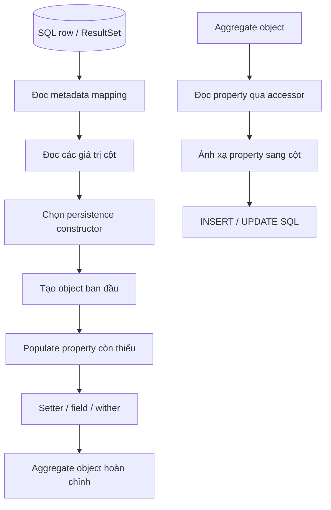

# Ánh xạ field, constructor, setter và phương thức wither

Trong **Spring Data Relational JDBC**, Spring Data phải chuyển đổi dữ liệu giữa hai dạng: hàng trong bảng SQL và đối tượng Java. Khi đọc, framework dựng object từ các giá trị cột; khi ghi, framework đọc các property của object để tạo câu SQL. Quá trình này được gọi là **object mapping** hoặc **object materialization**.

Có bốn cơ chế Java quan trọng ảnh hưởng đến quá trình đó:

- **Field:** nơi dữ liệu thực sự được lưu trong object.
- **Constructor:** cách tạo instance ban đầu từ các giá trị đã đọc.
- **Setter:** cách cập nhật property sau khi object được tạo.
- **Wither:** phương thức trả về một instance mới với một property được thay đổi, phù hợp với object immutable.

Hiểu đúng bốn cơ chế giúp bạn chọn được mô hình domain dễ bảo trì, xử lý chính xác ID do database sinh, và tránh lỗi khi Spring Data JDBC khôi phục object từ ResultSet. Bài học đặt các cơ chế này trong ngữ cảnh **Khởi tạo đối tượng** của Spring Data Relational JDBC.

## 1. Object mapping diễn ra như thế nào?

Spring Data JDBC dùng metadata để biết class nào là aggregate root, property nào cần lưu, tên bảng/cột tương ứng và cách tạo object. Metadata được xây dựng từ cấu trúc Java, annotation Spring Data và naming strategy.



Khi đọc dữ liệu, quy trình khái quát là:

1. Spring Data JDBC xác định mapping metadata của domain type.
2. Tên cột từ kết quả SQL được đối chiếu với persistent properties.
3. Các property có thể được truyền vào constructor được dùng để tạo object.
4. Các property chưa được gán trong constructor được populate tiếp bằng cơ chế truy cập phù hợp.
5. Object đã được dựng hoàn chỉnh được trả về cho repository caller.

Khi ghi dữ liệu, Spring Data JDBC đọc giá trị từ object thông qua property accessor và tạo các câu SQL cần thiết. Cách truy cập property ảnh hưởng đến việc framework lấy giá trị; constructor và wither ảnh hưởng đến việc tạo instance, đặc biệt khi có ID được database sinh.

**Spring Data JDBC không phải JPA.** Nó không dùng JPA persistence context, dirty checking hay lifecycle callback để tự động theo dõi thay đổi object. Bạn gọi repository để lưu aggregate; framework dùng metadata và JDBC để thực hiện thao tác lưu.

## 2. Field và persistent property

Một class Java thường có field và các phương thức truy cập:

```java
public class Customer {
    private String displayName;

    public String getDisplayName() {
        return displayName;
    }

    public void setDisplayName(String displayName) {
        this.displayName = displayName;
    }
}
```

- `displayName` là **field** lưu giá trị.
- `getDisplayName()` và `setDisplayName(...)` là các phương thức JavaBean.
- Trong mô hình object mapping của Spring Data, property là phần tử metadata đại diện cho một giá trị persistent. Property có thể được đọc/ghi qua field hoặc qua getter/setter tùy access strategy.

### 2.1. Field access

Spring Data thường có thể truy cập trực tiếp field bằng reflection, vì vậy entity không bắt buộc phải có setter cho mọi property. Ví dụ:

```java
import org.springframework.data.annotation.Id;
import org.springframework.data.relational.core.mapping.Table;

@Table("customers")
public class Customer {

    @Id
    private Long id;

    private String displayName;

    protected Customer() {
    }

    public Customer(String displayName) {
        this.displayName = displayName;
    }

    public Long getId() {
        return id;
    }

    public String getDisplayName() {
        return displayName;
    }
}
```

Class trên không có setter cho `id` hoặc `displayName`, nhưng Spring Data JDBC vẫn có thể ánh xạ chúng thông qua constructor và field access. Đây là một kiểu thiết kế hữu ích khi muốn kiểm soát thay đổi từ bên ngoài class.

Field access không có nghĩa là bạn nên công khai field. Hãy giữ field `private`, cung cấp hành vi nghiệp vụ và chỉ cho phép framework truy cập theo mapping metadata.

### 2.2. Property access

Nếu muốn Spring Data đọc/ghi qua JavaBean property thay vì truy cập field trực tiếp, có thể dùng `@AccessType`:

```java
import org.springframework.data.annotation.AccessType;
import org.springframework.data.annotation.Id;
import org.springframework.data.relational.core.mapping.Table;

@AccessType(AccessType.Type.PROPERTY)
@Table("customers")
public class Customer {

    private Long id;
    private String displayName;

    protected Customer() {
    }

    public Customer(String displayName) {
        this.displayName = displayName;
    }

    @Id
    public Long getId() {
        return id;
    }

    public void setId(Long id) {
        this.id = id;
    }

    public String getDisplayName() {
        return displayName;
    }

    public void setDisplayName(String displayName) {
        this.displayName = displayName;
    }
}
```

`@AccessType(AccessType.Type.PROPERTY)` là annotation của Spring Data, package `org.springframework.data.annotation`. Nó hướng dẫn mapping sử dụng property access. Khi chọn cách này, hãy bảo đảm getter/setter phù hợp tồn tại và có hành vi đúng.

Bạn cũng có thể đặt access type ở phạm vi property khi cần điều chỉnh một property cụ thể. Hãy kiểm tra vị trí annotation và quy tắc access type của phiên bản Spring Data đang sử dụng nếu class có cấu trúc phức tạp.

### 2.3. Đừng nhầm field với cột database

Tên field Java không nhất thiết giống tên cột. Spring Data Relational áp dụng naming strategy, và có thể ghi đè bằng `@Column`:

```java
import org.springframework.data.relational.core.mapping.Column;

@Column("display_name")
private String displayName;
```

Với property `displayName`, naming strategy mặc định thường suy ra cột `display_name`. Annotation tường minh hữu ích khi schema đã có tên riêng hoặc muốn mapping không phụ thuộc vào quy ước tự động.

`@Column` ở đây phải là `org.springframework.data.relational.core.mapping.Column`. Annotation `jakarta.persistence.Column` của JPA không phải metadata mapping tương ứng cho Spring Data JDBC.

### 2.4. Property nào được persistence?

Một property thông thường có thể được xem là persistent nếu Spring Data mapping metadata nhận diện nó và nó không bị loại trừ. Một số property có thể cần bỏ qua:

```java
import org.springframework.data.annotation.Transient;

@Table("products")
public class Product {

    @Id
    private Long id;

    private long priceCents;

    @Transient
    private String formattedPrice;
}
```

`formattedPrice` là dữ liệu tính toán, không phải cột lưu trữ. Annotation đúng là `org.springframework.data.annotation.Transient`. Đừng dùng `jakarta.persistence.Transient` với kỳ vọng Spring Data JDBC sẽ hiểu cùng metadata.

Khi thiết kế object, phân biệt rõ:

- **Persistent property:** cần đọc/ghi từ database.
- **Transient/computed property:** được tính từ các giá trị khác hoặc chỉ phục vụ hiển thị.
- **Constructor-only input:** tham số dùng để tạo object nhưng không nhất thiết là property lưu trữ; phải thiết kế mapping phù hợp để tránh framework không tìm thấy giá trị tương ứng khi đọc.

## 3. Constructor: cách Spring Data tạo object

Khi Spring Data JDBC đọc một hàng dữ liệu, nó cần một instance để điền giá trị. Constructor được chọn gọi là **persistence constructor**.

Spring Data có các quy ước chọn constructor, trong đó những trường hợp phổ biến là:

1. Nếu class có một constructor phù hợp duy nhất, Spring Data thường sử dụng constructor đó.
2. Nếu có nhiều constructor, có thể đánh dấu constructor hoặc factory method cần dùng bằng `@PersistenceCreator`.
3. Nếu không có constructor được chỉ định và class có constructor không tham số phù hợp, framework có thể tạo object trước rồi populate các property còn lại.
4. Java record có canonical constructor, rất phù hợp với mô hình immutable.
5. Tham số constructor cần khớp với persistent properties để Spring Data biết giá trị nào truyền vào tham số nào.

Không nên tạo nhiều constructor cùng lúc mà không làm rõ constructor dùng cho persistence. Điều đó khiến việc khôi phục object khó hiểu hoặc dẫn tới lỗi khi mapping metadata không thể xác định cách khởi tạo.

### 3.1. Constructor không tham số

Mô hình đơn giản:

```java
@Table("customers")
public class Customer {

    @Id
    private Long id;

    private String displayName;

    protected Customer() {
        // Dành cho object mapping.
    }

    public Customer(String displayName) {
        this.displayName = displayName;
    }

    public Long getId() {
        return id;
    }

    public String getDisplayName() {
        return displayName;
    }
}
```

Spring Data có thể gọi constructor không tham số để tạo instance, rồi populate ID và display name bằng field/property access. Constructor này thường để `protected` nhằm hạn chế code nghiệp vụ tự tạo object thiếu dữ liệu.

Không bắt buộc mọi class phải có no-arg constructor. Nếu chọn constructor-based materialization, có thể dùng constructor chứa các property cần thiết và bỏ constructor không tham số.

### 3.2. Constructor đầy đủ

```java
import org.springframework.data.annotation.Id;
import org.springframework.data.relational.core.mapping.Table;

@Table("customers")
public class Customer {

    @Id
    private final Long id;

    private final String displayName;
    private final String email;

    public Customer(Long id, String displayName, String email) {
        this.id = id;
        this.displayName = displayName;
        this.email = email;
    }

    public Long getId() {
        return id;
    }

    public String getDisplayName() {
        return displayName;
    }

    public String getEmail() {
        return email;
    }
}
```

Constructor nhận tất cả persistent properties cần khởi tạo. Khi query trả về hàng có `id`, `display_name` và `email`, Spring Data ánh xạ chúng vào các tham số tương ứng.

Một constructor duy nhất thường là lựa chọn rõ ràng. Với nhiều constructor, hãy đánh dấu constructor dành cho persistence, tránh để việc chọn phụ thuộc vào phỏng đoán.

### 3.3. `@PersistenceCreator` khi có nhiều constructor

```java
import org.springframework.data.annotation.Id;
import org.springframework.data.annotation.PersistenceCreator;
import org.springframework.data.relational.core.mapping.Table;

@Table("customers")
public class Customer {

    @Id
    private final Long id;

    private final String displayName;
    private final String email;

    @PersistenceCreator
    public Customer(Long id, String displayName, String email) {
        this.id = id;
        this.displayName = displayName;
        this.email = email;
    }

    public Customer(String displayName) {
        this(null, displayName, null);
    }

    public Long getId() {
        return id;
    }

    public String getDisplayName() {
        return displayName;
    }

    public String getEmail() {
        return email;
    }
}
```

Constructor được đánh dấu `@PersistenceCreator` là constructor Spring Data dùng để khôi phục object. Constructor ngắn hơn dành cho code nghiệp vụ tạo object mới.

Annotation phải import từ `org.springframework.data.annotation.PersistenceCreator`. Nó không phải annotation JPA và không thay thế quy tắc mapping của JPA.

Nếu dùng static factory method cho persistence, Spring Data cũng có thể hỗ trợ factory được đánh dấu phù hợp. Dù chọn constructor hay factory, hãy bảo đảm tất cả tham số có thể được ánh xạ từ persistent properties.

### 3.4. Tên tham số constructor phải khớp property

Ví dụ:

```java
public Customer(Long id, String displayName, String email) {
    // ...
}
```

Spring Data cần biết tham số `displayName` tương ứng với property `displayName`. Với Java, tên tham số ở runtime cần được giữ lại bằng compiler option `-parameters` hoặc cơ chế metadata tên tham số phù hợp. Nếu tên tham số bị mất, Spring Data có thể không phân giải được property tương ứng.

Trong Gradle, Java compiler có thể được cấu hình như sau:

```gradle
tasks.withType(JavaCompile).configureEach {
    options.compilerArgs.add("-parameters")
}
```

Spring Boot/Gradle project có thể đã cấu hình tùy theo plugin và phiên bản. Kiểm tra cấu hình build trước khi thêm lại. Không nên đặt tên constructor parameter tùy tiện khác với persistent property.

Với Java record, tên component được phản ánh rõ trong canonical constructor, nên thường thuận tiện cho constructor mapping:

```java
@Table("customers")
public record Customer(
        @Id Long id,
        String displayName,
        String email
) {
}
```

Record bất biến và không có setter. Spring Data có thể dùng canonical constructor để khôi phục record từ dữ liệu.

### 3.5. Constructor phải phản ánh trạng thái hợp lệ

Constructor là nơi tốt để bảo vệ invariant của domain:

```java
@Table("products")
public class Product {

    @Id
    private final Long id;

    private final String name;
    private final long priceCents;

    @PersistenceCreator
    public Product(Long id, String name, long priceCents) {
        if (name == null || name.isBlank()) {
            throw new IllegalArgumentException("Product name is required");
        }
        if (priceCents < 0) {
            throw new IllegalArgumentException("Price must not be negative");
        }

        this.id = id;
        this.name = name;
        this.priceCents = priceCents;
    }

    public Product(String name, long priceCents) {
        this(null, name, priceCents);
    }
}
```

Cần cân nhắc constructor validation có thể được gọi cả khi object được khôi phục từ DB. Nếu dữ liệu cũ không còn thỏa invariant mới, việc đọc dữ liệu có thể thất bại. Đây là lý do schema migration và quy tắc domain phải được quản lý cùng nhau.

## 4. Setter: cập nhật property sau khi tạo object

Setter là phương thức JavaBean có dạng `setProperty(value)`. Khi Spring Data dùng constructor để tạo object nhưng một property chưa được cung cấp qua constructor, setter có thể được dùng để populate property đó nếu access strategy cho phép.

Ví dụ:

```java
@Table("customers")
public class Customer {

    @Id
    private Long id;

    private String displayName;

    protected Customer() {
    }

    public Customer(String displayName) {
        this.displayName = displayName;
    }

    public Long getId() {
        return id;
    }

    public void setId(Long id) {
        this.id = id;
    }

    public String getDisplayName() {
        return displayName;
    }

    public void setDisplayName(String displayName) {
        this.displayName = displayName;
    }
}
```

Trong mô hình này, Spring Data có thể khởi tạo object rồi populate property. Setter hữu ích khi class cần cho phép cập nhật property sau khi tạo.

Tuy nhiên, setter công khai cho mọi field không phải lúc nào cũng là thiết kế domain tốt. Nó có thể cho phép code bên ngoài đưa object vào trạng thái không hợp lệ:

```java
customer.setDisplayName(null);
```

Nếu tên khách hàng là bắt buộc, setter cần validate hoặc bạn nên dùng method nghiệp vụ có tên rõ ràng:

```java
public void rename(String newName) {
    if (newName == null || newName.isBlank()) {
        throw new IllegalArgumentException("Name is required");
    }
    this.displayName = newName;
}
```

Phương thức nghiệp vụ `rename` không tự động là setter để mapping; nó phục vụ thay đổi domain trong ứng dụng. Hãy phân biệt API nghiệp vụ với cơ chế Spring Data populate property.

### 4.1. Constructor kết hợp setter

Bạn có thể dùng constructor cho những thuộc tính bắt buộc và setter cho những thuộc tính còn lại:

```java
@Table("customers")
public class Customer {

    @Id
    private Long id;

    private final String displayName;
    private String phoneNumber;

    @PersistenceCreator
    public Customer(String displayName) {
        this.displayName = displayName;
    }

    public Long getId() {
        return id;
    }

    public void setId(Long id) {
        this.id = id;
    }

    public String getDisplayName() {
        return displayName;
    }

    public String getPhoneNumber() {
        return phoneNumber;
    }

    public void setPhoneNumber(String phoneNumber) {
        this.phoneNumber = phoneNumber;
    }
}
```

Ví dụ này cần được hiểu theo mapping metadata cụ thể: constructor nhận `displayName`; các property như `id` và `phoneNumber` được populate tiếp bằng cơ chế truy cập property/field phù hợp. Với immutable ID hoặc access strategy khác, Spring Data có thể cần một cách tạo instance mới như wither. Nếu constructor không nhận property có thể bắt buộc trong schema, hãy bảo đảm property có thể được populate hợp lệ.

### 4.2. Setter có thể thực hiện validation, nhưng đừng gây side effect

Setter được gọi trong giai đoạn object mapping. Vì thế tránh đặt trong setter các tác vụ ngoài việc gán property, ví dụ:

- Gọi repository khác.
- Gửi email hoặc phát event nghiệp vụ.
- Gọi HTTP service.
- Tạo giao dịch lồng hoặc thực hiện SQL bổ sung.
- Dựa vào việc tất cả property khác đã được populate.

Thứ tự populate property không nên trở thành một phần logic nghiệp vụ. Nếu setter phụ thuộc vào setter khác được gọi trước, object có thể được dựng trong trạng thái không mong muốn.

Nếu cần kiểm tra invariant toàn object, constructor đầy đủ hoặc một bước domain factory rõ ràng thường phù hợp hơn. Nếu cần xử lý sau khi dữ liệu được đọc, hãy cân nhắc callback/event của Spring Data đúng mục đích và không nhầm với JPA lifecycle.

## 5. Wither: thay đổi một property bằng cách tạo object mới

Một **wither** là phương thức trả về một instance mới cùng kiểu, trong đó một property có giá trị mới. Quy ước tên phổ biến là `with<Property>(...)`.

Ví dụ object bất biến:

```java
@Table("customers")
public class Customer {

    @Id
    private final Long id;

    private final String displayName;

    public Customer(Long id, String displayName) {
        this.id = id;
        this.displayName = displayName;
    }

    public Customer withId(Long id) {
        return new Customer(id, this.displayName);
    }

    public Long getId() {
        return id;
    }

    public String getDisplayName() {
        return displayName;
    }
}
```

Khi ứng dụng tạo object mới với `id == null` và database sinh ID sau insert, Spring Data JDBC cần biểu diễn aggregate đã lưu với ID mới. Với object immutable, framework không thể gán trực tiếp `this.id = generatedId`. Wither cho phép tạo object khác:

```java
Customer unsaved = new Customer(null, "Linh");
Customer saved = customerRepository.save(unsaved);

// saved có thể là instance mới chứa ID do database cấp.
// Dùng saved.getId(), không giả định unsaved đã bị mutate.
Long id = saved.getId();
```

Wither không thay đổi object ban đầu. Nó tạo một instance mới với property đã cập nhật.

### 5.1. Quy tắc viết wither đúng

Một wither nên:

1. Trả về cùng kiểu domain.
2. Giữ nguyên mọi property khác.
3. Thay đúng property được yêu cầu.
4. Không thực hiện I/O hay side effect.
5. Tạo instance mới thay vì sửa field của instance hiện tại.

Ví dụ với nhiều property:

```java
public class Customer {

    @Id
    private final Long id;

    private final String displayName;
    private final String email;

    public Customer(Long id, String displayName, String email) {
        this.id = id;
        this.displayName = displayName;
        this.email = email;
    }

    public Customer withId(Long id) {
        return new Customer(id, displayName, email);
    }

    public Customer withEmail(String email) {
        return new Customer(id, displayName, email);
    }
}
```

Nếu `withId` quên giữ lại `email`, object sau khi framework dùng wither có thể mất dữ liệu. Vì vậy wither cần copy đầy đủ các property bất biến khác.

### 5.2. Wither và generated ID

Ví dụ aggregate root:

```java
@Table("orders")
public class Order {

    @Id
    private final Long id;

    private final String orderCode;

    public Order(Long id, String orderCode) {
        this.id = id;
        this.orderCode = orderCode;
    }

    public Order withId(Long id) {
        return new Order(id, orderCode);
    }

    public Long getId() {
        return id;
    }

    public String getOrderCode() {
        return orderCode;
    }
}
```

Khi lưu:

```java
Order draft = new Order(null, "ORD-2026-001");
Order persisted = orderRepository.save(draft);

System.out.println(draft.getId());     // Vẫn null với object immutable ban đầu.
System.out.println(persisted.getId()); // ID từ database trên object trả về.
```

Đừng bỏ qua giá trị trả về của `save`. Với mutable object, framework có thể populate ID vào cùng instance tùy access strategy; với immutable object, nó có thể tạo instance mới qua wither hoặc cơ chế constructor/property population. Cách an toàn là luôn dùng object được repository trả về.

### 5.3. Wither không giống setter

| Setter | Wither |
|---|---|
| Thường sửa chính instance hiện tại | Trả về instance mới |
| Thường có kiểu trả về `void` | Trả về object cùng kiểu |
| Phù hợp với mutable object | Phù hợp với immutable object |
| Ví dụ `setId(id)` | Ví dụ `withId(id)` |
| Có thể làm object thay đổi sau khi được chia sẻ | Giữ object cũ không thay đổi |

Một phương thức tên `withId` nhưng lại mutate field rồi trả về `this` không còn là wither theo ý nghĩa immutable. Nếu chọn mô hình wither, hãy giữ ngữ nghĩa copy rõ ràng.

## 6. Thứ tự populate property và lựa chọn cơ chế truy cập

Spring Data object mapping phối hợp constructor, wither, setter và field access. Có thể hình dung thứ tự lựa chọn tổng quát cho một property cần populate:

1. Nếu property được đưa vào persistence constructor, giá trị được truyền khi tạo object.
2. Nếu property cần thay đổi trên object immutable và có wither phù hợp, Spring Data có thể dùng wither để tạo instance mới.
3. Nếu có setter phù hợp và access strategy dùng property access, setter có thể được gọi.
4. Nếu mapping dùng field access, Spring Data có thể gán trực tiếp field bằng reflection.
5. Với object immutable không có setter/wither phù hợp, framework cần có constructor strategy cho phép dựng lại object với các giá trị cần thiết.

Đây là mô hình khái quát để lựa chọn thiết kế; các chi tiết thực tế phụ thuộc mapping metadata, access type và phiên bản Spring Data. Đừng viết logic nghiệp vụ dựa trên giả định setter cụ thể sẽ luôn chạy.

### 6.1. Constructor nhận property hay setter populate property?

Ví dụ A: tất cả property trong constructor:

```java
public Customer(Long id, String displayName, String email) {
    this.id = id;
    this.displayName = displayName;
    this.email = email;
}
```

Ví dụ B: constructor nhận phần bắt buộc, property còn lại được populate sau:

```java
public Customer(String displayName) {
    this.displayName = displayName;
}

public void setEmail(String email) {
    this.email = email;
}
```

Cả hai đều có thể là cách thiết kế hợp lệ nếu Spring Data biết cách dựng object và property mapping nhất quán. Constructor-based mapping làm rõ dữ liệu bắt buộc; setter/field population giúp giữ API constructor ngắn hơn. Với domain immutable, constructor đầy đủ hoặc wither thường tự nhiên hơn.

### 6.2. Tối ưu object instantiation và property access

Spring Data có thể dùng cơ chế generated instantiator/property accessor để giảm chi phí reflection khi tạo object và đọc/ghi property. Những cơ chế tối ưu này là chi tiết triển khai; ứng dụng nên ưu tiên mô hình rõ ràng và tuân thủ các quy tắc mapping.

Một số trường hợp có thể làm giảm khả năng tối ưu, ví dụ class/constructor không đáp ứng điều kiện truy cập, class nested không static hoặc visibility không phù hợp. Không nên thiết kế domain dựa vào việc tối ưu instantiator; hãy dùng constructor và access pattern đơn giản, dễ hiểu.

## 7. Java record và immutable aggregate

Java record là lựa chọn thuận tiện khi object có dữ liệu bất biến và constructor canonical rõ ràng:

```java
import org.springframework.data.annotation.Id;
import org.springframework.data.relational.core.mapping.Table;

@Table("products")
public record Product(
        @Id Long id,
        String sku,
        String name,
        long priceCents
) {
    public Product {
        if (sku == null || sku.isBlank()) {
            throw new IllegalArgumentException("SKU is required");
        }
        if (priceCents < 0) {
            throw new IllegalArgumentException("Price must not be negative");
        }
    }
}
```

Record không có setter; component là final. Spring Data có thể dùng canonical constructor để khôi phục dữ liệu. Khi ID được database sinh, object trả về từ repository có thể là record instance mới chứa ID đó.

Một wither tường minh cho record có thể viết:

```java
public record Product(
        @Id Long id,
        String sku,
        String name,
        long priceCents
) {
    public Product withId(Long newId) {
        return new Product(newId, sku, name, priceCents);
    }
}
```

Với record, mỗi wither phải tạo record mới và truyền lại toàn bộ component. Nếu record có nhiều component, hãy cân nhắc helper hoặc factory để tránh quên copy một property.

Record phù hợp với value object hoặc aggregate có state đơn giản. Với aggregate có collection cần thay đổi theo nghiệp vụ, class immutable có thể đòi hỏi tạo bản sao collection và object root khi thêm/xóa phần tử; hãy cân nhắc độ phức tạp đó thay vì chọn immutable chỉ vì phong cách.

## 8. ID sinh tự động và cách Spring Data cập nhật object

Một tình huống rất quan trọng của Spring Data JDBC là insert một aggregate có ID chưa có. Ví dụ:

```java
@Table("products")
public class Product {

    @Id
    private Long id;

    private String name;

    protected Product() {
    }

    public Product(String name) {
        this.name = name;
    }
}
```

Schema:

```sql
CREATE TABLE products (
    id BIGINT GENERATED BY DEFAULT AS IDENTITY PRIMARY KEY,
    name VARCHAR(160) NOT NULL
);
```

Repository:

```java
public interface ProductRepository
        extends CrudRepository<Product, Long> {
}
```

Service:

```java
Product draft = new Product("Keyboard");
Product saved = productRepository.save(draft);
Long generatedId = saved.getId();
```

Quá trình insert có thể diễn ra như sau:

1. Spring Data xác định object mới theo quy tắc entity newness, thường dựa trên ID (và version nếu có).
2. Repository yêu cầu JDBC insert.
3. Database sinh ID.
4. JDBC driver/database trả generated key theo cơ chế hỗ trợ.
5. Spring Data cập nhật trạng thái object trả về bằng field/property access hoặc tạo instance mới qua cơ chế immutable/wither.
6. Caller nhận object đã lưu.

**Không giả định object đầu vào luôn được mutate.** Với immutable domain, biến `draft` vẫn có thể chứa ID null; object trả về `saved` mới mang ID đã sinh.

### 8.1. Vì sao không nên bỏ qua kết quả `save`?

Mẫu dễ gây lỗi:

```java
Product product = new Product("Keyboard");
productRepository.save(product);

Long id = product.getId(); // Không an toàn nếu mapping trả về instance mới.
```

Mẫu đúng:

```java
Product product = new Product("Keyboard");
Product saved = productRepository.save(product);

Long id = saved.getId();
```

Hãy dùng kết quả trả về cho mọi thao tác tiếp theo cần ID/version hoặc trạng thái sau khi persist.

### 8.2. Với ID do ứng dụng cấp trước

Nếu constructor tạo ID ngay:

```java
Product product = new Product(1001L, "Keyboard");
```

Spring Data có thể coi object đã tồn tại tùy quy tắc xác định newness, và chọn update thay vì insert. Nếu hệ thống dùng assigned ID, cần thiết kế rõ cách xác định object mới, có thể dùng version property hoặc cơ chế newness thích hợp. Đừng coi việc có ID là điều kiện duy nhất trong mọi mô hình.

## 9. Field, setter và wither trong aggregate có version

Spring Data JDBC hỗ trợ optimistic locking với `@Version`. Khi save aggregate, framework sử dụng version để phát hiện cập nhật đồng thời. Nếu version thay đổi, giá trị version mới cũng phải được thể hiện trên object trả về.

Ví dụ immutable:

```java
import org.springframework.data.annotation.Id;
import org.springframework.data.annotation.Version;
import org.springframework.data.relational.core.mapping.Table;

@Table("accounts")
public class Account {

    @Id
    private final Long id;

    @Version
    private final Long version;

    private final long balanceCents;

    public Account(Long id, Long version, long balanceCents) {
        this.id = id;
        this.version = version;
        this.balanceCents = balanceCents;
    }

    public Account withId(Long id) {
        return new Account(id, version, balanceCents);
    }

    public Account withVersion(Long version) {
        return new Account(id, version, balanceCents);
    }

    public Account debit(long amountCents) {
        if (amountCents <= 0 || balanceCents < amountCents) {
            throw new IllegalArgumentException("Invalid debit");
        }
        return new Account(id, version, balanceCents - amountCents);
    }

    public Long getId() {
        return id;
    }

    public Long getVersion() {
        return version;
    }

    public long getBalanceCents() {
        return balanceCents;
    }
}
```

Ở đây method `debit` cũng trả về object mới, thể hiện domain immutability. Các wither `withId` và `withVersion` giữ lại các property còn lại để Spring Data có thể biểu diễn giá trị ID/version mới.

Nếu chọn mutable class, Spring Data có thể populate version qua field/setter. Với immutable class, hãy bảo đảm constructor/wither cho phép framework tạo trạng thái mới. Luôn dùng object được repository trả về sau thao tác lưu.

Optimistic locking phát hiện xung đột; nó không tự retry. Khi gặp lỗi cập nhật cạnh tranh, service cần quyết định tải lại aggregate, áp dụng lại thao tác hoặc báo conflict.

## 10. Setter và domain method không nên bị đánh đồng

Một setter là API kỹ thuật gán property. Domain method biểu đạt hành vi nghiệp vụ. Hai thứ có thể cùng thay đổi một field nhưng mang ý nghĩa khác nhau.

Ví dụ:

```java
public void setStatus(String status) {
    this.status = status;
}

public void cancel() {
    if ("SHIPPED".equals(status)) {
        throw new IllegalStateException("A shipped order cannot be cancelled");
    }
    this.status = "CANCELLED";
}
```

`setStatus` cho phép gán tùy ý; `cancel` áp dụng quy tắc nghiệp vụ. Nếu object được populate từ database, Spring Data cần cơ chế mapping; nếu ứng dụng thay đổi state, nên gọi domain method phù hợp.

Không nên để setter phụ thuộc vào repository hoặc gọi transaction. Object mapping có thể gọi setter khi khôi phục object từ database, nên setter phải đơn giản và dự đoán được.

### 10.1. Khi nào nên có setter?

Setter có thể phù hợp khi:

- Domain model mutable và property được phép thay đổi trực tiếp.
- Property cần được populate sau constructor.
- Access strategy được cấu hình để dùng property access.
- Việc gán giá trị không làm vi phạm invariant.

Không cần thêm setter chỉ để “Spring Data mới lưu được”. Spring Data JDBC có thể sử dụng field access; constructor-based mapping và wither cũng hỗ trợ các mô hình không có setter.

### 10.2. Khi nào nên có wither?

Wither phù hợp khi:

- Object bất biến.
- ID được database sinh sau insert.
- Version hoặc một property được framework cập nhật nhưng không thể mutate.
- Muốn biểu đạt việc thay đổi property bằng instance mới.

Không cần thêm wither cho mọi property. Chỉ tạo wither khi mapping hoặc domain design cần thay đổi giá trị của property immutable.

## 11. Một ví dụ hoàn chỉnh: mutable và immutable cùng một bảng

Giả sử bảng `customers` có `id`, `display_name` và `email`.

```sql
CREATE TABLE customers (
    id BIGINT GENERATED BY DEFAULT AS IDENTITY PRIMARY KEY,
    display_name VARCHAR(160) NOT NULL,
    email VARCHAR(255)
);
```

### 11.1. Phiên bản mutable: field và setter

```java
import org.springframework.data.annotation.Id;
import org.springframework.data.relational.core.mapping.Column;
import org.springframework.data.relational.core.mapping.Table;

@Table("customers")
public class MutableCustomer {

    @Id
    private Long id;

    @Column("display_name")
    private String displayName;

    private String email;

    protected MutableCustomer() {
    }

    public MutableCustomer(String displayName, String email) {
        this.displayName = displayName;
        this.email = email;
    }

    public Long getId() {
        return id;
    }

    public String getDisplayName() {
        return displayName;
    }

    public void setDisplayName(String displayName) {
        if (displayName == null || displayName.isBlank()) {
            throw new IllegalArgumentException("Name is required");
        }
        this.displayName = displayName;
    }

    public String getEmail() {
        return email;
    }

    public void setEmail(String email) {
        this.email = email;
    }
}
```

Đây là ví dụ minh họa field access/setter. Khi dùng setter để populate, tránh để validation phụ thuộc vào thứ tự populate các property khác. Với constructor no-arg và field access, Spring Data có thể không cần gọi setter.

### 11.2. Phiên bản immutable: constructor và wither

```java
import org.springframework.data.annotation.Id;
import org.springframework.data.relational.core.mapping.Column;
import org.springframework.data.relational.core.mapping.Table;

@Table("customers")
public class ImmutableCustomer {

    @Id
    private final Long id;

    @Column("display_name")
    private final String displayName;

    private final String email;

    public ImmutableCustomer(
            Long id,
            String displayName,
            String email
    ) {
        this.id = id;
        this.displayName = displayName;
        this.email = email;
    }

    public ImmutableCustomer(String displayName, String email) {
        this(null, displayName, email);
    }

    public ImmutableCustomer withId(Long id) {
        return new ImmutableCustomer(id, displayName, email);
    }

    public Long getId() {
        return id;
    }

    public String getDisplayName() {
        return displayName;
    }

    public String getEmail() {
        return email;
    }
}
```

Vì có nhiều constructor, hãy đánh dấu constructor persistence rõ ràng:

```java
@PersistenceCreator
public ImmutableCustomer(
        Long id,
        String displayName,
        String email
) {
    this.id = id;
    this.displayName = displayName;
    this.email = email;
}
```

Constructor ngắn hơn là API tạo object mới; constructor đầy đủ được dùng để khôi phục từ DB. Wither giúp biểu diễn ID mới sau insert. Nếu class immutable có thêm property, wither phải giữ nguyên toàn bộ property đó.

### 11.3. Repository và service

```java
public interface CustomerRepository
        extends CrudRepository<ImmutableCustomer, Long> {
}
```

```java
@Service
public class CustomerService {

    private final CustomerRepository customers;

    public CustomerService(CustomerRepository customers) {
        this.customers = customers;
    }

    public Long register(String name, String email) {
        ImmutableCustomer draft = new ImmutableCustomer(name, email);
        ImmutableCustomer saved = customers.save(draft);
        return saved.getId();
    }
}
```

Service dùng object trả về từ `save`. Điều này đúng cho cả mô hình mutable lẫn immutable, và giúp code không phụ thuộc vào việc Spring Data có mutate instance đầu vào hay tạo instance mới.

## 12. Lỗi thường gặp khi ánh xạ field và constructor

| Triệu chứng | Nguyên nhân có thể | Hướng xử lý |
|---|---|---|
| Không tạo được object khi query | Nhiều constructor nhưng không rõ persistence constructor | Dùng một constructor rõ ràng hoặc `@PersistenceCreator` |
| Không khớp tham số constructor | Tên tham số không khớp persistent property hoặc không có parameter name metadata | Bật `-parameters`, kiểm tra tên tham số và property |
| Property không được populate | Field/property không được mapping nhận diện, transient hoặc access type không phù hợp | Kiểm tra metadata, `@Transient` và `@AccessType` |
| Setter không được gọi như mong đợi | Framework đang dùng field access hoặc property không cần setter | Xác định access strategy; không phụ thuộc side effect setter |
| Generated ID vẫn null trên object ban đầu | Object immutable được tạo instance mới | Dùng giá trị trả về từ `repository.save` |
| Wither làm mất dữ liệu | Wither không copy các property còn lại | Tạo instance mới với đầy đủ giá trị |
| Constructor validation làm query thất bại | Dữ liệu DB cũ không thỏa invariant mới | Làm sạch/migrate dữ liệu hoặc điều chỉnh quy tắc tương thích |
| Property tính toán bị ánh xạ thành cột | Thiếu Spring Data `@Transient` hoặc mapping nhận diện property | Đánh dấu transient hoặc chuyển sang DTO |
| Cột không đúng tên | Nhầm `@Column` JPA với relational `@Column` | Import `org.springframework.data.relational.core.mapping.Column` |
| ID/version không cập nhật | Dùng annotation sai package hoặc object không thể được populate | Dùng Commons `@Id`/`@Version` và setter/field/wither phù hợp |
| Object sau save không phản ánh version mới | Bỏ qua instance trả về | Gán kết quả `save` vào biến và dùng instance đó |
| Setter gây hành vi khó đoán khi query | Setter chứa side effect hoặc phụ thuộc thứ tự populate | Giữ setter đơn giản, chuyển nghiệp vụ sang service/domain method |

### 12.1. Đọc lỗi constructor mapping

Khi lỗi liên quan tới constructor, hãy kiểm tra theo thứ tự:

1. Class có bao nhiêu constructor?
2. Constructor nào được Spring Data chọn?
3. Có `@PersistenceCreator` ở đúng constructor/factory cần dùng không?
4. Tên tham số có khớp persistent property không?
5. Java compiler có giữ tên tham số không?
6. Constructor có tham số cho property không tồn tại hoặc bị `@Transient` không?
7. Có setter, field access hoặc wither phù hợp cho các property còn lại không?

Không thêm constructor no-arg một cách máy móc nếu mục tiêu là immutable constructor mapping. Thêm constructor có thể thay đổi quy tắc chọn constructor và che đi vấn đề tên tham số.

### 12.2. Đọc lỗi property access

Khi property không được đọc/ghi như dự định:

- Xác định annotation `@AccessType` có đặt ở class hoặc property không.
- Kiểm tra getter/setter có đúng tên JavaBean không.
- Xem field có `final` hay không.
- Kiểm tra property có bị `@Transient` hoặc không được mapping hay không.
- Kiểm tra import của `@Column` và annotation mapping khác.
- Với immutable class, kiểm tra wither/constructor có tạo lại object đầy đủ không.

Nếu lỗi xảy ra sau khi insert, xem generated key có được database/driver trả về và repository trả object nào. Không nên kết luận lỗi ID chỉ từ việc object đầu vào vẫn null.

## 13. Kiểm thử object mapping với database thật

Unit test có thể kiểm tra constructor, setter và wither thuần Java:

```java
@Test
void withIdReturnsNewCustomerAndPreservesOtherProperties() {
    Customer original = new Customer(null, "Mai", "mai@example.com");

    Customer persisted = original.withId(42L);

    assertThat(original.getId()).isNull();
    assertThat(persisted.getId()).isEqualTo(42L);
    assertThat(persisted.getDisplayName()).isEqualTo("Mai");
    assertThat(persisted.getEmail()).isEqualTo("mai@example.com");
}
```

Test này chứng minh ngữ nghĩa wither, không chứng minh Spring Data JDBC mapping.

Để kiểm tra mapping, dùng integration test với Spring Data JDBC repository và database thử nghiệm:

```java
@DataJdbcTest
class CustomerMappingTest {

    @Autowired
    CustomerRepository customers;

    @Test
    void savesAndReadsCustomer() {
        Customer saved = customers.save(
                new Customer(null, "Mai", "mai@example.com")
        );

        assertThat(saved.getId()).isNotNull();

        Customer loaded = customers.findById(saved.getId())
                .orElseThrow();

        assertThat(loaded.getDisplayName()).isEqualTo("Mai");
        assertThat(loaded.getEmail()).isEqualTo("mai@example.com");
    }
}
```

`@DataJdbcTest` là test slice của Spring Boot cho JDBC. Test cần schema tương ứng; với database cụ thể có thể dùng embedded database hoặc Testcontainers. Nếu test method tự chạy trong transaction do test framework quản lý, cần hiểu việc rollback sau test để không nhầm với hành vi commit trong production.

Đối với immutable object, test nên xác nhận:

- Repository trả object có generated ID.
- Object ban đầu không bị giả định là đã mutate.
- Các property khác vẫn được giữ sau wither.
- Đọc lại từ database tạo object đúng constructor/property mapping.
- Version được cập nhật theo quy tắc optimistic locking khi có cấu hình tương ứng.

## 14. Chọn mô hình phù hợp cho ứng dụng

| Mô hình | Khi phù hợp | Điều cần chú ý |
|---|---|---|
| No-arg constructor + field access | Class mutable, mapping đơn giản | Không bắt buộc tạo setter cho mọi property |
| Constructor đầy đủ | Domain cần trạng thái hợp lệ ngay khi tạo | Tên tham số phải khớp property; xử lý ID sinh |
| Constructor + setter | Một số property bắt buộc, một số property populate sau | Setter phải đơn giản, không phụ thuộc thứ tự |
| Immutable class + wither | Muốn object bất biến nhưng cần ID/version mới | Wither phải copy đầy đủ property |
| Java record | Value object hoặc domain data immutable | Canonical constructor và component names cần khớp mapping |
| Property access với `@AccessType(PROPERTY)` | Muốn kiểm soát đọc/ghi qua JavaBean accessor | Cần getter/setter phù hợp, tránh side effect |

Không có một kiểu khởi tạo phù hợp với mọi domain. Hãy chọn theo invariant, khả năng thay đổi state và yêu cầu mapping. Với ứng dụng mới, constructor-based mapping thường làm rõ dependency dữ liệu hơn; immutable model với wither đặc biệt hữu ích khi cần giữ tính bất biến trong khi database sinh ID.

## 15. Nguyên tắc ghi nhớ

Khi ánh xạ field, constructor, setter và wither trong Spring Data JDBC:

1. **Field** lưu giá trị; Spring Data có thể dùng field access, nên setter không phải điều kiện bắt buộc cho mọi property.
2. **Constructor** tạo instance ban đầu; chọn persistence constructor rõ ràng và đặt tên tham số khớp persistent property.
3. **Setter** cho phép populate hoặc thay đổi property trên mutable object; giữ setter đơn giản và tránh side effect.
4. **Wither** tạo instance mới với property mới; dùng khi object immutable cần nhận ID/version do framework cập nhật.
5. **Giá trị trả về từ `save`** là object cần dùng cho các bước sau, đặc biệt khi ID/version có thể được cập nhật bằng instance mới.
6. **`@AccessType`** điều chỉnh field/property access; **`@PersistenceCreator`** làm rõ constructor/factory cho persistence.
7. **Mapping annotation phải đúng Spring Data**: dùng `@Id`, `@Version`, `@Transient` trong `org.springframework.data.annotation` và mapping relational trong `org.springframework.data.relational.core.mapping`.

Khi đọc một object từ database, hãy biết Spring Data tạo instance bằng constructor nào và populate property bằng cách nào. Khi ghi object, hãy biết giá trị được đọc từ field hay property. Với object immutable, hãy xác định wither hoặc constructor strategy để nhận ID/version mới. Đó là nền tảng để thiết kế object mapping rõ ràng, nhất quán và phù hợp với Spring Data Relational JDBC.
