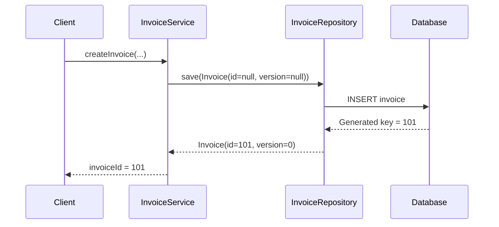
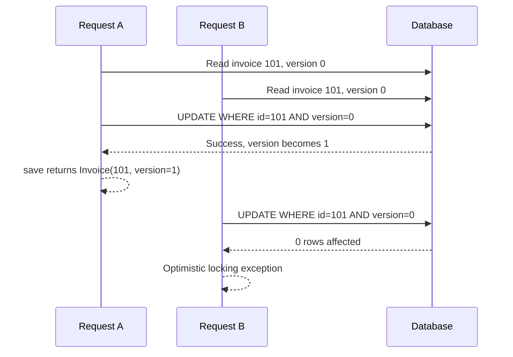

# Nhận lại ID và version trên đối tượng được trả về sau `save`

Trong **Spring Data JDBC**, phương thức `repository.save(entity)` trả về một đối tượng aggregate sau khi thao tác lưu được thực hiện. Đối tượng trả về có thể chứa **ID do database sinh** và **version mới** do Spring Data JDBC quản lý. Đây là dữ liệu quan trọng để ứng dụng tiếp tục thao tác với bản ghi, trả ID về API hoặc thực hiện lần cập nhật tiếp theo.

Điểm cần nhớ là hãy **sử dụng giá trị trả về từ `save`**. Với entity bất biến như Java `record`, Spring Data JDBC không thể thay đổi field của object đầu vào; framework tạo instance phù hợp với ID/version đã cập nhật. Với entity mutable, object đầu vào có thể được cập nhật thông qua cơ chế property access, nhưng không nên phụ thuộc vào việc hai tham chiếu có phải cùng một instance hay không.

Bài này phân biệt hai loại giá trị thường được nhận lại:

- **ID (`@Id`)** nhận diện bản ghi/aggregate. ID có thể được database sinh khi `INSERT`, hoặc do ứng dụng cấp theo chiến lược riêng.
- **Version (`@Version`)** là số phiên bản dùng để phát hiện cập nhật đồng thời (optimistic locking). Spring Data JDBC khởi tạo version khi insert và tăng version khi update thành công.

## 1. Ví dụ xuyên suốt: lưu một hóa đơn mới

Giả sử ứng dụng có bảng `invoices`:

```sql
CREATE TABLE invoices (
    id BIGINT GENERATED BY DEFAULT AS IDENTITY PRIMARY KEY,
    version BIGINT NOT NULL,
    invoice_number VARCHAR(40) NOT NULL,
    amount DECIMAL(18, 2) NOT NULL
);
```

`id` được database cấp tự động; `version` là cột dành cho optimistic locking. Cú pháp `GENERATED BY DEFAULT AS IDENTITY` phù hợp với một số hệ quản trị như H2 và PostgreSQL, nhưng cần điều chỉnh DDL theo database thực tế.

Entity:

```java
import java.math.BigDecimal;
import org.springframework.data.annotation.Id;
import org.springframework.data.annotation.Version;
import org.springframework.data.relational.core.mapping.Table;

@Table("invoices")
public record Invoice(
        @Id Long id,
        @Version Long version,
        String invoiceNumber,
        BigDecimal amount
) {}
```

Repository:

```java
import org.springframework.data.repository.CrudRepository;

public interface InvoiceRepository extends CrudRepository<Invoice, Long> {
}
```

Hai annotation đến từ Spring Data:

- `org.springframework.data.annotation.Id` đánh dấu ID của aggregate root.
- `org.springframework.data.annotation.Version` đánh dấu thuộc tính version để Spring Data JDBC áp dụng optimistic locking.

Không dùng nhầm `jakarta.persistence.Id` hoặc `jakarta.persistence.Version` của JPA cho ví dụ Spring Data JDBC này.

## 2. Nhận ID database sinh sau lần `INSERT` đầu tiên

Khi tạo hóa đơn mới, chưa có ID:

```java
Invoice draft = new Invoice(
        null,
        null,
        "INV-2026-001",
        new BigDecimal("1250000.00")
);

Invoice saved = invoiceRepository.save(draft);

System.out.println(saved.id());      // ID database cấp, ví dụ 101
System.out.println(saved.version()); // Version khởi tạo, ví dụ 0
```

Với chiến lược nhận diện mới mặc định, `id == null` cho biết aggregate chưa được lưu. Spring Data JDBC thực hiện `INSERT`, không đưa ID chưa có vào danh sách cột cần ghi, sau đó lấy **generated key** qua JDBC và đưa giá trị đó vào aggregate trả về.

SQL dưới đây minh họa ý nghĩa của lệnh insert; cú pháp và cách lấy generated key có thể khác theo dialect/driver:

```sql
INSERT INTO invoices (version, invoice_number, amount)
VALUES (?, ?, ?);
```

Database tạo `id`, ví dụ `101`. Spring Data JDBC kết hợp ID được trả về với dữ liệu aggregate và trả kết quả tương đương:

```text
draft:
  id      = null
  version = null
  invoiceNumber = "INV-2026-001"

saved:
  id      = 101
  version = 0
  invoiceNumber = "INV-2026-001"
```

**Không nên tiếp tục dùng `draft.id()` để lấy ID vừa sinh.** Hãy dùng `saved.id()` vì đó là đối tượng được trả về sau thao tác lưu.

### Vì sao version ban đầu là 0?

Khi entity có `@Version`, Spring Data JDBC quản lý giá trị version. Với entity mới, version được khởi tạo ở mức ban đầu (thông thường là `0`). Khi cập nhật thành công, version được tăng lên. Vì vậy, ngay sau insert, đối tượng trả về đã có version dùng cho lần update tiếp theo.

Trong ví dụ dùng `Long version`, giá trị `null` ở object mới biểu thị chưa có version; object trả về từ insert có giá trị version đã được khởi tạo. Với kiểu số nguyên primitive, giá trị mặc định `0` cũng được Spring Data xem xét theo quy tắc nhận diện entity mới. Dùng wrapper `Long` giúp thể hiện rõ trạng thái chưa có giá trị trước lần lưu đầu tiên.

## 3. Sử dụng đối tượng trả về khi cần ID cho bước tiếp theo

ID được sinh thường cần dùng để trả kết quả cho client hoặc liên kết với một thao tác khác. Ví dụ application service:

```java
import java.math.BigDecimal;
import org.springframework.stereotype.Service;
import org.springframework.transaction.annotation.Transactional;

@Service
public class InvoiceService {
    private final InvoiceRepository invoices;

    public InvoiceService(InvoiceRepository invoices) {
        this.invoices = invoices;
    }

    @Transactional
    public Long createInvoice(String invoiceNumber, BigDecimal amount) {
        Invoice draft = new Invoice(null, null, invoiceNumber, amount);
        Invoice saved = invoices.save(draft);
        return saved.id();
    }
}
```

Luồng dữ liệu:



Trong ví dụ, service trả về ID lấy từ `saved`, không tự suy đoán ID bằng cách đếm bản ghi hoặc truy vấn lại theo invoice number. Database là nơi cấp ID theo identity/sequence đã cấu hình.

Nếu muốn trả cả version trong response, có thể trả DTO thay vì entity persistence trực tiếp:

```java
public record InvoiceCreatedResponse(Long id, Long version) {}

@Transactional
public InvoiceCreatedResponse create(String number, BigDecimal amount) {
    Invoice saved = invoices.save(new Invoice(null, null, number, amount));
    return new InvoiceCreatedResponse(saved.id(), saved.version());
}
```

Việc dùng DTO giúp API công khai đúng dữ liệu cần thiết, đồng thời không buộc client phụ thuộc vào toàn bộ cấu trúc entity.

## 4. Entity bất biến: vì sao phải nhận lại object?

Java `record` là bất biến: sau khi khởi tạo, các component không thể được gán lại. Với:

```java
Invoice draft = new Invoice(null, null, "INV-2026-002", new BigDecimal("99.00"));
Invoice saved = invoiceRepository.save(draft);
```

Spring Data JDBC cần tạo một instance chứa ID và version vừa nhận được. Hai đối tượng có cùng dữ liệu nghiệp vụ nhưng khác trạng thái persistence:

```text
draft  = Invoice(null, null, "INV-2026-002", 99.00)
saved  = Invoice(102, 0, "INV-2026-002", 99.00)
```

Vì vậy, đoạn sau là sai về mặt sử dụng kết quả:

```java
Invoice draft = new Invoice(null, null, "INV-2026-002", amount);
invoiceRepository.save(draft);

// draft.id() vẫn null; kết quả save đã bị bỏ qua.
return draft.id();
```

Đoạn đúng:

```java
Invoice draft = new Invoice(null, null, "INV-2026-002", amount);
Invoice saved = invoiceRepository.save(draft);
return saved.id();
```

Với class mutable, Spring Data có thể cập nhật ID/version qua property accessor hoặc field access. Tuy nhiên, cách viết thống nhất và an toàn là **luôn gán kết quả của `save` vào biến và dùng biến đó cho các bước tiếp theo**. Điều này cũng tránh lỗi khi sau này đổi class mutable thành record hoặc dùng constructor-based mapping.

## 5. `@Version` sau update: nhận version mới

Sau khi insert, `saved` có `id = 101` và `version = 0`. Khi cập nhật, tạo đối tượng dựa trên ID và version hiện tại:

```java
Invoice changed = new Invoice(
        saved.id(),
        saved.version(),
        saved.invoiceNumber(),
        new BigDecimal("1300000.00")
);

Invoice updated = invoiceRepository.save(changed);

System.out.println(updated.id());      // 101
System.out.println(updated.version()); // 1
```

ID giữ nguyên vì vẫn là cùng một hóa đơn. Version tăng từ `0` lên `1` vì đây là lần cập nhật thành công tiếp theo.

SQL có ý nghĩa tương đương:

```sql
UPDATE invoices
SET invoice_number = ?,
    amount = ?,
    version = ?
WHERE id = ?
  AND version = ?;
```

Trong đó điều kiện `WHERE` sử dụng ID và version cũ; giá trị ghi là version mới. Cách viết SQL cụ thể có thể khác, nhưng nguyên tắc là **chỉ cập nhật khi bản ghi vẫn ở version mà caller đã đọc**.

`@Version` không phải một trường mô tả nghiệp vụ như `revisionName`, `approvalNumber` hay `updatedBy`. Nó là token kỹ thuật phục vụ kiểm soát cạnh tranh ghi dữ liệu.

## 6. Optimistic locking: phát hiện một bản cũ đang ghi đè

Giả sử hai request cùng đọc hóa đơn `101`, version `0`:

```text
Request A đọc Invoice(101, version=0)
Request B đọc Invoice(101, version=0)
```

Request A cập nhật thành công. Database chuyển version thành `1`, và `save` trả về `Invoice(101, version=1)`. Sau đó request B vẫn cố lưu object cũ với version `0`. Điều kiện cập nhật của B không còn khớp:

```sql
UPDATE invoices
SET amount = ?, version = 1
WHERE id = 101 AND version = 0;
```

Không có hàng nào được cập nhật. Spring Data JDBC phát hiện xung đột và ném lỗi optimistic locking, thường thuộc họ `OptimisticLockingFailureException`.



Đây là cách ngăn request cũ ghi đè âm thầm thay đổi mới. Nếu không có `@Version`, một lần cập nhật sau có thể ghi đè dữ liệu đã được request khác thay đổi, tùy cách thao tác và transaction.

### Xử lý xung đột

Ứng dụng có thể:

- Thông báo rằng dữ liệu đã được người khác thay đổi và yêu cầu người dùng tải lại.
- Đọc lại aggregate mới nhất, áp dụng lại ý định nghiệp vụ nếu thao tác còn hợp lệ, rồi thử lưu lại.
- Trả HTTP `409 Conflict` nếu API thể hiện xung đột chỉnh sửa tài nguyên.

Không nên retry mù quáng với mọi nghiệp vụ. Nếu use case có tác dụng phụ như thu tiền, gửi email hoặc phát thông điệp, retry có thể lặp tác dụng phụ. Chỉ retry khi có thể thực hiện an toàn, thường cần idempotency và phải đánh giá lại toàn bộ quy tắc nghiệp vụ trên trạng thái mới.

## 7. Version phải có cột tương ứng trong DDL

Khi thêm `@Version`, schema cần có cột version. Ví dụ:

```sql
ALTER TABLE invoices
ADD COLUMN version BIGINT DEFAULT 0 NOT NULL;
```

Đối với bảng mới, có thể khai báo trực tiếp:

```sql
version BIGINT NOT NULL
```

Spring Data JDBC quản lý giá trị version khi insert/update; không nên để entity khai báo `@Version` nhưng database thiếu cột. Ngược lại, có một cột tên `version` trong DDL nhưng entity không đánh dấu `@Version` thì Spring Data JDBC không tự coi cột ấy là optimistic locking token.

Khi bổ sung version vào bảng đã có dữ liệu, migration phải gán giá trị khởi tạo hợp lệ cho các hàng cũ. `DEFAULT 0 NOT NULL` là một lựa chọn trong ví dụ, nhưng cần kiểm tra cú pháp của database và trạng thái dữ liệu hiện tại. Không nên giả định chỉ sửa Java là đủ.

### Khi nào version được tăng?

| Thao tác | Kết quả version điển hình |
|---|---|
| Tạo entity mới và insert thành công | Khởi tạo `0` |
| Cập nhật entity đang ở version `0` thành công | Trả về `1` |
| Cập nhật entity đang ở version `1` thành công | Trả về `2` |
| Cập nhật bằng version cũ không còn khớp | Không có object kết quả thành công; phát sinh optimistic locking exception |
| Chỉ thay đổi object trong bộ nhớ, không gọi `save` | Database không thay đổi, version database không tăng |

Version không tăng chỉ vì ứng dụng đọc entity. Nó gắn với thao tác ghi được Spring Data JDBC thực hiện thành công.

## 8. ID được sinh và ID do ứng dụng cấp

Không phải mọi mô hình đều dùng identity do database sinh. Có thể chia thành hai trường hợp:

| Chiến lược | Trước khi save | Sau khi save | Lưu ý |
|---|---|---|---|
| Database identity/sequence | `id = null` | Nhận ID được database cấp | DDL và JDBC driver phải hỗ trợ lấy generated key |
| Ứng dụng cấp UUID/ID | Đã có ID | ID thường giữ nguyên | Phải cấu hình nhận diện entity mới đúng; ID có sẵn không mặc nhiên chứng minh bản ghi đã tồn tại |

Ví dụ ID do ứng dụng tạo:

```java
import java.util.UUID;

UUID id = UUID.randomUUID();
// Tạo aggregate với ID đã cấp trước khi gọi save.
```

Với mặc định nhận diện dựa vào ID khi không có version property, ID khác `null` thường khiến entity được coi là đã tồn tại và đi vào nhánh update. Nếu ID được cấp trước cho một entity mới, cần dùng chiến lược nhận diện mới phù hợp, chẳng hạn triển khai `Persistable<ID>` và quản lý `isNew()` chính xác, hoặc dùng version property theo quy tắc của Spring Data.

Không nên chỉ đổi `id` từ `null` thành UUID rồi kỳ vọng `save` luôn insert. Nếu framework coi object là entity cũ, thao tác có thể chạy `UPDATE` và không tìm thấy hàng.

## 9. Spring Data xác định entity mới hay đã tồn tại

Việc quyết định `INSERT` hay `UPDATE` ảnh hưởng trực tiếp tới ID/version trả về. Quy tắc mặc định cần hiểu ở mức thực hành:

- Nếu entity có thuộc tính `@Version`, Spring Data ưu tiên trạng thái version: version chưa được thiết lập (`null` với wrapper; giá trị mặc định `0` với primitive) cho biết entity mới.
- Nếu không có version property, ID được dùng để nhận diện: ID `null` cho biết entity mới; ID đã có thường được xem là entity hiện hữu.
- Nếu entity triển khai `Persistable`, phương thức `isNew()` cho phép mô hình tự cung cấp trạng thái mới/cũ.

Đây là lý do một entity có ID được cấp trước vẫn có thể được insert khi có chiến lược `isNew` phù hợp, và cũng là lý do không nên tự đặt version tùy tiện trước lần insert đầu tiên.

Với `Persistable`, ứng dụng phải quản lý trạng thái `isNew` đúng vòng đời. Sau khi insert thành công, entity phải được xem là không còn mới; nếu luôn trả về `true`, những lần save tiếp theo có thể tiếp tục đi theo nhánh insert và gặp lỗi khóa trùng.

## 10. `save` trả về khi nào so với transaction commit?

Một điểm quan trọng khác: **ID/version đã có trên object trả về không đồng nghĩa transaction bên ngoài chắc chắn đã commit**.

Ví dụ:

```java
@Transactional
public Invoice createAndContinue() {
    Invoice saved = invoices.save(
            new Invoice(null, null, "INV-2026-003", new BigDecimal("50.00"))
    );

    // Tại đây có thể đã biết saved.id() và saved.version().
    // Nhưng transaction bao quanh method chưa commit cho tới khi method kết thúc bình thường.
    return saved;
}
```

Trong transaction, Spring Data JDBC thực hiện câu SQL và nhận generated key/version. Transaction manager chỉ commit sau khi ranh giới transaction kết thúc thành công. Nếu sau `save` có lỗi khiến transaction rollback, object trong bộ nhớ vẫn có thể giữ ID/version đã nhận, nhưng hàng dữ liệu không được commit như một bản ghi bền vững.

Vì vậy:

- Dùng ID trả về để tiếp tục công việc **trong cùng transaction** là hợp lý.
- Không phát thông báo rằng dữ liệu đã lưu bền vững trước khi transaction commit nếu thông báo đó khiến hệ thống khác hành động.
- Nếu cần phát sự kiện sau commit, dùng cơ chế after-commit phù hợp hoặc transactional outbox để bảo đảm sự kiện gắn với thay đổi dữ liệu.
- Nếu transaction rollback, không tái sử dụng object có ID/version như bằng chứng rằng bản ghi vẫn tồn tại.

Ngoài transaction do service khai báo, repository CRUD thường có transaction behavior riêng theo cấu hình Spring Data. Tuy nhiên, khi một use case gồm nhiều thao tác cần nguyên tử, đặt `@Transactional` ở ranh giới application service giúp thể hiện rõ phạm vi commit/rollback.

## 11. Aggregate có phần tử con: root ID được dùng để lưu collection

Trong Spring Data JDBC, một lần `save(root)` có thể phát sinh nhiều câu SQL nếu aggregate có collection được ánh xạ bằng `@MappedCollection`. Root được insert/update và các thành phần con được lưu theo ranh giới sở hữu.

Ví dụ:

```java
@Table("purchase_orders")
public record PurchaseOrder(
        @Id Long id,
        @Version Long version,
        String orderNumber,
        @MappedCollection(idColumn = "order_id", keyColumn = "line_no")
        List<OrderLine> lines
) {}
```

Khi insert một đơn mới, ID root được sinh có thể được dùng làm `order_id` cho các dòng con. Đối tượng aggregate được trả về chứa ID root và version mới; cần dùng aggregate trả về cho các bước tiếp theo, đặc biệt với kiểu bất biến.

SQL minh họa về mặt ý nghĩa:

```sql
INSERT INTO purchase_orders (version, order_number) VALUES (?, ?);
-- nhận generated order id
INSERT INTO order_lines (order_id, line_no, sku, quantity) VALUES (?, ?, ?, ?);
```

Không nên giả định một lời gọi `save` chỉ thực thi một SQL. Cũng không nên tách child ra thành repository riêng chỉ để lấy ID nếu child thuộc vòng đời của root. Việc lưu aggregate có thể bao gồm nhiều thao tác và cần transaction phù hợp.

## 12. Khi nào cần tự viết SQL và tự quản lý version?

Với `repository.save(entity)`, Spring Data JDBC biết metadata và áp dụng cơ chế version cho thao tác aggregate. Nhưng nếu dùng một câu SQL cập nhật tùy chỉnh trực tiếp:

```java
@Modifying
@Query("UPDATE invoices SET amount = :amount WHERE id = :id")
int updateAmount(@Param("id") Long id, @Param("amount") BigDecimal amount);
```

không nên giả định `@Version` của entity sẽ tự động được thêm vào câu SQL này. SQL tùy chỉnh cần được thiết kế rõ ràng để bảo vệ optimistic locking nếu use case yêu cầu:

```sql
UPDATE invoices
SET amount = :amount,
    version = version + 1
WHERE id = :id
  AND version = :expectedVersion;
```

Sau đó cần kiểm tra số hàng bị ảnh hưởng:

- `1` hàng: cập nhật thành công, version mới là version cũ cộng một.
- `0` hàng: không tìm thấy bản ghi hoặc version không còn khớp; ứng dụng cần phân biệt theo nhu cầu và xử lý xung đột.

Đây là ví dụ về nguyên tắc, không phải cách thay thế mặc định cho `save`. Với SQL tùy chỉnh, chính lập trình viên chịu trách nhiệm bảo đảm điều kiện ID/version, tăng version và diễn giải số hàng bị ảnh hưởng.

## 13. Những lỗi phổ biến khi nhận ID và version

| Triệu chứng | Nguyên nhân có thể | Cách xử lý |
|---|---|---|
| `saved.id()` vẫn `null` | ID không được database sinh; DDL thiếu identity/sequence; driver không trả generated key; mapping sai | Kiểm tra `@Id`, DDL, dialect và generated-key support |
| `draft.id()` vẫn `null` sau `save` | Đang đọc object đầu vào bất biến thay vì kết quả trả về | Gán và dùng `Invoice saved = repository.save(draft)` |
| Lần đầu save chạy `UPDATE` thay vì `INSERT` | ID đã có hoặc trạng thái `isNew` báo entity cũ | Kiểm tra ID, version và `Persistable.isNew()` |
| Insert lỗi thiếu cột `version` | Entity có `@Version` nhưng DDL chưa có cột | Tạo migration thêm cột version phù hợp |
| Version không tăng như kỳ vọng | Không gọi `save`, entity không có `@Version`, hoặc dùng SQL tùy chỉnh không cập nhật version | Kiểm tra đường ghi thực tế và SQL |
| `OptimisticLockingFailureException` | Object đang lưu mang version cũ | Đọc lại dữ liệu, xử lý xung đột hoặc retry an toàn |
| Dữ liệu có ID trong object nhưng không thấy ở transaction khác | Transaction bên ngoài đã rollback hoặc chưa commit | Kiểm tra transaction boundary và kết quả commit |
| Lưu child gặp lỗi khóa ngoại | Root ID chưa được cấp/không được truyền đúng hoặc mapping `idColumn` sai | Kiểm tra thứ tự lưu aggregate và DDL child |
| ID được cấp trước nhưng insert bị bỏ qua | Chiến lược nhận diện mặc định xem ID có sẵn là entity cũ | Dùng `Persistable` hoặc version strategy phù hợp |

Khi debug, ghi lại bốn giá trị tại thời điểm gọi `save`: **ID đầu vào, version đầu vào, SQL được thực thi và ID/version đầu ra**. Nếu có transaction, ghi thêm trạng thái commit/rollback. Bốn thông tin này thường đủ để phân biệt lỗi nhận diện entity, lỗi generated key, lỗi optimistic locking và lỗi transaction.

## 14. Bài thực hành quan sát ID và version

Với H2 in-memory và bảng `invoices` ở phần đầu, có thể lần lượt thử:

1. Tạo `Invoice(null, null, ...)`, gọi `save`, in cả `draft` và `saved`. Quan sát ID đầu vào chưa có, ID trả về đã được cấp và version khởi tạo.
2. Tạo object mới dựa trên `saved.id()` và `saved.version()`, thay đổi `amount`, gọi `save` lần nữa. Quan sát ID không đổi và version tăng.
3. Giữ lại một bản object cũ với version trước đó. Sau khi lưu bản mới, thử lưu bản cũ; quan sát optimistic locking exception.
4. Bỏ qua giá trị trả về của lần insert, sau đó in `draft.id()`. Quan sát vì sao code bất biến không có ID vừa sinh.
5. Tạm bỏ cột `version` trong schema nhưng giữ `@Version`, dựng database thử nghiệm sạch và quan sát lỗi mapping/SQL. Khôi phục DDL sau đó.
6. Đặt một lỗi sau `save` trong một method `@Transactional` để transaction rollback; kiểm tra database và object trong bộ nhớ. Quan sát ID trong object không tự chứng minh hàng đã commit.

Không thực hiện các thử nghiệm phá schema trên database dùng dữ liệu thật. Với mỗi bước, lưu lại SQL, giá trị bind, trạng thái object trước/sau và kết quả database để hiểu đúng vòng đời.

## 15. Ghi nhớ khi sử dụng kết quả `save`

```text
Entity mới
    id = null, version = null
          |
          v
repository.save(entity)
          |
          v
INSERT + database generated key
          |
          v
Đối tượng trả về: id = generated ID, version = 0
          |
          v
Tạo thay đổi từ ID/version mới nhất
          |
          v
repository.save(changed)
          |
          v
UPDATE WHERE id = ? AND version = oldVersion
          |
          v
Đối tượng trả về: cùng ID, version tăng lên
```

`save` trả về một aggregate đã được Spring Data JDBC xử lý theo trạng thái hiện tại. **ID cho biết aggregate nào được lưu; version cho biết phiên bản nào đã được đọc/ghi thành công.** Dùng chính đối tượng trả về giúp mã ứng dụng tiếp tục với ID và version mới nhất, đặc biệt khi dùng entity bất biến. Kết hợp điều đó với `@Version`, DDL tương ứng và transaction boundary rõ ràng sẽ giúp thao tác lưu an toàn hơn trước việc ghi đồng thời và lỗi rollback.
