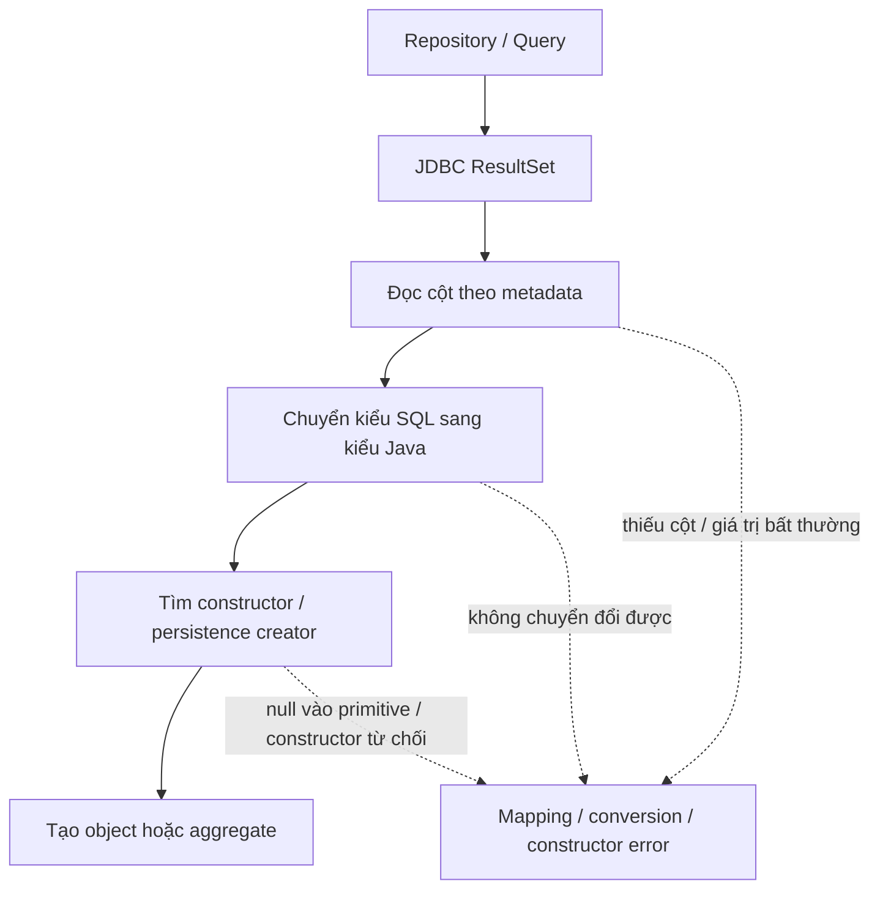

# Nullability và lỗi không dựng được đối tượng từ ResultSet

Khi Spring Data JDBC đọc một hàng dữ liệu, framework phải chuyển các giá trị trong `ResultSet` thành thuộc tính của object Java, sau đó gọi constructor hoặc factory method để tạo đối tượng. Quá trình này có thể thất bại nếu database trả về `NULL`, kiểu SQL không chuyển đổi được sang kiểu Java, cột cần thiết không có trong kết quả truy vấn hoặc constructor không nhận được các giá trị mà nó yêu cầu.

Để xử lý đúng, cần hiểu ba lớp nullability riêng biệt: **giá trị trong database**, **kiểu và quy tắc nullability của Java**, và **quy tắc tạo object của Spring Data JDBC**. Bài học dùng mô hình đơn hàng để giải thích các tình huống này, cách đọc lỗi và cách thiết kế schema, constructor, repository để dữ liệu được ánh xạ ổn định.

## 1. Phân biệt không có hàng, SQL NULL và cột không có trong kết quả

Ba tình huống sau khác nhau về ý nghĩa:

| Tình huống | Ví dụ | Ý nghĩa |
| --- | --- | --- |
| Không có hàng | `SELECT ... WHERE id = 999` không trả kết quả. | Không tồn tại bản ghi thỏa điều kiện. |
| Có hàng, một cột là `NULL` | Hàng đơn hàng có `note = NULL`. | Bản ghi tồn tại, nhưng giá trị của thuộc tính đó không được lưu/không biết. |
| Cột không xuất hiện trong ResultSet | Query chỉ chọn `id, status` trong khi mapper cần `customer_id`. | Kết quả truy vấn không cung cấp cột mà mapper mong đợi. |

Khi dùng repository, `findById(id)` thường biểu diễn tình huống thứ nhất bằng `Optional.empty()`. Nếu hàng tồn tại nhưng `note` là SQL `NULL`, object vẫn có thể được tạo với `note == null` nếu thuộc tính đó cho phép null. Trường hợp thứ ba là lỗi cấu trúc kết quả truy vấn hoặc ánh xạ, không phải giá trị null thông thường.

Ví dụ SQL:

```sql
-- Không có hàng nếu không tồn tại id = 999.
SELECT id, status, note
FROM purchase_order
WHERE id = 999;

-- Có hàng nhưng note có thể là SQL NULL.
SELECT id, status, note
FROM purchase_order
WHERE id = 1001;

-- Query này không trả cột customer_id.
SELECT id, status
FROM purchase_order
WHERE id = 1001;
```

Không nên xử lý cả ba tình huống bằng một câu `if (value == null)` chung. Cần xác định database có hàng hay không, cột có nằm trong kết quả hay không và giá trị thực tế của cột là gì.

## 2. Mô hình đơn hàng và quy tắc nullability

Một đơn hàng có ID, khách hàng, trạng thái, tổng tiền, ghi chú tùy chọn và danh sách dòng hàng:

| Thuộc tính | Có được null? | Lý do |
| --- | --- | --- |
| `id` | Có khi tạo mới; không được null sau khi lưu thành công. | ID được database sinh. |
| `customerId` | Không. | Đơn hàng phải thuộc một khách hàng. |
| `status` | Không. | Mọi đơn phải có trạng thái hợp lệ. |
| `totalAmount` | Không. | Tổng tiền phải được xác định. |
| `note` | Có. | Ghi chú là thông tin tùy chọn. |
| `lines` | Không nên dùng null để biểu diễn không có dòng. | Collection không có phần tử nên là danh sách rỗng; quy tắc nghiệp vụ có thể yêu cầu ít nhất một dòng. |
| `OrderLine.quantity` | Không. | Số lượng phải là số nguyên dương. |
| `OrderLine.unitPrice` | Không. | Đơn giá phải được xác định, không âm. |

Quy tắc này phải nhất quán giữa SQL, Java và nghiệp vụ. Ví dụ, nếu `customer_id` bắt buộc thì bảng nên khai báo `NOT NULL` và có foreign key; Java nên dùng một kiểu có thể kiểm tra null; service phải xác thực khách hàng trước khi lưu.

### DDL thể hiện nullability

```sql
CREATE TABLE customer (
    id BIGINT GENERATED BY DEFAULT AS IDENTITY PRIMARY KEY,
    name VARCHAR(150) NOT NULL
);

CREATE TABLE purchase_order (
    id BIGINT GENERATED BY DEFAULT AS IDENTITY PRIMARY KEY,
    customer_id BIGINT NOT NULL REFERENCES customer(id),
    status VARCHAR(20) NOT NULL,
    total_amount NUMERIC(19, 2) NOT NULL
        CHECK (total_amount >= 0),
    note VARCHAR(500) NULL
);

CREATE TABLE order_line (
    order_id BIGINT NOT NULL REFERENCES purchase_order(id),
    line_no INTEGER NOT NULL,
    product_id BIGINT NOT NULL,
    quantity INTEGER NOT NULL CHECK (quantity > 0),
    unit_price NUMERIC(19, 2) NOT NULL CHECK (unit_price >= 0),
    PRIMARY KEY (order_id, line_no)
);
```

`NOT NULL` là ràng buộc ở database. Nó ngăn thao tác ghi tạo giá trị null cho cột, nhưng không tự sửa các hàng cũ đã tồn tại trước khi constraint được thêm. Nếu hệ thống đang có dữ liệu legacy, cần kiểm tra và làm sạch trước khi migration thêm `NOT NULL`.

Cũng cần hiểu cách `DEFAULT` hoạt động:

```sql
CREATE TABLE product (
    id BIGINT GENERATED BY DEFAULT AS IDENTITY PRIMARY KEY,
    name VARCHAR(180) NOT NULL,
    active BOOLEAN NOT NULL DEFAULT TRUE
);

-- Dùng default vì không cung cấp cột active.
INSERT INTO product (name) VALUES ('Keyboard');

-- Giá trị NULL được truyền tường minh; DEFAULT không thay thế NULL.
INSERT INTO product (name, active) VALUES ('Mouse', NULL);
```

Giá trị mặc định thường được dùng khi cột bị bỏ khỏi lệnh `INSERT` hoặc khi chỉ định từ khóa `DEFAULT`. Nếu ứng dụng gửi SQL `NULL` tường minh, ràng buộc `NOT NULL` vẫn có thể thất bại.

## 3. Nullability trong Java: primitive, wrapper và reference type

Java primitive không biểu diễn được null. Các kiểu wrapper và reference type có thể chứa null:

| Primitive | Wrapper | Có biểu diễn null? |
| --- | --- | --- |
| `int` | `Integer` | Chỉ `Integer` |
| `long` | `Long` | Chỉ `Long` |
| `boolean` | `Boolean` | Chỉ `Boolean` |
| `double` | `Double` | Chỉ `Double` |

`String`, `BigDecimal`, `LocalDate` và các object Java khác cũng có thể nhận null nếu constructor không từ chối.

Nếu một cột SQL nullable được ánh xạ vào primitive, framework không thể biểu diễn đúng giá trị null. Tùy đường mapping và phiên bản, lỗi có thể xuất hiện khi chuyển đổi hoặc khi gọi constructor. Không nên dựa vào giá trị `0`/`false` để đoán null, vì điều đó làm mất khác biệt giữa “không có giá trị” và “giá trị bằng 0/false”.

Ví dụ dễ gặp lỗi:

```java
public record OrderLine(
    Long productId,
    int quantity,
    BigDecimal unitPrice
) {}
```

Nếu cột `quantity` có thể là SQL `NULL`, thành phần `int quantity` không thể nhận giá trị đó. Có hai cách thiết kế:

**Cách A — Quantity luôn bắt buộc.** Giữ `int`, bảo đảm DDL có `quantity INTEGER NOT NULL`, làm sạch dữ liệu cũ và kiểm tra mọi đường ghi.

**Cách B — Null là một trạng thái nghiệp vụ được phép.** Dùng `Integer` và xử lý null một cách tường minh. Tuy nhiên, nếu đơn hàng không thể có dòng thiếu số lượng, tốt hơn là từ chối null ở ranh giới domain/service thay vì để null lan sâu trong hệ thống.

Không đổi tất cả primitive sang wrapper một cách máy móc. Chọn kiểu Java phản ánh đúng quy tắc dữ liệu: primitive khi giá trị luôn bắt buộc và được bảo vệ; wrapper/reference khi null thực sự có ý nghĩa hoặc cần đọc dữ liệu legacy trước khi xác thực.

## 4. Constructor mapping của Spring Data JDBC

Spring Data JDBC tạo aggregate từ dữ liệu đọc được bằng cơ chế object mapping. Với class bất biến hoặc Java record, framework sử dụng constructor phù hợp để truyền các giá trị đã đọc/chuyển đổi.

Ví dụ record:

```java
import java.math.BigDecimal;
import java.util.List;

import org.springframework.data.annotation.Id;
import org.springframework.data.relational.core.mapping.Column;
import org.springframework.data.relational.core.mapping.MappedCollection;
import org.springframework.data.relational.core.mapping.Table;

@Table("purchase_order")
public record PurchaseOrder(
    @Id Long id,
    @Column("customer_id") Long customerId,
    String status,
    @Column("total_amount") BigDecimal totalAmount,
    String note,
    @MappedCollection(idColumn = "order_id", keyColumn = "line_no")
    List<OrderLine> lines
) {}
```

Một số điểm cần nhớ:

- Tên component của record là tên thuộc tính Java.
- `@Column` có thể chỉ định tên cột khác quy ước.
- Constructor canonical của record nhận các component theo đúng thứ tự khai báo.
- Cột nullable như `note` có thể được truyền vào dưới dạng null.
- Nếu một component primitive nhận dữ liệu SQL null, constructor không thể tạo giá trị đúng.
- Collection con được dựng theo mapping aggregate; nó có vòng đời gắn với root chứ không phải một cột scalar.

Với class thông thường có một constructor duy nhất, Spring Data có thể dùng constructor đó để tạo object. Nếu có nhiều constructor, cần làm rõ constructor nào được sử dụng. Có thể đánh dấu constructor/factory method dùng cho persistence bằng `@PersistenceCreator`:

```java
import java.math.BigDecimal;
import org.springframework.data.annotation.Id;
import org.springframework.data.annotation.PersistenceCreator;
import org.springframework.data.relational.core.mapping.Table;

@Table("purchase_order")
public class PurchaseOrder {

    private final Long id;
    private final Long customerId;
    private final String status;
    private final BigDecimal totalAmount;
    private final String note;

    @PersistenceCreator
    public PurchaseOrder(
            Long id,
            Long customerId,
            String status,
            BigDecimal totalAmount,
            String note) {
        this.id = id;
        this.customerId = customerId;
        this.status = status;
        this.totalAmount = totalAmount;
        this.note = note;
    }

    public PurchaseOrder(Long customerId, String status) {
        this(null, customerId, status, BigDecimal.ZERO, null);
    }

    @Id
    public Long getId() {
        return id;
    }

    public Long getCustomerId() {
        return customerId;
    }

    public String getStatus() {
        return status;
    }

    public BigDecimal getTotalAmount() {
        return totalAmount;
    }

    public String getNote() {
        return note;
    }
}
```

Khi constructor có nhiều tham số, tên tham số cần khớp với thuộc tính mà Spring Data dùng để ánh xạ. Với Java class thông thường, cấu hình biên dịch giữ metadata tên tham số (ví dụ tùy chọn `-parameters`) giúp việc khám phá tên ổn định. Với record, tên component đã là metadata của record. Nếu tên không được phát hiện hoặc không khớp, quá trình tạo object có thể thất bại hoặc nhận sai dữ liệu tùy tình huống.

`@PersistenceCreator` giải quyết việc chọn constructor/factory method. Nó không làm một cột nullable trở thành non-null, cũng không tự chuyển đổi kiểu SQL không tương thích.

## 5. SQL NULL được chuyển vào constructor như thế nào?

Quá trình khái quát khi đọc một aggregate:



Một query trả hàng có `note = NULL` thường dẫn đến `note == null` trong Java reference type. Nếu constructor gọi `Objects.requireNonNull(note)`, object sẽ không được tạo vì chính domain constructor từ chối dữ liệu đó. Đây là hành vi có chủ đích nếu ghi chú được xem là bắt buộc; nếu ghi chú tùy chọn thì constructor không nên từ chối null.

Ví dụ domain constructor xác thực:

```java
import java.math.BigDecimal;
import java.util.Objects;

public record OrderLine(
    Long productId,
    int quantity,
    BigDecimal unitPrice
) {
    public OrderLine {
        Objects.requireNonNull(productId, "productId is required");
        Objects.requireNonNull(unitPrice, "unitPrice is required");

        if (quantity <= 0) {
            throw new IllegalArgumentException(
                "quantity must be greater than zero"
            );
        }
        if (unitPrice.signum() < 0) {
            throw new IllegalArgumentException(
                "unitPrice must not be negative"
            );
        }
    }
}
```

Nếu database trả `product_id = NULL` hoặc `unit_price = NULL`, constructor sẽ thất bại. Với dữ liệu hợp lệ, những cột này nên được bảo vệ bằng `NOT NULL` và constraint tương ứng. Khi đọc dữ liệu cũ bị lỗi, thông báo từ constructor có thể là nguyên nhân gốc được bọc bên trong exception mapping khác.

## 6. Lỗi khi không dựng được object: nhận diện theo nguyên nhân

Không có một exception duy nhất cho mọi lỗi mapping. Loại exception bên ngoài phụ thuộc tầng phát sinh, phiên bản framework và việc lỗi được bọc bởi Spring Data/Spring JDBC. Khi đọc stack trace, hãy tìm **nguyên nhân sâu nhất (root cause)** và xác định giai đoạn lỗi.

| Nhóm lỗi | Ví dụ nguyên nhân | Hướng điều tra |
| --- | --- | --- |
| Không tìm thấy cột | Query không chọn `customer_id` nhưng mapper cần nó; alias sai. | Kiểm tra SELECT list, alias và schema. |
| Null không phù hợp | SQL NULL đi vào Java primitive hoặc constructor từ chối null. | Kiểm tra DDL, dữ liệu thực tế và kiểu component. |
| Không chuyển đổi được kiểu | Cột số/chuỗi/ngày có kiểu không tương thích với property. | Kiểm tra JDBC type, converter và driver. |
| Constructor không phù hợp | Không xác định được persistence creator, tham số thiếu hoặc tên không khớp. | Kiểm tra constructor, `@PersistenceCreator` và metadata tên tham số. |
| Constructor tự ném lỗi | `Objects.requireNonNull`, validation hoặc logic trong constructor thất bại. | Xem exception cause và điều kiện domain. |
| Lỗi SQL trước mapping | Bảng/cột không tồn tại, quyền truy cập hoặc cú pháp sai. | Xem SQL exception và query thực tế. |
| Lỗi dữ liệu khi ghi | `NOT NULL`, FK hoặc CHECK constraint bị vi phạm. | Kiểm tra payload và ràng buộc database. |

Một số loại exception có thể xuất hiện trong stack trace:

- `org.springframework.data.mapping.MappingException`: lỗi trong quá trình mapping metadata/object.
- `org.springframework.core.convert.ConversionFailedException`: chuyển đổi giá trị không thành công.
- `org.springframework.dao.DataAccessException` và các subclass: abstraction của Spring cho lỗi truy cập dữ liệu; nguyên nhân có thể đến từ JDBC/database.
- Exception từ constructor, chẳng hạn `IllegalArgumentException` hoặc `NullPointerException`, có thể nằm ở cause chain khi constructor từ chối dữ liệu.

Không kết luận chỉ từ tên exception ngoài cùng. Ví dụ một exception mapping có thể bọc lỗi constructor; còn lỗi `relation does not exist` phát sinh trước khi object được dựng. Đọc đầy đủ `Caused by:` và log SQL sẽ giúp xác định đúng tầng.

## 7. Cột thiếu, alias và query tùy chỉnh

Mapping phụ thuộc vào các cột mà query trả về. Nếu một phương thức truy vấn trả về kiểu entity/aggregate, query phải cung cấp dữ liệu cần thiết để ánh xạ kiểu đó. Không thể bỏ một cột bắt buộc rồi mong framework tự suy ra giá trị.

Ví dụ query rút gọn:

```sql
SELECT id, status
FROM purchase_order
WHERE id = :id;
```

Nếu kết quả được ánh xạ vào `PurchaseOrder` có cả `customer_id` và `total_amount`, các cột bị thiếu có thể làm mapping lỗi. Nếu mục tiêu chỉ cần ID và trạng thái, hãy dùng một kiểu kết quả phù hợp với đúng hai trường đó (DTO/projection hoặc custom row mapper) thay vì ánh xạ một phần vào aggregate đầy đủ.

Tên cột cũng cần khớp với mapping metadata. Ví dụ:

```sql
SELECT
    id,
    customer_id,
    status,
    total_amount,
    note
FROM purchase_order
WHERE id = :id;
```

Nếu query dùng alias, alias cần theo tên cột mà mapping mong đợi. Khi Java property được ánh xạ tường minh bằng `@Column("order_state")`, kết quả truy vấn phải cung cấp tên cột/alias tương ứng với mapping đó.

### LEFT JOIN và null từ phía bảng không có bản ghi

Một truy vấn có `LEFT JOIN` có thể trả về hàng bên trái trong khi các cột của bảng bên phải đều null vì không tìm thấy bản ghi liên quan:

```sql
SELECT
    o.id,
    o.status,
    c.name AS customer_name
FROM purchase_order o
LEFT JOIN customer c ON c.id = o.customer_id;
```

Nếu không có khách hàng khớp, `customer_name` là SQL NULL dù đơn hàng vẫn tồn tại. Một DTO dùng cho màn hình có thể biểu diễn `customerName` nullable. Nhưng nếu cố đưa kết quả join này vào một entity có trường bắt buộc, constructor có thể từ chối null.

Spring Data JDBC tập trung vào aggregate mapping, không phải ORM tùy ý với mọi đồ thị join. Với truy vấn báo cáo/join phức tạp, một DTO hoặc custom repository với `RowMapper` thường làm rõ ý nghĩa nullability hơn.

## 8. Đọc SQL NULL an toàn với JDBC thuần

Khi viết `RowMapper` hoặc JDBC code riêng, phải nhớ rằng một số getter primitive của `ResultSet` trả giá trị mặc định khi SQL là NULL. Ví dụ `getLong()` có thể trả `0`; cần gọi `wasNull()` ngay sau getter để biết giá trị vừa đọc có phải SQL NULL không.

Ví dụ:

```java
long rawCustomerId = rs.getLong("customer_id");
Long customerId = rs.wasNull() ? null : rawCustomerId;

int rawQuantity = rs.getInt("quantity");
Integer quantity = rs.wasNull() ? null : rawQuantity;

String note = rs.getString("note");          // SQL NULL -> null
BigDecimal total = rs.getBigDecimal("total_amount");
```

`wasNull()` nói về giá trị của cột được đọc gần nhất bằng getter; vì vậy phải gọi ngay sau `getLong()`/`getInt()`, trước khi đọc cột khác.

Có thể đóng gói thành helper:

```java
private static Long nullableLong(
        ResultSet rs, String column) throws SQLException {

    long value = rs.getLong(column);
    return rs.wasNull() ? null : value;
}

private static Integer nullableInt(
        ResultSet rs, String column) throws SQLException {

    int value = rs.getInt(column);
    return rs.wasNull() ? null : value;
}
```

Nếu JDBC driver hỗ trợ typed `getObject(column, Type.class)` theo JDBC version phù hợp, có thể dùng để lấy wrapper/reference type trực tiếp; vẫn cần xác nhận khả năng tương thích của driver. Không ép kiểu kết quả `getObject()` một cách giả định nếu database có thể trả kiểu số khác.

Ví dụ custom row mapper cho DTO:

```java
public record OrderHeaderView(
    Long id,
    Long customerId,
    String status,
    BigDecimal totalAmount,
    String note
) {}

RowMapper<OrderHeaderView> mapper = (rs, rowNum) ->
    new OrderHeaderView(
        nullableLong(rs, "id"),
        nullableLong(rs, "customer_id"),
        rs.getString("status"),
        rs.getBigDecimal("total_amount"),
        rs.getString("note")
    );
```

Ví dụ cần các import JDBC và `RowMapper` tương ứng. Nếu `customer_id` là bắt buộc, DTO có thể được validate sau khi đọc; hoặc mapper có thể chủ động ném lỗi có thông điệp rõ ràng khi phát hiện null.

## 9. Thiết kế object để biểu diễn null có chủ đích

Không phải mọi null đều là lỗi. Một số thuộc tính thực sự tùy chọn, ví dụ ghi chú đơn hàng, ngày giao dự kiến chưa biết hoặc mã khuyến mãi không được sử dụng.

Record có thể biểu diễn rõ trường tùy chọn:

```java
@Table("purchase_order")
public record PurchaseOrder(
    @Id Long id,
    @Column("customer_id") Long customerId,
    String status,
    @Column("total_amount") BigDecimal totalAmount,
    String note
) {}
```

Ở đây `note` có thể là null. Nếu `customerId`, `status` và `totalAmount` bắt buộc, cần bảo vệ điều đó ở database và domain constructor/service.

Có thể dùng compact constructor cho record:

```java
@Table("purchase_order")
public record PurchaseOrder(
    @Id Long id,
    @Column("customer_id") Long customerId,
    String status,
    @Column("total_amount") BigDecimal totalAmount,
    String note
) {
    public PurchaseOrder {
        Objects.requireNonNull(customerId, "customerId is required");
        Objects.requireNonNull(status, "status is required");
        Objects.requireNonNull(totalAmount, "totalAmount is required");

        if (totalAmount.signum() < 0) {
            throw new IllegalArgumentException(
                "totalAmount must not be negative"
            );
        }
        // note được phép null.
    }
}
```

Đây là cách fail fast nếu database chứa dữ liệu vi phạm invariant. Nhưng nếu dữ liệu legacy có thể thiếu trường bắt buộc và ứng dụng cần migration dần, có thể đọc qua DTO tạm thời nullable, làm sạch/chuẩn hóa, sau đó chuyển sang domain object hợp lệ. Không nên làm constructor domain chấp nhận mọi dữ liệu sai chỉ để né lỗi mapping.

### Optional có phải lựa chọn tốt cho field entity?

`Optional<T>` thường phù hợp để biểu diễn kết quả có thể không có, chẳng hạn `findById` trả `Optional<PurchaseOrder>`. Với field bên trong entity/aggregate, reference type nullable thường đơn giản và tương thích hơn với object mapping. Không nên lạm dụng `Optional` làm field hoặc constructor parameter nếu chưa kiểm tra rõ hỗ trợ mapping và quy ước serialization của ứng dụng.

Phân biệt:

- Không tìm thấy aggregate: repository trả `Optional.empty()`.
- Aggregate có trường tùy chọn không có giá trị: field có thể là null.
- Aggregate có trường bắt buộc bị null: dữ liệu vi phạm invariant, cần phát hiện và xử lý.

## 10. Dùng Bean Validation và database constraints đúng vai trò

Bean Validation có thể mô tả quy tắc như `@NotNull`, `@Positive`, `@Size`. Tuy nhiên, annotation validation không tự thay thế constraint ở database và không bảo đảm constructor mapping tự động chạy validation ở mọi đường đọc/ghi.

Ví dụ request DTO:

```java
public record CreateOrderRequest(
    @NotNull Long customerId,
    @NotEmpty List<@Valid CreateOrderLineRequest> lines
) {}

public record CreateOrderLineRequest(
    @NotNull Long productId,
    @Positive int quantity
) {}
```

Đây là validation đầu vào API. Ở các tầng khác:

| Tầng | Trách nhiệm |
| --- | --- |
| Request/API | Phát hiện payload thiếu hoặc sai định dạng trước khi gọi nghiệp vụ. |
| Domain/service | Bảo vệ invariant, trạng thái và quy tắc nghiệp vụ. |
| Spring Data mapping | Chuyển dữ liệu JDBC thành object theo metadata/converter/constructor. |
| Database | Bảo vệ `NOT NULL`, PK, FK, UNIQUE, CHECK và tính nhất quán ở mức lưu trữ. |

Nếu một script SQL, batch job hoặc ứng dụng khác ghi thẳng vào database, validation API không bảo vệ được dữ liệu đó. Constraint database là lớp bảo vệ quan trọng cho quy tắc cấu trúc.

## 11. Quy trình điều tra khi Spring Data JDBC không tạo được object

Khi gặp lỗi ở repository `findById` hoặc query method, điều tra theo thứ tự sau:

1. **Xác nhận query có trả hàng không.** Nếu không, kiểm tra ID và điều kiện WHERE; `Optional.empty()` có thể là kết quả đúng.
2. **Xác nhận cột thực tế.** Chạy SELECT tương ứng trên đúng database/schema, xem tên cột, alias và giá trị null.
3. **Đối chiếu mapping metadata.** Kiểm tra `@Table`, `@Column`, naming strategy, `@MappedCollection` và constructor component.
4. **Kiểm tra kiểu SQL và Java.** Ví dụ `NUMERIC` với `BigDecimal`, `BIGINT` với `Long`; không để SQL NULL đi vào primitive.
5. **Kiểm tra persistence creator.** Với nhiều constructor, xác nhận `@PersistenceCreator` đặt đúng; tham số cần ánh xạ đúng tên property.
6. **Đọc root cause.** Tìm lỗi conversion, column lookup, constructor validation hay SQL exception trong chuỗi `Caused by`.
7. **Kiểm tra dữ liệu cũ.** Một migration mới có thể thêm `NOT NULL` cho hàng mới nhưng dữ liệu cũ chưa được chuẩn hóa; xác nhận tất cả hàng hiện có.
8. **Viết integration test tái hiện.** Dùng đúng database/driver production nếu lỗi phụ thuộc dialect hoặc JDBC metadata.

Có thể chạy những truy vấn kiểm tra dữ liệu:

```sql
-- Tìm đơn hàng thiếu customer_id, status hoặc total_amount.
SELECT id
FROM purchase_order
WHERE customer_id IS NULL
   OR status IS NULL
   OR total_amount IS NULL;

-- Tìm dòng hàng có giá trị bắt buộc bị thiếu.
SELECT order_id, line_no
FROM order_line
WHERE product_id IS NULL
   OR quantity IS NULL
   OR unit_price IS NULL;

-- Kiểm tra số lượng và tổng tiền bất thường.
SELECT id, total_amount
FROM purchase_order
WHERE total_amount < 0;
```

Nếu bảng đã có `NOT NULL` thì các truy vấn null có thể trả rỗng, nhưng vẫn hữu ích trước migration hoặc khi dữ liệu được import từ nguồn khác.

## 12. Migration khi thay đổi nullability

Giả sử ban đầu cột `note` cho phép null, nhưng yêu cầu mới bắt buộc mọi đơn phải có ghi chú. Không nên chỉ đổi Java từ `String` thành một kiểu/constructor không nhận null rồi deploy ngay. Trước hết phải xử lý dữ liệu và schema theo thứ tự.

Một migration PostgreSQL minh họa:

```sql
-- Bước 1: kiểm tra và chuẩn hóa dữ liệu cũ.
UPDATE purchase_order
SET note = ''
WHERE note IS NULL;

-- Bước 2: sau khi xác nhận không còn NULL, thêm constraint.
ALTER TABLE purchase_order
ALTER COLUMN note SET NOT NULL;
```

Nếu `note` thực sự không nên là chuỗi rỗng, thay giá trị mặc định bằng nội dung nghiệp vụ có ý nghĩa hoặc xử lý các bản ghi cần bổ sung dữ liệu. Không tự điền chuỗi rỗng chỉ để migration chạy qua.

Quy trình triển khai an toàn thường gồm:

- Thống kê số hàng đang null và xác định cách xử lý có ý nghĩa.
- Triển khai code tương thích trong giai đoạn chuyển tiếp nếu cần.
- Backfill dữ liệu cũ theo batch phù hợp.
- Thêm constraint database sau khi dữ liệu đáp ứng.
- Cập nhật domain constructor/validation để phản ánh quy tắc mới.
- Chạy integration test trên schema sau migration.

Đối với trường hợp ngược lại, khi một cột bắt buộc trở thành tùy chọn, cần sửa DDL để cho phép null, điều chỉnh domain/API và kiểm tra các consumer đang giả định giá trị luôn tồn tại.

## 13. Kiểm thử nullability và constructor mapping

Test nên bao phủ cả trường hợp hợp lệ và dữ liệu không hợp lệ:

| Kịch bản | Kết quả mong đợi |
| --- | --- |
| Hàng hợp lệ, mọi trường bắt buộc có giá trị | Repository tạo object thành công. |
| `note` là SQL NULL | Object được tạo, `note == null` nếu field tùy chọn. |
| Không có hàng theo ID | `Optional.empty()`. |
| Cột bắt buộc SQL NULL nhưng Java/domain từ chối | Thao tác đọc thất bại với nguyên nhân mapping/constructor có thể xác định. |
| Cột không có trong kết quả query | Query/mapping thất bại hoặc không thể dựng kiểu yêu cầu; cần bổ sung cột/alias hoặc dùng DTO phù hợp. |
| Cột có kiểu SQL không tương thích | Conversion thất bại; cần sửa schema, converter hoặc query. |
| Giá trị legacy không hợp lệ | Test tái hiện dữ liệu cũ và xác nhận chiến lược migration/cleanup. |

Ví dụ integration test khái quát:

```java
@DataJdbcTest
class PurchaseOrderMappingTest {

    @Autowired
    PurchaseOrderRepository repository;

    @Autowired
    JdbcTemplate jdbcTemplate;

    @Test
    void mapsNullableNote() {
        // Arrange: tạo customer và một đơn hợp lệ.
        // Có thể dùng repository.save(...) hoặc SQL fixture.

        Long id = jdbcTemplate.queryForObject(
            "SELECT id FROM purchase_order ORDER BY id DESC LIMIT 1",
            Long.class
        );

        jdbcTemplate.update(
            "UPDATE purchase_order SET note = NULL WHERE id = ?",
            id
        );

        PurchaseOrder loaded = repository.findById(id).orElseThrow();

        assertThat(loaded.note()).isNull();
    }
}
```

Đây là khung minh họa; fixture và tên repository phải khớp với dự án thực tế. Test dùng SQL trực tiếp để tạo đúng trạng thái database cần kiểm tra, sau đó dùng repository để xác nhận object mapping.

Nếu dùng H2 cho test nhưng production dùng PostgreSQL/MySQL/Oracle, nên có integration test trên engine đích, nhất là khi lỗi liên quan kiểu dữ liệu, conversion, identifier hoặc driver. H2 có thể không tái hiện đúng mọi hành vi của driver production.

## 14. Những hiểu lầm cần tránh

- **“`Optional.empty()` nghĩa là cột nào đó NULL.”** Không đúng. Nó thường biểu diễn query không tìm thấy hàng.
- **“Java primitive null tự thành 0.”** Không an toàn. JDBC getter primitive có thể trả 0 khi SQL NULL, nhưng cần `wasNull()` để phân biệt; object mapping không nên dựa vào giá trị mặc định này.
- **“`DEFAULT` tự thay thế mọi NULL.”** Không đúng. DEFAULT áp dụng khi cột được bỏ qua hoặc chỉ định DEFAULT, không phải khi gửi NULL tường minh.
- **“`@NotNull` đảm bảo database không thể lưu null.”** Không đúng nếu không có validation được thực thi và constraint SQL.
- **“Thêm cột vào class là database tự có cột.”** Không đúng. Schema phải được migration/cập nhật riêng.
- **“Constructor có thể nhận mọi dữ liệu rồi validate sau.”** Nếu constructor từ chối giá trị, object không thể được tạo; nếu không kiểm tra, object sai invariant có thể đi sâu vào hệ thống.
- **“Một query chỉ lấy vài cột vẫn có thể map vào aggregate đầy đủ.”** Không nên giả định như vậy. Dùng kiểu kết quả phù hợp với tập cột được chọn.
- **“H2 pass chứng minh production pass.”** Không đúng với khác biệt SQL, driver, metadata và null conversion.

## 15. Câu hỏi tự kiểm tra

- Phân biệt không có hàng, một cột SQL NULL và cột không có trong ResultSet.
- Vì sao `int` không thể biểu diễn `quantity = NULL`?
- Khi nào nên dùng `Integer` thay cho `int`?
- `NOT NULL` và `DEFAULT` có vai trò gì, và chúng khác nhau thế nào?
- Spring Data JDBC chọn constructor nào khi class có nhiều constructor? `@PersistenceCreator` giải quyết vấn đề gì?
- Tại sao tên constructor parameter cần khớp với property metadata?
- Vì sao query chỉ chọn `id, status` có thể không đủ để ánh xạ một `PurchaseOrder` đầy đủ?
- Khi dùng `ResultSet.getLong()`, `wasNull()` phải được gọi ở thời điểm nào?
- Vì sao một `LEFT JOIN` có thể tạo SQL NULL cho cột của bảng bên phải dù hàng chính tồn tại?
- Làm thế nào xử lý dữ liệu legacy trước khi đổi một cột nullable thành `NOT NULL`?

Khi Spring Data JDBC không dựng được object từ ResultSet, hãy lần theo đường đi **SQL row → cột/giá trị → Java type → constructor → domain invariant**. Thiết kế nullability nhất quán ở database và Java, cung cấp đủ cột trong query, và đọc root cause thay vì đoán từ exception ngoài cùng. Cách tiếp cận này giúp phân biệt lỗi dữ liệu, lỗi mapping và lỗi nghiệp vụ, từ đó sửa đúng tầng phát sinh.
