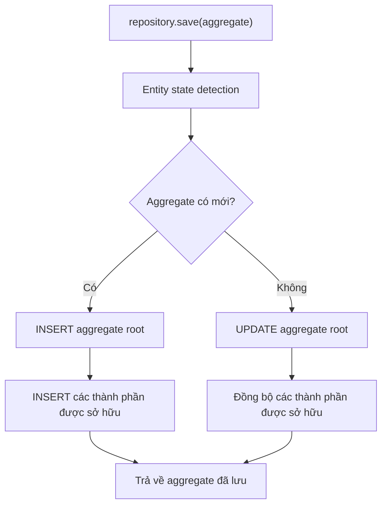
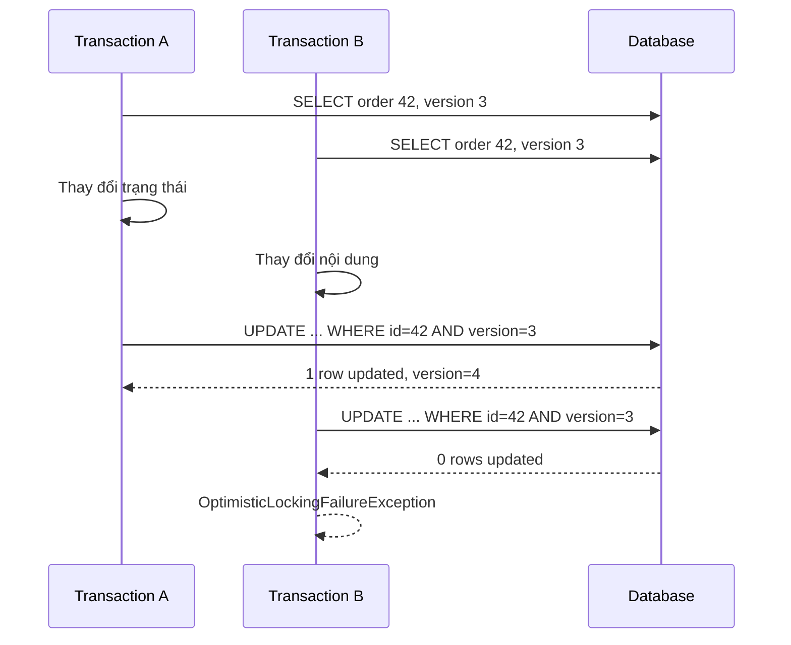

# Phát hiện đối tượng mới từ @Id và @Version

Khi gọi `repository.save(entity)` trong Spring Data JDBC, framework cần quyết định nên **INSERT** một aggregate mới hay **UPDATE** một aggregate đã tồn tại. Quyết định này được gọi là **entity state detection** — phát hiện trạng thái mới của đối tượng.

Spring Data không mặc định truy vấn database để kiểm tra xem một ID đã tồn tại hay chưa trước mỗi lần lưu. Thay vào đó, framework đọc trạng thái của object thông qua các thuộc tính mapping, chủ yếu là `@Id` và `@Version`. Hiểu đúng quy tắc này rất quan trọng khi database tự sinh ID, khi ứng dụng tự cấp UUID hoặc khi aggregate sử dụng optimistic locking.

## 1. Vì sao Spring Data cần biết entity có mới hay không?

Cùng một lời gọi:

```java
repository.save(order);
```

có thể dẫn đến hai nhóm thao tác khác nhau:

- Nếu aggregate được xem là **mới**, Spring Data JDBC tạo bản ghi bằng câu lệnh INSERT cho aggregate root và các đối tượng được root sở hữu.
- Nếu aggregate được xem là **đã tồn tại**, Spring Data JDBC thực hiện quy trình cập nhật root và đồng bộ các đối tượng con theo trạng thái aggregate.



Trong Spring Data JDBC, nếu aggregate root là mới, framework insert root rồi insert các entity được tham chiếu trực tiếp hoặc gián tiếp. Nếu root đã tồn tại, quy trình mặc định có thể xóa các entity được tham chiếu, update root rồi insert lại các entity con. Vì vậy, xác định sai trạng thái mới có thể dẫn tới thao tác SQL sai hoặc tốn kém. Đây không phải một chi tiết nhỏ của repository.

**Newness là trạng thái của object**, được suy ra từ metadata và giá trị property. Nó không đơn giản là câu trả lời cho câu hỏi “database đã có hàng này chưa?”.

## 2. Vai trò của @Id và @Version

Hai annotation quan trọng thuộc Spring Data Commons:

```java
import org.springframework.data.annotation.Id;
import org.springframework.data.annotation.Version;
```

| Annotation | Ý nghĩa chính | Vai trò trong phát hiện đối tượng mới |
| --- | --- | --- |
| `@Id` | Đánh dấu thuộc tính định danh của entity. | Được dùng làm cơ chế mặc định khi không có `@Version` phù hợp hoặc khi không có chiến lược `Persistable` tùy chỉnh. |
| `@Version` | Đánh dấu thuộc tính version dùng cho optimistic locking. | Khi có mặt, giá trị version được dùng để xác định entity mới trước khi fallback sang ID. |

`@Id` cho biết **đối tượng đại diện cho hàng nào**. `@Version` cho biết **đối tượng đang ở phiên bản persistence nào** và đồng thời hỗ trợ phát hiện đối tượng mới.

Đối với Spring Data JDBC, `@Version` thường được đặt trên **aggregate root**. Thuộc tính này cần là kiểu số, chẳng hạn `Long`, `Integer`, `long` hoặc `int`, và database cần có cột tương ứng.

## 3. Quy tắc phát hiện trạng thái mới

Spring Data cung cấp các chiến lược phát hiện entity mới. Trong trường hợp dùng mặc định:

1. Nếu entity có property `@Version`, Spring Data kiểm tra version trước.
2. Nếu version là `null`, entity được xem là mới.
3. Nếu version là kiểu primitive và giá trị bằng `0`, entity được xem là mới.
4. Nếu version có giá trị khác điều kiện mới ở trên, entity được xem là đã tồn tại.
5. Nếu không có property `@Version`, Spring Data kiểm tra `@Id`: ID `null` hoặc ID primitive bằng `0` biểu thị entity mới; các giá trị khác biểu thị entity đã tồn tại.

Có thể ghi nhớ quy tắc mặc định bằng bảng:

| Metadata và giá trị | Kết quả |
| --- | --- |
| Có `@Version Long`, version `null` | Mới |
| Có `@Version long`, version `0` | Mới |
| Có `@Version` với version khác `null`/`0` primitive | Đã tồn tại |
| Không có `@Version`, `@Id Long` là `null` | Mới |
| Không có `@Version`, `@Id long` là `0` | Mới |
| Không có `@Version`, ID có giá trị khác điều kiện mới | Đã tồn tại |

**Chú ý về kiểu wrapper và primitive:** `Long version = 0L` là một giá trị không null, vì vậy theo kiểm tra version property nó được xem là đã tồn tại. `long version = 0` là giá trị mặc định của primitive và được xem là mới. Tương tự, `Long id = null` biểu thị mới theo kiểm tra ID, trong khi `long id = 0` là giá trị primitive được xem là mới.

Đây là lý do kiểu dữ liệu của property quan trọng, không chỉ tên annotation.

## 4. Phát hiện đối tượng mới chỉ từ @Id

Cách đơn giản nhất là dùng ID do database tự sinh. Khi tạo object mới, ID chưa có giá trị:

```java
import org.springframework.data.annotation.Id;
import org.springframework.data.relational.core.mapping.Table;

@Table("purchase_orders")
public class PurchaseOrder {

    @Id
    private Long id;

    private String orderNumber;

    protected PurchaseOrder() {
    }

    public PurchaseOrder(String orderNumber) {
        this.orderNumber = orderNumber;
    }

    public Long getId() {
        return id;
    }

    public String getOrderNumber() {
        return orderNumber;
    }
}
```

Khi gọi:

```java
PurchaseOrder order = new PurchaseOrder("PO-2026-001");

PurchaseOrder saved = repository.save(order);
```

trạng thái trước khi lưu:

```text
id = null
=> Spring Data xem aggregate là mới
=> thực hiện INSERT
=> database sinh ID
=> Spring Data gán ID vào aggregate trả về
```

Sau khi insert, ID được gán nên object trả về không còn được xem là mới theo chiến lược kiểm tra ID.

### 4.1. ID tự tăng

Đây là trường hợp phổ biến với cột identity/auto-increment:

```sql
CREATE TABLE purchase_orders (
    id BIGINT GENERATED BY DEFAULT AS IDENTITY PRIMARY KEY,
    order_number VARCHAR(50) NOT NULL
);
```

Java dùng kiểu wrapper `Long` để có thể biểu diễn trạng thái chưa được cấp ID bằng `null`. Khi insert thành công, giá trị ID do database tạo được trả lại cho object được lưu.

Nên sử dụng kết quả của `save`:

```java
PurchaseOrder saved = repository.save(
    new PurchaseOrder("PO-2026-001")
);

Long generatedId = saved.getId();
```

Không nên giả định mọi object đều được sửa tại chỗ. Với entity bất biến, framework có thể tạo instance mới chứa giá trị ID; vì vậy hãy sử dụng object trả về từ repository.

### 4.2. ID được gán trước

Nếu ứng dụng tự cấp ID, chẳng hạn UUID:

```java
UUID id = UUID.randomUUID();
PurchaseOrder order = new PurchaseOrder(id, "PO-2026-002");

repository.save(order);
```

Nếu không có `@Version` hoặc chiến lược `Persistable` tùy chỉnh, ID đã có giá trị khiến entity được xem là **đã tồn tại**. Spring Data có thể chọn UPDATE dù hàng tương ứng chưa được insert vào database.

Điều này thường gây lỗi khi hệ thống muốn sử dụng ID được tạo ở application layer nhưng vẫn gọi `save` cho một aggregate mới.

Ví dụ:

```java
@Table("purchase_orders")
public class PurchaseOrder {

    @Id
    private UUID id;

    private String orderNumber;

    public PurchaseOrder(UUID id, String orderNumber) {
        this.id = id;
        this.orderNumber = orderNumber;
    }
}
```

Đối tượng có `id != null`, vì vậy chiến lược mặc định theo ID không thể biết ID đó vừa được tạo ở ứng dụng hay đã tồn tại trong database. Spring Data không tự suy luận thời điểm sinh UUID.

Các lựa chọn xử lý gồm:

- Dùng `@Version` với trạng thái version ban đầu biểu thị object mới.
- Implement `Persistable<ID>` và cung cấp `isNew()` nếu ứng dụng cần kiểm soát trạng thái rõ ràng.
- Dùng API `insert` khi use case chắc chắn cần insert và API được chọn phù hợp với phiên bản Spring Data đang dùng.
- Thiết kế lifecycle của ID để phù hợp với chiến lược phát hiện entity mới.

## 5. Phát hiện đối tượng mới bằng @Version

`@Version` có hai vai trò liên quan:

1. Giúp Spring Data nhận diện aggregate mới ngay cả khi ID đã được gán.
2. Bảo vệ cập nhật khỏi ghi đè dữ liệu đã bị một transaction khác thay đổi bằng optimistic locking.

Ví dụ:

```java
import java.util.UUID;

import org.springframework.data.annotation.Id;
import org.springframework.data.annotation.Version;
import org.springframework.data.relational.core.mapping.Table;

@Table("purchase_orders")
public class PurchaseOrder {

    @Id
    private UUID id;

    @Version
    private Long version;

    private String orderNumber;

    public PurchaseOrder(UUID id, String orderNumber) {
        this.id = id;
        this.orderNumber = orderNumber;
    }

    public UUID getId() {
        return id;
    }

    public Long getVersion() {
        return version;
    }

    public String getOrderNumber() {
        return orderNumber;
    }
}
```

Tạo object:

```java
PurchaseOrder order = new PurchaseOrder(
    UUID.randomUUID(),
    "PO-2026-003"
);
```

Trạng thái ban đầu:

```text
id      = UUID đã được tạo
version = null

@Version tồn tại và version là null
=> aggregate được xem là mới
=> Spring Data JDBC thực hiện INSERT
```

Trong ví dụ này, ID đã có giá trị nhưng version `null` được dùng để nhận diện object mới. Điều này đặc biệt hữu ích với UUID hoặc ID do ứng dụng tự tạo.

Sau khi insert, Spring Data JDBC quản lý version và trả về aggregate với trạng thái version đã được khởi tạo. Lần lưu tiếp theo, version có giá trị nên object được xem là đã tồn tại và đi theo đường UPDATE.

### 5.1. Version là kiểu wrapper

Dùng `Long` hoặc `Integer` cho phép biểu diễn trạng thái ban đầu bằng `null`:

```java
@Id
private UUID id;

@Version
private Long version;
```

Đây là một lựa chọn rõ ràng cho entity có ID được cấp trước. Giá trị version ban đầu `null` là dấu hiệu mới.

Không tự gán `0L` cho property wrapper nếu muốn dựa vào quy tắc này: `0L` là giá trị khác null nên được xem là đã tồn tại theo kiểm tra version property.

### 5.2. Version là kiểu primitive

Có thể dùng:

```java
@Id
private Long id;

@Version
private long version;
```

Kiểu `long` có giá trị mặc định là `0`. Spring Data xem version primitive bằng `0` là trạng thái mới. Sau khi persistence, version được tăng để object không còn ở trạng thái mới.

Điểm cần phân biệt:

| Khai báo | Giá trị ban đầu | Kết quả phát hiện |
| --- | --- | --- |
| `Long version` | `null` | Mới |
| `Long version` | `0L` | Đã tồn tại |
| `long version` | `0` | Mới |
| `long version` | `1` | Đã tồn tại |

Với wrapper, tránh tự đặt version mặc định là zero khi đang dùng null để phân biệt object chưa lưu. Với primitive, zero là trạng thái mặc định được framework hiểu là mới.

## 6. @Version ưu tiên hơn @Id

Khi entity có cả `@Id` và `@Version`, version property được dùng để xác định trạng thái mới trước; ID được dùng làm fallback khi không có version property.

Điều này có ý nghĩa rõ ràng với ID được gán trước:

```java
@Id
private UUID id;

@Version
private Long version;
```

| ID | Version | Kết quả theo chiến lược mặc định |
| --- | --- | --- |
| `null` | `null` | Mới |
| UUID đã gán | `null` | Mới |
| UUID đã gán | `1L` | Đã tồn tại |
| `null` | `1L` | Đã tồn tại theo version; trạng thái này thường không hợp lệ với dữ liệu nghiệp vụ |
| `null` | Không có version property | Mới theo ID |
| UUID đã gán | Không có version property | Đã tồn tại theo ID |

Hàng có `id = null` nhưng version đã có giá trị là một trạng thái bất thường đối với aggregate thường gặp. Spring Data tin vào version metadata và có thể chọn UPDATE; ứng dụng cần bảo đảm trạng thái object được khởi tạo nhất quán.

**Không dùng @Version để kiểm tra sự tồn tại thực tế của ID trong database.** Version cũng chỉ là trạng thái trên object; framework không chạy câu SELECT kiểm tra sự tồn tại trước khi quyết định insert/update.

## 7. @Version còn cung cấp optimistic locking

Optimistic locking xử lý tình huống hai transaction cùng đọc một aggregate, sau đó cùng cố gắng cập nhật.

Giả sử database có một đơn hàng:

```text
purchase_orders
+----+----------------+---------+
| id | order_number   | version |
+----+----------------+---------+
| 42 | PO-2026-004    | 3       |
+----+----------------+---------+
```

Hai request đọc cùng version 3:



Câu UPDATE của Spring Data JDBC có điều kiện tương tự:

```sql
UPDATE purchase_orders
SET order_number = ?, version = 4
WHERE id = 42 AND version = 3;
```

Nếu transaction A đã cập nhật version thành 4, câu UPDATE của transaction B với điều kiện version = 3 không còn khớp hàng nào. Spring Data JDBC ném `OptimisticLockingFailureException` để báo xung đột cập nhật.

Nhờ vậy, dữ liệu mới hơn không bị âm thầm ghi đè bởi object được tải từ trạng thái cũ.

### 7.1. Version được tăng khi lưu

Khi lưu aggregate có `@Version`:

- Với aggregate mới, Spring Data JDBC khởi tạo version cho bản ghi và cập nhật trạng thái version của object.
- Với aggregate đã tồn tại, version trong câu UPDATE được kiểm tra; khi cập nhật thành công, version được tăng.
- Với thao tác delete có version, điều kiện version cũng được kiểm tra; thao tác xóa không tăng version.

Hãy dùng object trả về từ `save` để tiếp tục thao tác, đặc biệt khi domain model bất biến hoặc framework tạo instance mới để chứa version đã cập nhật.

### 7.2. Version phải được lưu trong database

Ví dụ schema:

```sql
CREATE TABLE purchase_orders (
    id UUID PRIMARY KEY,
    order_number VARCHAR(50) NOT NULL,
    version BIGINT NOT NULL
);
```

Cột `version` cần tương ứng với property `@Version`. Nếu schema legacy chưa có cột này, việc chỉ thêm annotation vào Java không đủ để optimistic locking hoạt động. Cần migration hoặc điều chỉnh schema theo quyền sở hữu database.

Nếu version column không tồn tại hoặc kiểu dữ liệu không tương thích, thao tác persistence sẽ thất bại ở database. Nếu có nhiều ứng dụng cùng ghi một bảng, các writer khác cũng phải tôn trọng quy tắc version nếu muốn optimistic locking bảo vệ toàn bộ luồng cập nhật.

## 8. Tác động của phát hiện trạng thái đến save()

Giả sử repository:

```java
public interface PurchaseOrderRepository
        extends CrudRepository<PurchaseOrder, UUID> {
}
```

Khi gọi `save`, Spring Data JDBC sử dụng trạng thái aggregate để chọn thao tác.

| Trạng thái | Quyết định | Tác động |
| --- | --- | --- |
| ID null, không có version | Mới | Insert root và các thành phần được sở hữu. |
| ID có giá trị, không có version | Đã tồn tại | Update root theo ID. |
| ID có giá trị, version null (wrapper) | Mới | Insert; hữu ích với ID được cấp trước. |
| ID có giá trị, version primitive 0 | Mới | Insert. |
| ID có giá trị, version đã có giá trị | Đã tồn tại | Update với điều kiện version. |

Với aggregate đã tồn tại, Spring Data JDBC mặc định không giữ snapshot trạng thái cũ của các entity con như ORM có persistence context. Quy trình cập nhật có thể xóa và tạo lại các entity con được tham chiếu. Do đó, phân biệt new/existing đúng còn ảnh hưởng đến chi phí ghi và vòng đời dữ liệu con.

### 8.1. Nếu một object mới bị nhận diện là existing

Ví dụ UUID đã gán trước nhưng không có `@Version`:

```java
PurchaseOrder newOrder = new PurchaseOrder(
    UUID.randomUUID(),
    "PO-2026-005"
);

repository.save(newOrder);
```

Framework xem ID có giá trị là dấu hiệu existing và cố gắng UPDATE. Nếu database chưa có hàng tương ứng, lệnh update không tác động hàng nào và thao tác có thể thất bại. Spring Data không tự chuyển sang INSERT chỉ vì update không tìm thấy hàng.

### 8.2. Nếu một object existing bị nhận diện là new

Nếu object đã tồn tại nhưng version bị reset về null hoặc primitive 0, Spring Data có thể chọn INSERT. Khi ID trùng với primary key đã có, database trả lỗi vi phạm unique/primary key.

Vì vậy, không được tùy tiện xóa version hoặc đặt lại ID của một object đã lưu để “bắt framework insert lại”. Nếu cần tạo bản ghi mới, hãy tạo một aggregate mới với lifecycle/identity phù hợp.

## 9. Khi nào cần Persistable?

Spring Data Commons còn hỗ trợ interface `Persistable<ID>`:

```java
public interface Persistable<ID> {
    ID getId();
    boolean isNew();
}
```

Nếu entity implement `Persistable`, Spring Data ủy quyền việc phát hiện mới cho phương thức `isNew()` của entity. Cách này hữu ích khi:

- ID được cấp trước và không thể dựa vào null để phân biệt.
- Quy tắc vòng đời mới/cũ đặc thù với ứng dụng.
- Entity cần một cờ trạng thái do ứng dụng quản lý.

Ví dụ ý tưởng:

```java
public class ImportedOrder implements Persistable<UUID> {

    @Id
    private UUID id;

    @Transient
    private boolean newEntity;

    @Override
    public UUID getId() {
        return id;
    }

    @Override
    public boolean isNew() {
        return newEntity;
    }
}
```

Đây là phần khung minh họa; ứng dụng cần hoàn thiện lifecycle để đánh dấu object không còn mới sau khi insert và khi materialize object từ database. Có thể dùng callback thích hợp của Spring Data Relational hoặc cơ chế domain factory để quản lý cờ. Không để cờ ở trạng thái true mãi sau khi đã lưu, nếu không lần save tiếp theo tiếp tục bị xem là insert.

Nếu sử dụng property-based access, các accessor của `Persistable` có thể bị xem như persistent properties. Có thể đánh dấu thuộc tính hỗ trợ bằng `@Transient` khi phù hợp để tránh ghi nó vào database.

Không cần implement `Persistable` nếu quy tắc mặc định từ `@Id` hoặc `@Version` đã đáp ứng nhu cầu.

## 10. Phân biệt new detection với upsert

Một hiểu nhầm thường gặp là `save` luôn tương đương với SQL `MERGE` hoặc `UPSERT`.

`save` trong Spring Data JDBC chọn insert/update dựa trên **trạng thái object**:

- New → insert.
- Existing → update.

Nó không mặc định hỏi database xem ID có tồn tại để quyết định insert hay update.

Nếu cần native upsert, Spring Data JDBC cung cấp API `JdbcAggregateTemplate.upsert` trên các dialect được hỗ trợ. Upsert có semantics và yêu cầu riêng, đặc biệt cần ID có giá trị; theo tài liệu hiện hành, upsert không hỗ trợ optimistic locking. Vì vậy không nên dùng thuật ngữ upsert để mô tả chung cho `repository.save`.

| API | Cách quyết định |
| --- | --- |
| `CrudRepository.save` | Dựa trên trạng thái new/existing của object. |
| `JdbcAggregateTemplate.insert` | Chủ động yêu cầu insert. |
| `JdbcAggregateTemplate.update` | Chủ động yêu cầu update. |
| `JdbcAggregateTemplate.upsert` | Dùng native database upsert nếu dialect hỗ trợ; có yêu cầu riêng. |

Các API template này phù hợp khi cần điều khiển persistence rõ hơn, nhưng phải chọn đúng semantics cho use case.

## 11. Kiểm thử các trường hợp new/existing

Có thể viết test repository để xác nhận đường insert và update.

### 11.1. Test ID do database sinh

```java
@Test
void insertsAggregateWithoutId() {
    PurchaseOrder order = new PurchaseOrder("PO-NEW");

    assertThat(order.getId()).isNull();

    PurchaseOrder saved = repository.save(order);

    assertThat(saved.getId()).isNotNull();
}
```

Test này xác nhận ID được sinh sau insert. Với entity immutable, hãy kiểm tra object trả về thay vì object đầu vào.

### 11.2. Test ID được gán trước và version null

```java
@Test
void insertsAggregateWithAssignedIdWhenVersionIsNull() {
    UUID id = UUID.randomUUID();

    PurchaseOrder order = new PurchaseOrder(
        id,
        null,
        "PO-ASSIGNED"
    );

    PurchaseOrder saved = repository.save(order);

    assertThat(saved.getId()).isEqualTo(id);
    assertThat(saved.getVersion()).isNotNull();
}
```

Constructor trong test này cần tương ứng với entity có `@Version Long` và version null biểu thị mới. Test cần chạy trên database schema có version column.

### 11.3. Test optimistic locking

Một kịch bản kiểm thử có thể:

1. Lưu aggregate để tạo row và version.
2. Đọc cùng aggregate thành hai instance độc lập.
3. Lưu instance thứ nhất để version tăng.
4. Thử lưu instance thứ hai vẫn giữ version cũ.
5. Xác nhận Spring Data ném `OptimisticLockingFailureException`.

Ví dụ khung:

```java
@Test
void rejectsStaleAggregateVersion() {
    PurchaseOrder saved = repository.save(
        PurchaseOrder.newOrder("PO-LOCK")
    );

    PurchaseOrder first = repository.findById(saved.getId())
        .orElseThrow();
    PurchaseOrder stale = repository.findById(saved.getId())
        .orElseThrow();

    first.rename("PO-LOCK-A");
    repository.save(first);

    stale.rename("PO-LOCK-B");

    assertThatThrownBy(() -> repository.save(stale))
        .isInstanceOf(OptimisticLockingFailureException.class);
}
```

Đây là ví dụ khung; cần có phương thức domain `rename` và repository/domain model tương ứng. Test phải dùng hai instance độc lập cùng version ban đầu, nếu không sẽ không tái hiện được tình huống stale update.

## 12. Những lỗi thường gặp

| Hiện tượng | Nguyên nhân | Hướng xử lý |
| --- | --- | --- |
| ID UUID đã có nhưng save lại chạy UPDATE | Không có version hoặc custom newness strategy. | Thêm `@Version` có trạng thái ban đầu phù hợp hoặc implement `Persistable`. |
| Entity mới nhưng bị xem là existing | ID được gán trước hoặc version không ở trạng thái mới. | Kiểm tra `@Id` và `@Version` trước khi save. |
| Entity cũ bị INSERT | Version bị reset về null/primitive 0 hoặc ID bị reset. | Giữ nguyên trạng thái version/ID sau khi load. |
| UPDATE không tác động hàng nào | Object bị xem là existing nhưng row không tồn tại hoặc version không khớp. | Kiểm tra ID, version và lifecycle của object. |
| Optimistic locking không phát hiện xung đột | Thiếu `@Version` hoặc writer khác không tuân thủ version. | Đảm bảo mọi luồng cập nhật đều dùng version/đúng cơ chế đồng bộ. |
| Version column không tồn tại | Schema chưa được migration. | Bổ sung cột số tương ứng với `@Version`. |
| Wrapper version `0L` bị xem là existing | Wrapper không null nên không thỏa điều kiện new. | Dùng null cho trạng thái ban đầu hoặc thiết kế lại lifecycle. |
| Version primitive luôn bắt đầu bằng 0 | Giá trị mặc định của primitive. | Hiểu rằng 0 là new; dùng version do framework quản lý sau khi lưu. |

## 13. Quy trình lựa chọn chiến lược cho dự án

Khi thiết kế entity Spring Data JDBC, hãy xác định:

1. **ID được cấp ở đâu?** Database identity/sequence hay application UUID?
2. **ID có null trước lần lưu đầu tiên không?** Nếu có, chiến lược `@Id` mặc định thường đủ.
3. **Có cần optimistic locking không?** Nếu có, thêm `@Version` và cột version trên aggregate root.
4. **Version ban đầu là gì?** Dùng wrapper null hoặc primitive 0 theo đúng quy tắc phát hiện new.
5. **Có cần custom lifecycle không?** Chỉ implement `Persistable` khi quy tắc mặc định không phù hợp.
6. **Sau save có dùng object trả về không?** Cần thiết khi ID/version được framework cập nhật hoặc entity immutable.
7. **Database schema có khớp không?** ID và version columns cần đúng kiểu và constraint.
8. **Test có bao phủ cả insert và stale update không?** Kiểm thử trên database/dialect tương thích để xác nhận hành vi.

### Bảng chọn nhanh

| Tình huống | Lựa chọn phù hợp |
| --- | --- |
| ID auto-increment, object mới chưa có ID | `@Id` thường đủ. |
| UUID do ứng dụng cấp trước, cần insert lần đầu | `@Version` với version ban đầu null/primitive 0, hoặc `Persistable`. |
| Cần phát hiện xung đột cập nhật đồng thời | `@Version` trên aggregate root. |
| Có quy tắc xác định new/existing đặc biệt | `Persistable` và `isNew()`. |
| Muốn insert/update/upsert chủ động | Xem `JdbcAggregateTemplate` và semantics API tương ứng. |

> **`@Id` nhận diện hàng và mặc định hỗ trợ phát hiện entity mới khi ID chưa được cấp. `@Version` vừa có thể quyết định trạng thái mới trước ID, vừa bảo vệ cập nhật bằng optimistic locking.** Hãy chọn kiểu wrapper/primitive và giá trị ban đầu có chủ đích; đừng giả định `save` sẽ tự kiểm tra database để suy ra object mới.

### Tài liệu tham khảo

- [Spring Data Commons — Entity State Detection Strategies](https://docs.spring.io/spring-data/commons/reference/is-new-state-detection.html): quy tắc phát hiện entity mới từ `@Id`, `@Version` và `Persistable`.
- [Spring Data Relational — Persisting Entities](https://docs.spring.io/spring-data/relational/reference/jdbc/entity-persistence.html): insert/update aggregate, ID generation và optimistic locking trong Spring Data JDBC.
- [Spring Data Commons — Persistable API](https://docs.spring.io/spring-data/commons/reference/api/java/org/springframework/data/domain/Persistable.html): hợp đồng `getId()` và `isNew()`.
- [Spring Data JDBC — Custom ID Generation](https://spring.io/blog/2021/09/09/spring-data-jdbc-how-to-use-custom-id-generation/): tình huống ID được cấp trước và ảnh hưởng đến phát hiện trạng thái mới.
