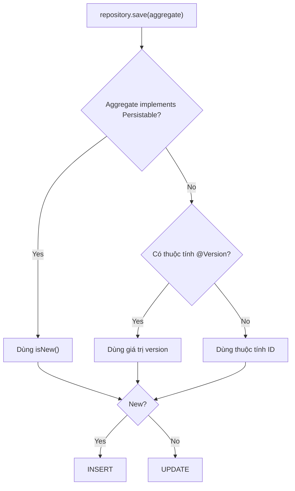

# Phân biệt ID null, giá trị 0 và ID đã được gán

Trong Spring Data JDBC, khi gọi `repository.save(aggregate)`, framework phải xác định aggregate đang **được tạo mới** hay **đã tồn tại trong cơ sở dữ liệu**. Quyết định này ảnh hưởng trực tiếp đến câu lệnh SQL được thực hiện: thông thường aggregate mới đi theo đường `INSERT`, còn aggregate đã tồn tại đi theo đường `UPDATE`.

Vì vậy, ba trạng thái sau không thể xem là tương đương:

- **ID là `null`:** chưa có giá trị định danh trong Java.
- **ID bằng `0`:** đang có một giá trị số cụ thể là 0; ý nghĩa nhận diện trạng thái mới còn phụ thuộc kiểu Java và chiến lược xác định newness.
- **ID đã được gán:** thuộc tính định danh đã có giá trị, dù giá trị đó được database sinh ra hay được ứng dụng cung cấp.

Điểm quan trọng là **có ID không đồng nghĩa chắc chắn bản ghi đã tồn tại trong database**. Một ứng dụng có thể tự cấp ID trước khi insert. Spring Data JDBC cần một quy tắc rõ ràng để phân biệt trường hợp đó với một aggregate đã được lưu từ trước.

## 1. ID có vai trò gì trong aggregate?

ID (*identifier*) là giá trị định danh một aggregate root. Nó cho phép ứng dụng tìm lại đúng aggregate trong những lần thao tác sau, tham chiếu aggregate từ nơi khác và xác định hàng tương ứng trong bảng.

Ví dụ một sản phẩm:

```java
import org.springframework.data.annotation.Id;
import org.springframework.data.relational.core.mapping.Table;

@Table("products")
public class Product {

    @Id
    private Long id;

    private String name;

    public Product() {
    }

    public Product(String name) {
        this.name = name;
    }

    public Long getId() {
        return id;
    }

    public String getName() {
        return name;
    }
}
```

`@Id` đánh dấu thuộc tính định danh của aggregate. Nó cho Spring Data JDBC biết thuộc tính nào tương ứng với khóa của hàng dữ liệu.

Tuy nhiên, `@Id` **không tự nói rằng ID phải được database sinh ra**, cũng không có nghĩa cứ nhìn thấy ID khác `null` thì hàng đó chắc chắn đã tồn tại. Cách cấp ID và cách xác định trạng thái mới là hai vấn đề có liên quan nhưng riêng biệt.

Ví dụ schema PostgreSQL sử dụng khóa tự sinh:

```sql
CREATE TABLE products (
    id BIGINT GENERATED BY DEFAULT AS IDENTITY PRIMARY KEY,
    name VARCHAR(200) NOT NULL
);
```

Với cách thiết kế này, database có thể cấp ID khi insert mà ứng dụng không truyền ID. Ở phía Java, dùng `Long` cho phép biểu diễn trạng thái trước khi lưu bằng `id == null`.

## 2. Ba trạng thái ID thường gặp

### 2.1. ID là null

```java
Product product = new Product("Bàn phím");
System.out.println(product.getId()); // null
```

`Long` là kiểu tham chiếu nên field chưa được gán có giá trị mặc định là `null`. Trong chiến lược xác định trạng thái mới mặc định, một ID kiểu tham chiếu đang `null` cho biết aggregate là **new**.

Khi gọi:

```java
Product saved = productRepository.save(product);
```

Spring Data JDBC thường thực hiện thao tác insert. Database cấp khóa chính, sau đó giá trị ID được đưa vào aggregate được trả về.

```text
Java trước khi save                    Database
-------------------                    --------
Product                                products
  id = null             INSERT ------> id = 101
  name = "Bàn phím"                    name = "Bàn phím"

Java sau khi save
-----------------
saved
  id = 101
  name = "Bàn phím"
```

Với aggregate bất biến, hoặc khi framework tạo một instance mới chứa ID được sinh ra, cần **dùng giá trị trả về của `save`**:

```java
Product saved = productRepository.save(product);

Long generatedId = saved.getId();
```

Đừng mặc định rằng biến `product` ban đầu luôn được cập nhật tại chỗ. Hãy lấy aggregate được trả về để sử dụng ID và trạng thái sau khi persist.

### 2.2. ID bằng 0

Giá trị `0` là một số nguyên hợp lệ trong Java. Nó không tự động đồng nghĩa với `null`.

Ví dụ:

```java
Long id = 0L;
long primitiveId = 0L;
```

Hai biến trên đều biểu diễn số 0, nhưng kiểu của chúng khác nhau:

- `Long id` là wrapper, có thể là `null` hoặc chứa giá trị 0.
- `long primitiveId` không thể là `null`; field chưa được gán có giá trị mặc định là 0.

Trong chiến lược xác định trạng thái mới mặc định của Spring Data Commons mà Spring Data JDBC sử dụng, **kiểu primitive có giá trị số 0 được xem là chưa có giá trị ID**. Ngược lại, một wrapper như `Long` đang chứa `0L` là giá trị khác `null` và được xem là đã có ID nếu không có quy tắc newness khác chi phối.

Điều này tạo ra khác biệt đáng chú ý:

| Khai báo Java | Giá trị | Ý nghĩa theo ID-based newness mặc định |
| --- | --- | --- |
| `Long id` | `null` | New |
| `Long id` | `0L` | Existing |
| `Long id` | `101L` | Existing |
| `long id` | `0L` | New (giá trị primitive mặc định/sentinel) |
| `long id` | `101L` | Existing |

**Không suy luận rằng database cấm ID bằng 0.** Database có thể cho phép một khóa chính bằng 0 nếu schema và cách insert cho phép. Việc primitive ID bằng 0 được dùng làm dấu hiệu newness là quy ước của chiến lược nhận diện entity, không phải quy tắc phổ quát của SQL.

Nếu nghiệp vụ cần ID 0 là một định danh đã được cấp thực sự, dùng primitive ID có thể làm mất khả năng phân biệt giữa “chưa có ID” và “ID hợp lệ bằng 0”. Kiểu wrapper hoặc một chiến lược xác định newness khác sẽ rõ ràng hơn.

### 2.3. ID đã được gán

Một ID đã được gán có thể đến từ nhiều nguồn:

- Database đã sinh ID sau lần insert trước.
- Ứng dụng tự cấp ID theo quy tắc riêng.
- Hệ thống bên ngoài gửi ID cần được lưu.
- ID là khóa tự nhiên, ví dụ mã sản phẩm hoặc mã nghiệp vụ.
- Ứng dụng tạo UUID trước khi ghi dữ liệu.

Ví dụ:

```java
Product product = new Product("Chuột không dây");
product.setId(101L);
```

Trong chiến lược mặc định dựa trên ID, một ID wrapper khác `null` được xem là aggregate đã tồn tại. Khi gọi `save`, Spring Data JDBC đi theo đường cập nhật.

```text
Product
  id = 101
  name = "Chuột không dây"
       |
       v
Spring Data JDBC xác định: existing
       |
       v
UPDATE products
SET name = ?
WHERE id = 101
```

Điểm dễ nhầm: **ứng dụng gán ID trước khi lưu không chứng minh rằng hàng có ID đó đã tồn tại trong database**. Nếu hàng chưa tồn tại, một thao tác update không tự động biến thành insert chỉ vì ứng dụng muốn tạo mới.

Tùy cấu hình, phiên bản và ngữ cảnh optimistic locking, thao tác cập nhật không tìm thấy hàng có thể không cập nhật được và có thể phát sinh ngoại lệ về ngữ nghĩa cập nhật. Vì thế, cần khai báo đúng chiến lược nhận diện trạng thái mới thay vì chỉ gán ID rồi gọi `save`.

## 3. Spring Data JDBC xác định aggregate mới như thế nào?

Spring Data JDBC cần biết trạng thái newness trước khi chọn đường ghi dữ liệu. Cơ chế mặc định của Spring Data Commons xét thông tin trên aggregate theo thứ tự khái quát:

1. Nếu aggregate triển khai `Persistable`, phương thức `isNew()` do aggregate cung cấp được dùng để xác định trạng thái mới.
2. Nếu có thuộc tính phiên bản được đánh dấu `@Version`, phiên bản được dùng để xác định trạng thái mới.
3. Nếu không có hai cơ chế trên, thuộc tính ID là căn cứ xác định newness.

Với chiến lược dựa trên thuộc tính được chọn:

- Giá trị `null` biểu thị aggregate mới.
- Với thuộc tính số primitive, giá trị mặc định `0` cũng được xem là mới.
- Giá trị khác `null` của wrapper, chẳng hạn `Long.valueOf(0)`, được xem là đã có giá trị.
- Giá trị khác sentinel của thuộc tính primitive được xem là đã có giá trị.

Đây là **quy tắc xác định newness ở tầng Spring Data**, không phải phép kiểm tra truy vấn database để xác nhận hàng có tồn tại hay không.

### 3.1. Bảng quyết định minh họa

Giả sử không triển khai `Persistable` và không có thuộc tính `@Version`:

| Thuộc tính ID | Giá trị | Kết quả newness mặc định |
| --- | --- | --- |
| `Long` | `null` | New |
| `Long` | `0L` | Existing |
| `Long` | `101L` | Existing |
| `long` | `0L` | New |
| `long` | `101L` | Existing |
| `String` | `null` | New |
| `String` | `"P-101"` | Existing |
| `UUID` | `null` | New |
| `UUID` | Một UUID cụ thể | Existing |

Bảng này mô tả chiến lược dựa trên ID. Nếu aggregate có `@Version` hoặc triển khai `Persistable`, cần xét cơ chế đó trước khi kết luận từ ID.

### 3.2. Sơ đồ lựa chọn thao tác



Kết quả của `isNew` chỉ xác định đường ghi. Nó không thay thế kiểm tra ràng buộc database, xác minh dữ liệu đầu vào hay kiểm tra xung đột đồng thời.

## 4. Vì sao wrapper ID thường phù hợp với khóa tự sinh?

Với ID được database cấp, kiểu wrapper giúp biểu diễn trạng thái trước và sau khi lưu:

```java
@Id
private Long id;
```

Trạng thái:

```text
Trước INSERT:  id = null
Sau INSERT:    id = 101
Sau khi đọc:   id = 101
```

Đây là một mô hình dễ hiểu:

- `null`: chưa có khóa được gán.
- `101`: đã có định danh cụ thể.
- Không cần dành riêng số 0 làm dấu hiệu “chưa có ID”.

So sánh với primitive:

```java
@Id
private long id;
```

Field `long` luôn có giá trị số. Trước khi gán, nó là 0. Nếu database hoặc nghiệp vụ cũng sử dụng ID 0 hợp lệ, code không còn biểu diễn rõ hai trạng thái khác nhau.

Vì vậy, với khóa tự sinh thông thường, **`Long` thường là lựa chọn rõ nghĩa hơn `long`**. Điều này không có nghĩa mọi ID đều phải là `Long`; UUID, String hoặc kiểu ID khác vẫn phù hợp nếu đáp ứng hợp đồng mapping và chiến lược newness.

## 5. Ví dụ đầy đủ: ID do database tự sinh

### 5.1. Schema

Dùng PostgreSQL:

```sql
CREATE TABLE products (
    id BIGINT GENERATED BY DEFAULT AS IDENTITY PRIMARY KEY,
    name VARCHAR(200) NOT NULL
);
```

`GENERATED BY DEFAULT AS IDENTITY` cho phép PostgreSQL tự cấp ID khi câu lệnh insert không cung cấp ID. Cách khai báo này cũng cho phép một giá trị ID được cung cấp tường minh trong những trường hợp phù hợp.

### 5.2. Aggregate

```java
import org.springframework.data.annotation.Id;
import org.springframework.data.relational.core.mapping.Table;

@Table("products")
public record Product(
        @Id Long id,
        String name
) {
}
```

### 5.3. Repository

```java
import org.springframework.data.repository.CrudRepository;

public interface ProductRepository
        extends CrudRepository<Product, Long> {
}
```

### 5.4. Lưu aggregate mới

```java
Product draft = new Product(null, "Bàn phím cơ");

Product saved = productRepository.save(draft);

System.out.println(saved.id());
```

Trước khi lưu, `draft.id()` là `null`. Spring Data JDBC nhận diện aggregate mới và thực hiện insert. Sau khi insert, dùng `saved` để lấy ID được sinh ra.

### 5.5. Đọc và cập nhật aggregate

```java
Product current = productRepository.findById(saved.id())
        .orElseThrow();

Product renamed = new Product(
        current.id(),
        "Bàn phím cơ phiên bản mới"
);

Product updated = productRepository.save(renamed);
```

Lần này ID đã có giá trị. Aggregate được xem là existing và thao tác save đi theo đường update.

```text
Lần 1:
new Product(null, "Bàn phím cơ")
       |
       v
INSERT -> database cấp id = 101

Lần 2:
new Product(101, "Bàn phím cơ phiên bản mới")
       |
       v
UPDATE -> thay đổi hàng id = 101
```

Cần phân biệt **ID được sinh sau lần lưu đầu tiên** với **ID được ứng dụng gán trước lần lưu đầu tiên**. Cả hai đều có thể là số 101 trong Java, nhưng trạng thái newness mặc định theo ID không giống nhau nếu ID đã có ngay trước khi gọi save.

## 6. ID được ứng dụng gán trước khi insert

Một số hệ thống không dùng khóa tự tăng. Chúng có thể cấp ID từ:

- UUID được tạo ở ứng dụng.
- Mã sản phẩm duy nhất.
- Mã đơn hàng theo quy tắc nghiệp vụ.
- ID do một hệ thống khác cấp.
- Sequence hoặc bộ cấp ID riêng.

Ví dụ:

```java
Product product = new Product(9001L, "Màn hình 27 inch");
```

Nếu không có `@Version` và không triển khai `Persistable`, Spring Data JDBC mặc định thấy ID đã có giá trị và xem aggregate là existing. Nhưng hàng `9001` có thể chưa tồn tại.

Để xử lý đúng, cần một cách diễn đạt rằng **ID đã được cấp nhưng aggregate vẫn là mới**.

Có hai lựa chọn phổ biến:

1. Dùng thuộc tính `@Version` nullable để xác định newness, đồng thời có optimistic locking.
2. Triển khai `Persistable` và tự quản lý `isNew()`.

### 6.1. Cách 1: dùng thuộc tính @Version

Spring Data JDBC hỗ trợ optimistic locking thông qua thuộc tính được đánh dấu `@Version`. Thuộc tính version cũng được dùng để xác định trạng thái mới khi có mặt.

Ví dụ:

```java
import org.springframework.data.annotation.Id;
import org.springframework.data.annotation.Version;
import org.springframework.data.relational.core.mapping.Table;

@Table("products")
public record Product(
        @Id Long id,
        @Version Long version,
        String name
) {
}
```

Tạo aggregate với ID đã cấp nhưng version chưa có:

```java
Product newProduct = new Product(
        9001L,
        null,
        "Màn hình 27 inch"
);

Product saved = productRepository.save(newProduct);
```

Vì `version == null`, aggregate được xác định là mới theo chiến lược version. Spring Data JDBC có thể thực hiện insert với ID được cung cấp. Sau khi insert, version được khởi tạo theo cơ chế optimistic locking của Spring Data JDBC.

Trạng thái khái quát:

```text
Trước INSERT:
  id      = 9001
  version = null
  name    = "Màn hình 27 inch"

Sau INSERT:
  id      = 9001
  version = giá trị khởi tạo do cơ chế version quản lý
  name    = "Màn hình 27 inch"

Lần save sau:
  version đã có giá trị -> existing
  UPDATE có kiểm tra version hiện tại
```

**Vì sao cách này hữu ích?**

- ID có thể được cấp trước khi lưu.
- Không cần dùng ID null làm dấu hiệu duy nhất của aggregate mới.
- Version giúp phát hiện một số trường hợp cập nhật đồng thời bị xung đột.
- Sau khi đọc aggregate từ database, version đã có giá trị nên aggregate được nhận diện là existing.

Dùng wrapper `Long version` giúp biểu diễn `null` trước lần lưu đầu tiên. Nếu dùng version primitive, chiến lược newness có thể dựa vào giá trị 0 làm sentinel; cần hiểu rõ quy tắc đó và không tự gán một version khác 0 cho aggregate mới.

**Lưu ý:** `@Version` không chỉ là cờ new/existing. Nó tham gia optimistic locking. Khi một aggregate đã bị một giao dịch khác cập nhật và version thay đổi, thao tác cập nhật bằng version cũ có thể thất bại với ngoại lệ optimistic locking. Ứng dụng cần quyết định cách báo lỗi, tải lại hoặc xử lý xung đột theo nghiệp vụ.

### 6.2. Cách 2: triển khai Persistable

Nếu quy tắc xác định newness của ứng dụng không thể biểu diễn phù hợp bằng ID hoặc version, aggregate có thể triển khai `Persistable<ID>`.

Giao diện này cung cấp:

- `getId()`: trả về định danh của aggregate.
- `isNew()`: trả về trạng thái aggregate mới hay đã tồn tại.

Ví dụ về cấu trúc:

```java
import org.springframework.data.annotation.Id;
import org.springframework.data.annotation.Transient;
import org.springframework.data.domain.Persistable;
import org.springframework.data.relational.core.mapping.Table;

@Table("products")
public class AssignedIdProduct implements Persistable<Long> {

    @Id
    private Long id;

    private String name;

    @Transient
    private boolean newEntity = true;

    protected AssignedIdProduct() {
    }

    public AssignedIdProduct(Long id, String name) {
        this.id = id;
        this.name = name;
        this.newEntity = true;
    }

    @Override
    public Long getId() {
        return id;
    }

    @Override
    public boolean isNew() {
        return newEntity;
    }

    public void markNotNew() {
        this.newEntity = false;
    }

    public String getName() {
        return name;
    }
}
```

`@Transient` của Spring Data đánh dấu `newEntity` là trạng thái tạm, không phải cột cần lưu trong bảng. `isNew()` được Spring Data dùng thay cho chiến lược xác định newness mặc định.

Ví dụ luồng tạo mới:

```java
AssignedIdProduct product =
        new AssignedIdProduct(9001L, "Màn hình 27 inch");

AssignedIdProduct saved = repository.save(product);

// Sau khi xác nhận save thành công, cập nhật trạng thái
saved.markNotNew();
```

Đây là ví dụ minh họa phần điều khiển trạng thái; trong ứng dụng thật, việc chuyển `newEntity` sang false cần được tích hợp đúng với vòng đời persist và load.

**Hai trách nhiệm bắt buộc khi dùng Persistable:**

1. Sau khi insert thành công, entity phải được đánh dấu existing trước lần save tiếp theo.
2. Khi entity được tải từ database, nó cũng phải được khởi tạo ở trạng thái existing.

Có thể quản lý việc này bằng factory, constructor mapping hoặc callback vòng đời phù hợp (ví dụ callback sau khi aggregate được chuyển đổi từ dữ liệu database). Nếu chỉ đặt `newEntity = true` và quên cập nhật khi đọc dữ liệu, một aggregate đã tồn tại có thể bị nhận diện nhầm là mới ở lần save sau.

Chỉ nên dùng `Persistable` khi thực sự cần kiểm soát newness. Nếu `@Version` đã giải quyết được trường hợp ID gán trước, cách đó thường ít trạng thái tùy chỉnh hơn.

## 7. Phân biệt ID, version và trạng thái tồn tại

ID và version có vai trò khác nhau:

| Thuộc tính | Trả lời câu hỏi | Ví dụ |
| --- | --- | --- |
| `@Id Long id` | Aggregate được định danh bằng giá trị nào? | `id = 9001` |
| `@Version Long version` | Aggregate đang ở phiên bản dữ liệu nào? | `version = 3` |
| `Persistable.isNew()` | Theo quy tắc của aggregate, nó có được xem là mới không? | `true` / `false` |

ID không phải version. ID thường ổn định qua các lần cập nhật; version thay đổi khi cập nhật thành công để hỗ trợ optimistic locking.

Ví dụ:

```text
Lần insert:
  id = 9001
  version = 0

Lần update thành công:
  id = 9001
  version = 1

Lần update tiếp theo:
  id = 9001
  version = 2
```

Giá trị khởi tạo version cụ thể có thể phụ thuộc cơ chế và kiểu version được sử dụng. Điều cần nhớ là version thay đổi theo lần ghi; ID giữ nguyên để định danh aggregate.

Không nên tự tăng `version` bằng tay khi gọi save thông thường. Hãy để Spring Data JDBC quản lý version theo cơ chế optimistic locking.

## 8. SQL INSERT và UPDATE khác nhau như thế nào?

Giả sử bảng:

```sql
CREATE TABLE products (
    id BIGINT PRIMARY KEY,
    name VARCHAR(200) NOT NULL
);
```

Một thao tác insert với ID được cấp:

```sql
INSERT INTO products (id, name)
VALUES (9001, 'Màn hình 27 inch');
```

Một thao tác cập nhật:

```sql
UPDATE products
SET name = 'Màn hình 27 inch phiên bản mới'
WHERE id = 9001;
```

Hai câu lệnh có mục đích khác nhau:

- `INSERT` tạo một hàng mới; nếu khóa chính đã tồn tại thì database từ chối theo constraint.
- `UPDATE` sửa hàng đã có; nếu không có hàng khớp, số hàng được cập nhật là 0.
- `save` chọn đường thao tác dựa trên trạng thái newness của aggregate; nó không phải lệnh SQL “upsert” phổ quát tự động chèn nếu update không tìm thấy.

Đây là lý do gán ID trước khi insert mà không điều chỉnh chiến lược newness có thể dẫn đến lỗi. **ID có giá trị không đủ để kết luận bản ghi đã được insert.**

### 8.1. Tránh nhầm save với upsert

Một số database hỗ trợ cú pháp upsert riêng như `INSERT ... ON CONFLICT ... DO UPDATE` của PostgreSQL. Đây là một chiến lược SQL cụ thể. `repository.save` của Spring Data JDBC không nên được hiểu là luôn phát câu lệnh upsert như vậy.

Nếu nghiệp vụ cần “nếu có thì cập nhật, nếu chưa có thì tạo”, hãy xác định chính sách xung đột khóa và triển khai phù hợp. Việc kiểm tra tồn tại rồi insert cũng có thể gặp race condition khi hai request chạy đồng thời; unique constraint và xử lý lỗi database vẫn rất quan trọng.

## 9. Khi nào nên dùng ID null, khi nào nên gán ID?

| Tình huống | Cách biểu diễn thường phù hợp | Lý do |
| --- | --- | --- |
| Database tự sinh ID | `Long id = null` | Newness rõ ràng; database cấp ID khi insert. |
| Ứng dụng tạo UUID trước khi lưu | ID đã có giá trị + `@Version Long version = null` hoặc `Persistable` | ID được cấp không có nghĩa aggregate đã tồn tại. |
| ID là mã nghiệp vụ cố định | ID đã có giá trị + cơ chế newness rõ ràng | Có thể insert với ID đã biết. |
| Đọc aggregate đã lưu | ID đã có giá trị và version (nếu có) | Aggregate là existing. |
| ID số 0 có ý nghĩa nghiệp vụ | Tránh dùng primitive 0 làm sentinel | Cần phân biệt ID hợp lệ với trạng thái chưa cấp ID. |
| Muốn tự quyết định trạng thái newness | `Persistable` | Có thể diễn đạt quy tắc tùy chỉnh, nhưng phải quản lý vòng đời chính xác. |

### 9.1. Database-generated ID

Chọn `Long` hoặc wrapper thích hợp, khởi tạo `null`, để database cấp giá trị. Đây là mô hình đơn giản nhất khi database là nơi quản lý ID.

### 9.2. Application-assigned ID

Nếu ứng dụng cần biết ID trước khi ghi (ví dụ UUID), đừng giả định Spring Data sẽ tự hiểu rằng aggregate vẫn là mới. Dùng `@Version` nullable hoặc `Persistable` để khai báo rõ trạng thái.

### 9.3. ID có thể bằng 0

Nếu ID 0 là giá trị hợp lệ, không dùng primitive 0 như dấu hiệu “chưa có ID” mà không có một cơ chế khác. Với `Long`, `0L` là một giá trị được gán; với `long`, chiến lược mặc định có thể xem 0 là trạng thái mới. Sự khác biệt này cần được tính đến trong thiết kế.

## 10. Những lỗi thường gặp và cách xử lý

| Hiện tượng | Nguyên nhân có thể | Hướng xử lý |
| --- | --- | --- |
| Gọi save với ID đã gán nhưng không tạo hàng mới | Default ID-based strategy xem ID khác null là existing | Dùng version nullable hoặc `Persistable` nếu aggregate thực sự mới. |
| ID primitive luôn có giá trị 0 trước khi gán | Primitive không có trạng thái null | Ưu tiên wrapper cho khóa tự sinh; nếu cần ID 0 hợp lệ, chọn chiến lược newness khác. |
| Gọi save với ID 0L wrapper và mong insert | `Long 0L` là giá trị khác null | Dùng null cho generated ID hoặc khai báo version/Persistable cho assigned ID. |
| Update không tìm thấy hàng | Aggregate bị nhận diện existing nhưng hàng chưa tồn tại | Kiểm tra chiến lược newness và dữ liệu trong database. |
| Entity đã lưu nhưng lần save sau bị coi là new | Trạng thái `isNew` tùy chỉnh không được chuyển sang false hoặc callback load sai | Sửa quản lý lifecycle nếu dùng `Persistable`. |
| Cập nhật bị optimistic locking failure | Version đã cũ do giao dịch khác cập nhật | Tải lại dữ liệu, xử lý xung đột hoặc báo người dùng theo nghiệp vụ. |
| ID bị trùng khi insert | ID ứng dụng cấp đã được dùng | Kiểm tra unique constraint, quy tắc cấp ID và xử lý xung đột. |
| Cho rằng `@Id` tự sinh ID | Nhầm metadata định danh với chiến lược cấp ID | Kiểm tra schema, cấu hình generation và driver/database. |

### 10.1. Cách điều tra khi save đi sai nhánh

Khi kết quả save không như mong đợi, hãy kiểm tra theo thứ tự:

1. **Kiểu ID:** field là `Long`, `long`, UUID hay String?
2. **Giá trị thực trước save:** null, 0 hay một giá trị cụ thể?
3. **Có `@Version` không?** Nếu có, giá trị version trước save là gì?
4. **Aggregate có triển khai `Persistable` không?** Nếu có, `isNew()` trả gì?
5. **Bản ghi có thật sự tồn tại không?** Truy vấn database bằng ID.
6. **Schema cấp ID thế nào?** Identity, sequence, UUID hay ứng dụng tự cấp?
7. **SQL thực tế là gì?** Bật log phù hợp hoặc quan sát truy vấn để xác nhận insert/update.
8. **Có giao dịch hoặc optimistic locking không?** Kiểm tra version và ngoại lệ gốc.

Không nên sửa lỗi bằng cách tùy tiện đổi ID thành 0 hoặc null trước mỗi lần save. Cần xác định đúng trạng thái nghiệp vụ và chiến lược newness.

## 11. Kiểm tra ID và newness trong Java

Có thể viết một số kiểm tra nhỏ để hiểu sự khác biệt của kiểu Java:

```java
Long nullableId = null;
Long zeroWrapperId = 0L;
Long assignedWrapperId = 101L;

long zeroPrimitiveId = 0L;
long assignedPrimitiveId = 101L;

System.out.println(nullableId == null);       // true
System.out.println(zeroWrapperId == null);    // false
System.out.println(assignedWrapperId == null);// false

System.out.println(zeroPrimitiveId);          // 0
System.out.println(assignedPrimitiveId);      // 101
```

Các phép so sánh này chỉ chứng minh trạng thái của biến Java. Chúng **không truy vấn database** và không tự xác nhận hàng đã tồn tại.

Nếu muốn quan sát đường SQL của Spring Data JDBC, có thể bật log SQL phù hợp trong môi trường phát triển. Ví dụ cấu hình logger tùy phiên bản Spring Boot và hệ thống logging:

```yaml
logging:
  level:
    org.springframework.jdbc.core: DEBUG
    org.springframework.data.jdbc.core: DEBUG
```

Tên logger và lượng thông tin chi tiết có thể khác theo phiên bản. Không bật log chứa dữ liệu nhạy cảm ở môi trường production nếu chưa kiểm soát việc ghi nhận tham số.

## 12. Các nguyên tắc thiết kế nên ghi nhớ

**Với khóa tự sinh từ database:**

- Dùng wrapper ID như `Long`.
- Để ID là `null` trước lần insert đầu tiên.
- Lấy ID từ aggregate trả về sau `save`.
- Khi đọc lại, dùng ID đã có để cập nhật đúng aggregate.

**Với ID được ứng dụng cấp trước:**

- Đừng dựa riêng vào ID khác null để kết luận aggregate đã tồn tại.
- Dùng `@Version` nullable khi optimistic locking cũng phù hợp.
- Hoặc triển khai `Persistable` với `isNew()` và quản lý trạng thái sau save/load cẩn thận.

**Với ID số 0:**

- `0` là giá trị số, không phải SQL NULL hay Java null.
- Primitive ID bằng 0 có thể được chiến lược mặc định xem là mới.
- Wrapper ID `Long.valueOf(0)` là một giá trị khác null và có thể được xem là existing nếu không có cơ chế newness khác.
- Chỉ dùng ID 0 khi quy tắc cấp ID và chiến lược newness đã được xác định rõ.

**Với optimistic locking:**

- ID dùng để định danh aggregate.
- Version dùng để kiểm soát phiên bản dữ liệu và phát hiện cập nhật xung đột.
- Không tự đồng nhất version với ID hoặc tự sửa version ngoài quy tắc persistence.

## 13. Tự luyện

Hãy dự đoán Spring Data JDBC sẽ chọn insert hay update trong từng tình huống. Giả sử không có `@Version` và không triển khai `Persistable`, trừ khi đề bài nói khác:

| Trường hợp | Kiểu và giá trị ID | Dự đoán |
| --- | --- | --- |
| A | `Long id = null` | ? |
| B | `Long id = 0L` | ? |
| C | `Long id = 101L` | ? |
| D | `long id = 0L` | ? |
| E | `long id = 101L` | ? |
| F | `UUID id = null` | ? |
| G | `UUID id = một UUID cụ thể` | ? |

Sau đó xét các tình huống bổ sung:

1. Aggregate có `id = 9001L` và `@Version Long version = null`. Nó có được xem là mới không?
2. Aggregate có ID đã gán nhưng triển khai `Persistable` với `isNew()` trả `true`. Cơ chế nào được dùng?
3. Aggregate được tải từ database, nhưng cờ `isNew` tùy chỉnh vẫn là `true`. Điều gì có thể xảy ra ở lần save tiếp theo?
4. Một bảng cho phép khóa chính bằng 0. Dùng `long id` với chiến lược mặc định có thể gây nhầm lẫn gì?
5. Tại sao việc kiểm tra ID khác null không chứng minh rằng hàng tồn tại trong database?

### Bài thực hành

Tạo một bảng `products` và repository Spring Data JDBC, rồi thử hai mô hình:

**Mô hình 1 — Database-generated ID**

- Dùng `@Id Long id`.
- Tạo aggregate với ID null.
- Gọi `save` và đọc ID từ kết quả trả về.
- Đọc lại aggregate bằng ID rồi sửa tên và save.
- Quan sát lần đầu insert, lần sau update.

**Mô hình 2 — Application-assigned ID**

- Tạo aggregate với ID 9001 nhưng hàng chưa có trong database.
- Thử save khi chỉ dựa trên ID.
- Thêm `@Version Long version` và khởi tạo version null.
- Save lại với ID đã gán, quan sát insert và giá trị version sau khi lưu.
- Đọc aggregate, sửa dữ liệu rồi save lần nữa để quan sát optimistic locking.
- Nếu thử `Persistable`, kiểm tra cả trạng thái sau save và sau khi load từ database.

Mục tiêu của thực hành là nhận ra rằng **ID đã được gán chỉ cho biết aggregate có một định danh trong Java; nó không tự chứng minh aggregate đã được lưu**. Chiến lược newness quyết định Spring Data JDBC chọn insert hay update.

## 14. Kết luận kiến thức

Ba trạng thái cần phân biệt là:

- **ID null:** không có giá trị định danh; với wrapper và chiến lược mặc định, aggregate được xem là mới.
- **ID bằng 0:** là một giá trị số. Primitive zero có thể là sentinel cho trạng thái mới; wrapper `Long 0L` là giá trị khác null và được xem là existing theo chiến lược ID mặc định.
- **ID đã được gán:** có thể là aggregate đã lưu hoặc một aggregate mới được ứng dụng cấp ID trước. Nếu ID đã có giá trị nhưng aggregate vẫn cần insert, hãy dùng `@Version` nullable hoặc `Persistable` để biểu diễn newness đúng cách.

Hiểu được sự khác biệt này giúp bạn tránh lỗi chọn nhầm đường `INSERT`/`UPDATE`, thiết kế ID rõ nghĩa và xử lý đúng các trường hợp database-generated ID lẫn application-assigned ID trong Spring Data JDBC.

