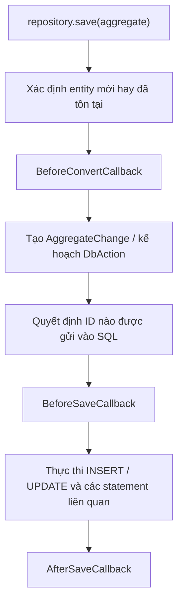

# Chọn thời điểm cấp ID bằng callback và kiểm tra quyết định insert/update

Trong **Spring Data Relational JDBC**, `repository.save(entity)` không truy vấn database để hỏi “ID này đã tồn tại chưa?” rồi mới quyết định ghi. Spring Data trước tiên xác định entity là **mới** hay **đã tồn tại** dựa trên trạng thái của object. Từ quyết định đó, framework chọn `INSERT` hoặc `UPDATE`.

Điều này trở nên quan trọng khi ứng dụng tự cấp ID, đặc biệt là UUID. Nếu muốn tạo ID trong lifecycle callback, phải chọn đúng thời điểm: **`BeforeConvertCallback` được gọi sau khi Spring Data đã quyết định insert/update, nhưng trước khi framework tạo kế hoạch SQL**. Callback này có thể cấp ID cho một aggregate đã được nhận diện là mới; `BeforeSaveCallback` thì quá muộn để làm việc đó.

Bài học giải thích thứ tự lifecycle, cách Spring Data phát hiện entity mới, ba chiến lược cấp ID và cách kiểm chứng quyết định ghi bằng SQL, `@Version` và integration test.

## 1. `save()` quyết định insert hay update dựa trên trạng thái entity

Một hiểu nhầm thường gặp là `save()` hoạt động như một lệnh *upsert*:

```text
save(entity)
  -> SELECT xem ID có tồn tại không
  -> có: UPDATE
  -> không: INSERT
```

Đó **không phải** cơ chế mặc định của Spring Data JDBC. Framework kiểm tra trạng thái mới của object (`isNew`) rồi chọn thao tác. Việc row có thực sự tồn tại trong database hay không chỉ được kiểm chứng khi câu SQL được thực thi.

Với chiến lược mặc định, Spring Data kiểm tra `@Id`:

- ID là `null` (hoặc `0` nếu dùng kiểu primitive) → entity được xem là **mới** → `INSERT`.
- ID đã có giá trị → entity được xem là **đã tồn tại** → `UPDATE`.

Nếu entity có property `@Version`, version được ưu tiên để xác định trạng thái:

- Version là `null` (hoặc `0` với kiểu primitive) → entity mới.
- Version đã có giá trị khác trạng thái khởi tạo → entity đã tồn tại.

Nếu entity triển khai `Persistable`, Spring Data dùng `isNew()` của entity thay cho suy luận mặc định. Bảng sau tóm tắt:

| Cách nhận diện | Trạng thái được xem là mới | Trạng thái được xem là đã tồn tại |
|---|---|---|
| `@Id` (mặc định) | ID `null`; ID primitive bằng `0` | ID khác `null`/`0` |
| `@Version` | Version `null`; version primitive bằng `0` | Version đã được khởi tạo |
| `Persistable.isNew()` | Phương thức trả `true` | Phương thức trả `false` |

**Hệ quả:** một UUID đã được gán trong constructor không còn `null`. Nếu entity không có `@Version` và không triển khai `Persistable`, `save()` có thể chọn `UPDATE` ngay cả khi row chưa tồn tại. UUID hợp lệ không đồng nghĩa entity đã được lưu.

## 2. Thứ tự callback khi lưu aggregate

Spring Data JDBC thực hiện các bước chính theo thứ tự sau:



| Callback | Thời điểm | Có phù hợp để cấp ID? |
|---|---|---|
| `BeforeConvertCallback<T>` | Sau quyết định insert/update, trước khi aggregate được chuyển thành kế hoạch SQL | **Có.** ID được tạo ở đây sẽ được đưa vào kế hoạch insert tiếp theo |
| `BeforeSaveCallback<T>` | Sau khi kế hoạch SQL đã được tạo, trước khi statement chạy | **Không.** Quyết định gửi ID xuống database đã được xác định |
| `AfterSaveCallback<T>` | Sau khi các SQL statement đã thực thi | Quá muộn để cấp ID cho lần insert vừa chạy |

Vì vậy, nếu muốn cấp ID trong callback, hãy dùng `BeforeConvertCallback`. Spring Data khuyến nghị entity callback thay cho application event khi cần biến đổi entity: callback trả về instance mới hoặc đã sửa đổi và được gọi đồng bộ theo lifecycle. Event phù hợp cho thông báo/quan sát; không nên dùng listener event làm cơ chế bắt buộc để cấp ID.

Một điểm quan trọng khác: các callback này áp dụng cho **aggregate root**. Các câu lệnh derived query hoặc `@Query` trực tiếp không đi qua quy trình lưu aggregate của repository theo cách tương tự, vì Spring Data không thể xác định đầy đủ aggregate bị ảnh hưởng để phát lifecycle callback.

## 3. Cấp UUID trong `BeforeConvertCallback`

Giả sử ứng dụng muốn tạo UUID ở tầng ứng dụng, nhưng không muốn mỗi service phải tự nhớ gọi `UUID.randomUUID()`. Ta có thể đặt logic tạo ID tại một callback dùng chung.

### Aggregate root

```java
package com.example.jobs;

import java.util.UUID;

import org.springframework.data.annotation.Id;
import org.springframework.data.annotation.Version;
import org.springframework.data.relational.core.mapping.Table;

@Table("job")
public class Job {

    @Id
    private UUID id;

    @Version
    private Long version;

    private String description;

    protected Job() {}

    public Job(String description) {
        this.description = description;
    }

    public UUID getId() { return id; }
    public Long getVersion() { return version; }
    public String getDescription() { return description; }

    public void rename(String description) {
        this.description = description;
    }

    public void assignId(UUID id) {
        this.id = id;
    }
}
```

Trong ví dụ này, `id` ban đầu là `null`, `version` cũng là `null`. Khi gọi `save()`, Spring Data nhận diện aggregate là mới trước khi chạy callback.

### Callback cấp ID nếu còn thiếu

```java
package com.example.jobs;

import java.util.UUID;

import org.springframework.data.relational.core.mapping.event.BeforeConvertCallback;
import org.springframework.stereotype.Component;

@Component
public class JobIdCallback implements BeforeConvertCallback<Job> {

    @Override
    public Job onBeforeConvert(Job aggregate) {
        if (aggregate.getId() == null) {
            aggregate.assignId(UUID.randomUUID());
        }

        return aggregate;
    }
}
```

Spring đăng ký callback như một bean; `BeforeConvertCallback<Job>` được áp dụng cho aggregate root kiểu `Job`. Callback chỉ tạo ID khi chưa có giá trị, nhờ đó không ghi đè ID đã được cấp từ một nguồn hợp lệ khác.

Khi gọi:

```java
Job saved = jobRepository.save(new Job("Generate monthly report"));
```

thứ tự thực tế là:

1. `Job.id == null`, `Job.version == null` → được nhận diện là entity mới.
2. `BeforeConvertCallback` tạo UUID và gán vào `Job.id`.
3. Spring Data chuyển aggregate thành kế hoạch `INSERT`, lần này ID đã có giá trị nên được gửi trong câu SQL.
4. Database lưu row; `@Version` được khởi tạo theo cơ chế optimistic locking của Spring Data JDBC.
5. `save()` trả về aggregate đã lưu.

Callback có thể trả về một instance khác, nên cũng phù hợp với immutable aggregate. Với class mutable ở ví dụ này, callback sửa instance rồi trả lại chính instance đó.

### Repository

```java
package com.example.jobs;

import java.util.UUID;

import org.springframework.data.repository.CrudRepository;

public interface JobRepository extends CrudRepository<Job, UUID> {}
```

Không cần gọi callback thủ công trong service. Khi `JobRepository.save()` sử dụng quy trình lưu aggregate của Spring Data JDBC, callback được áp dụng tự động nếu bean đã được đăng ký trong application context.

## 4. Vì sao `BeforeConvertCallback` vẫn có thể cấp ID mà không làm `save()` chuyển thành update?

Đây là điểm dễ nhầm nhất: **Spring Data quyết định entity mới hay cũ trước khi gọi `BeforeConvertCallback`**. Callback không làm thay đổi quyết định đã có.

Ví dụ entity ban đầu:

```text
id      = null
version = null
```

Sau khi state detection:

```text
isNew = true
operation = INSERT
```

Sau callback:

```text
id      = 9f7f... (UUID vừa tạo)
version = null
operation vẫn là INSERT
```

ID được cấp trước khi kế hoạch SQL được tạo, nên có thể xuất hiện trong `INSERT`. Việc `id` khác `null` ở thời điểm này không quay ngược lại để biến thao tác thành `UPDATE`.

Điều đó khác hẳn trường hợp ứng dụng cấp ID **trước khi gọi `save()`**:

```java
Job job = new Job("Generate monthly report");
job.assignId(UUID.randomUUID());

jobRepository.save(job);
```

Nếu không có `@Version` hoặc `Persistable`, Spring Data nhìn thấy ID khác `null` ngay ở bước state detection và xem entity là đã tồn tại. Khi đó, callback không thể sửa quyết định thành insert vì callback chỉ chạy sau bước đó.

## 5. Chọn một trong ba chiến lược cấp ID

### Chiến lược A — Database sinh ID

Dùng khi database có identity/auto-increment hoặc sequence và muốn database quản lý giá trị khóa.

```java
@Table("job")
public class Job {
    @Id
    private Long id;

    private String description;

    public Job(String description) {
        this.description = description;
    }
}
```

Với ID wrapper `Long` ban đầu `null`, Spring Data nhận diện entity mới. Không gán ID trong `BeforeConvertCallback`; để giá trị `null` để framework/database sử dụng cơ chế generated key. Sau insert, ID do database sinh được gán lại vào entity.

```sql
CREATE TABLE job (
    id BIGINT GENERATED BY DEFAULT AS IDENTITY PRIMARY KEY,
    description VARCHAR(255) NOT NULL
);
```

Nếu callback gán ID trước khi kế hoạch insert được tạo, Spring Data sẽ coi đó là ID được cung cấp và đưa nó vào câu lệnh insert. Điều này không còn là trường hợp để database tự sinh ID; với cột identity bị cấu hình không chấp nhận giá trị tường minh, insert có thể thất bại.

### Chiến lược B — Callback cấp ID sau khi state detection

Dùng khi muốn ID do ứng dụng tạo nhưng không muốn business code phụ thuộc vào thuật toán tạo ID.

```text
Entity trước save:       id = null
Spring Data detection:   INSERT
BeforeConvertCallback:   tạo UUID
AggregateChange:         INSERT với UUID đã cấp
```

Đây là chiến lược phù hợp với `BeforeConvertCallback`. Có thể dùng UUID, mã từ một generator nội bộ hoặc một ID được tạo bằng thuật toán thuần cục bộ. Callback nên:

- Chỉ cấp khi ID còn thiếu.
- Không gọi API mạng hoặc phụ thuộc dịch vụ bên ngoài trong lúc lưu.
- Có kết quả xác định cho cùng một lần xử lý, không tự thay ID đã tồn tại.
- Không làm thay đổi quyết định insert/update đã được Spring Data đưa ra.

### Chiến lược C — ID đã có trước `save()`

Dùng khi ID đến từ hệ thống khác, được cấp trong constructor/factory hoặc cần tồn tại trước khi ghi database. Trong trường hợp này, hãy cung cấp thêm cơ chế xác định trạng thái mới.

**Cách thường dùng: `@Version`**

```java
@Table("job")
public class Job {

    @Id
    private UUID id;

    @Version
    private Long version;

    private String description;

    public Job(UUID id, String description) {
        this.id = id;
        this.description = description;
        // version để null: Spring Data nhận diện entity mới.
    }
}
```

Khi `version == null`, entity được xem là mới ngay cả khi UUID đã có giá trị. Sau insert, version được khởi tạo; lần save tiếp theo sẽ được nhận diện là update. Đây cũng là lý do `@Version` hữu ích với UUID được tạo trong constructor.

**Cách khác: `Persistable`**

Nếu trạng thái mới/cũ có quy tắc riêng không thể diễn đạt bằng ID hoặc version, entity có thể triển khai `Persistable<ID>` và cung cấp `isNew()`. Cần quản lý việc chuyển `isNew` từ `true` sang `false` sau lần insert thành công; nếu luôn trả `true`, các lần save sau tiếp tục cố insert và gặp duplicate key. Khi dùng property access, các thuộc tính phục vụ `Persistable` cần được đánh dấu `@Transient` nếu không muốn Spring Data lưu chúng như dữ liệu domain.

Không nên triển khai `Persistable` chỉ để né một lỗi chưa hiểu rõ. `@Version` thường ngắn gọn hơn và đồng thời cung cấp optimistic locking.

## 6. `BeforeSaveCallback` quá muộn để cấp ID

Ví dụ sau là sai vị trí cho việc tạo ID:

```java
@Component
public class JobBeforeSaveCallback implements BeforeSaveCallback<Job> {

    @Override
    public Job onBeforeSave(Job aggregate, AggregateChange<Job> change) {
        if (aggregate.getId() == null) {
            aggregate.assignId(UUID.randomUUID());
        }
        return aggregate;
    }
}
```

Tại thời điểm `BeforeSaveCallback` chạy, `AggregateChange` và các `DbAction` đã được tạo. Framework đã quyết định ID nào được gửi xuống database hay database sẽ tự sinh. Sửa `aggregate.id` ở callback này không cập nhật lại quyết định đã được đưa ra trong kế hoạch.

| Mục đích | Callback phù hợp |
|---|---|
| Tạo ID cho aggregate mới | `BeforeConvertCallback` |
| Bổ sung/điều chỉnh dữ liệu trước khi tạo kế hoạch SQL | `BeforeConvertCallback` |
| Quan sát hoặc thay đổi entity khi kế hoạch ghi đã được tạo | `BeforeSaveCallback` |
| Ghi nhận kết quả sau khi SQL đã chạy | `AfterSaveCallback` |

Đối với event `BeforeConvertEvent`/`BeforeSaveEvent`, quy tắc thời điểm cũng tương tự. Tuy nhiên, event là cơ chế thông báo; listener có thể chịu ảnh hưởng của `ApplicationEventMulticaster` và executor, vì vậy không nên dùng event listener để thực hiện một thay đổi dữ liệu bắt buộc phải hoàn thành trước khi tạo SQL. Hãy dùng entity callback.

## 7. Kiểm tra quyết định insert/update bằng `@Version`

Một cách dễ quan sát là đặt `@Version` trên aggregate root. Spring Data JDBC dùng version để nhận diện entity mới và thực hiện optimistic locking cho các lần cập nhật.

Ví dụ trạng thái:

| Lần gọi | ID | Version trước khi save | Quyết định |
|---|---|---|---|
| Tạo `new Job(...)` | `null` | `null` | `INSERT` |
| Sau `BeforeConvertCallback` | UUID đã có | `null` | Vẫn `INSERT` |
| Sau insert | UUID đã có | Được khởi tạo | Entity không còn mới |
| Sửa mô tả rồi save | UUID đã có | Version hiện tại | `UPDATE ... WHERE id = ? AND version = ?` |
| Save với version cũ | UUID đã có | Version stale | Không update được; phát sinh lỗi optimistic locking |

Khi update, SQL có điều kiện theo ID và version. Nếu một transaction khác đã cập nhật row trước, version trong database không còn trùng với version của entity; Spring Data JDBC phát hiện số row được cập nhật không đúng và ném `OptimisticLockingFailureException`.

### Integration test kiểm tra cả hai nhánh

```java
import static org.assertj.core.api.Assertions.assertThat;

import org.junit.jupiter.api.Test;
import org.springframework.beans.factory.annotation.Autowired;
import org.springframework.boot.test.autoconfigure.data.jdbc.DataJdbcTest;
import org.springframework.context.annotation.Import;
import org.springframework.jdbc.core.JdbcTemplate;

@DataJdbcTest
@Import(JobIdCallback.class)
class JobRepositoryTest {

    @Autowired JobRepository repository;
    @Autowired JdbcTemplate jdbcTemplate;

    @Test
    void callbackAssignsIdBeforeInsertAndLaterSaveUpdates() {
        Job saved = repository.save(new Job("First description"));

        assertThat(saved.getId()).isNotNull();
        assertThat(saved.getVersion()).isNotNull();

        Integer rowsAfterInsert = jdbcTemplate.queryForObject(
                "SELECT COUNT(*) FROM job WHERE id = ?",
                Integer.class,
                saved.getId()
        );
        assertThat(rowsAfterInsert).isEqualTo(1);

        Long insertedVersion = saved.getVersion();
        saved.rename("Updated description");

        Job updated = repository.save(saved);

        assertThat(updated.getVersion()).isGreaterThan(insertedVersion);

        String description = jdbcTemplate.queryForObject(
                "SELECT description FROM job WHERE id = ?",
                String.class,
                saved.getId()
        );
        assertThat(description).isEqualTo("Updated description");

        Integer rowCount = jdbcTemplate.queryForObject(
                "SELECT COUNT(*) FROM job WHERE id = ?",
                Integer.class,
                saved.getId()
        );
        assertThat(rowCount).isEqualTo(1);
    }
}
```

Test cần schema `job` và callback bean được nạp trong test context. `@DataJdbcTest` là slice test nên `@Import(JobIdCallback.class)` đưa callback vào context một cách tường minh. Với H2 có thể đặt DDL trong `src/test/resources/schema.sql`:

```sql
CREATE TABLE job (
    id UUID PRIMARY KEY,
    version BIGINT NOT NULL,
    description VARCHAR(255) NOT NULL
);
```

Nếu test dùng database in-memory khác, điều chỉnh kiểu ID theo database đó. Trong dự án thật, nên chạy cùng database/driver mục tiêu qua Testcontainers để kiểm tra binding UUID và câu SQL cụ thể.

Test trên kiểm chứng ba điều: callback đã cấp ID, row thực sự được insert, và lần save tiếp theo cập nhật row hiện hữu đồng thời tăng version. Đếm row giúp phát hiện trường hợp vô tình tạo bản ghi trùng, còn đọc lại nội dung xác nhận update đã có hiệu lực.

## 8. Quan sát SQL để biết Spring Data đã chọn thao tác nào

Trong môi trường development/test, có thể bật log JDBC:

```yaml
logging:
  level:
    org.springframework.jdbc.core: DEBUG
```

Tùy driver và phiên bản, log có thể cho thấy câu `INSERT` hoặc `UPDATE` và các bind parameter. Với update có `@Version`, tìm điều kiện theo ID và version. Không nên bật logging giá trị bind nhạy cảm trong production.

Một cách kiểm tra khác là dùng database assertion trong integration test:

```sql
SELECT id, version, description
FROM job
WHERE id = :id;
```

Hãy phân biệt ba khái niệm:

- **Entity state detection:** Spring Data quyết định object mới/cũ từ `@Id`, `@Version` hoặc `Persistable`.
- **SQL action planning:** framework quyết định các `DbAction`, ID nào được bind và các thao tác trên entity con.
- **Database result:** SQL thực tế có ghi được row hay không; ID có tồn tại, constraint có thỏa mãn và version có còn khớp hay không.

Một object được nhận diện là mới không bảo đảm insert thành công: ID có thể trùng khóa chính, constraint có thể vi phạm hoặc database có thể từ chối statement. Ngược lại, object được nhận diện là cũ không chứng minh row tồn tại; update có thể tác động zero row và gây lỗi.

## 9. Phân biệt `save()`, `insert()`, `update()` và `upsert()`

Trong phần lớn code repository, `save()` là lựa chọn thông thường vì nó dùng trạng thái entity để chọn insert hoặc update. `JdbcAggregateTemplate` còn cung cấp các thao tác tường minh:

| API | Ý nghĩa | Khi nào cân nhắc |
|---|---|---|
| `save(entity)` | Tự chọn insert/update dựa trên `isNew` | Luồng repository thông thường |
| `insert(entity)` | Giả định aggregate mới, bỏ qua kiểm tra trạng thái | Khi use case biết chắc đây là insert |
| `update(entity)` | Giả định aggregate đã tồn tại | Khi use case biết chắc đây là update |
| `upsert(entity)` | Dùng native database upsert nếu dialect hỗ trợ | Khi cần insert-or-update trong một round-trip và hiểu giới hạn optimistic locking |

`insert()`/`update()` không phải cách chữa mặc định cho entity state detection sai. Nếu mô hình domain cần `save()`, hãy sửa trạng thái ID/version hoặc `Persistable`. `upsert()` có semantics khác: nó yêu cầu ID có giá trị, phụ thuộc hỗ trợ dialect và tài liệu hiện hành ghi rõ upsert không hỗ trợ optimistic locking. Chỉ dùng khi hành vi đó đúng với yêu cầu concurrency của nghiệp vụ.

## 10. Những lỗi thường gặp

| Biểu hiện | Nguyên nhân | Hướng xử lý |
|---|---|---|
| Callback tạo ID nhưng vẫn đi vào update | ID đã có trước bước state detection; hoặc version đã đánh dấu entity cũ | Kiểm tra giá trị ID/version tại thời điểm gọi `save()` |
| Callback tạo ID nhưng database vẫn sinh ID | Dùng `BeforeSaveCallback` hoặc kế hoạch SQL đã được tạo khi ID còn trống | Chuyển logic sang `BeforeConvertCallback` |
| `save()` update row không tồn tại | ID khác null nhưng không có version/Persistable xác định entity mới | Dùng `@Version` wrapper hoặc `Persistable.isNew()` |
| Mỗi lần save lại cố insert | `Persistable.isNew()` luôn trả `true`, hoặc không cập nhật trạng thái sau insert | Quản lý chuyển trạng thái sau khi lưu thành công |
| UUID bị ghi đè khi update | Callback tạo ID không kiểm tra `id == null` | Chỉ cấp ID cho aggregate chưa có ID |
| Database báo duplicate key | ID được cấp đã tồn tại hoặc generator không đủ uniqueness | Kiểm tra generator, nguồn ID và constraint |
| Không thấy callback chạy | Gọi SQL trực tiếp/derived query/annotated query, callback bean không được đăng ký hoặc sai generic type | Kiểm tra đường gọi và application context |
| ID có trong object nhưng không có trong câu insert | ID được cấp sau khi action plan đã tạo | Kiểm tra đúng lifecycle callback và SQL log |
| Update bị optimistic locking failure | Version trong object cũ hơn version trong database hoặc row đã bị xóa | Reload và xử lý conflict; không tự tăng version để bỏ qua kiểm tra |

## 11. Quy trình chọn thời điểm cấp ID

1. **Chọn chủ sở hữu ID:** database, constructor/factory, callback hay hệ thống bên ngoài?
2. **Xác định trạng thái tại lúc gọi `save()`:** ID có null không? Version có null không? `Persistable.isNew()` trả gì?
3. **Nếu database sinh ID:** giữ ID ở trạng thái khởi tạo và không gán trong callback.
4. **Nếu callback sinh ID:** để entity được nhận diện là mới trước khi callback chạy; cấp ID trong `BeforeConvertCallback`.
5. **Nếu ID có sẵn trước `save()`:** dùng `@Version` phù hợp hoặc `Persistable` để thể hiện entity mới; đừng dựa vào UUID khác null như bằng chứng đã tồn tại.
6. **Nếu cần ép insert/update:** chỉ dùng `JdbcAggregateTemplate.insert()`/`update()` khi use case thực sự biết chắc trạng thái.
7. **Kiểm tra kết quả:** xác nhận SQL insert/update, row count, version và round-trip dữ liệu trong integration test.

Ví dụ quy tắc lựa chọn:

| Nhu cầu | ID lúc vào `save()` | Cơ chế state detection | Vị trí cấp ID |
|---|---|---|---|
| Database identity | `null` | `@Id` | Database sau insert |
| UUID cấp bởi callback | `null` | `@Id` hoặc `@Version` null | `BeforeConvertCallback` |
| UUID cấp trong constructor | Đã có | `@Version` null | Constructor/factory |
| ID import từ hệ thống khác | Đã có | `@Version` null hoặc `Persistable.isNew()` | Trước `save()` |
| Entity đã được lưu | Đã có | Version đã khởi tạo hoặc `isNew() == false` | Không cấp lại; update |

**Điểm cần nhớ:** thời điểm cấp ID và thời điểm quyết định insert/update là hai bước khác nhau. Với Spring Data JDBC, `BeforeConvertCallback` nằm giữa chúng theo đúng thứ tự: state detection đã hoàn tất, nhưng kế hoạch SQL chưa được tạo. Chọn callback này khi cần cấp ID cho aggregate mới; dùng `@Version` hoặc `Persistable` khi ID đã có trước khi gọi `save()`, và luôn kiểm chứng quyết định bằng SQL cùng integration test.

## Tài liệu tham khảo chính thức

- [Spring Data Relational — Lifecycle Events and Entity Callbacks](https://docs.spring.io/spring-data/relational/reference/jdbc/events.html): thứ tự quyết định insert/update, `BeforeConvertCallback`, `BeforeSaveCallback` và các callback khác.
- [Spring Data Relational — Entity State Detection](https://docs.spring.io/spring-data/relational/reference/data-commons/is-new-state-detection.html): chiến lược nhận diện entity mới qua `@Id`, `@Version` và `Persistable`.
- [Spring Data Relational — Persisting Entities](https://docs.spring.io/spring-data/relational/reference/jdbc/entity-persistence.html): insert/update, ID generation, version và `JdbcAggregateTemplate`.
- [Spring Data JDBC — `BeforeConvertCallback` API](https://docs.spring.io/spring-data/jdbc/docs/current/api/org/springframework/data/relational/core/mapping/event/BeforeConvertCallback.html): callback đúng thời điểm để cấp ID và thứ tự persist.
- [Spring Data JDBC — `BeforeSaveCallback` API](https://docs.spring.io/spring-data/jdbc/docs/current/api/org/springframework/data/relational/core/mapping/event/BeforeSaveCallback.html): callback sau khi kế hoạch aggregate change được tạo.
- [Spring Blog — Spring Data JDBC: How to use custom ID generation](https://spring.io/blog/2021/09/09/spring-data-jdbc-how-to-use-custom-id-generation/): ví dụ cấp ID tùy chỉnh bằng callback.
