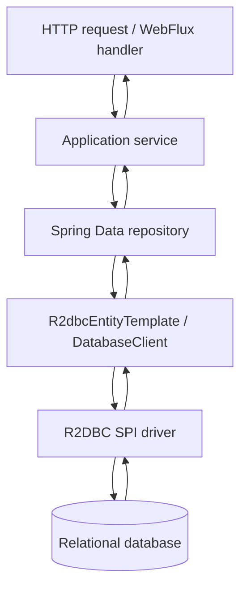

# From Storage Requirements to a Reactive Data Access Flow

Spring Data Relational R2DBC helps applications work with relational databases through asynchronous, non-blocking operations. To use it properly, start from the business storage requirements, choose how to represent data and define aggregate boundaries, and then design an end-to-end access flow from the API to the database. Simply changing return types from `T` to `Mono<T>` or `Flux<T>` is not enough to build a reactive system.

This lesson follows that journey: identifying requirements, choosing an architecture, configuring connections, mapping data, building repositories and services, and then handling transactions, errors, backpressure, and testing.

## 1. Starting from Storage Requirements

Before choosing a repository or writing SQL, clarify what data needs to be stored and how the application uses it. A requirement such as "save an order and display the customer's latest orders" involves many more design decisions than a single `INSERT` and `SELECT`.

| Question to Clarify | Impact on Design |
| --- | --- |
| Is the data relational and does it need integrity constraints? | Choose the appropriate table model, primary keys, foreign keys, unique constraints, and transactions. |
| Which objects must be saved consistently together? | Define aggregates and transaction boundaries. |
| Does the application read a single record or a result set? | Choose `Mono<T>` for at most one element and `Flux<T>` for a stream of multiple elements. |
| How do queries need to filter, sort, paginate, or aggregate? | Design indexes, query methods, or explicit SQL. |
| What are the concurrency load and database wait times? | Plan for connection pools, timeouts, query limits, and backpressure. |
| Do multiple data changes need to succeed or fail together? | Design reactive transactions. |
| Do the database and driver support R2DBC? | Confirm that truly asynchronous access can be implemented. |

Non-functional requirements matter just as much. An endpoint returning hundreds of thousands of rows needs a different data delivery strategy than an endpoint returning a single order. A money transfer requires atomicity; a search screen may accept batched results. Factor these differences into the design before writing code.

### When Is R2DBC a Good Fit?

R2DBC is a good fit when the application works with a relational database, a corresponding R2DBC driver is available, and the system needs to keep the processing flow asynchronous end-to-end. It is a natural choice in a Spring WebFlux application or a service that already uses Reactor.

R2DBC is a relational database access API. It does not automatically make every other part of the application reactive. If a request passes through WebFlux and then calls synchronous JDBC or JPA on the processing thread, that access segment still blocks the thread. Likewise, wrapping a JDBC call in `Mono.fromCallable` does not turn a JDBC driver into a non-blocking driver.

Confirm that the R2DBC driver supports the exact database engine, data types, SQL syntax, and features your application needs. If the system depends heavily on a JDBC-only library or on JPA's ORM behavior, evaluate the migration cost before choosing R2DBC.

## 2. Designing the Data Access Flow

A reactive data access flow typically consists of the following layers:



When a request is handled, the upper layers compose `Publisher`s to describe the work to be performed. Only when the framework subscribes to the publisher is the process triggered: acquiring a connection, sending the statement, receiving results, mapping each row to an object, and emitting signals back to the caller.

You can view this flow in two directions:

- **Request direction:** the controller calls the service; the service calls the repository; the repository translates the call into an R2DBC operation; the driver sends the statement to the database.
- **Result direction:** the database returns results; the driver emits data; Spring Data maps the data; the service and controller continue the processing chain and return the result to the client.

`Mono` and `Flux` are the primary Project Reactor publisher types:

| Type | Meaning | Example |
| --- | --- | --- |
| `Mono<T>` | Zero or at most one value of `T`. | Finding an order by ID, saving an order. |
| `Flux<T>` | Zero or more values of `T`. | Listing a customer's orders, reading result rows. |
| `Mono<Void>` | Indicates completion or error without emitting data values. | Deleting data or completing an update command. |

Publishers in Reactor are typically lazy: building a processing chain does not mean the query has executed. A subscriber—such as WebFlux when writing the response—triggers the chain. Therefore, do not call `subscribe()` yourself inside a controller or service. The framework at the application boundary is responsible for subscribing and managing the request lifecycle.

## 3. Choosing the Data Access Abstraction Level

Spring Data R2DBC provides several ways to interact with the database. Choose the abstraction level based on query complexity.

| Tool | Suitable When | Characteristics |
| --- | --- | --- |
| `ReactiveCrudRepository` | CRUD and queries derived from method names meet your needs. | Minimal boilerplate, methods declared by Spring Data conventions, returns `Mono` or `Flux`. |
| `R2dbcEntityTemplate` | Programmatic operations on entities, criteria, mappings, or statements managed the Spring Data Relational way are needed. | More flexible than repositories for dynamic operations and entity mapping. |
| `DatabaseClient` | Specific SQL, joins, database-specific expressions, or per-column mapping control is needed. | Works directly with SQL and result rows, supports parameter binding. |

There is no need to push every query down to manual SQL. A repository is a good starting point for standard operations. When a query has special requirements, you can use `@Query`, `R2dbcEntityTemplate`, or `DatabaseClient` right where needed.

### The Aggregate Model in Spring Data Relational

Spring Data Relational focuses on saving and loading aggregates. It does not provide full JPA ORM behavior: there is no JPA-style persistence context, automatic dirty checking, lazy loading of relationships, or entity cascading in the same way.

Therefore, clearly define the aggregate root and the data that must be saved together. For relationships between aggregates, applications typically store reference keys and query related data explicitly. This keeps access flows predictable and prevents a single read from unexpectedly triggering many queries.

## 4. Declaring Dependencies and Configuring Connections

The example below uses Spring Boot, Spring Data R2DBC, and the PostgreSQL driver. Library versions should be managed by Spring Boot dependency management so components remain compatible.

```kotlin
dependencies {
    implementation("org.springframework.boot:spring-boot-starter-data-r2dbc")
    runtimeOnly("org.postgresql:r2dbc-postgresql")
}
```

If the application exposes an HTTP API using WebFlux, add the WebFlux starter according to your project's dependency structure. R2DBC can be used in other reactive applications; WebFlux is not a mandatory part of the R2DBC driver itself.

Connection settings can be placed in `application.yml`:

```yaml
spring:
  r2dbc:
    url: r2dbc:postgresql://localhost:5432/orders
    username: ${DB_USERNAME}
    password: ${DB_PASSWORD}
```

An R2DBC URL has its own scheme, such as `r2dbc:postgresql://...`; do not use a JDBC URL like `jdbc:postgresql://...` for this property. Credentials should come from environment variables or a secret management system—never commit real passwords to the repository.

Spring Boot can auto-configure a `ConnectionFactory` from the configuration and driver on the classpath. At a lower level, `ConnectionFactory` is the connection creation entry point used by Spring Data and the driver. In environments with high concurrency, evaluate connection pooling, connection limits, connection acquisition wait times, and query timeouts. The pool must fit the database's connection limits; increasing the pool indefinitely does not make the system faster.

R2DBC does not replace schema management. Create and alter tables through controlled migrations, such as Flyway, Liquibase, or an equivalent migration tool. Some migration tools use JDBC, so the application may need a separate migration connection configuration alongside the R2DBC connection used for runtime data access.

## 5. Mapping Tables and Domain Objects

Suppose the business needs to save orders and query orders by customer. The table can be defined as follows:

```sql
CREATE TABLE orders (
    id BIGINT GENERATED BY DEFAULT AS IDENTITY PRIMARY KEY,
    customer_id BIGINT NOT NULL,
    total NUMERIC(12, 2) NOT NULL,
    status VARCHAR(20) NOT NULL,
    created_at TIMESTAMP NOT NULL
);

CREATE INDEX idx_orders_customer_created
    ON orders (customer_id, created_at DESC);
```

The index supports the query pattern of filtering by `customer_id` and sorting by `created_at`. Actual index design should be decided based on real queries and data—do not create indexes on every column.

The table can be mapped using a Java record:

```java
import java.math.BigDecimal;
import java.time.LocalDateTime;

import org.springframework.data.annotation.Id;
import org.springframework.data.relational.core.mapping.Column;
import org.springframework.data.relational.core.mapping.Table;

@Table("orders")
public record Order(
    @Id Long id,
    @Column("customer_id") Long customerId,
    BigDecimal total,
    OrderStatus status,
    @Column("created_at") LocalDateTime createdAt
) {}
```

```java
public enum OrderStatus {
    NEW,
    PAID,
    CANCELLED
}
```

`@Table` specifies the table name; `@Id` marks the primary key; `@Column` maps a Java property to a column name. Spring Data R2DBC supports mapping data types provided by the corresponding driver. Verify mappings when using specialized types, enums, JSON, temporal types, or vendor-specific database types.

In the example, `id` is `null` when creating a new order. With a database-generated identity column, an insert operation can return the entity populated with its generated ID. When updating, supply the ID and follow Spring Data's rules for determining whether an entity is new or existing.

## 6. Building a Reactive Repository

A repository describes the operations required on an aggregate. Spring Data generates the implementation based on the interface and method naming conventions:

```java
import reactor.core.publisher.Flux;
import reactor.core.publisher.Mono;

import org.springframework.data.repository.reactive.ReactiveCrudRepository;

public interface OrderRepository extends ReactiveCrudRepository<Order, Long> {

    Flux<Order> findByCustomerIdOrderByCreatedAtDesc(Long customerId);

    Mono<Order> findByIdAndStatus(Long id, OrderStatus status);
}
```

Operations inherited from `ReactiveCrudRepository` also return reactive types. For example, `findById` returns `Mono<Order>`, `findAll` returns `Flux<Order>`, and `save` returns `Mono<Order>`. Derived query method names must match entity properties, not necessarily database column names directly.

A repository should reflect business access needs. Avoid creating a generic method that accepts arbitrary SQL strings for every scenario; doing so loses the benefits of a clear interface and makes query control harder.

## 7. Wiring the Repository into Services and APIs

Services coordinate persistence operations with business rules. They return publishers to the calling layer and do not subscribe to publishers themselves.

```java
import java.math.BigDecimal;
import java.time.LocalDateTime;

public record CreateOrderRequest(Long customerId, BigDecimal total) {}
```

```java
import reactor.core.publisher.Flux;
import reactor.core.publisher.Mono;

import org.springframework.stereotype.Service;

@Service
public class OrderService {

    private final OrderRepository orders;

    public OrderService(OrderRepository orders) {
        this.orders = orders;
    }

    public Mono<Order> create(CreateOrderRequest request) {
        Order order = new Order(
            null,
            request.customerId(),
            request.total(),
            OrderStatus.NEW,
            LocalDateTime.now()
        );

        return orders.save(order);
    }

    public Mono<Order> findById(Long id) {
        return orders.findById(id);
    }

    public Flux<Order> findByCustomer(Long customerId) {
        return orders.findByCustomerIdOrderByCreatedAtDesc(customerId);
    }
}
```

A WebFlux controller can accept and return publishers directly:

```java
import java.net.URI;

import reactor.core.publisher.Flux;
import reactor.core.publisher.Mono;

import org.springframework.http.ResponseEntity;
import org.springframework.web.bind.annotation.*;

@RestController
@RequestMapping("/orders")
public class OrderController {

    private final OrderService service;

    public OrderController(OrderService service) {
        this.service = service;
    }

    @PostMapping
    public Mono<ResponseEntity<Order>> create(
            @RequestBody Mono<CreateOrderRequest> request) {
        return request
            .flatMap(service::create)
            .map(order -> ResponseEntity
                .created(URI.create("/orders/" + order.id()))
                .body(order));
    }

    @GetMapping("/{id}")
    public Mono<ResponseEntity<Order>> findById(@PathVariable Long id) {
        return service.findById(id)
            .map(ResponseEntity::ok)
            .defaultIfEmpty(ResponseEntity.notFound().build());
    }

    @GetMapping("/customer/{customerId}")
    public Flux<Order> findByCustomer(@PathVariable Long customerId) {
        return service.findByCustomer(customerId);
    }
}
```

In this example, `flatMap` connects the request body to the save operation; `map` transforms the saved entity into an HTTP response. When the repository completes, WebFlux writes the result back to the client. There is no need to call `block()` to get a synchronous result and no need to call `subscribe()` manually.

`map` is used when transforming a value synchronously. `flatMap` is used when the transformation function returns another publisher that needs to be chained into the same sequence. Confusing these two operators is a common mistake when getting started with Reactor.

## 8. Using Explicit SQL When Needed

A complex query or one relying on database-specific syntax may be a better fit for `DatabaseClient`. For example, querying a customer's orders with a named parameter:

```java
import java.math.BigDecimal;
import java.time.LocalDateTime;

import org.springframework.r2dbc.core.DatabaseClient;
import org.springframework.stereotype.Repository;

import reactor.core.publisher.Flux;

@Repository
public class OrderQueryRepository {

    private final DatabaseClient databaseClient;

    public OrderQueryRepository(DatabaseClient databaseClient) {
        this.databaseClient = databaseClient;
    }

    public Flux<Order> findRecentByCustomer(Long customerId) {
        return databaseClient.sql("""
                SELECT id, customer_id, total, status, created_at
                FROM orders
                WHERE customer_id = :customerId
                ORDER BY created_at DESC
                """)
            .bind("customerId", customerId)
            .map((row, metadata) -> new Order(
                row.get("id", Long.class),
                row.get("customer_id", Long.class),
                row.get("total", BigDecimal.class),
                OrderStatus.valueOf(row.get("status", String.class)),
                row.get("created_at", LocalDateTime.class)
            ))
            .all();
    }
}
```

`bind` passes values to SQL parameters. Using bind parameters lets the driver handle values properly and avoids concatenating user input directly into SQL strings. Table names, column names, or dynamic `ORDER BY` clauses generally cannot be passed as bind values; if dynamic selection is needed, map input through an allowlist and build the SQL in a controlled manner.

`map` converts each `Row` into a domain object, and `all()` returns a `Flux` containing the result rows. If a query returns at most one row, `one()` can be used; be sure to explicitly handle empty results or unexpectedly multiple rows.

## 9. Managing Reactive Transactions

A business operation consisting of multiple statements may require atomicity. For example, transferring money requires debiting the source account and crediting the destination account within the same transaction. If the credit step fails, the debit step must be rolled back.

For methods returning `Mono` or `Flux`, Spring can apply `@Transactional` via a reactive transaction manager:

```java
import java.math.BigDecimal;

import org.springframework.stereotype.Service;
import org.springframework.transaction.annotation.Transactional;

import reactor.core.publisher.Mono;

@Service
public class TransferService {

    private final AccountRepository accounts;

    public TransferService(AccountRepository accounts) {
        this.accounts = accounts;
    }

    @Transactional
    public Mono<Void> transfer(
            Long sourceId,
            Long destinationId,
            BigDecimal amount) {

        return accounts.debit(sourceId, amount)
            .then(accounts.credit(destinationId, amount))
            .then();
    }
}
```

An important requirement is that the operations participate in the same reactive transaction and use the same matching connection infrastructure. A reactive transaction manager binds transaction metadata to the Reactor Context; it does not rely solely on `ThreadLocal` like the traditional imperative model. Therefore, never split part of the work out of the reactive chain and expect it to automatically join the transaction.

`TransactionalOperator` can be used when you want to express transaction boundaries programmatically within the processing chain:

```java
return transactionalOperator.transactional(
    accounts.debit(sourceId, amount)
        .then(accounts.credit(destinationId, amount))
        .then()
);
```

Keep transactions short, containing only the operations that require atomicity. Do not keep a transaction open while waiting on external HTTP calls or performing long-running tasks. Actions such as sending emails or publishing notifications should generally be structured appropriately after the data has committed.

## 10. Backpressure, Errors, and Connection Resources

Reactive Streams provides a backpressure mechanism so subscribers can regulate the number of elements they want to receive. With `Flux`, this is helpful when reading many rows. However, backpressure does not automatically solve every memory or database load problem.

Practical considerations:

- Avoid calling `collectList()` on unbounded results if the dataset can be very large. That operation holds all results in memory.
- Use filtering, limits, pagination, or cursor-based queries suited to your needs. If you need a total record count, weigh the cost of a separate count query.
- Do not assume all drivers stream data from the database server to the client in the same way. Check your specific driver's buffering, fetching, and backpressure behavior.
- Monitor connection acquisition wait time, SQL execution time, active connections, and concurrent requests.
- Set timeouts where appropriate and handle errors intentionally. Do not turn every error into an empty list, as doing so hides operational failures.

In Reactor, errors propagate as `onError` signals. You can use `onErrorMap` to translate error types, `onErrorResume` to provide a fallback, or `retryWhen` to retry under appropriate conditions. Only retry transient errors and consider whether the operation is idempotent. Retrying a non-idempotent write command can create duplicate data or execute business logic multiple times.

Some unavoidable synchronous operations may need to be isolated on a suitable scheduler, but that is a workaround for a known blocking boundary. Do not use `Schedulers.boundedElastic()` to hide JDBC calls inside an R2DBC flow; identify which component is blocking and address the cause at the proper layer.

## 11. Testing Reactive Flows

Do not test publishers by calling `block()` in every test. Reactor provides `StepVerifier` to subscribe to a publisher and verify emitted signals:

```java
import org.junit.jupiter.api.Test;
import reactor.test.StepVerifier;

class OrderServiceTest {

    @Test
    void returnsOrderWhenItExists() {
        Mono<Order> result = service.findById(10L);

        StepVerifier.create(result)
            .expectNextMatches(order -> order.id().equals(10L))
            .verifyComplete();
    }
}
```

The example above assumes the service and test data are configured. For repository tests, use a real compatible database via Testcontainers or an equivalent integration environment to verify SQL, data types, mappings, and driver transaction behavior. Mocking repositories is suitable for testing service orchestration logic, but it does not prove that SQL queries or R2DBC configurations work correctly.

Scenarios to test include: finding existing and missing records; inserts returning generated IDs; updates and deletes; empty queries; data constraint errors; rollback when a step in a transaction fails; and multi-row queries.

## 12. Common Design Mistakes

| Mistake | Consequence | Fix |
| --- | --- | --- |
| Calling `block()` in the request path | Blocks the request-handling thread, losing non-blocking benefits. | Return and compose `Mono`/`Flux` across all layers. |
| Calling `subscribe()` inside a service | Detaches work from the request lifecycle, making error propagation and completion control difficult. | Return the publisher so the boundary layer subscribes. |
| Using JDBC/JPA inside a reactive chain | Introduces blocking points and can stall the event loop. | Use an R2DBC driver for operations needing non-blocking I/O or clearly isolate blocking boundaries. |
| Assuming R2DBC has full JPA ORM features | Designs rely on lazy loading, dirty checking, or cascading that do not exist as expected. | Design aggregates and query relationships explicitly. |
| Using `collectList()` for unbounded data | Memory grows with the full result size. | Limit queries, paginate, or process elements incrementally. |
| Retrying every error | Can repeat write operations and corrupt data. | Classify errors, check idempotency, and bound retry policies. |
| Keeping transactions open too long | Holds connections and locks too long, reducing capacity for other requests. | Narrow transactions to data operations requiring atomicity. |

## 13. Process for Turning Requirements into a Solution

When starting a new persistence feature, you can follow this sequence:

1. **Describe the business behavior:** what data is created, read, updated, or deleted; what are the validation rules and expected outputs?
2. **Define the data model:** tables, keys, constraints, indexes, data types, and aggregate boundaries.
3. **Confirm the platform:** does the database have a suitable R2DBC driver; are the required SQL features supported?
4. **Design the reactive flow:** decide which APIs return `Mono` or `Flux`, which repository owns each query, and which service coordinates business logic.
5. **Choose access tools:** use repositories for standard CRUD and query methods; use templates or explicit SQL for complex queries.
6. **Define transactions and error handling:** which operations need atomicity, which errors can be retried, and where timeouts and connection limits belong?
7. **Test against the real driver and database:** verify mappings, SQL, transactions, and edge-case data.
8. **Observe in production:** monitor latency, pools, query errors, returned data volume, and concurrency levels.

The journey from storage requirements to a reactive data access flow is a chain of interconnected decisions. The table model shapes mappings; mappings and queries shape repositories; repositories are composed into services via publishers; transactions protect changes requiring atomicity; and backpressure, pools, and operational observability keep that flow stable under load. When each piece is designed consistently, Spring Data R2DBC becomes a clear data access layer in your application's reactive architecture.
