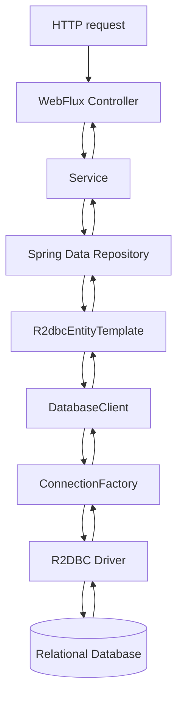

# Key Components and Their Relationships in an R2DBC Application

R2DBC (Reactive Relational Database Connectivity) is a specification that enables Java applications to access relational databases reactively. When using Spring Data R2DBC, an application still works with tables, rows, SQL statements, and transactions like a standard relational application, but I/O operations are represented by a `Publisher`, typically used via Project Reactor's `Mono` and `Flux`.

To understand how an R2DBC application works, it helps to distinguish the layers responsible for database connectivity, SQL execution, data mapping, and providing APIs to the business layer. Spring Data R2DBC connects these layers into a unified chain; each component has a distinct role and is usually accessed by the application through a higher-level component.

## 1. Overall Architectural Picture

A Spring Data R2DBC application typically has the following main components:

| Component | Responsibility |
|---|---|
| WebFlux or reactive communication layer | Receives requests and returns `Mono` or `Flux` for the framework to process |
| Service | Coordinates business logic, combines multiple data operations, and defines transaction boundaries |
| Repository or `R2dbcEntityTemplate` | Provides Spring Data-level entity manipulation APIs |
| `MappingR2dbcConverter` and `RelationalMappingContext` | Reads metadata and converts between Java entities and table row data |
| `DatabaseClient` | Executes SQL, binds parameters, and reads results at the Spring Framework level |
| `ConnectionFactory` and R2DBC Driver | Creates connections and translates R2DBC operations to the database management system |
| Relational database | Stores and processes data using SQL |

A typical call flow can be visualized as follows:



In this diagram, Repository is the familiar data access mechanism for entity-oriented operations. When flexible queries are needed, a Service or a dedicated class can use `R2dbcEntityTemplate` directly. For lower-level custom SQL statements, the application can use `DatabaseClient`.

Mapping and transaction components support this flow in their own ways. The converter and mapping context are used when Spring Data translates between database rows and Java objects. The transaction manager coordinates with `ConnectionFactory` to manage transactions across a chain of reactive operations.

## 2. R2DBC SPI, Drivers, and ConnectionFactory

The R2DBC SPI is the foundational layer defining how a Java application communicates with a relational database reactively. The SPI does not define how to structure business logic or repositories. It provides low-level abstractions for acquiring connections, creating statements, binding values, and receiving results.

Key types include:

- **`ConnectionFactory`**: the entry point for creating or acquiring a `Connection`. Applications typically configure a `ConnectionFactory` bean for the database in use.
- **`Connection`**: represents a connection to the database. From this connection, the driver creates statements and executes SQL operations.
- **`Statement`**: represents a statement to be executed; supports binding values to statement parameters.
- **`Result`**: represents statement execution results, which may contain data rows or affected row counts.
- **`Row`** and **`RowMetadata`**: respectively provide a row's values and metadata describing the columns in the result.

Each database management system requires a corresponding R2DBC driver, such as drivers for PostgreSQL, H2, or Microsoft SQL Server. The driver implements the SPI and handles protocol-level communication for that DBMS. Consequently, code at the Spring Data layer can rely on common abstractions while the driver handles protocol details and vendor-specific data types.

A `ConnectionFactory` can also be wrapped by a connection pool, such as R2DBC Pool. The pool reuses connections to avoid creating a new physical connection for every operation. A pool does not replace the driver; it manages the allocation and release of connections provided by the driver.

Example connection configuration in Spring Boot:

```yaml
spring:
  r2dbc:
    url: r2dbc:postgresql://localhost:5432/customer_db
    username: app_user
    password: change_me
```

The application must declare the driver dependency matching the URL. Spring Boot can auto-configure a `ConnectionFactory` from these properties when the corresponding driver is on the classpath. In manual configurations, the application can define a `ConnectionFactory` bean and pass it to other Spring R2DBC components.

## 3. DatabaseClient: SQL Execution at the Spring Framework Level

`DatabaseClient` belongs to Spring Framework and provides a more convenient API than the raw R2DBC SPI for executing SQL. It accepts a `ConnectionFactory`, manages acquiring and releasing connections for operations, supports parameter binding, and converts results into application-specified objects.

Example of querying directly with `DatabaseClient`:

```java
@Repository
public class PersonSqlRepository {

    private final DatabaseClient databaseClient;

    public PersonSqlRepository(DatabaseClient databaseClient) {
        this.databaseClient = databaseClient;
    }

    public Mono<Person> findById(Long id) {
        return databaseClient.sql("""
                SELECT id, first_name, version
                FROM people
                WHERE id = :id
                """)
            .bind("id", id)
            .map((row, metadata) -> new Person(
                row.get("id", Long.class),
                row.get("first_name", String.class),
                row.get("version", Long.class)
            ))
            .one();
    }
}
```

In this example:

1. `sql(...)` declares the SQL statement to run.
2. `bind(...)` attaches a value to the parameter. Parameter binding ensures data is passed with the proper type and avoids concatenating input directly into SQL strings.
3. `map(...)` reads the `Row` and converts columns into a `Person`.
4. `one()` requests at most one result and returns a `Mono<Person>`.

`DatabaseClient` fits when custom SQL is needed, explicit control over queries is desired, or results need to be mapped into a custom structure. However, it does not automatically apply Spring Data's full entity mapping rules. In the example above, the developer reads each column manually and constructs the `Person` object.

## 4. MappingR2dbcConverter and RelationalMappingContext

When using Spring Data R2DBC, applications usually work with Java entities instead of reading individual columns from a `Row`. Two components support this: `RelationalMappingContext` and `MappingR2dbcConverter`.

**`RelationalMappingContext`** holds metadata describing how entities relate to relational structures. Metadata is built from Java types, naming conventions, and annotations such as `@Table`, `@Column`, `@Id`, or `@Version`. Through this metadata, Spring Data knows which table an entity maps to, which columns map to which properties, and which property serves as the identifier.

**`MappingR2dbcConverter`** uses that metadata to convert data. When reading, the converter constructs entities from column values in result rows. When writing, the converter translates entity properties into values suitable for SQL statements. Specialized data types or custom domain types may require custom conversions.

Example of an entity mapped to the `people` table:

```java
import org.springframework.data.annotation.Id;
import org.springframework.data.annotation.Version;
import org.springframework.data.relational.core.mapping.Column;
import org.springframework.data.relational.core.mapping.Table;

@Table("people")
public record Person(
    @Id Long id,
    @Column("first_name") String firstName,
    @Version Long version
) {}
```

In this example, `@Table` specifies the table name, `@Id` marks the identifier, `@Column` maps the Java property name to the column name, and `@Version` marks the version field used for optimistic locking. If table or column names follow the default naming strategy, some annotations can be omitted.

Spring Data R2DBC is an aggregate-oriented relational mapping technology, not an ORM with a persistence context like JPA/Hibernate. Applications must explicitly design how related data is loaded and typically represent links between aggregates using identifiers. Do not assume that accessing a relational property will automatically trigger lazy loading or cascading as in JPA.

## 5. R2dbcDialect: Differences Across Database Management Systems

Database management systems differ in SQL syntax, bind parameter markers, how auto-generated values are returned, and certain data types. Spring Data R2DBC uses the **`R2dbcDialect`** abstraction to encapsulate these differences.

A dialect helps Spring Data components generate or adjust SQL statements for the active DBMS. As a result, repositories and `R2dbcEntityTemplate` can provide a relatively consistent API across drivers. When writing manual SQL, developers still need to pay attention to the target database's syntax and compatibility.

The dialect is usually detected from the connection configuration or supplied in custom configuration when needed. If an application uses vendor-specific features of a DBMS, verify whether both the driver and dialect support those features.

## 6. R2dbcEntityTemplate and R2dbcEntityOperations

`R2dbcEntityTemplate` is the entity-level data access API provided by Spring Data R2DBC. It combines `DatabaseClient`, the converter, mapping metadata, and the dialect to perform insert, select, update, and delete operations.

`R2dbcEntityOperations` is the abstraction describing the entity operations that the template provides. Coding against this abstraction allows custom code to depend on a data access contract rather than being tightly coupled to a concrete implementation.

Example using the template:

```java
import static org.springframework.data.relational.core.query.Criteria.where;
import static org.springframework.data.relational.core.query.Query.query;
import static org.springframework.data.relational.core.query.Update.update;

@Service
public class PersonDataService {

    private final R2dbcEntityTemplate template;

    public PersonDataService(R2dbcEntityTemplate template) {
        this.template = template;
    }

    public Mono<Person> create(Person person) {
        return template.insert(Person.class).using(person);
    }

    public Flux<Person> findByLastName(String lastName) {
        return template.select(Person.class)
            .matching(query(where("lastName").is(lastName)))
            .all();
    }

    public Mono<Long> rename(Long id, String newFirstName) {
        return template.update(Person.class)
            .matching(query(where("id").is(id)))
            .apply(update("firstName", newFirstName));
    }
}
```

The template is useful when you need to build dynamic queries, combine conditions based on parameters, or execute entity operations without declaring a dedicated repository method for every case. Spring Data's query API works with mapping metadata, so property names in criteria and updates are typically entity property names; Spring Data translates them to the corresponding column names.

You can use `R2dbcEntityTemplate` directly in a service or encapsulate it inside a dedicated data access class. When standard CRUD and convention-based queries suffice, a Repository usually results in more concise code.

## 7. Reactive Repositories and How Spring Data Connects the Layers

Spring Data R2DBC supports reactive repositories. An interface typically extends `ReactiveCrudRepository<T, ID>` to inherit CRUD operations returning reactive types.

```java
import org.springframework.data.repository.reactive.ReactiveCrudRepository;
import org.springframework.data.r2dbc.repository.Query;
import reactor.core.publisher.Flux;

public interface PersonRepository
        extends ReactiveCrudRepository<Person, Long> {

    Flux<Person> findByLastName(String lastName);

    @Query("SELECT * FROM people WHERE status = :status")
    Flux<Person> findByStatus(String status);
}
```

Spring Data generates implementations for repository interfaces at application startup. The default implementation performs entity operations through Spring Data R2DBC infrastructure, including `R2dbcEntityOperations` and `R2dbcEntityTemplate`. Consequently, application code can call `save`, `findById`, `findAll`, `deleteById`, or query methods without manually acquiring connections and mapping each row.

Repositories support two common ways of declaring queries:

- **Derived queries**: Spring Data parses the method name, such as `findByLastName`, to generate the corresponding query based on entity properties.
- **`@Query`**: the developer supplies SQL when explicit statement control or vendor-specific syntax is needed.

A repository is a solid fit for operations tied to an aggregate with stable query rules. When queries have many conditional branches or are assembled dynamically, that logic can be moved to `R2dbcEntityTemplate` or `DatabaseClient`.

## 8. Services and Controllers Keeping the Reactive Flow Seamless

Repositories, templates, and `DatabaseClient` return reactive types. The Service layer should continue composing results using Reactor operators such as `map`, `flatMap`, `zip`, `then`, or `onErrorResume`, and return `Mono` or `Flux` to its caller.

```java
@Service
public class PersonService {

    private final PersonRepository repository;

    public PersonService(PersonRepository repository) {
        this.repository = repository;
    }

    public Mono<Person> getPerson(Long id) {
        return repository.findById(id);
    }

    public Flux<Person> searchByLastName(String lastName) {
        return repository.findByLastName(lastName);
    }
}
```

If the application uses Spring WebFlux, the Controller can return these types directly:

```java
@RestController
@RequestMapping("/people")
public class PersonController {

    private final PersonService service;

    public PersonController(PersonService service) {
        this.service = service;
    }

    @GetMapping("/{id}")
    public Mono<Person> getById(@PathVariable Long id) {
        return service.getPerson(id);
    }

    @GetMapping
    public Flux<Person> search(@RequestParam String lastName) {
        return service.searchByLastName(lastName);
    }
}
```

`Mono<T>` represents an asynchronous result that may emit zero or one value; `Flux<T>` represents a sequence of zero, one, or many elements. Publishers typically begin executing only when subscribed to. In WebFlux, the framework subscribes and writes the HTTP response based on the publisher returned by the Controller.

Do not call `block()` or manually call `subscribe()` in regular request-handling flows. `block()` blocks the calling thread; `subscribe()` detaches execution and can prevent the caller from controlling completion timing, errors, or transactions. Return publishers up the stack and compose operations using reactive operators.

## 9. Transactions in an R2DBC Application

A business operation may need to execute multiple SQL statements as a single unit: all commit if successful or roll back if an error occurs. Spring manages R2DBC transactions through `R2dbcTransactionManager`, configured with the corresponding `ConnectionFactory`.

For Spring-managed reactive methods, `@Transactional` can be used:

```java
@Service
public class TransferService {

    private final AccountRepository accounts;

    public TransferService(AccountRepository accounts) {
        this.accounts = accounts;
    }

    @Transactional
    public Mono<Void> transfer(Long fromId, Long toId, BigDecimal amount) {
        return accounts.debit(fromId, amount)
            .then(accounts.credit(toId, amount))
            .then();
    }
}
```

The example illustrates transaction boundaries; the `debit` and `credit` methods must be implemented so their publishers only complete once the corresponding statement has executed. Reactive transactions are tied to the Reactor Context and the publisher subscription, rather than relying on thread-local storage like traditional imperative transaction management.

Therefore, all operations must stay inside the same reactive chain within the transaction boundary. Calling `subscribe()` inside the method or splitting work into an independent subscription may cause that operation to run outside the intended transaction. Also ensure all operations share the same `ConnectionFactory` and execute through Spring infrastructure that supports transaction participation.

For explicit programmatic control, `TransactionalOperator` can wrap a publisher. Both `@Transactional` and `TransactionalOperator` must be used properly with reactive return types; a JDBC transaction manager does not substitute for `R2dbcTransactionManager`.

## 10. Entity Callbacks and Auditing

In some applications, entities need to be adjusted at specific points in the persistence or loading lifecycle. Spring Data R2DBC provides entity callback mechanisms to execute logic before or after conversion and persistence stages. For example, an application can normalize data before converting an entity into SQL values, or perform additional processing after an entity is read.

Auditing is a common use case. Annotations such as `@CreatedDate`, `@LastModifiedDate`, `@CreatedBy`, and `@LastModifiedBy` can record timestamps or the user who created or updated a record. The application must enable R2DBC auditing configuration and supply current-user information if tracking `createdBy` or `lastModifiedBy`.

Callbacks should serve entity lifecycle rules. Core business logic, external service calls, or multi-aggregate orchestration are usually easier to control in the Service layer.

## 11. Configuring Components in an Application

In a Spring Boot application, auto-configuration typically creates foundational beans based on dependencies and `spring.r2dbc.*` properties. Depending on the version and application setup, common beans include:

- `ConnectionFactory`: connects to the database via the R2DBC driver.
- `DatabaseClient`: executes SQL on the `ConnectionFactory`.
- `R2dbcEntityTemplate`: provides entity operations built on `DatabaseClient`, converters, and the dialect.
- Repository proxies: discovered and generated from declared Repository interfaces.
- `R2dbcTransactionManager`: manages reactive transactions if configured by the application or provided by auto-configuration.

When manual configuration is needed, you can declare the transaction manager and enable repository scanning as follows:

```java
@Configuration
@EnableR2dbcRepositories
public class R2dbcConfiguration {

    @Bean
    R2dbcTransactionManager transactionManager(ConnectionFactory connectionFactory) {
        return new R2dbcTransactionManager(connectionFactory);
    }
}
```

There is no need to redeclare beans already auto-configured by Spring Boot. Only add manual configuration when the application needs to customize bean creation, repository scanning locations, auditing, custom conversions, connection pooling, or the transaction manager.

## 12. Choosing the Right Component for Each Need

Different APIs can coexist in the same application. Choosing an API depends on how much SQL control is needed and how closely the operation aligns with an entity.

| Need | Component to Consider | Reason |
|---|---|---|
| Standard CRUD for an aggregate | Reactive Repository | Concise API with built-in common operations and query methods |
| Dynamic queries or entity operations with runtime-assembled criteria | `R2dbcEntityTemplate` | Leverages Spring Data mapping metadata and a fluent API |
| Custom SQL, custom projections, or results not matching an entity directly | `DatabaseClient` | Direct control over SQL statements and result mapping |
| Direct integration with driver-specific capabilities | R2DBC SPI | Accesses low-level connection and statement abstractions |

Typically, the business layer only needs to depend on a Repository or an application-defined data access abstraction. Drop down to the template, `DatabaseClient`, or SPI only when real requirements demand that level of control.

## 13. Key Points When Combining Components

**Keep the reactive flow end-to-end.** An R2DBC operation returns a publisher. Blocking the thread with `block()` or mixing in synchronous JDBC within the same request can negate non-blocking benefits and stall processing threads.

**Manage connections through Spring infrastructure.** When using `DatabaseClient`, Repositories, or the template, these components coordinate with `ConnectionFactory` to manage connection lifecycles. When using the SPI directly, ensure connections are closed or returned to the pool properly, including on error or subscription cancellation.

**Do not assume JPA behavior.** Spring Data R2DBC does not provide a persistence context, dirty checking, lazy loading, or cascading in the JPA sense. Write operations explicitly and design aggregates to fit the relational model.

**Transactions depend on subscription.** A publisher chain only participates in the same transaction when executed within the proper reactive transaction boundary. Avoid creating independent subscriptions for a piece of business logic that must roll back alongside the rest.

**Reactive does not automatically make queries faster.** R2DBC enables non-blocking I/O and coordinates multiple operations without holding threads waiting on I/O. Actual performance still depends on queries, indexes, pools, drivers, database load, and how the application handles backpressure.

## 14. Summary of Layer Relationships

A Spring Data R2DBC application typically starts at the `ConnectionFactory`, where a driver supplies connections according to the R2DBC SPI. `DatabaseClient` uses those connections to execute SQL. Spring Data adds mapping metadata and converters to work with entities, and provides `R2dbcEntityTemplate` as an entity operations API. Repositories build on top of this infrastructure to expose CRUD and derived query methods. Services compose publishers into business workflows; WebFlux or another reactive consumer subscribes and handles results. When atomicity is needed, `R2dbcTransactionManager` coordinates with the same `ConnectionFactory` to manage transactions for the reactive chain.

Understanding each layer's responsibility helps you pick the right abstraction: Repositories for CRUD and stable queries, the template for flexible entity operations, `DatabaseClient` for custom SQL, and the R2DBC SPI for low-level integration. Regardless of the API chosen, all components must cooperate under the same reactive model so connection management, data mapping, and transactions remain consistent.
