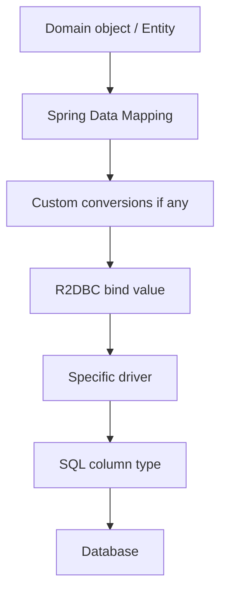

# Mapping UUIDs, Monetary Values, and Exact Numeric Types

## 1. Why Care About Data Types?

When a Java entity is persisted using Spring Data R2DBC, the mapping layer must convert values from Java types into types supported by the R2DBC driver and the database management system. When reading data, the process runs in reverse.

For simple types like `String` or `Integer`, mapping is usually straightforward. However, several types require careful selection and representation:

- **UUID:** identifiers need a consistent storage representation across Java, driver, and schema.
- **Monetary values:** exact numeric amounts and currency codes must be preserved, along with business-appropriate rounding rules.
- **Exact numeric types:** integers, exact decimals, and approximate floating-point numbers must be distinguished.

A poor data type choice can cause loss of precision, conversion failures, inaccurate comparisons, or incompatibility when switching databases/drivers. Therefore, Java types, SQL types, mapping rules, and business rules must be designed together.

## 2. Mapping UUIDs in Java and Databases

Java provides `java.util.UUID` to represent UUID identifiers. A UUID is 128 bits and is commonly displayed as a hyphenated hexadecimal string, for example:

```text
8f14e45f-ea3d-4a5b-9c2d-123456789abc
```

In Java:

```java
UUID id = UUID.randomUUID();
UUID parsed = UUID.fromString("8f14e45f-ea3d-4a5b-9c2d-123456789abc");
```

`UUID.randomUUID()` generates a random UUID using the JDK's mechanism. UUIDs may also be supplied by external systems, generated by another algorithm, or generated by the database depending on the design. What matters is that all components agree on the representation and ID generation strategy.

### 2.1. Choosing a UUID column type by DBMS

Not every DBMS stores UUIDs using the same SQL type:

| DBMS | Common storage type | Notes |
| --- | --- | --- |
| PostgreSQL | `UUID` | Has a native UUID type; the PostgreSQL R2DBC driver supports mapping with `java.util.UUID` |
| H2 | `UUID` | Has a UUID type; use the matching H2 R2DBC driver and compatible version |
| SQL Server | `UNIQUEIDENTIFIER` | SQL Server's dedicated identifier type; verify mapping in the driver being used |
| MySQL | `BINARY(16)` or `CHAR(36)` | Typically represents UUIDs as 16 bytes or a string; has no native UUID type like PostgreSQL |

With PostgreSQL, a schema can declare:

```sql
CREATE TABLE customer (
    id UUID PRIMARY KEY,
    name VARCHAR(200) NOT NULL
);
```

Corresponding Java entity:

```java
@Table("customer")
public class Customer {

    @Id
    private UUID id;

    private String name;
}
```

When the driver supports native mapping, Spring Data R2DBC can pass `UUID` values through the R2DBC SPI without converting them to strings manually. Use SQL types and drivers suited to the running database.

### 2.2. Storing UUIDs as `CHAR(36)`

Some schemas choose to store UUIDs as standard 36-character strings:

```sql
CREATE TABLE customer (
    id CHAR(36) PRIMARY KEY,
    name VARCHAR(200) NOT NULL
);
```

The Java type can still be `UUID`, while the persistence layer converts between `UUID` and `String`. This is easy to inspect in SQL dumps and logs, at the cost of greater storage size than binary forms and requiring consistent casing, hyphens, and string formatting.

A writing converter turning UUID into a string can be defined as follows:

```java
import org.springframework.core.convert.converter.Converter;
import org.springframework.data.convert.WritingConverter;

import java.util.UUID;

@WritingConverter
public class UuidToStringConverter implements Converter<UUID, String> {

    @Override
    public String convert(UUID source) {
        return source.toString();
    }
}
```

Reading converter in the reverse direction:

```java
import org.springframework.core.convert.converter.Converter;
import org.springframework.data.convert.ReadingConverter;

import java.util.UUID;

@ReadingConverter
public class StringToUuidConverter implements Converter<String, UUID> {

    @Override
    public UUID convert(String source) {
        return UUID.fromString(source);
    }
}
```

Converters must be registered in the application's `R2dbcCustomConversions`. Example configuration for the active dialect:

```java
@Configuration
public class R2dbcMappingConfiguration {

    @Bean
    R2dbcCustomConversions r2dbcCustomConversions(R2dbcDialect dialect) {
        return R2dbcCustomConversions.of(
                dialect,
                List.of(
                        new UuidToStringConverter(),
                        new StringToUuidConverter()
                )
        );
    }
}
```

Imports and how `R2dbcDialect` is obtained may vary across Spring Data R2DBC versions. When adding custom conversions, ensure the configuration preserves default converters and dialect-provided converters as required by your version.

Only convert UUIDs to `String` when the schema actually stores strings. If the driver already supports native UUIDs, the converter is unnecessary and can cause bind type mismatches if registered inappropriately.

### 2.3. Storing UUIDs as `BINARY(16)`

Another option is storing the 128-bit UUID in 16 bytes:

```sql
CREATE TABLE customer (
    id BINARY(16) PRIMARY KEY,
    name VARCHAR(200) NOT NULL
);
```

The binary form saves storage space and can benefit indexes compared to long strings. However, the exact byte order must be agreed upon when converting between `UUID` and `byte[]`. Some DBMSs or UUID functions use specific byte-ordering rules; do not assume every conversion approach is compatible.

If writing custom UUID/byte array converters, run round-trip tests with known UUIDs and confirm data read by other clients follows the same convention. In particular, never change byte order across application versions once the database holds existing data.

With a MySQL schema, verify that the R2DBC driver supports binding `byte[]` for `BINARY(16)` and pick a consistent conversion convention. If multiple tools need to inspect the data easily, `CHAR(36)` strings may be simpler to operate despite using more space.

### 2.4. Application-generated or database-generated UUIDs?

Two common approaches exist:

**Application generates UUID before insert:**

```java
Customer customer = new Customer();
customer.setId(UUID.randomUUID());
customer.setName("Lan Nguyen");
return customerRepository.save(customer);
```

The advantage is that the ID is available before database persistence and can be used in events, logs, or coordinating multiple operations. The application can also generate IDs without a database connection. Ensure the schema allows inserting application-supplied IDs.

**Database generates UUID:**

PostgreSQL can use a UUID-generating function as a default, for example:

```sql
CREATE TABLE customer (
    id UUID PRIMARY KEY DEFAULT gen_random_uuid(),
    name VARCHAR(200) NOT NULL
);
```

For the database to apply the default, the INSERT statement must omit the `id` column or specify `DEFAULT`. If Spring Data sends an explicit UUID, the database uses that value instead of invoking the default. Whether the generated ID is retrieved back depends on how Spring Data, the dialect, and the driver execute INSERTs; check generated-value handling in your version.

If the application needs the ID immediately when constructing the aggregate, generating the UUID in Java is usually simpler. If the database is the authoritative source of IDs, configure insert operations so the database generates and returns the value via the supported mechanism.

## 3. Integer and Decimal Types in Java

Java has multiple numeric types, but they do not share the same properties:

| Java Type | Characteristics | Common Use Cases |
| --- | --- | --- |
| `byte`, `short`, `int`, `long` | Signed integers, fixed width | Counters, quantities, numeric keys, bounded integers |
| `BigInteger` | Arbitrary-size integers | Integers exceeding `long` range |
| `float`, `double` | Binary floating-point, approximate | Measurements, scientific computing, graphics where error is acceptable |
| `BigDecimal` | Arbitrary-precision decimals by precision/scale | Currency, rates, calculations requiring decimal precision |

For monetary data and business numbers requiring exact comparisons, `BigDecimal` is generally more appropriate than `float` or `double`.

## 4. Why Not Use `float` or `double` for Money?

`float` and `double` represent numbers using binary floating-point standards. Many decimal fractions cannot be represented exactly in finite binary form. A familiar example:

```java
double total = 0.1 + 0.2;
System.out.println(total); // may display 0.30000000000000004
```

This inaccuracy is not a Java bug; it is a property of floating-point representation. With money, small errors can accumulate across calculations, causing totals, taxes, or balances not to reconcile.

Avoid writing:

```java
double price = 19.99;
double tax = price * 0.1;
```

Instead, use `BigDecimal`:

```java
BigDecimal price = new BigDecimal("19.99");
BigDecimal taxRate = new BigDecimal("0.10");
BigDecimal tax = price.multiply(taxRate);
```

Construct `BigDecimal` from strings or appropriate integer values. Avoid `new BigDecimal(0.1)` because the `double` constructor preserves the approximate binary representation of the input. If you must accept a `double`, `BigDecimal.valueOf(double)` is generally more predictable, though monetary data should be received and passed as strings, integer minor units, or `BigDecimal` from the start.

## 5. Mapping `BigDecimal` to DECIMAL/NUMERIC

SQL provides exact decimal numeric types such as `DECIMAL(p, s)` or `NUMERIC(p, s)`. In these:

- `p` (precision) is the total number of significant digits stored.
- `s` (scale) is the number of digits to the right of the decimal point.
- The maximum number of digits in the integer part is `p - s`.

For example, `DECIMAL(12, 2)` allows up to 12 digits total, with 2 digits in the fractional part. The integer part has at most 10 digits.

PostgreSQL schema:

```sql
CREATE TABLE invoice_line (
    id BIGINT GENERATED BY DEFAULT AS IDENTITY PRIMARY KEY,
    quantity INTEGER NOT NULL,
    unit_price NUMERIC(19, 4) NOT NULL,
    line_total NUMERIC(19, 4) NOT NULL
);
```

Java entity:

```java
@Table("invoice_line")
public class InvoiceLine {

    @Id
    private Long id;

    private Integer quantity;

    @Column("unit_price")
    private BigDecimal unitPrice;

    @Column("line_total")
    private BigDecimal lineTotal;
}
```

Spring Data R2DBC and drivers supporting `BigDecimal` can map directly to `NUMERIC`/`DECIMAL` columns. Confirm driver capabilities and rules for your specific database, especially when using numeric types with large precision/scale.

### 5.1. Choosing precision and scale

Examples:

| SQL Type | Max integer part | Max fractional part | Example valid value |
| --- | ---: | ---: | --- |
| `DECIMAL(10, 2)` | 8 digits | 2 digits | `12345678.90` |
| `DECIMAL(12, 4)` | 8 digits | 4 digits | `12345678.1234` |
| `DECIMAL(19, 4)` | 15 digits | 4 digits | `123456789012345.6789` |
| `DECIMAL(30, 8)` | 22 digits | 8 digits | Higher-precision values |

Do not pick `DECIMAL(19, 2)` for every number simply because it is a common default. Consider:

- Minimum and maximum values per business rules.
- Number of decimal digits needed before and after calculations.
- Units of measurement and precision of data sources.
- Rounding rules and when rounding occurs.
- Capabilities of the database, driver, and reporting tools.

If a value exceeds the column's precision, the database may reject the INSERT/UPDATE or report an arithmetic error. Some databases may round values to the column scale before storing. Specific behavior must be verified on your active DBMS; do not rely on the database handling it automatically the way you expect.

## 6. Using BigDecimal Properly

`BigDecimal` is immutable: operations return a new object instead of mutating the current object.

```java
BigDecimal subtotal = new BigDecimal("125.50");
BigDecimal shipping = new BigDecimal("10.00");

BigDecimal total = subtotal.add(shipping);
```

Do not write:

```java
subtotal.add(shipping); // result is ignored
```

You must retain the return value:

```java
subtotal = subtotal.add(shipping);
```

### 6.1. Division requires specifying scale and rounding

Decimal division can produce non-terminating repeating decimals. For example, `1 / 3` cannot be represented exactly with a finite number of digits. `BigDecimal.divide()` without an appropriate scale/rounding mode can throw `ArithmeticException` when the result has no finite decimal representation.

```java
BigDecimal amount = new BigDecimal("10.00");
BigDecimal parts = new BigDecimal("3");

BigDecimal share = amount.divide(parts, 2, RoundingMode.HALF_UP);
```

The result is rounded to 2 decimal places using `HALF_UP`. Rounding rules should be dictated by business requirements or applicable accounting/tax regulations; do not assume `HALF_UP` applies to every case.

Common `RoundingMode` values:

| Rounding mode | Behavior |
| --- | --- |
| `UP` | Rounds away from zero if any non-zero digits are discarded |
| `DOWN` | Truncates toward zero |
| `CEILING` | Rounds toward positive infinity |
| `FLOOR` | Rounds toward negative infinity |
| `HALF_UP` | Rounds to nearest; ties round away from zero |
| `HALF_DOWN` | Rounds to nearest; ties round toward zero |
| `HALF_EVEN` | Rounds to nearest; ties round to nearest even digit |
| `UNNECESSARY` | Throws error if rounding is required |

Example controlling scale:

```java
BigDecimal amount = new BigDecimal("12.345");

BigDecimal rounded = amount.setScale(2, RoundingMode.HALF_EVEN);
// 12.34

BigDecimal exact = amount.setScale(2, RoundingMode.UNNECESSARY);
// Throws ArithmeticException because a non-zero digit must be dropped.
```

`setScale` also returns a new object. Round only at boundaries defined by business rules, such as when recording payable totals or calculating each invoice line; avoid arbitrarily rounding after every multiplication or addition, as that can skew final totals.

### 6.2. Comparing BigDecimal

`BigDecimal.equals()` checks both value and scale:

```java
new BigDecimal("10.0").equals(new BigDecimal("10.00"));
// false
```

`compareTo()` compares numeric value:

```java
new BigDecimal("10.0").compareTo(new BigDecimal("10.00"));
// 0
```

When comparing monetary amounts by numeric value, typically use `compareTo()`:

```java
if (amount.compareTo(BigDecimal.ZERO) < 0) {
    throw new IllegalArgumentException("Amount must not be negative");
}
```

If `BigDecimal` is used as a key in collections, understand the difference between `equals()` and `compareTo()`, as it affects `HashMap`, `HashSet`, and `TreeMap`.

### 6.3. Object scale and column scale

The two values `10.0` and `10.00` have the same numeric value but different scales. A `NUMERIC(p, 2)` database column typically returns numbers with a scale matching how the driver represents results, though exact behavior can vary by DBMS and driver.

If the application needs consistent monetary formatting, normalize scale at the domain or presentation layer according to your chosen policy. Do not call `stripTrailingZeros()` blindly, as it can produce a negative scale for certain values, such as representing `1000` with scale `-3`.

## 7. Modeling Monetary Values Properly

A monetary amount is not just a single number. From a business perspective, money typically consists of:

- **Amount:** the exact numeric amount.
- **Currency:** the currency unit, typically identified by an ISO 4217 code such as `VND`, `USD`, `JPY`, or `EUR`.

Do not store only `BigDecimal amount` without knowing which currency the amount belongs to if the system can handle multiple currencies.

Schema example:

```sql
CREATE TABLE payment (
    id UUID PRIMARY KEY,
    amount NUMERIC(19, 4) NOT NULL,
    currency_code CHAR(3) NOT NULL
);
```

The persistence entity can map two separate columns:

```java
@Table("payment")
public class Payment {

    @Id
    private UUID id;

    private BigDecimal amount;

    @Column("currency_code")
    private String currencyCode;
}
```

At the domain layer, these two values can be wrapped into a `Money` value object:

```java
public record Money(BigDecimal amount, Currency currency) {

    public Money {
        Objects.requireNonNull(amount, "amount");
        Objects.requireNonNull(currency, "currency");

        if (amount.signum() < 0) {
            throw new IllegalArgumentException("Amount must not be negative");
        }
    }
}
```

This example is for business rules that allow only non-negative amounts; if the domain requires negative entries such as refunds or adjustment postings, the invariant must be designed differently. A persistence adapter can convert between `Money` and the two columns `amount` and `currency_code` when instantiating/persisting entities.

### 7.1. Do not assume every currency has two decimal places

A common mistake is always calling `setScale(2)` for every amount. The number of decimal places used in payments or accounting depends on the currency and business rules. For example, JPY typically uses no decimal places in ordinary currency units, whereas some currencies like KWD use three decimal places.

`Currency.getDefaultFractionDigits()` in Java can provide the default fraction digits according to JDK currency data:

```java
Currency currency = Currency.getInstance("JPY");
int fractionDigits = currency.getDefaultFractionDigits();
```

However, a currency's default fraction digits do not necessarily dictate every business rounding rule. A system may need higher precision when computing unit prices, exchange rates, or taxes before rounding at the settlement step.

Distinguish between:

- Internal storage scale of the amount.
- Number of digits displayed to the user.
- Number of digits permitted in payment transactions.
- Rounding rules for taxes, fees, and exchange rates.

These values can differ and should be explicitly specified.

### 7.2. Do not add or compare money of different currencies directly

Do not add `10 USD` and `10 EUR` simply by adding two `BigDecimal` values. Monetary operations must check that currencies match or convert using an authoritative exchange rate and timestamp.

Example logic inside a value object:

```java
public Money add(Money other) {
    if (!currency.equals(other.currency())) {
        throw new IllegalArgumentException("Currencies must match");
    }

    return new Money(amount.add(other.amount()), currency);
}
```

Currency conversion requires an exchange rate source, effective timestamp, rounding rules, and persisting the exchange rate used for the transaction. Do not use the current exchange rate to recalculate a historical transaction if business rules require preserving the rate at the time of occurrence.

## 8. Store Money in Minor Units or DECIMAL?

There are two common storage strategies.

### 8.1. Using DECIMAL/NUMERIC and BigDecimal

For example:

```sql
amount NUMERIC(19, 4) NOT NULL
```

Java:

```java
private BigDecimal amount;
```

Advantages:

- Represents exact decimals with defined precision/scale.
- Easy to read and inspect directly in SQL.
- Suitable for prices, rates, taxes, exchange rates, and calculations with varying scales.

Points to manage are precision/scale, rounding, and database arithmetic behavior.

### 8.2. Using integers in the smallest currency unit

Some systems store money as integers, such as cents or the currency's smallest unit:

```sql
amount_minor BIGINT NOT NULL,
currency_code CHAR(3) NOT NULL
```

Java can use `long`:

```java
long amountMinor = 1999L; // e.g., 19.99 if the currency uses 2 fraction digits
```

Advantages are exact integer addition/subtraction within the type's range and avoiding binary floating-point error. However, you must know exactly how many fraction digits each currency uses, handle overflow, and avoid mechanically applying this strategy to exchange rates or intermediate calculations requiring many decimal digits.

If integers larger than `long` are required, consider `BigInteger` and a corresponding `NUMERIC` type.

### 8.3. Choosing a strategy by business need

| Requirement | Appropriate approach |
| --- | --- |
| Product prices and invoice totals with defined scale | `BigDecimal` + `NUMERIC/DECIMAL` |
| Payment amounts in a currency's minor unit | `long`/`BIGINT` if value bounds fit |
| Exchange rates, tax rates, or high-precision calculations | `BigDecimal` with explicitly designed precision/scale |
| Multi-currency money | Store amount and currency code; validate currency in domain |
| Integer item quantities | `Integer`/`Long` if bounds fit |

Do not mix the two strategies without an explicit conversion convention. If one table stores amounts in minor units while another stores decimals, the persistence adapter must convert consistently.

## 9. Mapping Currency and Value Objects with Converters

If the persistence entity stores `currency_code` as a `String` while the domain uses `java.util.Currency`, you can register converters:

```java
@WritingConverter
public class CurrencyToStringConverter implements Converter<Currency, String> {

    @Override
    public String convert(Currency source) {
        return source.getCurrencyCode();
    }
}
```

```java
@ReadingConverter
public class StringToCurrencyConverter implements Converter<String, Currency> {

    @Override
    public Currency convert(String source) {
        return Currency.getInstance(source);
    }
}
```

Then register the converters in `R2dbcCustomConversions` for the dialect. `Currency.getInstance` can throw an error if the currency code is invalid or unsupported by the JDK. If the database holds legacy codes or custom business codes, establish clear validation and conversion policies.

For a `Money` value object with two fields, amount and currency, a simple `Money -> BigDecimal` converter would drop the currency. Therefore, do not use a single-column converter if currency is a required part of the domain value. Map amount and currency code as two columns, then construct `Money` in the domain layer or use a multi-column value object mapping mechanism appropriate for your Spring Data Relational version.

## 10. Type Conversion in Spring Data R2DBC

Spring Data R2DBC relies on mapping metadata, converters, and the R2DBC driver to convert Java types into SQL types. A general write flow:



When reading data, the process runs in reverse: the driver supplies values in types supported by the R2DBC SPI, and the mapping layer converts them to Java types and constructs the entity.

For common types, drivers usually support direct mapping already. Only add custom converters when the SQL type and Java type are not directly supported or the domain needs a custom representation. Converters must explicitly mark reading/writing directions if Spring Data cannot infer conversion direction automatically.

### 10.1. When is a custom converter needed?

A converter may be needed when:

- UUIDs are stored as `CHAR(36)` or `BINARY(16)` and the driver does not automatically map them to `UUID` for that schema.
- An enum or value object is stored as a string or number under custom conventions.
- A domain type needs to be converted to a scalar type supported by the driver.
- The database has a specialized type and the driver returns a Java type different from the domain type.

You do not need a converter simply to rename a column. Use `@Column` to map property names to column names. Likewise, do not create converters for `BigDecimal` if the driver already supports `BigDecimal` with `NUMERIC`/`DECIMAL` columns.

### 10.2. Avoid lossy converters

Converters must preserve the necessary information of a value. For example:

- UUIDs converted to strings must preserve all 128 bits exactly.
- UUIDs converted to byte arrays must use a stable byte-order convention.
- `Money` cannot be converted solely to an amount if currency is also a required part.
- `BigDecimal` must not be converted through `double` during mapping.
- Currency codes must be validated rather than silently defaulted when unrecognized.

A converter can be invoked in multiple places and affects both read and write data. Test both directions, including null handling and boundary values.

## 11. Other Exact Numeric Types

Beyond money, many business values require selecting the right numeric type:

| Data | Java | Suggested SQL | Notes |
| --- | --- | --- | --- |
| Integer quantities | `Integer`, `Long` | `INTEGER`, `BIGINT` | Choose sufficient range and non-negative constraints if needed |
| Sequence numbers or counters | `Long` | `BIGINT` | Avoid overflow as values grow over time |
| Percentages | `BigDecimal` | `NUMERIC(p, s)` | Specify whether storing `0.15` or `15.00` |
| Exchange rates | `BigDecimal` | `NUMERIC(p, s)` | Needs enough scale for rate accuracy |
| Approximate measurements | `double` | `DOUBLE PRECISION` | Floating-point error is acceptable |
| Very large integers | `BigInteger` | `NUMERIC(p, 0)` | Check database precision limits |

For percentages, agree on one convention. For example, `0.15` represents 15% as a ratio, whereas `15.00` represents 15 percentage points. Do not let different services use two conventions for the same column.

## 12. Handling Precision, Scale, and Overflow

Java types and SQL types have different limits. `BigDecimal` can represent very large values, whereas a `NUMERIC(p, s)` column only stores values within its defined precision. Similarly, `long` has a fixed range; adding past the limit overflows.

Example checking precision before writing:

```java
public BigDecimal normalizeAmount(BigDecimal amount) {
    BigDecimal normalized = amount.setScale(2, RoundingMode.UNNECESSARY);

    if (normalized.precision() > 19) {
        throw new IllegalArgumentException("Amount exceeds supported precision");
    }

    return normalized;
}
```

This snippet illustrates validation only. For a `NUMERIC(19, 2)` column, both precision and scale must align; `BigDecimal.precision()` does not replace full range and scale checks. You can call `setScale` to fix the number of decimal digits before checking.

For integers, you can use `Math.addExact` or `Math.multiplyExact` to detect overflow rather than letting results wrap silently:

```java
long total = Math.addExact(currentTotal, nextAmount);
```

Validate at the domain layer before writing if overflow alters business meaning. Database constraints should also be designed to protect data against other write paths.

## 13. Testing UUID and Monetary Mappings

Domain unit tests can verify value object logic, but only integration tests confirm that the driver and database map types properly.

### 13.1. UUID round-trip testing

Create a fixed UUID, save the entity, read it back by ID, and verify both UUIDs match:

```java
UUID expectedId = UUID.fromString("8f14e45f-ea3d-4a5b-9c2d-123456789abc");

Customer customer = new Customer(expectedId, "Lan Nguyen");

return customerRepository.save(customer)
        .then(customerRepository.findById(expectedId))
        .doOnNext(actual -> assertEquals(expectedId, actual.getId()));
```

If UUIDs are stored as `CHAR(36)` or `BINARY(16)`, tests must run with the custom converters and actual schema. For database-generated UUIDs, also verify that the generated ID is returned to the entity.

### 13.2. BigDecimal testing

You can use values with different scales and precisions:

```java
BigDecimal expected = new BigDecimal("123456789.1234");
```

After saving and reading, compare values as required:

```java
assertEquals(0, expected.compareTo(actual.getAmount()));
```

If scale is also part of the data contract, check `scale()` or `equals()` as well after confirming whether the database/driver preserves scale as expected. Do not use `double` in assertions for monetary data.

### 13.3. Boundary value testing

You should test:

- Valid UUIDs, malformed UUIDs, and null UUIDs if the schema permits.
- `BigDecimal` values at the column's precision limit.
- Out-of-bounds values and database error behavior.
- Values with more decimal digits than the column scale.
- Negative, zero, and positive values per business rules.
- Valid and invalid currency codes.
- Custom converter round-trips in both directions.

## 14. Common Errors

| Symptom | Possible Cause | Resolution |
| --- | --- | --- |
| Unable to bind UUID | Driver does not support UUID type for the column or schema uses another type | Check SQL type and driver; consider converters for `CHAR(36)`/`BINARY(16)` |
| UUID reads back different from original value | Inconsistent byte order when stored in binary form | Standardize byte convention and run round-trip tests with fixed data |
| UUID stored as string in a binary column | Converter or schema type mismatch | Align column type, bind type, and converter |
| Monetary totals have strange fractional errors | Used `double`/`float` or passed through an approximate type | Use `BigDecimal` from strings and `NUMERIC/DECIMAL` columns |
| `ArithmeticException` on division | Division without scale/rounding produced a repeating decimal | Choose scale and `RoundingMode` per business rules |
| Database reports numeric overflow | Value exceeds column precision | Redesign precision or validate value bounds before writing |
| Monetary values lose decimal digits | Column scale too small or database rounds per its own rules | Review scale, actual SQL, and rounding rules |
| `equals()` returns false for seemingly identical numbers | `BigDecimal` values have different scales | Use `compareTo()` when comparing numeric values |
| Unable to add two Money instances | Different currencies | Validate currencies or run a conversion workflow with an exchange rate |
| Read value has unexpected format | Driver/database returns a different scale or Java type than expected | Normalize at domain/presentation layer and test with real driver |

## 15. Type Selection and Mapping Process

When designing a UUID or exact numeric property in Spring Data R2DBC, follow this sequence:

1. Determine the domain meaning and valid value range.
2. Choose the appropriate Java type: `UUID`, `BigDecimal`, `BigInteger`, `Long`, or another type.
3. Choose the corresponding SQL type for the DBMS: `UUID`, `CHAR(36)`, `BINARY(16)`, `NUMERIC(p, s)`, `BIGINT`, etc.
4. Check the native mapping capabilities of the active R2DBC driver.
5. Write custom converters only when default mapping does not fit the schema or domain type.
6. For currency, store the currency code alongside the amount and define scale/rounding per business rules.
7. Avoid passing through `float`/`double` when exact decimal arithmetic is required.
8. Test round-trips, boundary values, overflow, nulls, and database-generated values.
9. Manage column type and converter changes with versioned migrations while maintaining legacy data compatibility.

UUIDs need a consistent representation across Java, driver, and schema. Monetary values need `BigDecimal` or an appropriate integer representation, while always carrying currency and rounding rules. Exact numeric types must be designed with matching precision, scale, and ranges. When these decisions align across the domain, mapping layer, and database, Spring Data R2DBC can pass data back and forth without losing meaning or accuracy.
