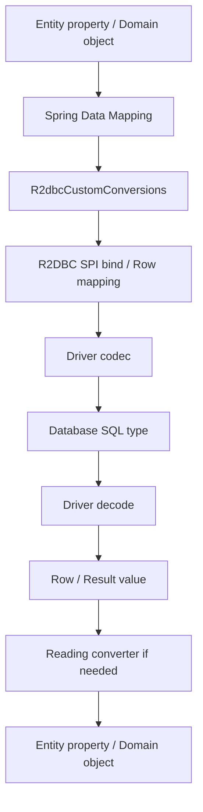

# Mapping JSON, Arrays, and Driver-Specific Data Types

Spring Data Relational R2DBC maps Java entity properties to relational columns through metadata, conversions, and the data encoding capabilities of the R2DBC driver. For simple types such as `String`, `Long`, or `LocalDate`, conversion is usually supported directly. For JSON, SQL arrays, database-specific enums, network types, or other specialized types, the application must understand both the SQL type used by the column and the Java types supported by the driver.

An important point is that the R2DBC SPI does not standardize every database's extended data types into a single Java type. Drivers are responsible for codecs (encoding/decoding) for specialized SQL types. Spring Data can add a conversion layer via `R2dbcCustomConversions`, and `DatabaseClient` allows binding typed values explicitly. Therefore, an entity can use plain Java types, driver-specific wrapper types, or domain types transformed via converters.

## 1. Layers Involved in the Mapping Process

When writing data, entity properties are read by Spring Data, converted if needed, and then bound to the statement. The R2DBC driver transforms Java values into forms understood by the database. When reading, the driver decodes SQL values into Java types it supports; Spring Data then converts them to the entity property's type if a matching converter is registered.



The components have distinct responsibilities:

- **Spring Data mapping:** knows which entity, table, column, and properties need to be persisted or read.
- **Custom conversions:** convert between domain types and store types that the driver can bind/read.
- **R2DBC SPI:** provides standard APIs to create statements, bind parameters, and consume results.
- **Driver codec:** knows how to represent a specific database's SQL types on the driver protocol.
- **Database:** defines the column type, constraints, operators, and actual data storage.

A Spring Data converter cannot grant the driver capabilities it lacks if the driver does not know how to bind the target type. Similarly, a driver having a JSON codec does not mean Spring Data automatically knows how to turn that JSON into any arbitrary POJO. Both layers must be connected properly.

## 2. Distinguishing JSON, JSON Arrays, and SQL ARRAYs

Three concepts are often confused:

| Data form | Example | Meaning |
| --- | --- | --- |
| JSON object | `{"color":"blue","size":3}` | A JSON document consisting of key/value pairs |
| JSON array | `["red","green","blue"]` | An array nested inside a JSON document |
| SQL ARRAY | `ARRAY['red', 'green', 'blue']` or a value bound to a `text[]` column | A relational DBMS array data type with its own element type |

A JSON array is the content of a JSON/JSONB value. A SQL ARRAY is an independent SQL type. Although both hold multiple elements, they differ in type rules, operators, indexing, and driver support.

PostgreSQL example:

```sql
CREATE TABLE product (
    id BIGINT GENERATED BY DEFAULT AS IDENTITY PRIMARY KEY,
    attributes JSONB,
    tags TEXT[]
);
```

Here `attributes` is a JSONB document, while `tags` is a SQL array with text elements. You cannot assume a `List<String>` property will automatically map properly to both columns. Choose Java types or converters according to the target SQL type.

## 3. Mapping JSON with PostgreSQL

PostgreSQL offers two common types, `json` and `jsonb`. Both store JSON documents, but differ in storage and internal processing. `json` preserves the input text representation, whereas `jsonb` stores parsed binary data and supports appropriate operators/indexing. Choosing the column type should be based on query needs, indexing, and how the application updates documents.

The R2DBC PostgreSQL driver provides `io.r2dbc.postgresql.codec.Json` to represent JSON values. Using this wrapper tells the driver the bound value should be treated as JSON instead of defaulting a Java `String` to a regular text type.

### Storing JSON using the driver's `Json` type

DDL:

```sql
CREATE TABLE customer_profile (
    id BIGINT GENERATED BY DEFAULT AS IDENTITY PRIMARY KEY,
    profile JSONB NOT NULL
);
```

The entity can use the PostgreSQL driver's `Json` type directly:

```java
import io.r2dbc.postgresql.codec.Json;
import org.springframework.data.annotation.Id;
import org.springframework.data.relational.core.mapping.Table;

@Table("customer_profile")
public class CustomerProfile {

    @Id
    private Long id;

    private Json profile;

    public CustomerProfile() {
    }

    public CustomerProfile(Long id, Json profile) {
        this.id = id;
        this.profile = profile;
    }

    public Long getId() {
        return id;
    }

    public Json getProfile() {
        return profile;
    }

    public void setProfile(Json profile) {
        this.profile = profile;
    }
}
```

When creating data:

```java
Json profile = Json.of("""
        {"displayName":"Lan","preferences":{"language":"vi"}}
        """);

CustomerProfile customer = new CustomerProfile();
customer.setProfile(profile);
```

`Json.of(...)` constructs a JSON value understood by the PostgreSQL driver. When reading a JSON/JSONB column, you can receive `Json` and retrieve its string representation via `asString()` for further processing. Exact wrapper APIs depend on the driver version; consult the documentation for the version in use.

The `Json` type is specific to the PostgreSQL driver, coupling the entity to that driver. If the application wants a database-independent domain model, you can use converters between domain objects and the `Json` type or use a commonly supported intermediate type.

### Binding JSON via `DatabaseClient`

When using custom SQL, you can bind `Json` directly:

```java
Json payload = Json.of("""
        {"source":"web","verified":true}
        """);

Mono<Long> updated = databaseClient.sql(
            "UPDATE customer_profile SET profile = :profile WHERE id = :id"
        )
        .bind("profile", payload)
        .bind("id", 10L)
        .fetch()
        .rowsUpdated();
```

Parameter names like `:profile` are `DatabaseClient` syntax; Spring translates them to dialect-appropriate markers. The `payload` value must still be a type recognized by the driver as JSON. If you bind a `String`, the driver may treat it as `VARCHAR`/text, and the database may not apply the intended JSON type without an explicit cast or type context.

## 4. Converting JSON to Domain Objects with Custom Converters

Domain models typically prefer working with strongly typed Java classes rather than manipulating JSON strings. Spring Data R2DBC lets you register reading and writing converters to map between the driver's JSON type and domain objects.

Domain type example:

```java
public record CustomerProfileData(
        String displayName,
        Preferences preferences
) {
    public record Preferences(String language) {
    }
}
```

Reading converter from `Json` to the domain object:

```java
import com.fasterxml.jackson.core.JsonProcessingException;
import com.fasterxml.jackson.databind.ObjectMapper;
import io.r2dbc.postgresql.codec.Json;
import org.springframework.core.convert.converter.Converter;
import org.springframework.data.convert.ReadingConverter;

@ReadingConverter
public class JsonToCustomerProfileData
        implements Converter<Json, CustomerProfileData> {

    private final ObjectMapper objectMapper;

    public JsonToCustomerProfileData(ObjectMapper objectMapper) {
        this.objectMapper = objectMapper;
    }

    @Override
    public CustomerProfileData convert(Json source) {
        try {
            return objectMapper.readValue(
                    source.asString(), CustomerProfileData.class
            );
        } catch (JsonProcessingException exception) {
            throw new IllegalArgumentException(
                    "Failed to read customer profile JSON", exception
            );
        }
    }
}
```

Writing converter from the domain object to `Json`:

```java
import com.fasterxml.jackson.core.JsonProcessingException;
import com.fasterxml.jackson.databind.ObjectMapper;
import io.r2dbc.postgresql.codec.Json;
import org.springframework.core.convert.converter.Converter;
import org.springframework.data.convert.WritingConverter;

@WritingConverter
public class CustomerProfileDataToJson
        implements Converter<CustomerProfileData, Json> {

    private final ObjectMapper objectMapper;

    public CustomerProfileDataToJson(ObjectMapper objectMapper) {
        this.objectMapper = objectMapper;
    }

    @Override
    public Json convert(CustomerProfileData source) {
        try {
            return Json.of(objectMapper.writeValueAsString(source));
        } catch (JsonProcessingException exception) {
            throw new IllegalArgumentException(
                    "Failed to write customer profile JSON", exception
            );
        }
    }
}
```

`@ReadingConverter` and `@WritingConverter` clarify conversion direction. This matters because some general Java types can be converted in multiple directions, and the framework needs to know which converter applies during reads or writes.

Register converters with `R2dbcCustomConversions` using the application's dialect. Conceptual Java configuration example:

```java
@Bean
R2dbcCustomConversions r2dbcCustomConversions(
        R2dbcDialect dialect,
        ObjectMapper objectMapper
) {
    return R2dbcCustomConversions.of(
            dialect,
            List.of(
                    new JsonToCustomerProfileData(objectMapper),
                    new CustomerProfileDataToJson(objectMapper)
            )
    );
}
```

Initialization APIs and how dialects/converters are provided may differ across Spring Data R2DBC and Spring Boot versions. In applications using `AbstractR2dbcConfiguration`, you can register converters via the extension point provided by the configuration class; in Spring Boot, integrate via the custom conversions mechanism of the Boot version in use. Avoid declaring an extra separate conversion set that drops the dialect's default converters.

Once converters are registered, the entity can use the domain type:

```java
@Table("customer_profile")
public class CustomerProfile {

    @Id
    private Long id;

    private CustomerProfileData profile;

    public CustomerProfile(Long id, CustomerProfileData profile) {
        this.id = id;
        this.profile = profile;
    }

    public Long getId() {
        return id;
    }

    public CustomerProfileData getProfile() {
        return profile;
    }
}
```

When saving, the writing converter transforms `CustomerProfileData` into `Json`; when reading, the reading converter transforms `Json` into `CustomerProfileData`. The database still stores JSONB, while business code works with typed objects.

## 5. Considerations When Using JSON

- **Column type must match:** JSON and JSONB are not the same as `TEXT`; the driver needs to know the value type when binding.
- **Validate JSON syntax:** `Json` wrappers or converters must produce valid JSON content. Malformed JSON may be rejected when parsed by the database.
- **SQL Null differs from JSON `null`:** SQL `NULL` means the column has no value; JSON `null` is a valid JSON value. The two states have different query semantics.
- **Do not serialize entire entity graphs:** JSON fits document data or flexible attributes; relationships requiring joins, foreign keys, and constraints should be modeled with relational tables.
- **Set size limits:** oversized JSON documents increase transmission, parsing, and storage costs. Store only necessary properties.
- **Manage JSON schemas:** when domain objects evolve, plan for old JSON data, missing fields, renamed fields, and backward compatibility.
- **Indexes and queries:** if querying deeply into JSON frequently, examine database operators/indexes such as GIN indexes for PostgreSQL JSONB; do not assume all databases share the same syntax.

Example distinguishing SQL NULL from JSON null in PostgreSQL:

```sql
-- SQL NULL: column has no value
UPDATE customer_profile SET profile = NULL WHERE id = 1;

-- JSON null: column holds a JSON null value
UPDATE customer_profile SET profile = 'null'::jsonb WHERE id = 2;
```

When mapping to Java, decide whether the domain model distinguishes these two cases. If both become `null` at the Java layer, the application may lose information needed by business logic.

## 6. Mapping SQL ARRAYs

SQL ARRAY is a database data type whose elements share the same underlying SQL type. PostgreSQL supports many array types, such as `text[]`, `integer[]`, `uuid[]`, or arrays of other types. The R2DBC PostgreSQL driver provides codecs for many supported array types and typically maps them to Java arrays of the corresponding element type.

Schema example:

```sql
CREATE TABLE article (
    id BIGINT GENERATED BY DEFAULT AS IDENTITY PRIMARY KEY,
    title VARCHAR(200) NOT NULL,
    tags TEXT[] NOT NULL DEFAULT '{}'
);
```

Entity:

```java
@Table("article")
public class Article {

    @Id
    private Long id;

    private String title;

    private String[] tags;

    public Article(Long id, String title, String[] tags) {
        this.id = id;
        this.title = title;
        this.tags = tags;
    }
}
```

When using `String[]` for a `text[]` column, the driver can encode each element using the corresponding codec. The Java element type must be compatible with the SQL array type. For instance, `Integer[]` fits certain integer array types; `UUID[]` works only if the driver supports UUID array codecs.

### Binding arrays via `DatabaseClient`

PostgreSQL example using an array-typed parameter:

```java
String[] tags = {"spring", "r2dbc", "database"};

Mono<Long> updated = databaseClient.sql(
            "UPDATE article SET tags = :tags WHERE id = :id"
        )
        .bind("tags", tags)
        .bind("id", 5L)
        .fetch()
        .rowsUpdated();
```

The PostgreSQL driver accepts the Java array and encodes it as a SQL array if the element type is supported. Binding syntax and supported array types depend on the driver. With drivers that do not support native arrays, choose another storage representation or an appropriate converter; converters only transform Java data and do not add SQL ARRAY support to a database.

### Reading arrays

When reading rows, you can retrieve the array value in a Java type supported by the driver:

```java
Flux<Article> articles = databaseClient.sql(
            "SELECT id, title, tags FROM article"
        )
        .map((row, metadata) -> new Article(
                row.get("id", Long.class),
                row.get("title", String.class),
                row.get("tags", String[].class)
        ))
        .all();
```

This snippet illustrates reading a PostgreSQL array into `String[]`. The Java type must match the codec provided by the driver. If the driver returns a different array representation or does not support the property type directly, use a reading converter to normalize into the domain type.

### Using `List<T>` in the domain model

Many domain models prefer `List<String>` over `String[]`. You can convert between `List<String>` and `String[]` using converters with explicit directions:

```java
@WritingConverter
public class StringListToArray implements Converter<List<String>, String[]> {

    @Override
    public String[] convert(List<String> source) {
        return source.toArray(String[]::new);
    }
}

@ReadingConverter
public class ArrayToStringList implements Converter<String[], List<String>> {

    @Override
    public List<String> convert(String[] source) {
        return List.of(source);
    }
}
```

Register these converters in `R2dbcCustomConversions` with the matching dialect. The example above assumes a list of non-null strings; if the column or elements can be null, choose a collection implementation and null policy that fit instead of `List.of`, since `List.of` disallows null elements.

For collection properties, distinguish collections representing SQL ARRAYs from collections representing relationships between entities. Spring Data Relational does not automatically infer that every `List<OtherEntity>` should be stored in a single array column. If a property is a list of related entities, model the relationship and corresponding save operations properly.

## 7. SQL ARRAY vs. JSON Array: Choosing the Right Model

| Criterion | SQL ARRAY | JSON array |
| --- | --- | --- |
| Column type | `text[]`, `integer[]`, ... | `json` or `jsonb` (database-dependent) |
| Element types | Same underlying SQL type | Can hold heterogeneous JSON types |
| Common mapping | Java arrays such as `String[]`, `Integer[]` | Driver JSON wrapper, `String`, or domain object via converter |
| Type constraints | Database enforces the array's element type | Database checks JSON syntax; detailed schema usually requires constraints or application validation |
| Querying | Database-specific array operators | Database-specific JSON path/key operators |
| Portability | Depends on SQL ARRAY support of database/driver | Depends on JSON type and codec of database/driver |

Choose SQL ARRAY when the data is a homogeneous set of elements, requires strict element typing, and is well supported by the database/driver. Choose JSON arrays when the structure is a JSON document, elements may be objects, or shapes are flexible. If you need to query individual elements, review indexing and operator support in the database before deciding.

## 8. Enums and Database-Defined Data Types

Java enums can usually be stored as strings or numbers through converters. A simple, readable, driver-independent approach is mapping enums to `VARCHAR`:

```java
public enum OrderStatus {
    NEW,
    PAID,
    SHIPPED
}
```

Writing converter:

```java
@WritingConverter
public class OrderStatusWriteConverter
        implements Converter<OrderStatus, String> {

    @Override
    public String convert(OrderStatus source) {
        return source.name();
    }
}
```

Reading converter:

```java
@ReadingConverter
public class OrderStatusReadConverter
        implements Converter<String, OrderStatus> {

    @Override
    public OrderStatus convert(String source) {
        return OrderStatus.valueOf(source);
    }
}
```

With this approach, the database column is typically `VARCHAR` or an equivalent string type. When renaming an enum constant, consider legacy data and backward compatibility. In long-lived systems, use a stable storage code instead of `name()` directly.

Some databases have native enum types. For instance, PostgreSQL allows creating custom enum types in the schema. To bind a Java enum directly to that native type, the driver may need a dedicated codec or registrar. Spring Data converters and driver codecs have distinct responsibilities: converters translate the domain enum to a Java type recognized by the driver; codecs govern how that Java type is transmitted as a native enum over the wire protocol. Follow your driver's documentation on enum registration and mapping for the version in use.

Other specialized types may include `UUID`, `inet`, `interval`, `range`, `hstore`, geometric types, or extended temporal types. There is no single uniform Java mapping across all of these types. Check the codecs provided by your driver and decide whether the domain model should depend on driver types or use converters to decouple dependencies.

## 9. Common Specialized Types

| Database type | Possible Java type | Notes |
| --- | --- | --- |
| UUID | `java.util.UUID` | Check whether driver and database have a matching UUID codec |
| JSON/JSONB | Driver's `Json`, `String`, or domain POJO via converter | Use the right driver wrapper/codec when JSON typing is needed during bind |
| SQL ARRAY | `String[]`, `Integer[]`, `UUID[]`, or driver-supported array type | Elements must match SQL type and codec |
| Native enum | Java `enum` via dedicated codec or `String` converter | May require registering a codec for the native enum |
| Network address | `InetAddress` or driver-specific type | Use only if the driver supports the corresponding codec |
| Extended date/time | `LocalDate`, `LocalTime`, `LocalDateTime`, `OffsetDateTime`, ... | Depends on SQL type, time zone, and driver support |

For example, PostgreSQL supports the `uuid` type and the PostgreSQL driver provides a codec for `UUID` in corresponding versions. An entity can declare:

```java
@Id
private UUID id;
```

For `inet`, the driver may use `InetAddress`. If storing network addresses, verify which exact type the codec returns and whether subnet/prefix information is preserved. An `InetAddress` only represents an IP address; it does not necessarily retain full CIDR notation such as `192.0.2.0/24`.

For temporal types, do not pick a Java type solely by similar naming. For example, `timestamp without time zone` and `timestamp with time zone` have different semantics. Determine whether the database stores an absolute instant or local time, how the driver translates time zones, and which Java type matches business rules.

## 10. Custom Conversions in Spring Data R2DBC

Spring Data R2DBC uses `R2dbcCustomConversions` to register converters between domain types and store types. Two commonly used annotations are:

- `@WritingConverter`: marks a converter used when writing from the domain type to the store/driver type.
- `@ReadingConverter`: marks a converter used when reading from the store/driver type to the domain type.

General example:

```java
@WritingConverter
public class DomainToStoreConverter
        implements Converter<MyDomainType, DriverValueType> {
    // Convert domain value to a type supported by the driver for binding.
}

@ReadingConverter
public class StoreToDomainConverter
        implements Converter<DriverValueType, MyDomainType> {
    // Convert value read by the driver to domain value.
}
```

Here `DriverValueType` can be `Json`, `String[]`, `String`, `UUID`, or another type supported by the driver. Do not choose a target type just because it is convenient in Java; ensure the driver can bind that type to the corresponding SQL column.

### Guidelines for writing converters

1. Clarify the conversion direction: domain → store on write, store → domain on read.
2. Annotate with `@WritingConverter` or `@ReadingConverter` so Spring does not have to guess direction.
3. Handle null data according to mapping APIs and business requirements; converters should not assume every input is non-null.
4. Handle parse/serialization failures with contextual error messages, preserving the root cause for diagnostics.
5. Register converters alongside the database dialect to preserve required default conversions.
6. Test both write and read paths using the actual driver/database in the application.

Avoid overly broad converters like `Converter<Object, String>` without a clear reason. Broad converters can compete with default conversions and cause unrelated types to convert unexpectedly.

## 11. Binding Specialized Types Directly with R2DBC SPI

When interacting directly with a `Statement`, values passed to `bind` must be types supported by the driver:

```java
Json json = Json.of("{\"enabled\":true}");
String[] tags = {"spring", "reactive"};

Statement statement = connection.createStatement(
        "INSERT INTO product_profile (profile, tags) VALUES ($1, $2)"
);

statement.bind(0, json);
statement.bind(1, tags);
```

This is a PostgreSQL example using `$1`, `$2` markers in SQL and 0-based bind indices per the R2DBC SPI. Markers and concrete data types depend on the driver. Do not copy PostgreSQL marker syntax to other drivers.

### Binding typed null values

The R2DBC SPI does not permit calling `bind(index, null)` as a normal bind value. If a SQL parameter is null, use `bindNull(index, Class<?>)` and provide the corresponding Java type:

```java
Statement statement = connection.createStatement(
        "INSERT INTO product_profile (profile) VALUES ($1)"
);

statement.bindNull(0, Json.class);
```

For SQL NULL on a JSON column, the driver needs the parameter type to send a properly typed null. Syntax and null-binding support for specialized types must still be checked per driver. If storing JSON `null`, that is valid JSON content rather than SQL NULL; pass a JSON value representing `null` in the way the driver supports.

With `DatabaseClient`, use Spring's typed null-binding API. Do not omit the null type when the driver cannot infer the parameter type from SQL context.

## 12. Testing Mappings with the Real Database and Driver

Mapping specialized types must be tested with a real driver because codecs are database-dependent components. A test using only a mock repository does not prove the driver can bind or read JSONB, SQL ARRAY, or native enums.

Example testing saving and reading JSON:

```java
StepVerifier.create(
        repository.save(new CustomerProfile(null,
                new CustomerProfileData("Lan",
                        new CustomerProfileData.Preferences("vi"))))
                .flatMap(saved -> repository.findById(saved.getId()))
)
        .assertNext(profile -> {
            assertThat(profile.getProfile().displayName()).isEqualTo("Lan");
            assertThat(profile.getProfile().preferences().language()).isEqualTo("vi");
        })
        .verifyComplete();
```

Similar tests should cover:

- Saving a JSON object and reading it back into a domain object.
- Saving a JSON array and verifying structure and element order if required by business rules.
- Distinguishing SQL NULL from JSON null.
- Saving and reading SQL ARRAYs, including empty arrays and null elements if permitted by the schema.
- Testing UUIDs, enums, or specialized types via the real driver.
- Testing invalid data and verifying errors propagate through the publisher.
- Verifying reading and writing converters are registered in the right Spring configuration.

You can use Testcontainers or a matching test database to run integration tests. Use the same major version of the database and driver that the application deploys, as codecs and SQL types can differ between versions.

## 13. Common Errors and How to Handle Them

| Symptom | Possible Cause | Troubleshooting Direction |
| --- | --- | --- |
| JSON is treated as text by the database | Bound `String` when the driver needs a JSON wrapper/typed context | Use a driver-supported JSON type or explicit SQL cast |
| Unable to read JSON into POJO | Missing reading converter or converter uses wrong source type | Check type returned by driver and register `@ReadingConverter` |
| Unable to save domain object into JSON | Missing writing converter or target type unsupported by driver | Convert domain object to a driver-supported JSON wrapper/type |
| Unable to bind SQL ARRAY | Driver does not support arrays or elements lack a codec | Check array type, element type, and driver docs |
| `List<T>` not mapped as expected | Spring Data interprets collection via different metadata or driver expects a Java array | Use `T[]` or explicit bidirectional converters |
| Native enum hits codec error | Driver has not registered or does not support the enum type | Use strings/VARCHAR or configure codecs per driver |
| Null value causes bind error | Called `bind` with null or omitted parameter type | Use `bindNull` with the matching Java type |
| JSON null confused with SQL NULL | Domain model merges the two states | Define clear semantics and test both cases |
| Time shifts across time zones | Wrong SQL/Java type chosen or assumed driver retains time zone | Check column type, time zone, and codec |
| Works with mocks but fails in real runs | Mocks do not execute database codecs | Add integration tests with the real R2DBC driver |

When diagnosing, verify the column's SQL type, the actual Java type being bound/read, the driver codec, Spring Data converters, and dialect configuration. Checking layer by layer helps isolate whether the issue is in the schema, driver, or mapping.

## 14. Choosing a Mapping Strategy

| Need | Approach |
| --- | --- |
| Storing a JSON document in PostgreSQL | Use PostgreSQL driver's `Json` or converters to `Json` |
| Domain wants to operate on POJOs | Create reading/writing converters between POJO and driver-supported JSON type |
| Storing a homogeneous string list in PostgreSQL | Use a SQL ARRAY like `text[]` with `String[]` if codec supports it |
| Domain wants `List<T>` while column is SQL ARRAY | Register converters between `List<T>` and `T[]` |
| Storing object arrays or multi-shape data | Use JSON/JSONB if document semantics fit |
| Using native enums or database-specific types | Check driver codec/registrar or convert via a basic type like `String` |
| Need to reduce driver coupling in domain model | Use domain types and custom conversions at the persistence boundary |

No single Java type fits every database. Prefer simple, portable types if the application must support multiple drivers. If you need to leverage native database features, use driver-specific types in the persistence layer and keep the domain model independent via converters.

## 15. Takeaways

- JSON objects, JSON arrays, and SQL ARRAYs are distinct forms; a JSON array is content inside a JSON document, whereas SQL ARRAY is a separate SQL type.
- Spring Data mapping, `R2dbcCustomConversions`, the R2DBC SPI, and driver codecs each have distinct responsibilities during reads and writes.
- The PostgreSQL R2DBC driver provides `io.r2dbc.postgresql.codec.Json` to represent JSON/JSONB; use a type the driver recognizes when binding JSON.
- JSON wrappers can be transformed into domain objects via `@ReadingConverter` and reversed via `@WritingConverter`.
- SQL ARRAYs require driver codecs for both the array type and element type; Java arrays like `String[]` are typically the clearest representation when supported by the driver.
- To use `List<T>` for a SQL ARRAY, register bidirectional converters between the list and Java array.
- Native enums, UUIDs, network addresses, ranges, intervals, and extended temporal types may require driver-specific codecs or conversions.
- `bindNull` requires a Java type; SQL NULL differs from a JSON `null` value.
- Register converters alongside the dialect without losing default conversions; configuration APIs must follow your Spring Data/Boot version.
- Test specialized type mappings against the actual database and R2DBC driver, as mocks do not prove codecs work.

When mapping a specialized data type, start from the SQL column type, determine the Java type supported by the driver, and then add converters if the domain model needs a different representation. This separation of concerns keeps entities clear, ensures statements bind with the right types, and minimizes driver-dependent errors when reading or writing data.
