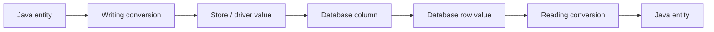

# Verifying Bidirectional Conversion, Null Data, and Type Mismatch Errors

Spring Data Relational R2DBC maps data between database columns and Java entity properties. When writing, Java values are converted into data types understood by the driver and database. When reading, values from result rows are converted back into Java types. If the two directions are inconsistent, or if data contains `NULL`, malformed formats, or unsupported types, persistence operations may fail or return unexpected values.

Verifying bidirectional (round-trip) conversion ensures that a written value can be read back accurately according to domain rules. You must check Spring Data converters, R2DBC driver codecs, schema column types, and how the application represents missing values. A converter that passes unit tests can still fail when combined with a real driver or database.

## 1. Two Conversion Directions in Spring Data R2DBC

When Spring Data writes an entity, `R2dbcConverter` transforms entity properties into values suitable for generating SQL statements and binding parameters. When reading results, the converter transforms values in a `Row` into corresponding Java properties.



For example, an `EmailAddress` property in the domain may be stored in a `VARCHAR` column. When writing, Spring Data needs to convert `EmailAddress` to `String`; when reading, it needs to convert `String` to `EmailAddress`.

These two directions are related, yet do not necessarily share the same source and target types. A writing converter transforms from domain type to store type; a reading converter transforms from store type to domain type. The store type must be compatible with the column type and the driver's bind/read capabilities.

## 2. Built-in Supported Data Types

Spring Data R2DBC and drivers generally already support common Java types such as `String`, numeric types, `Boolean`, `LocalDate`, `LocalDateTime`, `Instant`, `UUID`, and several other temporal types. Exact support scope depends on the Spring Data version, dialect, and driver.

Example entity using simple types:

```java
import java.time.LocalDateTime;
import org.springframework.data.annotation.Id;
import org.springframework.data.relational.core.mapping.Table;

@Table("customer")
public class Customer {

    @Id
    private Long id;

    private String name;

    private LocalDateTime createdAt;

    // Constructor, getters, and required methods.
}
```

If a Java type is directly supported by the driver and compatible with the column type, no custom converter is needed. However, the same Java type may be stored or read differently depending on the DBMS. For instance, `TIMESTAMP WITHOUT TIME ZONE` and `TIMESTAMP WITH TIME ZONE` have different semantics; choosing `LocalDateTime`, `OffsetDateTime`, or `Instant` must be based on the temporal meaning the domain needs to preserve.

Do not assume a Java type has identical precision or conversion rules across all databases. Check the schema, driver, and dialect documentation before choosing a data type.

## 3. When Is a Custom Converter Needed?

Custom converters are useful when the domain uses custom types that Spring Data/the driver cannot map directly, or when the database representation differs from what the application wants to use.

Examples:

- `EmailAddress` in Java is stored as `VARCHAR`.
- `Money` is stored as `DECIMAL` alongside a separate currency column.
- An enum uses a stable database code instead of the Java enum name.
- A value object is stored as JSON or a custom-formatted string.
- A temporal type or identifier needs normalization before writing and restoration on read.

Spring Data distinguishes reading and writing converters via the `@ReadingConverter` and `@WritingConverter` annotations. Specifying direction explicitly avoids ambiguity when the same type pair could be converted in multiple directions.

## 4. Bidirectional Conversion Example for a Value Object

Suppose the domain has an `EmailAddress` type, while the database stores emails in a `VARCHAR` column.

```java
public record EmailAddress(String value) {

    public EmailAddress {
        if (value == null || value.isBlank()) {
            throw new IllegalArgumentException("Email must not be blank");
        }
    }
}
```

Define a writing converter from `EmailAddress` to `String`:

```java
import org.springframework.core.convert.converter.Converter;
import org.springframework.data.convert.WritingConverter;

@WritingConverter
public class EmailAddressWriteConverter
        implements Converter<EmailAddress, String> {

    @Override
    public String convert(EmailAddress source) {
        return source.value();
    }
}
```

Define a reading converter from `String` to `EmailAddress`:

```java
import org.springframework.core.convert.converter.Converter;
import org.springframework.data.convert.ReadingConverter;

@ReadingConverter
public class EmailAddressReadConverter
        implements Converter<String, EmailAddress> {

    @Override
    public EmailAddress convert(String source) {
        return new EmailAddress(source);
    }
}
```

Both converters express the same rule in opposite directions. The writing converter needs no knowledge of the schema; it simply returns the store type `String`. The reading converter receives the type returned by the driver for string columns and constructs the value object.

### Registering custom converters

In a Spring Data R2DBC configuration based on `AbstractR2dbcConfiguration`, converters can be registered via `getCustomConverters()`:

```java
import java.util.List;
import org.springframework.data.r2dbc.config.AbstractR2dbcConfiguration;

public class R2dbcConfiguration extends AbstractR2dbcConfiguration {

    @Override
    protected List<Object> getCustomConverters() {
        return List.of(
                new EmailAddressWriteConverter(),
                new EmailAddressReadConverter()
        );
    }

    // Configure ConnectionFactory according to application architecture.
}
```

This is only the converter configuration portion, not a complete `ConnectionFactory` configuration. `AbstractR2dbcConfiguration` requires the application to supply connections per its configuration. If Spring Boot auto-configures `ConnectionFactory`, use the `R2dbcCustomConversions` registration mechanism compatible with your project's Boot/Spring Data version and avoid accidentally creating a second `ConnectionFactory`. Specific initialization APIs and extension points may vary across versions.

Once registered, you can use the value object type in an entity:

```java
@Table("customer")
public record Customer(
        @Id Long id,
        String name,
        @Column("email_address") EmailAddress email
) {
}
```

The schema needs the corresponding column:

```sql
CREATE TABLE customer (
    id BIGINT GENERATED BY DEFAULT AS IDENTITY PRIMARY KEY,
    name VARCHAR(200) NOT NULL,
    email_address VARCHAR(320) NOT NULL
);
```

Converters do not create columns or constraints. The schema must be compatible with the store type written by the converter.

## 5. Bidirectional Conversions Must Be Consistent

A write-then-read conversion should preserve the domain value's meaning. This requirement can be expressed as:

\[
read(write(x)) = normalize(x)
\]

Where `normalize(x)` is the normalized value according to defined rules. If no normalization is required, the read-back result should be equivalent to the original value.

For instance, if the email writing converter trims leading/trailing whitespace, the reading converter constructs `EmailAddress` from the normalized string. In that case, the round-trip need not preserve the exact original raw string, but it must preserve the normalized domain value.

Do not let the writing converter lowercase emails while the reading converter follows a different rule, or write timestamps in UTC while reading them as local time. Such discrepancies create subtle data bugs because insert operations can still succeed.

Properties that require consistency include:

- String formatting, delimiters, and encoding.
- Numeric precision, scale, and rounding behavior.
- Time zones, offsets, and timestamp precision.
- Case sensitivity, Unicode, and whitespace rules.
- Enum codes or status codes that may evolve across application versions.
- Representation of absent values and default values.

## 6. Numeric Conversions and Precision

Numeric types are a frequent source of bugs when Java and SQL types mismatch. For example, `BigDecimal` suits monetary values requiring decimal accuracy; `double`/`float` are binary floating-point types and may not represent decimal numbers like `0.1` exactly.

A schema might declare:

```sql
CREATE TABLE invoice_line (
    id BIGINT GENERATED BY DEFAULT AS IDENTITY PRIMARY KEY,
    quantity INTEGER NOT NULL,
    unit_price NUMERIC(12, 2) NOT NULL
);
```

Entity using `BigDecimal` for price:

```java
public record InvoiceLine(
        @Id Long id,
        Integer quantity,
        BigDecimal unitPrice
) {
}
```

If a `NUMERIC(12, 2)` column receives a value with more than two decimal digits, the database may round, reject, or process it according to its own rules. Do not rely on implicit behavior when business rules require a specific rounding policy. Normalize scale before writing and verify values after reading.

Converting `Long` to `Integer` can overflow if the value exceeds range. Converting `BigDecimal` to `Integer` can drop fractional parts. Converters must clearly define whether to reject unrepresentable values or permit rounding/truncation, and must never silently lose data.

## 7. Enum Conversions and Stable Storage Codes

Storing `Enum.name()` directly can be convenient, but renaming an enum in Java code can make legacy data unreadable. If the stored value is a long-term contract, you can define explicit stable codes:

```java
public enum OrderStatus {
    OPEN("O"),
    PAID("P"),
    CANCELLED("C");

    private final String code;

    OrderStatus(String code) {
        this.code = code;
    }

    public String code() {
        return code;
    }

    public static OrderStatus fromCode(String code) {
        return switch (code) {
            case "O" -> OPEN;
            case "P" -> PAID;
            case "C" -> CANCELLED;
            default -> throw new IllegalArgumentException(
                    "Unknown order status code: " + code);
        };
    }
}
```

Writing converter:

```java
@WritingConverter
public class OrderStatusWriteConverter
        implements Converter<OrderStatus, String> {

    @Override
    public String convert(OrderStatus source) {
        return source.code();
    }
}
```

Reading converter:

```java
@ReadingConverter
public class OrderStatusReadConverter
        implements Converter<String, OrderStatus> {

    @Override
    public OrderStatus convert(String source) {
        return OrderStatus.fromCode(source);
    }
}
```

If the database contains a new status code not yet understood by an older application version, the converter will throw an error. This can be the right behavior to avoid silently turning an unknown status into another status. When performing rolling updates, design migration and rollout ordering so every running version can read the codes being written.

## 8. Temporal and Time Zone Conversions

Time should be modeled according to domain semantics:

| Java Type | Meaning | Mapping Notes |
| --- | --- | --- |
| `LocalDate` | A calendar date, without time and time zone | Suitable for birth dates, invoice dates, or business dates |
| `LocalDateTime` | Local date and time, without offset/zone | Does not identify a unique global instant on its own |
| `OffsetDateTime` | Date and time with UTC offset | Can preserve offset if database/driver supports the corresponding type |
| `Instant` | A point on the UTC timeline | Suitable for event timestamps needing consistent system-wide comparison |
| `ZonedDateTime` | Date and time bound to a time zone region | Decide whether to store zone ID separately or only instant/offset |

For example, when recording order creation time, `Instant` usually expresses an absolute point in time clearly. When storing an appointment at 9 AM in a specific location, both local date-time and zone ID may be needed to handle daylight saving time changes.

Databases may truncate timestamp precision. A Java value with nanoseconds may be stored with microsecond or millisecond precision depending on the column and DBMS. When reading back, do not compare by requiring every nanosecond digit to remain intact if the schema does not support it.

Testing should cover timestamps near day boundaries, non-UTC offsets, daylight saving transitions if applicable, and high-precision values. In particular, avoid converting `LocalDateTime` to `Instant` by assuming the server's default time zone.

## 9. `NULL` Data in Databases and `null` in Java

SQL `NULL` represents the absence of a column value. In Java, `null` is typically used to represent the same state for reference types. However, how the application handles `null` must be clearly defined.

Example of a nullable phone number column:

```sql
CREATE TABLE customer_contact (
    id BIGINT PRIMARY KEY,
    email VARCHAR(320) NOT NULL,
    phone_number VARCHAR(30) NULL
);
```

The entity can use a reference type:

```java
public record CustomerContact(
        @Id Long id,
        String email,
        String phoneNumber
) {
}
```

If `phone_number` is SQL `NULL`, the `phoneNumber` property can receive `null`. With reference types, Java can represent this state. With primitive types such as `int`, `long`, or `boolean`, Java cannot hold `null`; depending on the mapping path, null values may cause conversion errors or unexpected behavior. Use `Integer`, `Long`, or `Boolean` for nullable properties.

### `NULL` differs from no result row

The following two cases are not the same:

- A query finds a row, and one column in that row has SQL `NULL`.
- A query finds no rows, and the `Mono` publisher completes empty.

`Mono.empty()` represents no element emitted; it does not represent a row containing a null column. Reactor does not allow `Mono.just(null)`. Therefore, do not use `Mono.empty()` as a substitute for a null column value if business logic needs to distinguish the two cases.

### `NULL` differs from an empty string or zero

`NULL`, `''`, `0`, and `false` are distinct states. Do not automatically convert null to an empty string or zero if business logic distinguishes "no data yet" from "data equal to 0." If a default value is needed, define it at the domain layer or schema under an explicit rule.

## 10. Handling Null in Custom Converters

Do not assume custom converters will always be invoked with `null`. Spring Data mapping and the conversion service typically handle null separately and may skip converters for null values. Therefore, converters should focus on converting actual values, while nullability is designed in the entity, schema, and business layer.

For instance, `EmailAddress` above rejects null in its constructor. If the `email_address` column allows null, the entity needs to represent that property as potentially absent and the service must decide when to construct `EmailAddress`. If the column is mandatory, use `NOT NULL` so the database rejects missing data.

If a domain type must clearly distinguish three states—such as "not provided," "clear current value," and "keep unchanged"—a simple `null` variable may not suffice. Especially for partial update commands, use a dedicated command type or field-presence wrapper instead of overloading null for every meaning.

### Database defaults and SQL NULL

Omitting a column in an `INSERT` statement can cause the database to apply `DEFAULT`. Sending the column with SQL `NULL` usually stores null and bypasses the default. These two behaviors differ. How Spring Data constructs insert statements depends on metadata and operations; if a database default is desired, inspect the generated SQL and use an appropriate API/schema. Do not assume returning `null` from a converter triggers the database default.

## 11. Verifying Data Types Across Entity, Converter, and Schema

Each property has at least three points that must align:

1. **Domain/Java type:** the property type in the entity, e.g., `EmailAddress`, `BigDecimal`, or `Instant`.
2. **Store type:** the type the converter writes out and receives back, e.g., `String`, `BigDecimal`, `LocalDateTime`, or a driver-specific type.
3. **SQL type:** the column type in the schema, e.g., `VARCHAR`, `NUMERIC`, `TIMESTAMP`, or `JSONB`.

Valid example:

| Layer | Type |
| --- | --- |
| Domain | `EmailAddress` |
| Writing converter | `EmailAddress` → `String` |
| Store/driver value | `String` |
| SQL column | `VARCHAR(320)` |
| Reading converter | `String` → `EmailAddress` |

If the converter outputs `String` while the column is `INTEGER`, the database may reject it or the driver/database may perform an unwanted cast. If the driver returns `BigDecimal` while the reading converter only registers `Double` as source, the conversion may not be found. Check the actual type returned by the driver, not just what the application assumes the column holds.

For JSON, arrays, native enums, or database-specific types, the driver may require dedicated codecs or wrappers. For example, PostgreSQL R2DBC has the driver's `Json` type for certain JSON/JSONB operations. A converter returning a generic `Map` is not automatically understood by the driver as JSONB. Use a store type and codec supported by the driver, or configure custom codecs per driver documentation.

## 12. Common Type Mismatch Errors

| Symptom | Possible Cause | Resolution |
| --- | --- | --- |
| No converter found | Converter not registered, wrong source/target direction, or driver returns an unexpected type | Check Java type, store type, read/write annotations, and custom conversions registration |
| `ConversionFailedException` or mapping error | Source value cannot be converted to the target property type | Inspect actual data, formatting, and converter logic |
| Driver reports bind/codec error | Submitted value type is unsupported by driver for the column or database type | Use a driver-supported store type or configure an appropriate codec |
| SQL datatype mismatch error | Parameter type and column type are incompatible | Check DDL, writing converter, and bind type |
| Numeric overflow or precision loss | Value exceeds range or scale of column/Java type | Adjust schema, validate bounds, and define rounding policy |
| String parsing failure | Legacy data is malformed or converter assumes wrong format | Normalize data, handle format versions, and report errors clearly |
| Error when reading SQL `NULL` | Java property is non-nullable or uses a primitive | Use wrapper types, adjust nullability, or fix data/schema |
| Time shifts or precision loss | Misaligned time zone/offset or timestamp precision | Choose temporal type per domain and check schema/driver |
| Enum cannot be read | Database holds a code not yet supported by current app version | Manage rollout/migrations and handle unknown codes intentionally |

Exact exception class names depend on the originating layer and driver. Spring may wrap conversion failures in mapping exceptions, while the driver may emit R2DBC exceptions during binding or reading columns. Do not catch a single exception class assuming all type errors pass through the same path.

## 13. Conversion Errors Appear in the Reactive Pipeline

Because repositories and templates return `Mono`/`Flux`, errors can occur when the publisher is subscribed to and the database returns results, not necessarily on the line where the method is called. Errors propagate as `onError` signals.

Example mapping a format error to a domain error:

```java
public Mono<Customer> findCustomer(Long id) {
    return customerRepository.findById(id)
            .onErrorMap(ConversionFailedException.class,
                    error -> new InvalidStoredCustomerDataException(error));
}
```

This snippet illustrates an error-translation boundary only. In practice, check the root cause and driver exceptions; you may need to handle `DataAccessException`, mapping errors, or R2DBC-specific exceptions. Do not catch `Throwable` and return a default entity, as that hides corrupted data and causes the pipeline to report false success.

If you want a fallback value when data is invalid, explicitly verify whether business rules allow skipping the record, using a replacement value, or failing the entire operation. For example, `onErrorResume` can turn an error into a default value, but only when such substitution does not compromise data correctness.

Do not call `block()` to check converter errors in a reactive service. Use `StepVerifier` or let WebFlux drive the publisher so errors are observed within the reactive lifecycle.

## 14. Unit Testing Converters

Unit tests verify each conversion direction independently:

```java
class EmailAddressConverterTest {

    private final EmailAddressWriteConverter writer =
            new EmailAddressWriteConverter();
    private final EmailAddressReadConverter reader =
            new EmailAddressReadConverter();

    @Test
    void convertsDomainValueToStoreValue() {
        EmailAddress email = new EmailAddress("an@example.com");

        assertThat(writer.convert(email)).isEqualTo("an@example.com");
    }

    @Test
    void convertsStoreValueBackToDomainValue() {
        EmailAddress email = reader.convert("an@example.com");

        assertThat(email).isEqualTo(new EmailAddress("an@example.com"));
    }
}
```

These tests verify pure converter logic, not whether Spring Data has registered the converters or whether the driver can bind the store type. Also test edge cases such as empty strings, whitespace, Unicode characters, legacy formats, and invalid inputs.

If a converter normalizes values, write tests for normalization rules and idempotency where applicable. For example, saving a normalized email and then reading and saving it again should not keep mutating the value.

## 15. Round-Trip Testing Against a Real Database

Integration tests verify the entire chain: entity → writing converter → driver → database column → driver row value → reading converter → entity. This catches errors caused by schema, dialect, or codecs that unit tests cannot detect.

Example using a repository and Reactor Test:

```java
@Test
void savesAndReadsEmailAddress() {
    Customer customer = new Customer(
            null,
            "An Nguyen",
            new EmailAddress("an@example.com")
    );

    StepVerifier.create(customerRepository.save(customer)
                    .flatMap(saved -> customerRepository.findById(saved.id())))
            .assertNext(loaded -> {
                assertThat(loaded.email())
                        .isEqualTo(new EmailAddress("an@example.com"));
            })
            .verifyComplete();
}
```

The test assumes `Customer` is a record with `id()` and `email()` accessors, converters are registered, and a matching schema is present. Run tests against the same database/driver type as the deployment environment; H2 or another database may not reproduce production data type semantics, time zones, or JSON handling.

Include additional tests that read data inserted directly via SQL or legacy data to verify the reading converter handles real-world formats. Only saving and reading back via the same converter pair can hide bugs if both directions perform an inverted yet erroneous transformation.

## 16. Testing SQL NULL and Boundary Data

For nullable properties, insert rows containing SQL `NULL` directly in the database and read them via the repository to confirm mapping. Also test inserting/updating with Java null properties and observe the generated SQL and stored values.

Cases to test:

- Nullable column with SQL `NULL` maps to null in a reference type.
- `NOT NULL` column rejects missing values per constraint.
- Null values are not inadvertently turned into empty strings, 0, or `false`.
- `Mono.empty()` is treated as no row rather than confused with a null property.
- Numeric values at min/max bounds and out-of-range values.
- Strings at exact column length limits and exceeding limits.
- Timestamps across different offsets and precisions.
- Enums/status codes unrecognized by the current version.
- Legacy data with a different format after a converter change.

## 17. Changing Converters and Legacy Data Compatibility

Converters are part of the storage contract. If you change formats—for example, previously storing an enum by name `PAID` and later storing code `P`—old data still exists in the database. New application versions must either read old data during a transition period or a migration must transform existing data before the new converter is deployed.

A safe strategy can include:

1. Identify old and new formats, along with application versions that may run concurrently.
2. Deploy a converter capable of reading both old and new formats during the transition period.
3. Migrate data via controlled migrations or backfill jobs.
4. Once confirmed that no old data remains and no old instances are writing the old format, simplify the converter to the new format.
5. Test rollback and deploy progressively across environments before production.

Do not switch a writing converter to a new format if older instances are still reading data in the old format without a compatibility plan. With rolling deployments, concurrently running versions must be able to read values written by other versions.

## 18. Monitoring Conversion Errors in Production

When conversion errors occur in production, gather enough context to pinpoint the originating layer without exposing sensitive data:

- Entity and property being mapped.
- Target Java type and expected store/SQL type.
- Database, driver, and Spring Data R2DBC versions.
- Column name and column type in the schema.
- Error code or root exception type, with stack trace at an appropriate level.
- Active converter profile/configuration.
- Presence of SQL `NULL`, legacy data, or out-of-bounds values.

Avoid logging full column values if they are emails, personal data, tokens, or confidential data. Log column names, data types, constraints, or correlation IDs to locate the affected record through secure access procedures.

## 19. Practical Guidelines

- Clearly understand the Java type, the store type used by the converter, and the column's SQL type.
- Use custom converters only when built-in types or driver codecs do not meet requirements.
- Explicitly mark `@WritingConverter` and `@ReadingConverter` to indicate conversion direction.
- Register converters via a configuration mechanism compatible with your Spring Data R2DBC / Spring Boot version.
- Ensure `read(write(x))` preserves domain meaning or follows defined normalization rules.
- Use `BigDecimal` for decimal values requiring precision and control scale/rounding.
- Choose temporal types according to UTC, offset, or local-time semantics; verify database precision.
- Use reference types for properties that may be SQL `NULL`; do not confuse null with empty strings, zero, or `Mono.empty()`.
- Do not assume converters will be called with null; design nullability across the entity, schema, and business logic.
- Test converters independently, then test round-trips against the real database and driver.
- Test legacy data, boundary values, and formats used during rolling deployments.
- Preserve root exceptions or translate them intentionally; do not mask conversion errors with arbitrary defaults.

## 20. Conclusion

Data conversion in Spring Data R2DBC has two directions: from Java types to store types when writing, and from database values back to Java types when reading. Custom converters allow mapping value objects or custom domain types, provided they are registered with the right direction and align with the driver and schema. A sound round-trip preserves data meaning, even when normalization rules apply.

SQL `NULL`, Java `null`, empty strings, default values, and empty publishers are distinct states. Clarify nullability, choose suitable Java types, and do not rely on converters to resolve every missing-data case automatically. Combining converter unit tests, real-database integration tests, legacy-data tests, and intentional reactive error handling will catch type mismatch errors early and keep data consistent.
