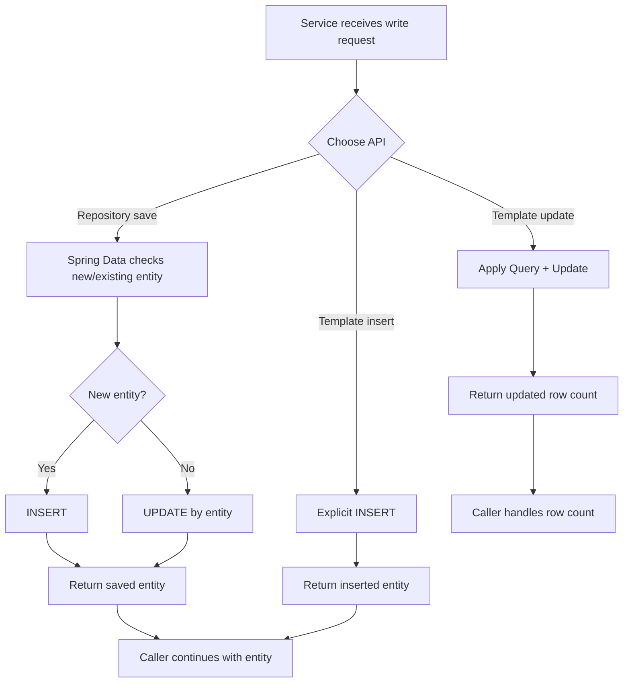

# Distinguishing Repository save from Template insert and update

Spring Data R2DBC provides two common ways to write relational data: using a repository with the `save()` method, or using `R2dbcEntityTemplate` with `insert()` and `update()` operations.

Both approaches share Spring Data Relational's mapping infrastructure and return reactive publishers. The main difference lies in how the application expresses its write intent:

- **Repository `save()`** accepts an entity and lets Spring Data determine whether the entity is new or existing, then chooses insert or update according to its new-state detection strategy.
- **Template `insert()` and `update()`** allow the application to specify the exact operation to perform. `insert()` always expresses the intent to add a new record; `update()` expresses the intent to update specified columns for rows matching a condition.

Choosing the right API keeps code aligned with business intent, prevents accidental updates or incorrect inserts, and gives you control over affected row counts and database-generated values.

## 1. Repository and Template in Spring Data R2DBC

### 1.1. Repository as a Domain-Oriented Abstraction

A repository provides an API tailored to operations on a single aggregate or entity type. Example:

```java
public interface CustomerRepository
        extends ReactiveCrudRepository<Customer, Long> {
}
```

`ReactiveCrudRepository` supplies standard CRUD operations such as `findById`, `findAll`, `save`, `saveAll`, and `deleteById`. Spring Data generates the implementation for the interface from entity metadata and repository configuration.

Repositories fit best when business logic mainly saves or loads entities by ID, uses derived query methods, and relies on queries with stable structure. Services interact with the repository interface without needing to know the details of the generated SQL.

### 1.2. `R2dbcEntityTemplate` as a More Flexible Data Access API

`R2dbcEntityTemplate` is Spring Data R2DBC's high-level API for entity, query, and update operations. It uses `DatabaseClient` alongside the mapping infrastructure to map between database rows and Java objects.

The template is useful when you need to:

- Explicitly specify an insert or update operation.
- Update a specific subset of properties instead of saving the entire entity state.
- Build dynamic `Query` conditions and `Update` expressions.
- Perform data operations that are awkward to express through the repository abstraction.
- Combine select, insert, update, and delete in a clear, explicit workflow.

In Spring Boot applications with the R2DBC starter, `R2dbcEntityTemplate` is typically auto-configured and can be injected into services.

```java
@Service
public class CustomerService {

    private final R2dbcEntityTemplate template;

    public CustomerService(R2dbcEntityTemplate template) {
        this.template = template;
    }
}
```

## 2. How Repository `save()` Works

Reactive repositories define `save()` with a generic return type:

```java
<S extends T> Mono<S> save(S entity);
```

The method takes an entity and returns a `Mono` emitting the entity once the save completes. With `saveAll()`, the repository returns a `Flux` of saved entities.

Before writing data, Spring Data must determine whether the entity is new or existing. Based on that state, the repository chooses insert or update.

### 2.1. How New Entities Are Detected

For typical entities, Spring Data Relational generally relies on the following rules:

1. If the entity has a `@Version` property, an uninitialized version value signals a new entity.
2. If there is no version property, the ID value typically determines newness: a null ID indicates a new entity; a non-null ID indicates an existing entity.
3. If the entity implements `Persistable`, `isNew()` supplies newness state via application logic.

Exact details also depend on ID/version types and the Spring Data version. For primitive IDs, the default value may indicate a new state; wrapper types like `Long` express `null` more clearly.

Example entity with a database-generated ID:

```java
@Table("customers")
public class Customer {

    @Id
    private Long id;

    private String name;
    private String email;

    public Customer(Long id, String name, String email) {
        this.id = id;
        this.name = name;
        this.email = email;
    }

    public Long getId() {
        return id;
    }

    public String getName() {
        return name;
    }

    public String getEmail() {
        return email;
    }
}
```

When the ID is `null`, the repository typically treats the object as new:

```java
Customer customer = new Customer(null, "Lan", "lan@example.com");

Mono<Customer> saved = customerRepository.save(customer);
```

When the entity has a non-null ID, the repository typically treats it as existing and chooses update:

```java
Customer customer = new Customer(42L, "Lan Nguyen", "lan@example.com");

Mono<Customer> saved = customerRepository.save(customer);
```

`save()` is not a general-purpose upsert command across arbitrary database unique keys. The insert/update decision relies on Spring Data's new-entity detection strategy, not on the database looking up a matching email and picking an operation automatically.

### 2.2. Repository `save()` Typically Persists Full Entity State

When calling repository `save()` on an existing entity, Spring Data builds an update based on the entity's mapping metadata. It is not an API designed for updating a single isolated field. To change one property, an application normally loads the entity, modifies the value, and calls `save()`; this expresses saving the entity's state.

Spring Data Relational does not maintain a JPA-style persistence context to track dirty fields and automatically update only changed properties. Therefore, if the requirement is to update a few columns conditionally, `R2dbcEntityTemplate.update()` usually expresses the intent more clearly.

### 2.3. Return Value of `save()`

`save()` returns the post-save entity. The returned value may contain:

- The database-generated ID from an insert.
- The new version after saving if the entity uses `@Version`.
- Values populated or adjusted via mapping/callbacks during persistence.

For immutable entities, Spring Data can instantiate a new object holding the updated values. Therefore, always use the entity emitted by `save()` rather than assuming the input object was mutated in place.

```java
return customerRepository.save(customer)
        .flatMap(saved -> auditService.recordCreated(saved.getId())
                .thenReturn(saved));
```

Reactive publishers are lazy: the database operation executes only upon subscription. Keep the save operation in the pipeline and do not call `.subscribe()` independently inside a service while returning the input entity.

## 3. `insert()` on `R2dbcEntityTemplate`

Template `insert()` explicitly expresses the intent to add a new record. Using the fluent API:

```java
Mono<Customer> inserted = template.insert(Customer.class)
        .using(customer);
```

Or inside a service:

```java
public Mono<Customer> create(Customer customer) {
    return template.insert(Customer.class).using(customer);
}
```

Unlike repository `save()`, `insert()` does not need to infer whether the entity is new or existing to pick an operation. The application has explicitly specified insert.

### 3.1. Database-Generated IDs

If the table uses identity or auto-increment, the input entity usually has a null ID. Upon a successful insert, the driver/database can return the generated ID, which Spring Data maps into the returned entity.

```java
return template.insert(Customer.class)
        .using(new Customer(null, "Lan", "lan@example.com"))
        .map(inserted -> new CustomerResponse(
                inserted.getId(),
                inserted.getName(),
                inserted.getEmail()
        ));
```

With immutable entities, the returned value may be a new instance holding the generated ID. Use `inserted` downstream in the pipeline.

### 3.2. Inserting with Application-Supplied IDs

If business logic uses UUIDs or application-generated primary keys, you can pass an entity that already has an ID into `insert()`:

```java
Customer customer = new Customer(UUID.randomUUID(), "Lan", "lan@example.com");

return template.insert(Customer.class).using(customer);
```

`insert()` still expresses the intent to add a new record. If the primary key or a unique constraint already exists, the database typically returns a constraint violation error. The template does not convert this operation into an update simply because the ID is non-null.

This is a key distinction from repository `save()`, which can interpret an entity with an ID as existing under the default newness strategy.

### 3.3. When Is `insert()` Appropriate?

Choose `insert()` when business logic is certain it is creating a new record, for example:

- Creating a new order after validating input.
- Writing a new event or audit entry.
- Inserting a row with an application-generated ID.
- Performing bulk inserts per entity or via an appropriate batching approach.

If the intent is creation and a duplicate key must be treated as an error, `insert()` communicates that rule more clearly than `save()`.

## 4. `update()` on `R2dbcEntityTemplate`

Template `update()` lets you specify both the matching condition for rows to update and the properties to change.

```java
Mono<Long> rowsUpdated = template.update(Customer.class)
        .matching(query(where("id").is(customerId)))
        .apply(Update.update("name", "Lan Nguyen"));
```

In this example, the application updates the column mapped to the `name` property for the row matching the ID. The result is a `Mono<Long>` representing the number of updated rows.

Common imports:

```java
import static org.springframework.data.relational.core.query.Criteria.where;
import static org.springframework.data.relational.core.query.Query.query;
import static org.springframework.data.relational.core.query.Update.update;
```

### 4.1. Updating Multiple Properties

You can construct an `Update` with multiple properties:

```java
Update changes = Update.update("name", "Lan Nguyen")
        .set("email", "lan.nguyen@example.com");

return template.update(Customer.class)
        .matching(query(where("id").is(customerId)))
        .apply(changes);
```

Only the properties included in `Update` are targeted by the operation. This is useful when performing a partial update without loading the entire entity.

### 4.2. Complex Update Conditions

`Query` can hold multiple conditions to restrict which rows are affected:

```java
Query criteria = query(
        where("id").is(customerId)
                .and("status").is("ACTIVE")
);

return template.update(Customer.class)
        .matching(criteria)
        .apply(Update.update("status", "INACTIVE"));
```

This condition updates only a record with the matching ID whose current status is `ACTIVE`. If no rows match, the updated row count is typically `0`.

Keep conditions tight, especially when scoping updates by tenant, ownership, or business status. An overly broad condition can modify more rows than intended.

### 4.3. Checking the Updated Row Count

`apply()` returns `Mono<Long>`. You can inspect the count to drive subsequent logic:

```java
public Mono<Void> renameCustomer(Long id, String newName) {
    return template.update(Customer.class)
            .matching(query(where("id").is(id)))
            .apply(Update.update("name", newName))
            .flatMap(rows -> {
                if (rows == 0) {
                    return Mono.error(new CustomerNotFoundException(id));
                }

                return Mono.empty();
            })
            .then();
}
```

If the update should affect strictly one row, check `rows == 1`. If `rows > 1`, either the condition is too loose or business rules permit multi-row updates; handle it according to the application contract.

Do not ignore the updated row count when business logic needs confirmation that the record existed or matched its expected prior state.

## 5. Comparing `save()` with `insert()` and `update()`

| Criterion | Repository `save()` | Template `insert()` | Template `update()` |
| --- | --- | --- | --- |
| Intent | Save entity; Spring Data detects new/existing | Add a new record | Update specified properties |
| INSERT/UPDATE choice | Based on newness detection | Always inserts | Always updates by condition |
| Input | Entity | Entity | `Query` condition and `Update` definition |
| Data scope | Entity state | Properties of the inserted entity | Properties listed in `Update` |
| Result | `Mono<S>` | `Mono<T>` | `Mono<Long>` updated row count |
| Generated ID | Can be returned in the saved entity | Can be returned in the inserted entity | Not the typical purpose of the update fluent API |
| Updating a few columns | Not its primary purpose | Not applicable | Well suited |
| Condition control | By ID/newness and mapping | No standard query matching | Explicit `Query` condition |
| Typical use case | Entity/aggregate CRUD | Intentional creation | Partial updates or conditional business updates |

All APIs are reactive and use the mapping infrastructure. The table summarizes intent and primary return types; exact details for generated values, callbacks, and transactions should be verified against your driver/database and Spring Data version.

## 6. Same Business Case with Repository vs. Template

Suppose we manage customers with this schema:

```sql
CREATE TABLE customers (
    id BIGINT GENERATED BY DEFAULT AS IDENTITY PRIMARY KEY,
    name VARCHAR(120) NOT NULL,
    email VARCHAR(180) NOT NULL UNIQUE,
    status VARCHAR(20) NOT NULL
);
```

Entity:

```java
@Table("customers")
public class Customer {

    @Id
    private Long id;
    private String name;
    private String email;
    private String status;

    public Customer(Long id, String name, String email, String status) {
        this.id = id;
        this.name = name;
        this.email = email;
        this.status = status;
    }

    public Long getId() { return id; }
    public String getName() { return name; }
    public String getEmail() { return email; }
    public String getStatus() { return status; }
    public void setId(Long id) { this.id = id; }
    public void setName(String name) { this.name = name; }
    public void setEmail(String email) { this.email = email; }
    public void setStatus(String status) { this.status = status; }
}
```

### 6.1. Creating with Repository `save()`

```java
public Mono<Customer> createWithRepository(CreateCustomerRequest request) {
    Customer customer = new Customer(
            null,
            request.name(),
            request.email(),
            "ACTIVE"
    );

    return customerRepository.save(customer);
}
```

A null ID causes the entity to be recognized as new under the default strategy. The repository inserts the row and returns the saved entity.

### 6.2. Creating with Template `insert()`

```java
public Mono<Customer> createWithTemplate(CreateCustomerRequest request) {
    Customer customer = new Customer(
            null,
            request.name(),
            request.email(),
            "ACTIVE"
    );

    return template.insert(Customer.class).using(customer);
}
```

The template explicitly signals an insert operation. If the ID or email violates a constraint, the database emits an error; the application can map it to an appropriate business response.

### 6.3. Updating the Whole Entity with Repository `save()`

```java
public Mono<Customer> renameWithRepository(Long id, String newName) {
    return customerRepository.findById(id)
            .switchIfEmpty(Mono.error(new CustomerNotFoundException(id)))
            .flatMap(customer -> {
                customer.setName(newName);
                return customerRepository.save(customer);
            });
}
```

The service loads the entity, modifies the property, and saves the entity back. This is convenient when business logic operates on the complete aggregate.

### 6.4. Updating a Single Column with Template `update()`

```java
public Mono<Void> renameWithTemplate(Long id, String newName) {
    return template.update(Customer.class)
            .matching(query(where("id").is(id)))
            .apply(Update.update("name", newName))
            .flatMap(rows -> rows == 0
                    ? Mono.error(new CustomerNotFoundException(id))
                    : Mono.empty())
            .then();
}
```

Here, there is no need to load the entity before updating. The database changes only the `name` property for the matching row. The returned value is the updated row count, not the entity.

## 7. Transactions When Combining Repository and Template

Repositories and `R2dbcEntityTemplate` can participate in the same reactive transaction when backed by the same `ConnectionFactory` and reactive transaction manager.

Example:

```java
@Service
public class CustomerRegistrationService {

    private final CustomerRepository repository;
    private final R2dbcEntityTemplate template;

    public CustomerRegistrationService(
            CustomerRepository repository,
            R2dbcEntityTemplate template) {
        this.repository = repository;
        this.template = template;
    }

    @Transactional
    public Mono<Customer> register(Customer customer) {
        return repository.save(customer)
                .flatMap(saved -> template.update(Profile.class)
                        .matching(query(where("customerId").is(saved.getId())))
                        .apply(Update.update("enabled", true))
                        .thenReturn(saved));
    }
}
```

This example demonstrates combining both APIs in a single pipeline. In a real application, the profile table must exist and the update condition must reflect actual business rules. If the second operation fails, the reactive transaction can roll back the first operation provided both share the same transaction manager/connection factory and the error propagates down the pipeline.

With reactive transactions, keep all operations inside the same publisher chain. Do not call `.block()` or create independent subscriptions mid-transaction, as doing so can lose the transaction context.

### 7.1. Optimistic Locking Considerations

Repository `save()` supports optimistic locking when the entity declares `@Version`. Spring Data uses the version to prevent updates from overwriting changes made by another operation.

With template `update(Query, Update)`, the application defines the matching criteria and update assignments itself. If optimistic locking is required, include the current version in the query condition, increment the version in `Update`, and check the updated row count.

```java
public Mono<Void> renameWithVersion(
        Long id,
        Long currentVersion,
        String newName) {

    Query condition = query(
            where("id").is(id)
                    .and("version").is(currentVersion)
    );

    Update changes = Update.update("name", newName)
            .set("version", currentVersion + 1);

    return template.update(Customer.class)
            .matching(condition)
            .apply(changes)
            .flatMap(rows -> rows == 1
                    ? Mono.empty()
                    : Mono.error(new OptimisticLockingFailureException(
                            "Customer was changed by another transaction")))
            .then();
}
```

This demonstrates manual optimistic locking at the template level. Use the version type and increment rule appropriate for your entity/database. If `rows == 0`, either the record does not exist or the version changed; the application can query further if it needs to distinguish between the two.

## 8. Entity Callbacks and Mapping

Both Repository and Template rely on the Spring Data mapping infrastructure. When operations go through Spring Data APIs, configured mapping mechanisms and entity callbacks can participate in the entity save lifecycle.

Common callbacks:

- `BeforeConvertCallback`: runs before the entity is converted into persistent store data.
- `BeforeSaveCallback`: runs before data is written.
- `AfterSaveCallback`: runs after the save operation completes.

Callbacks are useful for auditing, data normalization, or setting properties by shared convention. However, `Template.update(Query, Update)` updates only the fields in `Update` and does not pass a full entity through the same entity-save path as repository `save()`. Do not assume every entity-save callback will automatically run for a partial update.

If your application relies on auditing or callbacks to set `modifiedAt`, verify which write API is being used and explicitly update audit fields in template operations when needed.

## 9. When to Use Repository `save()`

Repository `save()` fits well when:

- The service works with complete entities or aggregates.
- You want Spring Data to detect new/existing state automatically via ID, version, or `Persistable`.
- You want a clean abstraction for standard CRUD.
- You want the saved entity returned with updated ID/version.
- Reads and writes can be expressed cleanly via repository methods or query methods.

For instance, a customer rename workflow can load the aggregate, verify permissions and domain rules, mutate state, and call `save()`.

## 10. When to Use Template `insert()` or `update()`

The template fits well when:

- Business logic needs to assert explicitly that an operation is an insert or an update.
- You need a partial update of a few columns without loading the full entity.
- Update conditions involve multiple criteria or are built dynamically.
- You need the exact updated row count.
- The repository abstraction does not cleanly fit the required statement or operation.

`insert()` fits intentional creation of new records. `update()` fits conditional updates that may modify only a subset of data.

If an update depends on domain status, ownership, or version, include those predicates in the query so the database updates only valid rows.

## 11. Common Mistakes When Choosing an API

| Situation | Cause | Resolution |
| --- | --- | --- |
| Calling `save()` expecting an unconditional INSERT | Entity has an ID, so it is treated as existing | Use `template.insert()` when the intent is adding a new record |
| Calling `save()` to update one field but many columns are written | Repository persists entity state per mapping | Use `template.update()` for partial updates |
| Calling `insert()` with an existing ID | Insert remains an insert and violates key/unique constraint | Check ID or use an appropriate update API |
| Template update returns `0` | No rows match the condition | Verify ID, status, and query predicates |
| Template update affects multiple rows | Query condition is not restrictive enough | Add tenant, status, or key predicates |
| Missing ID after insert | Publisher was never subscribed to or code reads the input object | Read the entity emitted from `Mono` |
| Lost optimistic locking when using template | Update condition does not check version | Include version in the predicate and update version explicitly |
| Transaction fails to roll back as expected | Both APIs use different connection factories/transaction managers or a detached subscription | Verify transaction manager and keep the same publisher chain |
| Audit fields are not updated | Partial update bypasses the expected entity-save path | Add audit fields to Update or use an appropriate callback |

## 12. Testing Repository and Template

Test insert/update behavior against a real R2DBC database or Testcontainers environment. Mocking repositories cannot verify generated SQL, generated IDs, affected row counts, or actual transaction behavior.

### 12.1. Testing Repository `save()`

```java
@DataR2dbcTest
class CustomerRepositoryTest {

    @Autowired
    CustomerRepository repository;

    @Test
    void saveNewCustomerShouldReturnGeneratedId() {
        Customer input = new Customer(null, "Lan", "lan@example.com", "ACTIVE");

        StepVerifier.create(repository.save(input))
                .assertNext(saved -> {
                    assertThat(saved.getId()).isNotNull();
                    assertThat(saved.getName()).isEqualTo("Lan");
                })
                .verifyComplete();
    }
}
```

### 12.2. Testing Template `insert()` and `update()`

```java
@DataR2dbcTest
class CustomerTemplateTest {

    @Autowired
    R2dbcEntityTemplate template;

    @Test
    void shouldInsertThenUpdateOnlySelectedProperty() {
        Customer input = new Customer(null, "Lan", "lan@example.com", "ACTIVE");

        Mono<Long> rowsUpdated = template.insert(Customer.class)
                .using(input)
                .flatMap(inserted -> template.update(Customer.class)
                        .matching(query(where("id").is(inserted.getId())))
                        .apply(Update.update("status", "INACTIVE")));

        StepVerifier.create(rowsUpdated)
                .expectNext(1L)
                .verifyComplete();
    }
}
```

This test illustrates inserting and then updating exactly one row. A real test requires the `customers` schema and static imports for `query`, `where`, and `Update`.

### 12.3. Scenarios to Verify

- `save()` with a null ID and with a populated ID.
- `save()` with an entity annotated with `@Version`.
- `insert()` when the ID does not exist and when the ID collides.
- `update()` when the query matches one row, zero rows, or multiple rows.
- Partial updates leaving columns outside `Update` untouched.
- Receiving generated IDs in the entity returned from insert.
- Manual optimistic locking with template updates.
- Rollback when combining repository and template in the same transaction.
- Callbacks/auditing across each write API in use.

## 13. API Selection Workflow

You can use these questions to choose how to write data:

1. Is the business operation creating a new record or updating an existing one?
2. Should Spring Data auto-detect new/existing state, or should the code explicitly state SQL intent?
3. Do you need to save the full entity state or modify only a few columns?
4. Do you need the affected row count to verify business preconditions?
5. Are optimistic locking, auditing, or callbacks required?
6. Do you need the post-save entity with generated ID/version, or only the updated row count?

| Requirement | API to Consider |
| --- | --- |
| Standard CRUD on an aggregate | Repository `save()` |
| Intentional new insert where key collision must fail | Template `insert()` |
| Updating a few columns by condition | Template `update()` |
| Saving full entity state after domain logic | Repository `save()` |
| Need the updated row count | Template `update()` |
| Application-supplied ID where insert must still be explicit | Template `insert()` or configuring `Persistable` for repository |
| Dynamic queries with multiple conditions | Template `update()` or corresponding query API |

## 14. Overall Execution Flow



## 15. Conclusion

Repository `save()` is suited to saving entities according to new/existing state detected by Spring Data from ID, version, or `Persistable`. It returns the saved entity, allowing callers to retrieve generated IDs and updated versions.

`R2dbcEntityTemplate.insert()` and `update()` fit when the application wants to express write intent explicitly. Insert always represents adding a new record; update lets you select rows with `Query`, specify columns with `Update`, and receive the affected row count. Use repositories for aggregate CRUD and the template for write operations needing fine-grained control, while verifying transactions, optimistic locking, callbacks, and generated values against your application requirements.
