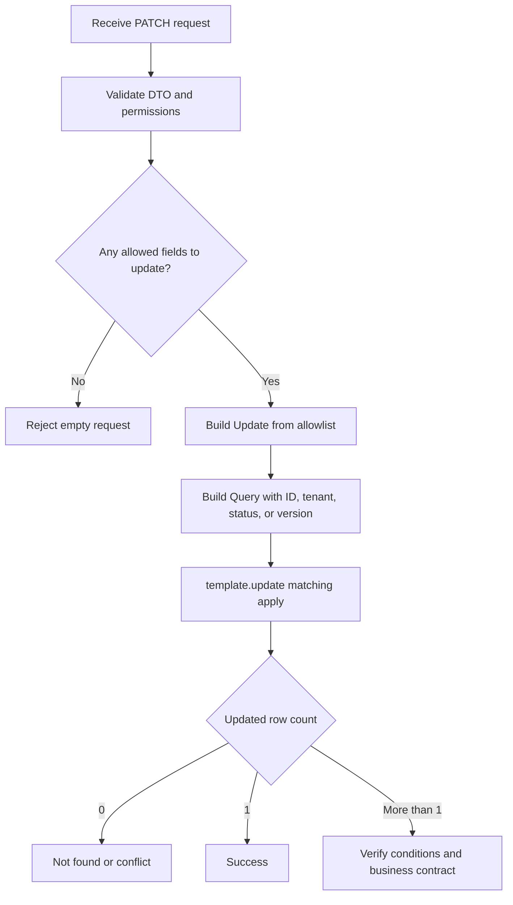

# Selectively Updating a Subset of Columns

In Spring Data R2DBC, an application does not always need to load an entire entity, modify one property, and save it back. For use cases that update only a few columns, `R2dbcEntityTemplate` provides the `update(Query, Update)` API to specify exactly which rows to change and which properties to write.

This approach is commonly called a *partial update*. It reduces data read overhead, avoids overwriting unrelated properties, and makes update conditions explicit at the database level.

When building partial updates, watch three concerns: allow updating only fields permitted by business rules, distinguish an omitted field from a field sent with `null`, and check the number of rows actually affected.

## 1. What Is a Partial Update?

Suppose the `customers` table has the following columns:

```sql
CREATE TABLE customers (
    id BIGINT GENERATED BY DEFAULT AS IDENTITY PRIMARY KEY,
    tenant_id BIGINT NOT NULL,
    name VARCHAR(120) NOT NULL,
    email VARCHAR(180),
    phone VARCHAR(30),
    status VARCHAR(20) NOT NULL,
    modified_at TIMESTAMP NOT NULL
);
```

A request to update a customer's name does not necessarily require reading the whole record. The application can run an equivalent statement:

```sql
UPDATE customers
SET name = ?, modified_at = ?
WHERE id = ?;
```

The `email`, `phone`, and `status` columns are not in `SET`, so this operation does not require rewriting their values.

Partial updates are useful when:

- An API receives a PATCH request containing only a few properties.
- A background job updates only a status or processing timestamp.
- A conditional update is needed without loading the entity first.
- An entity has many columns and the application wants to avoid rewriting unrelated values.
- Multiple processes may update different subsets of properties on the same record.

Partial updates do not replace all entity saves. When business logic must validate and mutate an entire aggregate, repository `save()` remains the right choice.

## 2. Using `R2dbcEntityTemplate.update()`

`R2dbcEntityTemplate` offers a fluent API to construct an update statement from an entity type, a `Query` condition, and properties in `Update`.

```java
import static org.springframework.data.relational.core.query.Criteria.where;
import static org.springframework.data.relational.core.query.Query.query;

import org.springframework.data.relational.core.query.Update;
import org.springframework.data.r2dbc.core.R2dbcEntityTemplate;
import reactor.core.publisher.Mono;

public Mono<Long> renameCustomer(
        R2dbcEntityTemplate template,
        Long customerId,
        String newName) {

    return template.update(Customer.class)
            .matching(query(where("id").is(customerId)))
            .apply(Update.update("name", newName));
}
```

The components mean the following:

- `Customer.class` tells the template which mapping metadata to use.
- `matching(Query)` identifies which rows are permitted to be updated.
- `Update.update("name", newName)` declares the property to change.
- `apply(Update)` executes the operation and returns a `Mono<Long>` containing the number of updated rows reported by the driver.

Names in `Update` and `Criteria` are typically entity property names. Spring Data uses metadata to map that property to the physical column in the database.

### 2.1. Updating Multiple Columns

Multiple properties can be added to the same `Update`:

```java
Update changes = Update.update("name", "Lan Nguyen")
        .set("email", "lan.nguyen@example.com")
        .set("phone", "0900000000");

return template.update(Customer.class)
        .matching(query(where("id").is(customerId)))
        .apply(changes);
```

The template builds a single update operation with the declared properties. There is no need to call `save()` for individual fields.

### 2.2. Using Conditions with Multiple Criteria

Update conditions can combine multiple criteria. For example, multi-tenant systems should constrain both the ID and the owning tenant:

```java
Query condition = query(
        where("id").is(customerId)
                .and("tenantId").is(tenantId)
);

return template.update(Customer.class)
        .matching(condition)
        .apply(Update.update("name", newName));
```

The tenant condition is placed in SQL so the database updates only records belonging to the current tenant. Service-layer permission checks are still required; the database predicate acts as a critical defense against updating wrong data.

A status condition can also be added:

```java
Query condition = query(
        where("id").is(customerId)
                .and("tenantId").is(tenantId)
                .and("status").is("ACTIVE")
);
```

Thus, only active customers belonging to that tenant are updated.

## 3. Dynamic Updates Based on Submitted Fields

A PATCH API typically receives optional fields. A client may send one field, several fields, or none. The application must construct `Update` from only the fields present in the request.

DTO example:

```java
public record CustomerPatchRequest(
        String name,
        String email,
        String phone
) {
}
```

If the API convention is that `null` means the field was not sent, a dynamic `Update` can be built as follows:

```java
private Update toUpdate(CustomerPatchRequest patch) {
    Update changes = null;

    if (patch.name() != null) {
        changes = Update.update("name", patch.name());
    }

    if (patch.email() != null) {
        changes = changes == null
                ? Update.update("email", patch.email())
                : changes.set("email", patch.email());
    }

    if (patch.phone() != null) {
        changes = changes == null
                ? Update.update("phone", patch.phone())
                : changes.set("phone", patch.phone());
    }

    return changes;
}
```

Then handle the case where no fields are updated:

```java
public Mono<Long> patchCustomer(
        Long customerId,
        Long tenantId,
        CustomerPatchRequest patch) {

    Update changes = toUpdate(patch);

    if (changes == null) {
        return Mono.error(new IllegalArgumentException(
                "At least one field must be provided"));
    }

    Query condition = query(
            where("id").is(customerId)
                    .and("tenantId").is(tenantId)
    );

    return template.update(Customer.class)
            .matching(condition)
            .apply(changes);
}
```

The snippet above illustrates a simple convention: non-null fields are updated; null fields are treated as unsent. This convention does not allow clients to explicitly clear a column by setting it to SQL `NULL`.

### 3.1. Distinguishing Omitted Fields from Fields Sent as `null`

In a PATCH API, these two intents differ:

```json
{}
```

Requests changing no fields.

```json
{"phone": null}
```

The client may be requesting to clear the current phone number by setting the `phone` column to SQL `NULL`.

If a Java DTO simply uses `String phone`, many JSON binders map both a missing field and an explicit `null` to the same Java `null` value. The application then cannot distinguish the two intents.

If business logic needs to support clearing values, use a data type that explicitly expresses three states: not supplied, supplied with a concrete value, and supplied with null. For example:

```java
public record FieldPatch<T>(boolean supplied, T value) {
}

public record CustomerPatch(
        FieldPatch<String> name,
        FieldPatch<String> email,
        FieldPatch<String> phone
) {
}
```

When `supplied` is `false`, do not add the property to `Update`. When `supplied` is `true`, add the property with its value; if `value` is `null`, the intent is to set the column to SQL `NULL` (if the schema permits).

Example building `Update`:

```java
private Update toUpdate(CustomerPatch patch) {
    Update changes = null;

    if (patch.name() != null && patch.name().supplied()) {
        changes = Update.update("name", patch.name().value());
    }

    if (patch.email() != null && patch.email().supplied()) {
        changes = changes == null
                ? Update.update("email", patch.email().value())
                : changes.set("email", patch.email().value());
    }

    if (patch.phone() != null && patch.phone().supplied()) {
        changes = changes == null
                ? Update.update("phone", patch.phone().value())
                : changes.set("phone", patch.phone().value());
    }

    return changes;
}
```

The `FieldPatch` type here is a data-modeling example. In a real API implementation, deserialization must be configured to distinguish missing fields from null-valued fields. Not every JSON library maps such a tri-state type out of the box without a custom deserializer.

### 3.2. Do Not Let Clients Update Arbitrary Properties

Never accept an arbitrary map from a request and convert every key directly into a property name to update. Clients could send sensitive fields like `id`, `tenantId`, `status`, `role`, `createdAt`, or `version`.

Define the list of updatable fields per use case. With strongly typed DTOs, that list is enforced by the DTO's properties. If using a dynamic map, check keys against an allowlist:

```java
private static final Set<String> ALLOWED_FIELDS = Set.of(
        "name", "email", "phone"
);
```

Beyond the allowlist, validate caller permissions, data types, lengths, formats, business state, and nullability constraints. Never insert column names from input into concatenated SQL strings.

## 4. Updating a Subset of Columns Under Business Conditions

Partial updates often need extra conditions to avoid modifying a record that has already changed or is no longer in a valid state.

### 4.1. Update Only When Current State Matches

For example, allow transitioning a customer from `ACTIVE` to `INACTIVE` only:

```java
public Mono<Long> deactivate(Long customerId, Long tenantId) {
    Query condition = query(
            where("id").is(customerId)
                    .and("tenantId").is(tenantId)
                    .and("status").is("ACTIVE")
    );

    Update changes = Update.update("status", "INACTIVE");

    return template.update(Customer.class)
            .matching(condition)
            .apply(changes);
}
```

If the updated row count is `0`, either the record does not exist, does not belong to the current tenant, or its status is no longer `ACTIVE`. Combining these conditions into one update statement makes the check-and-modify operation atomic in the database.

### 4.2. Version-Based Updates to Prevent Lost Updates

If concurrent requests can update the same record, optimistic locking can be used. With repository `save()`, Spring Data supports `@Version`. When using partial updates directly through the template, the application must include the current version in the condition and increment the version in `Update`.

```java
public Mono<Void> renameIfVersionMatches(
        Long customerId,
        Long expectedVersion,
        String newName) {

    Query condition = query(
            where("id").is(customerId)
                    .and("version").is(expectedVersion)
    );

    Update changes = Update.update("name", newName)
            .set("version", expectedVersion + 1);

    return template.update(Customer.class)
            .matching(condition)
            .apply(changes)
            .flatMap(rows -> {
                if (rows == 0) {
                    return Mono.error(new OptimisticLockingFailureException(
                            "Customer was changed or no longer exists"));
                }
                if (rows != 1) {
                    return Mono.error(new IllegalStateException(
                            "Expected exactly one updated customer"));
                }
                return Mono.empty();
            });
}
```

This is explicit optimistic locking. For a `Long` version, the example uses `expectedVersion + 1`; if the schema or version type differs, adjust accordingly. If the row count is `0`, the record may not exist or the version mismatched; you can query again if distinguishing the two cases is needed.

### 4.3. Tenant- and Ownership-Scoped Updates

In multi-tenant applications, every update operation should carry the authenticated tenant context. Do not rely solely on a client-supplied ID.

```java
Query condition = query(
        where("id").is(customerId)
                .and("tenantId").is(currentTenantId)
);
```

`currentTenantId` must come from a trusted server authentication context. Never take tenant ID from the request body and treat it as proof of ownership.

## 5. Updating Audit Timestamps and Managed Values

When updating a subset of columns, properties omitted from `Update` will not change automatically. If the system needs to update `modifiedAt`, add that field explicitly:

```java
Update changes = Update.update("name", newName)
        .set("modifiedAt", LocalDateTime.now());
```

In distributed systems, timestamps may need to come from a shared clock or the database depending on consistency requirements. Keep timezone and temporal types aligned with the schema.

Do not assume callbacks/auditing meant for entity save operations will run identically for `template.update(Query, Update)`. Partial updates do not pass a full entity through the same save lifecycle. If audit fields are required, include them in `Update` or design a dedicated auditing mechanism for this operation.

Columns like `createdAt`, `tenantId`, `id`, or privileged statuses should generally not be modifiable via ordinary PATCH DTOs. Separate endpoints or use cases with explicit authorization when those need updates.

## 6. How Partial Update Differs from Repository `save()`

| Criterion | Repository `save()` | Template `update(Query, Update)` |
| --- | --- | --- |
| Input | Entity | `Query` condition and `Update` field set |
| Purpose | Persist entity state | Selectively update a subset of properties |
| Reading entity first | Often needed when applying domain logic to current state | Not required if conditions and update values suffice |
| Fields written | Per entity mapping | Only fields declared in `Update` |
| Condition | By entity identity and keys | Multiple criteria can be specified in `Query` |
| Result | `Mono<S>` containing saved entity | `Mono<Long>` containing updated row count |
| Generated ID | Can be populated on returned entity | Not the primary goal of update |
| Optimistic locking | Supported via `@Version` | Version must be placed in condition and incremented explicitly if needed |
| Suitable for | Saving an aggregate after applying business rules | PATCH, status updates, updating a few columns |

If multiple domain rules must be checked against the full entity, read the entity and use repository save within an appropriate transaction. If only changing a few columns under well-defined conditions, template update can be simpler and more efficient.

## 7. Complete Service Example

Suppose the entity is:

```java
@Table("customers")
public class Customer {

    @Id
    private Long id;
    private Long tenantId;
    private String name;
    private String email;
    private String phone;
    private String status;
    private LocalDateTime modifiedAt;

    // Constructors, getters, and setters omitted.
}
```

A DTO allowing only name, email, and phone changes:

```java
public record CustomerPatchRequest(
        String name,
        String email,
        String phone
) {
}
```

Service:

```java
@Service
public class CustomerPatchService {

    private final R2dbcEntityTemplate template;
    private final Clock clock;

    public CustomerPatchService(
            R2dbcEntityTemplate template,
            Clock clock) {
        this.template = template;
        this.clock = clock;
    }

    public Mono<Void> patch(
            Long customerId,
            Long tenantId,
            CustomerPatchRequest patch) {

        Update changes = toUpdate(patch);
        if (changes == null) {
            return Mono.error(new IllegalArgumentException(
                    "No supported field was provided"));
        }

        changes = changes.set(
                "modifiedAt",
                LocalDateTime.now(clock)
        );

        Query condition = query(
                where("id").is(customerId)
                        .and("tenantId").is(tenantId)
        );

        return template.update(Customer.class)
                .matching(condition)
                .apply(changes)
                .flatMap(rows -> {
                    if (rows == 0) {
                        return Mono.error(new CustomerNotFoundException(customerId));
                    }
                    if (rows != 1) {
                        return Mono.error(new IllegalStateException(
                                "Expected one customer to be updated"));
                    }
                    return Mono.empty();
                });
    }

    private Update toUpdate(CustomerPatchRequest patch) {
        Update changes = null;

        if (patch.name() != null) {
            changes = Update.update("name", patch.name());
        }
        if (patch.email() != null) {
            changes = changes == null
                    ? Update.update("email", patch.email())
                    : changes.set("email", patch.email());
        }
        if (patch.phone() != null) {
            changes = changes == null
                    ? Update.update("phone", patch.phone())
                    : changes.set("phone", patch.phone());
        }

        return changes;
    }
}
```

This example assumes `null` in the DTO means the field was omitted and that the server has already authenticated `tenantId`. `Clock` is injected so time can be controlled in tests. In production code, add validation for name, email, phone, and access rules.

## 8. Data Types and Mapping Considerations

### 8.1. Use Property Names Instead of Physical Column Names

Suppose the entity has:

```java
@Column("first_name")
private String firstName;
```

When creating `Update`, use the property name:

```java
Update.update("firstName", newName);
```

Spring Data mapping metadata translates the property to the `first_name` column. This decouples code from physical database column naming conventions.

### 8.2. Null Values

A null value placed in `Update` means setting the column to SQL `NULL`, provided the column type permits it and converters support it. It differs from omitting the property from `Update`.

```java
Update changes = Update.update("phone", null);
```

If the `phone` column has a `NOT NULL` constraint, the database will reject the operation. Verify schema constraints and business rules before allowing clearing values.

### 8.3. Enum Values and Value Objects

If an entity uses enums, value objects, or custom types, Spring Data uses its conversion infrastructure to translate `Update` values to database types. Register custom converters if a data type is not supported by default.

Do not pass arbitrary strings from requests into enum fields without validation. Conversion failures will cause the publisher to emit an error at execution time.

## 9. Transactions and Multiple Partial Updates

If a business operation must update multiple tables or field groups that must succeed together, place the operations inside an appropriate reactive transaction.

```java
@Transactional
public Mono<Void> updateCustomerAndProfile(
        Long customerId,
        String newName,
        String newDisplayName) {

    Mono<Long> customerUpdate = template.update(Customer.class)
            .matching(query(where("id").is(customerId)))
            .apply(Update.update("name", newName));

    return customerUpdate.flatMap(rows -> {
        if (rows != 1) {
            return Mono.error(new CustomerNotFoundException(customerId));
        }

        return template.update(Profile.class)
                .matching(query(where("customerId").is(customerId)))
                .apply(Update.update("displayName", newDisplayName))
                .then();
    }).then();
}
```

Operations must use the same `ConnectionFactory` and reactive transaction manager to participate in the same transaction. Keep them inside one reactive publisher chain and let errors propagate so the transaction can roll back. Never call `.subscribe()` independently or `.block()` inside a reactive transactional method.

If the second update matches no profile record, explicitly decide whether that is a valid case or an error requiring rollback. `then()` simply discards the row count; it does not treat `0` as an error on its own.

## 10. Checking the Updated Row Count

`apply()` returns `Mono<Long>`. This row count provides useful proof of whether the update condition matched.

```java
return template.update(Customer.class)
        .matching(query(where("id").is(customerId)))
        .apply(Update.update("status", "INACTIVE"))
        .flatMap(rows -> {
            if (rows == 0) {
                return Mono.error(new CustomerNotFoundException(customerId));
            }
            return Mono.just(rows);
        });
```

Key interpretations:

- `0`: no rows reported as updated.
- `1`: one row updated.
- Greater than `1`: multiple rows affected; confirm whether that matches business intent.

Drivers/databases can differ in how they report row counts when the new value equals the old value. If logic depends strictly on *matched* versus *changed* row counts, confirm the semantics of your driver/database and design checks accordingly.

## 11. Common Mistakes in Selective Updates

| Symptom | Possible Cause | Remedy |
| --- | --- | --- |
| Field does not change | Field not added to `Update` or publisher not subscribed | Check builder and reactive pipeline |
| Unintended fields overwritten | Using `save()` with a partial entity or mapping raw input directly | Use partial update and a field allowlist |
| Cannot clear value to null | DTO does not distinguish missing field from null field | Use a tri-state patch model |
| Update affects wrong tenant | Predicate contains only ID | Add authenticated tenant context to `Query` |
| Too many rows updated | Matching condition lacks criteria | Add criteria and check row count |
| Update returns 0 | Record missing or status/version condition failed | Handle not found or conflict per business logic |
| Lost updates under concurrent requests | Not checking current version or state | Use optimistic locking or conditional predicates |
| `modifiedAt` unchanged | Partial update does not auto-populate audit fields as expected | Add audit field to `Update` |
| Wrong column/property name | Using physical SQL name when API expects property name, or misconfigured mapping | Check `@Column` and entity metadata |
| Constraint error when setting null | Database column forbids null | Check schema and validate requests |

## 12. Testing Partial Updates

Test against a real R2DBC database or Testcontainers to verify generated SQL, matching conditions, mapping, and transactions. Mocking `R2dbcEntityTemplate` only verifies API invocation, not that data actually changes as expected.

Test example:

```java
@DataR2dbcTest
class CustomerPartialUpdateTest {

    @Autowired
    R2dbcEntityTemplate template;

    @Test
    void shouldUpdateOnlyNameAndPreserveEmail() {
        Customer customer = new Customer(
                null,
                10L,
                "Lan",
                "lan@example.com",
                "0900000000",
                "ACTIVE",
                LocalDateTime.now()
        );

        Mono<Customer> result = template.insert(Customer.class)
                .using(customer)
                .flatMap(inserted -> template.update(Customer.class)
                        .matching(query(where("id").is(inserted.getId())))
                        .apply(Update.update("name", "Lan Nguyen"))
                        .then(template.selectOne(
                                query(where("id").is(inserted.getId())),
                                Customer.class)));

        StepVerifier.create(result)
                .assertNext(updated -> {
                    assertThat(updated.getName()).isEqualTo("Lan Nguyen");
                    assertThat(updated.getEmail()).isEqualTo("lan@example.com");
                })
                .verifyComplete();
    }
}
```

The test illustrates inserting data, updating only the name, and reading back to confirm email stays intact. Constructors and schemas in tests must match your project's actual entity; fixture builders can help avoid repeating long argument lists.

### 12.1. Scenarios to Test

- Sending only one field and confirming other columns remain unchanged.
- Sending multiple fields and confirming all are updated.
- Sending no fields and confirming the API rejects or handles per contract.
- Sending null to clear a value if the API supports tri-state patches.
- Updating a non-existent ID.
- Updating an ID belonging to another tenant.
- Invalid current status condition.
- Stale version and current version under optimistic locking.
- Updating multiple tables in one transaction and verifying rollback.
- Audit fields updated per policy.

## 13. Workflow for Building a Safe PATCH API

Implement in the following sequence:

1. Clearly identify which fields the use case permits changing.
2. Design the DTO to distinguish omitted fields from null-valued fields if needed.
3. Validate data types, lengths, formats, and business rules.
4. Resolve tenant, user, and ownership from the security context.
5. Build `Update` strictly from fields in the allowlist.
6. Build `Query` with ID and required status/permission/version conditions.
7. Execute `apply()` in the reactive pipeline.
8. Check the updated row count and translate to not found/conflict where appropriate.
9. Explicitly update audit fields.
10. Test missing fields, null values, conflicts, and rollbacks.

## 14. Partial Update Processing Flow



## 15. Conclusion

`R2dbcEntityTemplate.update(Query, Update)` is a fitting choice when an application needs to selectively update a subset of columns. `Update` describes properties to write; `Query` scopes which rows may be modified; `apply()` returns the updated row count for service handling.

Build `Update` from a field allowlist, distinguish missing fields from explicit nulls, include tenant/status/version in conditions when required by business rules, and update audit fields explicitly. For operations saving an entire aggregate after applying domain logic, repository `save()` remains better suited. Testing against a real database verifies that partial updates alter only the exact columns and rows allowed by business rules.
