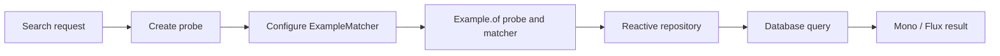

# Query by Example and ExampleMatcher Configuration

Spring Data Relational R2DBC supports Query by Example (QBE), a technique for building queries from a sample object rather than writing query method names or assembling SQL strings manually. The sample object is called a *probe*: non-null properties on the probe become search conditions. `ExampleMatcher` defines how those properties are matched, such as exact matching, starts-with, ends-with, substring contains, ignoring specific properties, or case-insensitive matching.

QBE fits search screens with many optional filters where conditions are primarily equality or string matching. It enables flexible queries without writing a repository method for every filter combination. However, QBE has limits: it is not a complete expression language for all comparisons, complex logical groupings, or multi-table queries. When you need greater-than/less-than conditions, value ranges, or parenthesized `AND`/`OR` groups, consider query methods, `@Query`, or `Criteria` with `R2dbcEntityTemplate`.

## 1. Components of Query by Example

QBE has three main components:

| Component | Role |
| --- | --- |
| Probe | Domain object holding the values to use as search criteria |
| `ExampleMatcher` | Specifies how properties are matched, null handling, ignored paths, and string matching rules |
| `Example<T>` | Combines the probe and matcher into a typed query specification |

Usage flow:



For example, if a probe has `name = "Frodo"` and all other properties are null, QBE builds a condition filtering by name by default. Null properties are ignored by default, so you do not need a separate query for every combination of filled-in fields.

## 2. Declaring a Repository That Supports QBE

The repository needs the `ReactiveQueryByExampleExecutor` contract to expose reactive QBE methods. It can be declared explicitly alongside `ReactiveCrudRepository`:

```java
import org.springframework.data.repository.query.ReactiveQueryByExampleExecutor;
import org.springframework.data.repository.reactive.ReactiveCrudRepository;

public interface CustomerRepository
        extends ReactiveCrudRepository<Customer, Long>,
                ReactiveQueryByExampleExecutor<Customer> {
}
```

`ReactiveQueryByExampleExecutor<Customer>` provides methods such as:

- `findAll(Example<S>)` returning `Flux<S>` containing matching records.
- `findOne(Example<S>)` returning `Mono<S>`; the publisher completes empty if no result exists and emits an error if more than one result matches.
- `count(Example<S>)` returning `Mono<Long>`.
- `exists(Example<S>)` returning `Mono<Boolean>`.
- `findAll(Example<S>, Sort)` returning results in the specified order.

Some specialized repository interfaces or Spring Data versions may already inherit the QBE contract. If your current repository already exposes these methods, there is no need to declare it redundantly. Check your project's interfaces and dependency version.

## 3. Creating a Probe and a Simple Example

Suppose the `Customer` entity has properties `name`, `city`, and `status`:

```java
import org.springframework.data.annotation.Id;
import org.springframework.data.relational.core.mapping.Table;

@Table("customer")
public class Customer {

    @Id
    private Long id;

    private String name;

    private String city;

    private String email;

    private CustomerStatus status;

    // Constructors, getters, and setters.
}
```

Create a probe containing only the name to search for:

```java
import org.springframework.data.domain.Example;
import reactor.core.publisher.Flux;

public Flux<Customer> findByName(String name) {
    Customer probe = new Customer();
    probe.setName(name);

    Example<Customer> example = Example.of(probe);
    return customerRepository.findAll(example);
}
```

If `name` is `"Frodo"`, the null `city` and `status` properties are omitted from the conditions under the default matcher. The query corresponds conceptually to `WHERE name = 'Frodo'`.

`Example.of(probe)` uses the default matcher. You can pass a custom matcher via `Example.of(probe, matcher)` when you need to customize matching rules.

## 4. `matchingAll()` and `matchingAny()`

By default, `ExampleMatcher.matching()` behaves like `matchingAll()`: every included property must match. This is an `AND` combination.

```java
import org.springframework.data.domain.Example;
import org.springframework.data.domain.ExampleMatcher;

Customer probe = new Customer();
probe.setCity("Hobbiton");
probe.setStatus(CustomerStatus.ACTIVE);

ExampleMatcher matcher = ExampleMatcher.matchingAll();
Example<Customer> example = Example.of(probe, matcher);
```

Logical meaning:

```sql
WHERE city = 'Hobbiton'
  AND status = 'ACTIVE'
```

`matchingAny()` combines included properties with `OR`: matching any single property selects the record.

```java
ExampleMatcher matcher = ExampleMatcher.matchingAny();
Example<Customer> example = Example.of(probe, matcher);
```

Logical meaning:

```sql
WHERE city = 'Hobbiton'
   OR status = 'ACTIVE'
```

`matchingAny()` applies OR across the properties included by the matcher. It does not provide a way to define nested OR groups, such as `(city = A AND status = ACTIVE) OR (city = B AND status = PENDING)`. For expressions with grouped logic like that, use `Criteria` or custom SQL.

## 5. Ignoring Properties with `withIgnorePaths`

Probes are often built from entities that have more properties than the search form exposes. You can specify properties to ignore:

```java
Customer probe = new Customer();
probe.setName("Frodo");
probe.setCity("Hobbiton");
probe.setStatus(CustomerStatus.ACTIVE);

ExampleMatcher matcher = ExampleMatcher.matchingAll()
        .withIgnorePaths("status");

Example<Customer> example = Example.of(probe, matcher);
```

Even though `probe.status` has a value, that property does not participate in the condition. The query filters only on `name` and `city`.

This is useful when a probe is bound from a request or constructed from an object carrying extra fields, some of which are display-only or disallowed as filters. However, never rely on ignored paths for authorization; access-scope constraints must be enforced separately on the server and in appropriate query conditions.

## 6. Ignoring Nulls vs. Including Nulls in Conditions

By default, QBE ignores null properties on the probe. This behavior is convenient for optional filters:

```java
Customer probe = new Customer();
probe.setCity("Hobbiton");
// name and status are null so they are ignored.

Example<Customer> example = Example.of(probe);
```

If you want to find rows where a SQL column is `NULL`, you can configure `withIncludeNullValues()`:

```java
Customer probe = new Customer();
probe.setCity("Hobbiton");

ExampleMatcher matcher = ExampleMatcher.matchingAll()
        .withIncludeNullValues();

Example<Customer> example = Example.of(probe, matcher);
```

Null properties are then included in the matching condition, typically corresponding to `IS NULL` in SQL. In this example, if `name` and `status` are unset, they may also become null conditions, making the query much narrower than intended.

If you only want to check null for one specific property, configure a property-scoped matcher if supported by your version's API, or choose `Criteria` to express `IS NULL` explicitly. Distinguish clearly between:

- Omitting a search field: usually means skipping that condition.
- Requesting records with a missing value: means adding an `IS NULL` condition.

Do not use the same `null` in a DTO to represent both meanings without an explicit convention.

## 7. Notes on Primitive Types in a Probe

QBE ignores null, yet Java primitive types cannot hold null. For example, `int age` in a probe always has a value, defaulting to `0`; `boolean active` defaults to `false`. Those default values can become unintended search conditions.

For objects used as probes, prefer wrapper types for optional fields:

```java
public class CustomerSearchProbe {
    private Integer age;
    private Boolean active;
}
```

If the probe must be an entity that has primitive fields, ignore the properties you do not want to filter on using `withIgnorePaths("age", "active")`. A cleaner choice in complex search APIs is using a dedicated filter DTO and constructing an appropriate probe from it.

## 8. Configuring String Matching

By default, string properties are matched exactly (exact match). `ExampleMatcher` lets you choose string matching rules such as:

| String matcher | Meaning | Example for probe `"Fro"` |
| --- | --- | --- |
| `EXACT` | Value must match completely | `Fro` |
| `STARTING` | Value starts with probe | `Frodo`, `Frobin` |
| `ENDING` | Value ends with probe | `SamFro` |
| `CONTAINING` | Value contains probe | `TheFrodoName` |

You can configure a global matcher rule for string properties:

```java
ExampleMatcher matcher = ExampleMatcher.matchingAll()
        .withStringMatcher(ExampleMatcher.StringMatcher.CONTAINING)
        .withIgnoreCase();
```

`withStringMatcher(CONTAINING)` applies substring matching to string properties that have no per-property override. `withIgnoreCase()` requests case-insensitive matching for eligible string properties.

If you only want to apply a rule to one property, use `withMatcher`:

```java
ExampleMatcher matcher = ExampleMatcher.matchingAll()
        .withMatcher("name",
                ExampleMatcher.GenericPropertyMatchers.startsWith().ignoreCase())
        .withMatcher("city",
                ExampleMatcher.GenericPropertyMatchers.exact());
```

In this example, `name` matches by prefix ignoring case, while `city` matches exactly. Per-property configuration takes precedence over the matcher's default string rule.

## 9. Ignoring Case

You can enable case-insensitive matching for all string properties:

```java
ExampleMatcher matcher = ExampleMatcher.matchingAll()
        .withIgnoreCase();
```

Or only for specific properties:

```java
ExampleMatcher matcher = ExampleMatcher.matchingAll()
        .withIgnoreCase("name", "email");
```

QBE builds queries according to the store and database capabilities. Case-insensitive comparisons may depend on collation, how the database handles letter casing, and the dialect. With Unicode or locale-specific rules, do not assume `ignoreCase` matches every locale rule. If you need normalized emails or usernames, consider storing a normalized column with a corresponding unique constraint.

## 10. Configuring Per-Property Matchers

`withMatcher` lets you configure each property independently without affecting others. For example, searching for customers whose name starts with a string, email contains a keyword, and city matches exactly:

```java
Customer probe = new Customer();
probe.setName("An");
probe.setEmail("example");
probe.setCity("Ho Chi Minh City");

ExampleMatcher matcher = ExampleMatcher.matchingAll()
        .withMatcher("name",
                ExampleMatcher.GenericPropertyMatchers.startsWith().ignoreCase())
        .withMatcher("email",
                ExampleMatcher.GenericPropertyMatchers.contains().ignoreCase())
        .withMatcher("city",
                ExampleMatcher.GenericPropertyMatchers.exact());

Example<Customer> example = Example.of(probe, matcher);
```

Results must satisfy all three conditions because the matcher uses `matchingAll()`. Property names passed to the matcher must match the entity's Java properties, not necessarily physical column names if the entity renames them with `@Column`.

## 11. Building Search Filters from a DTO

You do not have to bind HTTP requests directly to an entity. A separate DTO separates input data from persistence data, preventing clients from controlling IDs, tenants, or internal fields.

```java
public record CustomerSearchRequest(
        String name,
        String city,
        CustomerStatus status
) {
}
```

The service converts the DTO into a probe:

```java
public Flux<Customer> search(CustomerSearchRequest request) {
    Customer probe = new Customer();
    probe.setName(request.name());
    probe.setCity(request.city());
    probe.setStatus(request.status());

    ExampleMatcher matcher = ExampleMatcher.matchingAll()
            .withMatcher("name",
                    ExampleMatcher.GenericPropertyMatchers.contains().ignoreCase())
            .withMatcher("city",
                    ExampleMatcher.GenericPropertyMatchers.startsWith().ignoreCase());

    Example<Customer> example = Example.of(probe, matcher);
    return customerRepository.findAll(example);
}
```

In this example, `status` uses default matching, while `name` and `city` have custom string rules. Null fields in the request are ignored by default. If tenant scoping is required, obtain the tenant from the server's authentication context and enforce it in a guaranteed query condition; never rely on a client-controlled tenant ID in a probe as the sole authorization mechanism.

## 12. Sorting QBE Results

`ReactiveQueryByExampleExecutor` provides an overload accepting `Sort`:

```java
import org.springframework.data.domain.Sort;

public Flux<Customer> searchByCity(String city) {
    Customer probe = new Customer();
    probe.setCity(city);

    Example<Customer> example = Example.of(probe);
    Sort sort = Sort.by(Sort.Order.asc("name"));

    return customerRepository.findAll(example, sort);
}
```

Property names in `Sort` are entity properties. When sorting based on client-supplied choices, map through an allow-list of permitted properties instead of passing raw input strings directly as property names.

If you need result limits or pagination, check the fluent query API and repository capabilities of your Spring Data version. `ReactiveQueryByExampleExecutor` supplies basic overloads; fluent projection, limit, or pagination support depends on the version and store. For search endpoints over large datasets, do not emit the entire result set unbounded.

## 13. Counting and Checking Existence with Example

There is no need to load full entities if the goal is merely counting or checking whether results exist:

```java
public Mono<Long> countCustomers(CustomerSearchRequest request) {
    Customer probe = new Customer();
    probe.setCity(request.city());
    probe.setStatus(request.status());

    Example<Customer> example = Example.of(probe);
    return customerRepository.count(example);
}

public Mono<Boolean> hasCustomer(String email) {
    Customer probe = new Customer();
    probe.setEmail(email);

    return customerRepository.exists(Example.of(probe));
}
```

`count` returns `Mono<Long>` and `exists` returns `Mono<Boolean>`. This avoids materializing a list of entities just to obtain a count or existence check.

If you want a single result, use `findOne`. Make sure the probe is specific enough that at most one row matches; if multiple rows match, the publisher emits `IncorrectResultSizeDataAccessException` instead of arbitrarily picking one row.

## 14. `ExampleMatcher` Is Immutable

Configuration methods on `ExampleMatcher` return a new matcher instance. Be sure to retain the returned result after each configuration call:

```java
ExampleMatcher matcher = ExampleMatcher.matchingAll();
matcher = matcher.withIgnoreCase();
matcher = matcher.withIgnorePaths("internalNote");
```

Or chain the calls:

```java
ExampleMatcher matcher = ExampleMatcher.matchingAll()
        .withIgnoreCase()
        .withIgnorePaths("internalNote");
```

Do not call a `with...` method and ignore its return value if you expect the matcher to change. A matcher can be reused across multiple probes when search rules are identical; probes should be created per request to avoid sharing mutable state.

## 15. Limitations of Query by Example

QBE is designed for queries based on the shape of a probe. It is not the right tool for every SQL expression:

- It does not directly express greater-than, less-than, or range comparisons such as `age > 18` or `created_at BETWEEN ...`.
- It does not support arbitrary logical groupings such as `(A AND B) OR (C AND D)`.
- It is unsuitable for queries needing complex joins or conditions over collections/maps.
- It does not replace projections and specialized queries when reading result shapes other than the entity.
- String matching, collation, and certain data type behaviors depend on the database and driver.

When you only need a few equality and string-matching conditions, QBE is concise. When you need dynamic conditions with ranges, logical groups, joins, or specialized SQL, choose among:

| Need | Suitable approach |
| --- | --- |
| Stable query with clear condition names | Derived query method or `@Query` |
| Many optional filters with `AND`, `OR`, ranges, and condition groups | `Criteria` + `Query` + `R2dbcEntityTemplate` |
| Database-specific SQL, joins, or custom projections | `@Query` or `DatabaseClient` |
| Filters primarily using equality and string matching from a probe | Query by Example |

## 16. Comparing QBE with Criteria

Both approaches can construct dynamic queries, yet they follow different usage models:

| Criterion | Query by Example | Criteria / Query |
| --- | --- | --- |
| How it is expressed | Probe holding values and matcher defining match rules | Code explicitly describing each condition |
| Equality | Inferred from non-null properties | Using `.is(value)` |
| Strings | Matchers for exact, starts, ends, contains, and ignore case | Matching Criteria operators, depending on API/dialect |
| AND/OR | `matchingAll()` or `matchingAny()` across properties | Can nest `and(...)` and `or(...)` groups |
| Ranges | Not a strength of QBE | Supports comparisons like greater/less and suitable predicates |
| Nulls | Default matcher ignores nulls; can include nulls | Can specify `isNull()` / `isNotNull()` |
| Repository | Uses `ReactiveQueryByExampleExecutor` | Typically uses template/operations |
| Best fit | Simple search forms, optional filters | Dynamic queries with complex business logic |

You do not have to pick a single approach for the entire application. You can use QBE for simple lookup screens and Criteria for reports or advanced search.

## 17. Testing QBE

Test both how probes are constructed and what the query returns. With unit tests, verify that the service maps DTOs into probes and configures matchers properly. With integration tests, seed records to confirm the database executes the expected QBE semantics.

Useful test cases:

1. Probe with one property: only rows matching that property are returned.
2. `matchingAll()` requires all non-null properties to match together.
3. `matchingAny()` returns rows matching at least one selected property.
4. `withIgnorePaths` excludes a property from conditions even when set on the probe.
5. Nulls are ignored by default; `withIncludeNullValues()` matches SQL null columns per matcher setup.
6. `STARTING`, `ENDING`, `CONTAINING`, and `ignoreCase` behave consistently with the database/collation.
7. An empty probe is handled intentionally rather than accidentally returning the entire table.
8. Primitive properties with default values do not introduce unintended filters.
9. `findOne` errors when multiple rows match; `exists` and `count` return the expected result types.

Example verifying reactive results:

```java
StepVerifier.create(customerRepository.findAll(example))
        .expectNextMatches(customer ->
                customer.getName().startsWith("Fro"))
        .verifyComplete();
```

Thorough tests should seed both matching and non-matching rows. Checking only that one valid row appears is not enough to catch conditions that accidentally became too broad.

## 18. Common Mistakes

| Mistake | Consequence | Resolution |
| --- | --- | --- |
| Repository missing `ReactiveQueryByExampleExecutor` | Reactive QBE methods unavailable | Extend QBE interface or use a repository that supports it |
| Using `matchingAny()` when all filters must match | Results are too broad | Use `matchingAll()` or Criteria with explicit grouping |
| Forgetting nulls are ignored by default | Fails to match rows with null columns as intended | Use include-nulls or Criteria `IS NULL` |
| Using primitives in a probe | Default `0`/`false` values become active filters | Use wrappers or ignore paths |
| Empty probe | Can create an unbounded query depending on matcher/store semantics | Validate empty requests and define a reject or empty-result policy |
| Expecting QBE to handle ranges or complex OR groups | Cannot express required conditions | Switch to Criteria, `@Query`, or DatabaseClient |
| Not reassigning matcher | New configuration is lost | Store the matcher returned from `with...` |
| Assuming ignore case behaves identically across all databases | Results vary by collation/Unicode | Test against real database and normalize when needed |

## 19. Practical Guidelines

- Construct probes from search DTOs instead of binding entire requests directly to persistence entities.
- Use `Example.of(probe)` for default rules or `Example.of(probe, matcher)` when detailed configuration is required.
- Use `matchingAll()` when all present filters must match; use `matchingAny()` when matching any single property suffices.
- Exclude properties that do not participate in searching via `withIgnorePaths`.
- Remember that nulls are ignored by default; only include nulls when you genuinely want `IS NULL` queries.
- Use wrapper types for optional probe properties to avoid primitive default values.
- Choose string matchers and ignore-case settings according to business requirements, and test against a real database.
- Reassign the matcher after every `with...` call because matchers are immutable.
- Check for empty probes and define explicit behavior before querying.
- Use Criteria or custom SQL when ranges, AND/OR groups, joins, or complex expressions are required.
- Limit/sort results and avoid loading entire tables for large search screens.
- Ensure tenant scoping and authorization come from server context rather than relying on client-supplied probe filters.

## 20. Conclusion

Query by Example allows Spring Data R2DBC to construct reactive queries from a probe and an `ExampleMatcher`. The probe carries the values to search for; the matcher controls `AND`/`OR` combination, ignored properties, null handling, and string matching. Repositories provide `findAll`, `findOne`, `count`, `exists`, and related overloads to execute an `Example` as a `Flux` or `Mono`.

QBE is especially helpful for search forms with many optional fields and straightforward matching rules. Keep in mind that nulls are ignored by default, primitives carry default values, `matchingAny()` applies OR across properties, and matchers are immutable. When a query needs ranges, nested logical groups, joins, or specialized SQL, switch to Criteria, query methods, or `@Query` to express the requirement accurately.
