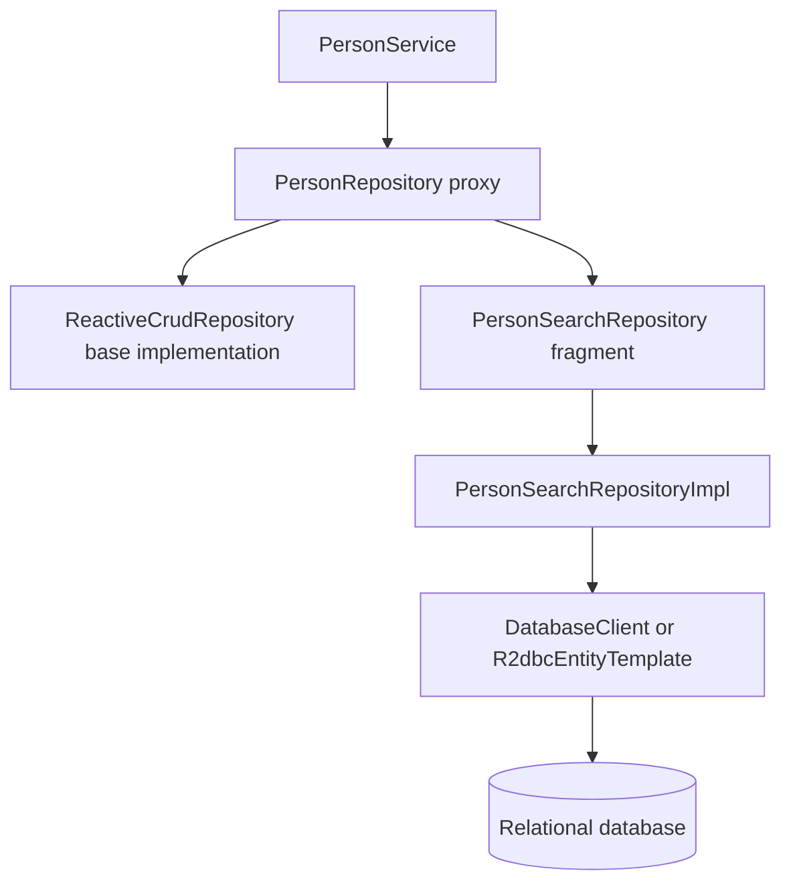

# Extending Repositories with Fragments and Custom Implementations

Spring Data R2DBC automatically generates implementations for Repository interfaces, allowing applications to use methods like `findById`, `save`, `deleteById`, or query methods without writing implementation classes manually. However, when business logic needs specialized SQL queries, custom projections, multi-table operations, or shared data-access rules, CRUD and derived query methods may fall short.

Spring Data addresses this need with **repository fragments**. A fragment is a slice of functionality described by an interface and implemented in a separate class. The main Repository combines the base CRUD interface with one or more fragments; Spring Data composes these implementations into the Repository object that the application injects and uses.

With fragments, custom data access can use `DatabaseClient`, `R2dbcEntityTemplate`, or other Spring R2DBC abstractions. This organization keeps the Repository interface as the data-layer contract while encapsulating operations that cannot be expressed concisely as query methods.

## 1. When Do You Need to Extend a Repository?

Interfaces such as `ReactiveCrudRepository<T, ID>` provide reactive CRUD out of the box. Spring Data can also generate queries from method names or `@Query`. These mechanisms cover most routine operations.

However, an application may require:

- Searches with many optional conditions and complex filter combinations.
- Multi-table joins mapped into DTOs that do not correspond to a single entity.
- CTEs, window functions, JSON operators, full-text search, or database-specific syntax.
- Read/write operations spanning multiple SQL statements under custom rules.
- Reusing a group of data-access operations across multiple Repositories.
- Customizing how a Repository behavior executes when the default API does not suffice.

Do not create a fragment for every query method. If a query can be expressed cleanly using a method name or a simple `@Query`, keep it there to preserve interface readability. Fragments shine when the implementation needs Java logic, multiple steps, custom SQL, or a dedicated abstraction.

## 2. What Is a Repository Fragment?

A repository fragment has two parts:

1. **Fragment interface:** declares the methods provided by the extension.
2. **Fragment implementation:** the class implementing that interface.

The main Repository extends the fragment interface alongside Spring Data's base Repository interface. When initializing repositories, Spring Data composes the default implementation together with discovered fragments.

Example package layout:

```text
com.example.people
├── Person.java
├── PersonRepository.java
├── PersonSearchRepository.java
└── PersonSearchRepositoryImpl.java
```

Where:

- `PersonRepository` is the Repository used by the Service.
- `PersonSearchRepository` describes the custom search extension.
- `PersonSearchRepositoryImpl` implements that custom search.

Relationship diagram:



The Repository proxy is the single entry point the Service layer depends on. CRUD calls are handled by the base implementation; fragment methods are routed to the corresponding fragment implementation class.

## 3. Creating the Fragment Interface

Suppose the `person` table has columns `id`, `firstname`, `lastname`, `email`, `status`, and `created_at`. The application needs to search people by status and return a projection with selected fields.

First, define the result DTO:

```java
public record PersonSummary(
    Long id,
    String firstname,
    String lastname,
    String email
) {}
```

Define the search criteria:

```java
public record PersonSearchCriteria(
    String status,
    String namePrefix,
    int limit
) {}
```

Then declare the fragment interface:

```java
public interface PersonSearchRepository {

    Flux<PersonSummary> search(PersonSearchCriteria criteria);

    Mono<Long> deleteInactiveBefore(Instant cutoff);
}
```

The interface describes only the contract. It does not need to extend `ReactiveCrudRepository` and does not need to know whether queries use `DatabaseClient` or `R2dbcEntityTemplate`.

Extracting the fragment interface into its own type helps:

- Give a clear name to the extension group.
- Reuse the fragment across multiple Repositories sharing the same contract.
- Write unit tests for the implementation without instantiating the entire Repository proxy.
- Swap implementation details without modifying Services calling the interface.

## 4. Implementing a Fragment with DatabaseClient

Spring Framework provides `DatabaseClient` for reactive SQL execution. The fragment implementation can inject the client via constructor and return `Flux` or `Mono`.

```java
public class PersonSearchRepositoryImpl implements PersonSearchRepository {

    private final DatabaseClient databaseClient;

    public PersonSearchRepositoryImpl(DatabaseClient databaseClient) {
        this.databaseClient = databaseClient;
    }

    @Override
    public Flux<PersonSummary> search(PersonSearchCriteria criteria) {
        int limit = Math.max(1, Math.min(criteria.limit(), 100));

        return databaseClient.sql("""
                SELECT id, firstname, lastname, email
                FROM person
                WHERE status = :status
                  AND firstname LIKE :namePrefix
                ORDER BY firstname ASC, id ASC
                LIMIT :limit
                """)
            .bind("status", criteria.status())
            .bind("namePrefix", criteria.namePrefix() + "%")
            .bind("limit", limit)
            .map((row, metadata) -> new PersonSummary(
                row.get("id", Long.class),
                row.get("firstname", String.class),
                row.get("lastname", String.class),
                row.get("email", String.class)
            ))
            .all();
    }

    @Override
    public Mono<Long> deleteInactiveBefore(Instant cutoff) {
        return databaseClient.sql("""
                DELETE FROM person
                WHERE status = :status
                  AND created_at < :cutoff
                """)
            .bind("status", "INACTIVE")
            .bind("cutoff", cutoff)
            .fetch()
            .rowsUpdated();
    }
}
```

In this example:

- `DatabaseClient` is constructor-injected, making dependency injection and testing straightforward.
- `bind(...)` passes values safely into SQL rather than concatenating input into query strings.
- `map(...)` converts each `Row` into a `PersonSummary`.
- `all()` returns `Flux<PersonSummary>`.
- `rowsUpdated()` returns the affected row count as `Mono<Long>`.
- `limit` is bounded in the application to prevent a request from asking for too many rows.

The example uses common `LIKE` syntax, though wildcard and collation handling can differ across databases. If case-insensitive matching or full-text search is needed, use syntax tailored to the database engine and test against the real driver.

## 5. Combining the Fragment with the Main Repository

Once the fragment interface and implementation exist, the main Repository extends the fragment:

```java
public interface PersonRepository
        extends ReactiveCrudRepository<Person, Long>, PersonSearchRepository {
}
```

The Service layer can invoke both CRUD methods and fragment methods through the same bean:

```java
@Service
public class PersonService {

    private final PersonRepository repository;

    public PersonService(PersonRepository repository) {
        this.repository = repository;
    }

    public Mono<Person> findById(Long id) {
        return repository.findById(id);
    }

    public Flux<PersonSummary> search(PersonSearchCriteria criteria) {
        return repository.search(criteria);
    }

    public Mono<Long> cleanup(Instant cutoff) {
        return repository.deleteInactiveBefore(cutoff);
    }
}
```

Spring Data creates the Repository proxy and composes the components declared by the interfaces. The Service does not inject `PersonSearchRepositoryImpl` separately; it depends solely on the `PersonRepository` contract.

## 6. Naming Rules and Implementation Discovery

By default convention, Spring Data looks for an implementation class named after the fragment interface with the `Impl` suffix.

| Fragment interface | Default implementation |
|---|---|
| `PersonSearchRepository` | `PersonSearchRepositoryImpl` |
| `PersonAuditRepository` | `PersonAuditRepositoryImpl` |
| `OrderReportingRepository` | `OrderReportingRepositoryImpl` |

To ensure Spring Data discovers the implementation cleanly:

- Place the fragment interface, Repository, and implementation in scanned packages.
- Follow the configured suffix naming convention.
- Ensure the class implements the fragment interface.
- Use constructor injection for dependencies such as `DatabaseClient` or `R2dbcEntityTemplate`.
- Avoid registering another bean with the same role and bean name that could make discovery ambiguous.

If you need to change the default suffix, configure `repositoryImplementationPostfix` on `@EnableR2dbcRepositories`:

```java
@Configuration
@EnableR2dbcRepositories(
    basePackages = "com.example.people",
    repositoryImplementationPostfix = "Custom"
)
public class R2dbcRepositoryConfiguration {
}
```

Then the fragment implementation can use the `Custom` suffix, such as `PersonSearchRepositoryCustom`. Interface and class names must follow the configured convention. If the project uses Spring Boot auto-configuration, only add `@EnableR2dbcRepositories` when you actually need to customize Repository scanning; avoid duplicating scanning configuration that Boot already provides.

## 7. One Repository Can Compose Multiple Fragments

A Repository is not limited to one fragment. You can split functional groups by responsibility:

```java
public interface PersonSearchRepository {
    Flux<PersonSummary> search(PersonSearchCriteria criteria);
}

public interface PersonExportRepository {
    Flux<PersonExportRow> exportByStatus(String status);
}

public interface PersonMaintenanceRepository {
    Mono<Long> deleteInactiveBefore(Instant cutoff);
}
```

Main Repository combining the interfaces:

```java
public interface PersonRepository extends
        ReactiveCrudRepository<Person, Long>,
        PersonSearchRepository,
        PersonExportRepository,
        PersonMaintenanceRepository {
}
```

Corresponding implementations:

```text
PersonSearchRepositoryImpl
PersonExportRepositoryImpl
PersonMaintenanceRepositoryImpl
```

This split gives each fragment a focused purpose. `PersonSearchRepositoryImpl` can use `DatabaseClient` for dynamic filters; `PersonExportRepositoryImpl` can stream projection rows; `PersonMaintenanceRepositoryImpl` can execute batch cleanups or specialized SQL statements.

Avoid splitting fragments too finely to the point where every single method gets its own interface and class without reuse or clear responsibility boundaries. A fragment should represent a cohesive group of operations.

## 8. Reusing a Fragment Across Multiple Repositories

A fragment can be shared across multiple Repositories when entities or tables require the same capability. For instance, multiple tables may have a `tenant_id` column and require tenant-scoped queries.

You can create a generic interface:

```java
public interface TenantScopedSearch<T> {
    Flux<T> findAllByTenant(Long tenantId, int limit);
}
```

However, a generic implementation must know which table an entity maps to and how the tenant column is mapped. You can inject `R2dbcEntityTemplate` and use entity metadata to build queries, or design entity-specific fragments to avoid guessing table/column names.

Example entity-specific fragment:

```java
public interface InvoiceSearchRepository {
    Flux<InvoiceSummary> findOpenInvoices(Long tenantId, int limit);
}
```

```java
public class InvoiceSearchRepositoryImpl implements InvoiceSearchRepository {

    private final DatabaseClient databaseClient;

    public InvoiceSearchRepositoryImpl(DatabaseClient databaseClient) {
        this.databaseClient = databaseClient;
    }

    @Override
    public Flux<InvoiceSummary> findOpenInvoices(Long tenantId, int limit) {
        int safeLimit = Math.max(1, Math.min(limit, 100));

        return databaseClient.sql("""
                SELECT id, invoice_no, due_date, total_amount
                FROM invoice
                WHERE tenant_id = :tenantId
                  AND status = :status
                ORDER BY due_date ASC, id ASC
                LIMIT :limit
                """)
            .bind("tenantId", tenantId)
            .bind("status", "OPEN")
            .bind("limit", safeLimit)
            .map((row, metadata) -> new InvoiceSummary(
                row.get("id", Long.class),
                row.get("invoice_no", String.class),
                row.get("due_date", LocalDate.class),
                row.get("total_amount", BigDecimal.class)
            ))
            .all();
    }
}
```

Reuse should reduce code duplication while keeping SQL and business rules clear. When tables differ substantially in structure, dedicated implementations are usually clearer than an overly complex generic abstraction.

## 9. Using R2dbcEntityTemplate in a Fragment

Not every fragment needs raw SQL. When operations are entity-based and require dynamic criteria, `R2dbcEntityTemplate` can fit better than `DatabaseClient`.

```java
public interface PersonMaintenanceRepository {
    Mono<Long> deleteInactiveBefore(Instant cutoff);
}
```

```java
public class PersonMaintenanceRepositoryImpl
        implements PersonMaintenanceRepository {

    private final R2dbcEntityTemplate template;

    public PersonMaintenanceRepositoryImpl(R2dbcEntityTemplate template) {
        this.template = template;
    }

    @Override
    public Mono<Long> deleteInactiveBefore(Instant cutoff) {
        Criteria criteria = Criteria.where("status").is("INACTIVE")
            .and("createdAt").lessThan(cutoff);

        return template.delete(Person.class)
            .matching(Query.query(criteria))
            .all();
    }
}
```

The template uses mapping metadata to translate entity properties into column names and generates dialect-appropriate SQL. This helps keep query code close to the entity model while avoiding manual table/column string construction.

When complex joins, CTEs, database-specific functions, or custom projections are required, `DatabaseClient` generally offers tighter SQL control. Both APIs can be used within the same application or across different fragments.

## 10. When Is a Custom Base Repository Class Needed?

Repository fragments and custom base classes solve different problems.

**Fragments** add a specific set of methods to one or a few Repositories. This is the default choice when adding search, reporting, export, or cleanup capabilities.

**Custom base repository classes** replace the foundational implementation shared by many Repositories—for example, customizing how a standard CRUD method executes or adding a common method across all Repositories within a configuration scope.

In Spring Data R2DBC, the default base implementation is `SimpleR2dbcRepository`. You can create a generic class extending it and register it via `repositoryBaseClass`:

```java
@NoRepositoryBean
public interface BaseR2dbcRepository<T, ID>
        extends ReactiveCrudRepository<T, ID> {

    // Declare shared contracts if needed.
}
```

```java
public class CustomR2dbcRepository<T, ID>
        extends SimpleR2dbcRepository<T, ID> {

    public CustomR2dbcRepository(
            RelationalEntityInformation<T, ID> entity,
            R2dbcEntityOperations operations) {
        super(entity, operations);
    }

    // Override or add shared behavior here.
}
```

Registering the base class:

```java
@Configuration
@EnableR2dbcRepositories(
    basePackages = "com.example.data",
    repositoryBaseClass = CustomR2dbcRepository.class
)
public class RepositoryConfiguration {
}
```

This is an illustrative skeleton of the custom base class pattern. Constructor signatures and helper types of `SimpleR2dbcRepository` can change between Spring Data versions; consult the API of your release train before implementing. When you do not need to alter shared CRUD behavior, fragments are simpler and less coupled to framework internals.

`@NoRepositoryBean` is typically placed on generic base repository interfaces so Spring Data does not attempt to instantiate a repository directly for an interface lacking concrete entity types. Actual Repositories extend that base interface with concrete entity and ID types.

## 11. Distinguishing Fragments from Legacy Custom Implementations

Earlier Spring Data versions commonly used a single class named after the Repository, such as `PersonRepositoryImpl`, to hold all custom methods. That organization tied the implementation to one specific Repository and became hard to split as features grew.

Modern repository composition encourages separating each fragment into its own interface and implementation:

| Organization style | Example | Characteristics |
|---|---|---|
| Legacy repository-specific implementation | `PersonRepositoryImpl` | Ties implementation directly to one Repository; suited for maintaining legacy code |
| Repository fragment | `PersonSearchRepository` + `PersonSearchRepositoryImpl` | Splits contract and implementation by capability; multiple fragments can be composed |
| Custom base class | `CustomR2dbcRepository` | Changes or extends foundational behavior across many Repositories |

For new code, prefer fragments when extending Repository capabilities. If upgrading a legacy project, check the implementation discovery rules of your current version and migration guide before renaming or moving classes. Avoid having both a legacy implementation and a fragment declare identical methods unless you understand composition ordering and how the framework resolves calls.

## 12. Transactions in Custom Fragments

A fragment implementation may run one or multiple SQL statements. When multiple operations must succeed or fail together, use an appropriate reactive transaction.

For example:

```java
public interface AccountTransferRepository {
    Mono<Void> transfer(Long fromId, Long toId, BigDecimal amount);
}
```

```java
public class AccountTransferRepositoryImpl
        implements AccountTransferRepository {

    private final DatabaseClient databaseClient;

    public AccountTransferRepositoryImpl(DatabaseClient databaseClient) {
        this.databaseClient = databaseClient;
    }

    @Override
    @Transactional
    public Mono<Void> transfer(
            Long fromId,
            Long toId,
            BigDecimal amount) {

        Mono<Long> debit = databaseClient.sql("""
                UPDATE account
                SET balance = balance - :amount
                WHERE id = :id
                  AND balance >= :amount
                """)
            .bind("amount", amount)
            .bind("id", fromId)
            .fetch()
            .rowsUpdated();

        return debit.flatMap(updated -> {
            if (updated != 1) {
                return Mono.error(new IllegalStateException(
                    "Source account is missing or has insufficient balance"));
            }

            return databaseClient.sql("""
                    UPDATE account
                    SET balance = balance + :amount
                    WHERE id = :id
                    """)
                .bind("amount", amount)
                .bind("id", toId)
                .fetch()
                .rowsUpdated()
                .flatMap(credited -> credited == 1
                    ? Mono.empty()
                    : Mono.error(new IllegalStateException("Target account not found")));
        });
    }
}
```

This example illustrates chaining publishers within a transaction. Real applications should also validate balances, positive transfer amounts, source/target accounts, and other domain rules. `@Transactional` takes effect only when calls pass through a Spring proxy and the reactive transaction manager is configured with the same `ConnectionFactory` used by `DatabaseClient`.

Do not call `subscribe()` or `block()` inside a fragment. Return `Mono`/`Flux` so the caller subscribes to the publisher and Spring manages the transaction via Reactor Context. When a fragment is invoked inside an existing transaction, operations can participate in that transaction according to propagation settings.

## 13. Design Rules for Implementations

Fragment implementations are normally managed as singleton beans. Therefore:

- Use constructor injection for `DatabaseClient`, `R2dbcEntityTemplate`, converters, or other dependencies.
- Never store per-request state in mutable fields of the implementation.
- Pass input data via method parameters and bind parameters in SQL.
- Do not manually open connections or manage connection lifecycles when using `DatabaseClient` or templates.
- Keep methods reactive: return `Mono` or `Flux`, and do not subscribe internally.
- Keep business rules in Services when coordinating multiple aggregates; fragments focus on data operations.
- Name methods clearly after the access pattern and result type.
- Limit results, paginate, and use projections to avoid loading unnecessary data.
- For dynamic SQL identifiers such as column names or sort directions, use allow-lists; parameter binding protects values only.

Do not push all business logic into a fragment merely because it accesses the database. A fragment packed with business branches, external service calls, or cross-bounded-context orchestration becomes hard to test and blurs Repository responsibilities.

## 14. Error Handling and Results in Fragments

Fragment methods should define clear result contracts:

| Return type | Common meaning |
|---|---|
| `Mono<Entity>` | At most one entity; empty publisher if not found |
| `Flux<DTO>` | Zero, one, or many result rows |
| `Mono<Long>` | Affected row count or a count value |
| `Mono<Void>` | Only indicates completion or failure |

If an update or delete needs to distinguish the case where no rows matched, returning the affected row count lets the Service make that decision. If a method returns only `Mono<Void>`, callers cannot tell from emitted values whether any row was affected.

Driver/database errors may be translated into Spring R2DBC exceptions or preserve the original cause. Fragments can let errors propagate up to the Service, which maps them into business errors or HTTP responses. Only translate errors inside a fragment when doing so carries specific meaning for the data-access contract.

Avoid broadly swallowing errors with `onErrorResume(error -> Mono.empty())`. That pattern can make a failed query look like missing data or a successful operation. Clearly distinguish not-found cases, constraint violations, timeouts, connection failures, and programming bugs.

## 15. Testing Fragments

Fragments can be tested independently because implementations are plain Java classes receiving dependencies via constructors. However, unit tests mocking `DatabaseClient` cannot prove that SQL actually runs correctly against the database.

Combine:

**Unit tests for Java logic:** check input normalization, page size capping, sort allow-lists, condition construction, and result handling.

**Integration tests for the database:** run fragments against a real R2DBC driver and database or Testcontainers to verify SQL syntax, parameter binding, type mapping, transactions, and constraints.

**Repository composition tests:** start an ApplicationContext or repository test slice to confirm Spring discovers the fragment implementation and routes calls through the Repository proxy.

Example integration test using `StepVerifier`:

```java
@DataR2dbcTest
class PersonRepositoryTest {

    @Autowired
    PersonRepository repository;

    @Test
    void searchReturnsOnlyMatchingPeople() {
        PersonSearchCriteria criteria = new PersonSearchCriteria(
            "ACTIVE",
            "An",
            10
        );

        StepVerifier.create(repository.search(criteria))
            .expectNextMatches(person ->
                person.firstname().startsWith("An"))
            .verifyComplete();
    }
}
```

This example assumes the test database is seeded with matching data and repository scanning detects the fragment. When using Testcontainers, configure `ConnectionFactory` for the container and ensure the fragment is registered in the test context.

Additional checks worth covering:

- Empty results cause `Flux` to complete empty.
- Input values bind safely and cannot alter SQL structure.
- Projection results map aliases and data types accurately.
- `limit` never exceeds the maximum bound.
- Constraint or database errors propagate properly.
- Multiple statements inside a fragment roll back together when a transaction fails.
- Fragment methods execute via the Repository proxy and invoke the expected implementation.

## 16. Common Errors When Implementing Fragments

| Symptom | Possible cause | Resolution |
|---|---|---|
| Repository proxy reports missing method or implementation not found | Wrong class name, wrong suffix, or implementation outside scan scope | Verify fragment interface name + postfix and scanned packages |
| Bean creation fails because dependency is not injected | Constructor requires an unavailable bean or incomplete R2DBC config | Verify `DatabaseClient`, `R2dbcEntityTemplate`, and `ConnectionFactory` |
| CRUD methods work, but fragment methods are not wired | Repository does not extend the fragment interface | Add the fragment interface to the Repository declaration |
| SQL runs, but mapping fails | Column aliases or Java types mismatch what driver returns | Check `Row`, `RowMetadata`, data types, and converters |
| Transaction does not cover all SQL statements | Publisher subscribed independently or mismatched connection factory/transaction manager | Return the reactive chain and unify transaction infrastructure |
| Shared implementation mixes up request data | Request state stored in mutable singleton fields | Move data into method parameters and keep implementation stateless |
| Unsafe dynamic SQL | Column names or request values concatenated into SQL | Bind values and enforce allow-lists for identifiers |

## 17. Workflow for Extending a Repository

When a Repository requires custom behavior, follow this sequence:

**Step 1 — Identify the gap in the current API.** Check whether CRUD methods, derived queries, or `@Query` already express the requirement cleanly.

**Step 2 — Group capabilities.** Identify operations that form a cohesive responsibility, such as search, reporting, export, or cleanup.

**Step 3 — Create the fragment interface.** Declare methods and reactive return types, keeping the contract independent of implementation details.

**Step 4 — Write the implementation.** Name the class after the fragment interface plus the configured suffix, injecting `DatabaseClient` or `R2dbcEntityTemplate` via constructor.

**Step 5 — Compose the fragment into the Repository.** Have the main Repository extend the fragment interface alongside `ReactiveCrudRepository` or the appropriate base Repository.

**Step 6 — Preserve reactive chains and transactions.** Do not block or subscribe manually; configure the transaction manager with the matching `ConnectionFactory` when multiple statements must be atomic.

**Step 7 — Test composition and SQL.** Verify Spring discovers the implementation, SQL runs properly, and mapping and error handling behave as expected.

**Step 8 — Use a custom base class only when shared behavior must change.** Fragments should be the first choice for individual extensions; base classes are for foundational changes across many Repositories.

## 18. Conclusion

Repository fragments extend Spring Data R2DBC through composition: a fragment interface describes a group of operations, a properly suffixed class implements them, and the main Repository combines fragments with default CRUD methods. This enables using `DatabaseClient` or `R2dbcEntityTemplate` for specialized queries while Services depend on a single Repository interface.

Use fragments for well-bounded custom capabilities, keep implementations stateless and reactive, bind inputs safely, and test both Spring's implementation wiring and SQL against a real database. Build a custom base repository class only when foundational behavior shared across many Repositories needs to change; for most custom extensions, fragments are easier to organize and maintain.
