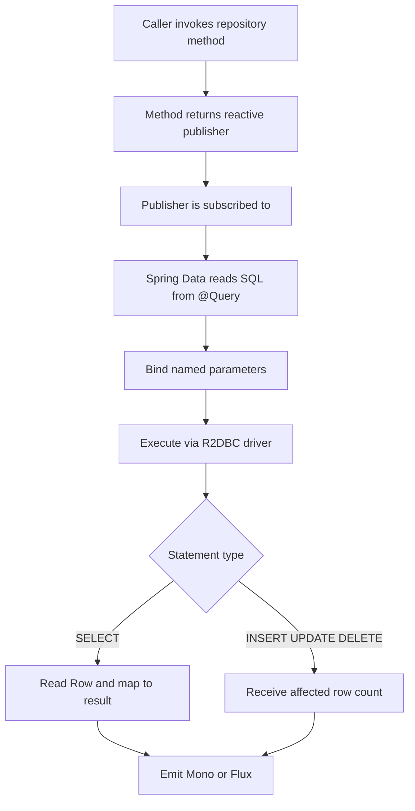

# Declaring SQL with `@Query`

Spring Data R2DBC allows declaring SQL statements directly on a repository method using the `@Query` annotation. This approach is useful when a query method based on naming conventions cannot express the query, when specific joins or aggregates are needed, or when you want explicit control over the SQL sent to the database.

With `@Query`, the SQL statement is written directly on the repository interface. Spring Data executes the statement using the R2DBC infrastructure, binds parameters, and maps the results to reactive return types. For statements that modify data such as `UPDATE` or `DELETE`, you need to mark the method with `@Modifying` so Spring Data handles it as a modifying query.

## 1. What is `@Query`?

`@Query` is a Spring Data R2DBC annotation used to provide a SQL statement for a repository method. The annotation is in the package:

```java
import org.springframework.data.r2dbc.repository.Query;
```

Example:

```java
public interface CustomerRepository
        extends ReactiveCrudRepository<Customer, Long> {

    @Query("SELECT * FROM customers WHERE status = :status")
    Flux<Customer> findCustomersByStatus(String status);
}
```

When the method is called and the publisher is subscribed to, Spring Data executes the declared SQL, binds the `status` value, and maps each row to a `Customer`.

The method name in the example does not need to follow query derivation conventions. When `@Query` is present, the SQL in the annotation is the query definition that Spring Data uses for that method.

### 1.1. When should you use `@Query`?

`@Query` is suitable when:

- The query needs to join multiple tables or use specific SQL expressions.
- You need `GROUP BY`, aggregates, subqueries, or CTEs where query derivation is inconvenient.
- You want to control selected columns, conditions, ordering, or result limits.
- You need to declare a specific `UPDATE` or `DELETE` statement on the repository.
- You want to keep the SQL close to the repository method for readability and maintainability.

If a simple query can be clearly expressed with a query method like `findByStatus`, query derivation is usually more concise. If the query structure varies heavily at runtime, consider `R2dbcEntityTemplate` or `DatabaseClient` instead of creating many annotations with nearly identical SQL.

## 2. Declaring the repository and entity

Entity example:

```java
import org.springframework.data.annotation.Id;
import org.springframework.data.relational.core.mapping.Column;
import org.springframework.data.relational.core.mapping.Table;

@Table("customers")
public class Customer {

    @Id
    private Long id;

    private String name;

    @Column("email_address")
    private String email;

    private String status;

    public Customer(Long id, String name, String email, String status) {
        this.id = id;
        this.name = name;
        this.email = email;
        this.status = status;
    }

    public Long getId() { return id; }
    public String getName() { return name; }
    public String getEmail() { return email; }
    public String getStatus() { return status; }
}
```

Repository:

```java
import org.springframework.data.repository.reactive.ReactiveCrudRepository;
import org.springframework.data.r2dbc.repository.Query;
import reactor.core.publisher.Flux;
import reactor.core.publisher.Mono;

public interface CustomerRepository
        extends ReactiveCrudRepository<Customer, Long> {

    @Query("SELECT * FROM customers WHERE status = :status")
    Flux<Customer> findByStatusUsingSql(String status);

    @Query("SELECT * FROM customers WHERE id = :id")
    Mono<Customer> findOneUsingSql(Long id);
}
```

Spring Data generates the implementation for the repository. There is no need to manually write an implementation class for methods annotated with `@Query`.

## 3. Binding parameters in SQL statements

You should not concatenate input data directly into a SQL string. Use bind parameters so the database receives the statement and the values separately.

### 3.1. Named parameters

Spring Data R2DBC supports named parameters in SQL statements, typically written with the `:parameterName` syntax:

```java
@Query("SELECT * FROM customers WHERE status = :status")
Flux<Customer> findByStatus(String status);
```

Parameter values are bound when the publisher is executed. The driver receives the bind markers appropriate for the database dialect through the Spring R2DBC infrastructure.

If you want to explicitly associate parameter names, use `@Param`:

```java
import org.springframework.data.repository.query.Param;

@Query("SELECT * FROM customers WHERE status = :customerStatus")
Flux<Customer> findByStatus(
        @Param("customerStatus") String status);
```

`@Param` is especially useful when the Java parameter name differs from the SQL placeholder name or when you want to avoid relying on parameter name metadata preserved by the compiler. If you rely on Java parameter names, configure the build to retain parameter names as required by your Spring Data version.

### 3.2. A query with multiple parameters

```java
@Query("""
       SELECT *
       FROM customers
       WHERE status = :status
         AND email_address LIKE :emailPattern
       """)
Flux<Customer> search(
        @Param("status") String status,
        @Param("emailPattern") String emailPattern);
```

Call example:

```java
repository.search("ACTIVE", "%@example.com");
```

The value `%@example.com` is the value for `LIKE`, not a concatenated part of the SQL statement. Explicitly define wildcard escaping rules if the search input comes directly from users.

### 3.3. Safe parameter binding and its limits

Bind parameters are used for values such as IDs, statuses, emails, or timestamps. They are not used to substitute table names, column names, SQL keywords, or sort directions.

The following example is not a safe way to pass a column name:

```sql
SELECT * FROM customers ORDER BY :columnName
```

Bind parameters do not turn a value into a SQL identifier. If you need to sort based on a user's selection, map that selection through an application allowlist and choose a corresponding SQL statement/template. Never concatenate input directly into a SQL string.

## 4. Mapping `@Query` results

The return type of the repository method determines how results are emitted:

- `Mono<Customer>` is suitable when the query is expected to return at most one entity.
- `Flux<Customer>` is suitable when the query returns multiple rows.
- `Mono<Long>` can be used for an aggregate value such as `COUNT(*)`.
- `Mono<Integer>` or a corresponding numeric type is typically used for the affected row count of a modifying query.

### 4.1. Returning a single entity

```java
@Query("SELECT * FROM customers WHERE id = :id")
Mono<Customer> findCustomer(@Param("id") Long id);
```

If there is no matching row, the `Mono` completes without emitting an entity. If the query might return multiple rows but the method declares `Mono<Customer>`, ensure the query condition truly limits the result to at most one row, for example by primary key or database-specific limit syntax.

### 4.2. Returning multiple entities

```java
@Query("""
       SELECT *
       FROM customers
       WHERE status = :status
       ORDER BY name
       """)
Flux<Customer> findAllByStatus(@Param("status") String status);
```

Each result row is mapped to a `Customer` and emitted sequentially through the `Flux`. If pagination is needed, you can declare `LIMIT` and `OFFSET` explicitly in SQL or use an appropriate query API. Row-limiting syntax can vary by database.

### 4.3. Returning a scalar or aggregate

```java
@Query("SELECT COUNT(*) FROM customers WHERE status = :status")
Mono<Long> countByStatus(@Param("status") String status);
```

Because the query returns only a single numeric column, the method can receive a scalar type instead of an entity. The Java type must be compatible with the value type returned by the driver and supported by the conversion infrastructure.

### 4.4. Selecting specific columns and aliases

You do not have to use `SELECT *`. Selecting only the necessary columns makes the query clearer and avoids reading unnecessary data:

```java
@Query("""
       SELECT id, name, email_address
       FROM customers
       WHERE status = :status
       """)
Flux<Customer> findCustomerFields(@Param("status") String status);
```

The selected columns must be sufficient to map the entity validly. If the entity has a constructor requiring other properties, or non-nullable properties that must be initialized, a query missing columns can cause mapping errors or create objects with unintended state.

When the SQL column name differs from the Java property, use `@Column` on the entity or alias the result to the name expected by the mapping target. For example, the entity declares `@Column("email_address")` on the `email` property, so a result containing the `email_address` column can be mapped to that property.

### 4.5. Projections for partial read-only results

If a query only needs a subset of data, you can define a projection instead of mapping to a full entity.

Interface projection example:

```java
public interface CustomerSummary {
    Long getId();
    String getName();
}
```

Repository method:

```java
@Query("SELECT id, name FROM customers WHERE status = :status")
Flux<CustomerSummary> findSummariesByStatus(
        @Param("status") String status);
```

Result column names must correspond to the projection's properties/accessors according to mapping rules. If using a DTO class or record, the constructor and parameter names must also be compatible with the selected columns.

## 5. Using `@Query` for data-modifying statements

`@Query` is not limited to `SELECT`. You can declare `UPDATE` or `DELETE` statements. For modifying queries, you must add `@Modifying` to indicate a data-modifying statement.

```java
import org.springframework.data.r2dbc.repository.Modifying;
import org.springframework.data.r2dbc.repository.Query;
import org.springframework.data.repository.query.Param;
import reactor.core.publisher.Mono;

public interface CustomerRepository
        extends ReactiveCrudRepository<Customer, Long> {

    @Modifying
    @Query("UPDATE customers SET status = :status WHERE id = :id")
    Mono<Integer> updateStatus(
            @Param("id") Long id,
            @Param("status") String status);
}
```

`@Modifying` belongs to the `org.springframework.data.r2dbc.repository` package. The numeric result typically represents the number of rows reported as affected by the database.

### 5.1. Updating multiple columns

```java
@Modifying
@Query("""
       UPDATE customers
       SET name = :name,
           status = :status,
           modified_at = :modifiedAt
       WHERE id = :id
       """)
Mono<Integer> updateCustomer(
        @Param("id") Long id,
        @Param("name") String name,
        @Param("status") String status,
        @Param("modifiedAt") LocalDateTime modifiedAt);
```

This is a fixed SQL statement with separate bound values. Only the columns appearing in `SET` are updated.

### 5.2. Deleting data

```java
@Modifying
@Query("DELETE FROM customers WHERE status = :status")
Mono<Integer> deleteByStatus(@Param("status") String status);
```

The method returns the number of deleted rows. For dangerous operations such as bulk deletes, conditions must be carefully designed and may require authorization checks at the service layer.

### 5.3. Checking the affected row count

```java
public Mono<Void> deactivateCustomer(Long id) {
    return repository.updateStatus(id, "INACTIVE")
            .flatMap(rows -> {
                if (rows == 0) {
                    return Mono.error(new CustomerNotFoundException(id));
                }
                if (rows != 1) {
                    return Mono.error(new IllegalStateException(
                            "Expected exactly one customer to be updated"));
                }
                return Mono.empty();
            });
}
```

If the query uses a unique ID, the expected row count is usually `0` or `1`. For queries updating by status or a data group, multiple rows may be affected. Drivers/databases may differ in how they count matched rows versus actually changed rows when the new value equals the old value; verify the semantics if business logic depends on this exact number.

### 5.4. `@Modifying` does not automatically return the updated entity

Modifying queries normally return the number of affected rows or another supported result type depending on the version, rather than automatically mapping the entire modified entity.

If you need the entity after an update, you can run a subsequent query in the same pipeline:

```java
public Mono<Customer> renameAndRead(Long id, String newName) {
    return repository.rename(id, newName)
            .flatMap(rows -> rows == 0
                    ? Mono.empty()
                    : repository.findById(id));
}
```

If you need to keep the update and the re-read within a consistent transaction, place both operations inside an appropriate reactive transaction.

## 6. Fixed SQL vs. dynamic queries

`@Query` is best suited for SQL statements with a relatively fixed structure. Bind parameters allow changing condition values, but do not alter the SQL structure itself.

For example, you can vary the status via a parameter:

```java
@Query("SELECT * FROM customers WHERE status = :status")
Flux<Customer> findByStatus(@Param("status") String status);
```

However, you cannot use a bind parameter to select a column name or arbitrarily append an `ORDER BY` clause.

### 6.1. Dynamic sorting

If there are only a few allowed sort options, you can create separate repository methods or use a Template to build the query from an allowlist:

```java
String sortColumn = switch (sortBy) {
    case "name" -> "name";
    case "email" -> "email_address";
    default -> "id";
};
```

Do not concatenate `sortBy` directly from a request into SQL. The input value must be mapped to a fixed identifier controlled by the application.

### 6.2. Optional conditions

For some queries with simple optional conditions, you can declare fixed SQL:

```java
@Query("""
       SELECT * FROM customers
       WHERE (:status IS NULL OR status = :status)
       """)
Flux<Customer> findOptionalStatus(@Param("status") String status);
```

This approach depends on null-binding capabilities and how the database evaluates the expression. It can also lead to suboptimal execution plans on large datasets. For multiple optional conditions, `R2dbcEntityTemplate` is usually easier to maintain because predicates can be added only when conditions are provided.

### 6.3. Do not concatenate input strings to build SQL

Avoid doing this:

```java
String sql = "SELECT * FROM customers WHERE name = '" + name + "'";
```

String concatenation can introduce SQL injection vulnerabilities and escaping bugs. Bind the value instead:

```java
@Query("SELECT * FROM customers WHERE name = :name")
Flux<Customer> findByName(@Param("name") String name);
```

If you genuinely need dynamic identifiers or SQL structure, use an allowlist and an appropriate query builder API, never raw SQL fragments from a client.

## 7. Pagination and limiting results

With declared SQL, you can include `LIMIT` and `OFFSET` in the statement if the database supports that syntax:

```java
@Query("""
       SELECT * FROM customers
       WHERE status = :status
       ORDER BY id
       LIMIT :limit OFFSET :offset
       """)
Flux<Customer> findPage(
        @Param("status") String status,
        @Param("limit") int limit,
        @Param("offset") long offset);
```

Check your database's syntax and validate `limit`/`offset` to prevent overly large queries or invalid negative values. `ORDER BY` should be deterministic, typically adding a unique key as the final tie-breaker to prevent records from shifting between pages when data changes.

For large datasets, keyset pagination is generally more stable than offset pagination:

```java
@Query("""
       SELECT * FROM customers
       WHERE status = :status
         AND id > :afterId
       ORDER BY id
       LIMIT :limit
       """)
Flux<Customer> findNextBatch(
        @Param("status") String status,
        @Param("afterId") Long afterId,
        @Param("limit") int limit);
```

This query assumes IDs increase monotonically and are unique keys. For more complex ordering, the cursor must include enough sort columns to identify the next position.

## 8. Transactions when using `@Query`

A query method invoked within a reactive transaction can participate in the transaction if the repository uses the same `ConnectionFactory` and reactive transaction manager. When multiple SQL statements must succeed or roll back together, place the transaction boundary in the service layer.

```java
@Service
public class CustomerService {

    private final CustomerRepository repository;
    private final AuditRepository auditRepository;

    public CustomerService(
            CustomerRepository repository,
            AuditRepository auditRepository) {
        this.repository = repository;
        this.auditRepository = auditRepository;
    }

    @Transactional
    public Mono<Void> deactivate(Long customerId) {
        return repository.updateStatus(customerId, "INACTIVE")
                .flatMap(rows -> rows == 1
                        ? auditRepository.recordStatusChange(customerId)
                        : Mono.error(new CustomerNotFoundException(customerId)))
                .then();
    }
}
```

In the example, the update operation and the audit recording are in the same publisher chain. For rollback to work, both repositories must use the same transaction manager/connection factory, and errors must propagate outward. Do not call `.subscribe()` independently or `.block()` inside a transactional pipeline.

Do not assume every `@Query` method is automatically wrapped in a transaction just because it resides in a repository. Declare transactions at business boundaries when atomicity is required.

## 9. Important notes on mapping and callbacks

### 9.1. Column names and properties

For an entity with:

```java
@Column("email_address")
private String email;
```

`SELECT *` returns the `email_address` column, which is mapped according to metadata. If the query uses aliases, choose aliases that match the column/property names expected by the mapping target.

### 9.2. Queries must return enough data for the target type

If a method returns `Customer`, select enough columns needed for the entity. If you only select `id` and `name`, use a projection or appropriate DTO instead of attempting to map an entity that has additional required fields.

### 9.3. Modifying queries and lifecycle callbacks

`@Modifying @Query` executes the declared SQL directly. Because a full entity is not necessarily passed through the save flow, you should not assume entity callbacks, auditing, or version handling will run automatically as they do with repository `save()`.

If the query needs to update `modified_at`, version, or audit data, include that logic explicitly in the SQL or use an appropriate entity-saving API. If using optimistic locking, include the version in the predicate and increment the version in the same statement.

## 10. Comparing `@Query`, query derivation, and Template

| Criterion | Query derivation | Repository `@Query` | `R2dbcEntityTemplate` |
| --- | --- | --- | --- |
| Definition | From method name | SQL declared in annotation | Query/Update built via API |
| Complex SQL | Limited by derivation capabilities | Very flexible for fixed SQL | Flexible for dynamic conditions |
| Parameter binding | Automatic from method | Named parameters in SQL | Bound via query API |
| Dynamic predicates | Limited | Must be designed in fixed SQL or multiple methods | Well-suited |
| SQL control | Indirect | Direct | Framework generates SQL from metadata |
| Best fit | Simple CRUD and query methods | Joins, aggregates, vendor-specific SQL, or modifying queries | Queries/updates varying at runtime |

Choose the simplest approach that clearly expresses intent. You do not need `@Query` for a simple `findByStatus` if query derivation is already clear enough. Conversely, do not force a complex join or aggregate query into a long, hard-to-read method name.

## 11. Common errors when using `@Query`

| Symptom | Possible cause | Resolution |
| --- | --- | --- |
| Parameters fail to bind | Placeholder does not match `@Param` name or parameter names lack metadata | Check `:name` and `@Param("name")` |
| SQL syntax error | SQL statement or dialect syntax does not match the database | Run the query directly on the database and check the dialect |
| Entity mapping fails | Missing result columns or column names do not match mapping | Select sufficient columns, check `@Column` and aliases |
| UPDATE/DELETE does not run as expected | Missing `@Modifying` or incompatible return type | Mark as a modifying query and use a supported numeric/void return type |
| `Mono` emits multiple-results error | Query returns multiple rows while method declares a single result | Limit the query or switch to `Flux` |
| SQL injection | Concatenating input directly into SQL | Use bind parameters and an allowlist for identifiers |
| Cannot sort by parameter | Bind parameters cannot substitute column names or `ASC/DESC` | Use an allowlist or Template |
| Missing ID/version after modifying query | Modifying queries return row counts, not saved entities | Re-query or use an appropriate repository/template insert/save |
| Transaction does not roll back | Operations are not in the same transaction context or have detached subscriptions | Use the same connection factory and reactive transaction manager |

## 12. Testing repositories with `@Query`

You should test against a real R2DBC database or Testcontainers. Unit tests that only mock the repository do not verify whether the SQL is valid for the dialect, whether parameters bind properly, or whether mapping is accurate.

Example:

```java
@DataR2dbcTest
class CustomerQueryRepositoryTest {

    @Autowired
    CustomerRepository repository;

    @Test
    void shouldFindActiveCustomers() {
        StepVerifier.create(repository.findByStatusUsingSql("ACTIVE"))
                .expectNextMatches(customer ->
                        "ACTIVE".equals(customer.getStatus()))
                .thenCancel()
                .verify();
    }

    @Test
    void shouldUpdateStatusAndReturnAffectedRows() {
        StepVerifier.create(repository.updateStatus(1L, "INACTIVE"))
                .expectNext(1)
                .verifyComplete();
    }
}
```

Tests need appropriate schema and fixture data. For update tests, prepare a record with a known ID and verify both the returned row count and the state after re-reading. Avoid relying on hardcoded IDs if the database auto-generates IDs.

### 12.1. Cases you should test

- Queries returning one row, multiple rows, and zero rows.
- Named parameters with special values such as quotes or wildcard characters.
- Column mapping with aliases and `@Column`.
- Projections or DTOs with fewer columns than the full entity.
- Modifying queries returning the expected affected row count.
- Queries with tenant, ownership, or version conditions.
- `LIMIT`/`OFFSET` syntax for the target database.
- Transaction rollback when a second SQL statement throws an error.
- Null parameter behavior if the query supports nullable conditions.

## 13. Workflow for writing a `@Query` method

1. Determine the result type: entity, projection, scalar, or affected row count.
2. Write the SQL statement using the project's database dialect.
3. Use named parameters for all values coming from input.
4. Use `@Param` to explicitly link parameter names.
5. Select sufficient columns and aliases to map cleanly to the return type.
6. If the statement modifies data, add `@Modifying` and choose an appropriate return type.
7. Check predicates, tenant filters, status, and version to constrain affected rows.
8. Place transactions in the service layer if multiple operations require atomicity.
9. Write integration tests against the corresponding database.

## 14. `@Query` execution flow



## 15. Conclusion

`@Query` lets you declare SQL directly on Spring Data R2DBC repository methods. It is well-suited for queries with fixed structures requiring joins, aggregates, projections, or vendor-specific SQL. Named parameters and `@Param` enable safe value binding; `Mono`/`Flux` return types define how results are emitted and mapped.

For `UPDATE` or `DELETE`, use `@Modifying`, verify the affected row count, and include data-protection conditions in the SQL. Never concatenate input into SQL statements, never use bind parameters to substitute identifiers, and never assume modifying queries automatically update entities, callbacks, or versions like repository `save()`. When a query needs to vary conditions at runtime, consider `R2dbcEntityTemplate`; when a query is simple, query derivation is usually clear enough.
