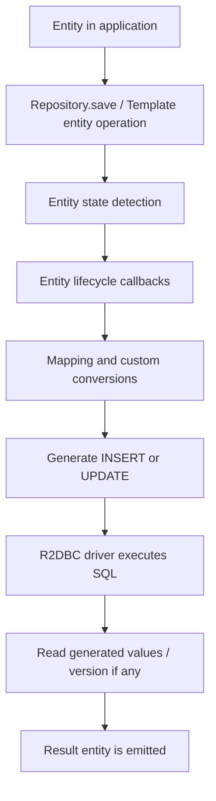

# Distinguishing Direct Update Queries from Saving Entities via the Mapping Lifecycle

In Spring Data Relational R2DBC, a data change can be performed in two main ways. The application can ask Spring Data to persist an entity through a repository or the entity-oriented API of `R2dbcEntityTemplate`; or the application can issue a direct update statement via `@Modifying @Query`, `DatabaseClient`, or the fluent update API.

Both approaches can modify the same row in the database, yet they travel through different processing paths. Saving an entity uses Spring Data's mapping metadata and persistence lifecycle. Direct updates execute an explicitly described statement and usually return only the affected row count. They do not automatically load entities, detect changes inside objects, or run entity lifecycle callbacks like saving an entity does.

Choosing the right approach helps control auditing, generated values, optimistic locking, the scope of updated columns, and performance. This is also crucial to keep in mind when coming from JPA/Hibernate to R2DBC: Spring Data Relational has no persistence context to dirty-check entities automatically, regardless of whether the application uses repositories, templates, or transactions.

## 1. Two ways to express a change

Suppose the `customer` table has columns `id`, `name`, `status`, `last_modified`, and `version`. The application needs to change a customer's status.

**Saving an entity:** read the entity, mutate the property in Java, and call `save`:

```java
public Mono<Customer> changeStatus(Long id, String newStatus) {
    return customerRepository.findById(id)
            .switchIfEmpty(Mono.error(
                    new IllegalArgumentException("Customer not found: " + id)
            ))
            .flatMap(customer -> {
                customer.setStatus(newStatus);
                return customerRepository.save(customer);
            });
}
```

**Direct update:** explicitly describe the SQL statement to execute:

```java
public Mono<Long> changeStatus(Long id, String newStatus) {
    return databaseClient.sql(
                "UPDATE customer SET status = :status WHERE id = :id"
            )
            .bind("status", newStatus)
            .bind("id", id)
            .fetch()
            .rowsUpdated();
}
```

The first approach works with the entity and lets Spring Data generate the statement from metadata. The second explicitly states which column is updated and which condition identifies the row. Publishers from both approaches must be subscribed to before any database I/O actually occurs.

## 2. Saving entities through the mapping lifecycle

When calling `repository.save(entity)`, Spring Data treats the entity as a persistence object. The framework uses metadata to determine the table, columns, identifier, version, and persistent properties. Property values are converted into types the R2DBC driver can bind, and the framework executes an insert or update operation.

General flow:



Exact steps depend on the operation, mapping, and Spring Data version, but key characteristics include:

- Spring Data knows the entity type and mapping metadata.
- New vs. existing state is detected via `Persistable`, `@Version`, or `@Id`.
- Entity callbacks relevant to the persistence operation can be invoked.
- Custom conversions translate domain types to store types and back.
- The framework generates SQL statements based on metadata and dialect.
- The saved result can carry a new ID or version, especially for entities using generated IDs or optimistic locking.

### Entity and repository example

```java
@Table("customer")
public class Customer {

    @Id
    private Long id;

    private String name;

    private String status;

    @Version
    private Long version;

    // Constructor, getters, and setters
}
```

Repository:

```java
public interface CustomerRepository
        extends ReactiveCrudRepository<Customer, Long> {
}
```

When a service calls `save`, Spring Data uses `@Id` to identify the identifier and `@Version` if the entity uses optimistic locking. The application does not have to write table names, column names, or version conditions manually for ordinary entity-oriented operations.

### Newness detection and INSERT/UPDATE

`save` does not always mean `UPDATE`. Spring Data must classify an entity as new or existing:

- Entities implementing `Persistable`: `isNew()` decides.
- If not implementing `Persistable` but having `@Version`: the version takes precedence to detect new entities.
- If neither applies: the `@Id` identifier is used.

The classification decides insert vs. update. The framework does not run a `SELECT` by default to check if the ID exists before picking the operation.

### Entity callbacks and auditing

Entity-oriented persistence can go through callbacks such as `BeforeConvertCallback`, `BeforeSaveCallback`, and `AfterSaveCallback` (their reactive counterparts in the reactive API). These allow the application to normalize data, populate values, or run logic tied to the persistence lifecycle.

Spring Data R2DBC auditing also uses callbacks to populate properties such as:

- `@CreatedDate`: creation timestamp.
- `@LastModifiedDate`: last modification timestamp.
- `@CreatedBy`: creator principal.
- `@LastModifiedBy`: last modifier principal.

Example:

```java
@Table("customer")
public class Customer {

    @Id
    private Long id;

    private String status;

    @LastModifiedDate
    private Instant lastModified;
}
```

When auditing is properly configured and the entity passes through a Spring Data-managed save operation, the auditing callback updates `lastModified` before writing. If the application uses a direct `UPDATE` query, this entity callback does not run automatically; the SQL itself must update `last_modified` if business logic requires it.

### Save result

`save` returns a publisher containing the entity after persistence. The resulting entity may reflect a generated ID, a new version, or changes applied by callbacks. For immutable entities, Spring Data may create a new instance rather than mutating the input object.

Therefore, always use the value emitted by `save`:

```java
return customerRepository.save(customer)
        .map(saved -> new CustomerView(
                saved.getId(),
                saved.getStatus(),
                saved.getVersion()
        ));
```

Do not assume the input object is always mutated in place or that the database has been written simply because the `save` publisher was constructed.

## 3. Direct updates with `@Modifying @Query`

For simple changes targeting well-defined columns, a repository can declare SQL with `@Query`. When the query modifies data, add `@Modifying` so Spring Data treats it as a modifying query.

```java
public interface CustomerRepository
        extends ReactiveCrudRepository<Customer, Long> {

    @Modifying
    @Query("UPDATE customer SET status = :status WHERE id = :id")
    Mono<Integer> updateStatus(
            @Param("id") Long id,
            @Param("status") String status
    );
}
```

This method emits a publisher holding the affected row count. It does not return a `Customer` that Spring Data loaded, modified, and saved through the entity lifecycle. The SQL statement is the primary specification: the `customer` table, `status` column, and `id` condition are all written explicitly.

### Characteristics of modifying queries

- No need to read the entity before updating.
- Can update one or many rows with a single SQL statement.
- The scope of updated columns is explicitly defined in `SET`.
- The result is usually the affected row count, not an entity.
- Does not automatically run entity lifecycle callbacks for each updated row.
- Does not automatically apply auditing or optimistic locking from entity metadata.
- Table names, column names, expressions, and SQL syntax must match the database.

Specific reactive return types and support depend on the Spring Data R2DBC version. In the example above, `Mono<Integer>` represents the update count. Consult your project version's API if `Mono<Long>` or another return type is needed.

## 4. Direct updates with `DatabaseClient`

`DatabaseClient` fits when you need explicit SQL, parameter binding, result mapping, or database-specific syntax.

```java
public Mono<Long> updateCustomerStatus(Long id, String status) {
    return databaseClient.sql("""
                UPDATE customer
                SET status = :status,
                    last_modified = :modifiedAt
                WHERE id = :id
                """)
            .bind("status", status)
            .bind("modifiedAt", Instant.now())
            .bind("id", id)
            .fetch()
            .rowsUpdated();
}
```

In this example, the SQL explicitly updates both `status` and `last_modified`. No entity auditing callback automatically fills in the timestamp; the service passes the timestamp and the statement writes that column explicitly.

Always bind values instead of concatenating input data directly into SQL:

```java
// Do not concatenate user data into SQL strings.
String sql = "UPDATE customer SET status = '" + status + "' WHERE id = " + id;
```

Bind parameters let the driver transmit values as parameters, avoiding quoting bugs and reducing SQL injection risk. Table names, column names, and SQL keywords generally cannot be bound as values; if they must be chosen from input, validate them against an allowlist.

### Null values and specialized types

When updating a column to SQL `NULL`, the bind API needs an explicit Java type whenever the type cannot be inferred from context:

```java
databaseClient.sql("UPDATE customer SET nickname = :nickname WHERE id = :id")
        .bindNull("nickname", String.class)
        .bind("id", id)
        .fetch()
        .rowsUpdated();
```

For JSON, SQL arrays, or other specialized types, bind types supported by the driver or configure appropriate converters. Direct SQL does not eliminate the driver's parameter-encoding responsibilities.

## 5. Entity-oriented `R2dbcEntityTemplate` and fluent updates

`R2dbcEntityTemplate` offers both entity-oriented APIs and conditional update APIs. Distinguish these two groups carefully.

### Entity operations

Operations such as:

```java
template.insert(customer);
template.update(customer);
```

take an entity instance as input and persist it using the entity's mapping metadata. They belong to the entity-oriented path and can invoke entity callbacks, conversions, generated values, and versioning as supported by the operation.

### Conditional fluent updates

APIs like:

```java
template.update(Customer.class)
        .matching(query(where("id").is(id)))
        .apply(update("status", newStatus));
```

describe an update statement by entity type, criteria, and the set of properties to modify. Although the API uses `Customer.class` and property names, this is still a conditional update rather than saving an entity instance through the save lifecycle. There is no entity instance available to run callbacks for each updated row.

Fluent updates are useful when you want property/dialect metadata while directly updating specific columns. The result is usually the affected row count. If you need lifecycle callbacks, auditing, or optimistic locking for a specific entity, choose entity-oriented persistence or express those rules explicitly in the statement.

## 6. Comparing the processing paths

| Aspect | Entity save (`save`, `insert(entity)`, `update(entity)`) | Direct update (`@Modifying @Query`, `DatabaseClient`, fluent update) |
| --- | --- | --- |
| Primary input | Entity instance | SQL/criteria and parameters |
| Table/column mapping | Based on entity metadata | Explicit SQL; fluent update can use property metadata |
| INSERT/UPDATE choice | Newness detection with `save` | Statement is explicitly chosen |
| Entity callbacks | May run according to operation lifecycle | Do not run automatically for affected entities |
| Auditing | May auto-update via callbacks if configured | Must update audit columns manually |
| `@Version` | May apply optimistic locking | Not applied automatically; must write condition and increment version |
| Generated ID | Result entity can receive database-generated ID | Does not automatically update entities; must read result/`RETURNING` if supported |
| Column scope | According to entity mapping and operation | Exactly as specified in `SET` or update definition |
| Typical result | Saved entity | Affected row count or data returned by explicit query |
| Multi-row updates | Usually requires per-entity operations or separate bulk APIs | One statement can update many rows |
| Read before write | Usually needed when modifying an existing entity based on current data | Can be skipped if SQL conditions suffice |

Neither approach is universally better. The question to answer is whether the business operation needs an entity change with lifecycle mapping, or a database command updating a specific set of columns/rows.

## 7. Auditing: direct updates do not automatically run callbacks

Suppose an entity has:

```java
@CreatedDate
private Instant createdAt;

@LastModifiedDate
private Instant lastModifiedAt;
```

When Spring Data saves the entity along the entity-oriented persistence path and auditing is enabled, auditing callbacks populate `createdAt` on insert and update `lastModifiedAt` on modification.

However, the statement:

```sql
UPDATE customer SET status = 'INACTIVE' WHERE last_login < :cutoff
```

does not automatically trigger auditing callbacks for each customer. To record the modification timestamp, the SQL must include that column in `SET`:

```sql
UPDATE customer
SET status = :status,
    last_modified_at = :modifiedAt
WHERE last_login < :cutoff
```

For bulk updates, using a single shared timestamp for the batch may be appropriate. If business rules require an actor, pass the actor or user identifier explicitly. Never assume `@LastModifiedBy` or `@LastModifiedDate` is applied automatically during direct updates.

## 8. Optimistic locking and `@Version`

When an entity has `@Version`, entity-oriented updates can include the identifier and current version in the SQL predicate. If another transaction has already modified the row, an update with the stale version matches zero rows and Spring Data raises an optimistic locking failure.

Direct updates do not automatically read `@Version` metadata to add a version predicate or increment the version. To preserve optimistic locking, the SQL must express that rule explicitly.

Example:

```java
@Modifying
@Query("""
       UPDATE customer
       SET name = :name,
           version = version + 1
       WHERE id = :id
         AND version = :expectedVersion
       """)
Mono<Integer> updateNameIfVersionMatches(
        @Param("id") Long id,
        @Param("name") String name,
        @Param("expectedVersion") Long expectedVersion
);
```

If the publisher emits `1`, one row was updated. If it emits `0`, no row matched both the ID and the version. This can happen either because the row does not exist or because the entity is stale; if you need to distinguish the two, re-read by ID in an appropriate step.

With `DatabaseClient` SQL, the same principle applies:

```java
Mono<Long> update = databaseClient.sql("""
            UPDATE customer
            SET name = :name,
                version = version + 1
            WHERE id = :id AND version = :version
            """)
        .bind("name", newName)
        .bind("id", id)
        .bind("version", expectedVersion)
        .fetch()
        .rowsUpdated();
```

When using direct updates, the application is responsible for synchronizing the version property on any held entity or re-reading the entity after the update. Failing to increment the version can prevent optimistic-locking flows from detecting the change that just occurred.

## 9. Direct updates can be safer and more efficient for atomic transformations

Not every change needs to load an entity into Java and write it back. For counters, balances, or conditional updates, a single SQL statement can perform the transformation directly in the database, avoiding race-prone read-modify-write patterns.

Example decrementing stock if enough remains:

```java
Mono<Long> decreaseStock(Long productId, int amount) {
    return databaseClient.sql("""
                UPDATE inventory
                SET quantity = quantity - :amount
                WHERE product_id = :productId
                  AND quantity >= :amount
                """)
            .bind("amount", amount)
            .bind("productId", productId)
            .fetch()
            .rowsUpdated();
}
```

Such a statement checks the condition and updates the row in one database operation. A result of `1` can indicate a successful decrement; `0` indicates no row satisfied the condition, either because the product does not exist or stock is insufficient.

If implemented by reading `quantity`, subtracting in Java, and calling `save`, two concurrent requests could read the same stale value and overwrite each other without proper locking or versioning. Atomic direct updates are a strong choice for transformations expressible safely in SQL.

That does not mean every business rule should move into SQL. When you need to validate multiple domain rules, call other services, execute callbacks, or return a mapped entity, the entity-oriented path can be clearer.

## 10. Multi-row updates (bulk updates)

Direct updates are particularly useful when modifying many rows matching a condition:

```java
Mono<Long> deactivateDormantCustomers(Instant cutoff) {
    return databaseClient.sql("""
                UPDATE customer
                SET status = :status,
                    last_modified_at = :now
                WHERE last_login < :cutoff
                  AND status = :activeStatus
                """)
            .bind("status", "INACTIVE")
            .bind("now", Instant.now())
            .bind("cutoff", cutoff)
            .bind("activeStatus", "ACTIVE")
            .fetch()
            .rowsUpdated();
}
```

One statement can update rows in bulk without loading every entity into the application. This reduces network round trips and memory pressure when row counts are large.

In exchange, individual rows do not go through the entity lifecycle. Auditing callbacks, service-level save logic, generated values, and optimistic locking do not run per row. If those rules matter, put them into the SQL, design controlled entity-batch operations, or break the work into explicit steps.

Bulk updates can also leave previously loaded entities stale. Spring Data R2DBC has no persistence context to synchronize held objects automatically. If the application keeps using them, re-read them or update in-memory state intentionally.

## 11. Transactions and subscriptions apply to both approaches

Both entity saves and direct updates are reactive operations. Constructing a publisher does not mean SQL has executed; the publisher must be subscribed to by the framework or caller.

You can coordinate multiple operations inside a single reactive transaction:

```java
@Transactional
public Mono<Void> updateCustomerAndAudit(Long id, String status) {
    return customerRepository.findById(id)
            .switchIfEmpty(Mono.error(
                    new IllegalArgumentException("Customer not found")
            ))
            .flatMap(customer -> customerRepository.save(
                    customer.withStatus(status)
            ))
            .flatMap(saved -> databaseClient.sql("""
                        INSERT INTO audit_log (customer_id, action)
                        VALUES (:id, :action)
                        """)
                    .bind("id", saved.getId())
                    .bind("action", "STATUS_CHANGED")
                    .fetch()
                    .rowsUpdated()
                    .then());
}
```

When a transaction needs to span both repositories and `DatabaseClient`, both must share the same `ConnectionFactory` configuration and reactive transaction manager. The operations must stay inside the same Spring-managed reactive pipeline.

Never call `subscribe()` manually inside a `@Transactional` service. A detached subscription may run outside the transaction context and leave the caller unable to await execution. Return the complete publisher.

Rollback only reverts database changes belonging to the transaction. It does not restore Java objects mutated in memory. After a transaction failure, if accurate state is needed, re-read the entity or rebuild objects from trustworthy data.

## 12. Direct updates and in-memory entities

Suppose the application has read:

```java
Customer customer = ...; // status = "ACTIVE"
```

And then executes a direct update:

```java
databaseClient.sql("UPDATE customer SET status = 'INACTIVE' WHERE id = :id")
        .bind("id", customer.getId())
        .fetch()
        .rowsUpdated();
```

Once the SQL succeeds, the database row has `status = 'INACTIVE'`, while the Java object still holds `status = 'ACTIVE'`. There is no persistence context for Spring Data to refresh that object automatically.

Continuing to use the old object may display or process stale data. Calling `save(customer)` later could even overwrite the direct update's change with the stale object's values, depending on saved properties and version strategy.

Ways to handle this:

- Re-read the entity after a direct update if fresh data is needed.
- Construct a new DTO/result from input data and the update count when the full entity is unnecessary.
- Use a `RETURNING` statement if the database supports it and the application needs the updated data; result mapping must be declared explicitly.
- Avoid holding mutable entities longer than necessary when multiple database operations can modify the same row.

## 13. When should you use each approach?

### Choose saving entities via repository/template when

- Business logic operates on a specific entity already loaded or created in the application.
- You want Spring Data to leverage mapping metadata, custom conversions, and generated values.
- Configured entity callbacks, auditing, or entity lifecycle behavior are needed.
- You want `@Version`-based optimistic locking without writing version predicates manually.
- You need the saved entity back for further domain processing or returning a response.
- The operation inserts or updates a single entity and full entity mapping fits the requirement.

### Choose direct updates when

- Only a few columns need changing and you want to specify those exact columns.
- Multiple rows can be updated with a single SQL condition.
- You need an atomic transformation such as incrementing/decrementing counters or checking predicates inside `WHERE`.
- The query relies on database-specific expressions, operators, or syntax.
- There is no need to instantiate Java entities for each affected row.
- You want to minimize round trips and data transferred to the application.

### Use `R2dbcEntityTemplate` when a middle ground is needed

`R2dbcEntityTemplate` can fit when you want mapping metadata and dialect awareness while still running conditional queries or updates. Distinguish entity-accepting APIs (`insert(entity)`, `update(entity)`) from fluent updates (`update(Entity.class).matching(...).apply(...)`), since the two groups have different goals and lifecycles.

## 14. Quick decision table

| Scenario | Typically suitable choice | What you must manage manually |
| --- | --- | --- |
| Creating a new entity with a database-generated ID | `repository.save` or `template.insert(entity)` | Use the returned entity containing the generated ID |
| Changing one entity's status with auditing needed | Entity save | Configure auditing and use the save result |
| Updating only the `status` column by ID | `@Modifying @Query` or `DatabaseClient` | Update audit/version columns if required |
| Atomically incrementing a counter | Direct update | Check update count and predicate |
| Updating tens of thousands of rows by condition | Bulk direct update | Auditing, version, callbacks, and stale objects |
| Updating an entity with `@Version` | Entity save | Handle optimistic locking failures |
| Direct-updating an entity with `@Version` | Direct SQL with version condition | Check version, increment version, and handle 0 rows |
| Needing database-specific SQL | `DatabaseClient` or `@Query` | SQL, parameter binding, and result mapping |
| Updating a few properties using criteria mapping | Template fluent update | Do not assume per-row entity callbacks run |

## 15. Testing both update paths

Tests should verify both database outcomes and relevant lifecycle side effects.

### Testing entity save

```java
StepVerifier.create(
        customerRepository.findById(10L)
                .flatMap(customer -> {
                    customer.setStatus("INACTIVE");
                    return customerRepository.save(customer);
                })
)
        .assertNext(saved -> {
            assertThat(saved.getStatus()).isEqualTo("INACTIVE");
            assertThat(saved.getLastModified()).isNotNull();
        })
        .verifyComplete();
```

This test assumes auditing is configured and the entity has a `lastModified` property. You can re-read the entity afterward to confirm the value was written to the database.

### Testing direct update

```java
StepVerifier.create(customerRepository.updateStatus(10L, "INACTIVE"))
        .expectNext(1)
        .verifyComplete();

StepVerifier.create(customerRepository.findById(10L))
        .assertNext(customer ->
                assertThat(customer.getStatus()).isEqualTo("INACTIVE")
        )
        .verifyComplete();
```

If the direct update query does not update `last_modified` itself, tests should confirm that the auditing callback does not run automatically and the column changes only when the SQL explicitly updates it.

### Additional scenarios worth testing

- Entity save triggers configured callbacks; direct updates do not trigger corresponding entity callbacks.
- Auditing timestamps/actors are updated automatically on the entity path and updated explicitly in direct SQL if needed.
- `@Version` detects stale entities on the entity path.
- Version-conditioned direct updates return 0 rows on mismatch and increment the version on success.
- Bulk updates affect the expected row count and the service does not continue using stale entities.
- Transaction rollbacks revert database changes on both update paths.
- Unsubscribed publishers perform no writes.
- Null values and specialized types bind accurately against a real driver.

Repository tests must subscribe to publishers, for example via `StepVerifier`. Creating a `Mono` and discarding it does not verify that SQL ever ran.

## 16. Common mistakes

| Symptom | Possible cause | Resolution |
| --- | --- | --- |
| Direct update does not change `lastModified` | No entity auditing callbacks run on direct queries | Put the timestamp column in `SET` or use entity save |
| Direct update does not increment version | Query does not automatically apply `@Version` | Increment version and add version check to `WHERE` |
| `save` overwrites a column recently modified via direct update | Held object is stale and save writes persistent entity properties | Re-read entity, use versioning, or update a single column explicitly |
| `@Modifying` query fails to run as expected | Missing annotation or unsupported return type in current version | Check query method and current Spring Data R2DBC API |
| Update count is 0 | No row matched condition, wrong ID, or stale version | Check predicates; re-read if needed to disambiguate |
| Caller receives response before SQL finishes | Service called `subscribe()` and returned a different publisher | Return the write publisher and chain with `flatMap`/`then` |
| Callbacks do not run for custom SQL | Direct queries bypass the entity lifecycle | Move logic into SQL or use entity-oriented operations |
| Java object does not reflect direct update | No persistence context synchronizes held objects | Re-read or construct a new result |
| Database rolled back but object keeps new values | Transactions do not roll back heap objects | Re-read or reconstruct objects after rollback |

When troubleshooting, identify which code path is in use: entity-oriented persistence or direct update. Then inspect callbacks, auditing, versioning, SQL predicates, update counts, and subscriptions. Do not look for a dirty-checking mechanism to explain R2DBC behavior.

## 17. Key takeaways

- `repository.save(entity)` and entity-oriented `R2dbcEntityTemplate` use Spring Data's mapping metadata and persistence lifecycle.
- `@Modifying @Query` and `DatabaseClient` execute explicitly declared update statements; fluent update is also a conditional update rather than saving an entity instance.
- Direct updates usually return the affected row count rather than automatically returning mapped entities.
- Entity callbacks and auditing do not run automatically for rows modified by direct SQL.
- `@Version` is applied automatically on supported entity persistence paths; direct updates must include version conditions and increments manually if optimistic locking is needed.
- Direct updates modify only specified columns, making them well-suited for bulk updates and atomic transformations.
- In-memory entities are not automatically synchronized after direct updates; re-read them before continuing to use or save old instances.
- Transactions can cover both approaches if operations stay in the same reactive pipeline and share the transaction context.
- Publishers must be subscribed to; avoid detached `subscribe()` calls inside services.
- Choose entity save when entity lifecycle and mapping are required; choose direct updates when control over SQL, columns, and target row sets is needed.

When designing an R2DBC write operation, decide whether the application needs to persist an entity through the mapping lifecycle or execute a direct SQL command. That decision determines what handles auditing, versioning, conversions, callbacks, return values, and in-memory object state synchronization.
